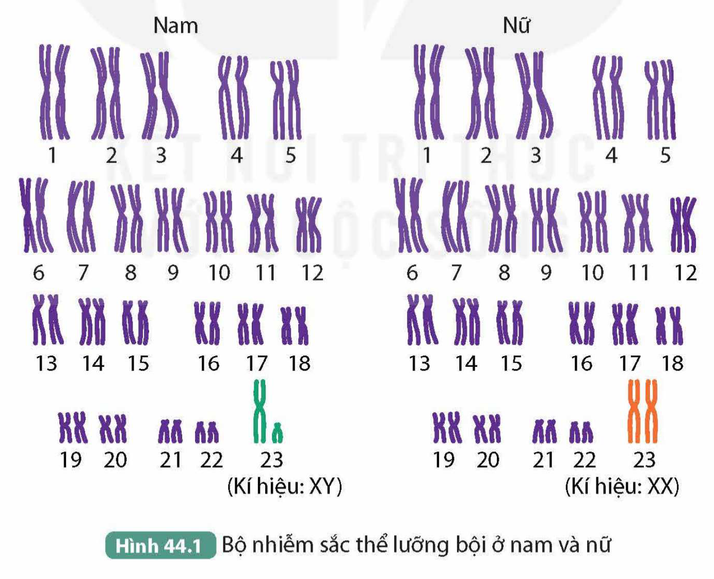
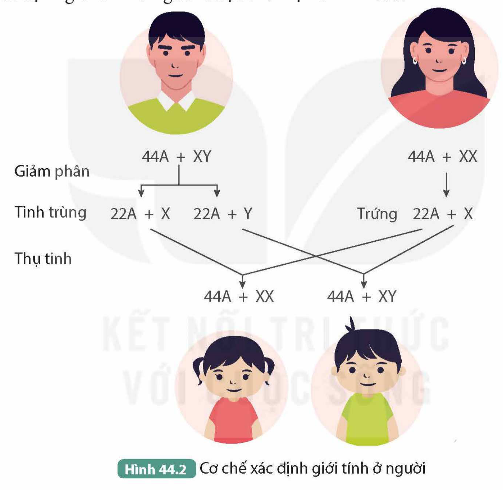
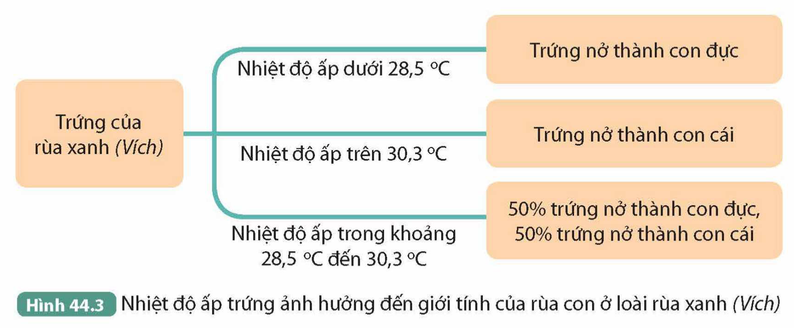

<!-- pdf:193 -->

# BÀI 44: NHIỄM SẮC THỂ GIỚI TÍNH VÀ CƠ CHẾ XÁC ĐỊNH GIỚI TÍNH

## 🎯 Mục tiêu

- Nêu được khái niệm nhiễm sắc thể giới tính và nhiễm sắc thể thường.
- Trình bày được cơ chế xác định giới tính. Nêu được một số yếu tố ảnh hưởng đến sự phân hoá giới tính.

## 🔴 Mở đầu

Một cặp vợ chồng có thể sinh con trai hoặc con gái. Theo em, giới tính của con do bố hay mẹ truyền cho? Giải thích.

## I. Nhiễm sắc thể thường và nhiễm sắc thể giới tính

Bộ NST trong tế bào của đa số sinh vật nhân thực bao gồm NST thường và NST giới tính. Ví dụ: Trong tế bào sinh dưỡng ở người có 46 NST, tồn tại thành 23 cặp. Trong đó có 22 cặp NST thường, giống nhau giữa nam và nữ, cặp còn lại là cặp NST giới tính, khác nhau giữa nam và nữ. Nam chứa cặp NST giới tính không tương đồng (kí hiệu là XY), nữ chứa cặp NST giới tính tương đồng (kí hiệu là XX) (Hình 44.1). Bộ NST lưỡng bội ($2n$) của nam kí hiệu là $44\text{A} + \text{XY}$, của nữ là $44\text{A} + \text{XX}$.

Hình 44.1. Bộ nhiễm sắc thể lưỡng bội ở nam và nữ

> ✋ Đọc thông tin trên kết hợp quan sát Hình 44.1, thực hiện các yêu cầu sau:
>
> 1. Nhận xét về số lượng, hình dạng của NST thường, NST giới tính.
> 2. Nêu khái niệm NST thường, NST giới tính.

<!-- pdf:194 -->

## II. Cơ chế xác định giới tính

Giới tính của đa số các loài phụ thuộc vào sự có mặt của cặp NST giới tính trong tế bào. Ví dụ: Ở ruồi giấm, ở người và các động vật có vú khác, cá thể đực có cặp NST giới tính gồm hai chiếc khác nhau, kí hiệu là XY; cá thể cái có cặp NST giới tính gồm hai chiếc giống nhau, kí hiệu là XX. Ở chim, một số loài cá và một số loài côn trùng, con đực có cặp NST giới tính gồm hai chiếc giống nhau, kí hiệu là ZZ; con cái có cặp NST giới tính gồm hai chiếc khác nhau, kí hiệu là ZW.

Ngoài kiểu xác định giới tính phụ thuộc vào sự có mặt của NST giới tính, ở một số loài ong và kiến, giới tính được xác định bằng mức bội thể của cơ thể: con đực được phát triển từ trứng không được thụ tinh, là cơ thể đơn bội ($n$), con cái được phát triển từ trứng được thụ tinh, là cơ thể lưỡng bội ($2n$).

Ở đa số các loài giao phối, cơ chế xác định giới tính là sự phân li của cặp NST giới tính trong quá trình phát sinh giao tử và sự tổ hợp lại cặp NST giới tính trong thụ tinh.

Cơ chế xác định giới tính ở người được thể hiện ở hình sau:

Hình 44.2. Cơ chế xác định giới tính ở người

> ✋ Quan sát Hình 44.2 và đọc thông tin trên, thực hiện các yêu cầu sau:
>
> 1. Trình bày cơ chế xác định giới tính ở người.
> 2. Giải thích vì sao trong thực tế, tỉ lệ bé trai và bé gái sơ sinh xấp xỉ $1 : 1$.

## III. Các yếu tố ảnh hưởng đến sự phân hoá giới tính

<!-- term: Sự phân hoá giới tính -->
Cặp NST giới tính trong bộ NST lưỡng bội quyết định giới tính cơ thể. Bên cạnh đó, giới tính cũng bị ảnh hưởng bởi các yếu tố khác thuộc môi trường trong và ngoài cơ thể.

<!-- term: Sự phân hoá giới tính -->
Yếu tố môi trường trong cơ thể: Nếu cho hormone sinh dục tác động vào những giai đoạn sớm trong sự phát triển cá thể có thể làm thay đổi giới tính dù cặp NST giới tính không thay đổi. Ví dụ: Dùng hormone sinh dục đực methyltestosterone tác động vào cá vàng cái có thể làm cá cái chuyển thành cá đực.

<!-- pdf:195 -->

<!-- term: Sự phân hoá giới tính -->
Yếu tố môi trường ngoài: Nhiệt độ ấp trứng sau thụ tinh ở một số loài bò sát như rắn, rùa,... cũng ảnh hưởng đến tỉ lệ đực, cái ở con non (Hình 44.3); dưa chuột được hun khói thì tỉ lệ hoa cái tăng; thầu dầu trồng trong ánh sáng cường độ yếu thì tỉ lệ hoa đực giảm.

Hình 44.3. Nhiệt độ ấp trứng ảnh hưởng đến giới tính của rùa con ở loài rùa xanh (*Vích*)

Nhờ hiểu được cơ chế xác định giới tính và các yếu tố ảnh hưởng tới sự phân hoá giới tính, con người có thể chủ động điều chỉnh tỉ lệ đực, cái ở vật nuôi cho phù hợp với mục tiêu sản xuất. Ví dụ: tạo ra nhiều bê đực để nuôi lấy thịt; tạo ra nhiều bê cái để nuôi lấy sữa; tạo ra nhiều tằm đực để lấy tơ,...

> ❓ Nêu những yếu tố ảnh hưởng đến sự phân hoá giới tính và lấy thêm ví dụ.

## 📌 Em đã học

- **NST thường** gồm nhiều cặp tương đồng, giống nhau giữa giới đực và giới cái, chứa các gene quy định tính trạng thường. **NST giới tính** thường có một cặp, tương đồng hoặc không tương đồng, khác nhau giữa giới đực và giới cái, có thể chứa gene quy định giới tính và các gene khác.
- **Cơ chế xác định giới tính** là sự phân li cặp NST giới tính trong giảm phân và tổ hợp lại trong thụ tinh. Tính theo lí thuyết, tỉ lệ phân li giới tính là 1 đực : 1 cái.

<!-- term: Sự phân hoá giới tính -->
- Sự phân hoá giới tính chịu ảnh hưởng của các yếu tố bên trong cơ thể và bên ngoài môi trường. Con người đã chủ động điều khiển giới tính vật nuôi phù hợp với mục tiêu sản xuất.

## ✏️ Em có thể

- Vận dụng kiến thức về các yếu tố ảnh hưởng đến sự phân hoá giới tính để đề xuất biện pháp điều khiển giới tính một số loài vật nuôi phù hợp với mục tiêu sản xuất.

> 🔍 Ngoài các hệ thống xác định giới tính XY và ZW, còn có cơ chế xác định giới tính khác. Ở ong và một số côn trùng, cơ chế xác định giới tính do số lượng bộ NST quy định, bộ NST lưỡng bội quy định con cái, bộ NST đơn bội quy định con đực. Trong khi ở châu chấu, tôm, ve sầu,... chỉ có một NST giới tính; con đực có kiểu NST giới tính là XO (chỉ có một NST giới tính X), con cái có 2 NST giới tính là XX.

## 📷 Danh sách hình trong bài

| Mã hình | Trang PDF | Vị trí | Chú thích gốc |
| --- | --- | --- | --- |
| H9-khoa_hoc_tu_nhien-b44-01 | 193 | Mục I | Hình 44.1. Bộ nhiễm sắc thể lưỡng bội ở nam và nữ |
| H9-khoa_hoc_tu_nhien-b44-02 | 194 | Mục II (allow_edge_ink: đỉnh tóc nhân vật sát chân dấu nặng của dòng văn bản phía trên) | Hình 44.2. Cơ chế xác định giới tính ở người |
| H9-khoa_hoc_tu_nhien-b44-03 | 195 | Mục III | Hình 44.3. Nhiệt độ ấp trứng ảnh hưởng đến giới tính của rùa con ở loài rùa xanh (*Vích*) |
