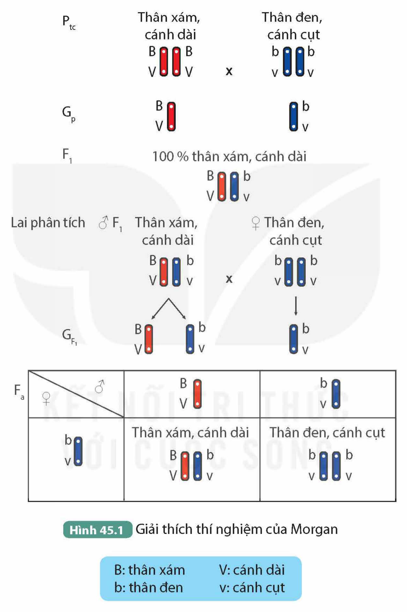

<!-- pdf:196 -->

# BÀI 45: DI TRUYỀN LIÊN KẾT

## 🎯 Mục tiêu

- Dựa vào sơ đồ phép lai, trình bày được khái niệm di truyền liên kết và phân biệt với quy luật phân li độc lập.
- Nêu được một số ứng dụng về di truyền liên kết trong thực tiễn.

## 🔴 Mở đầu

Khi làm thí nghiệm trên ruồi giấm, quan sát thấy có hiện tượng tính trạng thân xám thường di truyền cùng cánh dài, tính trạng thân đen thường di truyền cùng cánh cụt. Đây là hiện tượng gì?

## I. Quy luật di truyền liên kết

### 1. Thí nghiệm của Morgan

Thomas Hunt Morgan (1866 – 1945) là nhà di truyền học người Mĩ, ông là người đầu tiên phát hiện hiện tượng di truyền liên kết trên ruồi giấm vào năm 1910.

Cách tiến hành và kết quả thí nghiệm của Morgan được trình bày dưới đây:

> - $P_{\text{tc}}$: Ruồi thân xám, cánh dài $\times$ Ruồi thân đen, cánh cụt
> - $F_1$: 100% ruồi thân xám, cánh dài
> - Cho ruồi đực $F_1$ lai phân tích
> - ♂ $F_1$ ruồi thân xám, cánh dài $\times$ ♀ ruồi thân đen, cánh cụt
> - $F_a^{(\*)}$: 50% ruồi thân xám, cánh dài : 50% ruồi thân đen, cánh cụt

> ✋ Dựa vào kết quả thí nghiệm, thực hiện các yêu cầu sau:
>
> 1. Phép lai trên gồm những tính trạng nào?
> 2. Trong phép lai trên, nếu các tính trạng di truyền theo quy luật di truyền của Mendel thì kết quả phép lai sẽ có bao nhiêu kiểu hình?
> 3. Em có nhận xét gì về sự di truyền của các tính trạng trong phép lai trên?

### 2. Giải thích thí nghiệm

$P$ thuần chủng, $F_1$ thu được 100% ruồi thân xám, cánh dài, nên thân xám và cánh dài là tính trạng trội, thân đen và cánh cụt là tính trạng lặn.

Nếu gene quy định các tính trạng màu thân và chiều dài cánh phân li độc lập thì kết quả phép lai phân tích một tính trạng có tỉ lệ kiểu hình là $1 : 1$, phép lai phân tích hai tính trạng có tỉ lệ kiểu hình là $1 : 1 : 1 : 1$. Trong khi đó, kết quả phép lai phân tích trên chỉ thu được hai loại kiểu hình với tỉ lệ $1 : 1$ nên tính trạng màu thân và chiều dài cánh không di truyền theo quy luật phân li độc lập.

> (\*) $F_a$: Thế hệ con của phép lai phân tích

<!-- pdf:197 -->

Tính trạng thân xám luôn đi cùng với tính trạng cánh dài, tính trạng thân đen luôn đi cùng với tính trạng cánh cụt nên hai cặp gene quy định hai tính trạng này cùng nằm trên một cặp NST tương đồng và di truyền cùng nhau. Cặp gene $Bb$ và $Vv$ cùng nằm trên một cặp NST tương đồng. Sự di truyền của hai cặp gene quy định tính trạng màu thân và chiều dài cách di truyền theo **quy luật liên kết gene**. Sự phân li và tổ hợp của hai cặp gene nằm trên một cặp NST tương đồng trong giảm phân và thụ tinh được thể hiện ở Hình 45.1.

Hình 45.1. Giải thích thí nghiệm của Morgan

> ✋ 1. Vì sao cơ thể $F_1$ trong thí nghiệm của Morgan giảm phân chỉ hình thành hai loại giao tử?
>
> 2. Trình bày khái niệm di truyền liên kết.
> 3. Dựa vào kiến thức đã học, phân biệt quy luật di truyền liên kết với di truyền phân li độc lập bằng cách hoàn thành vào vở theo mẫu Bảng 45.1.

<!-- pdf:198 -->

> Bảng 45.1. Phân biệt di truyền liên kết với di truyền phân li độc lập
>
> | Đặc điểm phân biệt \ Quy luật di truyền | Liên kết gene | Phân li độc lập |
> | --- | --- | --- |
> | Sự di truyền các tính trạng | ? | ? |
> | Sự phân bố của các gene quy định các tính trạng | ? | ? |
> | Biến dị tổ hợp ở đời con | ? | ? |

## II. Ứng dụng về di truyền liên kết

Di truyền liên kết đảm bảo sự di truyền bền vững của nhóm tính trạng luôn đi cùng với nhau, nên trong chọn giống, người ta có thể ứng dụng để chọn được những nhóm tính trạng tốt luôn đi cùng với nhau, phù hợp với mục tiêu sản xuất của con người.

Hiện nay, các nhà khoa học đã thiết lập được bản đồ gene, biết vị trí gene trên NST của nhiều loài. Việc xác định được vị trí gene trên NST có nhiều ý nghĩa trong nông nghiệp. Con người có thể lựa chọn và chuyển những gene quy định tính trạng tốt nằm trên cùng một NST để tạo thành nhóm tính trạng tốt di truyền cùng nhau. Ví dụ: Chuyển gene để tạo thành nhóm gene quy định cây trồng có sức đề kháng với thuốc diệt cỏ, thuốc diệt côn trùng, tăng sản lượng hoặc nâng cao giá trị dinh dưỡng.

> ❓ Di truyền liên kết có ý nghĩa như thế nào trong nông nghiệp? Nêu ví dụ.

## 📌 Em đã học

- **Di truyền liên kết** là hiện tượng các gene quy định các tính trạng cùng nằm trên một NST có xu hướng di truyền cùng nhau trong quá trình giảm phân.
- Các tính trạng do các gene trên một NST quy định luôn di truyền cùng nhau tạo thành **nhóm tính trạng di truyền liên kết**. Trong chọn giống, có thể ứng dụng di truyền liên kết để chọn được những nhóm tính trạng tốt luôn di truyền cùng nhau, phù hợp với mục tiêu sản xuất của con người.
- Di truyền phân li độc lập làm xuất hiện các biến dị tổ hợp, tạo ra sự đa dạng cho sinh giới, còn di truyền liên kết hạn chế biến dị tổ hợp, đảm bảo cho sự di truyền bền vững của nhóm tính trạng.

## ✏️ Em có thể

- Nhận biết được các tính trạng di truyền liên kết với nhau ở sinh vật.
- Giải thích được cơ sở ứng dụng di truyền liên kết gene trọng chọn giống.

## 📷 Danh sách hình trong bài

| Mã hình | Trang PDF | Vị trí | Chú thích gốc |
| --- | --- | --- | --- |
| H9-khoa_hoc_tu_nhien-b45-01 | 197 | Mục I.2 | Hình 45.1. Giải thích thí nghiệm của Morgan |
