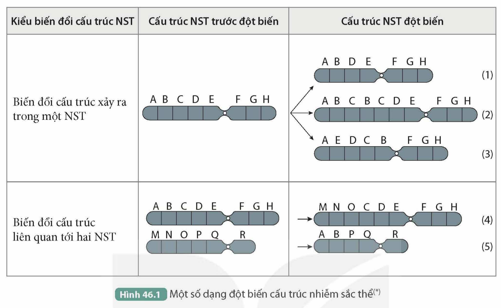
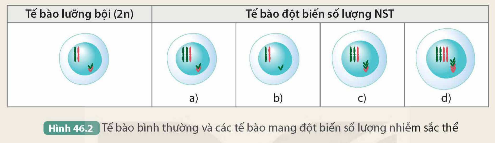
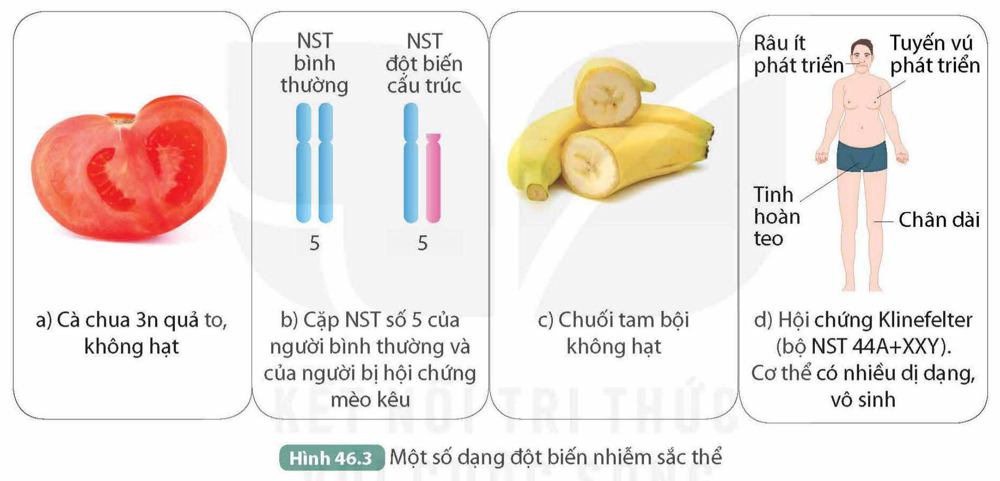

<!-- pdf:199 -->

# BÀI 46: ĐỘT BIẾN NHIỄM SẮC THỂ

## 🎯 Mục tiêu

- Nêu được khái niệm đột biến nhiễm sắc thể. Lấy được ví dụ minh hoạ.
- Trình bày được ý nghĩa và tác hại của đột biến nhiễm sắc thể.

## 🔴 Mở đầu

Con người có thể tạo ra dưa hấu đột biến NST có đặc điểm: quả to, không có hạt, hàm lượng đường trong quả cao hơn so với dưa hấu thường trong tự nhiên. Đột biến NST là gì và có tác động như thế nào đến con người?

## I. Khái niệm đột biến nhiễm sắc thể

Bộ NST đặc trưng của loài thường được truyền đạt nguyên vẹn cho thế hệ con cháu nhờ các quá trình: nhân đôi, nguyên phân, giảm phân và thụ tinh. Tuy nhiên, các nhân tố của môi trường bên trong và bên ngoài cơ thể có thể tác động vào các quá trình đó, dẫn đến xuất hiện những biến đổi về cấu trúc hoặc số lượng của một hoặc nhiều NST trong tế bào, những biến đổi đó được gọi là **đột biến NST**.

> ❓ Dựa vào thông tin trên, cho biết đột biến NST là gì.

## II. Đột biến cấu trúc nhiễm sắc thể

### 1. Khái niệm đột biến cấu trúc nhiễm sắc thể

> ✋ Quan sát Hình 46.1, thực hiện các yêu cầu sau:
>
> 1. Nêu sự thay đổi về cấu trúc của NST sau khi đột biến và hoàn thành vào vở theo mẫu Bảng 46.1.
>
> Bảng 46.1. Sự thay đổi về cấu trúc của các nhiễm sắc thể sau khi đột biến
>
> | Các NST đột biến | (1) | (2) | (3) | (4) | (5) |
> | --- | --- | --- | --- | --- | --- |
> | Điểm khác biệt về cấu trúc so với NST trước đột biến | ? | ? | ? | ? | ? |
>
> 2. Dựa vào những thông tin trên, hãy cho biết đột biến cấu trúc NST là gì.

<!-- pdf:200 -->

Hình 46.1. Một số dạng đột biến cấu trúc nhiễm sắc thể(\*)

Đột biến cấu trúc NST gồm các dạng: mất đoạn, lặp đoạn, đảo đoạn và chuyển đoạn.

Ví dụ đột biến cấu trúc NST: Ruồi giấm mắt dẹt mang đột biến lặp đoạn trên NST giới tính X,...

### 2. Ý nghĩa và tác hại của đột biến cấu trúc nhiễm sắc thể

Đột biến cấu trúc NST dẫn đến cấu trúc lại các gene trong hệ gene, có thể làm xuất hiện kiểu hình mới, cung cấp nguyên liệu cho tiến hoá và cho chọn giống. Đột biến cấu trúc NST dẫn đến lặp gene, có thể làm cho một gene có lợi được tăng số bản sao trong hệ gene, điều đó có thể có lợi cho thể đột biến và cho con người. Con người có thể ứng dụng đột biến cấu trúc NST để loại bỏ các gene có hại ra khỏi hệ gene.

<!-- term: Hội chứng cri-du-chat -->
Bên cạnh đó, đột biến cấu trúc NST có thể làm hỏng gene, mất gene. Đột biến cấu trúc NST thường liên quan đến nhiều gene nên có khuynh hướng làm mất cân bằng hệ gene và gây hại cho thể đột biến như giảm sức sống, giảm khả năng sinh sản hoặc gây chết. Ví dụ: Ở người, đột biến chuyển đoạn giữa NST số 9 và số 22 dẫn đến bệnh ung thư bạch cầu tuỷ cấp tính; đột biến làm mất một đoạn trên cánh ngắn của NST số 5 gây ra hội chứng cri-du-chat (hội chứng mèo kêu), trẻ mang đột biến này có tiếng khóc giống mèo kêu và thường tử vong trong năm đầu đời sau sinh.

> ❓ 1. Dạng đột biến cấu trúc NST nào có thể được ứng dụng trong chọn giống để đem lại lợi ích cho con người?
>
> 2. Dạng đột biến cấu trúc NST nào gây hại cho sinh vật? Giải thích.

> (\*) Các chữ cái trên NST minh hoạ các đoạn DNA trên NST

<!-- pdf:201 -->

## III. Đột biến số lượng nhiễm sắc thể

### 1. Khái niệm đột biến số lượng nhiễm sắc thể

> ✋ Quan sát Hình 46.2 và thực hiện các yêu cầu sau:
>
> 1. Nhận xét sự thay đổi số lượng NST trong mỗi tế bào đột biến (Hình 46.2 a, b, c, d) so với tế bào lưỡng bội.
> 2. Nêu khái niệm đột biến số lượng NST.

Hình 46.2. Tế bào bình thường và các tế bào mang đột biến số lượng nhiễm sắc thể

Số lượng NST trong tế bào có thể bị thay đổi ở một, một số hoặc ở tất cả các cặp NST tương đồng. Dựa vào số cặp NST tương đồng xảy ra đột biến, người ta chia đột biến số lượng NST thành hai dạng:

**Đột biến lệch bội**: đột biến làm tăng hoặc giảm số lượng NST ở một hoặc một số cặp NST tương đồng. Ví dụ: Ở người, bộ NST lưỡng bội là $2n = 46$, người mắc hội chứng Edward (Ét-uốt) mang đột biến lệch bội có 3 NST số 18, $2n + 1 = 47$.

**Đột biến đa bội**: đột biến làm tăng đều số lượng NST ở tất cả các cặp NST tương đồng (bộ NST lớn hơn $2n$). Ví dụ: Củ cải đường lưỡng bội có $2n = 18$, củ cải đường tam bội có $3n = 27$.

> ❓ Cho biết tế bào nào trong Hình 46.2 mang đột biến lệch bội, tế bào nào mang đột biến đa bội?

### 2. Ý nghĩa và tác hại của đột biến số lượng nhiễm sắc thể

<!-- term: Thể đa bội -->
Trong tự nhiên, đột biến đa bội thường gặp ở thực vật, ít gặp ở động vật. Tế bào đa bội có hàm lượng DNA tăng theo bội số $n$, quá trình tổng hợp chất hữu cơ diễn ra mạnh mẽ nên thể đa bội có cơ quan sinh dưỡng lớn, sinh trưởng nhanh và chống chịu tốt với những điều kiện bất lợi của môi trường. Vì vậy, nhiều loài thực vật đa bội hiện đang phân bố ở những vùng có khí hậu khắc nghiệt trên Trái Đất. Đột biến số lượng NST cung cấp nguyên liệu cho quá trình tiến hoá. Ở thực vật, đột biến đa bội góp phần nhanh chóng hình thành loài mới. Đột biến lệch bội đã và đang được sử dụng trong nghiên cứu di truyền học.

Nhiều giống cây đột biến đa bội cho năng suất cao đang được con người trồng ở nhiều quốc gia trên thế giới như lúa mì lục bội ($6n$), nho tam bội ($3n$), bông tứ bội ($4n$),...

<!-- pdf:202 -->

Nhiều giống đột biến đa bội được con người tạo ra và đưa vào sản xuất. Ví dụ: Tôm sú $3n$ sinh trưởng nhanh, kích thước cơ thể lớn, năng suất cao hơn tôm sú $2n$.

<!-- term: Hội chứng Down -->
Đột biến lệch bội thường gây hại cho thể đột biến do mất cân bằng trong hệ gene. Ở người và động vật, sự mất cân bằng trong hệ gene do đột biến lệch bội thường dẫn tới giảm sức sống, thậm chí mất khả năng sinh sản hoặc gây chết. Ví dụ: Người có ba NST ở cặp 21 sẽ mắc hội chứng Down, cơ thể có nhiều dị dạng, vô sinh,... Đột biến đa bội nếu xuất hiện ở những loài sinh vật có hại có thể trở thành tác nhân gây hại cho sản xuất nông nghiệp do thể đột biến có tốc độ sinh trưởng nhanh, chống chịu tốt.

> ❓ 1. Trong các đột biến ở Hình 46.3, cho biết đột biến nào có lợi, đột biến nào có hại đối với con người.
>
> 2. Nêu thêm một số ví dụ về ý nghĩa và tác hại của đột biến số lượng NST.

Hình 46.3. Một số dạng đột biến nhiễm sắc thể

## 📌 Em đã học

- Đột biến NST là những biến đổi về cấu trúc và số lượng NST.
- **Đột biến cấu trúc NST** là những biến đổi làm thay đổi cấu trúc của NST, gồm các dạng: mất đoạn, lặp đoạn, đảo đoạn, chuyển đoạn.
- **Đột biến số lượng NST** làm thay đổi số lượng NST trong bộ NST, gồm đột biến lệch bội và đột biến đa bội. Đột biến số lượng NST xảy ra phổ biến ở thực vật.
- Đột biến NST có thể có lợi, có hại hoặc không có lợi cũng không có hại (trung tính) cho thể đột biến. Đột biến NST cung cấp nguyên liệu cho tạo giống mới và cho tiến hoá.

## ✏️ Em có thể

- Giải thích được tại sao khi trồng những cây thu hoạch thân, lá (như dâu tằm,...), người ta thường trồng giống đa bội hơn là giống lưỡng bội.

## 📷 Danh sách hình trong bài

| Mã hình | Trang PDF | Vị trí | Chú thích gốc |
| --- | --- | --- | --- |
| H9-khoa_hoc_tu_nhien-b46-01 | 200 | Mục II.1 | Hình 46.1. Một số dạng đột biến cấu trúc nhiễm sắc thể(\*) — (\*) Các chữ cái trên NST minh hoạ các đoạn DNA trên NST |
| H9-khoa_hoc_tu_nhien-b46-02 | 201 | Mục III.1 | Hình 46.2. Tế bào bình thường và các tế bào mang đột biến số lượng nhiễm sắc thể |
| H9-khoa_hoc_tu_nhien-b46-03 | 202 | Mục III.2 | Hình 46.3. Một số dạng đột biến nhiễm sắc thể |
