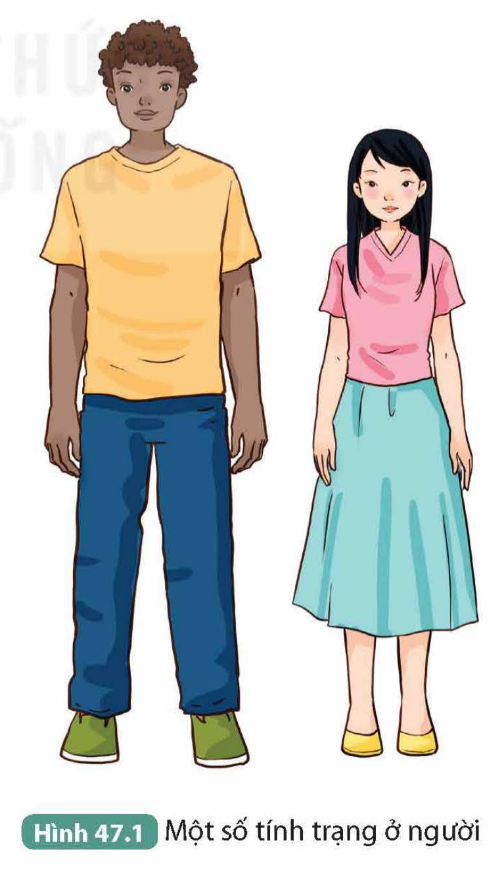
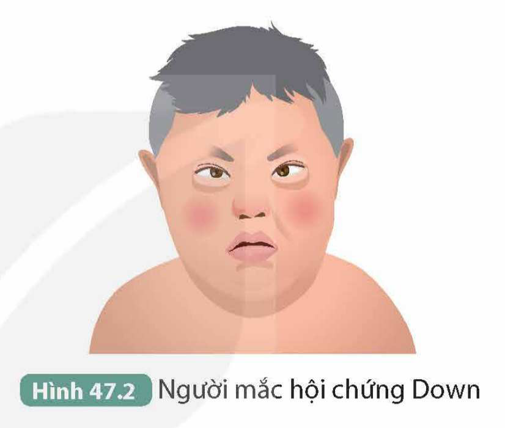
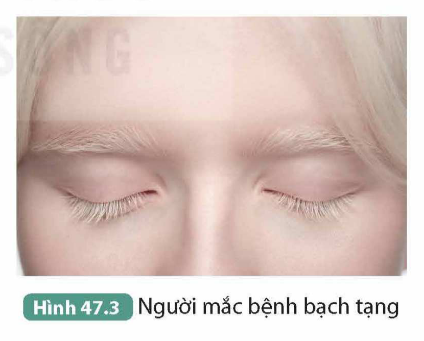
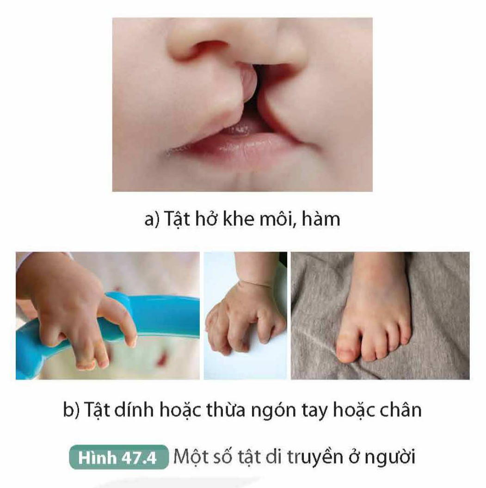
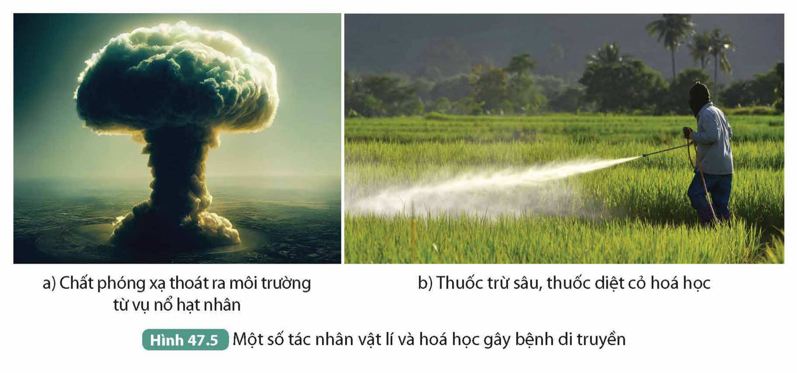
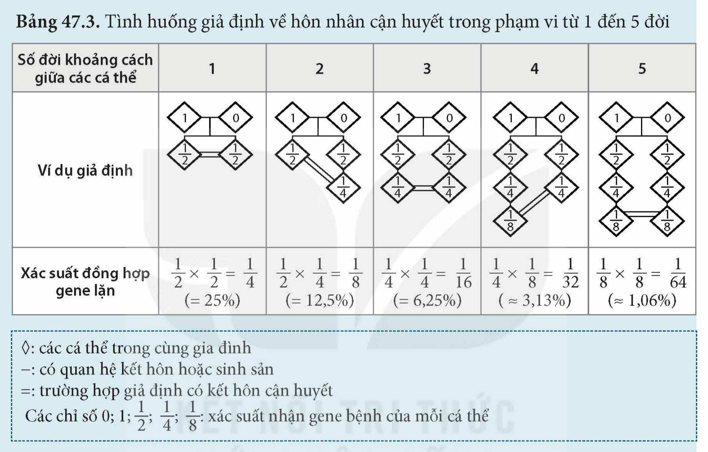

<!-- pdf:203 -->

# BÀI 47: DI TRUYỀN HỌC VỚI CON NGƯỜI

## 🎯 Mục tiêu

- Nêu được một số ví dụ về tính trạng ở người, khái niệm về bệnh và tật di truyền ở người.
- Kể tên được một số hội chứng và bệnh di truyền ở người: Down, Turner, câm điếc bẩm sinh, bạch tạng.
- Dựa vào hình ảnh, kể tên được một số tật di truyền ở người (hở khe môi, hàm; dính ngón tay).
- Trình bày được một số tác nhân gây bệnh di truyền như các chất phóng xạ, hoá chất do công nghiệp, thuốc trừ sâu, thuốc diệt cỏ.
- Nêu được vai trò của di truyền học với hôn nhân, ý nghĩa của việc cấm kết hôn gần huyết thống. Trình bày được quan điểm về lựa chọn giới tính trong sinh sản.
- Tìm hiểu được một số bệnh di truyền và tuổi kết hôn ở địa phương.

## 🔴 Mở đầu

Vì sao Luật Hôn nhân và Gia đình ở nước ta cấm kết hôn giữa những người có họ trong phạm vi ba đời?

## I. Tính trạng ở người

> ✋
> 1. Quan sát Hình 47.1, xác định những tính trạng quan sát được. Xác định kiểu hình của em đối với mỗi tính trạng vừa nêu.
> 2. Ngoài những tính trạng quan sát được ở Hình 47.1, nêu thêm một số ví dụ về tính trạng ở người.

<!-- term: Tính trạng ở người -->
Ở người, một số tính trạng thường dùng để phân biệt người này với với kia như chiều cao, dạng tóc, màu mắt, màu da, má lúm đồng tiền,...

Hình 47.1. Một số tính trạng ở người
<!-- ocr-ok: đã đối chiếu ảnh trang gốc 203, OCR không đọc được chữ trắng trên nền xanh Hình 47.1 -->

<!-- pdf:204 -->

## II. Bệnh và tật di truyền ở người

### 1. Khái niệm bệnh và tật di truyền

Đột biến NST và đột biến ở một số gene đã gây nên các bệnh, tật di truyền. Những thay đổi bất thường về hình thái trên cơ thể do đột biến gây ra gọi là **tật di truyền**. Những rối loạn chức năng của các cơ quan trên cơ thể do đột biến gây ra gọi là **bệnh di truyền**. Một số bệnh di truyền biểu hiện phức tạp với nhiều triệu chứng được gọi là **hội chứng**.

### 2. Một số hội chứng ở người

Một số hội chứng ở người như Down, Turner, Klinefelter,...

<!-- term: Hội chứng Down -->
- Hội chứng Down (Hình 47.2): Trẻ chậm phát triển trí tuệ, cổ ngắn, lưỡi dày,... Bệnh do thừa một NST số 21 (chiếm trên 90% bệnh nhân), do đột biến chuyển đoạn NST số 21 hoặc đột biến ở nhiều gene.

Hình 47.2. Người mắc hội chứng Down
<!-- ocr-ok: đã đối chiếu ảnh trang gốc 204, OCR không đọc được chữ trắng trên nền xanh Hình 47.2 -->

<!-- term: Hội chứng Turner -->
- Hội chứng Turner: Bề ngoài người bệnh là nữ, chậm lớn, cổ và ngực to ngang, tuyến vú không phát triển. Hầu hết người mắc bệnh do thiếu một NST giới tính X, còn lại do đột biến mất đoạn trên NST X.

### 3. Một số bệnh di truyền ở người

Một số bệnh di truyền ở người như bệnh câm điếc bẩm sinh, bạch tạng,...

<!-- term: Bệnh câm điếc bẩm sinh -->
- Bệnh câm điếc bẩm sinh: Trẻ bị điếc bẩm sinh nên không có khả năng nghe, nói. Trên 75% trẻ mắc bệnh do đột biến gene lặn trên NST thường hoặc NST X. Tuy vậy, có nhiều gene gây bệnh, phần lớn gene trên NST thường.

<!-- term: Bệnh bạch tạng -->
- Bệnh bạch tạng (Hình 47.3): Người bị bệnh có da, mắt, tóc,... màu nhạt. Bệnh do đột biến gene tổng hợp melanin giúp bảo vệ cơ thể khỏi tia cực tím (tia UV), đây là dạng đột biến gene lặn trên NST thường.

Hình 47.3. Người mắc bệnh bạch tạng
<!-- ocr-ok: đã đối chiếu ảnh trang gốc 204, OCR không đọc được chữ trắng trên nền xanh Hình 47.3 -->

<!-- pdf:205 -->

### 4. Một số tật di truyền ở người

Một số tật di truyền ở người như tật hở khe môi, hàm (Hình 47.4a); tật dính hoặc thừa ngón tay, ngón chân (Hình 47.4b).

<!-- term: Tật hở khe môi, hàm -->
Trẻ mắc tật hở khe môi, hàm bị ảnh hưởng về khả năng ăn uống, phát âm và các vấn đề răng miệng; phần lớn tật do đột biến gene.

<!-- term: Tật dính hoặc thừa ngón tay, ngón chân -->
Trẻ bị dính hoặc thừa ngón tay, chân bị ảnh hưởng về khả năng cầm nắm hoặc đi, chạy. Khoảng 20 gene đã biết liên quan đến các tật này.

Các tật di truyền có thể được khắc phục và tạo hình thẩm mĩ nhờ phẫu thuật.

Hình 47.4. Một số tật di truyền ở người
<!-- ocr-ok: đã đối chiếu ảnh trang gốc 205, OCR không đọc được chữ trắng trên nền xanh Hình 47.4 -->

> ❓
> 1. Đọc thông tin trong mục II và quan sát các Hình 47.2, 47.3, 47.4, cho biết đặc điểm nào giúp phân biệt bệnh và tật di truyền.
> 2. Nêu thêm một số hội chứng, bệnh và tật di truyền ở người.

## III. Một số tác nhân gây bệnh di truyền

Bệnh và tật di truyền do đột biến NST hoặc đột biến gene gây ra. Đột biến ở tần số thấp là đặc điểm tự nhiên của NST và gene, do các sai hỏng tự phát trong tái bản DNA và nhân đôi NST. Tuy nhiên, khi môi trường sống bị ô nhiễm bởi một số tác nhân vật lí, hoá học thì tần số đột biến tăng lên. Các tác nhân như vậy được xem là **tác nhân gây bệnh di truyền**. Một số tác nhân gây bệnh di truyền như các chất phóng xạ (Hình 47.5a), tia UV và nhiều loại hoá chất trong công nghiệp nhuộm, công nghiệp giấy và nhựa, trong các thuốc trừ sâu và thuốc diệt cỏ hoá học (Hình 47.5b),...

Hình 47.5. Một số tác nhân vật lí và hoá học gây bệnh di truyền

<!-- pdf:206 -->

> ❓ Cần làm gì để hạn chế tác nhân gây bệnh di truyền?

## IV. Vai trò của di truyền học với hôn nhân

### 1. Di truyền học với hôn nhân và kế hoạch hoá gia đình

Di truyền học là cơ sở giải thích một số tiêu chí trong hôn nhân và kế hoạch hoá gia đình:

- Độ tuổi kết hôn: nam từ đủ 20 tuổi trở lên, nữ từ đủ 18 tuổi trở lên.
- Hôn nhân một vợ một chồng.
- Cấm kết hôn giữa những người có họ trong phạm vi ba đời.
- Không lựa chọn giới tính thai nhi.
- Không nên sinh con quá sớm hoặc quá muộn. Người mẹ không nên sinh con sau 35 tuổi.

> ❓ Vận dụng những kiến thức về di truyền học, giải thích cơ sở của tiêu chí hôn nhân một vợ một chồng và không nên sinh con quá sớm hoặc quá muộn.

### 2. Ý nghĩa của việc cấm kết hôn gần huyết thống

<!-- term: Kết hôn gần huyết thống -->
Di truyền học đã chỉ rõ kết hôn gần làm cho các đột biến lặn có hại được biểu hiện ở cá thể đồng hợp với tần số tăng lên đáng kể so với tự nhiên. Tần số bệnh và tật di truyền ở các quần thể tự nhiên vào khoảng 3 – 4% số trẻ sơ sinh, còn ở các cặp hôn nhân có họ hàng thân thuộc, có khoảng 20 – 30% số con cháu bị chết non hoặc mang các bệnh và tật di truyền bẩm sinh.

### 3. Vấn đề lựa chọn giới tính trong sinh sản

Vấn đề “trọng nam khinh nữ” đã tồn tại từ lâu ở nhiều nơi trên thế giới, dẫn đến các vấn đề về xã hội và y tế như tăng tỉ lệ phá thai, mất cân bằng và kì thị giới tính, giảm sức khoẻ ở phụ nữ,... Luật Hôn nhân và Gia đình nước ta nghiêm cấm lựa chọn giới tính thai nhi dưới mọi hình thức.

> ❓
> 1. Lựa chọn giới tính trong sinh sản dẫn đến nguy cơ gì?
> 2. Thái độ và hành động của em như thế nào trước hiện tượng lựa chọn giới tính thai nhi và trọng nam khinh nữ?

<!-- pdf:207 -->

> ✋ **Tìm hiểu một số bệnh di truyền và độ tuổi kết hôn ở địa phương**
>
> Điều tra hoặc tìm thông tin trên internet hoặc các nguồn tài liệu khác để thực hiện các yêu cầu sau:
>
> 1. Tìm hiểu tình hình các bệnh di truyền phổ biến ở địa phương với những nội dung: tên bệnh, số người/tỉ lệ mắc bệnh, nguyên nhân gây bệnh, giải pháp phòng bệnh hiện hành.
> 2. Tìm hiểu độ tuổi kết hôn ở địa phương em.
>
> Hoàn thành vào vở kết quả tìm hiểu một số bệnh di truyền và độ tuổi kết hôn ở địa phương theo mẫu Bảng 47.1 và 47.2.
>
> Bảng 47.1. Kết quả tìm hiểu một số bệnh di truyền ở địa phương
>
> | Tên bệnh | Số người/tỉ lệ mắc bệnh | Nguyên nhân gây bệnh | Giải pháp phòng bệnh |
> | --- | --- | --- | --- |
> | ? | ? | ? | ? |
> | ? | ? | ? | ? |
>
> Bảng 47.2. Kết quả tìm hiểu độ tuổi kết hôn ở địa phương
>
> | Tên người được điều tra | Giới tính | Độ tuổi kết hôn | Nhận xét (So sánh với độ tuổi cho phép trong Luật Hôn nhân và Gia đình) |
> | --- | --- | --- | --- |
> | ? | ? | ? | ? |
> | ? | ? | ? | ? |

## 📌 Em đã học

- Một số tính trạng ở người như màu da, kiểu tóc, màu tóc, màu mắt, kiểu mí mắt,...
- Bệnh di truyền ở người là những rối loạn về chức năng của các cơ quan trên cơ thể. Tật di truyền là những bất thường về hình thái trên cơ thể. Bệnh và tật di truyền ở người do đột biến gene và đột biến NST. Ngoài nguyên nhân tự phát (do các quá trình sinh học trong tế bào) thì tác nhân ô nhiễm môi trường cũng làm tăng tần số mắc bệnh và tật di truyền trong cộng đồng.
- Di truyền học cung cấp cơ sở khoa học cho kế hoạch hoá gia đình trong hôn nhân và các quy định của Luật Hôn nhân và Gia đình ở Việt Nam cũng như nhiều quốc gia trên thế giới, trong đó có việc cấm kết hôn gần huyết thống và cấm lựa chọn giới tính thai nhi.

## ✏️ Em có thể

- Đề xuất được giải pháp phòng tránh và giảm thiểu nguy cơ mắc bệnh di truyền.
- Áp dụng được kiến thức di truyền trong hôn nhân và sinh sản ở người để có các hành vi đúng đắn.

<!-- pdf:208 -->

> 🔍 **Tại sao cấm kết hôn giữa những người có họ trong phạm vi ba đời?**
>
> Hình dưới cho thấy tình huống giả định do kết hôn cận huyết giữa những người có họ trong phạm vi từ 1 đến 5 đời. Giả thiết một trong hai cá thể ở thế hệ xuất phát (biểu thị bằng 2 hình $\lozenge$ ở hàng ngang trên cùng) mang allele đột biến lặn gây bệnh. Lúc này, xác suất con cháu của họ mắc bệnh (do đồng hợp lặn gene bệnh) lần lượt tăng từ 1,06% đến 3,13%; 6,25%; 12,5% và 25% khi khoảng cách số đời quan hệ họ hàng giảm dần từ 5 đến 1. Như vậy, ý nghĩa của việc cấm kết hôn cận huyết nhằm tránh làm tăng tần số bệnh di truyền trong cộng đồng, cũng như nguy cơ mắc bệnh trong mỗi gia đình.
>
> 
>
> Bảng 47.3. Tình huống giả định về hôn nhân cận huyết trong phạm vi từ 1 đến 5 đời
>
> | Số đời khoảng cách giữa các cá thể | 1 | 2 | 3 | 4 | 5 |
> | --- | --- | --- | --- | --- | --- |
> | Ví dụ giả định | Thế hệ đầu: $(1) - (0)$; đời 1 kết hôn cận huyết: $\left(\frac{1}{2}\right) = \left(\frac{1}{2}\right)$ | Thế hệ đầu: $(1) - (0)$; đời 2 kết hôn cận huyết: $\left(\frac{1}{2}\right) = \left(\frac{1}{4}\right)$ | Thế hệ đầu: $(1) - (0)$; đời 3 kết hôn cận huyết: $\left(\frac{1}{4}\right) = \left(\frac{1}{4}\right)$ | Thế hệ đầu: $(1) - (0)$; đời 4 kết hôn cận huyết: $\left(\frac{1}{4}\right) = \left(\frac{1}{8}\right)$ | Thế hệ đầu: $(1) - (0)$; đời 5 kết hôn cận huyết: $\left(\frac{1}{8}\right) = \left(\frac{1}{8}\right)$ |
> | Xác suất đồng hợp gene lặn | $\frac{1}{2} \times \frac{1}{2} = \frac{1}{4}$ ($= 25\%$) | $\frac{1}{2} \times \frac{1}{4} = \frac{1}{8}$ ($= 12,5\%$) | $\frac{1}{4} \times \frac{1}{4} = \frac{1}{16}$ ($= 6,25\%$) | $\frac{1}{4} \times \frac{1}{8} = \frac{1}{32}$ ($\approx 3,13\%$) | $\frac{1}{8} \times \frac{1}{8} = \frac{1}{64}$ ($\approx 1,06\%$) |
> <!-- ocr-ok: đã đối chiếu ảnh trang gốc 208, Bảng 47.3 chứa sơ đồ phả hệ và công thức phân số -->
>
> - $\lozenge$: các cá thể trong cùng gia đình
> - $-$: có quan hệ kết hôn hoặc sinh sản
> - $=$: trường hợp giả định có kết hôn cận huyết
> - Các chỉ số $0; 1; \frac{1}{2}; \frac{1}{4}; \frac{1}{8}$: xác suất nhận gene bệnh của mỗi cá thể

## 📷 Danh sách hình trong bài

| Mã hình | Trang PDF | Trang sách | Chú thích |
| --- | --- | --- | --- |
| H9-khoa_hoc_tu_nhien-b47-01 | 203 | 201 | Hình 47.1. Một số tính trạng ở người |
| H9-khoa_hoc_tu_nhien-b47-02 | 204 | 202 | Hình 47.2. Người mắc hội chứng Down |
| H9-khoa_hoc_tu_nhien-b47-03 | 204 | 202 | Hình 47.3. Người mắc bệnh bạch tạng |
| H9-khoa_hoc_tu_nhien-b47-04 | 205 | 203 | Hình 47.4. Một số tật di truyền ở người |
| H9-khoa_hoc_tu_nhien-b47-05 | 205 | 203 | Hình 47.5. Một số tác nhân vật lí và hoá học gây bệnh di truyền |
| H9-khoa_hoc_tu_nhien-b47-06 | 208 | 206 | Bảng 47.3. Tình huống giả định về hôn nhân cận huyết trong phạm vi từ 1 đến 5 đời |
