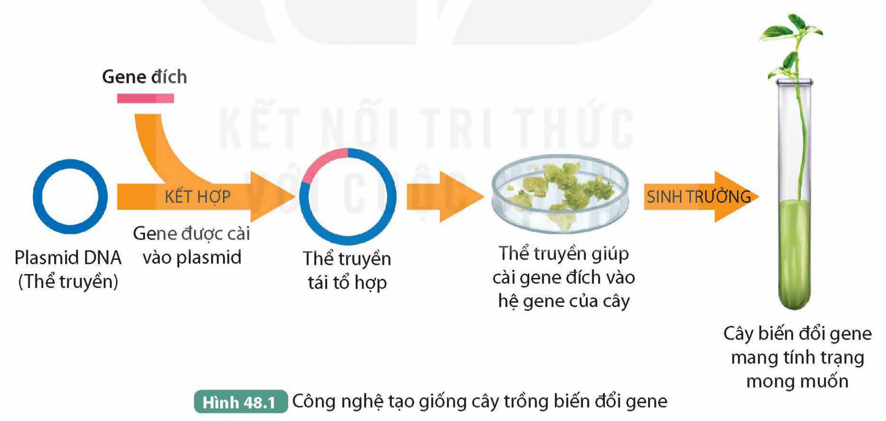
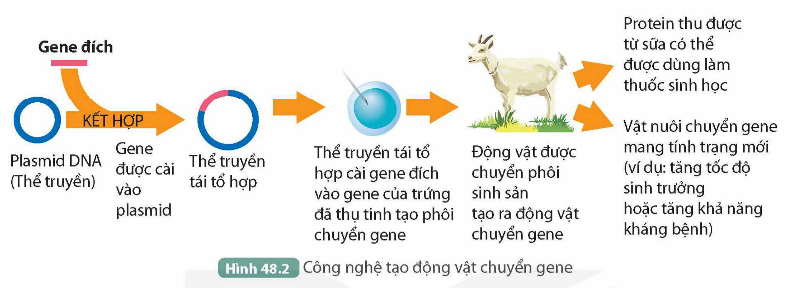
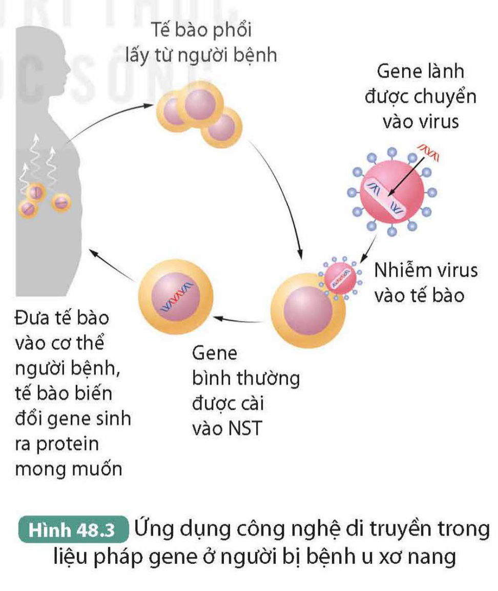
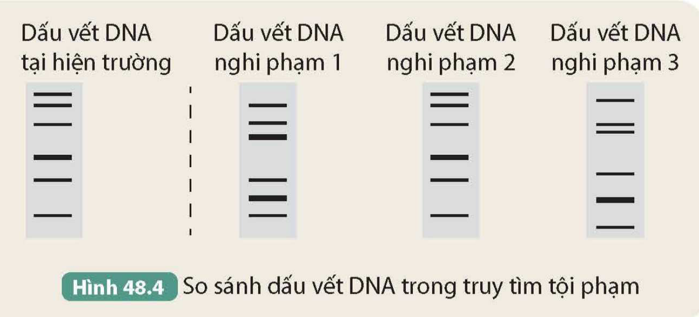

<!-- pdf:209 -->

# BÀI 48: ỨNG DỤNG CÔNG NGHỆ DI TRUYỀN VÀO ĐỜI SỐNG

## 🎯 Mục tiêu

- Nêu được một số ứng dụng công nghệ di truyền trong nông nghiệp, y tế, pháp y, làm sạch môi trường, an toàn sinh học.
- Tìm hiểu được một số sản phẩm ứng dụng công nghệ di truyền tại địa phương.
- Nêu được một số vấn đề về đạo đức sinh học trong nghiên cứu và ứng dụng công nghệ di truyền.

## 🔴 Mở đầu

Công nghệ di truyền sử dụng tế bào sống và các quá trình sinh học để tạo ra sản phẩm sinh học đem lại những giá trị cho nhiều lĩnh vực đời sống, xã hội. Công nghệ di truyền được ứng dụng trong đời sống như thế nào? Kể tên một số sản phẩm được tạo ra nhờ công nghệ đó.

## I. Ứng dụng công nghệ di truyền trong nông nghiệp

### 1. Tạo giống cây trồng biến đổi gene

<!-- term: Cây trồng biến đổi gene -->
Cây trồng biến đổi gene được tạo ra bằng công nghệ di truyền (Hình 48.1). Công nghệ này sử dụng plasmid như một thể truyền (vector), cho phép gene đích (quy định tính trạng mong muốn) cài vào hệ gene của cây, nhờ đó cây biến đổi gene có được tính trạng mới.

Hình 48.1. Công nghệ tạo giống cây trồng biến đổi gene
<!-- ocr-ok: đã đối chiếu ảnh trang gốc 209, OCR không đọc được chữ trắng trên nền xanh Hình 48.1 -->

> ❓ Quan sát Hình 48.1, mô tả quá trình tạo cây biến đổi gene nhờ ứng dụng công nghệ di truyền.

Một số ví dụ về cây biến đổi gene đã được đưa vào sản xuất nông nghiệp: giống ngô Bt kháng sâu được chuyển gene quy định một loại protein có độc tính diệt sâu, nguồn gốc từ vi khuẩn *Bacillus thuringiensis*; giống “lúa vàng” được chuyển gene tổng hợp β-carotene, giúp cơ thể người tổng hợp vitamin A; giống đu đủ mang gene kháng virus gây bệnh;...

<!-- pdf:210 -->

### 2. Tạo vật nuôi chuyển gene

> ✋ Quan sát Hình 48.2, mô tả quá trình tạo động vật chuyển gene.

Hình 48.2. Công nghệ tạo động vật chuyển gene
<!-- ocr-ok: đã đối chiếu ảnh trang gốc 210, OCR không đọc được chữ trắng trên nền xanh Hình 48.2 -->

<!-- term: Vật nuôi chuyển gene -->
Con người ứng dụng công nghệ di truyền nhằm tạo ra các giống vật nuôi mang gene quy định đặc tính mong muốn, ví dụ: các giống bò hoặc dê chuyển gene sinh trưởng nhanh hoặc trong sữa có thành phần protein làm thuốc sinh học.

> ❓ Nêu thêm một số ứng dụng công nghệ di truyền trong nông nghiệp.

## II. Ứng dụng công nghệ di truyền trong y tế và pháp y

Trong y tế, công nghệ di truyền có thể được ứng dụng để tạo ra các dòng tế bào (vi khuẩn, nấm, động vật và thực vật) hoặc cơ thể (vật nuôi, cây trồng) mang gene đích nhằm sản xuất các protein hoặc RNA làm thuốc sinh học. Ví dụ: erythropoietin điều trị bệnh thiếu máu, insulin điều trị bệnh đái tháo đường, hay vaccine mRNA phòng bệnh COVID-19,...

Ngoài ra, công nghệ di truyền còn được ứng dụng chữa trị bệnh di truyền do gene sai hỏng gây ra, bằng cách dùng virus làm vector chuyển gene lành vào tế bào thay thế gene bệnh (liệu pháp gene, Hình 48.3).

Trong pháp y nhằm điều tra tội phạm, việc đối chiếu dấu vết DNA thu thập từ hiện trường với dấu vết DNA của các nghi phạm là cơ sở xác định thủ phạm gây án.

Hình 48.3. Ứng dụng công nghệ di truyền trong liệu pháp gene ở người bị bệnh u xơ nang

<!-- pdf:211 -->

Nguyên tắc tương tự được áp dụng trong xác định huyết thống; xác định danh tính hài cốt liệt sĩ trong chiến tranh từ lâu, xác định tử thi trong các vụ án hoặc thảm hoạ (cháy, thiên tai) mà các dữ liệu khác (hình thái, di vật) không đủ để định danh.

> ❓ Quan sát Hình 48.4, cho biết nghi phạm số mấy có thể là thủ phạm của vụ án. Giải thích.

Hình 48.4. So sánh dấu vết DNA trong truy tìm tội phạm
<!-- ocr-ok: đã đối chiếu ảnh trang gốc 211, OCR không đọc được chữ trắng trên nền xanh Hình 48.4 -->

## III. Ứng dụng công nghệ di truyền trong làm sạch môi trường và an toàn sinh học

Để làm sạch môi trường bị ô nhiễm do rò rỉ các chất thải độc hại như xăng dầu hay chất thải công nghiệp, người ta có thể ứng dụng công nghệ di truyền để tạo ra các chủng vi khuẩn tổng hợp enzyme phân giải chất gây ô nhiễm và sử dụng chúng nhằm làm sạch môi trường.

Trong việc xác định sự có mặt của tác nhân gây nguy cơ mất an toàn sinh học (chẳng hạn vi khuẩn gây ngộ độc thực phẩm hay vũ khí sinh học mang vi khuẩn gây bệnh), người ta có thể sử dụng các dấu vết DNA theo nguyên tắc giống với ứng dụng công nghệ di truyền trong nghiên cứu pháp y để xác định và loại bỏ tác nhân gây mất an toàn sinh học.

> ❓ Nêu thêm một số ứng dụng công nghệ di truyền trong làm sạch môi trường và an toàn sinh học.

> ✋ Tìm thông tin về một số sản phẩm ứng dụng công nghệ di truyền ở Việt Nam và ở địa phương em đang sinh sống.

## IV. Đạo đức sinh học trong nghiên cứu và ứng dụng công nghệ di truyền

<!-- term: Đạo đức sinh học -->
Giống như mọi công nghệ mới, công nghệ di truyền mang lại nhiều lợi ích tiềm năng nhưng cũng tiềm ẩn các rủi ro gây hại cho con người và môi trường tự nhiên. Đạo đức sinh học đề cập việc đánh giá được các lợi ích, rủi ro của công nghệ để mỗi người kiểm soát hành vi khi ứng dụng công nghệ một cách chính đáng và tuân thủ các quy định, phù hợp với đạo đức xã hội.

<!-- pdf:212 -->

Bảng 48.1. Lợi ích và rủi ro của ứng dụng công nghệ di truyền

| Lợi ích | Rủi ro |
| --- | --- |
| Chưa có bằng chứng cho thấy cây biến đổi gene và vật nuôi chuyển gene gây hại với con người và môi trường. | Các sản phẩm từ cây biến đổi gene và vật nuôi chuyển gene có thể ảnh hưởng tới con người và môi trường theo cách chưa biết. |
| Các giống cây biến đổi gene có sản lượng và chất lượng tốt hơn giống truyền thống. | Mở rộng vùng trồng cây biến đổi gene có thể làm giảm đa dạng sinh học (nguồn gene) tự nhiên. |
| Các chủng vi khuẩn và virus được dùng làm vector trong công nghệ di truyền thường không sống được trong tự nhiên. | Các cơ thể mang gene mới có thể thoát ra ngoài môi trường và chuyển gene tái tổ hợp sang các cơ thể hoang dại, gây nên vấn đề mới khó kiểm soát (ví dụ: cơ thể hoang dại có tính trạng mới gây hại môi trường). |
| Các biện pháp an toàn sinh học được các nhà nghiên cứu áp dụng để đảm bảo an toàn đối với môi trường, sức khoẻ con người và vật nuôi. | Nhiều quốc gia chưa có quy định về ghi nhãn sản phẩm biến đổi gene nên người tiêu dùng không phân biệt được sản phẩm có nguồn gốc biến đổi gene. |

> ✋ Dựa vào thông tin ở Bảng 48.1, trả lời các câu hỏi sau:
>
> 1. Hành vi của con người nên thay đổi thế nào khi lợi ích của ứng dụng công nghệ di truyền vượt trội yếu tố rủi ro tương ứng và ngược lại?
> 2. Chúng ta nên làm gì để hạn chế các yếu tố rủi ro nêu trên?

## 📌 Em đã học

- Công nghệ di truyền được phát triển dựa trên kiến thức về gene (DNA) và được ứng dụng ngày càng rộng rãi trong nhiều lĩnh vực của đời sống (nông nghiệp, y tế, môi trường,...).
- Ứng dụng công nghệ di truyền để tạo sinh vật biến đổi gene, mang các tính trạng mới mong muốn và liệu pháp gene chữa trị bệnh di truyền.
- Đạo đức sinh học giúp mọi người kiểm soát hành vi khi ứng dụng công nghệ di truyền.

## ✏️ Em có thể

- Nhận biết được các sản phẩm của công nghệ di truyền.
- Nhận biết được các hành vi chính đáng khi ứng dụng công nghệ di truyền trong đời sống.

<!-- term: Công nghệ CRISPR/Cas9 -->
> 🔍 Công nghệ CRISPR/Cas9 được gọi là “Chiếc kéo phân tử chỉnh sửa gene” sắc bén nhất hiện nay. Bằng công nghệ này, các nhà nghiên cứu có thể thay đổi trình tự gene ở vị trí rất chính xác trên DNA trực tiếp trong tế bào sinh vật mà không cần phải dùng vector chuyển gene truyền thống có nguồn gốc vi khuẩn hoặc virus. Công nghệ này hứa hẹn sẽ mang lại nhiều thành tựu mới trong chọn giống, điều trị các bệnh nan y như ung thư và các bệnh di truyền.

## 📷 Danh sách hình trong bài

| Mã hình | Trang PDF | Trang sách | Chú thích |
| --- | --- | --- | --- |
| H9-khoa_hoc_tu_nhien-b48-01 | 209 | 207 | Hình 48.1. Công nghệ tạo giống cây trồng biến đổi gene |
| H9-khoa_hoc_tu_nhien-b48-02 | 210 | 208 | Hình 48.2. Công nghệ tạo động vật chuyển gene |
| H9-khoa_hoc_tu_nhien-b48-03 | 210 | 208 | Hình 48.3. Ứng dụng công nghệ di truyền trong liệu pháp gene ở người bị bệnh u xơ nang |
| H9-khoa_hoc_tu_nhien-b48-04 | 211 | 209 | Hình 48.4. So sánh dấu vết DNA trong truy tìm tội phạm |
