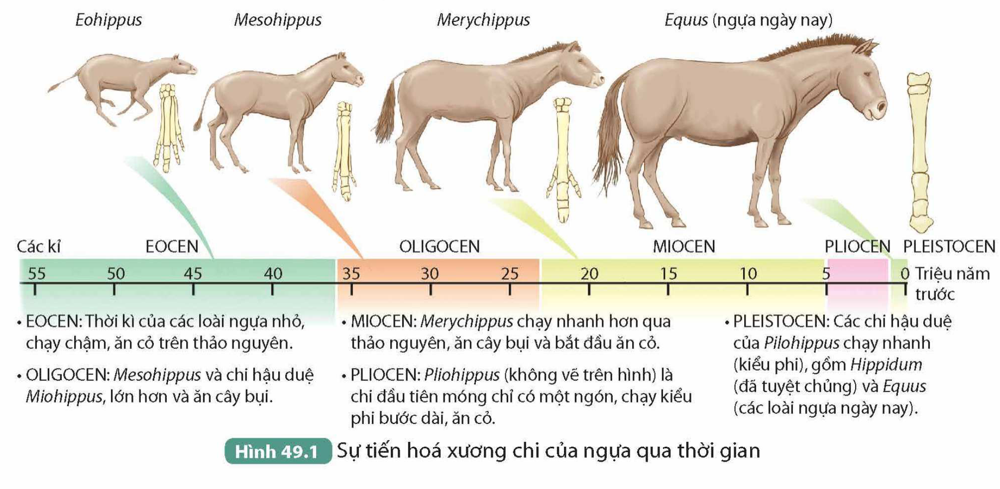
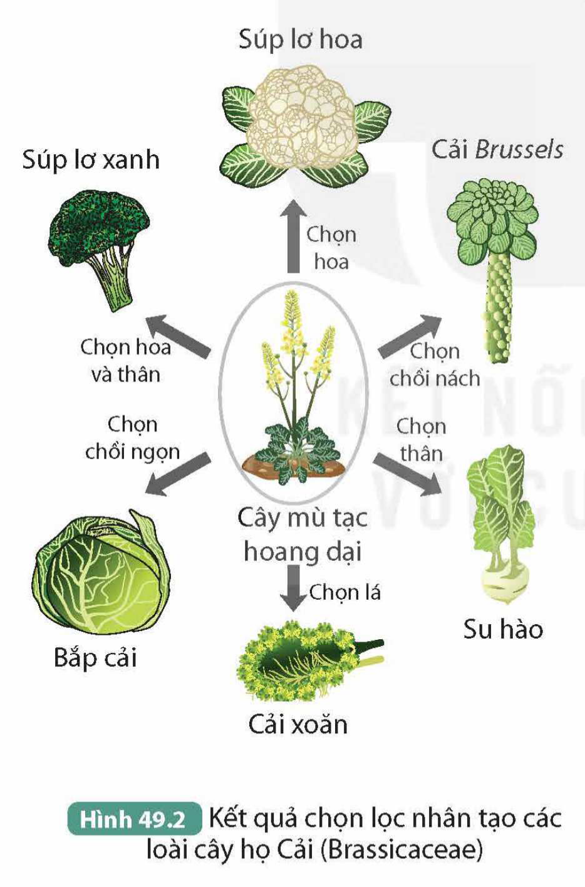
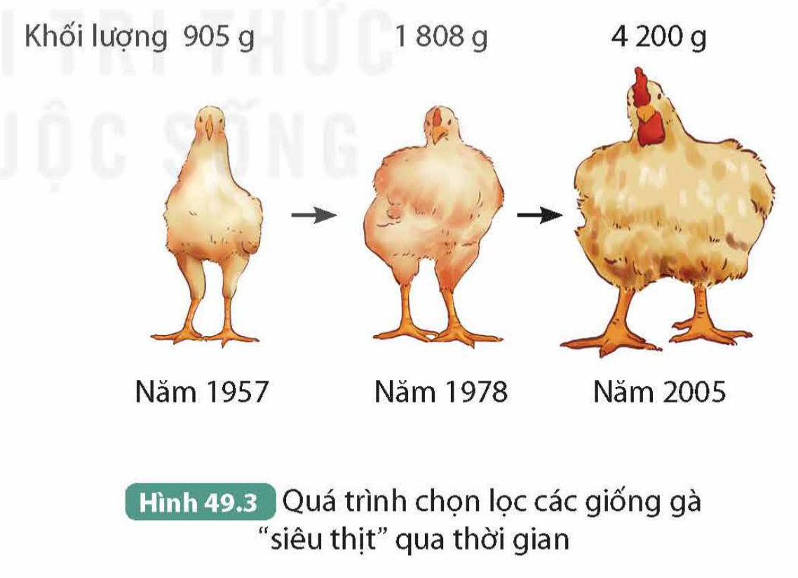
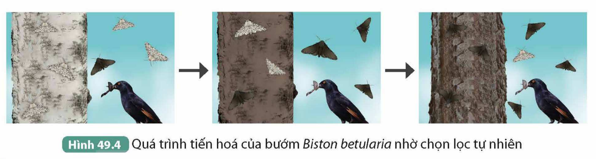

<!-- pdf:213 -->

# BÀI 49: KHÁI NIỆM TIẾN HOÁ VÀ CÁC HÌNH THỨC CHỌN LỌC

## 🎯 Mục tiêu

- Phát biểu được khái niệm tiến hoá.
- Phát biểu được khái niệm chọn lọc nhân tạo. Trình bày được một số bằng chứng của quá trình chọn lọc do con người tiến hành đưa đến sự đa dạng và thích nghi của các loài vật nuôi và cây trồng từ vài dạng hoang dại ban đầu.
- Phát biểu được khái niệm chọn lọc tự nhiên. Dựa vào các hình ảnh hoặc sơ đồ, mô tả được quá trình chọn lọc tự nhiên.
- Thông qua phân tích các ví dụ về tiến hoá thích nghi, chứng minh được vai trò của chọn lọc tự nhiên đối với sự hình thành đặc điểm thích nghi và đa dạng của sinh vật.

## 🔴 Mở đầu

Thế giới sinh vật vô cùng đa dạng và phong phú, tuy nhiên các loài sinh vật cũng có nhiều đặc điểm chung. Bằng cách nào đã tạo ra sinh giới đa dạng như vậy? Những sinh vật hiện nay có phải là những loài khoẻ nhất hay thông minh nhất không?

## I. Khái niệm tiến hoá

Từ cơ sở di truyền học mà chúng ta đã biết, các đặc tính di truyền của loài được quy định trong gene, duy trì từ bố mẹ cho thế hệ con qua sinh sản, tuy nhiên chúng cũng có những thay đổi. **Tiến hoá sinh học** là sự thay đổi các đặc tính di truyền của quần thể sinh vật qua các thế hệ nối tiếp nhau theo thời gian.

Hình 49.1. Sự tiến hoá xương chi của ngựa qua thời gian
<!-- ocr-ok: đã đối chiếu ảnh trang gốc 213, OCR không đọc được chữ trắng trên nền xanh Hình 49.1 -->

<!-- pdf:214 -->

> ✋ Quan sát Hình 49.1, thực hiện các yêu cầu sau:
>
> 1. Nhận xét về sự thay đổi kích thước và hình thái xương chi ở ngựa qua thời gian.
> 2. Những thay đổi đó phù hợp với nơi sống và cách di chuyển của ngựa như thế nào?

## II. Chọn lọc nhân tạo

Con người sử dụng nguyên lí của tiến hoá (sự thay đổi đặc tính di truyền) để tạo ra các giống vật nuôi và cây trồng có những tính trạng di truyền mong muốn, thường xuất phát từ một vài dạng hoang dại ban đầu. Quá trình chọn lọc từ dạng ban đầu để phát hiện, giữ lại, nhân giống những cá thể mang đặc tính tốt (theo yêu cầu đề ra) và loại thải cá thể thiếu các đặc tính đó nhằm nâng cao năng suất, chất lượng vật nuôi và cây trồng được gọi là **chọn lọc nhân tạo**.

Kết quả chọn lọc nhân tạo một số vật nuôi, cây trồng được thể hiện trong Hình 49.2 và Hình 49.3.

Hình 49.2. Kết quả chọn lọc nhân tạo các loài cây họ Cải (Brassicaceae)
<!-- ocr-ok: đã đối chiếu ảnh trang gốc 214, OCR gộp dòng chú thích Hình 49.2 và Hình 49.3 -->

Hình 49.3. Quá trình chọn lọc các giống gà “siêu thịt” qua thời gian
<!-- ocr-ok: đã đối chiếu ảnh trang gốc 214, OCR không đọc được chữ trắng trên nền xanh Hình 49.3 -->

> ❓
> 1. Trong Hình 49.2, cây nào là nguồn gốc của các loại rau cải phổ biến ngày nay? Tại sao lại có nhiều loại rau cải như ngày nay?
> 2. Mục đích chọn lọc của con người ở đối tượng trong Hình 49.3 là gì?
> 3. Kể tên ba loại cây trồng khác cũng đã được chọn lọc nhân tạo làm thực phẩm mà em biết.

<!-- pdf:215 -->

## III. Chọn lọc tự nhiên

**Chọn lọc tự nhiên** là quá trình các cá thể thích nghi hơn với môi trường sống sẽ có khả năng sống sót và sinh sản cao hơn, dẫn đến số lượng cá thể có đặc điểm thích nghi (biến dị di truyền) trở nên phổ biến trong quần thể.

<!-- term: Tiến hoá thích nghi -->
Quá trình chọn lọc tự nhiên dẫn đến sự tiến hoá thích nghi (ví dụ: ở bướm *Biston betularia* sống trên cây bạch dương ở nước Anh đầu thế kỉ XIX) được thể hiện trong Hình 49.4.

Hình 49.4. Quá trình tiến hoá của bướm *Biston betularia* nhờ chọn lọc tự nhiên

> ✋ Quan sát Hình 49.4, trả lời các câu hỏi sau:
>
> 1. Đặc điểm màu sắc thân của quần thể bướm thay đổi như thế nào khi màu thân cây bạch dương bị hoá sẫm do ô nhiễm khói công nghiệp?
> 2. Chọn lọc tự nhiên tác động trực tiếp lên kiểu hình hay kiểu gene?
> 3. Sự đa dạng màu sắc thân ở bướm do ô nhiễm môi trường hay do nguyên nhân nào khác?

Nhờ cơ chế chọn lọc tự nhiên mà các cá thể trong quần thể tự nhiên có những đặc điểm thích nghi với môi trường cao hơn sẽ sống sót và sinh sản được nhiều con hơn cho thế hệ sau. Nhờ vậy, tần số gene (allele) quy định đặc điểm thích nghi của quần thể tăng qua các thế hệ và trở nên phổ biến trong quần thể.

Thông qua cơ chế này cũng đã hình thành quần thể côn trùng kháng thuốc trừ sâu, vi khuẩn kháng thuốc kháng sinh, chủng virus mới kháng vaccine sẵn có.

## 📌 Em đã học

- Tiến hoá sinh học là quá trình thay đổi các đặc tính di truyền của quần thể sinh vật qua các thế hệ nối tiếp nhau theo thời gian.
- Chọn lọc nhân tạo là phương pháp con người sử dụng nguyên lí tiến hoá nhằm tạo ra các giống vật nuôi, cây trồng, các chủng vi sinh vật phù hợp với nhu cầu cụ thể của con người.
- Chọn lọc tự nhiên là quá trình các cá thể thích nghi hơn với môi trường sống có khả năng sống sót và sinh sản cao hơn, dẫn đến số lượng cá thể có đặc điểm thích nghi được di truyền trở nên phổ biến trong quần thể.

## ✏️ Em có thể

- Vận dụng được khái niệm chọn lọc tự nhiên và chọn lọc nhân tạo để giải thích quá trình tiến hoá của các quần thể sinh vật tự nhiên.
- Vận dụng được kiến thức về sự hình thành các đặc điểm thích nghi để giải thích trường hợp côn trùng kháng thuốc trừ sâu, vi khuẩn kháng kháng sinh,...

## 📷 Danh sách hình trong bài

| Mã hình | Trang PDF | Trang sách | Chú thích |
| --- | --- | --- | --- |
| H9-khoa_hoc_tu_nhien-b49-01 | 213 | 211 | Hình 49.1. Sự tiến hoá xương chi của ngựa qua thời gian |
| H9-khoa_hoc_tu_nhien-b49-02 | 214 | 212 | Hình 49.2. Kết quả chọn lọc nhân tạo các loài cây họ Cải (Brassicaceae) |
| H9-khoa_hoc_tu_nhien-b49-03 | 214 | 212 | Hình 49.3. Quá trình chọn lọc các giống gà “siêu thịt” qua thời gian |
| H9-khoa_hoc_tu_nhien-b49-04 | 215 | 213 | Hình 49.4. Quá trình tiến hoá của bướm Biston betularia nhờ chọn lọc tự nhiên |
