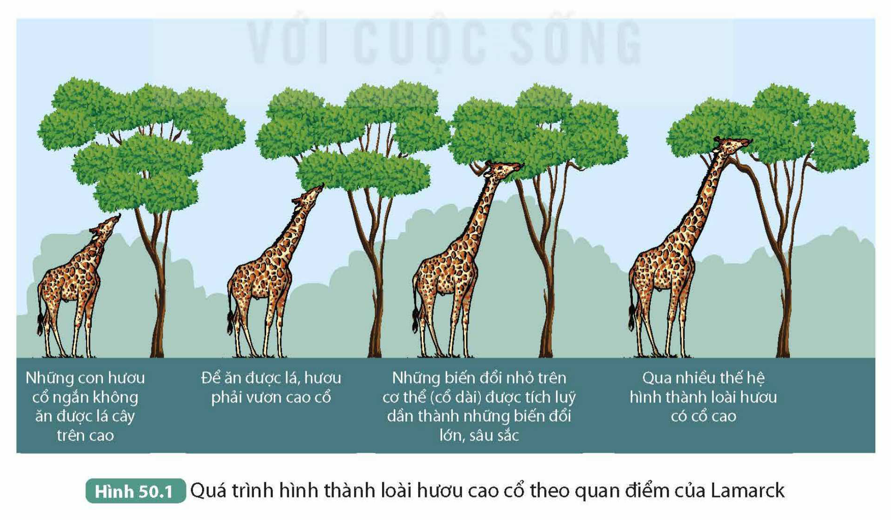
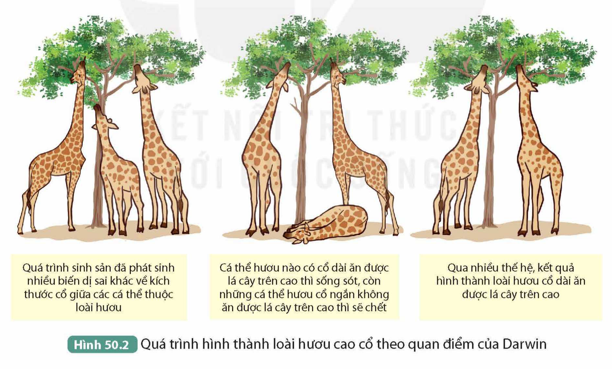
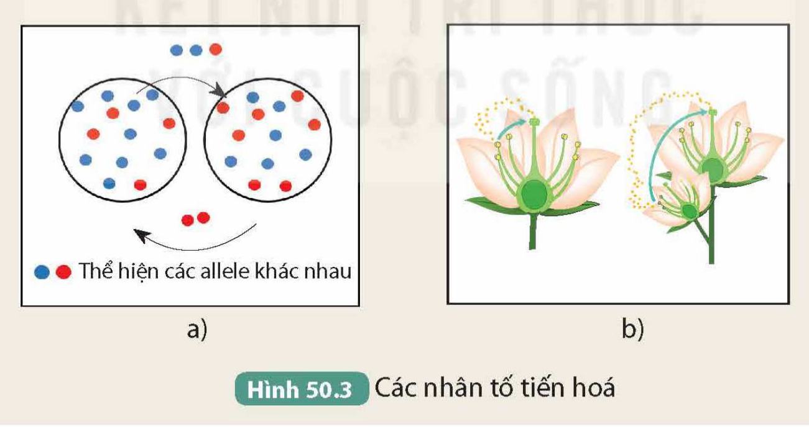
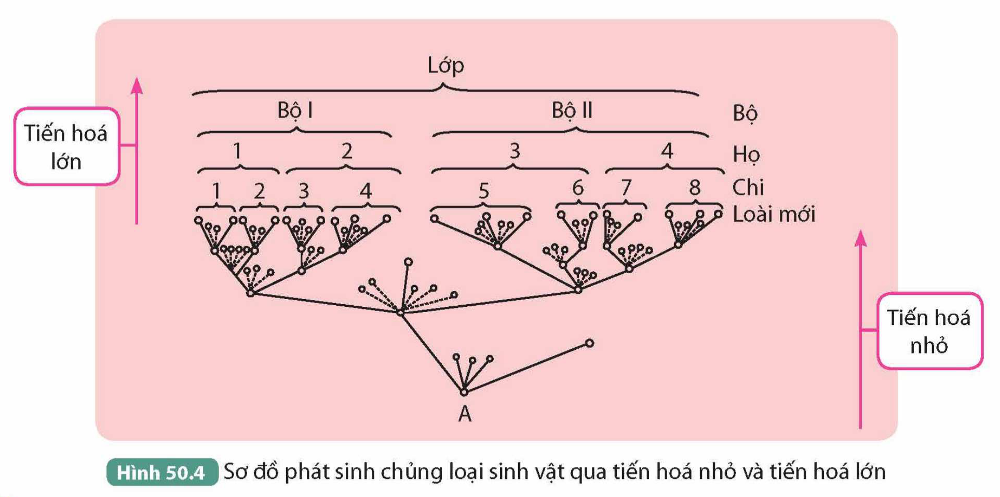

<!-- pdf:216 -->

# BÀI 50: CƠ CHẾ TIẾN HOÁ

## 🎯 Mục tiêu

- Nêu được quan điểm của Lamarck về cơ chế tiến hoá.
- Trình bày được quan điểm của Darwin về cơ chế tiến hoá.
- Trình bày được một số luận điểm về tiến hoá theo quan niệm của thuyết tiến hoá tổng hợp hiện đại (cụ thể: nguồn biến dị di truyền của quần thể, các nhân tố tiến hoá, cơ chế tiến hoá lớn).

## 🔴 Mở đầu

Sâu bọ rất đa dạng về hình thái và màu sắc. Nguyên nhân và cơ chế nào đã tạo nên sự đa dạng đó?

## I. Quan điểm của Lamarck về cơ chế tiến hoá

Jean Baptiste Lamarck (1744 – 1829) là nhà tự nhiên học người Pháp, ông là người đầu tiên đưa ra quan điểm về tiến hoá của sinh giới vào năm 1809. Ông cho rằng: các loài sinh vật không bất biến mà chúng có thể biến đổi từ loài này thành loài khác dưới tác dụng của ngoại cảnh. Ví dụ về sự hình thành loài hươu cao cổ được Lamarck giải thích như Hình 50.1.

Hình 50.1. Quá trình hình thành loài hươu cao cổ theo quan điểm của Lamarck

<!-- pdf:217 -->

> ✋ Quan sát Hình 50.1, thực hiện các yêu cầu sau:
>
> 1. Mô tả quá trình hình thành loài hươu cao cổ theo quan điểm của Lamarck.
> 2. Nguyên nhân nào dẫn đến sự hình thành loài hươu cao cổ?

<!-- term: Quan điểm tiến hoá của Lamarck -->
Quan điểm của Lamarck cho rằng: Sinh vật luôn chủ động thích ứng với sự thay đổi chậm chạp của môi trường, chúng không ngừng vươn tới một tổ chức cơ thể phức tạp hơn, do đó không có loài nào bị đào thải. Ngoại cảnh không đồng nhất và thường xuyên thay đổi làm cho các sinh vật của một loài tổ tiên ban đầu chủ động biến đổi cơ thể theo nhiều hướng khác nhau, qua nhiều thế hệ hình thành nhiều loài mới.

> ❓ Nêu những hạn chế trong quan điểm của Lamarck về cơ chế tiến hoá.

## II. Quan điểm của Darwin về cơ chế tiến hoá

Charles Darwin (1809 – 1882) là nhà tự nhiên học người Anh, trong tác phẩm Nguồn gốc các loài (On the Origin of Species), được công bố vào năm 1859 đã đưa ra thuyết tiến hoá. Theo quan điểm của Darwin về cơ chế tiến hoá, sự hình thành loài hươu cao cổ được giải thích như Hình 50.2.

Hình 50.2. Quá trình hình thành loài hươu cao cổ theo quan điểm của Darwin

> ✋ Quan sát Hình 50.2 và thực hiện các yêu cầu sau:
>
> 1. Mô tả quá trình hình thành loài hươu cao cổ theo quan điểm của Darwin.
> 2. Để giải thích sự hình thành loài hươu cao cổ, quan điểm của Darwin khác với quan điểm của Lamarck như thế nào?

<!-- pdf:218 -->

Darwin gọi những đặc điểm sai khác giữa các cá thể cùng loài là **biến dị cá thể**. Biến dị cá thể là vô hướng, phát sinh trong quá trình sinh sản. Những biến dị giúp sinh vật thích nghi với môi trường sống được tích luỹ và di truyền cho thế hệ sau, biến dị bất lợi cho sinh vật bị chọn lọc tự nhiên đào thải. Kết quả hình thành các loài sinh vật có khả năng thích nghi cao với môi trường sống từ một loài ban đầu.

> ❓ Trình bày những hạn chế trong quan điểm của Darwin về cơ chế tiến hoá.

## III. Một số luận điểm của thuyết tiến hoá tổng hợp hiện đại

### 1. Tiến hoá nhỏ

Quá trình biến đổi tần số allele, tần số kiểu gene của quần thể qua các thế hệ gọi là **tiến hoá nhỏ**.

Tiến hoá nhỏ diễn ra trong phạm vi phân bố tương đối hẹp, thời gian lịch sử tương đối ngắn, có thể nghiên cứu bằng thực nghiệm. Quần thể là đơn vị của tiến hoá.

### 2. Nguồn biến dị di truyền của quần thể

<!-- term: Nguồn biến dị di truyền của quần thể -->
Quá trình tiến hoá chỉ diễn ra nếu trong quần thể có các biến dị di truyền (đột biến và biến dị tổ hợp) làm nguyên liệu cho quá trình chọn lọc. Như vậy, trong quần thể có hai nguồn biến dị di truyền, đó là các đột biến và các biến dị tổ hợp. Ngoài ra, nguồn biến dị di truyền của quần thể còn được bổ sung bởi sự di chuyển của các cá thể hoặc các giao tử từ quần thể khác vào.

Quá trình phát sinh đột biến và biến dị tổ hợp hình thành qua giao phối đã làm cho mỗi quần thể trở thành một kho dự trữ nguồn biến dị di truyền vô cùng phong phú, tạo nên tính đa dạng của quần thể.

> ❓ Nguồn biến dị nào là nguyên liệu chính cho tiến hoá? Tại sao?

### 3. Các nhân tố tiến hoá

Các nhân tố tác động vào quần thể gây nên sự biến đổi tần số allele và tần số kiểu gene của một nhóm cá thể trong quần thể được gọi là **nhân tố tiến hoá**. Nhân tố tiến hoá bao gồm đột biến, di nhập gene, chọn lọc tự nhiên, yếu tố ngẫu nhiên và giao phối không ngẫu nhiên.

**a) Đột biến**

Đột biến làm thay đổi tần số các allele và tần số các kiểu gene của quần thể. Ví dụ: Trong quần thể ban đầu, tỉ lệ allele A bằng tỉ lệ allele a (đều bằng 0,5), nếu phát sinh một đột biến allele A thành allele a sẽ làm tỉ lệ allele A giảm và tỉ lệ allele a tăng, hoặc khi allele A đột biến thành allele $a_1$ cũng dẫn đến thay đổi tần số các allele và tần số các kiểu gene của quần thể, trải qua nhiều thế hệ sẽ dẫn đến sự tiến hoá trong quần thể.

<!-- pdf:219 -->

**b) Di – nhập gene**

Khi một nhóm cá thể từ quần thể này di cư (di gene) đến nhập vào một quần thể khác (nhập gene), nếu chúng tham gia giao phối sẽ dẫn đến tần số các allele và tần số các kiểu gene của quần thể bị thay đổi (do vốn gene của các quần thể khác nhau). Di – nhập gene là nhân tố tiến hoá làm thay đổi tần số allele và tần số kiểu gene của quần thể.

**c) Chọn lọc tự nhiên**

Chọn lọc tự nhiên đào thải những cá thể có kiểu hình kém thích nghi, tạo điều kiện cho những cá thể có kiểu hình thích nghi sinh sản làm tăng số lượng cá thể. Qua nhiều thế hệ, kiểu hình thích nghi được nhân rộng, trở nên phổ biến trong loài. Như vậy, tác động của chọn lọc tự nhiên làm thay đổi tần số các allele và tần số các kiểu gene, phá vỡ cân bằng cũ, thiết lập cân bằng mới trong quần thể. Nghĩa là, đã diễn ra sự tiến hoá trong quần thể.

**d) Yếu tố ngẫu nhiên**

Hiện tượng tần số các allele và tần số các kiểu gene của quần thể bị thay đổi đột ngột bởi một yếu tố ngẫu nhiên nào đó (ví dụ: thiên tai, cháy rừng,...) gọi là **biến động di truyền** hay **phiêu bạt di truyền**. Do đó, yếu tố ngẫu nhiên là một loại nhân tố tiến hoá.

**e) Giao phối không ngẫu nhiên**

Các hình thức giao phối không ngẫu nhiên như tự thụ phấn ở thực vật, giao phối cận huyết và giao phối có chọn lọc ở động vật tuy không làm thay đổi tần số các allele nhưng làm thay đổi tần số các kiểu gene trong quần thể, vì thế cũng là nhân tố tiến hoá.

> ❓ Xác định nhân tố tiến hoá được thể hiện trong Hình 50.3a và 50.3b.

Hình 50.3. Các nhân tố tiến hoá
<!-- ocr-ok: đã đối chiếu ảnh trang gốc 219, OCR không đọc được chữ trắng trên nền xanh Hình 50.3 -->

### 4. Cơ chế tiến hoá lớn

Sự biến đổi tần số allele, tần số kiểu gene của quần thể dẫn đến hình thành các loài có nhiều đặc điểm tương đồng (sự sai khác không đáng kể). Quá trình tiến hoá diễn ra trong không gian địa lí rộng lớn và thời gian lịch sử lâu dài sẽ tạo ra các loài có nhiều đặc điểm khác biệt và có thể xếp vào các đơn vị phân loại trên loài (chi/giống, họ, bộ, lớp, ngành, giới), quá trình này được gọi là **tiến hoá lớn**.

<!-- pdf:220 -->

Hình 50.4. Sơ đồ phát sinh chủng loại sinh vật qua tiến hoá nhỏ và tiến hoá lớn

> ✋
> 1. Quan sát Hình 50.4, mô tả sự hình thành các đơn vị phân loại.
> 2. Tiến hoá lớn diễn ra theo cơ chế nào?

Như vậy, sinh vật đa dạng ngày nay dù có tổ chức phức tạp hay đơn giản đều có nguồn gốc chung.

## 📌 Em đã học

<!-- term: Quan điểm tiến hoá của Lamarck -->
- Quan điểm tiến hoá của Lamarck với cơ chế tiến hoá là sự biến đổi và tích luỹ các đặc tính thu được do tác động của ngoại cảnh.

<!-- term: Quan điểm tiến hoá của Darwin -->
- Quan điểm tiến hoá của Darwin với cơ chế tiến hoá là sự tích luỹ các biến dị cá thể có lợi dưới tác động của chọn lọc tự nhiên (được chọn lọc bởi môi trường) qua nhiều thế hệ, dẫn đến hình thành các đặc điểm thích nghi trên cơ thể sinh vật.

<!-- term: Thuyết tiến hoá tổng hợp hiện đại -->
- Thuyết tiến hoá tổng hợp hiện đại xác định nguồn biến dị di truyền chủ yếu là đột biến và biến dị tổ hợp được phát sinh trong quần thể. Các nhân tố tiến hoá làm thay đổi vốn gene của quần thể gồm đột biến, di – nhập gene, chọn lọc tự nhiên, yếu tố ngẫu nhiên và giao phối không ngẫu nhiên. Cơ chế của tiến hoá diễn ra theo con đường phân li của loài ban đầu dưới tác động chủ yếu của chọn lọc tự nhiên.

## ✏️ Em có thể

- Giải thích được vì sao mỗi loài sinh vật có thể thích nghi với môi trường sống nhất định.
- Giải thích được sự đa dạng, phong phú của sinh giới.

> 🔍 **Những đóng góp cho khoa học của Lamarck**
>
> Lamarck là người đầu tiên cố gắng xây dựng được một thuyết tiến hoá có hệ thống, thừa nhận sự tiến hoá trong sinh giới chứ không phải do Thượng đế sáng tạo từ đầu và bất biến tuyệt đối; nêu cao được vai trò của ngoại cảnh đối với sự tiến hoá của sinh giới; bước đầu giải thích được cơ chế tác động của ngoại cảnh, thông qua việc sử dụng hay không sử dụng của các cơ quan và di truyền cho đời sau các đặc tính thu được.

## 📷 Danh sách hình trong bài

| Mã hình | Trang PDF | Trang sách | Chú thích |
| --- | --- | --- | --- |
| H9-khoa_hoc_tu_nhien-b50-01 | 216 | 214 | Hình 50.1. Quá trình hình thành loài hươu cao cổ theo quan điểm của Lamarck |
| H9-khoa_hoc_tu_nhien-b50-02 | 217 | 215 | Hình 50.2. Quá trình hình thành loài hươu cao cổ theo quan điểm của Darwin |
| H9-khoa_hoc_tu_nhien-b50-03 | 219 | 217 | Hình 50.3. Các nhân tố tiến hoá |
| H9-khoa_hoc_tu_nhien-b50-04 | 220 | 218 | Hình 50.4. Sơ đồ phát sinh chủng loại sinh vật qua tiến hoá nhỏ và tiến hoá lớn |
