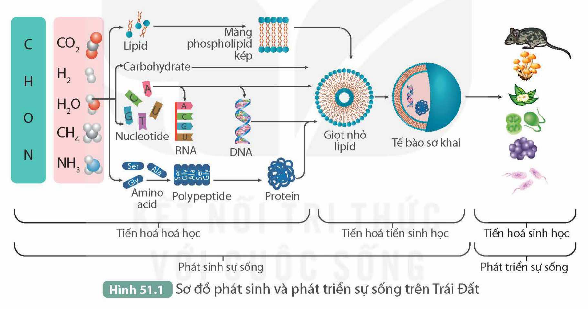
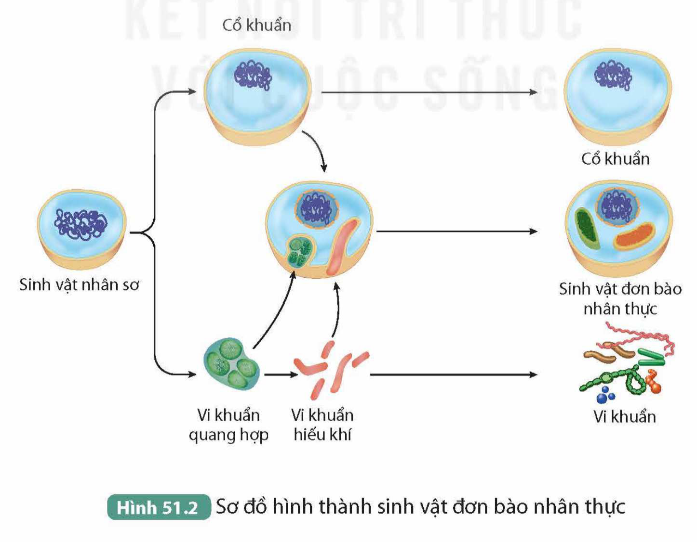
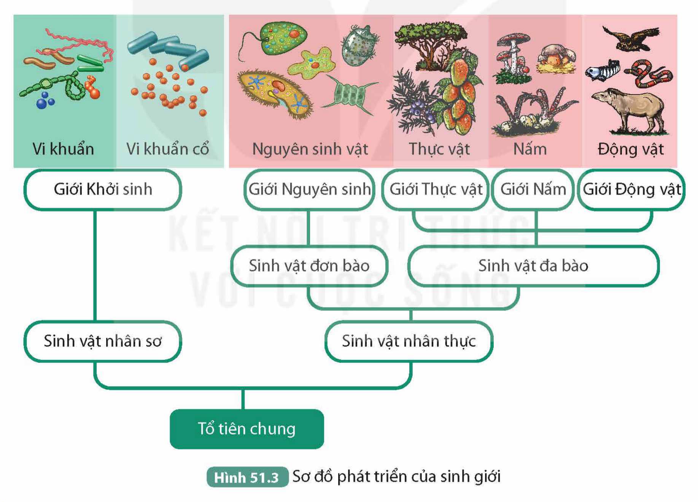
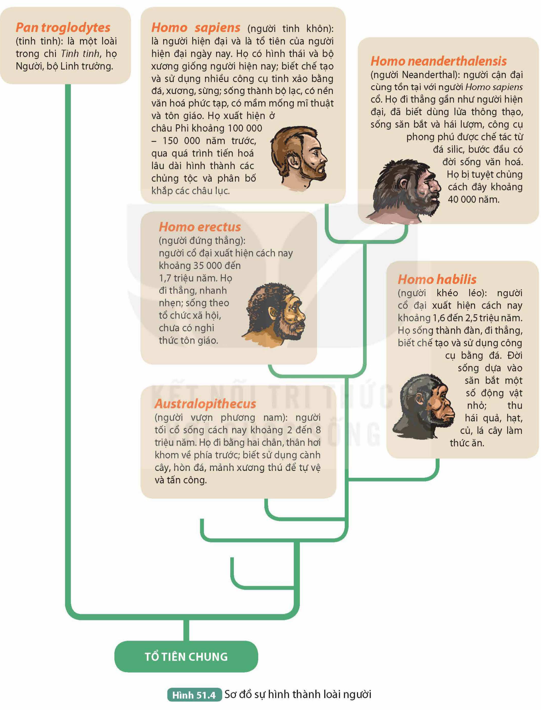
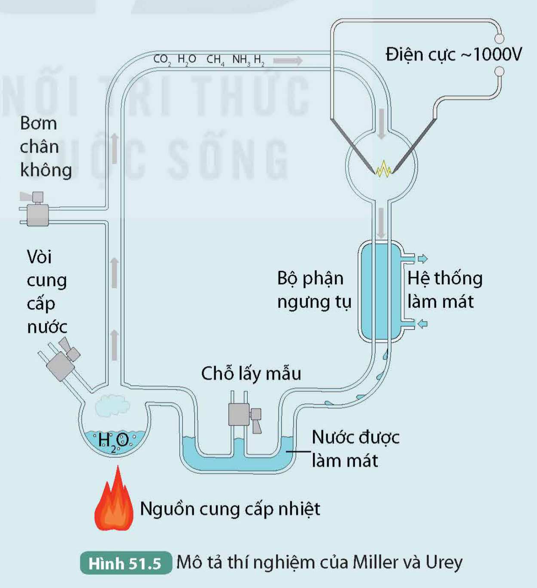

<!-- pdf:221 -->

# BÀI 51: SỰ PHÁT SINH VÀ PHÁT TRIỂN SỰ SỐNG TRÊN TRÁI ĐẤT

## 🎯 Mục tiêu

- Dựa vào sơ đồ, trình bày được khái quát sự phát triển của thế giới sinh vật trên Trái Đất; nguồn gốc xuất hiện của sinh vật nhân thực từ sinh vật nhân sơ; sự xuất hiện và sự đa dạng hoá của sinh vật đa bào.
- Dựa vào sơ đồ, trình bày được khái quát sự hình thành loài người.

## 🔴 Mở đầu

Trái Đất khi mới hình thành chỉ gồm các chất vô cơ mà chưa hề có sự tồn tại của sinh vật. Con người và các sinh vật tồn tại hiện nay được tạo ra từ đâu và phát triển như thế nào?

## I. Các giai đoạn phát sinh và phát triển sự sống trên Trái Đất

Sự phát sinh và phát triển sự sống trên Trái Đất gồm các giai đoạn được tóm tắt trên Hình 51.1.

Hình 51.1. Sơ đồ phát sinh và phát triển sự sống trên Trái Đất

> ✋ Quan sát Hình 51.1, trả lời các câu hỏi sau:
>
> 1. Quá trình phát sinh và phát triển sự sống trên Trái Đất gồm những giai đoạn nào?
> 2. Thế giới sinh vật trên Trái Đất có nguồn gốc từ đâu?

### 1. Sự phát sinh sự sống trên Trái Đất theo quan điểm hiện đại

Có nhiều giả thuyết về quá trình phát sinh và phát triển sự sống trên Trái Đất. Tuy nhiên, giả thuyết về nguồn gốc sự sống theo quan điểm hiện đại được nhiều người chấp nhận nhất. Giả thuyết về sự hình thành những tế bào đơn giản đầu tiên theo một trật tự gồm hai giai đoạn như sau:

**a) Giai đoạn tiến hoá hoá học (tổng hợp vô sinh)**

<!-- term: Tiến hoá hoá học -->
Trong những điều kiện thích hợp, từ các nguyên tố C, H, O, N (có trong bầu khí quyển của Trái Đất nguyên thuỷ, tổng hợp nên các chất có hai nguyên tố, sau đó hình thành

<!-- pdf:222 -->

<!-- term: Tiến hoá hoá học -->
những phân tử hữu cơ đơn giản như amino acid, nucleotide, carbohydrate, lipid. Từ các chất hữu cơ đơn giản hình thành những hợp chất hữu cơ phức tạp như RNA, DNA, protein và phospholipid.

**b) Giai đoạn tiến hoá tiền sinh học**

Giai đoạn tiến hoá tiền sinh học đã diễn ra ba sự kiện quan trọng gồm:

- Hình thành lớp màng kép: Những hợp chất phospholipid với cấu trúc thích hợp có thể tạo nên lớp màng phospholipid kép, là tiền thân của màng tế bào.

<!-- term: Tế bào sơ khai -->
- Hình thành tế bào sơ khai: Trong môi trường nước, các phân tử lớn tập trung và được bao bọc bởi lớp màng phospholipid kép, tạo thành các giọt nhỏ. Dưới tác động của chọn lọc tự nhiên, những giọt nhỏ tiến hoá dần thành tế bào sơ khai. Các tế bào sơ khai có thể biểu hiện một số đặc tính của sự sống, bao gồm sinh sản đơn giản và sự chuyển hoá cũng như khả năng duy trì ổn định cấu trúc.

<!-- term: Ribozyme -->
- Xuất hiện các phân tử có khả năng tự sao chép làm vật liệu di truyền: Quá trình trùng hợp của các đơn phân nucleotide đã hình thành những mạch RNA ngẫu nhiên, trong đó có những RNA có hoạt tính xúc tác (ribozyme). Trong môi trường thích hợp, các RNA có khả năng sao chép nhanh và chính xác. Trong những tế bào sơ khai có RNA mang thông tin di truyền, RNA sẽ làm khuôn mẫu tổng hợp nên phân tử DNA mạch kép. DNA mạch kép là nguồn dự trữ thông tin di truyền ổn định và sao chép chính xác hơn RNA.

> ❓
> 1. Tiến hoá hoá học là gì? Hãy vẽ sơ đồ khái quát quá trình tiến hoá hoá học.
> 2. Tóm tắt ba sự kiện diễn ra trong giai đoạn tiến hoá tiền sinh học.

### 2. Sự phát triển sự sống trên Trái Đất theo quan điểm hiện đại

**a) Xuất hiện sinh vật nhân thực từ sinh vật nhân sơ**

Hình 51.2. Sơ đồ hình thành sinh vật đơn bào nhân thực

> ✋ Quan sát Hình 51.2, trình bày sự xuất hiện cơ thể đơn bào nhân thực.

<!-- pdf:223 -->

Sự xuất hiện sinh vật nhân sơ: Từ các tế bào sơ khai, dưới tác động của chọn lọc tự nhiên (trên cơ sở đột biến và chọn lọc của môi trường), tiến hoá hình thành nên các cơ thể đơn bào đơn giản, đó là các tế bào sinh vật nhân sơ.

Sự xuất hiện sinh vật nhân thực: Từ tế bào nhân sơ đầu tiên tiến hoá ra các dạng cơ thể nhân sơ khác như vi khuẩn quang hợp, vi khuẩn hiếu khí, cổ khuẩn,... và các dạng cơ thể nhân thực. Cơ thể nhân thực đầu tiên là đơn bào nhân thực (Hình 51.2).

**b) Sự xuất hiện sinh vật đa bào và đa dạng hoá sinh vật đa bào**

Sự xuất hiện sinh vật đa bào: Một số sinh vật nhân thực đơn bào cộng sinh với nhau đã tiến hoá thành dạng đa bào. Sinh vật đa bào đầu tiên xuất hiện là tảo nhỏ, sống cách nay khoảng 1,8 tỉ năm.

Sự đa dạng hoá của sinh vật đa bào: Trong quá trình hình thành và tồn tại, Trái Đất liên tục biến đổi, dẫn đến khí hậu của Trái Đất đôi khi bị biến đổi mạnh. Sự biến đổi mạnh mẽ của khí hậu đã dẫn đến những đợt tuyệt chủng hàng loạt các loài và sau đó là một giai đoạn tiến hoá, phát sinh các loài mới từ những sinh vật sống sót có các đặc điểm thích nghi. Sinh giới không ngừng tiến hoá đã tạo nên thế giới sinh vật đa dạng, phong phú như ngày nay (Hình 51.3).

Hình 51.3. Sơ đồ phát triển của sinh giới
<!-- ocr-ok: đã đối chiếu ảnh trang gốc 223, OCR không đọc được chữ trắng trên nền xanh Hình 51.3 -->

> ❓ Đọc thông tin trên kết hợp quan sát Hình 51.3, trình bày quá trình phát triển của sinh giới.

<!-- pdf:224 -->

## II. Sự phát sinh loài người

Quá trình phát sinh loài người theo các bằng chứng hoá thạch và phân tử tới nay trải qua một số giai đoạn chính sau:

Hình 51.4. Sơ đồ sự hình thành loài người
<!-- ocr-ok: đã đối chiếu ảnh trang gốc 224, OCR không đọc được chữ trắng trên nền xanh Hình 51.4 -->

- *Pan troglodytes* (tinh tinh): là một loài trong chi *Tinh tinh*, họ Người, bộ Linh trưởng.
<!-- ocr-ok: đã đối chiếu ảnh trang gốc 224, OCR đọc nhầm dấu tiếng Việt trong hộp Pan troglodytes của Hình 51.4 -->

<!-- term: Người tối cổ -->
- *Australopithecus* (người vượn phương nam): người tối cổ sống cách nay khoảng 2 đến 8 triệu năm. Họ đi bằng hai chân, thân hơi khom về phía trước; biết sử dụng cành cây, hòn đá, mảnh xương thú để tự vệ và tấn công.

<!-- term: Người cổ đại -->
- *Homo habilis* (người khéo léo): người cổ đại xuất hiện cách nay khoảng 1,6 đến 2,5 triệu năm. Họ sống thành đàn, đi thẳng, biết chế tạo và sử dụng công cụ bằng đá. Đời sống dựa vào săn bắt một số động vật nhỏ; thu hái quả, hạt, củ, lá cây làm thức ăn.

<!-- term: Người cổ đại -->
- *Homo erectus* (người đứng thẳng): người cổ đại xuất hiện cách nay khoảng 35 000 đến 1,7 triệu năm. Họ đi thẳng, nhanh nhẹn; sống theo tổ chức xã hội, chưa có nghi thức tôn giáo.

<!-- term: Người cận đại -->
- *Homo neanderthalensis* (người Neanderthal): người cận đại cùng tồn tại với người *Homo sapiens* cổ. Họ đi thẳng gần như người hiện đại, đã biết dùng lửa thông thạo, sống săn bắt và hái lượm, công cụ phong phú được chế tác từ đá silic, bước đầu có đời sống văn hoá. Họ bị tuyệt chủng cách đây khoảng 40 000 năm.

<!-- term: Người hiện đại -->
- *Homo sapiens* (người tinh khôn): là người hiện đại và là tổ tiên của người hiện đại ngày nay. Họ có hình thái và bộ xương giống người hiện nay; biết chế tạo và sử dụng nhiều công cụ tinh xảo bằng đá, xương, sừng; sống thành bộ lạc, có nền văn hoá phức tạp, có mầm mống mĩ thuật và tôn giáo. Họ xuất hiện ở châu Phi khoảng 100 000 – 150 000 năm trước, qua quá trình tiến hoá lâu dài hình thành các chủng tộc và phân bố khắp các châu lục.

<!-- pdf:225 -->

> ✋ Quan sát Hình 51.4, thực hiện các yêu cầu sau:
>
> 1. Gọi tên các giai đoạn chính của quá trình phát sinh loài người.
> 2. Trình bày tóm tắt đặc điểm hình thái, đời sống của các dạng người.

## 📌 Em đã học

- Sự phát sinh sự sống thông qua quá trình tiến hoá hoá học và tiến hoá tiền sinh học.
- Từ tế bào sơ khai đã hình thành các dạng sinh vật đơn bào nhân sơ, sinh vật đơn bào nhân thực; sự kết hợp của một số sinh vật đơn bào nhân thực hình thành sinh vật đa bào nhân thực; dưới tác động theo nhiều hướng của chọn lọc tự nhiên đã tạo ra thế giới sống đa dạng và phong phú.
- Quá trình phát sinh loài người qua các giai đoạn: người tối cổ, người cổ đại, người cận đại và người hiện đại.

## ✏️ Em có thể

- Vận dụng kiến thức về sự phát sinh và phát triển của sinh vật trên Trái Đất để giải thích lịch sử hình thành và phát triển của các nhóm sinh vật, tính thống nhất và đa dạng của từng nhóm sinh vật cũng như của toàn bộ sinh giới.

> 🔍 **Thí nghiệm chứng minh sự tạo thành hợp chất hữu cơ từ chất vô cơ**
>
> Năm 1953, Stanley Miller và Harold Urey đã tổng hợp được một số amino acid khi cho dòng điện phóng qua thiết bị đặc biệt (Hình 51.5) có chứa hỗn hợp khí vô cơ (có thành phần tương tự khí quyển của Trái Đất nguyên thuỷ) liên tục trong một tuần. Sau thí nghiệm của Miller và Urey, các nhà khoa học khác lặp lại thí nghiệm này nhiều lần với thành phần các chất vô cơ có thay đổi chút ít và họ đã thu được các hợp chất hữu cơ khác nhau. Như vậy, thí nghiệm của Miller và Urey đã thiết lập được quy trình tự nhiên tạo ra khối vật chất sống mà không đòi hỏi sự sống và nó đã khởi nguồn cho nhiều nghiên cứu sâu hơn về nguồn gốc sự sống.
>
> 
>
> Hình 51.5. Mô tả thí nghiệm của Miller và Urey
> <!-- ocr-ok: đã đối chiếu ảnh trang gốc 225, OCR không đọc được chữ trắng trên nền xanh Hình 51.5 -->

## 📷 Danh sách hình trong bài

| Mã hình | Trang PDF | Trang sách | Chú thích |
| --- | --- | --- | --- |
| H9-khoa_hoc_tu_nhien-b51-01 | 221 | 219 | Hình 51.1. Sơ đồ phát sinh và phát triển sự sống trên Trái Đất |
| H9-khoa_hoc_tu_nhien-b51-02 | 222 | 220 | Hình 51.2. Sơ đồ hình thành sinh vật đơn bào nhân thực |
| H9-khoa_hoc_tu_nhien-b51-03 | 223 | 221 | Hình 51.3. Sơ đồ phát triển của sinh giới |
| H9-khoa_hoc_tu_nhien-b51-04 | 224 | 222 | Hình 51.4. Sơ đồ sự hình thành loài người |
| H9-khoa_hoc_tu_nhien-b51-05 | 225 | 223 | Hình 51.5. Mô tả thí nghiệm của Miller và Urey |
