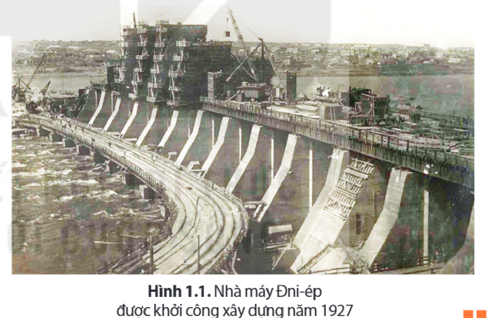
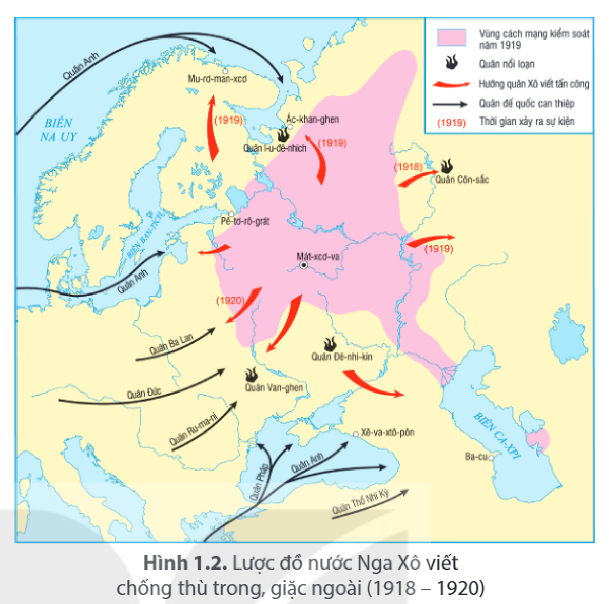
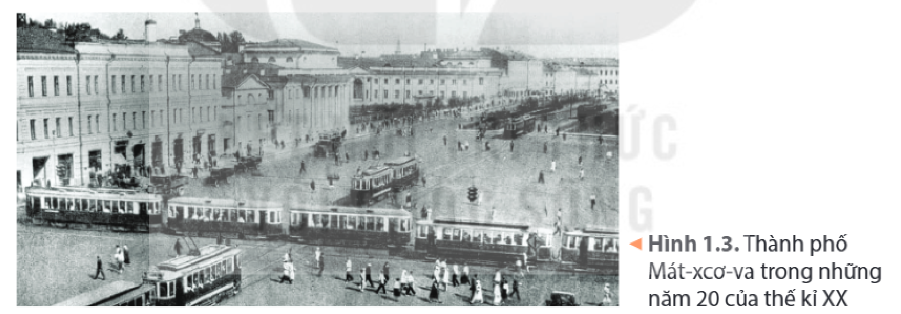
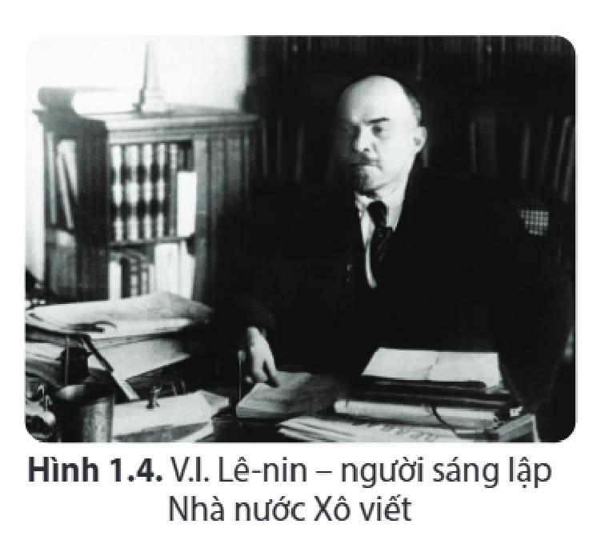

<!-- pdf:9 -->

# BÀI 1: NƯỚC NGA VÀ LIÊN XÔ TỪ NĂM 1918 ĐẾN NĂM 1945

## 🎯 Học xong bài này, em sẽ:

- Nêu được những nét chính về nước Nga trước khi Liên Xô được thành lập.
- Trình bày được những thành tựu và chỉ ra được những hạn chế của công cuộc xây dựng chủ nghĩa xã hội ở Liên Xô.

## 🔴 Mở đầu

Hình bên là nhà máy thuỷ điện lớn nhất của châu Âu vào những năm 30 của thế kỉ XX – một trong những thành tựu tiêu biểu về kinh tế của công cuộc xây dựng chủ nghĩa xã hội ở Liên Xô. Không chỉ vậy, Liên Xô còn đạt được nhiều thành tựu rực rỡ trên các lĩnh vực khác. Hãy chia sẻ thêm một số thành tựu của Liên Xô mà em biết.

*Hình 1.1. Nhà máy Đni-ép được khởi công xây dựng năm 1927*

## 1. Nước Nga Xô viết từ năm 1918 đến năm 1922

Sau thắng lợi của Cách mạng tháng Mười năm 1917, quân đội 14 đế quốc (Anh, Pháp, Mỹ, Nhật Bản,...) đã câu kết với các thế lực phản cách mạng trong nước mở cuộc tấn công vũ trang vào nước Nga Xô viết.

<!-- term: Chính sách cộng sản thời chiến -->
Suốt ba năm (1918 – 1920), nước Nga phải tiến hành cuộc chiến tranh cách mạng chống thù trong, giặc ngoài trong những điều kiện vô cùng khó khăn, gian khổ. Từ năm 1919 với việc thực hiện *Chính sách cộng sản thời chiến* (quốc hữu hoá toàn bộ các xí nghiệp, trưng thu lương thực thừa của nông dân, thi hành chế độ lao động bắt buộc,...), Nhà nước Xô viết đã kiểm soát được các ngành kinh tế then chốt như: ngân hàng, đường sắt, ngoại thương, hầm mỏ,...

<!-- pdf:10 -->

Cuối năm 1920, Hồng quân đã đánh tan giặc ngoại xâm và nội phản, bảo vệ chính quyền cách mạng. Nhà nước Xô viết đã xoá bỏ những bất công trong xã hội, thực hiện quyền tự do dân chủ, quyền tự quyết của các dân tộc.

Tháng 3 – 1921, Đảng Bôn-sê-vích quyết định thực hiện *Chính sách kinh tế mới* (NEP) do Lê-nin đề xướng. Nhờ vậy, nước Nga Xô viết đã từng bước vượt qua khủng hoảng, phục hồi kinh tế và đời sống nhân dân được cải thiện.

*Hình 1.2. Lược đồ nước Nga Xô viết chống thù trong, giặc ngoài (1918 – 1920)*

Nội dung cơ bản của *Chính sách kinh tế mới* là bãi bỏ chế độ trưng thu lương thực thừa và thay thế bằng chính sách thu thuế lương thực (sau khi nộp đủ thuế, nông dân được toàn quyền sử dụng số lương thực dư thừa); thực hiện tự do buôn bán, cho phép tư nhân được mở các xí nghiệp nhỏ, khuyến khích tư bản nước ngoài đầu tư kinh doanh ở Nga,...

*Hình 1.3. Thành phố Mát-xcơ-va trong những năm 20 của thế kỉ XX*

> ❓ Nêu những nét chính về tình hình nước Nga Xô viết từ năm 1918 đến năm 1922.

## 2. Liên Xô từ năm 1922 đến năm 1945

<!-- term: Liên bang Cộng hoà xã hội chủ nghĩa Xô viết -->
Tháng 12 – 1922, Liên bang Cộng hoà xã hội chủ nghĩa Xô viết được thành lập (còn gọi là Liên Xô), gồm 4 nước Cộng hoà Xô viết là Nga, U-crai-na, Bê-lô-rút-xi-a và Ngoại Cáp-ca-dơ. Đến năm 1940, Liên Xô bao gồm 15 nước cộng hoà.

Nhờ sự nỗ lực của các nước cộng hoà, từ năm 1922 đến năm 1945, Liên Xô đã đạt được nhiều thành tựu trong xây dựng chủ nghĩa xã hội trên tất cả các lĩnh vực.

*Hình 1.4. V.I. Lê-nin – người sáng lập Nhà nước Xô viết*
<!-- ocr-ok: đã đối chiếu p010.png, OCR bỏ sót dòng đầu chú thích Hình 1.4 -->

<!-- term: Công nghiệp hoá xã hội chủ nghĩa -->
*Về kinh tế:* Sau khi hoàn thành công cuộc khôi phục kinh tế, tháng 12 – 1925, Đại hội của

<!-- pdf:11 -->

<!-- term: Công nghiệp hoá xã hội chủ nghĩa -->
Đảng Bôn-sê-vích đã xác định đường lối và nhiệm vụ cơ bản để thực hiện công nghiệp hoá xã hội chủ nghĩa, đặt trọng tâm là phát triển công nghiệp nặng.

<!-- term: Công nghiệp hoá xã hội chủ nghĩa -->
Trải qua hai kế hoạch 5 năm (1928 – 1932, 1933 – 1937) xây dựng chủ nghĩa xã hội, Liên Xô đã trở thành một cường quốc công nghiệp.

Sản xuất công nghiệp đã chiếm hơn 70% tổng sản phẩm kinh tế quốc dân. Sản lượng công nghiệp của Liên Xô đứng đầu châu Âu và đứng thứ hai thế giới (sau Mỹ).

BẢNG SẢN LƯỢNG MỘT SỐ SẢN PHẨM CÔNG NGHIỆP CỦA LIÊN XÔ TRONG NHỮNG NĂM 1928 – 1940

(Theo R.V.Đây-vi, M.Ha-ri-sơn, S.G.Uýt-cróp, *Sự chuyển đổi kinh tế của Liên Xô (1913 – 1945)* (The Economic transformation of the Soviet Union, 1913 – 1945), NXB Đại học Cam-brít, 1994, tr. 296)

| Sản phẩm \ Năm | 1928 | 1932 | 1940 |
| --- | --- | --- | --- |
| Thép (triệu tấn) | 4 | 6 | 18 |
| Dầu (triệu tấn) | 12 | 21 | 26 |
| Điện (tỉ KWh) | 5 | 13,5 | 48,3 |

Công cuộc tập thể hoá nông nghiệp hoàn thành với quy mô sản xuất lớn.

*Về xã hội, văn hoá, giáo dục:* Cơ cấu giai cấp trong xã hội có sự thay đổi căn bản. Các giai cấp bóc lột bị xoá bỏ, chỉ còn lại hai giai cấp lao động là công nhân và nông dân tập thể, cùng tầng lớp trí thức xã hội chủ nghĩa.

Liên Xô đã xoá được nạn mù chữ, xây dựng hệ thống giáo dục thống nhất, hoàn thành phổ cập Trung học cơ sở ở các thành phố. Các lĩnh vực khoa học tự nhiên, khoa học xã hội, văn học – nghệ thuật cũng đạt được nhiều thành tựu to lớn.

Công cuộc xây dựng chủ nghĩa xã hội ở Liên Xô cũng đã bộc lộ một số hạn chế, thiếu sót như: nóng vội, thiếu dân chủ trong quá trình tập thể hoá nông nghiệp, chưa chú trọng đúng mức đến việc nâng cao đời sống nhân dân,...

Tháng 6 – 1941, phát xít Đức tấn công Liên Xô, nhân dân Liên Xô phải tạm dừng thực hiện kế hoạch 5 năm lần thứ ba (được triển khai từ năm 1937) để tiến hành cuộc chiến tranh giữ nước vĩ đại (1941 – 1945).

> ❓ 1. Hãy trình bày những thành tựu tiêu biểu của công cuộc xây dựng chủ nghĩa xã hội ở Liên Xô (1925 – 1941).
>
> 2. Hãy cho biết một số hạn chế của công cuộc xây dựng chủ nghĩa xã hội ở Liên Xô (trước năm 1941).

## ✏️ Luyện tập và Vận dụng

**Luyện tập:**

Hoàn thành bảng (theo gợi ý dưới đây vào vở) về những thành tựu tiêu biểu và hạn chế trong công cuộc xây dựng chủ nghĩa xã hội ở Liên Xô (trước năm 1941).

| Lĩnh vực | Thành tựu tiêu biểu | Hạn chế |
| --- | --- | --- |
| Chính trị | ? | ? |
| Kinh tế | ? | ? |
| Xã hội, văn hoá, giáo dục | ? | ? |

**Vận dụng:**

Tìm hiểu thông tin trên sách, báo và internet, viết đoạn văn ngắn giới thiệu về một thành tựu của công cuộc xây dựng chủ nghĩa xã hội ở Liên Xô (1925 – 1941) mà em ấn tượng nhất.

## 📷 Danh sách hình trong bài

| Mã hình | Trang PDF | Vị trí | Chú thích |
| --- | --- | --- | --- |
| H9-lich_su_va_dia_ly-ls-b01-01 | 9 | Mở đầu, góc dưới bên phải chạm biểu tượng trang trí màu cam (trang 7) | Hình 1.1. Nhà máy Đni-ép được khởi công xây dựng năm 1927 |
| H9-lich_su_va_dia_ly-ls-b01-02 | 10 | Mục 1 (trang 8) | Hình 1.2. Lược đồ nước Nga Xô viết chống thù trong, giặc ngoài (1918 – 1920) |
| H9-lich_su_va_dia_ly-ls-b01-03 | 10 | Mục 1 (trang 8) | Hình 1.3. Thành phố Mát-xcơ-va trong những năm 20 của thế kỉ XX |
| H9-lich_su_va_dia_ly-ls-b01-04 | 10 | Mục 2 (trang 8) | Hình 1.4. V.I. Lê-nin – người sáng lập Nhà nước Xô viết |
