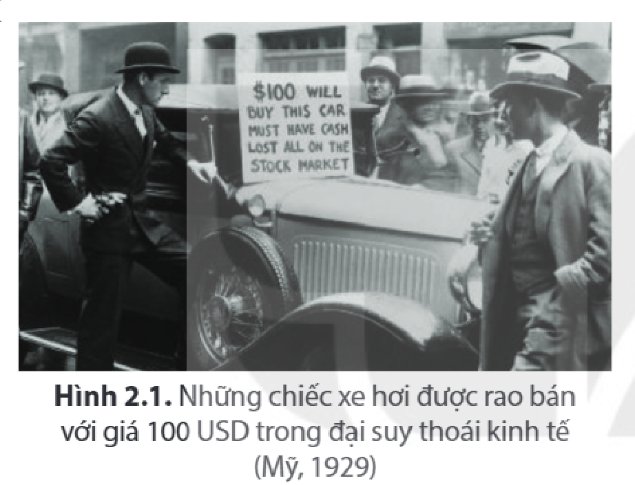
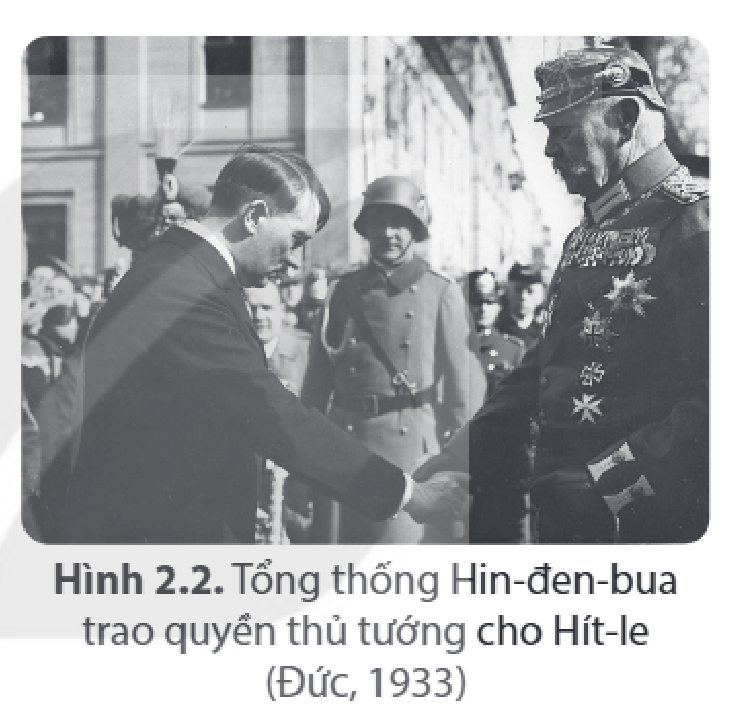
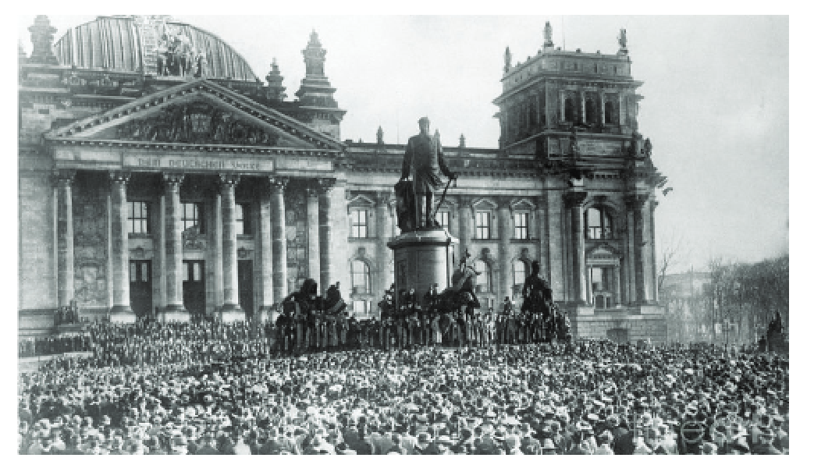
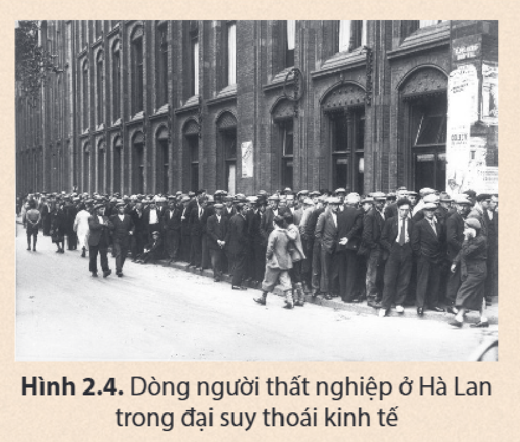
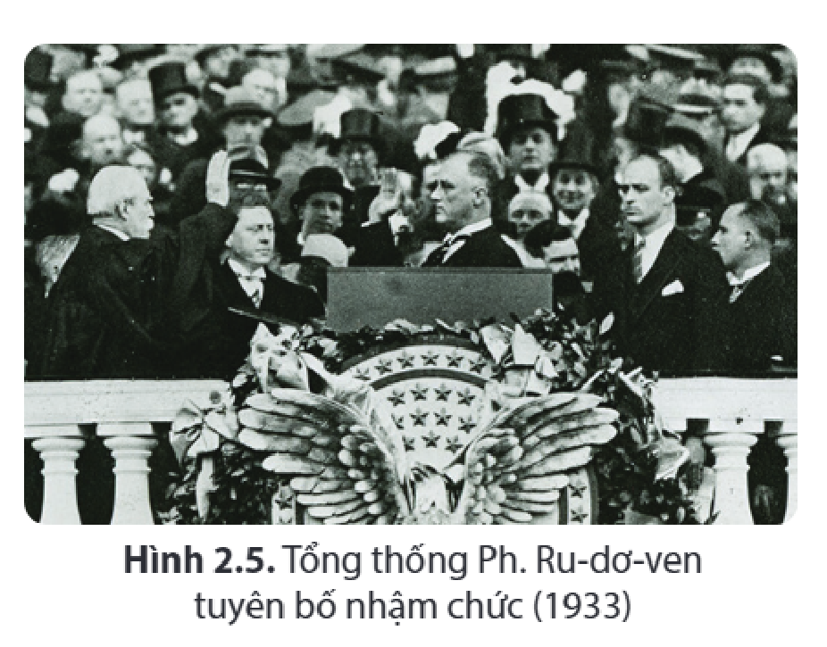
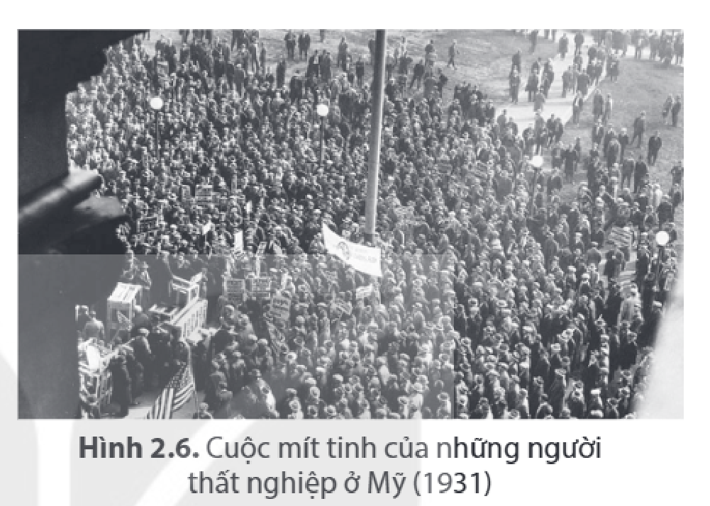
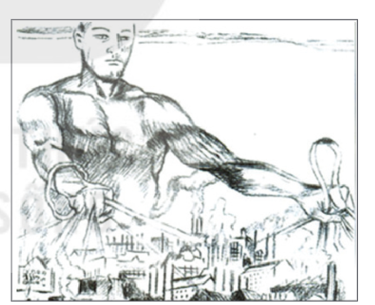

<!-- pdf:12 -->

# BÀI 2: CHÂU ÂU VÀ NƯỚC MỸ TỪ NĂM 1918 ĐẾN NĂM 1945

## 🎯 Học xong bài này, em sẽ:

- Trình bày được những nét chính về: phong trào cách mạng và sự thành lập Quốc tế Cộng sản; đại suy thoái kinh tế 1929 – 1933; sự hình thành chủ nghĩa phát xít ở châu Âu.
- Nhận biết được tình hình chính trị và sự phát triển kinh tế nước Mỹ giữa hai cuộc chiến tranh thế giới.

## 🔴 Mở đầu

*Hình 2.1. Những chiếc xe hơi được rao bán với giá 100 USD trong đại suy thoái kinh tế (Mỹ, 1929)*

*Hình 2.2. Tổng thống Hin-đen-bua trao quyền thủ tướng cho Hít-le (Đức, 1933)*

Trong những năm 1918 – 1945, lịch sử châu Âu và nước Mỹ đã trải qua những bước phát triển thăng trầm, đầy biến động trên tất cả các lĩnh vực kinh tế, chính trị, xã hội. Em biết gì về những biến động đó thông qua hai hình trên? Sự ra đời của Quốc tế Cộng sản, đại suy thoái kinh tế thế giới (1929 – 1933) và sự xuất hiện chủ nghĩa phát xít có liên quan gì đến tình hình đó?

## 1. Phong trào cách mạng (1918 – 1923) và sự thành lập Quốc tế Cộng sản (1919)

### a) Phong trào cách mạng ở các nước tư bản châu Âu

Do hậu quả nặng nề của Chiến tranh thế giới thứ nhất và tác động của Cách mạng tháng Mười Nga năm 1917, vào những năm 1918 – 1923, một phong trào cách mạng đã bùng nổ ở hầu khắp các nước tư bản châu Âu.

Ở Đức, ngày 9 – 11 – 1918, công nhân và các tầng lớp nhân dân ở Béc-lin đã tổng bãi công, sau đó chuyển thành khởi nghĩa vũ trang với sự tham gia của cả binh lính đã lật đổ

*Hình 2.3. Nhân dân tập trung trước toà nhà Rây-xtác (Đức) trong buổi tuyên bố thành lập chính phủ mới (1918)*

<!-- pdf:13 -->

chế độ quân chủ. Sau đó, chính quyền rơi vào tay giai cấp tư sản, chế độ cộng hoà tư sản ở Đức được thiết lập. Tháng 12 – 1918, Đảng Cộng sản Đức được thành lập. Trong những năm 1919 – 1923, phong trào cách mạng chống lại giai cấp tư sản vẫn tiếp diễn nhưng thất bại.

Phong trào cách mạng cũng phát triển mạnh ở các nước châu Âu như: Hung-ga-ri, Anh, Pháp,...

Ở Anh, từ năm 1919 đến năm 1921, đã có tới 6,5 triệu người bãi công. Công nhân không những đưa ra yêu sách kinh tế mà còn đưa ra yêu sách về chính trị.

Ở Pháp, phong trào bãi công của công nhân chuyển thành cao trào cách mạng, với cuộc tổng bãi công lớn nhất nổ ra nhân ngày Quốc tế Lao động (1 – 5 – 1920) lôi cuốn hơn 1 triệu người tham gia và kéo dài suốt một tuần lễ.

> 💡 **Em có biết?**
>
> Ở I-ta-li-a, tính riêng năm 1919, đã có hơn 1 600 cuộc bãi công với hơn 1 triệu người tham gia. Phong trào đấu tranh của công nhân đạt tới đỉnh điểm vào năm 1920, khi chuyển thành phong trào chiếm công xưởng, thành lập các “Đội cận vệ đỏ” để bảo vệ công xưởng.

Qua phong trào, nhiều Đảng Cộng sản được thành lập như: Đảng Cộng sản Hung-ga-ri (1918), Đảng Cộng sản Pháp (1920), Đảng Cộng sản Anh (1920), Đảng Cộng sản I-ta-li-a (1921),...

> ❓ Trình bày những nét chính về phong trào cách mạng ở các nước tư bản châu Âu từ năm 1918 đến năm 1923.

### b) Sự thành lập Quốc tế Cộng sản

<!-- term: Quốc tế Cộng sản -->
Sự phát triển của phong trào cách mạng đòi hỏi phải có một tổ chức quốc tế để lãnh đạo. Tháng 3 – 1919, với những hoạt động tích cực của V. I. Lê-nin và Đảng Bôn-sê-vích Nga, Quốc tế Cộng sản (còn gọi là Quốc tế thứ ba) được thành lập ở Mát-xcơ-va.

<!-- term: Quốc tế Cộng sản -->
Trong thời gian tồn tại (1919 – 1943), Quốc tế Cộng sản đã tiến hành 7 kì đại hội, đề ra đường lối cho từng thời kì phát triển của cách mạng thế giới, trở thành tổ chức quốc tế của giai cấp công nhân và các dân tộc bị áp bức trên toàn thế giới.

<!-- term: Luận cương về vấn đề dân tộc và vấn đề thuộc địa -->
Tại Đại hội lần thứ II (1920), Quốc tế Cộng sản thông qua *Luận cương về vấn đề dân tộc và vấn đề thuộc địa* do V. I. Lê-nin dự thảo với khẩu hiệu: “Vô sản toàn thế giới và các dân tộc bị áp bức đoàn kết lại”. Nguyễn Ái Quốc đã tìm thấy ở Luận cương con đường cứu nước, giải phóng dân tộc cho nhân dân Việt Nam.

Năm 1943, do sự thay đổi của tình hình thế giới, Quốc tế Cộng sản tuyên bố tự giải tán.

> ❓ Trình bày sự thành lập và một số hoạt động chính của Quốc tế Cộng sản.

## 2. Cuộc đại suy thoái kinh tế (1929 – 1933) và sự hình thành chủ nghĩa phát xít

<!-- term: Đại suy thoái kinh tế -->
Trong những năm 1924 – 1929, kinh tế ở các nước tư bản chủ nghĩa phát triển mạnh mẽ, sản xuất tăng lên nhanh chóng. Nhưng do sản xuất ồ ạt, nhu cầu và sức mua của thị trường không có sự tăng lên tương ứng, hàng hoá trở nên ế thừa và dẫn tới suy thoái trong sản xuất. Vì thế, đời sống của đa số nhân dân không được cải thiện. Đó là những nguyên nhân dẫn tới cuộc đại suy thoái kinh tế.

<!-- term: Đại suy thoái kinh tế -->
Tháng 10 – 1929, cuộc đại suy thoái kinh tế bùng nổ ở Mỹ, sau đó lan rộng ra toàn thế giới tư bản chủ nghĩa, diễn ra trên tất cả các lĩnh vực (tài chính, công nghiệp, nông nghiệp, thương nghiệp), kéo dài gần 4 năm, trầm trọng nhất là năm 1932.

<!-- term: Đại suy thoái kinh tế -->
Cuộc đại suy thoái đó đã tàn phá nặng nề nền kinh tế và gây ra những hậu quả nghiêm trọng về mặt xã hội ở các nước tư bản chủ nghĩa.

<!-- pdf:14 -->

> 📜 **Tư liệu**
>
> Số công nhân thất nghiệp đã lên tới 50 triệu… Hàng triệu nông dân bị mất ruộng đất, sống trong cảnh nghèo đói... Trong bối cảnh đó, phong trào cách mạng thế giới đã có bước chuyển biến mới: thoái trào tiến dần lên cao trào... Theo thống kê không đầy đủ, từ năm 1928 đến cuối năm 1933, số người tham gia bãi công ở các nước tư bản chủ nghĩa đã lên tới 17 triệu.
>
> (Theo Nguyễn Anh Thái (Chủ biên), *Lịch sử thế giới hiện đại*, NXB Giáo dục Việt Nam, 2011, tr. 99)

*Hình 2.4. Dòng người thất nghiệp ở Hà Lan trong đại suy thoái kinh tế*

<!-- term: Chủ nghĩa phát xít -->
Để thoát khỏi đại suy thoái, các nước Anh, Pháp,... do có nhiều thuộc địa, vốn và thị trường nên tiến hành những cuộc cải cách kinh tế – xã hội. Trong khi đó, các nước Đức, I-ta-li-a, không có hoặc có ít thuộc địa nên ngày càng thiếu vốn, thiếu nguyên liệu, thị trường, đã đi theo con đường phát xít hoá, thiết lập chế độ độc tài, phát động chiến tranh để phân chia lại thế giới.

Ở Đức, để đối phó với đại suy thoái kinh tế và phong trào cách mạng ngày càng dâng cao, giai cấp tư sản cầm quyền quyết định đưa Hít-le lên làm Thủ tướng (1 – 1933). Nước Đức trở thành một “lò lửa chiến tranh”.

Ở I-ta-li-a, một “lò lửa chiến tranh” khác cũng xuất hiện. Do Chính phủ không thoả mãn với việc phân chia lại thế giới theo Hoà ước Véc-xai nên đã bành trướng thế lực và tiến hành xâm chiếm thuộc địa ở châu Phi, khu vực Địa Trung Hải,...

> ❓ 1. Khai thác tư liệu và thông tin trong mục, hãy trình bày nguyên nhân và biểu hiện của cuộc đại suy thoái kinh tế trong những năm 1929 – 1933.
>
> 2. Sự hình thành chủ nghĩa phát xít ở châu Âu diễn ra như thế nào?

## 3. Nước Mỹ giữa hai cuộc chiến tranh thế giới

### a) Tình hình chính trị

*Về đối nội:* Trong những năm 20 của thế kỉ XX, Đảng Cộng hoà liên tục nắm chính quyền, đề cao sự phồn vinh của nền kinh tế, ngăn chặn các cuộc đấu tranh của công nhân, đàn áp những người có tư tưởng tiến bộ,...

Năm 1930, Đảng Dân chủ giành thắng lợi trong cuộc bỏ phiếu bầu Quốc hội Mỹ. Năm 1932, ứng cử viên Đảng Dân chủ là Ph. Ru-dơ-ven được bầu làm Tổng thống.

<!-- term: Học thuyết Mơn-rô -->
*Về đối ngoại:* Trong những năm 20 của thế kỉ XX, giới cầm quyền Mỹ theo đuổi lập trường chống Liên Xô, tiếp tục thực hiện học thuyết Mơn-rô (châu Mỹ của người châu Mỹ) để bành trướng, thậm chí can thiệp về quân sự khi cần thiết đối với khu vực Mỹ La-tinh.

*Hình 2.5. Tổng thống Ph. Ru-dơ-ven tuyên bố nhậm chức (1933)*

<!-- pdf:15 -->

<!-- term: Chính sách láng giềng thân thiện -->
Từ năm 1933, Chính phủ của Tổng thống Ph. Ru-dơ-ven đã công nhận và đặt quan hệ ngoại giao với Liên Xô, thực hiện *Chính sách láng giềng thân thiện* đối với các nước Mỹ La-tinh.

### b) Sự phát triển kinh tế

Chiến tranh thế giới thứ nhất đã đem lại cơ hội vàng cho sự phát triển kinh tế nước Mỹ, đưa nền kinh tế nước này bước vào thời kì "hoàng kim" trong những năm 20 của thế kỉ XX.

Chỉ trong vòng 6 năm (1923 – 1929) sản lượng công nghiệp Mỹ tăng 69%. Năm 1929, Mỹ chiếm 48% sản lượng công nghiệp thế giới, đứng đầu thế giới về ngành công nghiệp sản xuất ô tô, thép và dầu mỏ.

Cuộc đại suy thoái kinh tế bùng nổ ở Mỹ (10 – 1929), bắt đầu từ lĩnh vực tài chính, rồi nhanh chóng lan rộng ra các lĩnh vực công nghiệp và nông nghiệp, khiến nền kinh tế, tài chính Mỹ bị chấn động dữ dội.

*Hình 2.6. Cuộc mít tinh của những người thất nghiệp ở Mỹ (1931)*

<!-- term: Chính sách mới -->
Để đưa nước Mỹ thoát ra khỏi cuộc đại suy thoái, Tổng thống Ph. Ru-dơ-ven đã thực hiện *Chính sách mới*.

<!-- term: Chính sách mới -->
Chính sách mới bao gồm các biện pháp nhằm giải quyết nạn thất nghiệp, phục hồi sự phát triển của các ngành kinh tế – tài chính, cải tổ hệ thống ngân hàng, tạo thêm nhiều việc làm mới và ổn định tình hình xã hội.

<!-- term: Chính sách mới -->
Chính sách mới đã cứu nguy cho chủ nghĩa tư bản Mỹ, góp phần làm cho nước Mỹ duy trì được chế độ dân chủ tư sản, tình hình chính trị, xã hội dần dần được ổn định.

*Hình 2.7. Bức tranh đương thời mô tả Chính sách mới của Mỹ (người khổng lồ tượng trưng cho Nhà nước)*

> ❓ Trình bày những nét lớn về tình hình chính trị, kinh tế của nước Mỹ giữa hai cuộc chiến tranh thế giới.

## ✏️ Luyện tập và Vận dụng

**Luyện tập:**

1. Lập sơ đồ tư duy về những nét chính của tình hình châu Âu và nước Mỹ giữa hai cuộc chiến tranh thế giới.

2. Nêu nhận xét của em về con đường thoát khỏi đại suy thoái của các nước tư bản châu Âu và nước Mỹ.

**Vận dụng:**

Tìm hiểu thông tin trên sách, báo và internet, viết đoạn văn ngắn giới thiệu về *Chính sách mới* của Tổng thống Ph. Ru-dơ-ven nhằm đưa nước Mỹ thoát khỏi cuộc đại suy thoái kinh tế.

## 📷 Danh sách hình trong bài

| Mã hình | Trang PDF | Vị trí | Chú thích |
| --- | --- | --- | --- |
| H9-lich_su_va_dia_ly-ls-b02-01 | 12 | Mở đầu (trang 10) | Hình 2.1. Những chiếc xe hơi được rao bán với giá 100 USD trong đại suy thoái kinh tế (Mỹ, 1929) |
| H9-lich_su_va_dia_ly-ls-b02-02 | 12 | Mở đầu (trang 10) | Hình 2.2. Tổng thống Hin-đen-bua trao quyền thủ tướng cho Hít-le (Đức, 1933) |
| H9-lich_su_va_dia_ly-ls-b02-03 | 12 | Mục 1.a, chú thích in bên trái dưới đoạn văn (trang 10) | Hình 2.3. Nhân dân tập trung trước toà nhà Rây-xtác (Đức) trong buổi tuyên bố thành lập chính phủ mới (1918) |
| H9-lich_su_va_dia_ly-ls-b02-04 | 14 | Mục 2 (trang 12) | Hình 2.4. Dòng người thất nghiệp ở Hà Lan trong đại suy thoái kinh tế |
| H9-lich_su_va_dia_ly-ls-b02-05 | 14 | Mục 3.a (trang 12) | Hình 2.5. Tổng thống Ph. Ru-dơ-ven tuyên bố nhậm chức (1933) |
| H9-lich_su_va_dia_ly-ls-b02-06 | 15 | Mục 3.b (trang 13) | Hình 2.6. Cuộc mít tinh của những người thất nghiệp ở Mỹ (1931) |
| H9-lich_su_va_dia_ly-ls-b02-07 | 15 | Mục 3.b, chú thích in bên trái dưới đoạn văn (trang 13) | Hình 2.7. Bức tranh đương thời mô tả Chính sách mới của Mỹ (người khổng lồ tượng trưng cho Nhà nước) |
