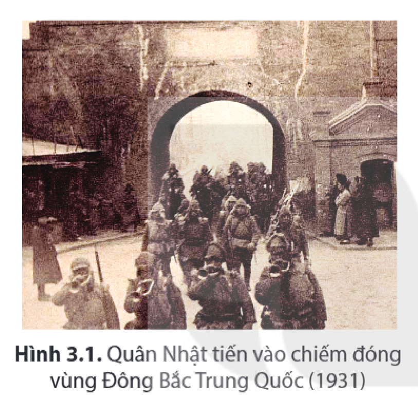
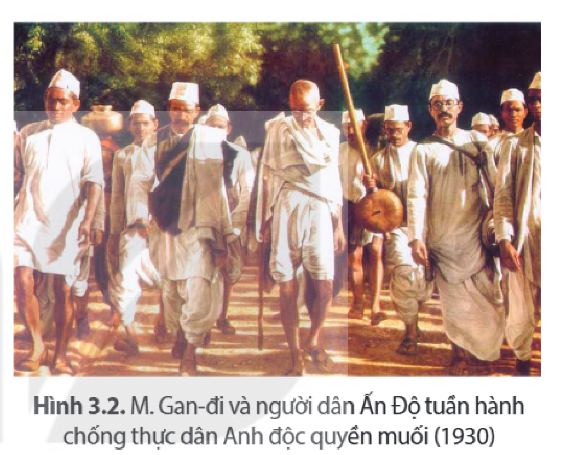
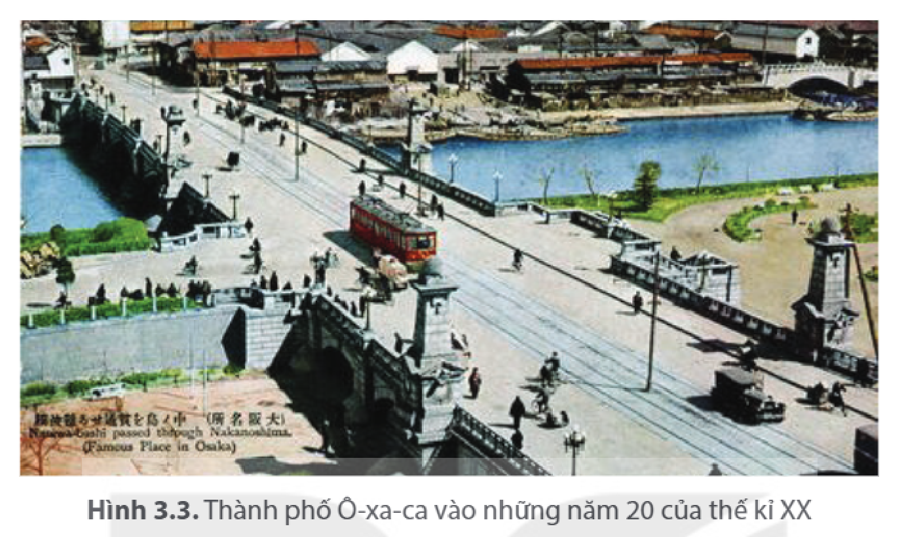
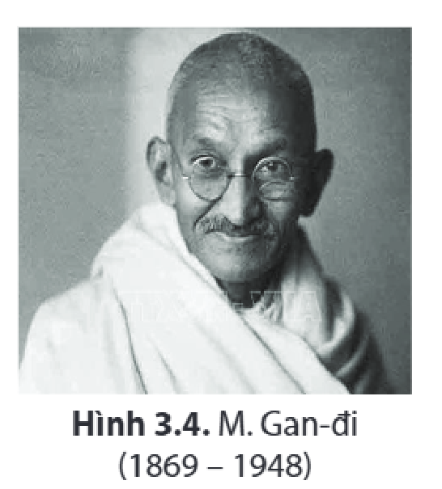
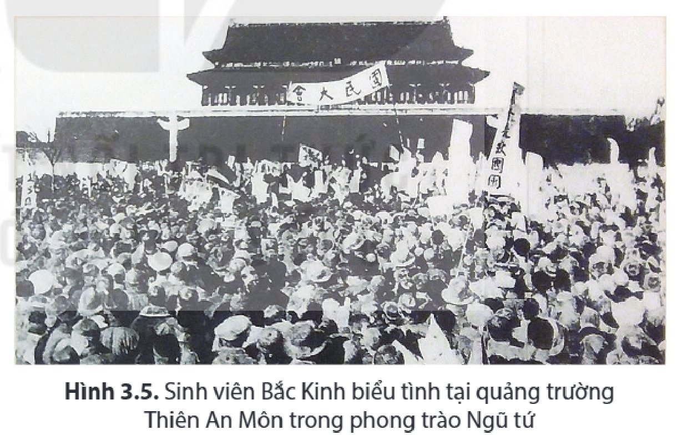

<!-- pdf:16 -->

# BÀI 3: CHÂU Á TỪ NĂM 1918 ĐẾN NĂM 1945

## 🎯 Học xong bài này, em sẽ:

- Nêu được những nét chính về tình hình châu Á từ năm 1918 đến năm 1945.

## 🔴 Mở đầu

*Hình 3.1. Quân Nhật tiến vào chiếm đóng vùng Đông Bắc Trung Quốc (1931)*
<!-- ocr-ok: đã đối chiếu p016.png, OCR bỏ sót dòng đầu chú thích Hình 3.1 -->

*Hình 3.2. M. Gan-đi và người dân Ấn Độ tuần hành chống thực dân Anh độc quyền muối (1930)*

Hai hình trên phản ánh tình hình trái ngược ở châu Á trong thời gian giữa hai cuộc chiến tranh thế giới (1918 – 1939). Trong khi Nhật Bản tăng cường chiến tranh xâm lược thì ở hầu hết các nước còn lại như Ấn Độ, Trung Quốc và các nước Đông Nam Á đã bùng nổ các cuộc đấu tranh giành độc lập dân tộc. Vì sao như vậy? Những biểu hiện nào chứng tỏ điều đó?

## 1. Nhật Bản từ năm 1918 đến năm 1945

### a) Nhật Bản trong những năm 1918 – 1929

Nhờ hưởng lợi từ trong Chiến tranh thế giới thứ nhất, nền kinh tế Nhật Bản phát triển nhanh chóng sau chiến tranh. Tuy nhiên, sự phát triển đó chỉ kéo dài trong 18 tháng.

Đến những năm 1920 – 1921, nền kinh tế Nhật Bản sa sút, nhiều công ty làm ăn thua lỗ, nhiều nhà kinh doanh bị phá sản, số người thất nghiệp lên tới 12 vạn người. Đời sống người lao động không được cải thiện, phong trào đấu tranh của công nhân và nông dân bùng lên mạnh mẽ. Tháng 7 – 1922, Đảng Cộng sản Nhật Bản được thành lập và trở thành lực lượng lãnh đạo phong trào công nhân.

Vào những năm 1924 – 1929, kinh tế Nhật Bản phát triển nhưng không ổn định. Năm 1926, sản lượng công nghiệp phục hồi vượt mức trước chiến tranh. Tuy nhiên, năm 1927,

<!-- pdf:17 -->

cuộc khủng hoảng tài chính ở Tô-ki-ô làm cho hàng chục ngân hàng phải đóng cửa, số công nhân thất nghiệp tăng mạnh, nông dân bị bần cùng hoá, sức mua của người dân giảm sút.

*Hình 3.3. Thành phố Ô-xa-ca vào những năm 20 của thế kỉ XX*

> ❓ Nêu những nét chính về tình hình Nhật Bản trong những năm 1918 – 1929.

### b) Nhật Bản trong những năm 1929 – 1945

Cuộc đại suy thoái kinh tế thế giới 1929 – 1933 đã giáng một đòn nặng nề vào kinh tế Nhật Bản.

So với năm 1929, năm 1931, sản lượng công nghiệp giảm 32,5%, ngoại thương giảm 80%, khoảng 3 triệu người thất nghiệp. Cuộc đại suy thoái làm cho mâu thuẫn xã hội ngày càng gay gắt. Năm 1929 có 276 cuộc bãi công nổ ra, đến năm 1931 đã có gần 1 000 cuộc bãi công.

Để đưa đất nước ra khỏi đại suy thoái, Chính phủ Nhật Bản tăng cường chính sách quân sự hoá bộ máy nhà nước, gây chiến tranh xâm lược, bành trướng ra bên ngoài.

Ngay từ năm 1927, Thủ tướng Ta-na-ca đã đệ trình lên Nhật hoàng bản *Tấu trình*, đề ra kế hoạch xâm lược và thống trị thế giới. Tháng 9 – 1931, Nhật Bản xâm chiếm vùng Đông Bắc Trung Quốc, đánh dấu việc hình thành "lò lửa chiến tranh" ở châu Á – Thái Bình Dương.

Khi Chiến tranh thế giới thứ hai bắt đầu diễn ra, Nhật Bản cũng ráo riết chuẩn bị chiến tranh. Tháng 9 – 1940, quân Nhật kéo vào Đông Dương. Tháng 12 – 1941, Nhật Bản bất ngờ tấn công hạm đội Mỹ ở Trân Châu cảng (quần đảo Ha-oai). Quân đội Nhật Bản xâm lược các nước Đông Nam Á khác, tiến đánh nhiều đảo thuộc châu Á – Thái Bình Dương,... Tuy nhiên, đến ngày 15 – 8 – 1945, Nhật Bản phải chấp nhận đầu hàng không điều kiện trước quân Đồng minh.

> ❓ Tình hình Nhật Bản trong những năm 1929 – 1945 có điểm gì nổi bật?

## 2. Phong trào đấu tranh giành độc lập dân tộc ở châu Á từ năm 1918 đến năm 1945

### a) Khái quát

Thắng lợi của Cách mạng tháng Mười Nga đã tác động đến nhiều nước châu Á. Phong trào đấu tranh giành độc lập dân tộc dâng cao và lan rộng khắp các khu vực: Đông Bắc Á, Đông Nam Á, Nam Á và Tây Á.

<!-- pdf:18 -->

Phong trào đấu tranh giành độc lập ở châu Á giai đoạn này diễn ra theo hai khuynh hướng chính: dân chủ tư sản (tiêu biểu là Ấn Độ, In-đô-nê-xi-a,...) và vô sản (tiêu biểu là Trung Quốc, Việt Nam,...).

<!-- term: Đảng Quốc đại -->
Ở Ấn Độ, dưới sự lãnh đạo của Đảng Quốc đại, đứng đầu là M. Gan-đi, nhân dân đã đấu tranh đòi quyền độc lập, tẩy chay hàng hoá của Anh và phát triển nền kinh tế dân tộc.

Ở Mông Cổ, trong những năm 1921 – 1924 đã diễn ra phong trào giải phóng dân tộc, dẫn tới sự ra đời của nước Cộng hoà Nhân dân Mông Cổ.

*Hình 3.4. M. Gan-đi (1869 – 1948)*

Ở Thổ Nhĩ Kỳ, cuộc chiến tranh giải phóng dân tộc trong những năm 1919 – 1922 đã đưa đến sự thành lập nước Cộng hoà Thổ Nhĩ Kỳ.

> ❓ Nêu những nét chính về phong trào đấu tranh giành độc lập dân tộc ở châu Á từ năm 1918 đến năm 1945.

### b) Cách mạng Trung Quốc trong những năm 1919 – 1945

<!-- term: Phong trào Ngũ tứ -->
Phong trào Ngũ tứ bùng nổ ngày 4 – 5 – 1919, mở đầu là cuộc biểu tình của 3 000 sinh viên yêu nước ở Bắc Kinh chống lại âm mưu xâu xé Trung Quốc của các nước đế quốc. Phong trào đã nhanh chóng lan rộng ra cả nước, lôi cuốn đông đảo công nhân, nông dân, trí thức yêu nước tham gia.

Tháng 7 – 1921, Đảng Cộng sản Trung Quốc được thành lập.

Trong những năm 1927 – 1937, nhân dân Trung Quốc dưới sự lãnh đạo của Đảng Cộng sản tiến hành cuộc chiến tranh cách mạng nhằm lật đổ nền thống trị của tập đoàn Quốc dân đảng – đại diện cho quyền lợi của đại địa chủ, đại tư sản và đế quốc ở Trung Quốc.

*Hình 3.5. Sinh viên Bắc Kinh biểu tình tại quảng trường Thiên An Môn trong phong trào Ngũ tứ*

<!-- term: Quốc – Cộng hợp tác -->
Tháng 7 – 1937, Nhật Bản mở rộng cuộc chiến tranh xâm lược nhằm thôn tính toàn bộ Trung Quốc. Trong bối cảnh đó, Đảng Cộng sản Trung Quốc đã chủ động đề nghị Quốc dân đảng đình chiến, cùng hợp tác chống Nhật. Cách mạng Trung Quốc chuyển sang thời kì Quốc – Cộng hợp tác để cùng kháng chiến chống Nhật Bản.

> ❓ Nêu những nét chính về phong trào cách mạng Trung Quốc trong những năm 1919 – 1945.

### c) Phong trào đấu tranh giành độc lập dân tộc ở Đông Nam Á trong những năm 1918 – 1945

Từ sau Chiến tranh thế giới thứ nhất, giai cấp vô sản ở các nước Đông Nam Á từng bước trưởng thành, đã tham gia lãnh đạo phong trào cách mạng.

<!-- pdf:19 -->

Trong giai đoạn này, một số Đảng Cộng sản được thành lập như: Đảng Cộng sản In-đô-nê-xi-a (5 – 1920), Đảng Cộng sản Việt Nam (đầu năm 1930), các Đảng Cộng sản Mã Lai và Xiêm (4 – 1930), Đảng Cộng sản Phi-líp-pin (11 – 1930).

Dưới sự lãnh đạo của Đảng Cộng sản, phong trào đấu tranh giành độc lập dân tộc của giai cấp công nhân và nhân dân lao động một số nước đã bùng nổ. Nổi bật là cuộc khởi nghĩa tại Gia-va và Xu-ma-tơ-ra (1926 – 1927) ở In-đô-nê-xi-a và cao trào Xô viết Nghệ – Tĩnh (1930 – 1931) ở Việt Nam. Những cuộc nổi dậy này đều bị chính quyền thực dân đàn áp đẫm máu.

Cùng với sự phát triển của phong trào vô sản, phong trào dân chủ tư sản cũng có bước tiến rõ rệt so với những năm đầu thế kỉ XX.

Nếu như trước đây mới chỉ xuất hiện các nhóm, phái hoặc các hội do những nhà yêu nước sáng lập, thì đến giai đoạn này đã xuất hiện các chính đảng có tổ chức và ảnh hưởng xã hội rộng lớn như: Đảng Dân tộc ở In-đô-nê-xi-a, Phong trào Tha-kin ở Miến Điện, Liên minh Thanh niên Ma-lay-a ở Mã Lai,...

Ở Đông Dương, cuộc đấu tranh chống thực dân Pháp được tiến hành dưới nhiều hình thức phong phú với sự tham gia của đông đảo các tầng lớp nhân dân.

Ở Lào, nhiều bộ tộc đã tham gia phong trào chống thực dân Pháp, tiêu biểu là cuộc khởi nghĩa do Ong Kẹo và Com-ma-đam lãnh đạo kéo dài hơn 30 năm (1901 – 1937).

Ở Cam-pu-chia, các cuộc đấu tranh yêu nước liên tiếp nổ ra trong những năm 1918 – 1920, 1926,... đặc biệt là phong trào yêu nước theo xu hướng dân chủ tư sản do nhà sư A-cha Hem-chiêu đứng đầu trong những năm 1930 – 1935.

Ở Việt Nam, phong trào đấu tranh chống thực dân Pháp phát triển mạnh mẽ, nhất là sau khi Đảng Cộng sản được thành lập (1930).

Trong Chiến tranh thế giới thứ hai, phong trào đấu tranh giành độc lập dân tộc ở Đông Nam Á phát triển mạnh mẽ. Năm 1940, quân phiệt Nhật Bản xâm lược các nước Đông Nam Á. Năm 1945, lợi dụng thời cơ Nhật Bản đầu hàng Đồng minh, phong trào giải phóng dân tộc đã giành thắng lợi ở một số nước.

> ❓ Nêu những nét chính về phong trào đấu tranh giành độc lập dân tộc ở Đông Nam Á trong những năm 1918 – 1945.

## ✏️ Luyện tập và Vận dụng

**Luyện tập:**

1. Hãy lập bảng hệ thống những nét chính về tình hình châu Á từ năm 1918 đến năm 1945.

2. Trình bày những biểu hiện chứng tỏ sự phát triển của phong trào giải phóng dân tộc ở châu Á sau Chiến tranh thế giới thứ nhất.

**Vận dụng:**

Sưu tầm tư liệu từ sách, báo và internet, hãy tìm một số sự kiện trong những năm 1939 – 1945 thể hiện mối liên minh đoàn kết chiến đấu giữa ba nước Việt Nam – Lào – Cam-pu-chia và giới thiệu với bạn.

## 📷 Danh sách hình trong bài

| Mã hình | Trang PDF | Vị trí | Chú thích |
| --- | --- | --- | --- |
| H9-lich_su_va_dia_ly-ls-b03-01 | 16 | Mở đầu (trang 14) | Hình 3.1. Quân Nhật tiến vào chiếm đóng vùng Đông Bắc Trung Quốc (1931) |
| H9-lich_su_va_dia_ly-ls-b03-02 | 16 | Mở đầu (trang 14) | Hình 3.2. M. Gan-đi và người dân Ấn Độ tuần hành chống thực dân Anh độc quyền muối (1930) |
| H9-lich_su_va_dia_ly-ls-b03-03 | 17 | Mục 1.a (trang 15) | Hình 3.3. Thành phố Ô-xa-ca vào những năm 20 của thế kỉ XX |
| H9-lich_su_va_dia_ly-ls-b03-04 | 18 | Mục 2.a (trang 16) | Hình 3.4. M. Gan-đi (1869 – 1948) |
| H9-lich_su_va_dia_ly-ls-b03-05 | 18 | Mục 2.b (trang 16) | Hình 3.5. Sinh viên Bắc Kinh biểu tình tại quảng trường Thiên An Môn trong phong trào Ngũ tứ |
