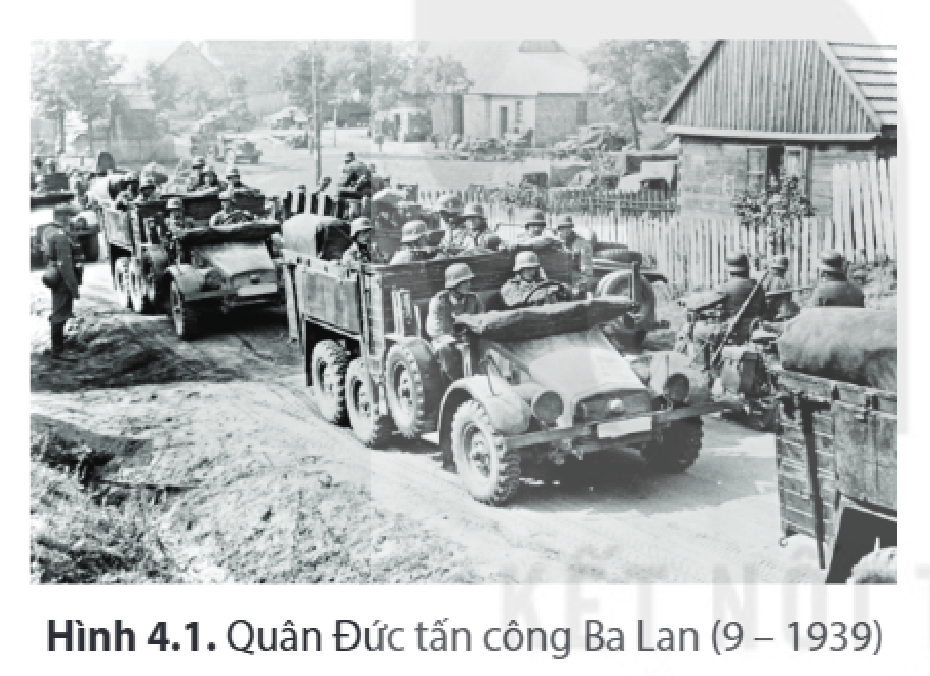
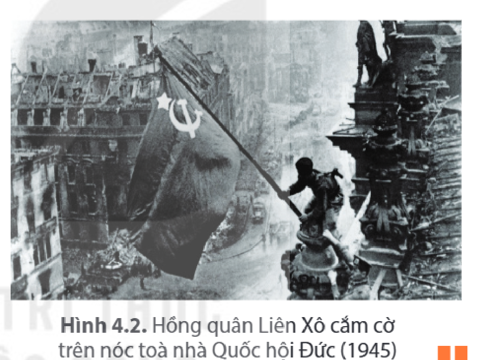
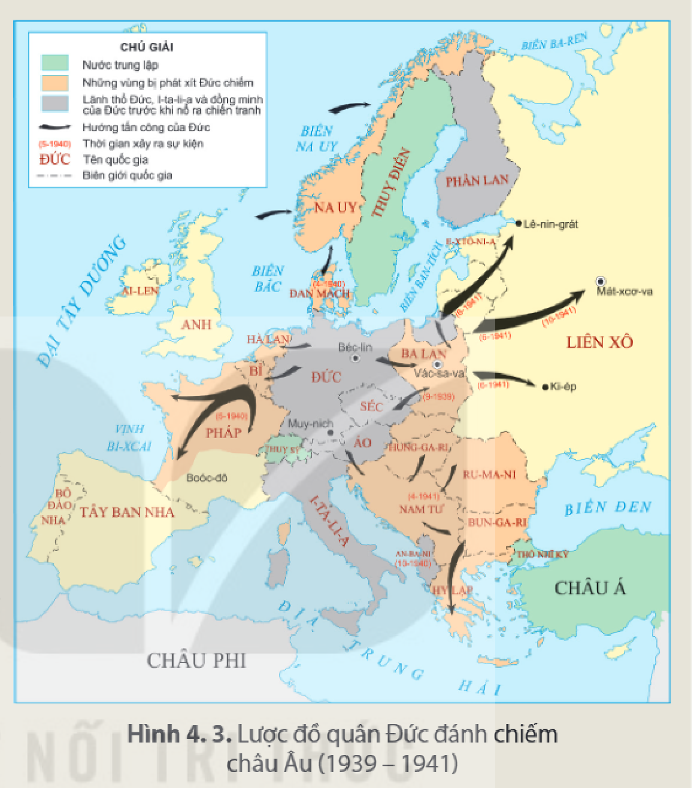
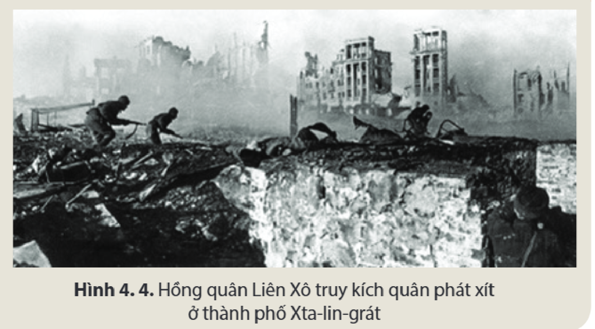
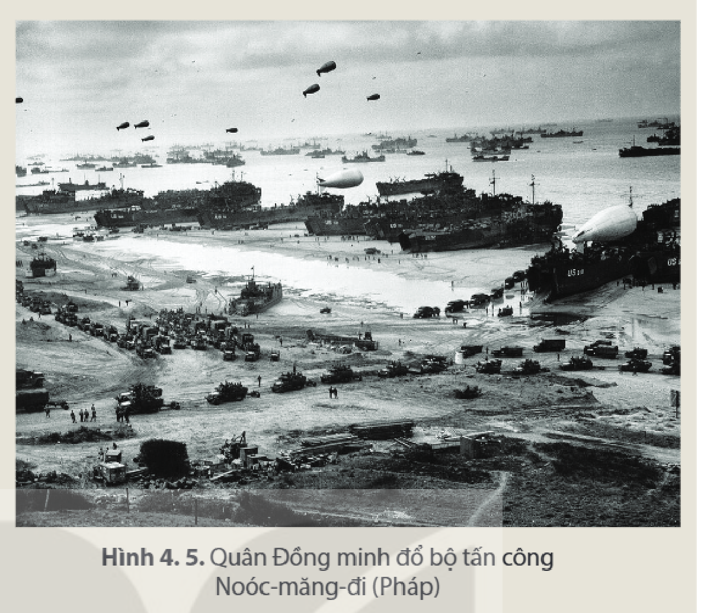
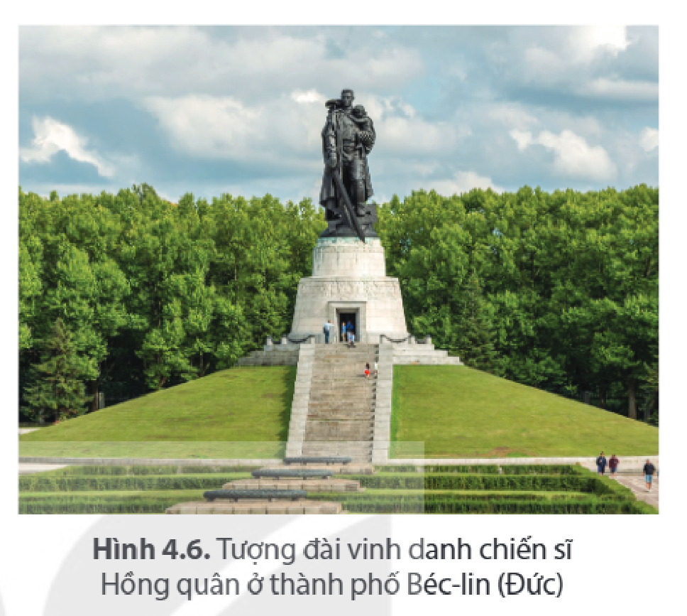

<!-- pdf:20 -->

# BÀI 4: CHIẾN TRANH THẾ GIỚI THỨ HAI (1939 – 1945)

## 🎯 Học xong bài này, em sẽ:

- Trình bày được nguyên nhân và diễn biến chủ yếu của Chiến tranh thế giới thứ hai.
- Phân tích được hậu quả của Chiến tranh thế giới thứ hai đối với lịch sử nhân loại.
- Nêu được nguyên nhân thắng lợi, ý nghĩa lịch sử, vai trò của Liên Xô và các nước Đồng minh trong chiến thắng chủ nghĩa phát xít.

## 🔴 Mở đầu

Hai hình dưới đây gợi cho em liên tưởng đến sự kiện nào của thế giới trong thế kỉ XX? Hãy chia sẻ những hiểu biết của em về nguyên nhân, diễn biến, hậu quả của sự kiện đó.

*Hình 4.1. Quân Đức tấn công Ba Lan (9 – 1939)*

*Hình 4.2. Hồng quân Liên Xô cắm cờ trên nóc toà nhà Quốc hội Đức (1945)*

## 1. Nguyên nhân dẫn tới Chiến tranh thế giới thứ hai

Sau Chiến tranh thế giới thứ nhất, những mâu thuẫn về thị trường và thuộc địa tiếp tục nảy sinh giữa các nước đế quốc. Đặc biệt, cuộc đại suy thoái kinh tế 1929 – 1933 đã làm sâu sắc thêm những mâu thuẫn của chủ nghĩa tư bản. Chính những điều đó dẫn tới sự hình thành chủ nghĩa phát xít và quân phiệt ở Đức và Nhật Bản. Cùng với I-ta-li-a, các thế lực này là thủ phạm gây ra chiến tranh.

Trên thế giới hình thành hai khối đế quốc đối địch nhau: khối các nước tư bản dân chủ gồm Anh, Pháp, Mỹ và khối phát xít gồm Đức, I-ta-li-a, Nhật Bản. Tuy nhiên, cả hai khối đế quốc này cùng có chung mâu thuẫn với Liên Xô.

Liên Xô coi chủ nghĩa phát xít là kẻ thù nguy hiểm nhất nên chủ trương liên kết với các nước tư bản để chống phát xít và nguy cơ chiến tranh. Chính phủ các nước Anh, Pháp, Mỹ một mặt lo sợ sự bành trướng của chủ nghĩa phát xít, mặt khác lại thù ghét chủ nghĩa cộng sản. Vì thế, giới cầm quyền các nước này đã nhượng bộ phát xít, hòng đẩy Đức chống Liên Xô.

> ❓ Hãy trình bày nguyên nhân dẫn đến Chiến tranh thế giới thứ hai.

<!-- pdf:21 -->

## 2. Diễn biến chính và hậu quả của Chiến tranh thế giới thứ hai

### a) Diễn biến chính

**Giai đoạn I:** Chiến tranh bùng nổ và lan rộng khắp thế giới (từ ngày 1 – 9 – 1939 đến tháng 11 – 1942)

- Ngày 1 – 9 – 1939, quân đội Đức tấn công Ba Lan. Ngày 3 – 9 – 1939, Anh, Pháp tuyên chiến với Đức. Chiến tranh thế giới bắt đầu.
- Từ tháng 4 đến tháng 7 – 1940, quân Đức đánh chiếm Pháp, tấn công Anh.
- Mùa hè 1941, quân Đức chiếm hầu hết các nước tư bản châu Âu.
- Ngày 22 – 6 – 1941, quân Đức tấn công Liên Xô trên dọc tuyến biên giới phía tây. Đến tháng 10, quân Đức uy hiếp Thủ đô Mát-xcơ-va.
- Tháng 12 – 1941, quân Nhật Bản tấn công căn cứ Trân Châu cảng của Mỹ ở Thái Bình Dương, Mỹ chính thức tham gia vào chiến tranh. Chiến tranh lan rộng toàn thế giới.

*Hình 4. 3. Lược đồ quân Đức đánh chiếm châu Âu (1939 – 1941)*

<!-- term: Mặt trận Đồng minh chống phát xít -->
- Tháng 1 – 1942, Mặt trận Đồng minh chống phát xít được thành lập với ba trụ cột là Liên Xô, Mỹ, Anh.

**Giai đoạn II:** Quân Đồng minh chuyển sang phản công, chiến tranh kết thúc (từ tháng 11 – 1942 đến tháng 8 – 1945)

<!-- term: Trận Xta-lin-grát -->
- Từ tháng 11 – 1942 đến tháng 2 – 1943, Hồng quân Liên Xô phản công và giành thắng lợi trước quân phát xít tại thành phố Xta-lin-grát, tạo nên bước ngoặt của cuộc chiến tranh: từ phòng ngự chuyển sang phản công.

*Hình 4. 4. Hồng quân Liên Xô truy kích quân phát xít ở thành phố Xta-lin-grát*

<!-- pdf:22 -->

- Tháng 6 – 1944, liên quân Mỹ, Anh và Đồng minh đổ bộ vào Noóc-măng-đi (Bắc Pháp), mở mặt trận thứ hai ở Tây Âu, giải phóng nước Pháp.
- Ngày 16 – 4 – 1945, Hồng quân Liên Xô mở chiến dịch công phá Béc-lin (Đức).
- Ngày 9 – 5 – 1945, Đức kí văn kiện đầu hàng Đồng minh không điều kiện. Chiến tranh kết thúc ở châu Âu.
- Ngày 6 và ngày 9 – 8 – 1945, Mỹ ném hai quả bom nguyên tử xuống thành phố Hi-rô-si-ma và Na-ga-sa-ki của Nhật Bản.

*Hình 4. 5. Quân Đồng minh đổ bộ tấn công Noóc-măng-đi (Pháp)*

- Ngày 8 – 8 – 1945, Hồng quân Liên Xô mở cuộc tấn công quân Nhật ở Đông Bắc Trung Quốc.
- Ngày 15 – 8 – 1945, Nhật Bản tuyên bố đầu hàng Đồng minh không điều kiện. Chiến tranh thế giới thứ hai kết thúc.

> ❓ Trình bày diễn biến chính của Chiến tranh thế giới thứ hai.

### b) Hậu quả của chiến tranh

<!-- term: Chiến tranh thế giới thứ hai -->
Chiến tranh thế giới thứ hai kết thúc với sự sụp đổ hoàn toàn của chủ nghĩa phát xít. Tuy nhiên, cuộc chiến tranh này đã gây ra những hậu quả vô cùng nặng nề: nền kinh tế thế giới bị thiệt hại; nhiều thành phố, làng mạc, cơ sở sản xuất công nghiệp bị tàn phá.

BẢNG THỐNG KÊ HẬU QUẢ CỦA CHIẾN TRANH THẾ GIỚI THỨ HAI

| Danh mục thống kê | Số liệu |
| --- | --- |
| Số nước tham chiến | 76 |
| Số người gia nhập quân đội (triệu người) | 110 |
| Số người chết vì chiến tranh (triệu người) | 60 |
| Số người bị thương (triệu người) | 90 |
| Thiệt hại về vật chất (tỉ USD) | 4 000 |
| Chi phí quân sự trực tiếp (tỉ USD) | 1 384 |

> ❓ Phân tích hậu quả của Chiến tranh thế giới thứ hai đối với lịch sử nhân loại.

<!-- pdf:23 -->

## 3. Nguyên nhân thắng lợi, ý nghĩa lịch sử, vai trò của Liên Xô và các nước Đồng minh trong chiến thắng chủ nghĩa phát xít

- *Nguyên nhân thắng lợi:*

<!-- term: Chiến tranh thế giới thứ hai -->
Chiến tranh thế giới thứ hai là cuộc chiến tranh phi nghĩa do phe phát xít gây ra – “kẻ gieo gió phải gặt bão”, đồng thời là cuộc chiến tranh chính nghĩa của phe Đồng minh, của các dân tộc bị phát xít chiếm đóng và của các lực lượng tiến bộ trên toàn thế giới.

Các dân tộc, toàn thể nhân loại tiến bộ luôn đoàn kết, kiên cường, sát cánh cùng lực lượng Đồng minh chiến đấu vì nền hoà bình, độc lập dân tộc, dân chủ và tiến bộ xã hội,...

Tinh thần chiến đấu và ý chí kiên cường của quân đội các nước Đồng minh, đặc biệt là của Hồng quân Liên Xô là một nhân tố quan trọng góp phần làm nên thắng lợi.

*Hình 4.6. Tượng đài vinh danh chiến sĩ Hồng quân ở thành phố Béc-lin (Đức)*

<!-- term: Chiến tranh thế giới thứ hai -->
- *Ý nghĩa:* Thắng lợi của Liên Xô và các nước Đồng minh đã giúp nhân loại thoát khỏi thảm hoạ của chủ nghĩa phát xít, tạo nên bước chuyển biến căn bản của tình hình thế giới sau chiến tranh: sự ra đời của hệ thống các nước xã hội chủ nghĩa, tương quan giữa các nước tư bản chủ nghĩa thay đổi,...

<!-- term: Chiến tranh thế giới thứ hai -->
Chiến thắng chủ nghĩa phát xít đã tạo điều kiện cho phong trào giải phóng dân tộc, phong trào vì hoà bình, dân chủ và tiến bộ xã hội phát triển.

- *Vai trò của Liên Xô và các nước Đồng minh trong chiến thắng chủ nghĩa phát xít:* Liên Xô, Mỹ, Anh là lực lượng đi đầu, giữ vai trò trụ cột, quyết định thắng lợi, trong đó Liên Xô có vai trò quyết định nhất.

> ❓ 1. Vì sao phát xít Đức, I-ta-li-a và quân phiệt Nhật Bản bị tiêu diệt trong Chiến tranh thế giới thứ hai?
>
> 2. Thắng lợi của Liên Xô và các nước Đồng minh trong Chiến tranh thế giới thứ hai có ý nghĩa lịch sử như thế nào?
>
> 3. Liên Xô và các nước Đồng minh có vai trò như thế nào trong việc tiêu diệt chủ nghĩa phát xít?

## ✏️ Luyện tập và Vận dụng

**Luyện tập:**

1. Vẽ trục thời gian thể hiện những sự kiện chính của Chiến tranh thế giới thứ hai (1939 – 1945).

2. Dựa vào thông tin trong bài học, hãy đánh giá vai trò của Liên Xô và các nước Đồng minh trong chiến thắng chủ nghĩa phát xít và nêu dẫn chứng.

**Vận dụng:**

Liên hệ và cho biết: Chiến tranh thế giới thứ hai đã để lại những bài học gì cho việc bảo vệ hoà bình thế giới hiện nay?

## 📷 Danh sách hình trong bài

| Mã hình | Trang PDF | Vị trí | Chú thích |
| --- | --- | --- | --- |
| H9-lich_su_va_dia_ly-ls-b04-01 | 20 | Mở đầu (trang 18) | Hình 4.1. Quân Đức tấn công Ba Lan (9 – 1939) |
| H9-lich_su_va_dia_ly-ls-b04-02 | 20 | Mở đầu, góc dưới bên phải chạm biểu tượng trang trí màu cam (trang 18) | Hình 4.2. Hồng quân Liên Xô cắm cờ trên nóc toà nhà Quốc hội Đức (1945) |
| H9-lich_su_va_dia_ly-ls-b04-03 | 21 | Mục 2.a (trang 19) | Hình 4. 3. Lược đồ quân Đức đánh chiếm châu Âu (1939 – 1941) |
| H9-lich_su_va_dia_ly-ls-b04-04 | 21 | Mục 2.a (trang 19) | Hình 4. 4. Hồng quân Liên Xô truy kích quân phát xít ở thành phố Xta-lin-grát |
| H9-lich_su_va_dia_ly-ls-b04-05 | 22 | Mục 2.a (trang 20) | Hình 4. 5. Quân Đồng minh đổ bộ tấn công Noóc-măng-đi (Pháp) |
| H9-lich_su_va_dia_ly-ls-b04-06 | 23 | Mục 3 (trang 21) | Hình 4.6. Tượng đài vinh danh chiến sĩ Hồng quân ở thành phố Béc-lin (Đức) |
