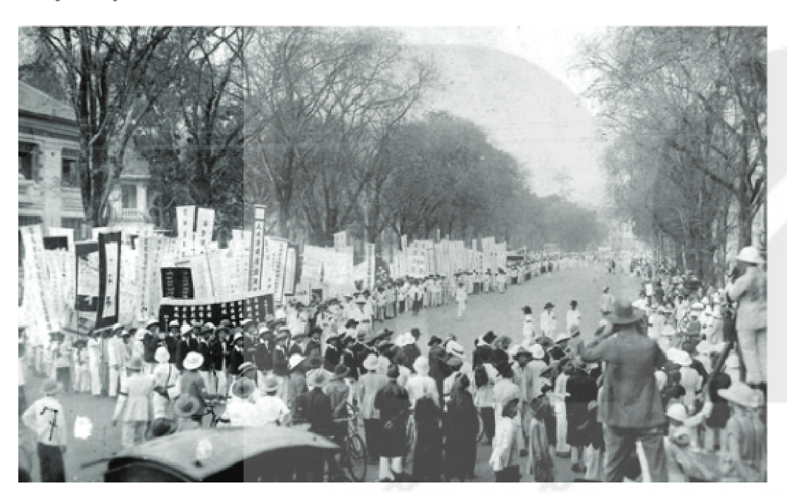
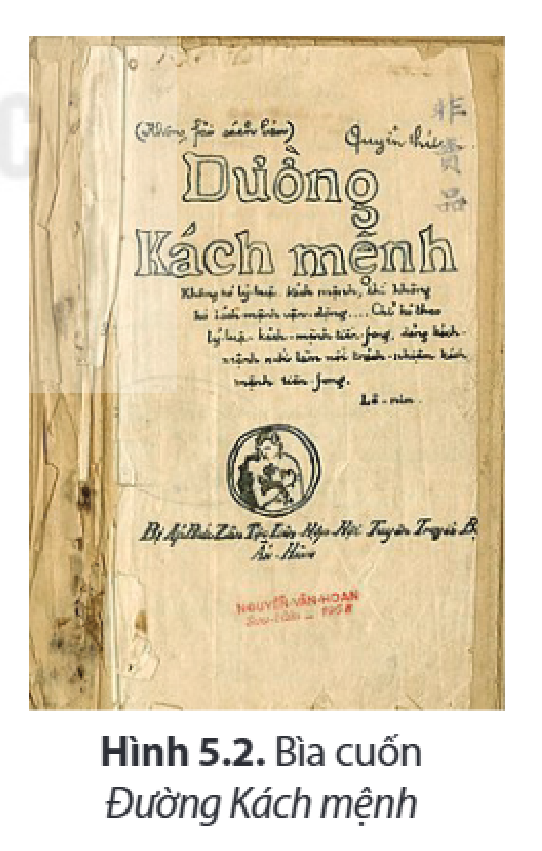
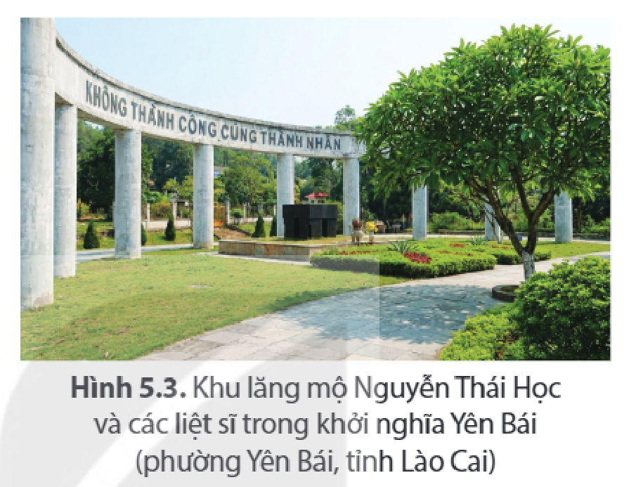

<!-- pdf:24 -->

# BÀI 5: PHONG TRÀO DÂN TỘC DÂN CHỦ TRONG NHỮNG NĂM 1918 – 1930

## 🎯 Học xong bài này, em sẽ:

- Mô tả được những nét chính của phong trào dân tộc dân chủ những năm 1918 – 1930.

## 🔴 Mở đầu

Trong những thập kỉ đầu thế kỉ XX, phong trào yêu nước, cách mạng của nhân dân Việt Nam tiếp tục rơi vào "tình hình đen tối như không có đường ra". Hãy nêu những hiểu biết của em về hoạt động đấu tranh của các giai cấp, tầng lớp trong xã hội Việt Nam từ năm 1918 đến năm 1930. Theo em, vì sao phong trào dân tộc dân chủ ở giai đoạn này dù diễn ra sôi nổi nhưng vẫn chưa thành công?

Chương trình khai thác thuộc địa lần thứ hai của tư bản Pháp được tiến hành ở Đông Dương đã đưa tới nhiều biến đổi quan trọng về chính trị, kinh tế, văn hoá và xã hội Việt Nam. Trên thế giới, thắng lợi của Cách mạng tháng Mười Nga (1917) và sự ra đời của Quốc tế Cộng sản (1919) đã tác động to lớn đến phong trào cộng sản và công nhân quốc tế, cũng như phong trào giải phóng dân tộc ở nhiều nước thuộc địa, phụ thuộc.

Bối cảnh lịch sử mới đã thúc đẩy phong trào dân tộc dân chủ Việt Nam phát triển với những hình thức và nội dung phong phú.

## 1. Hoạt động yêu nước của người Việt Nam ở nước ngoài

<!-- term: Tâm tâm xã -->
Tại Trung Quốc: Một nhóm thanh niên yêu nước lập ra tổ chức *Tâm tâm xã* (1923) ở Quảng Châu, chủ trương “khôi phục quyền làm người của người Việt Nam” và có hoạt động gây tiếng vang là mưu sát Toàn quyền Đông Dương Méc-lanh tại Sa Diện (Quảng Châu, 1924).

Tại Pháp: Phan Châu Trinh và một số người Việt Nam sáng lập *Hội những người yêu nước Việt Nam tại Pháp* (1919), viết nhiều tác phẩm lên án chế độ quân chủ trong nước và thể hiện tinh thần dân tộc,...

> ❓ Hãy trình bày hoạt động yêu nước tiêu biểu của người Việt Nam ở nước ngoài.

## 2. Phong trào của giai cấp tư sản và tầng lớp tiểu tư sản ở trong nước

- *Phong trào của giai cấp tư sản*

Giai cấp tư sản và bộ phận đại địa chủ Việt Nam đã đấu tranh chống lại sự cạnh tranh, chèn ép của tư sản Hoa kiều và tư sản Pháp, đồng thời yêu cầu chính quyền thuộc địa trao cho một số quyền tự do, dân chủ, được tham gia vào bộ máy chính quyền,...

Các phong trào đấu tranh tiêu biểu gồm: tẩy chay tư sản Hoa kiều, vận động người Việt Nam dùng hàng Việt Nam ở Sài Gòn (Thành phố Hồ Chí Minh), Hà Nội, Hải Phòng, Nam Định (nay thuộc tỉnh Ninh Bình),... (1919); chống độc quyền cảng Sài Gòn của tư sản Pháp (1923).

<!-- pdf:25 -->

Một số tư sản và đại địa chủ đã thành lập Đảng Lập hiến tại Sài Gòn (1923), lập một số tờ báo để làm công cụ tuyên truyền và đòi quyền lợi cho mình như: *Thực nghiệp dân báo*, *Diễn đàn bản xứ*, *Tiếng vang An Nam*,...

- *Phong trào của tầng lớp tiểu tư sản*

Trong giai đoạn này, tầng lớp tiểu tư sản ngày càng trưởng thành và tích cực tham gia vào phong trào yêu nước. Các hoạt động của họ đã góp phần tuyên truyền tư tưởng dân tộc, dân chủ, thức tỉnh và cổ vũ tinh thần yêu nước.

Nhiều trí thức đã mở các nhà xuất bản tiến bộ như: Cường học thư xã, Quan hải tùng thư, Nam Đồng thư xã,...; ra báo bằng tiếng Pháp và tiếng Việt như: *Chuông rạn*, *An Nam trẻ*,... Bên cạnh đó, một số tổ chức chính trị sơ khai đã ra đời làm nòng cốt trong phong trào yêu nước như: Thanh niên cao vọng đảng, Việt Nam nghĩa đoàn, Hội Phục Việt, Đảng Thanh niên,...

Tầng lớp tiểu tư sản cũng tham gia các phong trào đấu tranh như: đòi nhà cầm quyền Pháp thả Phan Bội Châu (1925), Nguyễn An Ninh (1926), tổ chức đám tang và lễ truy điệu Phan Châu Trinh (1926),...

> 💡 **Em có biết?**
>
> Nhiều thanh niên, tiểu tư sản yêu nước tham gia các phong trào giai đoạn này về sau đã gia nhập Đảng Cộng sản Việt Nam như: Trần Phú, Nguyễn Đức Cảnh, Trần Huy Liệu,...

*Hình 5.1. Lễ tang Phan Châu Trinh ở Sài Gòn (1926)*

> ❓ Hãy trình bày những nét chính của phong trào của giai cấp tư sản và tầng lớp tiểu tư sản ở trong nước.

## 3. Phong trào của giai cấp công nhân

Các cuộc đấu tranh của giai cấp công nhân Việt Nam diễn ra sôi nổi với mục đích chủ yếu là bãi công đòi tăng lương, giảm giờ làm,... Bên cạnh các hoạt động bỏ trốn, phá bỏ giao kèo, công nhân đã bắt đầu sử dụng hình thức đấu tranh bãi công.

Tiêu biểu như: cuộc đấu tranh của thuỷ thủ trên tàu Sác-nô ở Hải Phòng (1919), bãi công của 600 thợ nhuộm ở Sài Gòn – Chợ Lớn (1920),... Một số công nhân Việt Nam cũng đã tham gia Liên đoàn công nhân tàu biển ở Viễn Đông.

<!-- term: Bãi công Ba Son -->
Tháng 8 – 1925, cuộc bãi công của hơn 1 000 công nhân Ba Son (Sài Gòn) dưới sự lãnh đạo của Tôn Đức Thắng và tổ chức Công hội đã nổ ra và giành thắng lợi, góp phần ngăn cản tàu chiến Pháp chở binh lính sang đàn áp phong trào cách mạng Trung Quốc. Cuộc bãi công thắng lợi đã đánh dấu bước chuyển của phong trào công nhân từ giai đoạn đấu tranh "tự phát" sang "tự giác".

> 💡 **Em có biết?**
>
> Xưởng Ba Son (Nhà máy đóng tàu Ba Son) được xây dựng ngay khi thực dân Pháp chiếm được ba tỉnh miền Đông Nam Kì, là cơ xưởng quan trọng bậc nhất ở Đông Dương và tập trung nhiều công nhân lành nghề nhất lúc đó. Xưởng sửa chữa nhiều tàu có trọng tải lớn, chế tạo tàu mới và nhiều công trình hàng hải.

<!-- pdf:26 -->

<!-- term: Bãi công Ba Son -->
> 📜 **Tư liệu**
>
> "Bằng hành động của mình, cuộc bãi công Ba Son đã cắm một cột mốc rất quan trọng trong phong trào công nhân – giai đoạn công nhân Việt Nam bắt đầu đi vào đấu tranh có tổ chức và có mục đích chính trị rõ ràng”.
>
> (Đinh Xuân Lâm (Chủ biên), *Lịch sử Việt Nam*, Tập III, NXB Giáo dục Việt Nam, 2012, tr. 357 – 358)

Từ năm 1926, các cuộc đấu tranh có tổ chức của công nhân diễn ra liên tục từ Bắc tới Nam và bước đầu thể hiện sự liên kết với nhiều ngành, nhiều địa phương. Đặc biệt, bên cạnh mục tiêu kinh tế, công nhân còn đấu tranh nhằm mục tiêu chính trị rõ ràng hơn như: chống lại chính sách áp bức, bóc lột của chủ tư bản và chính quyền thực dân phong kiến. Giai cấp công nhân dần trở thành lực lượng chính trị độc lập.

Một số cuộc đấu tranh lớn như bãi công ở mỏ than Mạo Khê (tỉnh Quảng Ninh), nhà máy xe lửa Trường Thi (tỉnh Nghệ An), nhà máy sửa chữa ô tô A-vi-a (thành phố Hà Nội), đồn điền cao su Phú Riềng (tỉnh Đồng Nai),...

> ❓ 1. Khai thác tư liệu và thông tin trong mục, hãy nêu ý nghĩa của cuộc bãi công của công nhân Ba Son.
>
> 2. Hãy trình bày những nét chính trong phong trào của giai cấp công nhân.

## 4. Sự ra đời của các tổ chức yêu nước cách mạng

Trước sự phát triển của phong trào dân tộc dân chủ và sự tăng cường đàn áp của thực dân Pháp, những người yêu nước đã đoàn kết, thành lập nên các tổ chức yêu nước cách mạng. Hoạt động của các tổ chức này đã thúc đẩy phong trào đấu tranh của các giai cấp, tầng lớp trong xã hội diễn ra mạnh mẽ hơn.

<!-- term: Hội Việt Nam Cách mạng Thanh niên -->
- *Hội Việt Nam Cách mạng Thanh niên:* được Nguyễn Ái Quốc thành lập vào tháng 6 – 1925 tại Quảng Châu (Trung Quốc) trên cơ sở lựa chọn các thanh niên ưu tú đang hoạt động ở Trung Quốc (tổ chức *Tâm tâm xã*) và từ trong nước sang. Hội công bố Chương trình, Điều lệ, khẳng định mục đích làm cách mạng dân tộc để giành lấy độc lập, sau đó làm cách mạng thế giới để đi đến xã hội cộng sản.

<!-- term: Phong trào “vô sản hoá” -->
Hội đã mở nhiều lớp huấn luyện cán bộ. Những bài giảng của Nguyễn Ái Quốc tại đây được tập hợp thành sách *Đường Kách mệnh* (1927) và bí mật đưa về nước. Năm 1928, Hội phát động phong trào “vô sản hoá” đưa cán bộ thâm nhập vào các đồn điền, hầm mỏ,... ở trong nước để rèn luyện, tuyên truyền cách mạng, nâng cao ý thức chính trị cho giai cấp công nhân và tổ chức quần chúng đấu tranh.

*Hình 5.2. Bìa cuốn Đường Kách mệnh*

<!-- term: Hội Việt Nam Cách mạng Thanh niên -->
Đến trước tháng 5 – 1929, Hội đã xây dựng được cơ sở ở cả ba kì trong nước, Trung Quốc, Xiêm,... với thành phần tham gia gồm thanh niên, trí thức, công nhân, nông dân,... Hoạt động của Hội đã góp phần truyền bá chủ nghĩa Mác – Lê-nin vào Việt Nam.

<!-- term: Tân Việt Cách mạng đảng -->
- *Tân Việt Cách mạng đảng:* có tiền thân là Hội Phục Việt, ra đời trong phong trào dân tộc dân chủ đầu những năm 20 của thế kỉ XX. Tháng 7 – 1928, tổ chức này đổi tên thành

<!-- pdf:27 -->

<!-- term: Tân Việt Cách mạng đảng -->
Tân Việt Cách mạng đảng, hoạt động chủ yếu ở Trung Kì với lực lượng chủ yếu gồm: trí thức trẻ, thanh niên, tư sản yêu nước.

<!-- term: Tân Việt Cách mạng đảng -->
Ban đầu, đảng này theo khuynh hướng dân chủ tư sản, nhưng về sau đã chuyển dần sang khuynh hướng vô sản dưới ảnh hưởng của Hội Việt Nam Cách mạng Thanh niên. Hoạt động chính của Tân Việt gồm: giới thiệu các sách báo yêu nước tiến bộ, góp phần truyền bá chủ nghĩa Mác – Lê-nin ở trong nước; tổ chức một số cuộc đấu tranh của học sinh, tiểu thương và công nhân,... Nhiều đảng viên cũng được cử sang dự các lớp huấn luyện của Hội Việt Nam Cách mạng Thanh niên.

<!-- term: Việt Nam Quốc dân đảng -->
- *Việt Nam Quốc dân đảng:* được thành lập vào tháng 12 – 1927 trên cơ sở hạt nhân là một số thành viên của Nam Đồng thư xã như: Nguyễn Thái Học, Phó Đức Chính,... Thành phần tham gia gồm tư sản dân tộc, binh lính Việt Nam trong quân đội Pháp, viên chức, học sinh, thân hào, thân sĩ ở nông thôn,... Đảng theo khuynh hướng cách mạng dân chủ tư sản với mục tiêu đánh đuổi giặc Pháp, thiết lập dân quyền bằng phương pháp bạo động, ám sát cá nhân.

*Hình 5.3. Khu lăng mộ Nguyễn Thái Học và các liệt sĩ trong khởi nghĩa Yên Bái (phường Yên Bái, tỉnh Lào Cai)*

<!-- term: Việt Nam Quốc dân đảng -->
Đầu tháng 2 – 1929, sau khi Việt Nam Quốc dân đảng tổ chức ám sát tên trùm mộ phu Ba-danh, thực dân Pháp đã tiến hành các cuộc vây ráp lớn khiến cho nhiều cơ sở của đảng bị tan vỡ. Cuộc khởi nghĩa của Việt Nam Quốc dân đảng nổ ra đêm 9 – 2 – 1930 ở thị xã Yên Bái (nay thuộc tỉnh Lào Cai), một số nơi ở Phú Thọ, sau đó là ở Hải Dương (nay thuộc thành phố Hải Phòng), ở Thái Bình (nay thuộc tỉnh Hưng Yên),... nhưng nhanh chóng bị thực dân Pháp đàn áp dã man.

Thất bại của khởi nghĩa Yên Bái và sự tan rã nhanh chóng của Việt Nam Quốc dân đảng cho thấy khuynh hướng dân chủ tư sản đã hoàn toàn bất lực trước nhiệm vụ cứu nước. Trong khi đó, sự phát triển của Hội Việt Nam Cách mạng Thanh niên và sự chuyển biến trong lập trường chính trị của Tân Việt Cách mạng đảng đã chứng tỏ khuynh hướng vô sản ngày càng thắng thế trong phong trào dân tộc dân chủ ở Việt Nam.

> ❓ 1. Hãy nêu những nét chính về sự ra đời của các tổ chức yêu nước cách mạng.
>
> 2. Theo em, vì sao hoạt động của Việt Nam Quốc dân đảng không thành công?

## ✏️ Luyện tập và Vận dụng

**Luyện tập:**

1. Vẽ sơ đồ thể hiện những sự kiện tiêu biểu trong phong trào dân tộc dân chủ từ năm 1918 đến năm 1930 ở Việt Nam.

2. Theo em, phong trào dân tộc dân chủ từ năm 1918 đến năm 1930 có ý nghĩa như thế nào đối với cách mạng Việt Nam?

**Vận dụng:**

Sưu tầm tư liệu từ sách, báo, internet, hãy kể tên một số thanh niên, trí thức đã tham gia tích cực vào phong trào dân tộc dân chủ (1918 – 1930). Xây dựng poster giới thiệu về một nhân vật mà em ấn tượng nhất.

## 📷 Danh sách hình trong bài

| Mã hình | Trang PDF | Vị trí | Chú thích |
| --- | --- | --- | --- |
| H9-lich_su_va_dia_ly-ls-b05-01 | 25 | Mục 2, chú thích in bên phải dưới hộp Em có biết? (trang 23) | Hình 5.1. Lễ tang Phan Châu Trinh ở Sài Gòn (1926) |
| H9-lich_su_va_dia_ly-ls-b05-02 | 26 | Mục 4 (trang 24) | Hình 5.2. Bìa cuốn Đường Kách mệnh |
| H9-lich_su_va_dia_ly-ls-b05-03 | 27 | Mục 4 (trang 25) | Hình 5.3. Khu lăng mộ Nguyễn Thái Học và các liệt sĩ trong khởi nghĩa Yên Bái (phường Yên Bái, tỉnh Lào Cai) |
