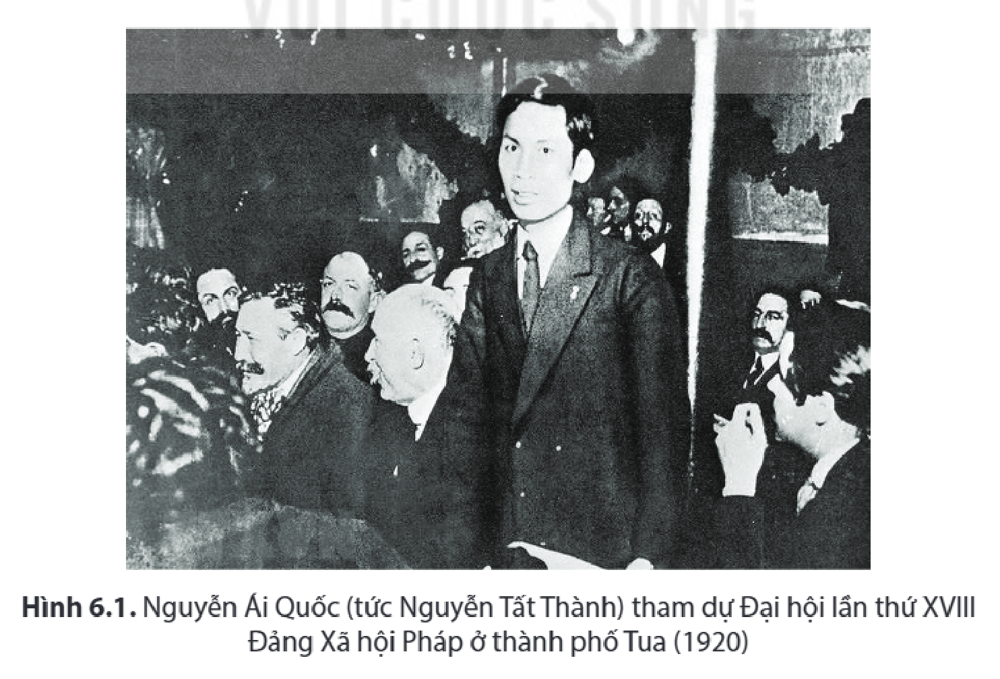
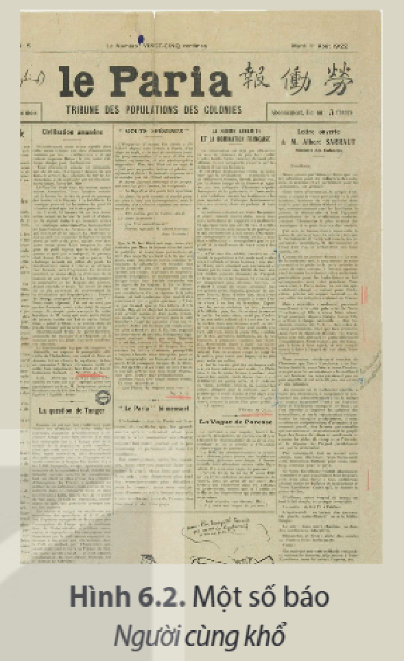
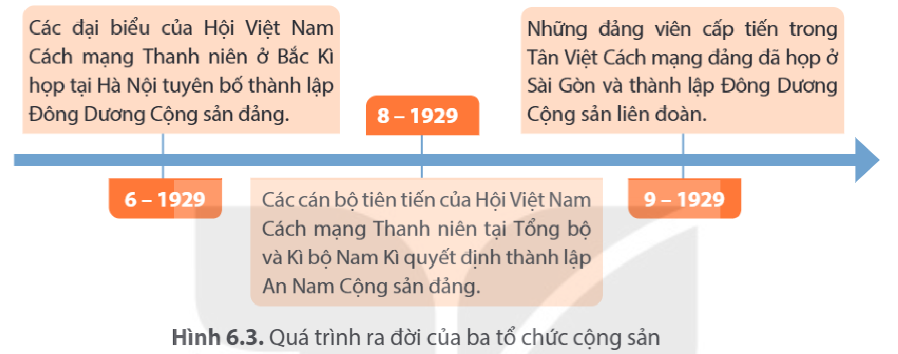
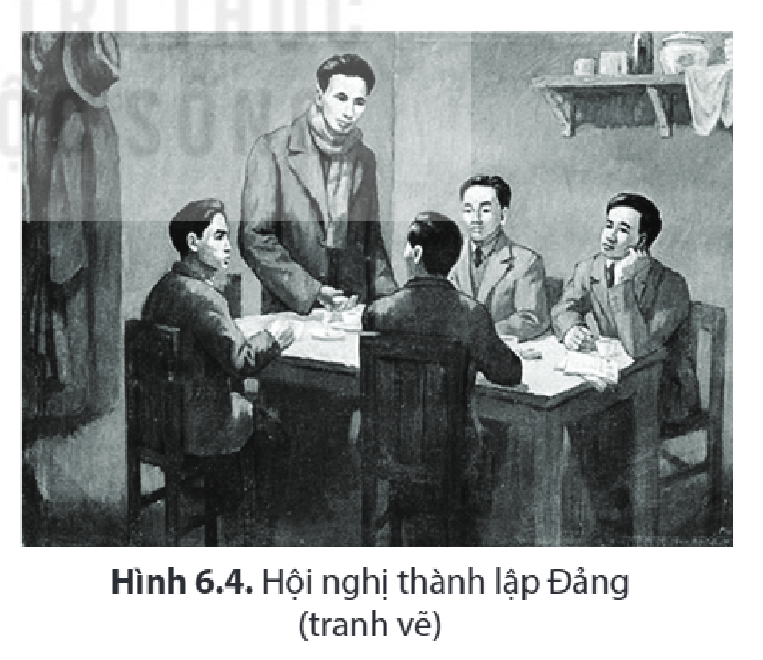

<!-- pdf:28 -->

# BÀI 6: HOẠT ĐỘNG CỦA NGUYỄN ÁI QUỐC VÀ SỰ THÀNH LẬP ĐẢNG CỘNG SẢN VIỆT NAM

## 🎯 Học xong bài này, em sẽ:

- Nêu được những nét chính về hoạt động của Nguyễn Ái Quốc trong những năm 1918 – 1930.
- Nhận biết được quá trình và ý nghĩa của việc thành lập Đảng Cộng sản Việt Nam; đánh giá được vai trò của Nguyễn Ái Quốc trong quá trình thành lập Đảng Cộng sản Việt Nam.

## 🔴 Mở đầu

Những câu thơ bên miêu tả rất xúc động về một sự kiện trong hành trình đi tìm đường cứu nước của Nguyễn Ái Quốc. Hãy chia sẻ hiểu biết của em về quá trình hoạt động của Nguyễn Ái Quốc từ năm 1918 đến năm 1930. Theo em, Nguyễn Ái Quốc có vai trò như thế nào đối với việc thành lập Đảng Cộng sản Việt Nam? Sự ra đời của Đảng có ý nghĩa gì đối với lịch sử dân tộc?

> *"... Luận cương đến Bác Hồ. Và Người đã khóc*
> *Lệ Bác Hồ rơi trên chữ Lê-nin*
> *...*
> *Bác reo lên một mình như nói cùng dân tộc*
> *“Cơm áo là đây! Hạnh phúc đây rồi!”"*
>
> (Trích *Người đi tìm hình của nước*, Chế Lan Viên)

## 1. Hoạt động của Nguyễn Ái Quốc từ năm 1918 đến năm 1930

Sau một thời gian sống và làm việc tại nhiều quốc gia, khoảng cuối năm 1917, Nguyễn Tất Thành quay lại hoạt động ở Pa-ri (Pháp).

*Hình 6.1. Nguyễn Ái Quốc (tức Nguyễn Tất Thành) tham dự Đại hội lần thứ XVIII Đảng Xã hội Pháp ở thành phố Tua (1920)*

<!-- pdf:29 -->

KHÁI QUÁT NHỮNG NÉT CHÍNH TRONG QUÁ TRÌNH HOẠT ĐỘNG CỦA NGUYỄN ÁI QUỐC NHỮNG NĂM 1918 – 1930

**Hoạt động của Nguyễn Ái Quốc tại Pháp**

- Đầu năm 1919: gia nhập Đảng Xã hội Pháp.

<!-- term: Yêu sách của nhân dân An Nam -->
- Tháng 6 – 1919: thay mặt những người Việt Nam yêu nước tại Pháp, Nguyễn Tất Thành đã gửi bản *Yêu sách của nhân dân An Nam* (kí tên là Nguyễn Ái Quốc) tới Hội nghị Véc-xai.

- Tháng 7 – 1920: đọc *Sơ thảo lần thứ nhất những Luận cương về vấn đề dân tộc và vấn đề thuộc địa* của Lê-nin. Luận cương đã giúp Nguyễn Ái Quốc tìm thấy con đường cứu nước, giải phóng dân tộc – đi theo con đường cách mạng vô sản.
- Tháng 12 – 1920: tham dự Đại hội Tua, bỏ phiếu tán thành việc Đảng Xã hội Pháp gia nhập Quốc tế Cộng sản, tham gia thành lập Đảng Cộng sản Pháp. Đây là bước ngoặt trong quá trình hoạt động cách mạng của Nguyễn Ái Quốc: từ chủ nghĩa yêu nước đến chủ nghĩa Mác – Lê-nin và đi theo con đường cách mạng vô sản.
- Năm 1921: cùng một số nhà cách mạng các nước thuộc địa Pháp lập ra Hội Liên hiệp thuộc địa.

*Hình 6.2. Một số báo Người cùng khổ*

<!-- term: Báo Người cùng khổ -->
- Năm 1922: là Chủ nhiệm kiêm chủ bút báo *Người cùng khổ* (Le Paria).

**Hoạt động của Nguyễn Ái Quốc tại Liên Xô**

- Tháng 10 – 1923: được bầu vào Hội đồng Quốc tế Nông dân.
- Tháng 6 – 1924: trình bày tham luận tại Đại hội lần thứ V của Quốc tế Cộng sản.
- Từ năm 1923 đến năm 1924: viết bài cho tạp chí *Thư tín quốc tế*, báo *Sự thật*,...

**Hoạt động của Nguyễn Ái Quốc tại Trung Quốc**

- Từ năm 1925 đến năm 1927: sáng lập Hội Việt Nam Cách mạng Thanh niên, xuất bản tờ báo *Thanh niên*; trực tiếp mở các lớp huấn luyện chính trị tại Quảng Châu để đào tạo một số thanh niên trở thành những cán bộ cách mạng.
- Tháng 7 – 1925: tham gia sáng lập Hội Liên hiệp các dân tộc bị áp bức.
- Đầu năm 1927: Tác phẩm *Đường Kách mệnh* gồm các bài giảng của Nguyễn Ái Quốc ở các lớp huấn luyện tại Quảng Châu được xuất bản.

> 💡 **Em có biết?**
>
> Số học viên do Nguyễn Ái Quốc trực tiếp huấn luyện ở Quảng Châu gồm 75 người. Đây là lớp cán bộ đầu tiên của Đảng, trong đó có Lê Hồng Phong, Phùng Chí Kiên, Nguyễn Lương Bằng, Trần Phú, Phạm Văn Đồng,...

Từ giữa năm 1927 đến cuối năm 1929, Nguyễn Ái Quốc tiếp tục có thời gian hoạt động cách mạng tại Pháp, Bỉ, Đức, Xiêm,... trước khi quay trở lại Trung Quốc triệu tập Hội nghị hợp nhất các tổ chức cộng sản ở Việt Nam.

> ❓ Hãy nêu những nét chính về quá trình hoạt động của Nguyễn Ái Quốc trong những năm 1918 – 1930.

<!-- pdf:30 -->

## 2. Sự thành lập Đảng Cộng sản Việt Nam

### a) Sự ra đời các tổ chức cộng sản ở Việt Nam

Trong những năm 1928 – 1929, thông qua hoạt động của Hội Việt Nam Cách mạng Thanh niên, tiêu biểu là phong trào "vô sản hoá", chủ nghĩa Mác – Lê-nin được truyền bá sâu rộng vào Việt Nam, thúc đẩy phong trào công nhân và phong trào yêu nước phát triển mạnh mẽ. Tình hình này đặt ra nhu cầu cần phải thành lập Đảng Cộng sản để đưa phong trào cách mạng tiếp tục tiến lên.

*Hình 6.3. Quá trình ra đời của ba tổ chức cộng sản*

<!-- term: Đông Dương Cộng sản đảng -->
> - **6 – 1929:** Các đại biểu của Hội Việt Nam Cách mạng Thanh niên ở Bắc Kì họp tại Hà Nội tuyên bố thành lập Đông Dương Cộng sản đảng.

<!-- term: An Nam Cộng sản đảng -->
> - **8 – 1929:** Các cán bộ tiên tiến của Hội Việt Nam Cách mạng Thanh niên tại Tổng bộ và Kì bộ Nam Kì quyết định thành lập An Nam Cộng sản đảng.

<!-- term: Đông Dương Cộng sản liên đoàn -->
> - **9 – 1929:** Những đảng viên cấp tiến trong Tân Việt Cách mạng đảng đã họp ở Sài Gòn và thành lập Đông Dương Cộng sản liên đoàn.

Ba tổ chức cộng sản lần lượt ra đời trong năm 1929 đã chứng tỏ sự phát triển của phong trào yêu nước theo khuynh hướng vô sản và là bước chuẩn bị trực tiếp cho sự thành lập Đảng Cộng sản Việt Nam.

> ❓ Nêu quá trình thành lập và ý nghĩa sự ra đời của các tổ chức cộng sản ở Việt Nam.

### b) Hội nghị thành lập Đảng Cộng sản Việt Nam

Sự ra đời của các tổ chức cộng sản đã tác động tích cực tới phong trào cách mạng trong nước. Tuy nhiên, ba tổ chức này hoạt động riêng rẽ, tranh giành ảnh hưởng với nhau, làm cho phong trào cách mạng trong nước có nguy cơ dẫn đến chia rẽ lớn. Trong bối cảnh đó, Nguyễn Ái Quốc với tư cách là phái viên của Quốc tế Cộng sản đã triệu tập và chủ trì Hội nghị hợp nhất các tổ chức cộng sản tại Hương Cảng (Trung Quốc) vào đầu năm 1930.

*Hình 6.4. Hội nghị thành lập Đảng (tranh vẽ)*

> 💡 **Em có biết?**
>
> Đại hội đại biểu toàn quốc của Đảng Lao động Việt Nam (1960) đã quyết định lấy ngày 3 – 2 hằng năm là ngày kỉ niệm thành lập Đảng Cộng sản Việt Nam.

Hội nghị bắt đầu từ ngày 6 – 1 – 1930. Tham dự hội nghị có các đại biểu của Đông Dương Cộng sản đảng và An Nam Cộng sản đảng. Đến ngày 8 – 2 – 1930, các đại biểu lên đường về nước. Ngày 24 – 2 – 1930, Đông Dương Cộng sản liên đoàn cũng gia nhập Đảng Cộng sản Việt Nam.

<!-- pdf:31 -->

Hội nghị nhất trí tán thành việc thống nhất các tổ chức cộng sản để thành lập một đảng duy nhất là Đảng Cộng sản Việt Nam. Hội nghị thông qua *Chính cương vắn tắt*, *Sách lược vắn tắt*, *Điều lệ vắn tắt*, *Chương trình tóm tắt* của Đảng do Nguyễn Ái Quốc soạn thảo; định kế hoạch thực hiện việc thống nhất trong nước;...

<!-- term: Cương lĩnh chính trị đầu tiên của Đảng -->
Hội nghị hợp nhất các tổ chức cộng sản có ý nghĩa như Đại hội thành lập Đảng. Các văn kiện được thông qua tại Hội nghị trở thành *Cương lĩnh chính trị* đầu tiên của Đảng, đã đề ra đường lối cơ bản cho cách mạng Việt Nam.

<!-- term: Cương lĩnh chính trị đầu tiên của Đảng -->
Cương lĩnh đã nêu rõ đường lối chiến lược của cách mạng là làm tư sản dân quyền cách mạng và thổ địa cách mạng để đi tới xã hội cộng sản.

<!-- term: Cương lĩnh chính trị đầu tiên của Đảng -->
Nhiệm vụ của cách mạng là đánh đổ đế quốc Pháp và bọn phong kiến, làm cho nước Việt Nam được hoàn toàn độc lập, xây dựng Chính phủ công – nông – binh, tịch thu ruộng đất của đế quốc chia cho dân cày nghèo,...

Đảng Cộng sản Việt Nam được xác định là “đội tiên phong” của giai cấp vô sản song cần thu phục được "đại bộ phận dân cày và phải dựa vào hạng dân cày nghèo", "hết sức liên lạc với tiểu tư sản, trí thức, trung nông", đoàn kết với những dân tộc bị áp bức và vô sản thế giới.

Đảng Cộng sản Việt Nam ra đời có ý nghĩa lịch sử vô cùng to lớn.

<!-- term: Đảng Cộng sản Việt Nam -->
> 📜 **Tư liệu**
>
> Sự thành lập của Đảng Cộng sản Việt Nam là một sự kiện chính trị trọng đại, một bước ngoặt lịch sử trong sự nghiệp đấu tranh giải phóng dân tộc của nhân dân Việt Nam. Đảng Cộng sản Việt Nam ra đời là kết quả của sự kết hợp giữa chủ nghĩa Mác – Lê-nin với phong trào công nhân và phong trào yêu nước Việt Nam.
>
> (Theo Viện Sử học, *Lịch sử Việt Nam*, Tập 8, NXB Khoa học xã hội, 2017, tr. 571)

<!-- term: Đảng Cộng sản Việt Nam -->
Đảng Cộng sản Việt Nam ra đời đã chấm dứt sự khủng hoảng về đường lối cứu nước và giai cấp lãnh đạo của cách mạng Việt Nam. Cũng từ đây, dưới sự lãnh đạo của Đảng, cách mạng Việt Nam trở thành một bộ phận khăng khít của cách mạng thế giới. Đây cũng là bước chuẩn bị tất yếu đầu tiên cho những bước phát triển nhảy vọt về sau của cách mạng Việt Nam.

> ❓ Khai thác tư liệu và thông tin trong mục, nêu quá trình, ý nghĩa của việc thành lập Đảng Cộng sản Việt Nam.

## ✏️ Luyện tập và Vận dụng

**Luyện tập:**

1. Đánh giá vai trò của Nguyễn Ái Quốc đối với quá trình thành lập Đảng Cộng sản Việt Nam.

2. Từ thông tin trong bài, hãy làm sáng tỏ nhận định: “Đảng Cộng sản Việt Nam ra đời là bước ngoặt lịch sử chấm dứt sự khủng hoảng về đường lối cứu nước và giai cấp lãnh đạo của cách mạng Việt Nam”.

**Vận dụng:**

Sưu tầm tư liệu từ sách, báo và internet, thiết kế sơ đồ tư duy hoặc infographic giới thiệu những sự kiện chính trong hành trình tìm đường cứu nước, hoạt động cách mạng của Nguyễn Ái Quốc từ năm 1918 đến năm 1930.

## 📷 Danh sách hình trong bài

| Mã hình | Trang PDF | Vị trí | Chú thích |
| --- | --- | --- | --- |
| H9-lich_su_va_dia_ly-ls-b06-01 | 28 | Mục 1 (trang 26) | Hình 6.1. Nguyễn Ái Quốc (tức Nguyễn Tất Thành) tham dự Đại hội lần thứ XVIII Đảng Xã hội Pháp ở thành phố Tua (1920) |
| H9-lich_su_va_dia_ly-ls-b06-02 | 29 | Mục 1, đặt trên nền hộp màu xám nâu (trang 27) | Hình 6.2. Một số báo Người cùng khổ |
| H9-lich_su_va_dia_ly-ls-b06-03 | 30 | Mục 2.a (trang 28) | Hình 6.3. Quá trình ra đời của ba tổ chức cộng sản |
| H9-lich_su_va_dia_ly-ls-b06-04 | 30 | Mục 2.b (trang 28) | Hình 6.4. Hội nghị thành lập Đảng (tranh vẽ) |
