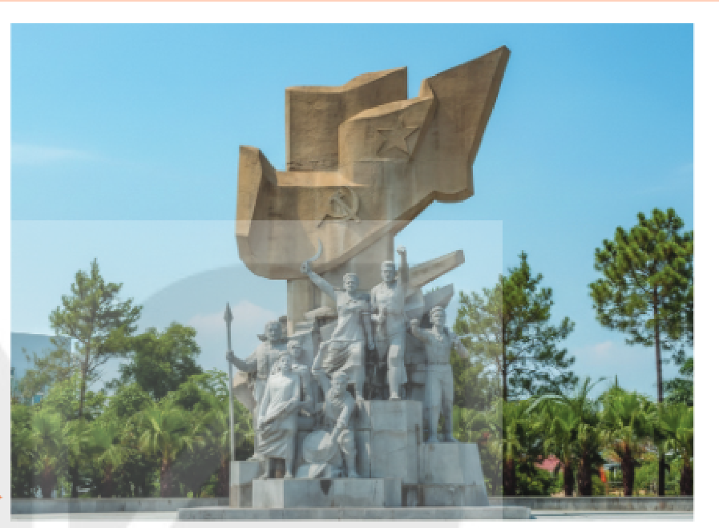
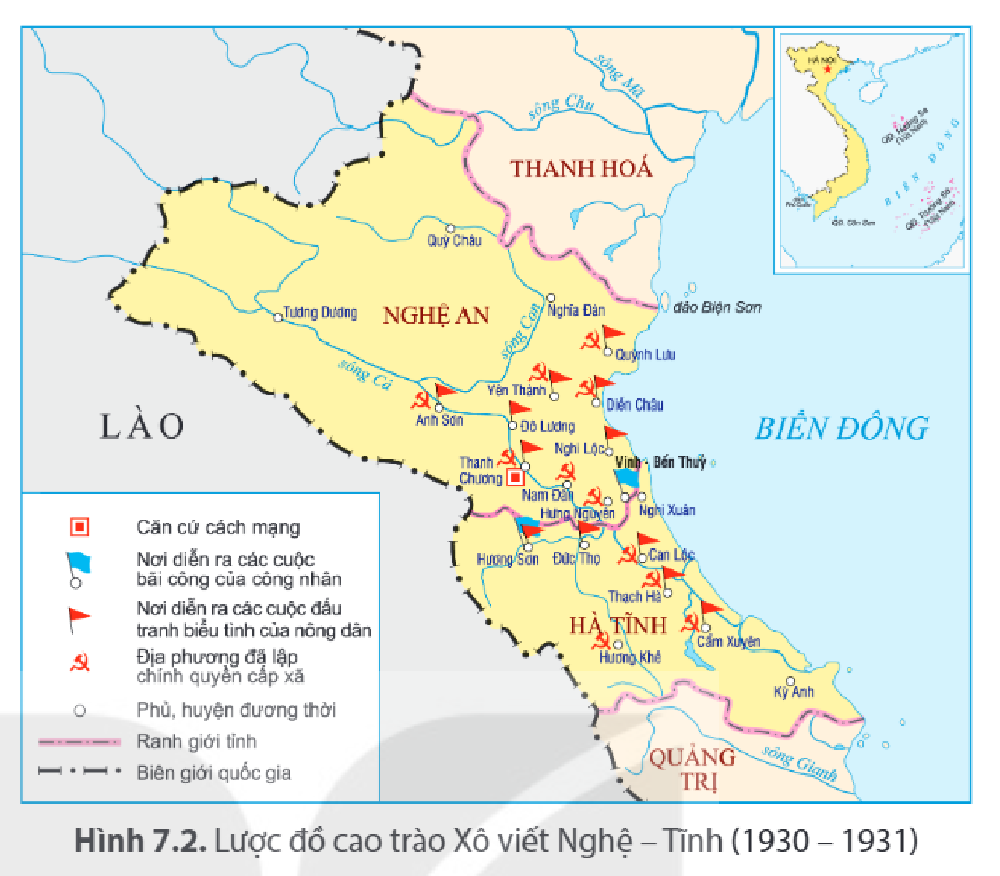
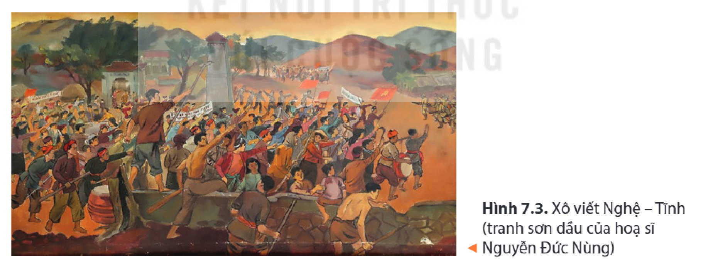
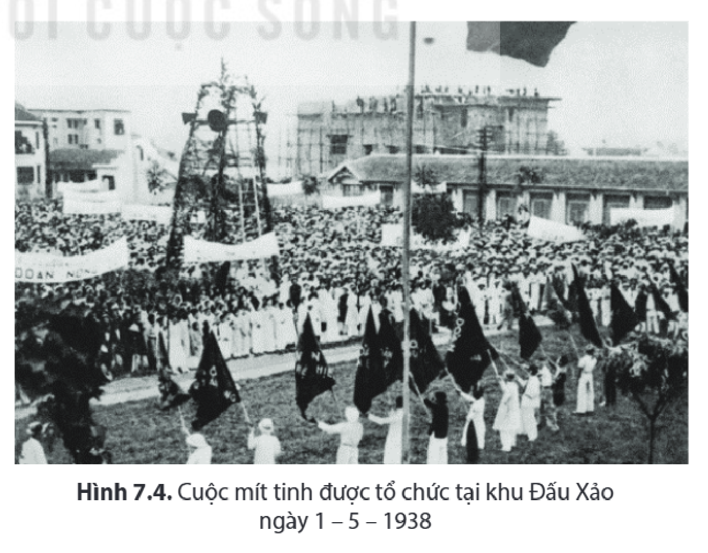

<!-- pdf:32 -->

# BÀI 7: PHONG TRÀO CÁCH MẠNG VIỆT NAM THỜI KÌ 1930 – 1939

## 🎯 Học xong bài này, em sẽ:

- Mô tả được những nét chủ yếu của phong trào cách mạng giai đoạn 1930 – 1931 và 1936 – 1939.

## 🔴 Mở đầu

Hình bên là một trong những di tích gắn với một sự kiện lịch sử tiêu biểu của Việt Nam trong những năm 1930 – 1931. Hãy chia sẻ những hiểu biết của em về sự kiện đó cũng như phong trào cách mạng Việt Nam thời kì 1930 – 1939.

*Hình 7.1. Tượng đài Xô viết Nghệ – Tĩnh (xã Can Lộc, tỉnh Hà Tĩnh)*

## 1. Phong trào cách mạng trong những năm 1930 – 1931

- *Nguyên nhân bùng nổ*

Việt Nam là thuộc địa của Pháp nên cũng chịu ảnh hưởng của cuộc đại suy thoái kinh tế thế giới (1929 – 1933). Mâu thuẫn trong xã hội ngày càng sâu sắc, nổi lên với hai mâu thuẫn cơ bản là: mâu thuẫn giữa toàn thể dân tộc Việt Nam với thực dân Pháp và mâu thuẫn giữa nông dân với địa chủ phong kiến. Trong bối cảnh đó, Đảng Cộng sản Việt Nam vừa ra đời đã kịp thời lãnh đạo cách mạng và đẩy mạnh cuộc đấu tranh trên phạm vi toàn quốc.

- *Diễn biến chính*

Ngay từ đầu năm 1930, một số cuộc đấu tranh của công nhân, nông dân và các tầng lớp lao động khác đã nổ ra với mục tiêu đòi cải thiện đời sống, đòi tăng lương, giảm giờ làm, giảm sưu thuế,... Tiêu biểu là cuộc bãi công của công nhân đồn điền cao su Phú Riềng (tỉnh Đồng Nai), nhà máy sợi Nam Định (tỉnh Ninh Bình), nhà máy diêm Bến Thuỷ (tỉnh Nghệ An),...

Từ tháng 5 – 1930, phong trào phát triển mạnh mẽ trong phạm vi cả nước như: bãi công của công nhân nhà máy điện Chợ Quán, Sài Gòn (Thành phố Hồ Chí Minh), khu mỏ Hồng Gai (tỉnh Quảng Ninh),...; biểu tình của nông dân các tỉnh Thái Bình (nay thuộc tỉnh Hưng Yên), Hà Nam (nay thuộc tỉnh Ninh Bình), Gia Định (nay thuộc Thành phố Hồ Chí Minh),...

> 💡 **Em có biết?**
>
> Ngày 1 – 5 – 1930, cờ đỏ búa liềm tung bay trên đỉnh núi Bài Thơ (tỉnh Quảng Ninh). Đây là một sự kiện quan trọng, cổ vũ mạnh mẽ phong trào đấu tranh của công nhân vùng mỏ.

Nhân ngày Quốc tế Lao động 1 – 5, lần đầu tiên công nhân và các tầng lớp nhân dân khác đã biểu dương tinh thần đoàn kết với giai cấp vô sản thế giới, rải truyền đơn, treo cờ Đảng.

Đến tháng 9 và tháng 10 – 1930, phong trào đạt đến đỉnh cao, quyết liệt nhất là ở Nghệ An và Hà Tĩnh.

<!-- pdf:33 -->

Những cuộc biểu tình của nông dân ở các huyện Nam Đàn, Thanh Chương, Diễn Châu, Nghi Lộc,... được sự hưởng ứng của công nhân Vinh – Bến Thuỷ (tỉnh Nghệ An) đã làm bộ máy chính quyền của thực dân và phong kiến tay sai ở nhiều huyện bị tê liệt, ở một số thôn, xã bị tan rã.

<!-- term: Xô viết Nghệ – Tĩnh -->
Chính quyền nhân dân được thành lập ở một số thôn, xã của Nghệ An, Hà Tĩnh dưới hình thức các xô viết. Chính quyền Xô viết đã ban hành và thực hiện các chính sách tiến bộ.

*Hình 7.2. Lược đồ cao trào Xô viết Nghệ – Tĩnh (1930 – 1931)*

<!-- term: Xô viết Nghệ – Tĩnh -->
Về chính trị: ban bố các quyền tự do, dân chủ cho nhân dân; về kinh tế: chia ruộng đất công, bãi bỏ các thứ thuế vô lí, thực hiện giảm tô và xoá nợ cho dân nghèo; về văn hoá, xã hội: tổ chức đời sống mới, mở các lớp dạy chữ Quốc ngữ, xoá bỏ các tệ nạn xã hội,...

Hoảng sợ trước phong trào quần chúng, thực dân Pháp tiến hành khủng bố cực kì tàn bạo. Chúng cho máy bay ném bom tàn sát cuộc biểu tình của 8 000 nông dân huyện Hưng Nguyên ngày 12 – 9 – 1930.

*Hình 7.3. Xô viết Nghệ – Tĩnh (tranh sơn dầu của hoạ sĩ Nguyễn Đức Nùng)*

Đầu năm 1931, thực dân Pháp tập trung lực lượng đàn áp, khủng bố phong trào. Nhiều tổ chức của Đảng bị phá vỡ, hàng vạn cán bộ, đảng viên, người yêu nước bị bắt giam. Phong trào cách mạng 1930 – 1931 tạm thời lắng xuống.

- *Ý nghĩa*

<!-- term: Phong trào cách mạng 1930 – 1931 -->
Phong trào cách mạng 1930 – 1931 đã khẳng định vai trò lãnh đạo cách mạng của Đảng. Từ trong phong trào, khối liên minh công – nông được hình thành, để lại nhiều bài học quý báu cho phong trào cách mạng sau này.

<!-- pdf:34 -->

> ❓ 1. Trình bày nguyên nhân, diễn biến chính của phong trào cách mạng 1930 – 1931. Những biểu hiện nào chứng tỏ Xô viết Nghệ – Tĩnh là đỉnh cao của phong trào cách mạng 1930 – 1931?
>
> 2. Phong trào cách mạng 1930 – 1931 có ý nghĩa lịch sử như thế nào đối với cách mạng Việt Nam?

## 2. Phong trào cách mạng trong những năm 1936 – 1939

- *Nguyên nhân*

Tháng 7 – 1935, Đại hội VII của Quốc tế Cộng sản đã họp và chủ trương thành lập Mặt trận Nhân dân ở các nước nhằm tập hợp các lực lượng dân chủ chống chủ nghĩa phát xít và nguy cơ chiến tranh. Ở Pháp, năm 1936, Mặt trận Nhân dân lên cầm quyền đã thi hành một số chính sách tiến bộ.

<!-- term: Mặt trận Dân chủ Đông Dương -->
Ở Việt Nam, cuối năm 1934 – 1935, các tổ chức Đảng và phong trào quần chúng dần được phục hồi. Tháng 7 – 1936, Hội nghị Ban Chấp hành Trung ương Đảng Cộng sản Đông Dương xác định nhiệm vụ trước mắt là đấu tranh chống chế độ phản động thuộc địa, chống phát xít và nguy cơ chiến tranh, đòi tự do, dân sinh, dân chủ, cơm áo và hoà bình. Hội nghị chủ trương thành lập Mặt trận Nhân dân phản đế Đông Dương (sau đổi tên là Mặt trận Dân chủ Đông Dương).

- *Diễn biến chính*

> 💡 **Em có biết?**
>
> Tháng 7 – 1936, trên báo *Tranh đấu*, Nguyễn An Ninh cho đăng các bài *Tiến tới một Đại hội Đông Dương*, *Hãy bắt tay vào Đại hội Đông Dương*, đã thổi bùng lên phong trào đấu tranh của quần chúng. Tháng 9 – 1936, ông bị địch bắt giam và kiên quyết tuyệt thực để phản đối. Trước sức ép đấu tranh của quần chúng, tháng 11 – 1936, ông được trả tự do.
<!-- ocr-ok: đã đối chiếu p034.png, hộp Em có biết? in song song 2 cột bị OCR trộn dòng -->

<!-- term: Phong trào Đông Dương đại hội -->
Mở đầu là *phong trào Đông Dương đại hội*: Được tin Quốc hội Pháp cử phái đoàn sang điều tra tình hình Đông Dương, Đảng chủ trương phát động một phong trào đấu tranh công khai, rộng lớn của quần chúng nhằm thu thập nguyện vọng của họ, tiến tới triệu tập Đông Dương đại hội.

Đầu năm 1937, nhân dịp đón Gô-đa – phái viên của Chính phủ Pháp sang điều tra tình hình Đông Dương và Brê-vi-ê sang nhậm chức Toàn quyền Đông Dương, nhiều cuộc mít tinh, biểu tình, đưa “dân nguyện”,... đã diễn ra. Tiêu biểu là cuộc bãi công của công nhân xe lửa Trường Thi (tỉnh Nghệ An, tháng 7 – 1937), cuộc mít tinh của 2,5 vạn người tại khu Đấu Xảo (thành phố Hà Nội) nhân dịp ngày Quốc tế Lao động (1 – 5 – 1938),...

*Hình 7.4. Cuộc mít tinh được tổ chức tại khu Đấu Xảo ngày 1 – 5 – 1938*

<!-- pdf:35 -->

<!-- term: Phong trào Đông Dương đại hội -->
> 📜 **Tư liệu**
>
> Phong trào Đông Dương đại hội là phong trào đấu tranh rộng lớn đầu tiên của quần chúng, mở đầu cho một cao trào vận động cách mạng mới ở Việt Nam.
>
> (Đinh Xuân Lâm (Chủ biên), *Lịch sử Việt Nam*, Tập III, Sđd, tr. 591)

*Phong trào đấu tranh nghị trường:* Đây là một hình thức đấu tranh mới trong thời kì này của Đảng Cộng sản Đông Dương với mục đích mở rộng lực lượng của Mặt trận Dân chủ và vạch trần chính sách phản động của chính quyền thực dân và tay sai, bênh vực nhân dân lao động.

Trong cuộc bầu cử vào Viện Dân biểu Trung Kì (1937), Viện Dân biểu Bắc Kì (1938), Hội đồng Quản hạt Nam Kì (1939), Đảng vận động đưa người của Mặt trận Dân chủ Đông Dương ra ứng cử.

*Đấu tranh trên lĩnh vực báo chí:* Nhiều tờ báo đã được xuất bản công khai như: *Tiền phong*, *Dân chúng*, *Lao động*,... Một số sách giới thiệu chủ nghĩa Mác – Lê-nin và chính sách của Đảng cũng được lưu hành rộng rãi như cuốn *Vấn đề dân cày* của Qua Ninh (Trường Chinh) và Vân Đình (Võ Nguyên Giáp),...

Cuối năm 1938, phong trào đấu tranh công khai bị thu hẹp dần và chấm dứt khi Chiến tranh thế giới thứ hai bùng nổ (9 – 1939).

- *Ý nghĩa*

<!-- term: Phong trào dân chủ 1936 – 1939 -->
Phong trào dân chủ 1936 – 1939 là phong trào quần chúng rộng lớn, có tổ chức, đặt dưới sự lãnh đạo của Đảng Cộng sản Đông Dương, đã buộc chính quyền thực dân phải nhượng bộ một số yêu sách cụ thể về dân sinh, dân chủ. Phong trào này được xem là cuộc diễn tập cho Cách mạng tháng Tám năm 1945. Từ phong trào, Đảng tích luỹ được nhiều bài học kinh nghiệm trong lãnh đạo, tổ chức đấu tranh,...

> ❓ 1. Trình bày nguyên nhân, diễn biến chính của phong trào cách mạng 1936 – 1939.
>
> 2. Hãy cho biết ý nghĩa lịch sử của phong trào cách mạng 1936 – 1939.

## ✏️ Luyện tập và Vận dụng

**Luyện tập:**

Hoàn thành bảng so sánh về phong trào cách mạng 1930 – 1931 và 1936 – 1939 (theo gợi ý dưới đây vào vở).

| Nội dung so sánh | Phong trào cách mạng 1930 – 1931 | Phong trào cách mạng 1936 – 1939 |
| --- | --- | --- |
| Kẻ thù | ? | ? |
| Nhiệm vụ | ? | ? |
| Hình thức, phương pháp đấu tranh | ? | ? |
| Lực lượng tham gia | ? | ? |
| Ý nghĩa | ? | ? |

**Vận dụng:**

Tìm hiểu và cho biết: Ở địa phương em (tỉnh hoặc thành phố) trong những năm 1930 – 1931 và 1936 – 1939 đã diễn ra những cuộc đấu tranh nào?

## 📷 Danh sách hình trong bài

| Mã hình | Trang PDF | Vị trí | Chú thích |
| --- | --- | --- | --- |
| H9-lich_su_va_dia_ly-ls-b07-01 | 32 | Mở đầu, chú thích in bên trái dưới đoạn văn (trang 30) | Hình 7.1. Tượng đài Xô viết Nghệ – Tĩnh (xã Can Lộc, tỉnh Hà Tĩnh) |
| H9-lich_su_va_dia_ly-ls-b07-02 | 33 | Mục 1 (trang 31) | Hình 7.2. Lược đồ cao trào Xô viết Nghệ – Tĩnh (1930 – 1931) |
| H9-lich_su_va_dia_ly-ls-b07-03 | 33 | Mục 1 (trang 31) | Hình 7.3. Xô viết Nghệ – Tĩnh (tranh sơn dầu của hoạ sĩ Nguyễn Đức Nùng) |
| H9-lich_su_va_dia_ly-ls-b07-04 | 34 | Mục 2 (trang 32) | Hình 7.4. Cuộc mít tinh được tổ chức tại khu Đấu Xảo ngày 1 – 5 – 1938 |
