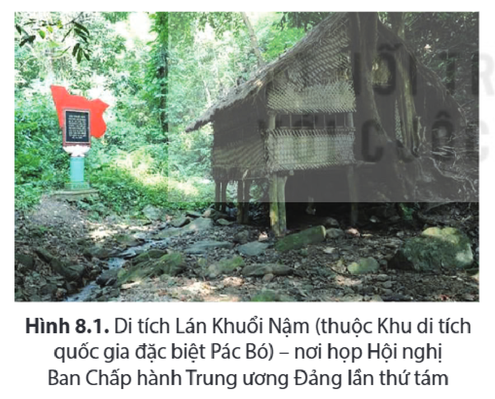
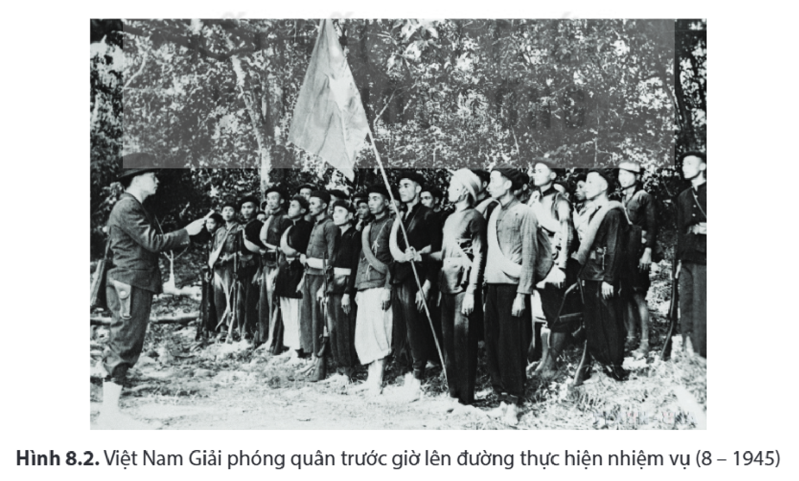
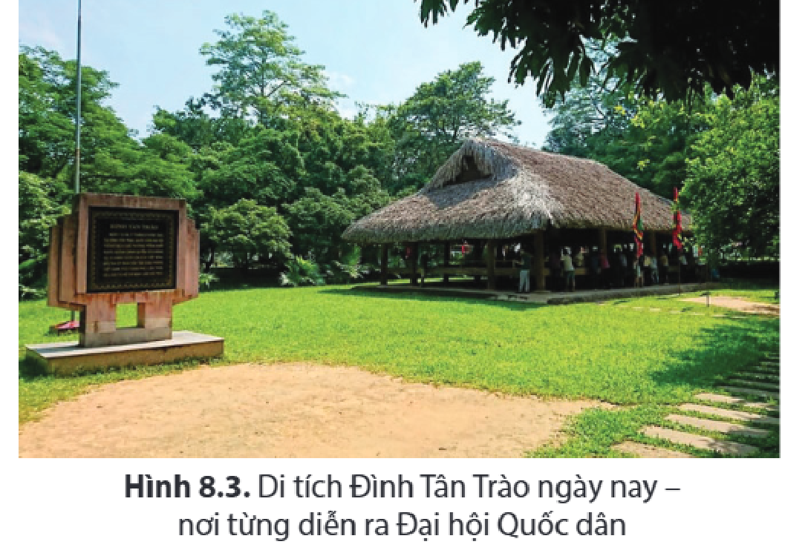
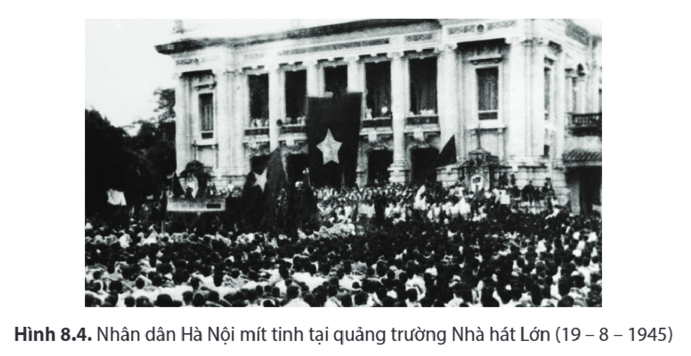
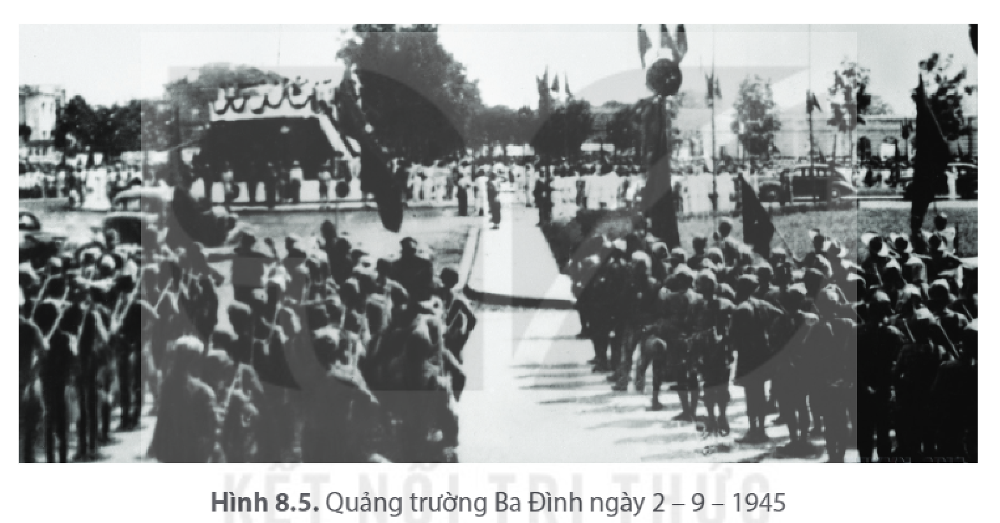

<!-- pdf:36 -->

# BÀI 8: CÁCH MẠNG THÁNG TÁM NĂM 1945

## 🎯 Học xong bài này, em sẽ:

- Nêu được tình hình Việt Nam dưới ách thống trị của Pháp – Nhật Bản.
- Nêu được sự chuẩn bị của nhân dân Việt Nam tiến tới khởi nghĩa giành chính quyền: chuyển hướng chiến lược của Đảng Cộng sản Đông Dương; chuẩn bị về lực lượng, sự ra đời căn cứ địa.
- Trình bày được thời cơ, nét chính diễn biến của Cách mạng tháng Tám năm 1945 và sự ra đời của nước Việt Nam Dân chủ Cộng hoà.
- Nêu được nguyên nhân thắng lợi, ý nghĩa lịch sử của Cách mạng tháng Tám năm 1945 và đánh giá được vai trò của Đảng Cộng sản Đông Dương trong Cách mạng tháng Tám năm 1945.

## 🔴 Mở đầu

Năm 1941, Đảng Cộng sản Đông Dương nhận định: "Trong lúc này quyền lợi của bộ phận, của giai cấp phải đặt dưới sự sinh tử, tồn vong của quốc gia, của dân tộc. Trong lúc này nếu không giải quyết được vấn đề dân tộc giải phóng, không đòi được độc lập, tự do cho toàn thể dân tộc, thì chẳng những toàn thể quốc gia dân tộc còn chịu mãi kiếp ngựa trâu, mà quyền lợi của bộ phận, giai cấp đến vạn năm cũng không đòi lại được".

(*Văn kiện Đảng toàn tập*, Tập 7, NXB Chính trị quốc gia, 2000, tr. 113)

Theo em, vấn đề “sinh tử, tồn vong của quốc gia, của dân tộc” trong giai đoạn lịch sử này là gì? Đảng Cộng sản Đông Dương đã lãnh đạo nhân dân Việt Nam giải quyết vấn đề đó như thế nào?

## 1. Tình hình Việt Nam dưới ách thống trị của Pháp – Nhật Bản

Chiến tranh thế giới thứ hai bùng nổ. Phát xít Đức đánh chiếm hàng loạt các nước châu Âu. Tháng 6 – 1940, Chính phủ Pháp đầu hàng phát xít Đức.

Ở châu Á, tháng 9 – 1940, quân phiệt Nhật Bản tiến đánh Việt Nam ở Lạng Sơn, rồi từng bước xâm chiếm toàn bộ Đông Dương. Quân Pháp kháng cự yếu ớt rồi đầu hàng, câu kết với quân Nhật ra sức bóc lột nhân dân Đông Dương. Việt Nam chịu ách thống trị của cả Pháp và Nhật Bản.

Về chính trị, cả Nhật Bản và Pháp đều tiến hành phát xít hoá bộ máy cai trị, thẳng tay đàn áp phong trào cách mạng, thủ tiêu các quyền lợi mà nhân dân Việt Nam đã giành được trong những năm 1936 – 1939.

Về kinh tế, thực dân Pháp thực hiện chính sách “Kinh tế chỉ huy”, tăng cường các loại thuế,...; quân Nhật bắt nhân dân ta nhổ lúa trồng đay, thu mua lương thực theo lối cưỡng bức với giá rẻ mạt,... Những thủ đoạn tàn ác này đã gây nên nạn đói nghiêm trọng ở Bắc Kì và Bắc Trung Kì vào cuối năm 1944 – đầu năm 1945.

<!-- pdf:37 -->

Chính sách thống trị của Pháp – Nhật đã làm cho mâu thuẫn giữa toàn thể dân tộc Việt Nam với đế quốc và tay sai trở nên gay gắt. Một số cuộc nổi dậy đầu tiên đã diễn ra, đó là khởi nghĩa Bắc Sơn (tỉnh Lạng Sơn, 9 – 1940), khởi nghĩa Nam Kì (11 – 1940) và binh biến Đô Lương (tỉnh Nghệ An, 1 – 1941).

> 💡 **Em có biết?**
>
> Trong cuộc khởi nghĩa Bắc Sơn, đội du kích Bắc Sơn được thành lập, là cơ sở để xây dựng lực lượng vũ trang cách mạng sau này.
>
> Trong khởi nghĩa Nam Kì, lá cờ đỏ sao vàng lần đầu xuất hiện.
<!-- ocr-ok: đã đối chiếu p037.png, hộp Em có biết? in song song 2 cột bị OCR trộn dòng -->

> ❓ Nêu nét chính về tình hình Việt Nam dưới ách thống trị của thực dân Pháp và quân phiệt Nhật Bản.

## 2. Công cuộc chuẩn bị tiến tới khởi nghĩa giành chính quyền trong toàn quốc

### a) Sự chuyển hướng chiến lược của Đảng Cộng sản Đông Dương

Trước những chuyển biến to lớn của tình hình thế giới và trong nước, Ban Chấp hành Trung ương Đảng Cộng sản Đông Dương đã kịp thời tổ chức các hội nghị để vạch ra đường lối lãnh đạo cách mạng.

Tháng 11 – 1939, Hội nghị Ban Chấp hành Trung ương Đảng Cộng sản Đông Dương diễn ra tại Bà Điểm (Thành phố Hồ Chí Minh) do Tổng Bí thư Nguyễn Văn Cừ chủ trì. Hội nghị đã xác định nhiệm vụ của cách mạng Việt Nam lúc này là cuộc cách mạng giải phóng dân tộc, nhằm đánh đổ đế quốc Pháp và tay sai để giành độc lập.

<!-- term: Hội nghị Ban Chấp hành Trung ương Đảng Cộng sản Đông Dương lần thứ tám -->
Tháng 5 – 1941, Hội nghị Ban Chấp hành Trung ương Đảng Cộng sản Đông Dương lần thứ tám được triệu tập tại Pác Bó (tỉnh Cao Bằng) do lãnh tụ Nguyễn Ái Quốc trực tiếp chủ trì. Hội nghị đã hoàn chỉnh chuyển hướng chiến lược cách mạng của Đảng, đưa nhiệm vụ giải phóng dân tộc lên hàng đầu, được đề ra từ Hội nghị Ban Chấp hành Trung ương tháng 11 – 1939.

*Hình 8.1. Di tích Lán Khuổi Nậm (thuộc Khu di tích quốc gia đặc biệt Pác Bó) – nơi họp Hội nghị Ban Chấp hành Trung ương Đảng lần thứ tám*

> 📜 **Tư liệu 1.** Nhiệm vụ chiến lược của cách mạng Việt Nam lúc này không phải là cuộc cách mạng giải quyết hai vấn đề phản đế và điền địa nữa (cách mạng tư sản dân quyền) mà là cuộc cách mạng chỉ phải giải quyết một vấn đề cấp bách là giải phóng dân tộc. Đây là cuộc cách mạng giải phóng dân tộc.
>
> (Theo *Văn kiện Đảng toàn tập*, Tập 7, Sđd, 2000, tr. 119)

<!-- term: Hội nghị Ban Chấp hành Trung ương Đảng Cộng sản Đông Dương lần thứ tám -->
Trên cơ sở đó, Hội nghị xác định: giải quyết vấn đề dân tộc trong phạm vi từng nước Đông Dương; chuẩn bị khởi nghĩa vũ trang để giành chính quyền là nhiệm vụ trung tâm, xác định hình thái cuộc khởi nghĩa là đi từ khởi nghĩa từng phần tiến lên tổng khởi nghĩa; dự báo về thời cơ của cuộc tổng khởi nghĩa giành chính quyền;...

> ❓ Khai thác thông tin và tư liệu trong mục, hãy cho biết nội dung chuyển hướng chiến lược cách mạng của Đảng Cộng sản Đông Dương trong những năm 1939 – 1941 là gì? Lấy dẫn chứng từ tư liệu 1 để chứng minh.

<!-- pdf:38 -->

### b) Chuẩn bị về lực lượng

<!-- term: Mặt trận Việt Nam độc lập đồng minh -->
Ngày 19 – 5 – 1941, theo chủ trương đề ra tại Hội nghị Ban Chấp hành Trung ương Đảng lần thứ tám, Mặt trận Việt Nam độc lập đồng minh (gọi tắt là Mặt trận Việt Minh) được thành lập nhằm “liên hiệp hết thảy các giới đồng bào yêu nước, không phân biệt giàu nghèo, già trẻ, gái trai, không phân biệt tôn giáo và xu hướng chính trị, đặng cùng nhau mưu cuộc dân tộc giải phóng”. Mặt trận bao gồm các tổ chức quần chúng lấy tên là Hội Cứu quốc.

> 📜 **Tư liệu 2.** Từ khi Mặt trận Việt Minh ra đời, “toàn bộ phong trào chống phát xít Pháp – Nhật của nhân dân ta mang tên là phong trào Việt Minh, cái tên tiêu biểu cho lòng yêu nước, ý chí quật cường của dân tộc ta”.
>
> (Ban Nghiên cứu Lịch sử Đảng Trung ương, *Cách mạng tháng Tám (1945)*, NXB Sự thật, Hà Nội, 1971, tr. 27)

<!-- term: Mặt trận Việt Nam độc lập đồng minh -->
Mặt trận Việt Minh ra đời đã thu hút đông đảo quần chúng nhân dân, nhất là ở Cao Bằng, tham gia vào các hội Cứu quốc. Dưới ngọn cờ Việt Minh, công cuộc chuẩn bị mọi mặt cho cuộc Tổng khởi nghĩa vũ trang giành chính quyền được xúc tiến gấp rút.

<!-- term: Đội Việt Nam Tuyên truyền Giải phóng quân -->
Ngày 22 – 12 – 1944, theo chỉ thị của Hồ Chí Minh, Đội Việt Nam Tuyên truyền Giải phóng quân được thành lập tại Cao Bằng. Ngay sau khi thành lập, Đội Việt Nam Tuyên truyền Giải phóng quân đã đánh thắng hai trận liên tiếp tại Phay Khắt và Nà Ngần (tỉnh Cao Bằng).

<!-- term: Việt Nam Giải phóng quân -->
Ngày 15 – 4 – 1945, Hội nghị Quân sự cách mạng Bắc Kì được triệu tập. Hội nghị quyết định thống nhất Cứu quốc quân (được thành lập bắt đầu từ năm 1941) và Việt Nam Tuyên truyền Giải phóng quân thành Việt Nam Giải phóng quân, phát triển hơn nữa các lực lượng vũ trang và nửa vũ trang, xây dựng căn cứ địa kháng Nhật,...

*Hình 8.2. Việt Nam Giải phóng quân trước giờ lên đường thực hiện nhiệm vụ (8 – 1945)*

> ❓ Công cuộc chuẩn bị lực lượng diễn ra và đạt được kết quả như thế nào?

<!-- pdf:39 -->

### c) Sự ra đời của căn cứ địa

Từ những năm 1941 – 1944, Trung ương Đảng đã chỉ đạo xây dựng căn cứ địa Bắc Sơn – Võ Nhai và Cao Bằng, sau đó phát triển thành hai chiến khu: Cao – Bắc – Lạng và Thái – Tuyên – Hà.

<!-- term: Khu giải phóng Việt Bắc -->
Tháng 5 – 1945, lãnh tụ Hồ Chí Minh rời Pác Bó về Tân Trào (tỉnh Tuyên Quang). Theo chỉ thị của Hồ Chí Minh, Khu giải phóng Việt Bắc được thành lập, "trở thành căn cứ địa chính của cách mạng cả nước. Khu giải phóng được xem là hình ảnh thu nhỏ của nước Việt Nam mới".

> ❓ Hãy trình bày một số nét chính về sự ra đời của căn cứ địa trong Cách mạng tháng Tám năm 1945.

### d) Cao trào kháng Nhật cứu nước và những hoạt động chuẩn bị cuối cùng cho Tổng khởi nghĩa (từ tháng 3 đến giữa tháng 8 – 1945)

Đầu năm 1945, Chiến tranh thế giới thứ hai bước vào giai đoạn kết thúc. Ở Đông Dương, thực dân Pháp ráo riết hoạt động, chờ cơ hội phản công quân Nhật, mâu thuẫn Nhật – Pháp trở nên gay gắt.

<!-- term: Cao trào “Kháng Nhật cứu nước” -->
Tối 9 – 3 – 1945, Nhật tiến hành đảo chính Pháp trên toàn Đông Dương. Ngày 12 – 3, Ban Thường vụ Trung ương Đảng Cộng sản Đông Dương ra chỉ thị *Nhật – Pháp bắn nhau và hành động của chúng ta*, phát động cao trào “Kháng Nhật cứu nước” làm tiền đề cho cuộc tổng khởi nghĩa. Cao trào “Kháng Nhật cứu nước” đã phát triển mạnh mẽ và rộng khắp trên cả nước.

Ở khu căn cứ địa Cao – Bắc – Lạng, Việt Nam Tuyên truyền Giải phóng quân phối hợp với lực lượng chính trị của quần chúng giải phóng hàng loạt xã, châu, huyện.

Ở Bắc Kì và Bắc Trung Kì, phong trào *Phá kho thóc, giải quyết nạn đói* diễn ra quyết liệt chưa từng có.

Khởi nghĩa từng phần dâng lên ở nhiều nơi như: Tiên Du (tỉnh Bắc Ninh), Bần Yên Nhân (tỉnh Hưng Yên), Ba Tơ (tỉnh Quảng Ngãi),...

> ❓ Cao trào kháng Nhật cứu nước và những hoạt động chuẩn bị cuối cùng tiến tới tổng khởi nghĩa giành chính quyền diễn ra như thế nào?

## 3. Cách mạng tháng Tám năm 1945 và sự ra đời của nước Việt Nam Dân chủ Cộng hoà

### a) Thời cơ và diễn biến chính của Tổng khởi nghĩa tháng Tám năm 1945

Quân phiệt Nhật Bản đầu hàng Đồng minh không điều kiện (15 – 8 – 1945), quân Nhật ở Đông Dương rệu rã, Chính phủ thân Nhật Trần Trọng Kim hoang mang cực độ, thời cơ "ngàn năm có một" của tổng khởi nghĩa đã đến.

Ngày 13 – 8 – 1945, Uỷ ban Khởi nghĩa toàn quốc đã được thành lập, ban bố *Quân lệnh số 1*, chính thức phát lệnh Tổng khởi nghĩa trong cả nước.

Ngày 14 và 15 – 8 – 1945, Hội nghị toàn quốc của Đảng họp ở Tân Trào (tỉnh Tuyên Quang), thông qua kế hoạch lãnh đạo toàn dân tổng khởi nghĩa, quyết định những vấn đề quan trọng trong chính sách đối nội, đối ngoại sau khi giành được chính quyền.

<!-- pdf:40 -->

<!-- term: Đại hội Quốc dân -->
Ngày 16 và 17 – 8 – 1945, Đại hội Quốc dân được triệu tập. Đại hội tán thành chủ trương Tổng khởi nghĩa của Đảng, thông qua 10 chính sách của Việt Minh, cử ra Uỷ ban Dân tộc giải phóng Việt Nam (sau này là Chính phủ lâm thời) do Hồ Chí Minh làm Chủ tịch.

*Hình 8.3. Di tích Đình Tân Trào ngày nay – nơi từng diễn ra Đại hội Quốc dân*

DIỄN BIẾN CHÍNH CỦA TỔNG KHỞI NGHĨA THÁNG TÁM NĂM 1945

| Thời gian | Sự kiện |
| --- | --- |
| Ngày 14 – 8 | Một số cấp bộ Đảng và tổ chức Việt Minh ở nhiều xã, huyện thuộc các tỉnh đồng bằng châu thổ sông Hồng, Thanh Hoá, Nghệ An, Hà Tĩnh, Thừa Thiên, Quảng Ngãi, Khánh Hoà,... đã phát động nhân dân khởi nghĩa giành chính quyền. |
| Ngày 16 – 8 | Võ Nguyên Giáp chỉ huy một đơn vị Giải phóng quân xuất phát từ Tân Trào tiến về giải phóng thị xã Thái Nguyên, mở đường tiến về Hà Nội. |
| Ngày 18 – 8 | Nhân dân Bắc Giang, Hải Dương, Hà Tĩnh, Quảng Nam giành được chính quyền ở tỉnh lị sớm nhất trong cả nước. |
| Ngày 19 – 8 | Tại Hà Nội, quần chúng cách mạng có sự hỗ trợ của các đội tự vệ chiến đấu lần lượt chiếm Phủ Khâm sai, Sở Cảnh sát Trung ương, Trại Bảo an binh,... Đến tối, cuộc khởi nghĩa giành thắng lợi hoàn toàn. |
| Ngày 23 – 8 | Tại Huế, hàng vạn nhân dân nội, ngoại thành kéo về biểu tình thị uy, chiếm các công sở, giành chính quyền về tay nhân dân. |
| Ngày 24, 25 – 8 | Tại Sài Gòn, tối 24 – 8, cuộc khởi nghĩa cơ bản giành thắng lợi. Ngày 25 – 8, hàng chục vạn nhân dân Sài Gòn, Chợ Lớn, Gia Định và các tỉnh lân cận kéo về trung tâm thành phố dự cuộc mít tinh khổng lồ chào mừng thắng lợi của cuộc khởi nghĩa; chính quyền cách mạng ra mắt nhân dân. |
| Ngày 28 – 8 | Đồng Nai Thượng và Hà Tiên là hai tỉnh cuối cùng giành được chính quyền. |

*Hình 8.4. Nhân dân Hà Nội mít tinh tại quảng trường Nhà hát Lớn (19 – 8 – 1945)*

<!-- pdf:41 -->

> ❓ 1. Hãy trình bày thời cơ và diễn biến chính của Tổng khởi nghĩa tháng Tám năm 1945.
>
> 2. Theo em, sự nhạy bén, sáng suốt của Đảng Cộng sản Đông Dương và Tổng bộ Việt Minh trong lãnh đạo Tổng khởi nghĩa tháng Tám năm 1945 được thể hiện qua những sự kiện nào?

### b) Nước Việt Nam Dân chủ Cộng hoà ra đời

Ngày 25 – 8 – 1945, Chủ tịch Hồ Chí Minh cùng với Trung ương Đảng và Uỷ ban Dân tộc giải phóng Việt Nam từ Tân Trào về đến Hà Nội. Hồ Chí Minh soạn thảo bản *Tuyên ngôn Độc lập*, chuẩn bị mọi công việc để Chính phủ lâm thời ra mắt quốc dân.

<!-- term: Tuyên ngôn Độc lập -->
Ngày 2 – 9, tại Quảng trường Ba Đình (thành phố Hà Nội), trước cuộc mít tinh lớn của hàng vạn nhân dân Thủ đô và các vùng lân cận, Chủ tịch Hồ Chí Minh thay mặt Chính phủ lâm thời đọc *Tuyên ngôn Độc lập* khai sinh ra nước Việt Nam Dân chủ Cộng hoà.

*Hình 8.5. Quảng trường Ba Đình ngày 2 – 9 – 1945*

<!-- term: Tuyên ngôn Độc lập -->
> 📜 **Tư liệu 3.** Trong bản *Tuyên ngôn Độc lập* có đoạn: “Nước Việt Nam có quyền hưởng tự do và độc lập, và sự thực đã thành một nước tự do và độc lập. Toàn thể dân tộc Việt Nam quyết đem tất cả tinh thần và lực lượng, tính mệnh và của cải để giữ vững quyền tự do và độc lập ấy”.
>
> (*Hồ Chí Minh: Toàn tập*, Tập 4, NXB Chính trị quốc gia, 2011, tr. 3)

> ❓ 1. Nước Việt Nam Dân chủ Cộng hoà ra đời như thế nào?
>
> 2. Khai thác tư liệu 3 và hãy xác định nội dung chính của tư liệu.

## 4. Nguyên nhân thắng lợi, ý nghĩa lịch sử của Cách mạng tháng Tám năm 1945

### a) Nguyên nhân thắng lợi

Dân tộc ta vốn có truyền thống yêu nước nồng nàn, luôn kiên cường, bất khuất, kiên quyết đấu tranh vì độc lập, tự do. Đảng Cộng sản Đông Dương, đứng đầu là Chủ tịch Hồ Chí Minh, với đường lối đúng đắn, sáng tạo đã lãnh đạo nhân dân tiến hành cuộc cách mạng và giành thắng lợi hoàn toàn.

<!-- pdf:42 -->

Trong cuộc cách mạng này, Mặt trận Việt Minh từ Trung ương đến địa phương đã tập hợp được mọi lực lượng của dân tộc, linh hoạt, sáng tạo trong chỉ đạo khởi nghĩa, chớp thời cơ phát động quần chúng nổi dậy giành chính quyền.

Chiến thắng của Hồng quân Liên Xô và quân Đồng minh trong cuộc chiến tranh chống phát xít, nhất là chiến thắng quân phiệt Nhật Bản đã cổ vũ tinh thần, củng cố niềm tin và tạo thời cơ để nhân dân ta đứng lên tổng khởi nghĩa.

### b) Ý nghĩa lịch sử

<!-- term: Cách mạng tháng Tám năm 1945 -->
Cách mạng tháng Tám năm 1945 là sự kiện lịch sử vĩ đại trong lịch sử dân tộc Việt Nam, đã phá tan xiềng xích nô lệ của thực dân Pháp và ách thống trị của quân phiệt Nhật Bản, chấm dứt sự tồn tại của chế độ quân chủ trên đất nước ta, mở ra một kỉ nguyên mới trong lịch sử dân tộc: kỉ nguyên đất nước độc lập, tự do dưới chế độ dân chủ cộng hoà.

<!-- term: Cách mạng tháng Tám năm 1945 -->
Thắng lợi của Cách mạng tháng Tám đã cổ vũ mạnh mẽ tinh thần đấu tranh của các dân tộc thuộc địa và phụ thuộc trên thế giới, đặc biệt là nhân dân hai nước Cam-pu-chia và Lào.

> ❓ Hãy nêu nguyên nhân thắng lợi và ý nghĩa lịch sử của Cách mạng tháng Tám năm 1945.

## ✏️ Luyện tập và Vận dụng

**Luyện tập:**

1. Lập bảng thống kê về những sự kiện chính trong Cách mạng tháng Tám năm 1945 (theo gợi ý dưới đây vào vở).

| Thời gian | Sự kiện nổi bật | Ý nghĩa |
| --- | --- | --- |
| ? | ? | ? |
| ? | ? | ? |

2. Hãy đánh giá vai trò của Đảng Cộng sản Đông Dương trong Cách mạng tháng Tám năm 1945.

**Vận dụng:**

1. Theo em, bài học kinh nghiệm nào của Cách mạng tháng Tám năm 1945 có thể được vận dụng vào công cuộc xây dựng và bảo vệ Tổ quốc hiện nay?

2. Tìm hiểu và chia sẻ thông tin về cuộc Tổng khởi nghĩa giành chính quyền tháng Tám năm 1945 ở địa phương em (tỉnh hoặc thành phố).

## 📷 Danh sách hình trong bài

| Mã hình | Trang PDF | Vị trí | Chú thích |
| --- | --- | --- | --- |
| H9-lich_su_va_dia_ly-ls-b08-01 | 37 | Mục 2.a (trang 35) | Hình 8.1. Di tích Lán Khuổi Nậm (thuộc Khu di tích quốc gia đặc biệt Pác Bó) – nơi họp Hội nghị Ban Chấp hành Trung ương Đảng lần thứ tám |
| H9-lich_su_va_dia_ly-ls-b08-02 | 38 | Mục 2.b (trang 36) | Hình 8.2. Việt Nam Giải phóng quân trước giờ lên đường thực hiện nhiệm vụ (8 – 1945) |
| H9-lich_su_va_dia_ly-ls-b08-03 | 40 | Mục 3.a, ảnh tràn sát mép trên trang sách (trang 38) | Hình 8.3. Di tích Đình Tân Trào ngày nay – nơi từng diễn ra Đại hội Quốc dân |
| H9-lich_su_va_dia_ly-ls-b08-04 | 40 | Mục 3.a (trang 38) | Hình 8.4. Nhân dân Hà Nội mít tinh tại quảng trường Nhà hát Lớn (19 – 8 – 1945) |
| H9-lich_su_va_dia_ly-ls-b08-05 | 41 | Mục 3.b (trang 39) | Hình 8.5. Quảng trường Ba Đình ngày 2 – 9 – 1945 |
