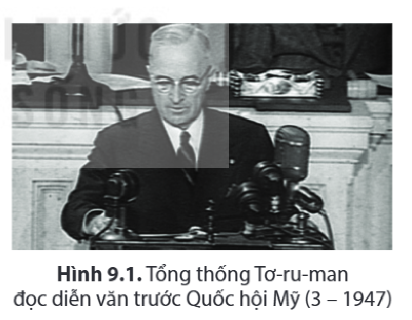
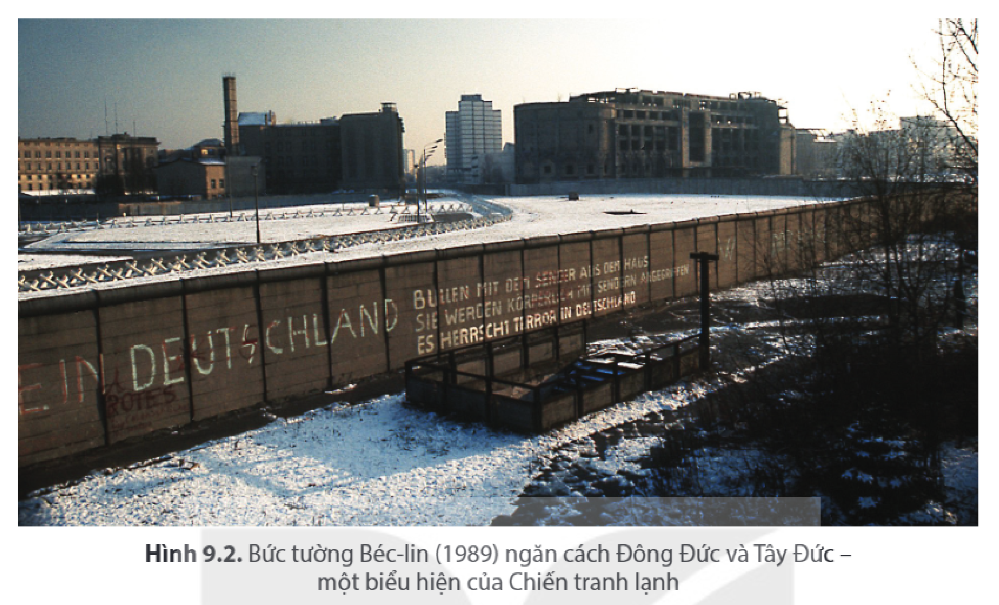

<!-- pdf:43 -->

# BÀI 9: CHIẾN TRANH LẠNH (1947 – 1989)

## 🎯 Học xong bài này, em sẽ:

- Nhận biết được nguyên nhân, những biểu hiện và hậu quả của Chiến tranh lạnh.

## 🔴 Mở đầu

Nhận định về tình trạng chiến tranh lạnh ngay sau Chiến tranh thế giới thứ hai, Rây-mân A-ron viết: “Hoà bình là bất khả thi, chiến tranh không thể xảy ra” (*Cuộc đối đầu lớn*, NXB Ga-li-mát, Pa-ri, 1948).

Em hiểu Chiến tranh lạnh là gì? Hãy chia sẻ những hiểu biết của em về nguyên nhân, biểu hiện và hậu quả của Chiến tranh lạnh.

## 1. Nguyên nhân xuất hiện Chiến tranh lạnh

Sau Chiến tranh thế giới thứ hai, Liên Xô và Mỹ cùng các nước tư bản Tây Âu chuyển từ quan hệ đồng minh sang đối đầu.

Mỹ và các nước tư bản chủ nghĩa lo ngại về sự tồn tại và ảnh hưởng của chủ nghĩa cộng sản ở Liên Xô. Trong khi Mỹ muốn mở rộng ảnh hưởng và làm bá chủ thế giới, Liên Xô đã giúp đỡ Đảng Cộng sản ở các nước Đông Âu thành lập các nhà nước dân chủ nhân dân, đi theo con đường xã hội chủ nghĩa.

Tháng 3 – 1947, Tổng thống Mỹ Tơ-ru-man công khai thực hiện Chiến lược toàn cầu, từ bỏ hợp tác với Liên Xô, bắt đầu cuộc Chiến tranh lạnh chống Liên Xô và các nước xã hội chủ nghĩa.

*Hình 9.1. Tổng thống Tơ-ru-man đọc diễn văn trước Quốc hội Mỹ (3 – 1947)*

> 📜 **Tư liệu**
>
> “Theo Tơ-ru-man, các nước Đông Âu “vừa mới bị cộng sản thôn tính”... Vì vậy, Mỹ phải đứng ra “đảm nhiệm sứ mạng lãnh đạo thế giới tự do”... chống lại “sự đe doạ” của chủ nghĩa cộng sản, chống lại sự “bành trướng” của Liên Xô.”
>
> (Nguyễn Anh Thái (Chủ biên), *Lịch sử thế giới hiện đại từ 1945 đến 1995*, Quyển A, NXB Đại học Quốc gia Hà Nội, 1999, tr. 34)

> ❓ Khai thác tư liệu và thông tin trong mục, hãy trình bày nguyên nhân dẫn đến Chiến tranh lạnh.

<!-- pdf:44 -->

## 2. Biểu hiện của Chiến tranh lạnh

Trong Chiến tranh lạnh, Mỹ – đứng đầu hệ thống tư bản chủ nghĩa và Liên Xô – đứng đầu hệ thống xã hội chủ nghĩa luôn ở trong tình trạng đối đầu trên các lĩnh vực: kinh tế, chính trị – quân sự và mở rộng ảnh hưởng ở các khu vực trên thế giới,...

BẢNG MỘT SỐ BIỂU HIỆN VỀ SỰ ĐỐI ĐẦU GIỮA CÁC NƯỚC TƯ BẢN CHỦ NGHĨA VÀ XÃ HỘI CHỦ NGHĨA

<!-- term: Kế hoạch Mác-san -->
<!-- term: Hội đồng Tương trợ kinh tế -->
<!-- term: Tổ chức Hiệp ước Bắc Đại Tây Dương -->
<!-- term: Tổ chức Hiệp ước Vác-sa-va -->
| Lĩnh vực / Khu vực | MỸ VÀ CÁC NƯỚC TƯ BẢN CHỦ NGHĨA | LIÊN XÔ VÀ CÁC NƯỚC XÃ HỘI CHỦ NGHĨA |
| --- | --- | --- |
| KINH TẾ | Đề ra Kế hoạch Mác-san (1947), Mỹ đầu tư khoảng 13 tỉ USD cho 16 nước Tây Âu phục hồi kinh tế. | Thành lập Hội đồng Tương trợ kinh tế – SEV (1949), thúc đẩy sự hợp tác, giúp đỡ lẫn nhau giữa các nước xã hội chủ nghĩa. |
| CHÍNH TRỊ – QUÂN SỰ | Thành lập Tổ chức Hiệp ước Bắc Đại Tây Dương – NATO (1949). | Thành lập Tổ chức Hiệp ước Vác-sa-va (1955). |
| CHÍNH TRỊ – QUÂN SỰ | Chế tạo thành công bom nguyên tử (1945). Phóng thành công vệ tinh nhân tạo (1958),... | Chế tạo thành công bom nguyên tử (1949). Phóng thành công vệ tinh nhân tạo (1957),... |
| MỞ RỘNG ẢNH HƯỞNG Ở CÁC KHU VỰC: Đức | Ủng hộ thành lập Nhà nước Cộng hoà Liên bang Đức ở Tây Đức (9 – 1949). | Ủng hộ thành lập Nhà nước Cộng hoà Dân chủ Đức ở Đông Đức (10 – 1949). |
| MỞ RỘNG ẢNH HƯỞNG Ở CÁC KHU VỰC: Triều Tiên | Ủng hộ thành lập Nhà nước Đại Hàn Dân quốc ở phía nam (Hàn Quốc, 8 – 1948); viện trợ và trực tiếp tham gia trong cuộc chiến tranh với Cộng hoà Dân chủ nhân dân Triều Tiên (1950 – 1953). | Ủng hộ thành lập Nhà nước Cộng hoà Dân chủ nhân dân Triều Tiên ở phía bắc (9 – 1948); viện trợ và trực tiếp tham gia trong cuộc chiến tranh với Hàn Quốc (1950 – 1953). |
| MỞ RỘNG ẢNH HƯỞNG Ở CÁC KHU VỰC: Cu-ba | Chống Chính phủ Cu-ba do Phi-đen Cát-xtơ-rô đứng đầu (1961), thực hiện lệnh phong toả hải quân đối với Cu-ba (10 – 1962). | Hỗ trợ kinh tế, đưa quân đội thường trực và một số tên lửa hạt nhân vào Cu-ba (10 – 1962). |
| MỞ RỘNG ẢNH HƯỞNG Ở CÁC KHU VỰC: Việt Nam | Giúp thực dân Pháp tiến hành chiến tranh xâm lược (1950 – 1954); thiết lập, hỗ trợ chính quyền ở miền Nam, tiến hành chiến tranh xâm lược ở miền Nam và chống phá công cuộc xây dựng chủ nghĩa xã hội ở miền Bắc (1954 – 1975). | Ủng hộ cuộc kháng chiến chống thực dân Pháp xâm lược (1950 – 1954); ủng hộ công cuộc xây dựng chủ nghĩa xã hội ở miền Bắc và cuộc kháng chiến chống Mỹ, cứu nước, thống nhất đất nước (1954 – 1975). |

<!-- pdf:45 -->

*Hình 9.2. Bức tường Béc-lin (1989) ngăn cách Đông Đức và Tây Đức – một biểu hiện của Chiến tranh lạnh*

> ❓ Trình bày một số biểu hiện chính của Chiến tranh lạnh.

## 3. Hậu quả của Chiến tranh lạnh

Chiến tranh lạnh được các nhà lãnh đạo Mỹ và Liên Xô tuyên bố chấm dứt trong cuộc gặp gỡ không chính thức tại Man-ta (12 – 1989).

Chiến tranh lạnh đã đẩy thế giới vào tình trạng luôn căng thẳng, đối đầu giữa hai phe đối lập, thậm chí làm bùng nổ các cuộc chiến tranh, xung đột cục bộ ở khắp các khu vực trên phạm vi toàn cầu, làm xuất hiện nguy cơ của một cuộc chiến tranh thế giới mới.

Mặt khác, Chiến tranh lạnh cũng đưa đến sự chia cắt lãnh thổ, chia rẽ tình cảm dân tộc, xung đột tôn giáo,... ở nhiều quốc gia, khu vực với hệ luỵ sâu sắc và lâu dài.

> ❓ Hãy nêu hậu quả của Chiến tranh lạnh.

## ✏️ Luyện tập và Vận dụng

**Luyện tập:**

Hãy hoàn thành bảng (theo gợi ý dưới đây vào vở) tóm tắt nguyên nhân, biểu hiện chính và hậu quả của Chiến tranh lạnh.

| Nội dung | Tóm tắt |
| --- | --- |
| Nguyên nhân | ? |
| Biểu hiện chính | ? |
| Hậu quả | ? |

**Vận dụng:**

Tìm hiểu từ sách, báo và internet, hãy nêu một số biểu hiện là hậu quả của Chiến tranh lạnh đối với thế giới hiện nay.

## 📷 Danh sách hình trong bài

| Mã hình | Trang PDF | Vị trí | Chú thích |
| --- | --- | --- | --- |
| H9-lich_su_va_dia_ly-ls-b09-01 | 43 | Mục 1 (trang 41) | Hình 9.1. Tổng thống Tơ-ru-man đọc diễn văn trước Quốc hội Mỹ (3 – 1947) |
| H9-lich_su_va_dia_ly-ls-b09-02 | 45 | Mục 2 (trang 43) | Hình 9.2. Bức tường Béc-lin (1989) ngăn cách Đông Đức và Tây Đức – một biểu hiện của Chiến tranh lạnh |
