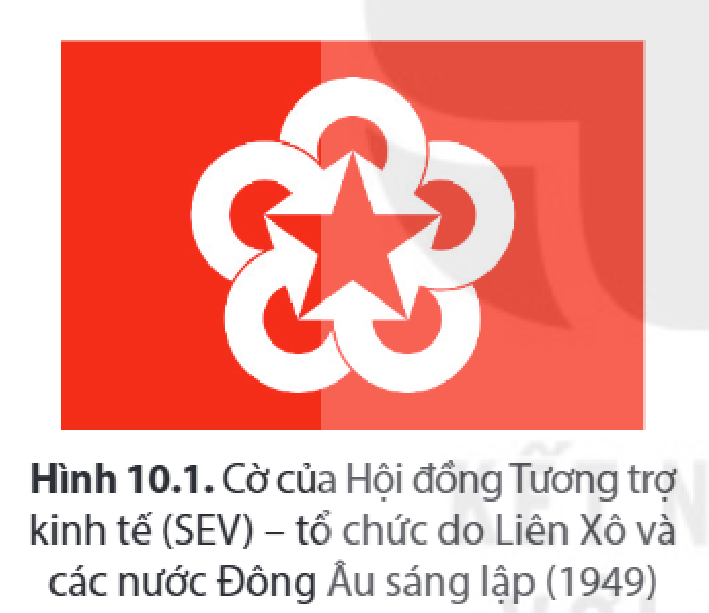
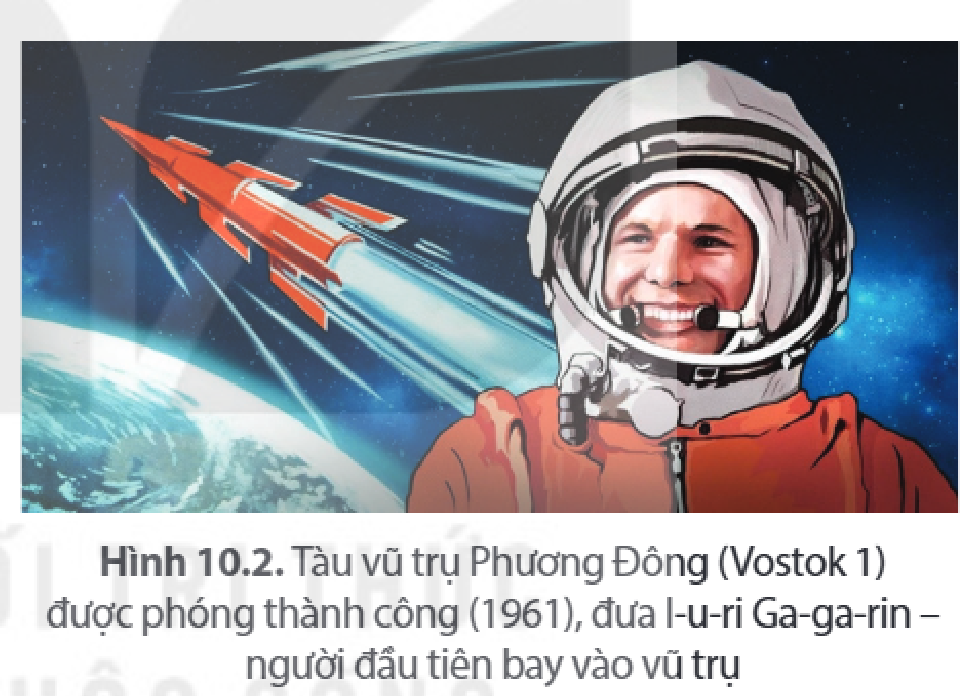
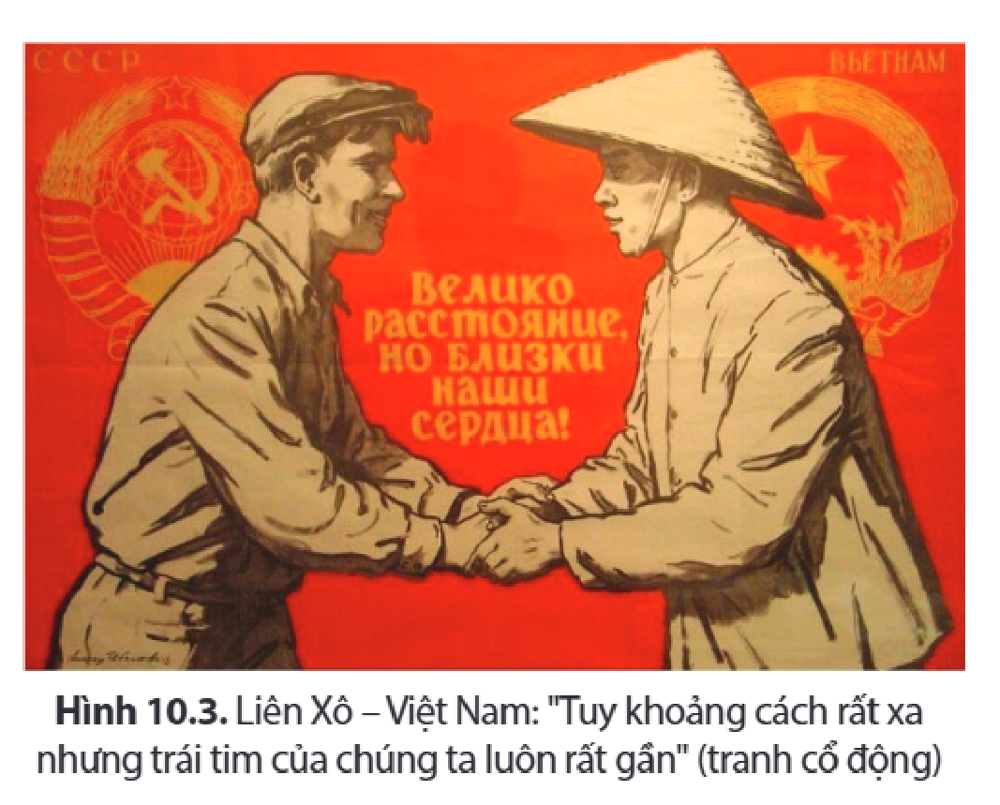
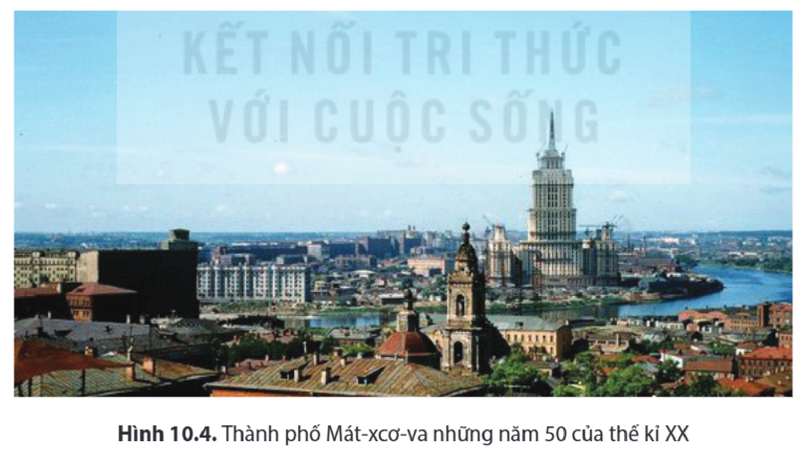
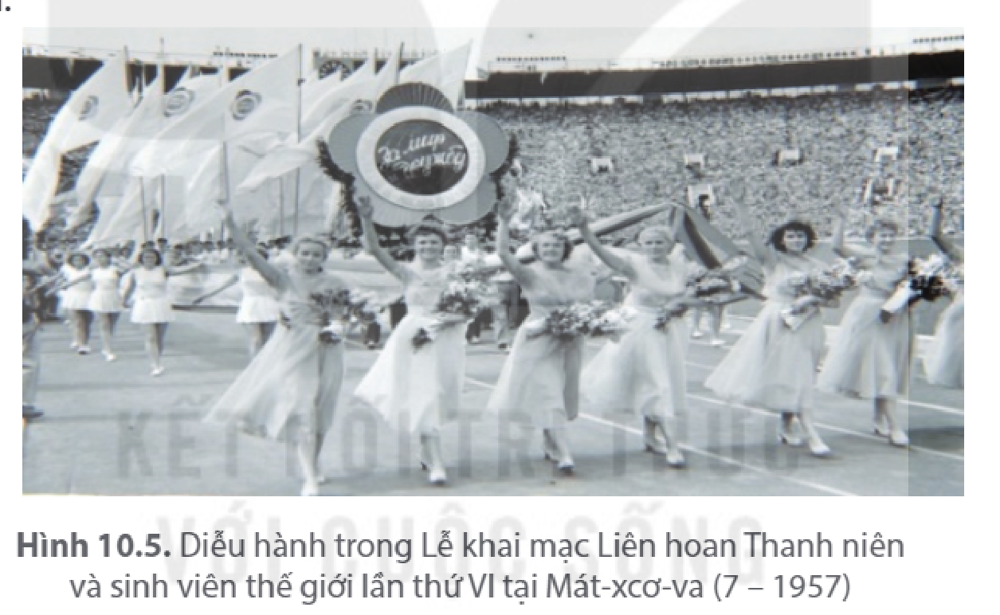
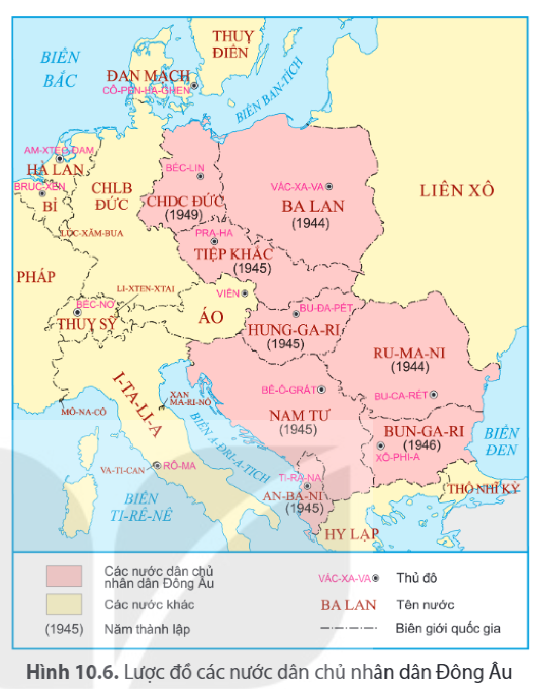
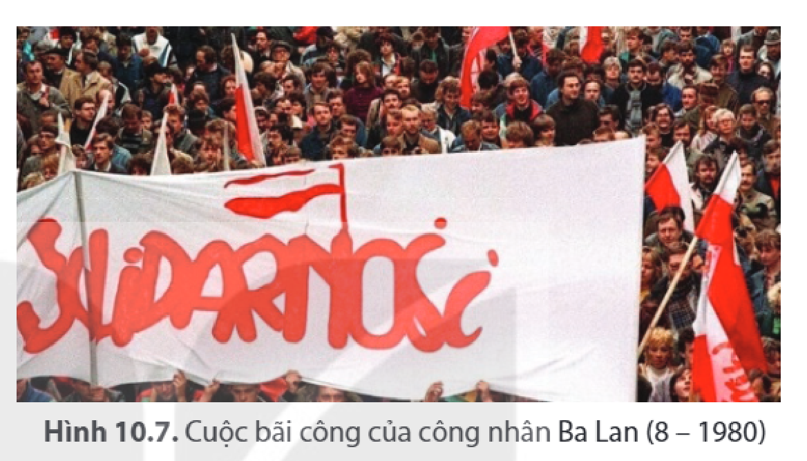

<!-- pdf:46 -->

# BÀI 10: LIÊN XÔ VÀ ĐÔNG ÂU TỪ NĂM 1945 ĐẾN NĂM 1991

## 🎯 Học xong bài này, em sẽ:

- Trình bày được tình hình chính trị, kinh tế, xã hội, văn hoá của Liên Xô và Đông Âu từ năm 1945 đến năm 1991.
- Giải thích được sự sụp đổ của chế độ xã hội chủ nghĩa ở Liên Xô và Đông Âu.

## 🔴 Mở đầu

Quan sát hai hình dưới đây, em liên hệ đến quốc gia và khu vực nào? Tình hình chính trị, kinh tế, xã hội, văn hoá của quốc gia và khu vực này từ sau Chiến tranh thế giới thứ hai đến năm 1991 có gì nổi bật? Hãy chia sẻ một số hiểu biết của em về điều đó.

*Hình 10.1. Cờ của Hội đồng Tương trợ kinh tế (SEV) – tổ chức do Liên Xô và các nước Đông Âu sáng lập (1949)*

*Hình 10.2. Tàu vũ trụ Phương Đông (Vostok 1) được phóng thành công (1961), đưa I-u-ri Ga-ga-rin – người đầu tiên bay vào vũ trụ*

## 1. Liên Xô từ năm 1945 đến năm 1991

### a) Chính trị

Sau Chiến tranh thế giới thứ hai, Liên Xô tiến hành bầu cử Xô viết các cấp, thực hiện dân chủ hoá hệ thống chính trị bằng cách khôi phục đại hội các tổ chức chính trị – xã hội từ năm 1949.

Liên Xô chủ trương duy trì hoà bình và an ninh thế giới, giúp đỡ to lớn về vật chất và tinh thần cho các nước xã hội chủ nghĩa và phong trào đấu tranh giải phóng dân tộc trên thế giới.

*Hình 10.3. Liên Xô – Việt Nam: "Tuy khoảng cách rất xa nhưng trái tim của chúng ta luôn rất gần" (tranh cổ động)*

<!-- pdf:47 -->

<!-- term: Công cuộc cải tổ ở Liên Xô -->
Tới đầu những năm 80 của thế kỉ XX, Liên Xô lâm vào khủng hoảng chính trị. Tháng 3 – 1985, M. Goóc-ba-chốp được bầu làm Tổng Bí thư Đảng Cộng sản Liên Xô và công cuộc cải tổ được tiến hành. Trong đó, cải tổ chính trị với khẩu hiệu “dân chủ hoá”, “công khai hoá” đã xác lập chế độ đa nguyên, đa đảng và hệ thống chính quyền tổng thống.

Tháng 3 – 1990, Đại hội đại biểu nhân dân Liên Xô lần thứ ba bầu M. Goóc-ba-chốp làm Tổng thống. Ngày 19 – 8 – 1991, một số lãnh đạo Đảng và Nhà nước Liên Xô đã tiến hành cuộc đảo chính lật đổ M. Goóc-ba-chốp, nhưng không thành công.

Hệ quả là mâu thuẫn chính trị gia tăng, Đảng Cộng sản bị đình chỉ hoạt động, chính quyền Liên bang bị tê liệt, các nước cộng hoà tuyên bố độc lập, tách khỏi Liên bang dẫn đến việc M. Goóc-ba-chốp buộc phải từ chức Tổng thống vào ngày 25 – 12 – 1991, đánh dấu sự tan rã của Liên bang Xô viết.

> ❓ Trình bày tình hình chính trị của Liên Xô từ năm 1945 đến năm 1991.

### b) Kinh tế

Năm 1946, Liên Xô bắt tay vào công cuộc khôi phục kinh tế, đến năm 1950 đã phục hồi được mức trước chiến tranh. Từ đây, Liên Xô tiến hành xây dựng cơ sở vật chất cho chủ nghĩa xã hội. Đến những năm 60, Liên Xô trở thành cường quốc công nghiệp thứ hai thế giới (sau Mỹ). Liên Xô là nước đầu tiên trên thế giới phóng thành công vệ tinh nhân tạo (1957), phóng tàu vũ trụ có người lái vào quỹ đạo Trái Đất (1961), mở đầu kỉ nguyên chinh phục vũ trụ của loài người.

Thực hiện kế hoạch 5 năm (1946 – 1950), công nghiệp Liên Xô tăng 73% so với mức trước chiến tranh, hơn 6 000 nhà máy được khôi phục và xây dựng mới. Với các kế hoạch 5 năm (1951 – 1955, 1956 – 1960) và kế hoạch 7 năm (1959 – 1965),... sản lượng công nghiệp của Liên Xô chiếm khoảng 20% sản lượng công nghiệp thế giới; sản xuất nông nghiệp trong những năm 60 tăng trung bình 16%/năm.

*Hình 10.4. Thành phố Mát-xcơ-va những năm 50 của thế kỉ XX*

<!-- term: Công cuộc cải tổ ở Liên Xô -->
Từ giữa những năm 70, nền kinh tế Liên Xô có dấu hiệu trì trệ. Công cuộc cải tổ kinh tế được thực hiện từ năm 1985, nhưng thiếu đồng bộ và hiệu quả, dẫn đến khủng hoảng kinh tế trầm trọng trong những năm 1989 – 1991 với sự khan hiếm lương thực, thực phẩm và các hàng hoá tiêu dùng thiết yếu.

> ❓ Trình bày tình hình kinh tế của Liên Xô từ năm 1945 đến năm 1991.

<!-- pdf:48 -->

### c) Xã hội và văn hoá

- *Xã hội:* Cơ cấu xã hội Liên Xô có những biến đổi tích cực, thành phần công nhân và trí thức gia tăng. Năm 1971, công nhân chiếm hơn 55% lực lượng lao động trong cả nước và có trên 30 triệu người làm việc trí óc.

Từ cuối những năm 70, do khó khăn kinh tế ngày càng gia tăng làm cho đời sống của nhân dân Liên Xô suy giảm, niềm tin vào chủ nghĩa xã hội lung lay dẫn đến bất bình gia tăng. Cùng với sự kích động của các thế lực thù địch trong và ngoài nước, nhiều cuộc biểu tình, bãi công đã nổ ra từ năm 1989.

- *Văn hoá:* Sau năm 1945, văn hoá của Liên Xô phát triển, thực hiện chế độ giáo dục miễn phí – thể hiện tính ưu việt của chủ nghĩa xã hội.

> 📜 **Tư liệu 1.** “Năm 1971 ... Liên Xô là nước đứng đầu thế giới về trình độ học vấn của nhân dân với 3/4 số dân có trình độ đại học và trung học.”
>
> (Nguyễn Anh Thái (Chủ biên), *Lịch sử thế giới hiện đại từ 1945 đến 1995*, Sđd, tr. 167)

Liên Xô cũng thúc đẩy giao lưu văn hoá giữa các dân tộc trong nước và với các quốc gia trên thế giới.

*Hình 10.5. Diễu hành trong Lễ khai mạc Liên hoan Thanh niên và sinh viên thế giới lần thứ VI tại Mát-xcơ-va (7 – 1957)*

<!-- term: Công cuộc cải tổ ở Liên Xô -->
Khi công cuộc cải tổ được thực hiện, đời sống văn hoá ở Liên Xô trở nên “cởi mở” với tinh thần “dân chủ” và “công khai”. Điều này đem lại luồng không khí mới, kích thích sự sáng tạo văn hoá. Tuy nhiên, sự buông lỏng quản lí văn hoá của Nhà nước đã dẫn đến chủ nghĩa đa nguyên và tư tưởng chống chủ nghĩa xã hội trong nước gia tăng.

> ❓ 1. Khai thác tư liệu 1 và thông tin trong mục, trình bày tình hình xã hội và văn hoá của Liên Xô từ năm 1945 đến năm 1991.
>
> 2. Nêu những biểu hiện về sự khủng hoảng và giải thích vì sao chủ nghĩa xã hội ở Liên Xô sụp đổ.

## 2. Các nước Đông Âu từ năm 1945 đến năm 1991

### a) Chính trị

<!-- term: Nhà nước dân chủ nhân dân -->
Từ năm 1944 đến năm 1946, được sự giúp đỡ của Hồng quân Liên Xô, nhân dân các nước Đông Âu dưới sự lãnh đạo của những người cộng sản đã thành lập các nhà nước dân chủ

<!-- pdf:49 -->

<!-- term: Nhà nước dân chủ nhân dân -->
nhân dân. Riêng ở Đông Đức, Nhà nước Cộng hoà Dân chủ Đức ra đời năm 1949. Sau đó, các nước Đông Âu đã tiến hành xây dựng chủ nghĩa xã hội.

<!-- term: Chế độ đa nguyên chính trị -->
Đến đầu những năm 80, tình hình chính trị ở các nước Đông Âu diễn biến hết sức phức tạp. Sự yếu kém, hạn chế của bộ máy nhà nước bộc lộ ngày càng rõ, tạo cơ hội cho các lực lượng đối lập câu kết với nhau, kích động nhân dân đòi thực hiện đa nguyên, đa đảng và tổng tuyển cử tự do. Trước sức ép trong nước, cùng chính sách không “can thiệp” của Liên Xô, từ năm 1989, ban lãnh đạo các nước Đông Âu phải thực hiện đa nguyên chính trị và tổ chức tổng tuyển cử tự do. Kết quả là các thế lực chống chủ nghĩa xã hội đã thắng cử, giành được quyền lãnh đạo đất nước, chế độ xã hội chủ nghĩa bị xoá bỏ ở các nước Đông Âu.

*Hình 10.6. Lược đồ các nước dân chủ nhân dân Đông Âu*

> ❓ Trình bày nét nổi bật về chính trị của các nước Đông Âu từ năm 1945 đến năm 1991.

### b) Kinh tế

<!-- term: Nhà nước dân chủ nhân dân -->
Sau khi thành lập nhà nước dân chủ nhân dân, các nước Đông Âu đã thực hiện cải cách ruộng đất, quốc hữu hoá các xí nghiệp lớn của tư bản và tiến hành công nghiệp hoá nhằm xây dựng cơ sở vật chất cho chủ nghĩa xã hội. Các nước hợp tác kinh tế trong Hội đồng tương trợ kinh tế (SEV),...

Từ những nước nông nghiệp nghèo nàn, lạc hậu, đến đầu những năm 70 của thế kỉ XX, các nước Đông Âu đã trở thành những nước công nghiệp hoặc công – nông nghiệp.

Trước chiến tranh, An-ba-ni là nước nghèo nhất châu Âu, đến năm 1970, cả nước đã được điện khí hoá. Từ năm 1949 đến năm 1970, thu nhập quốc dân của Cộng hoà Dân chủ Đức tăng 4 lần. Sản phẩm công nghiệp của Bun-ga-ri tăng 55 lần từ năm 1939 đến năm 1975. Sản xuất công nghiệp của Ru-ma-ni tăng 30 lần từ năm 1944 đến năm 1974.

Từ giữa những năm 70, nền kinh tế các nước Đông Âu bắt đầu có sự suy giảm. Hầu hết các nước đều tiến hành cải cách nhưng không cải thiện được tình hình. Từ năm 1988, tất cả các nước Đông Âu đều lâm vào cuộc khủng hoảng kinh tế, thu nhập quốc dân giảm sút nghiêm trọng, nợ nước ngoài tăng lên.

<!-- pdf:50 -->

> 📜 **Tư liệu 2.** Tăng trưởng thu nhập quốc dân của các nước Đông Âu đạt 3,3% (1981 – 1985), 2,6% (1988) và 0,5% (1989). Nợ nước ngoài của các nước Đông Âu lên đến 128,6 tỉ USD (1987).
>
> (Theo Nguyễn Anh Thái (Chủ biên), *Lịch sử thế giới hiện đại từ 1945 đến 1995*, Sđd, tr. 236 – 237)

Đến năm 1991, Hội đồng tương trợ kinh tế bị giải thể.

> ❓ Khai thác tư liệu 2 và thông tin trong mục, trình bày nét nổi bật về kinh tế của các nước Đông Âu từ năm 1945 đến năm 1991.

### c) Xã hội và văn hoá

- *Xã hội:* Sau khi Nhà nước dân chủ nhân dân ra đời, ở các nước Đông Âu, giai cấp bóc lột bị xoá bỏ, công nhân, nông dân và trí thức trở thành những người làm chủ đất nước. Đời sống vật chất và tinh thần của người dân không ngừng được cải thiện và nâng cao.

Từ cuối những năm 70, khủng hoảng kinh tế làm cho đời sống của các tầng lớp nhân dân ở Đông Âu khó khăn. Niềm tin vào chủ nghĩa xã hội giảm sút và tình trạng bất bình gia tăng. Các cuộc bãi công, biểu tình của công nhân xuất hiện ở nhiều nước Đông Âu.

*Hình 10.7. Cuộc bãi công của công nhân Ba Lan (8 – 1980)*

- *Văn hoá:* Văn hoá của các nước Đông Âu có bước phát triển vượt bậc. Nạn mù chữ được xoá bỏ với chính sách giáo dục bắt buộc và miễn phí.

Từ nửa sau những năm 80 đến năm 1991, ở các nước Đông Âu xuất hiện nhiều ấn phẩm văn hoá có nội dung chống chủ nghĩa xã hội, tuyên truyền chế độ đa nguyên.

> ❓ 1. Trình bày nét nổi bật về xã hội và văn hoá của các nước Đông Âu từ năm 1945 đến năm 1991.
>
> 2. Nêu những biểu hiện và giải thích vì sao chủ nghĩa xã hội ở Đông Âu sụp đổ.

## ✏️ Luyện tập và Vận dụng

**Luyện tập:**

Hãy hoàn thành bảng (theo mẫu dưới đây) tóm tắt về tình hình kinh tế, chính trị, xã hội, văn hoá của Liên Xô và các nước Đông Âu (1945 – 1991).

| Lĩnh vực | Liên Xô | Các nước Đông Âu |
| --- | --- | --- |
| Chính trị | ? | ? |
| Kinh tế | ? | ? |
| Xã hội và văn hoá | ? | ? |

**Vận dụng:**

Sưu tầm và sử dụng tài liệu từ sách, tạp chí và internet, giới thiệu một số thành tựu tiêu biểu về chính trị, kinh tế, xã hội, văn hoá của Liên Xô hoặc một nước Đông Âu từ sau năm 1945.

## 📷 Danh sách hình trong bài

| Mã hình | Trang PDF | Vị trí | Chú thích |
| --- | --- | --- | --- |
| H9-lich_su_va_dia_ly-ls-b10-01 | 46 | Mở đầu (trang 44) | Hình 10.1. Cờ của Hội đồng Tương trợ kinh tế (SEV) – tổ chức do Liên Xô và các nước Đông Âu sáng lập (1949) |
| H9-lich_su_va_dia_ly-ls-b10-02 | 46 | Mở đầu (trang 44) | Hình 10.2. Tàu vũ trụ Phương Đông (Vostok 1) được phóng thành công (1961), đưa I-u-ri Ga-ga-rin – người đầu tiên bay vào vũ trụ |
| H9-lich_su_va_dia_ly-ls-b10-03 | 46 | Mục 1.a (trang 44) | Hình 10.3. Liên Xô – Việt Nam: "Tuy khoảng cách rất xa nhưng trái tim của chúng ta luôn rất gần" (tranh cổ động) |
| H9-lich_su_va_dia_ly-ls-b10-04 | 47 | Mục 1.b (trang 45) | Hình 10.4. Thành phố Mát-xcơ-va những năm 50 của thế kỉ XX |
| H9-lich_su_va_dia_ly-ls-b10-05 | 48 | Mục 1.c (trang 46) | Hình 10.5. Diễu hành trong Lễ khai mạc Liên hoan Thanh niên và sinh viên thế giới lần thứ VI tại Mát-xcơ-va (7 – 1957) |
| H9-lich_su_va_dia_ly-ls-b10-06 | 49 | Mục 2.a (trang 47) | Hình 10.6. Lược đồ các nước dân chủ nhân dân Đông Âu |
| H9-lich_su_va_dia_ly-ls-b10-07 | 50 | Mục 2.c (trang 48) | Hình 10.7. Cuộc bãi công của công nhân Ba Lan (8 – 1980) |
