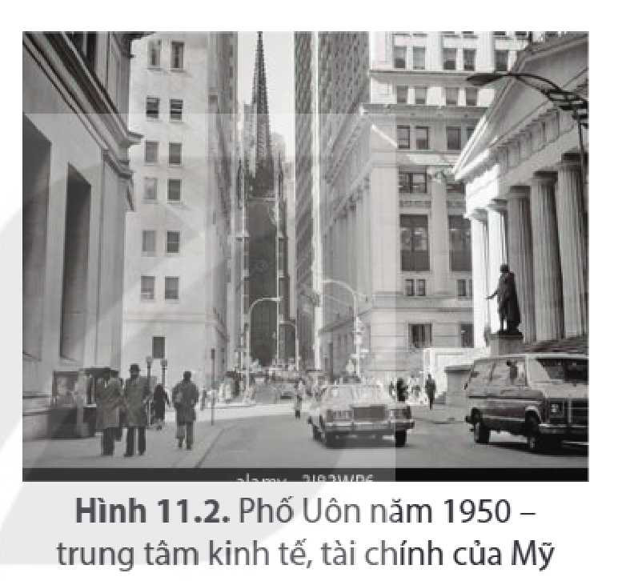
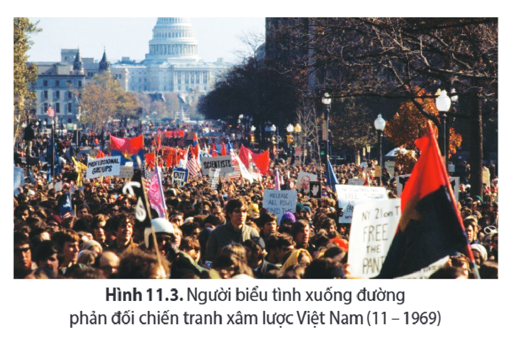
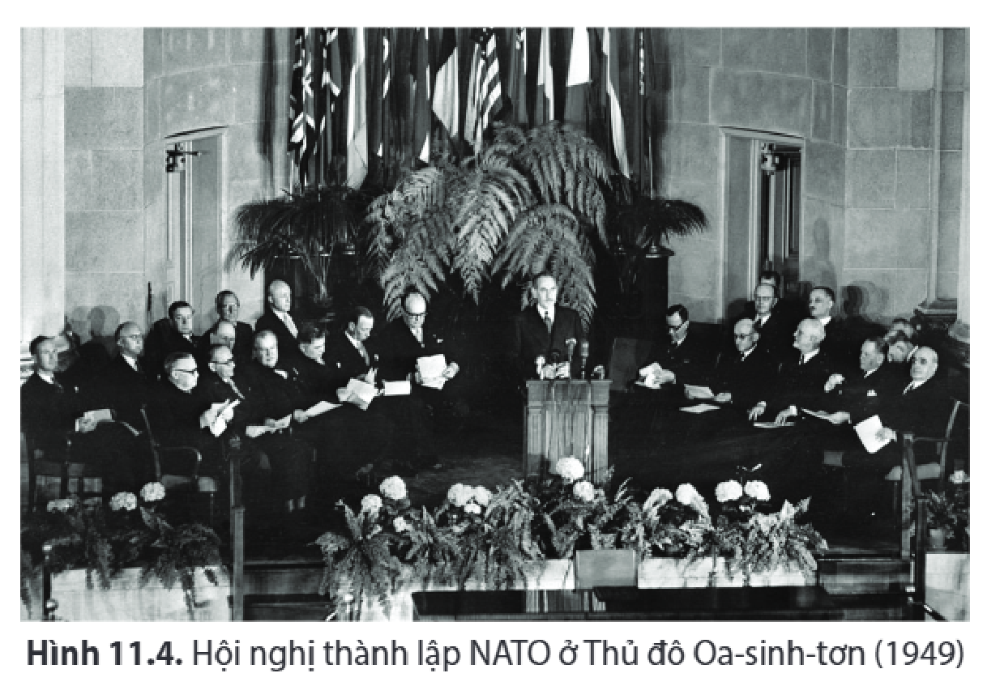
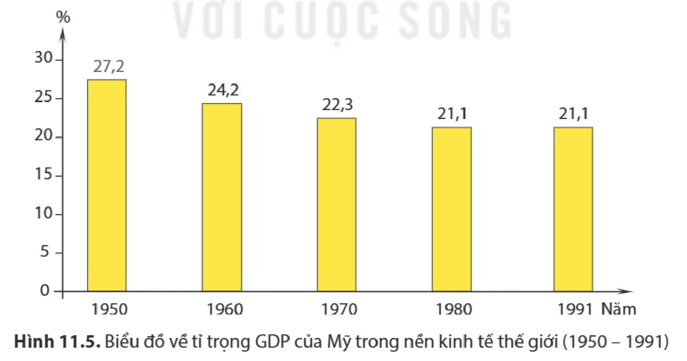

<!-- pdf:51 -->

# BÀI 11: NƯỚC MỸ VÀ TÂY ÂU TỪ NĂM 1945 ĐẾN NĂM 1991

## 🎯 Học xong bài này, em sẽ:

- Nêu được những nét chính về chính trị, kinh tế của nước Mỹ và các nước Tây Âu từ năm 1945 đến năm 1991.

## 🔴 Mở đầu

Quan sát hình 11.1 và hình 11.2, em có liên hệ đến sự phát triển của quốc gia và khu vực nào? Tình hình chính trị, kinh tế của quốc gia và khu vực này từ sau Chiến tranh thế giới thứ hai có gì nổi bật? Hãy chia sẻ những điều mà em biết.

*Hình 11.1. Logo của Kế hoạch Mác-san*

*Hình 11.2. Phố Uôn năm 1950 – trung tâm kinh tế, tài chính của Mỹ*

## 1. Nước Mỹ từ năm 1945 đến năm 1991

- *Chính trị*

Nước Mỹ vẫn duy trì nền dân chủ tư sản với chế độ hai đảng thay nhau cầm quyền (Đảng Dân chủ và Đảng Cộng hoà). Từ năm 1945 đến năm 1991, Mỹ thực hiện chính sách đối nội nhất quán nhằm mục tiêu phát triển kinh tế, ổn định xã hội. Đồng thời, chính quyền Mỹ luôn thực hiện chính sách ngăn chặn, đàn áp phong trào đấu tranh của các lực lượng tiến bộ ở trong nước.

*Hình 11.3. Người biểu tình xuống đường phản đối chiến tranh xâm lược Việt Nam (11 – 1969)*

> 💡 **Em có biết?**
>
> Khi Tổng thống Ních-xơn quyết định leo thang chiến tranh xâm lược Việt Nam (1969), làn sóng biểu tình lớn nhất của sinh viên trong lịch sử nước Mỹ đã diễn ra. Chỉ trong tháng 5 – 1970, khoảng 4 triệu người Mỹ đã tham gia các cuộc biểu tình phản chiến, đóng cửa các lớp học tại hàng trăm ngôi trường trên khắp nước Mỹ.

<!-- pdf:52 -->

<!-- term: Chiến lược toàn cầu -->
Trong chính sách đối ngoại, Mỹ tập trung triển khai Chiến lược toàn cầu nhằm chống phá các nước xã hội chủ nghĩa, đàn áp phong trào giải phóng dân tộc và thực hiện tham vọng làm bá chủ thế giới. Mỹ đã lôi kéo các nước nhận viện trợ, thành lập các khối quân sự như: Tổ chức Hiệp ước Bắc Đại Tây Dương – NATO (1949), khối SEATO ở Đông Nam Á (1954),... và thiết lập chính quyền tay sai thân Mỹ ở nhiều quốc gia trên thế giới.

*Hình 11.4. Hội nghị thành lập NATO ở Thủ đô Oa-sinh-tơn (1949)*

Từ những năm 70 của thế kỉ XX, Mỹ tìm cách cải thiện quan hệ với Liên Xô bằng việc hạn chế chạy đua vũ trang, với Trung Quốc thể hiện qua chuyến thăm của Tổng thống Ních-xơn. Năm 1989, Mỹ và Liên Xô cùng tuyên bố chấm dứt Chiến tranh lạnh.

- *Kinh tế*

Từ năm 1945 đến năm 1991, Mỹ vẫn luôn giữ vững vị thế cường quốc kinh tế số một thế giới, nhưng tỉ trọng kinh tế của Mỹ trong nền kinh tế thế giới giảm dần.

Những năm 1945 – 1950, kinh tế Mỹ chiếm ưu thế tuyệt đối trong nền kinh tế thế giới, nhưng từ năm 1950 đến năm 1991, kinh tế Mỹ không còn chiếm ưu thế tuyệt đối do sự vươn lên của các nước Tây Âu và Nhật Bản.

Năm 1948, sản lượng công nghiệp của Mỹ chiếm 56% tổng sản lượng công nghiệp toàn thế giới, sản lượng nông nghiệp của Mỹ gấp 2 lần sản lượng nông nghiệp của các nước Anh, Pháp, Tây Đức, I-ta-li-a và Nhật Bản cộng lại. Mỹ nắm giữ 3/4 dự trữ vàng của thế giới.

Năm 1973, Mỹ chỉ còn chiếm 39,8% tổng sản lượng công nghiệp toàn thế giới. Dự trữ vàng là 11,9 tỉ USD (1974).

*Hình 11.5. Biểu đồ về tỉ trọng GDP của Mỹ trong nền kinh tế thế giới (1950 – 1991)*

> ❓ Khai thác thông tin trong mục, hãy nêu nét chính về tình hình chính trị, kinh tế Mỹ từ năm 1945 đến năm 1991.

<!-- pdf:53 -->

## 2. Tây Âu từ năm 1945 đến năm 1991

BẢNG TÓM TẮT TÌNH HÌNH CHÍNH TRỊ, KINH TẾ CÁC NƯỚC TÂY ÂU (1945 – 1991)

<!-- term: Liên minh châu Âu -->
<!-- term: Cộng đồng Than – Thép châu Âu -->
<!-- term: Cộng đồng Kinh tế châu Âu -->
| Lĩnh vực | Giai đoạn 1945 – 1950 | Giai đoạn 1950 – 1973 | Giai đoạn 1973 – 1991 |
| --- | --- | --- | --- |
| Chính trị | – Củng cố, tăng cường chính quyền của giai cấp tư sản. – Liên minh chặt chẽ với Mỹ, tham gia khối NATO. – Khôi phục sự thống trị tại các thuộc địa cũ. | – Tiếp tục liên minh chặt chẽ với Mỹ (tiêu biểu là Anh). – Tìm cách giảm bớt sự lệ thuộc vào Mỹ (tiêu biểu là Pháp). | Thúc đẩy liên kết chính trị, đặt nền móng cho quá trình nhất thể hoá Tây Âu với thoả thuận về việc thành lập Liên minh châu Âu – EU (1991). |
| Kinh tế | – Khôi phục kinh tế, nhận viện trợ của Mỹ (khoảng 13 tỉ USD) theo Kế hoạch Mác-san; năm 1950, kinh tế phục hồi, đạt mức trước chiến tranh. – Lệ thuộc chặt chẽ vào Mỹ. | – Tăng trưởng cao, vươn lên trở thành một trong ba trung tâm kinh tế – tài chính của thế giới. – Xuất hiện xu hướng liên kết: thành lập Cộng đồng Than – Thép châu Âu (1951), Cộng đồng Kinh tế châu Âu (1957),... | – Tăng trưởng thấp, nhưng vẫn là một trong những trung tâm kinh tế – tài chính của thế giới. – Thông qua quyết định xây dựng thị trường tiền tệ với đồng tiền chung duy nhất (ơ-rô) (1991). |

> ❓ Trình bày nét chính về tình hình chính trị, kinh tế của các nước Tây Âu từ năm 1945 đến năm 1991.

## ✏️ Luyện tập và Vận dụng

**Luyện tập:**

Hãy hoàn thành bảng (theo gợi ý dưới đây vào vở) tóm tắt về chính trị, kinh tế của các nước Tây Âu và Mỹ từ năm 1945 đến năm 1991.

| Lĩnh vực | Các nước Tây Âu | Nước Mỹ |
| --- | --- | --- |
| Chính trị | ? | ? |
| Kinh tế | ? | ? |

**Vận dụng:**

Sưu tầm tư liệu từ sách, báo, internet về tình hình chính trị, kinh tế của các nước Tây Âu hoặc Mỹ từ năm 1945 đến năm 1991 và giới thiệu với bạn.

## 📷 Danh sách hình trong bài

| Mã hình | Trang PDF | Vị trí | Chú thích |
| --- | --- | --- | --- |
| H9-lich_su_va_dia_ly-ls-b11-01 | 51 | Mở đầu (trang 49) | Hình 11.1. Logo của Kế hoạch Mác-san |
| H9-lich_su_va_dia_ly-ls-b11-02 | 51 | Mở đầu (trang 49) | Hình 11.2. Phố Uôn năm 1950 – trung tâm kinh tế, tài chính của Mỹ |
| H9-lich_su_va_dia_ly-ls-b11-03 | 51 | Mục 1 (trang 49) | Hình 11.3. Người biểu tình xuống đường phản đối chiến tranh xâm lược Việt Nam (11 – 1969) |
| H9-lich_su_va_dia_ly-ls-b11-04 | 52 | Mục 1 (trang 50) | Hình 11.4. Hội nghị thành lập NATO ở Thủ đô Oa-sinh-tơn (1949) |
| H9-lich_su_va_dia_ly-ls-b11-05 | 52 | Mục 1 (trang 50) | Hình 11.5. Biểu đồ về tỉ trọng GDP của Mỹ trong nền kinh tế thế giới (1950 – 1991) |
