<!-- pdf:54 -->

# BÀI 12: KHU VỰC MỸ LA-TINH VÀ CHÂU Á TỪ NĂM 1945 ĐẾN NĂM 1991

## 🎯 Học xong bài này, em sẽ:

- Mô tả được đôi nét về các nước Mỹ La-tinh từ năm 1945 đến năm 1991.
- Trình bày được một cách khái quát về cách mạng Cu-ba và đánh giá được kết quả công cuộc xây dựng chủ nghĩa xã hội ở Cu-ba.
- Giới thiệu được những nét chính về Nhật Bản, Trung Quốc, Ấn Độ từ năm 1945 đến năm 1991.
- Trình bày được cuộc đấu tranh giành độc lập dân tộc và quá trình phát triển của các nước Đông Nam Á, sự hình thành và phát triển của Hiệp hội các quốc gia Đông Nam Á (ASEAN).

## 🔴 Mở đầu

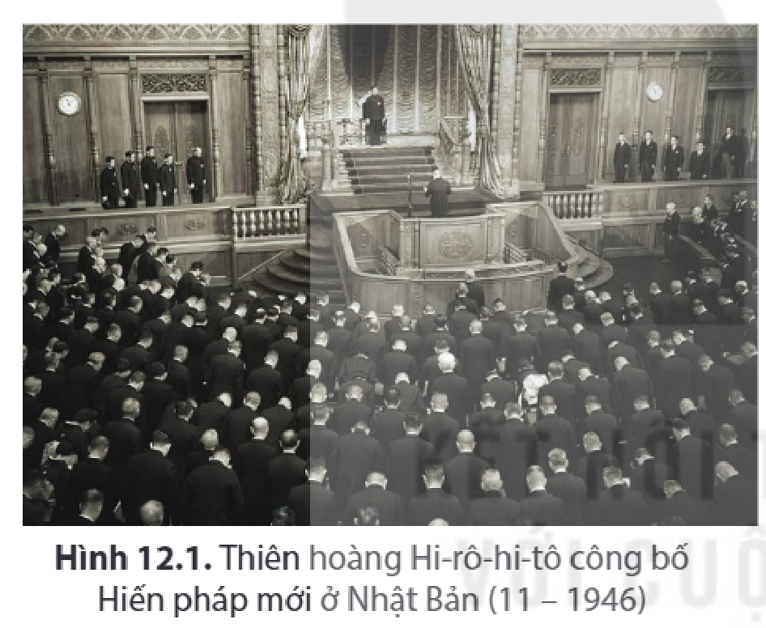

*Hình 12.1. Thiên hoàng Hi-rô-hi-tô công bố Hiến pháp mới ở Nhật Bản (11 – 1946)*

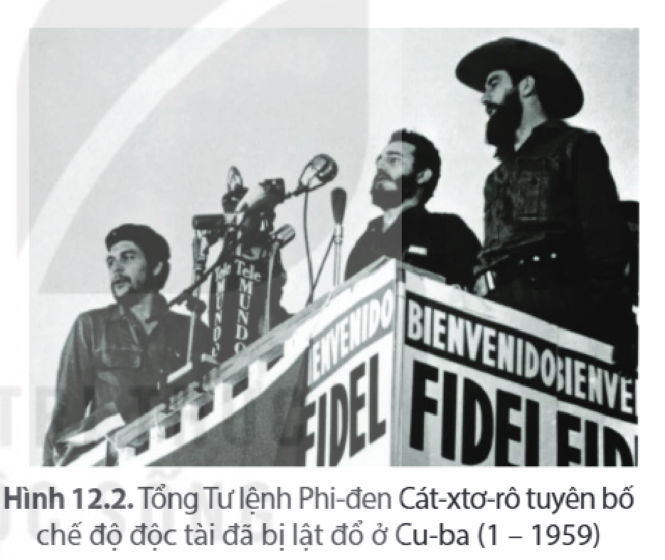

*Hình 12.2. Tổng Tư lệnh Phi-đen Cát-xtơ-rô tuyên bố chế độ độc tài đã bị lật đổ ở Cu-ba (1 – 1959)*

Hai hình trên là các sự kiện lớn làm thay đổi tình hình của một số nước ở châu Á và khu vực Mỹ La-tinh từ sau Chiến tranh thế giới thứ hai. Sự thay đổi đó là gì? Hãy chia sẻ hiểu biết của em về những sự kiện cũng như sự thay đổi đó.

## 1. Khu vực Mỹ La-tinh từ năm 1945 đến năm 1991

### a) Khái quát về khu vực Mỹ La-tinh

Sau Chiến tranh thế giới thứ hai, Mỹ đã tìm cách thiết lập các chế độ độc tài thân Mỹ ở Mỹ La-tinh nhằm biến khu vực này thành “sân sau” của mình. Vì vậy, các nước Mỹ La-tinh phải tiến hành cách mạng dân tộc dân chủ, chống chế độ độc tài, mở đầu là cuộc cách mạng Cu-ba (1959), sau đó bùng phát mạnh mẽ với các cuộc đấu tranh vũ trang ở nhiều nước như: Bô-li-vi-a, Vê-nê-xu-ê-la, Cô-lôm-bi-a, Ni-ca-ra-goa,... Kết quả là chính quyền độc tài phản động ở nhiều nước bị lật đổ; chính quyền dân chủ được thành lập, tiến hành các chính sách cải cách tiến bộ.

<!-- pdf:55 -->

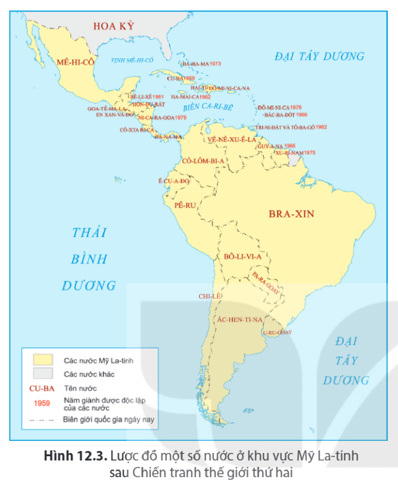

*Hình 12.3. Lược đồ một số nước ở khu vực Mỹ La-tinh sau Chiến tranh thế giới thứ hai*

> 💡 **Em có biết?**
>
> Ở Ni-ca-ra-goa, Mặt trận Xan-đi-nô đã lãnh đạo quần chúng nhân dân lật đổ chế độ độc tài thân Mỹ, đưa đất nước phát triển theo con đường dân chủ. Tuy nhiên, do sự can thiệp của Mỹ nên phong trào đã thất bại vào năm 1990.

Sau khi hoàn thành cách mạng dân tộc dân chủ, các nước Mỹ La-tinh bắt tay vào xây dựng đất nước và đã đạt được nhiều thành tựu quan trọng. Độc lập, chủ quyền được củng cố, nền chính trị được dân chủ hoá, kinh tế được cải cách, quá trình liên kết khu vực cũng được đẩy mạnh.

> ❓ Hãy nêu nét chính về các nước Mỹ La-tinh từ năm 1945 đến năm 1991.

### b) Cu-ba

Cu-ba là nước đi tiên phong trong cuộc cách mạng dân tộc dân chủ ở Mỹ La-tinh.

DIỄN BIẾN CHÍNH CỦA CÁCH MẠNG CU-BA

<!-- term: Phong trào 26 – 7 -->
| Thời gian | Sự kiện |
| --- | --- |
| Tháng 3 – 1952 | Chế độ độc tài quân sự của tướng Ba-ti-xta do Mỹ trợ giúp được thiết lập. |
| Tháng 7 – 1953 | Luật sư Phi-đen Cát-xtơ-rô lãnh đạo 135 thanh niên yêu nước tấn công pháo đài Môn-ca-đa nhưng thất bại. |
| Năm 1955 | Phi-đen Cát-xtơ-rô bị trục xuất, phải chuyển sang Mê-hi-cô hoạt động. Tại đây, Phi-đen thành lập một tổ chức cách mạng lấy tên là Phong trào 26 – 7 để xây dựng lực lượng, huấn luyện quân sự. |
| Tháng 11 – 1956 | Phi-đen Cát-xtơ-rô cùng 81 chiến sĩ yêu nước trên tàu Gran-ma trở về Cu-ba, lập căn cứ địa và phát triển lực lượng. |
| Cuối năm 1958 | Nghĩa quân tổng công kích xuống đồng bằng, giải phóng các đô thị và nhiều vùng ở nông thôn. |
| Ngày 1 – 1 – 1959 | Nghĩa quân tiến về Thủ đô La Ha-ba-na. Chế độ độc tài Ba-ti-xta bị lật đổ. Cách mạng giành thắng lợi, nước Cộng hoà Cu-ba được thành lập. |

<!-- pdf:56 -->

Từ năm 1961, Cu-ba tiến hành xây dựng chủ nghĩa xã hội và đạt được nhiều thành tựu to lớn trên các lĩnh vực.

Hiến pháp Cu-ba năm 1976 đã thể chế hoá quyền lợi của các tầng lớp nhân dân lao động và con đường xây dựng chủ nghĩa xã hội.

Sau 30 năm (1961 – 1991), từ một nền nông nghiệp độc canh (trồng mía), nền công nghiệp đơn nhất (khai thác mỏ) với kĩ thuật lạc hậu, Cu-ba đã xây dựng được công nghiệp chế tạo máy móc, năng lượng; nền nông nghiệp đa canh (trồng mía, rau quả, thuốc lá, chăn nuôi,...) từng bước cơ giới hoá.

Đời sống của người dân không ngừng được cải thiện. Giáo dục phát triển đạt mức cao nhất khu vực Mỹ La-tinh. Mạng lưới chăm sóc y tế, số lượng bác sĩ,... phát triển vượt bậc, tuổi thọ trung bình của người dân tăng cao, từ 64 tuổi (1960) lên 74 tuổi (1991).

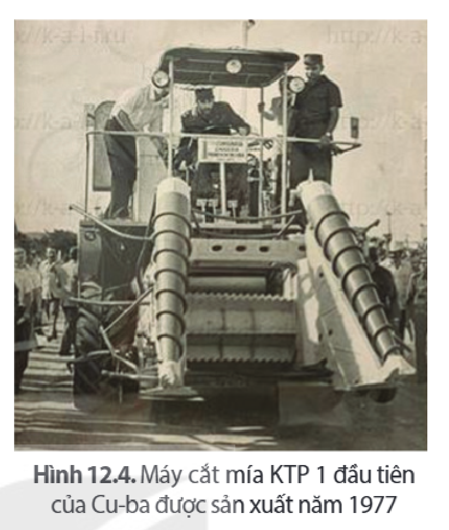

*Hình 12.4. Máy cắt mía KTP 1 đầu tiên của Cu-ba được sản xuất năm 1977*

> ❓ 1. Trình bày tóm tắt diễn biến chính của cách mạng Cu-ba.
>
> 2. Đánh giá kết quả của công cuộc xây dựng chủ nghĩa xã hội ở Cu-ba (1961 – 1991).

## 2. Các nước Nhật Bản, Trung Quốc và Ấn Độ từ năm 1945 đến năm 1991

### a) Nhật Bản

<!-- term: Hiệp ước an ninh Mỹ – Nhật -->
> 💡 **Em có biết?**
>
> Ngày 8 – 9 – 1951, Nhật Bản kí với Mỹ *Hiệp ước an ninh Mỹ – Nhật*, chấp nhận đặt dưới “ô bảo hộ hạt nhân” của Mỹ, theo đó Mỹ được đóng quân, xây dựng căn cứ quân sự trên lãnh thổ Nhật Bản.
<!-- ocr-ok: đã đối chiếu p056.png, hộp Em có biết? in song song 2 cột bị OCR trộn dòng -->

<!-- term: Bộ chỉ huy tối cao lực lượng Đồng minh -->
*Về chính trị:* Nhật Bản bị quân đội Mỹ dưới danh nghĩa lực lượng Đồng minh chiếm đóng từ năm 1945 đến năm 1952. Bộ chỉ huy tối cao lực lượng Đồng minh (SCAP) do Mỹ đứng đầu đã tiến hành cải cách, loại bỏ chủ nghĩa quân phiệt và thiết lập nền dân chủ tư sản đại nghị ở Nhật Bản. Trong giai đoạn này, Nhật Bản hoàn toàn lệ thuộc vào Mỹ về chính trị và an ninh.

> 📜 **Tư liệu 1.** Theo Hiến pháp mới, Quốc hội là cơ quan quyền lực tối cao, Nội các chịu trách nhiệm trước Quốc hội, Thiên hoàng chỉ là người đứng đầu Nhà nước có tính chất tượng trưng... Hiến pháp mới công nhận và đảm bảo quyền tự do, dân chủ của mọi công dân... Nhật Bản không duy trì hải, lục, không quân và các lực lượng chiến đấu khác, không tham gia chiến tranh với bất cứ nước nào.
>
> (Theo Phan Ngọc Liên (Chủ biên), *Lịch sử Nhật Bản*, NXB Văn hoá Thông tin, 1995, tr. 233)

Bước sang giai đoạn 1955 – 1991, Đảng Dân chủ Tự do (LDP) liên tục cầm quyền ở Nhật Bản. Mặc dù vẫn tiếp tục duy trì liên minh chặt chẽ với Mỹ, nhưng Nhật Bản dần đa dạng hoá quan hệ đối ngoại nhằm nâng cao vị thế quốc tế.

*Về kinh tế:* Sau thời gian tiến hành cải cách (1945 – 1952), nền kinh tế Nhật Bản đã được khôi phục và phát triển nhanh. Bước sang những năm 60, tận dụng cuộc chiến tranh xâm lược Việt Nam của Mỹ, nền kinh tế Nhật Bản có cơ hội mới để đạt được sự tăng trưởng "thần kì",

<!-- pdf:57 -->

vượt qua các nước Tây Âu, vươn lên đứng thứ hai thế giới, sau Mỹ. Đến đầu những năm 70, Nhật Bản đã vươn lên trở thành một trong ba trung tâm kinh tế – tài chính của thế giới.

Trong giai đoạn 1953 – 1973, tổng sản phẩm quốc dân (GNP) tăng trung bình 9,4%, riêng thập kỉ 60 tăng trung bình 11% – được gọi là giai đoạn phát triển "thần kì". Năm 1988, GDP bình quân đầu người đạt khoảng 25 000 USD, vượt Mỹ, đứng thứ hai thế giới (sau Thuỵ Sĩ).

*Về khoa học – công nghệ:* Nhật Bản coi khoa học – công nghệ là đòn bẩy để phát triển kinh tế – xã hội. Bên cạnh việc khuyến khích các phát minh trong nước, Nhật Bản đẩy mạnh việc mua bằng sáng chế của nước ngoài, tập trung chủ yếu trong lĩnh vực ứng dụng dân dụng.

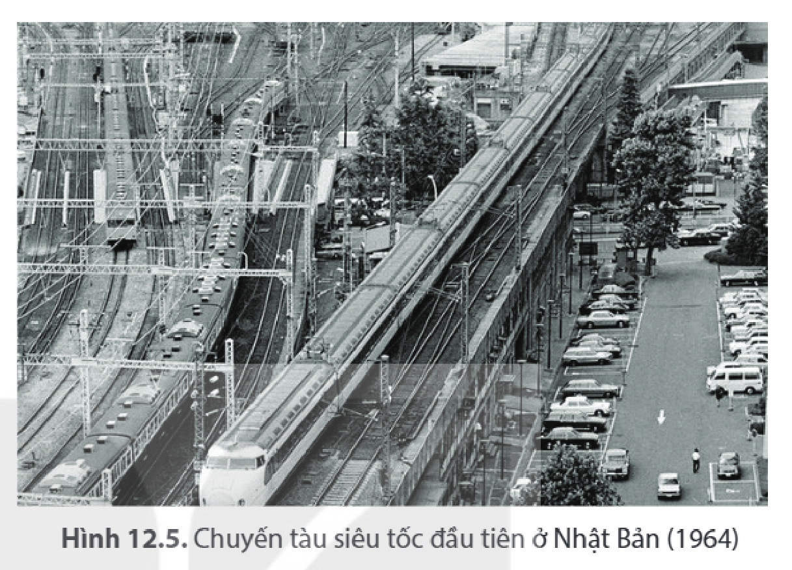

*Hình 12.5. Chuyến tàu siêu tốc đầu tiên ở Nhật Bản (1964)*

> ❓ Trình bày những nét chính về tình hình Nhật Bản từ năm 1945 đến năm 1991.

### b) Trung Quốc

- *Tiếp tục tiến hành cuộc cách mạng dân tộc dân chủ và xây dựng chế độ mới (1945 – 1952)*

<!-- term: Nước Cộng hoà Nhân dân Trung Hoa -->
Sau cuộc kháng chiến chống Nhật thắng lợi, ở Trung Quốc diễn ra cuộc nội chiến (1946 – 1949) giữa Quốc dân đảng (Đảng Quốc dân) và Đảng Cộng sản. Cuối năm 1949, lực lượng Quốc dân đảng thất bại, phải rút chạy ra Đài Loan, toàn bộ lục địa Trung Quốc được giải phóng. Ngày 1 – 10 – 1949, nước Cộng hoà Nhân dân Trung Hoa được thành lập.

<!-- term: Nước Cộng hoà Nhân dân Trung Hoa -->
Sự kiện này đánh dấu sự thắng lợi của cuộc cách mạng dân tộc dân chủ và mở ra một kỉ nguyên mới trong lịch sử Trung Quốc: kỉ nguyên độc lập, tự do và tiến lên chủ nghĩa xã hội, đồng thời cổ vũ phong trào đấu tranh giải phóng dân tộc và góp phần hình thành hệ thống xã hội chủ nghĩa trên thế giới.

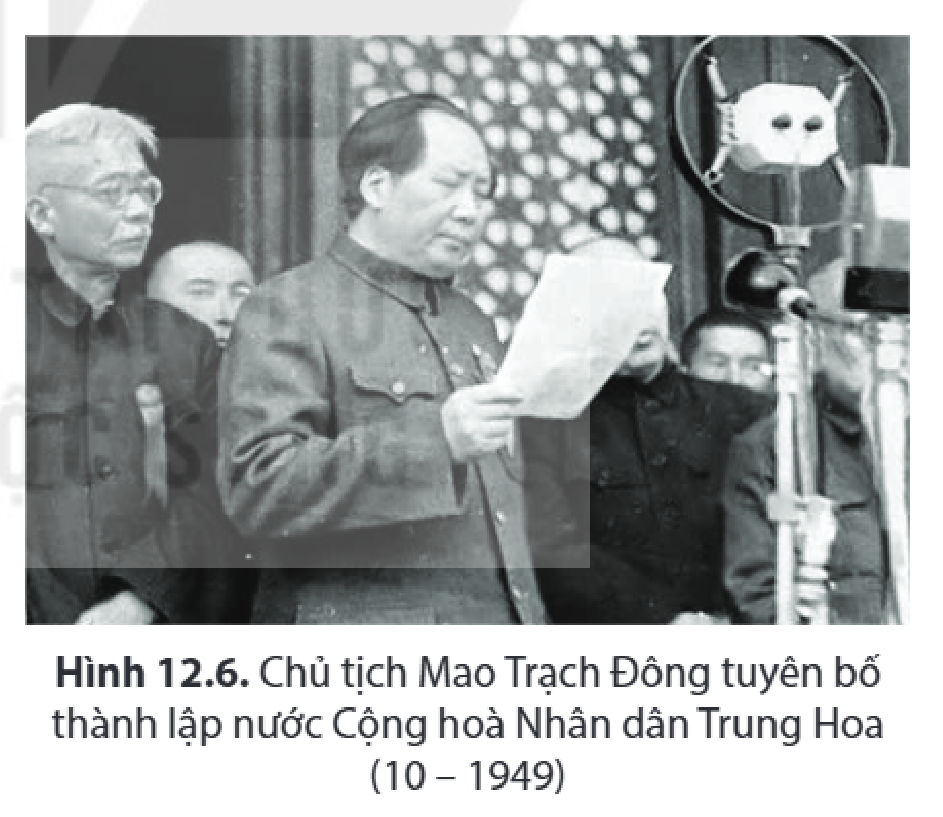

*Hình 12.6. Chủ tịch Mao Trạch Đông tuyên bố thành lập nước Cộng hoà Nhân dân Trung Hoa (10 – 1949)*
<!-- ocr-ok: đã đối chiếu p057.png, OCR bỏ sót dòng đầu chú thích Hình 12.6 -->

Sau khi thành lập Nhà nước mới, Trung Quốc bắt tay vào xây dựng và phát triển kinh tế, xã hội.

Từ năm 1950 đến năm 1952, Trung Quốc thực hiện thành công công cuộc khôi phục kinh tế, cải cách ruộng đất, cải tạo công thương nghiệp, phát triển văn hoá, giáo dục,...

Trung Quốc thực hiện đường lối đối ngoại tích cực, góp phần củng cố hoà bình, thúc đẩy phong trào cách mạng thế giới.

<!-- pdf:58 -->

- *Bước đầu xây dựng chủ nghĩa xã hội (1953 – 1978)*

Năm 1953, Trung Quốc bắt đầu xây dựng chủ nghĩa xã hội với kế hoạch 5 năm lần thứ nhất (1953 – 1957). Được sự giúp đỡ của Liên Xô, Trung Quốc đã hoàn thành kế hoạch này, góp phần làm thay đổi bộ mặt đất nước.

Tuy nhiên, sau đó Trung Quốc đã đề ra và thực hiện các đường lối không phù hợp, dẫn đến tình trạng kinh tế khủng hoảng, chính trị bất ổn và xã hội rối loạn.

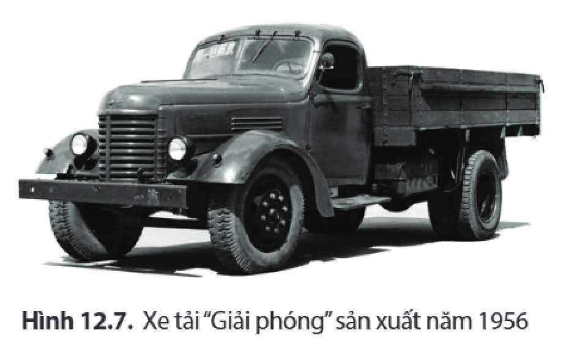

*Hình 12.7. Xe tải “Giải phóng” sản xuất năm 1956*

<!-- term: Đường lối “Ba ngọn cờ hồng” -->
Năm 1958, Trung Quốc thực hiện đường lối “Ba ngọn cờ hồng” bao gồm: "Đường lối chung", “Đại nhảy vọt” và “Công xã nhân dân”. Thực hiện “Đại nhảy vọt”, phát động phong trào toàn dân làm gang thép với phương châm “nhanh, nhiều, tốt, rẻ” và tổ chức “Công xã nhân dân” trên cơ sở sáp nhập các hợp tác xã theo hướng quân sự hoá, bao cấp mọi hoạt động, làm sản xuất giảm sút, nhiều nơi bị mất mùa, đói kém. Từ năm 1966 đến năm 1976, Trung Quốc thực hiện cuộc “Đại cách mạng văn hoá vô sản”, nhiều nhà chính trị, cách mạng, trí thức đã bị đưa ra đấu tố,...

Trung Quốc tiếp tục ủng hộ phong trào giải phóng dân tộc, nhưng xảy ra xung đột biên giới với Ấn Độ (1962), với Liên Xô (1969), trong khi hoà dịu quan hệ với Mỹ.

- *Tiến hành cải cách, mở cửa (1978 – 1991)*

<!-- term: Công cuộc cải cách, mở cửa ở Trung Quốc -->
Tháng 12 – 1978, Đảng Cộng sản Trung Quốc bắt đầu đề ra đường lối mới, lấy phát triển kinh tế làm trung tâm, thực hiện cải cách, mở cửa nhằm hiện đại hoá, đưa Trung Quốc trở thành quốc gia giàu mạnh, văn minh.

<!-- term: Công cuộc cải cách, mở cửa ở Trung Quốc -->
Đến năm 1991, Trung Quốc không chỉ đẩy lùi được cuộc khủng hoảng kinh tế, chính trị, xã hội mà đã đạt được những thành tựu bước đầu, nhất là về kinh tế.

Giai đoạn 1980 – 1991, tăng trưởng GDP trung bình hằng năm của Trung Quốc đạt hơn 9,1% – mức tăng trưởng cao nhất thế giới. Trung Quốc bước đầu xây dựng thành công các đặc khu kinh tế hướng tới xuất khẩu, tiêu biểu là Thâm Quyến, Chu Hải,...

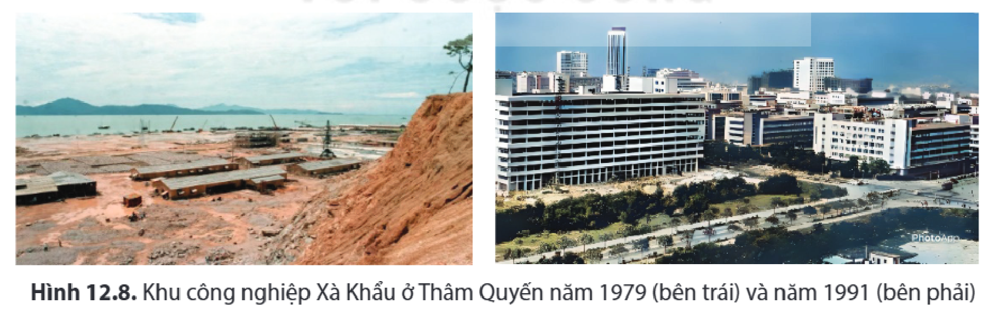

*Hình 12.8. Khu công nghiệp Xà Khẩu ở Thâm Quyến năm 1979 (bên trái) và năm 1991 (bên phải)*

Trung Quốc đã điều chỉnh chính sách đối ngoại, bình thường hoá và mở rộng quan hệ ngoại giao với nhiều nước.

> ❓ 1. Trình bày những nét chính về tình hình Trung Quốc từ năm 1945 đến năm 1978.
>
> 2. Nêu nét chính của công cuộc cải cách, mở cửa ở Trung Quốc (1978 – 1991).

<!-- pdf:59 -->

### c) Ấn Độ

<!-- term: Kế hoạch Mao-bát-tơn -->
Từ năm 1945, cuộc đấu tranh chống thực dân Anh của nhân dân Ấn Độ dưới sự lãnh đạo của Đảng Quốc đại bùng phát mạnh mẽ. Trước tình hình đó, thực dân Anh buộc phải nhượng bộ, trao quyền tự trị cho Ấn Độ theo Kế hoạch Mao-bát-tơn (1947). Ấn Độ được chia thành hai quốc gia trên cơ sở tôn giáo: Ấn Độ của người theo Hin-đu giáo và Pa-ki-xtan của người theo Hồi giáo. Không thoả mãn quy chế tự trị, từ năm 1947 đến năm 1950, nhân dân Ấn Độ tiếp tục cuộc đấu tranh để giành độc lập hoàn toàn. Ngày 26 – 1 – 1950, Ấn Độ chính thức ban hành Hiến pháp, tuyên bố thành lập nước cộng hoà.

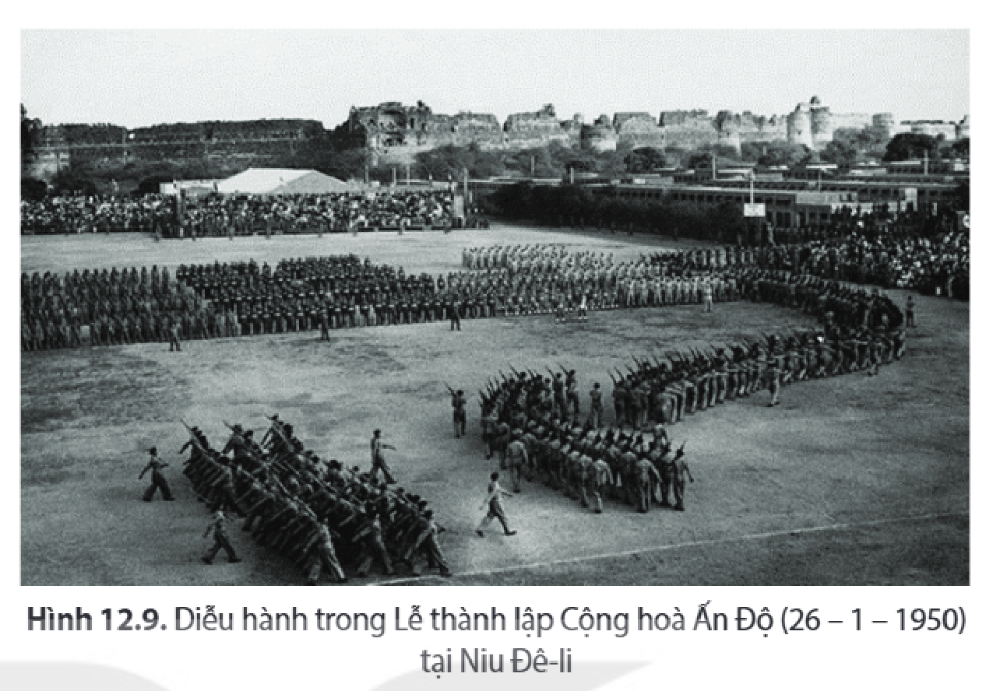

*Hình 12.9. Diễu hành trong Lễ thành lập Cộng hoà Ấn Độ (26 – 1 – 1950) tại Niu Đê-li*

Sự ra đời của nước Cộng hoà Ấn Độ là sự kiện trọng đại, mở ra thời kì độc lập của nhân dân Ấn Độ và có ảnh hưởng sâu sắc đến phong trào giải phóng dân tộc trên thế giới.

Từ năm 1950 đến năm 1991, Ấn Độ bước vào thời kì xây dựng đất nước và đạt được những thành tựu quan trọng về chính trị, kinh tế, khoa học – công nghệ.

Thể chế cộng hoà liên bang của Ấn Độ được củng cố, nền dân chủ được hoàn thiện, địa vị quốc tế được xác lập với đường lối đối ngoại trung lập.

<!-- term: Cuộc “Cách mạng xanh” -->
Ấn Độ đã xây dựng được nền kinh tế độc lập với cơ cấu hợp lí hơn. Công nghiệp nặng tương đối phát triển, gồm công nghiệp chế tạo máy móc, sản xuất điện từ năng lượng hạt nhân, công nghiệp hoá chất,... Trong nông nghiệp, nhờ tiến hành cuộc “Cách mạng xanh”, Ấn Độ không chỉ tự túc được lương thực mà còn xuất khẩu. Đến những năm 80, Ấn Độ đứng hàng thứ 10 trong các nước sản xuất công nghiệp lớn nhất thế giới.

Khoa học – công nghệ của Ấn Độ cũng có những bước tiến nhanh chóng: chế tạo thành công bom nguyên tử (1974), phóng vệ tinh nhân tạo lên quỹ đạo Trái Đất (1975),...

> ❓ Trình bày những nét chính về tình hình Ấn Độ từ năm 1945 đến năm 1991.

## 3. Các nước Đông Nam Á từ năm 1945 đến năm 1991

### a) Phong trào đấu tranh giành độc lập dân tộc

Chớp thời cơ Nhật đầu hàng Đồng minh, nhân dân nhiều nước Đông Nam Á nổi dậy và đã giành được độc lập như: In-đô-nê-xi-a, Việt Nam (đều trong tháng 8 – 1945), Lào (10 – 1945). Khi các nước thực dân quay trở lại tái chiếm Đông Nam Á, nhân dân các nước trong khu vực lại phải tiếp tục đấu tranh chống xâm lược và giành được thắng lợi vào những thời điểm khác nhau.

Phi-líp-pin được Mỹ trao trả độc lập (7 – 1946), Miến Điện được thực dân Anh trao trả độc lập (1 – 1948), Cộng hoà Liên bang In-đô-nê-xi-a được thực dân Hà Lan công nhận (1949). Cam-pu-chia được thực dân Pháp trao trả độc lập (1953), Mã Lai được Anh công nhận độc lập (8 – 1957), Xin-ga-po được Anh công nhận quyền tự trị (6 – 1959). Bru-nây đến năm 1984 mới tuyên bố độc lập.

<!-- pdf:60 -->

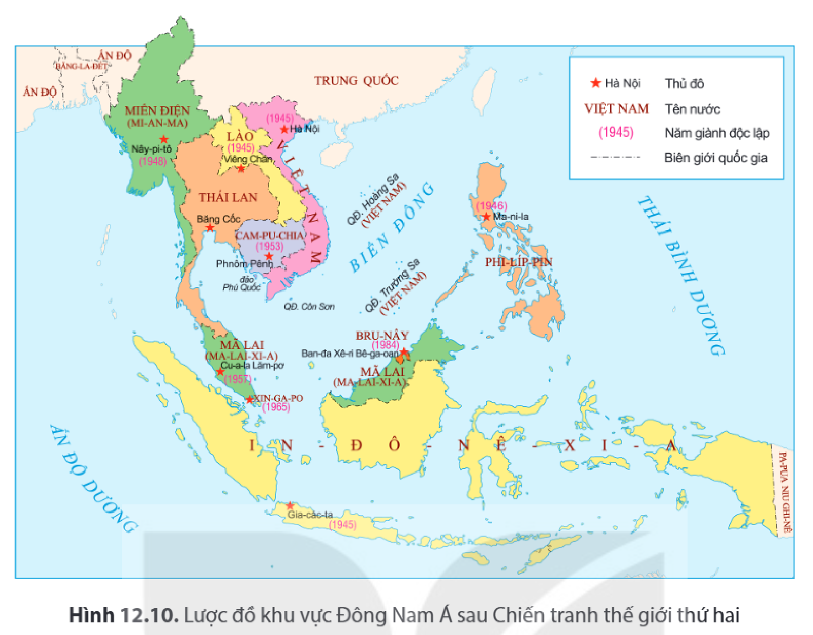

*Hình 12.10. Lược đồ khu vực Đông Nam Á sau Chiến tranh thế giới thứ hai*

> ❓ Trình bày cuộc đấu tranh giành độc lập dân tộc của các nước Đông Nam Á từ năm 1945.

### b) Công cuộc bảo vệ và xây dựng, phát triển đất nước sau khi giành độc lập

BẢNG TÓM TẮT QUÁ TRÌNH PHÁT TRIỂN CỦA CÁC NƯỚC ĐÔNG NAM Á SAU KHI GIÀNH ĐỘC LẬP

<!-- term: Công nghiệp hoá hướng nội -->
<!-- term: Công nghiệp hoá hướng ngoại -->
| NHÓM NƯỚC/ NƯỚC | Giai đoạn | Nội dung |
| --- | --- | --- |
| Thái Lan, In-đô-nê-xi-a, Ma-lai-xi-a, Phi-líp-pin, Xin-ga-po | Những năm 50, 60 của thế kỉ XX | – Thực hiện công nghiệp hoá hướng nội, đẩy mạnh sản xuất công nghiệp tiêu dùng để thay thế nhập khẩu. – Đáp ứng được nhu cầu cơ bản của đất nước, giải quyết được thất nghiệp, sản phẩm quốc dân tăng, nhưng còn những bất cập: thiếu vốn, nguyên liệu, kĩ thuật. |
| Thái Lan, In-đô-nê-xi-a, Ma-lai-xi-a, Phi-líp-pin, Xin-ga-po | Những năm 70, 80 của thế kỉ XX | – Thực hiện công nghiệp hoá hướng ngoại, đẩy mạnh sản xuất công nghiệp hướng vào xuất khẩu. – Tạo ra biến đổi to lớn về kinh tế – xã hội: tăng trưởng kinh tế khá cao, gia tăng nhanh tỉ trọng công nghiệp và ngoại thương. Nổi trội nhất là Xin-ga-po – đã trở thành “con rồng” kinh tế châu Á. |
| Việt Nam, Lào | 1945 – 1975 | Vừa kháng chiến, vừa kiến quốc: – Tiến hành cuộc kháng chiến chống Pháp thắng lợi (1954), tiếp tục kháng chiến chống Mỹ và giải phóng hoàn toàn (1975). – Việt Nam: xây dựng, phát triển vùng giải phóng (1945 – 1954), xây dựng chủ nghĩa xã hội ở miền Bắc (1954 – 1975); Lào: xây dựng căn cứ địa cách mạng, mở rộng vùng giải phóng. |

<!-- pdf:61 -->

| NHÓM NƯỚC/ NƯỚC | Giai đoạn | Nội dung |
| --- | --- | --- |
| Việt Nam, Lào | 1975 – 1986 | – Xây dựng chủ nghĩa xã hội trên phạm vi cả nước: củng cố bộ máy nhà nước dân chủ nhân dân, xây dựng nền kinh tế kế hoạch hoá tập trung. – Ổn định về chính trị, song còn nghèo nàn, kém phát triển về kinh tế. |
| Việt Nam, Lào | 1986 – 1991 | – Tiến hành công cuộc Đổi mới, xây dựng nền kinh tế thị trường có sự điều tiết của Nhà nước. – Kinh tế – xã hội đạt được những thành tựu bước đầu. |
| Cam-pu-chia | 1953 – 1970 | Thành lập Chính phủ, thi hành chính sách hoà bình, trung lập. |
| Cam-pu-chia | 1970 – 1975 | Tiến hành cuộc kháng chiến chống Mỹ. |
| Cam-pu-chia | 1975 – 1979 | Rơi vào thảm hoạ diệt chủng dưới sự thống trị của tập đoàn Pôn Pốt. |
| Cam-pu-chia | 1979 – 1991 | – Năm 1979, các lực lượng cách mạng Cam-pu-chia được sự giúp đỡ của quân tình nguyện Việt Nam đã lật đổ tập đoàn phản động Pôn Pốt. – Kí kết Hiệp định Hoà bình về Cam-pu-chia (10 – 1991), tạo điều kiện cho quá trình khôi phục và phát triển đất nước. |
| Bru-nây | 1984 – 1991 | Chuyển từ nền kinh tế hoàn toàn dựa vào nguồn dầu mỏ và khí tự nhiên sang nền kinh tế đa dạng hoá, phát triển công nghiệp tiêu dùng và xuất khẩu. |
| Miến Điện | 1948 – 1988 | Thực hiện chính sách tự lực, hướng nội. Dưới sự cầm quyền của chính quyền quân sự độc tài, những năm 80, Miến Điện lâm vào cuộc khủng hoảng toàn diện về kinh tế, chính trị, xã hội. |
| Miến Điện | 1988 – 1991 | Khôi phục trật tự xã hội, đổi quốc hiệu thành Mi-an-ma (1989), cải cách, mở cửa nền kinh tế và đã đạt được thành tựu bước đầu. |

> ❓ Trình bày nét chính về quá trình phát triển của các nước Đông Nam Á từ sau khi giành được độc lập đến năm 1991.

### c) Hiệp hội các quốc gia Đông Nam Á

<!-- term: Hiệp hội các quốc gia Đông Nam Á -->
Ngày 8 – 8 – 1967, Hiệp hội các quốc gia Đông Nam Á (ASEAN) được thành lập tại Băng Cốc (Thái Lan) với sự tham gia của năm nước là: In-đô-nê-xi-a, Ma-lai-xi-a, Phi-líp-pin, Xin-ga-po và Thái Lan.

<!-- term: Hiệp hội các quốc gia Đông Nam Á -->
> 📜 **Tư liệu 2.** “Tôn chỉ và mục đích của Hiệp hội sẽ là: Thúc đẩy sự tăng trưởng kinh tế, tiến bộ xã hội và phát triển văn hoá trong khu vực thông qua các nỗ lực chung trên tinh thần bình đẳng và hợp tác nhằm tăng cường cơ sở cho một cộng đồng các quốc gia Đông Nam Á hoà bình và thịnh vượng;...”.
>
> (Nguồn: *Tuyên bố Hội nghị Bộ trưởng Ngoại giao ASEAN (Tuyên bố Băng Cốc)*, ngày 8 – 8 – 1967)

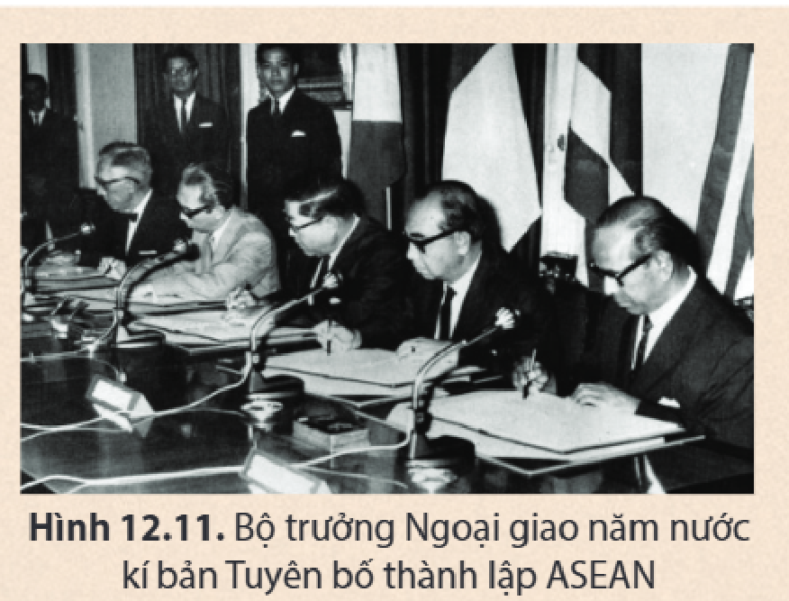

*Hình 12.11. Bộ trưởng Ngoại giao năm nước kí bản Tuyên bố thành lập ASEAN*

<!-- pdf:62 -->

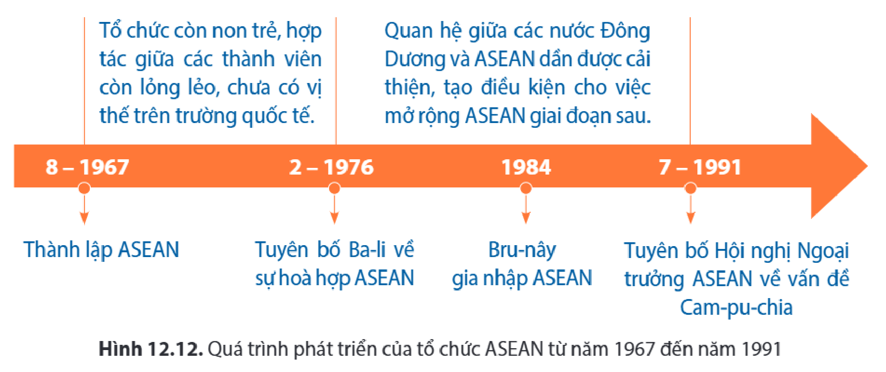

*Hình 12.12. Quá trình phát triển của tổ chức ASEAN từ năm 1967 đến năm 1991*

> - **8 – 1967:** Thành lập ASEAN. Tổ chức còn non trẻ, hợp tác giữa các thành viên còn lỏng lẻo, chưa có vị thế trên trường quốc tế.
> - **2 – 1976:** Tuyên bố Ba-li về sự hoà hợp ASEAN. Quan hệ giữa các nước Đông Dương và ASEAN dần được cải thiện, tạo điều kiện cho việc mở rộng ASEAN giai đoạn sau.
> - **1984:** Bru-nây gia nhập ASEAN.
> - **7 – 1991:** Tuyên bố Hội nghị Ngoại trưởng ASEAN về vấn đề Cam-pu-chia.

<!-- term: Tuyên bố Ba-li -->
> 💡 **Em có biết?**
>
> *Tuyên bố Ba-li* xác định nguyên tắc cơ bản trong quan hệ giữa các nước là tôn trọng chủ quyền và toàn vẹn lãnh thổ; không can thiệp vào công việc nội bộ của nhau; không sử dụng vũ lực hoặc đe doạ bằng vũ lực đối với nhau; giải quyết các tranh chấp bằng biện pháp hoà bình; hợp tác có hiệu quả về kinh tế, văn hoá và xã hội.

> ❓ Khai thác tư liệu 2 và thông tin trong mục, hãy trình bày bối cảnh, sự thành lập và quá trình phát triển của tổ chức ASEAN từ năm 1967 đến năm 1991.

## ✏️ Luyện tập và Vận dụng

**Luyện tập:**

1. Hãy hoàn thành bảng (theo gợi ý dưới đây vào vở) về những nét chính của các nước Mỹ La-tinh và Cu-ba từ năm 1945 đến năm 1991.

| Khu vực Mỹ La-tinh | Cu-ba |
| --- | --- |
| ? | ? |

2. Hãy lập bảng tóm tắt về tình hình chính trị, kinh tế và khoa học – công nghệ của Nhật Bản từ năm 1945 đến năm 1991.

**Vận dụng:**

1. Tìm hiểu thông tin từ sách, báo và internet, hãy viết bài giới thiệu về một sự kiện tiêu biểu trong cuộc đấu tranh giành độc lập hoặc thành tựu của công cuộc xây dựng, phát triển đất nước ở một nước Đông Nam Á từ năm 1945 đến năm 1991 mà em có ấn tượng nhất.

2. Tìm hiểu thêm thông tin qua sách, báo, internet và chia sẻ với bạn về ảnh hưởng của cuộc cách mạng lật đổ chế độ độc tài bằng đấu tranh vũ trang và công cuộc xây dựng chủ nghĩa xã hội ở Cu-ba đối với khu vực Mỹ La-tinh.

## 📷 Danh sách hình trong bài

| Mã hình | Trang PDF | Vị trí | Chú thích |
| --- | --- | --- | --- |
| H9-lich_su_va_dia_ly-ls-b12-01 | 54 | Mở đầu, sát chú thích Hình 12.2 bên phải (trang 52) | Hình 12.1. Thiên hoàng Hi-rô-hi-tô công bố Hiến pháp mới ở Nhật Bản (11 – 1946) |
| H9-lich_su_va_dia_ly-ls-b12-02 | 54 | Mở đầu (trang 52) | Hình 12.2. Tổng Tư lệnh Phi-đen Cát-xtơ-rô tuyên bố chế độ độc tài đã bị lật đổ ở Cu-ba (1 – 1959) |
| H9-lich_su_va_dia_ly-ls-b12-03 | 55 | Mục 1.a (trang 53) | Hình 12.3. Lược đồ một số nước ở khu vực Mỹ La-tinh sau Chiến tranh thế giới thứ hai |
| H9-lich_su_va_dia_ly-ls-b12-04 | 56 | Mục 1.b (trang 54) | Hình 12.4. Máy cắt mía KTP 1 đầu tiên của Cu-ba được sản xuất năm 1977 |
| H9-lich_su_va_dia_ly-ls-b12-05 | 57 | Mục 2.a (trang 55) | Hình 12.5. Chuyến tàu siêu tốc đầu tiên ở Nhật Bản (1964) |
| H9-lich_su_va_dia_ly-ls-b12-06 | 57 | Mục 2.b (trang 55) | Hình 12.6. Chủ tịch Mao Trạch Đông tuyên bố thành lập nước Cộng hoà Nhân dân Trung Hoa (10 – 1949) |
| H9-lich_su_va_dia_ly-ls-b12-07 | 58 | Mục 2.b (trang 56) | Hình 12.7. Xe tải “Giải phóng” sản xuất năm 1956 |
| H9-lich_su_va_dia_ly-ls-b12-08 | 58 | Mục 2.b (trang 56) | Hình 12.8. Khu công nghiệp Xà Khẩu ở Thâm Quyến năm 1979 (bên trái) và năm 1991 (bên phải) |
| H9-lich_su_va_dia_ly-ls-b12-09 | 59 | Mục 2.c (trang 57) | Hình 12.9. Diễu hành trong Lễ thành lập Cộng hoà Ấn Độ (26 – 1 – 1950) tại Niu Đê-li |
| H9-lich_su_va_dia_ly-ls-b12-10 | 60 | Mục 3.a (trang 58) | Hình 12.10. Lược đồ khu vực Đông Nam Á sau Chiến tranh thế giới thứ hai |
| H9-lich_su_va_dia_ly-ls-b12-11 | 61 | Mục 3.c (trang 59) | Hình 12.11. Bộ trưởng Ngoại giao năm nước kí bản Tuyên bố thành lập ASEAN |
| H9-lich_su_va_dia_ly-ls-b12-12 | 62 | Mục 3.c (trang 60) | Hình 12.12. Quá trình phát triển của tổ chức ASEAN từ năm 1967 đến năm 1991 |
