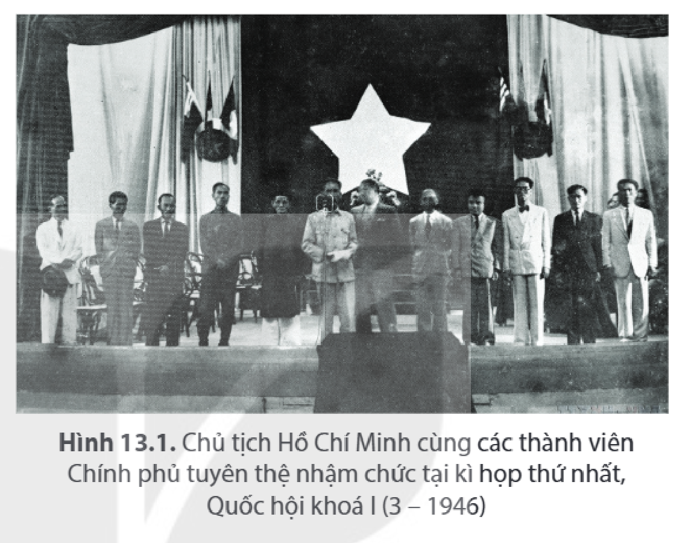
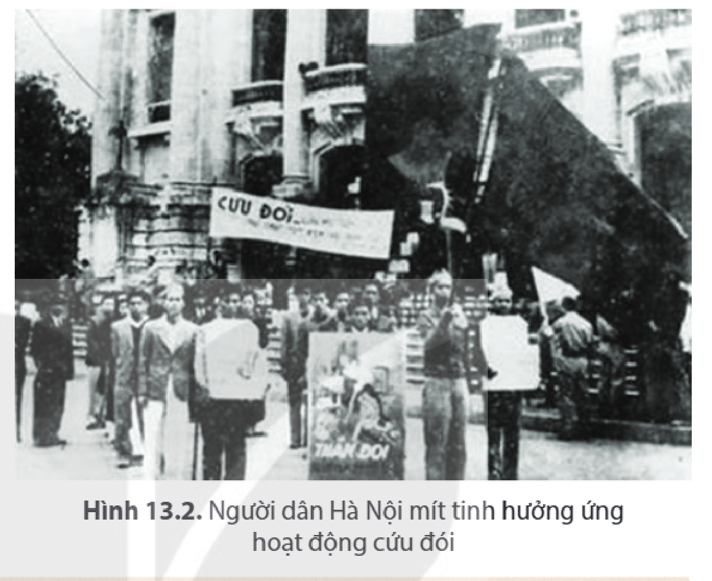
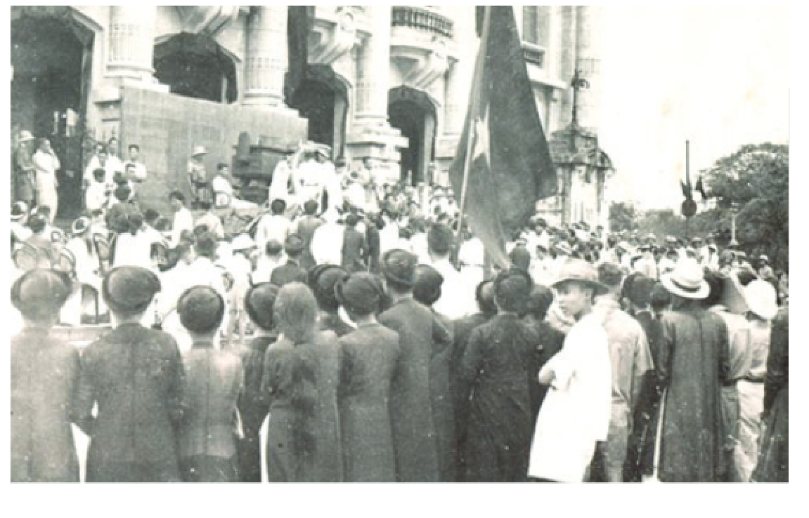
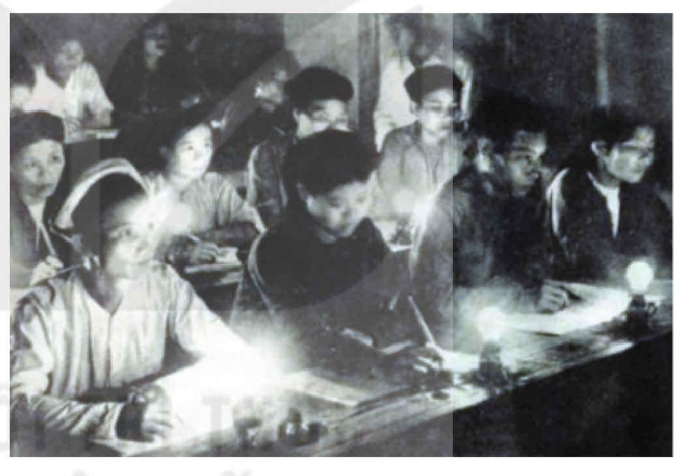
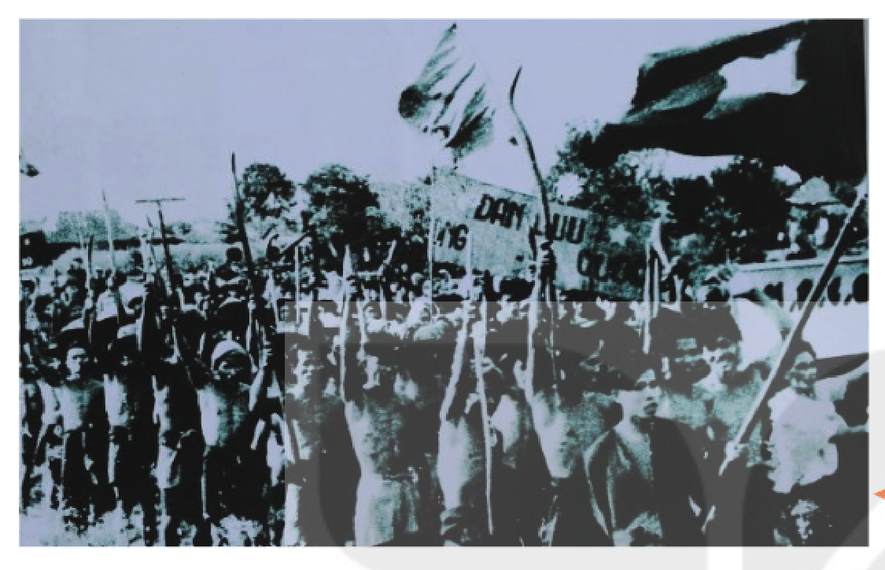
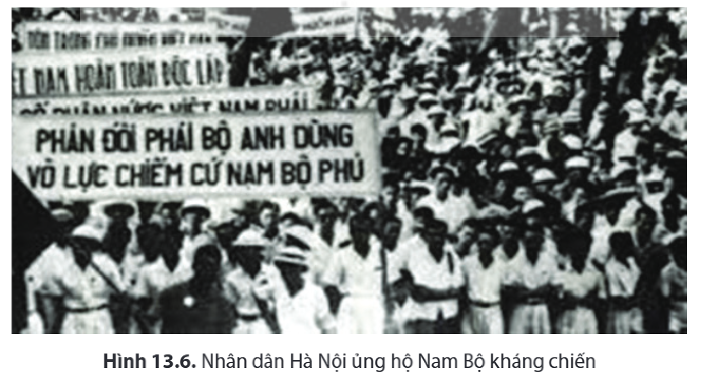
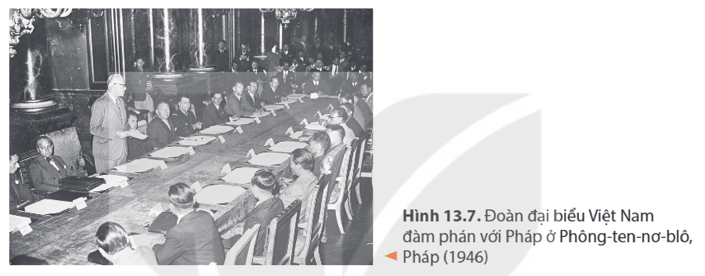

<!-- pdf:63 -->

# BÀI 13: VIỆT NAM TRONG NĂM ĐẦU SAU CÁCH MẠNG THÁNG TÁM NĂM 1945

## 🎯 Học xong bài này, em sẽ:

- Nêu được những biện pháp chủ yếu để xây dựng và củng cố chính quyền cách mạng, giải quyết những khó khăn về kinh tế, văn hoá, giáo dục, quân sự,... trong năm đầu sau Cách mạng tháng Tám năm 1945.
- Trình bày được những nét chính về cuộc kháng chiến chống thực dân Pháp xâm lược của nhân dân Nam Bộ.

## 🔴 Mở đầu

Trong *Thư gửi Tổng thống Pháp Sác-lơ Đờ Gôn* (5 – 9 – 1945), Chủ tịch Hồ Chí Minh khẳng định: “Chính phủ chúng tôi gồm các thành viên cộng hoà của ba xứ Việt Nam với quyết tâm bảo vệ nền độc lập Việt Nam bằng mọi biện pháp, cam kết bảo đảm an ninh, tính mạng và tài sản của người nước ngoài ở toàn cõi Việt Nam trên cơ sở tôn trọng lẫn nhau và đối xử bình đẳng. Chúng tôi phản đối việc quân đội Pháp xâm nhập lãnh thổ Việt Nam”.

Nội dung bức thư của Chủ tịch Hồ Chí Minh cho em biết điều gì về tình hình nước Việt Nam Dân chủ Cộng hoà sau khi thành lập (2 – 9 – 1945)? Theo em, Chính phủ cách mạng đã có những biện pháp gì để bảo vệ nền độc lập vừa giành được?

## 1. Các biện pháp xây dựng và củng cố chính quyền cách mạng

Sau Cách mạng tháng Tám năm 1945, nước Việt Nam Dân chủ Cộng hoà mới ra đời đã phải đối mặt với nhiều khó khăn. Chính quyền cách mạng còn non trẻ, lực lượng vũ trang mới thành lập, nền độc lập dân tộc bị đe doạ nghiêm trọng.

Từ vĩ tuyến 16 trở ra Bắc, quân đội Trung Hoa Dân quốc lấy danh nghĩa Đồng minh kéo vào Việt Nam. Theo chân đội quân này là các đảng phái tay sai như Việt Quốc, Việt Cách,... không ngừng có những hành động chống phá chính quyền Việt Nam Dân chủ Cộng hoà. Từ vĩ tuyến 16 trở vào Nam, quân Anh mở đường cho thực dân Pháp quay trở lại xâm lược Việt Nam.

> 💡 **Em có biết?**
>
> Ngày 5 – 1 – 1946, Chủ tịch Hồ Chí Minh đã viết *Lời kêu gọi quốc dân đi bỏ phiếu*: “... Ngày mai là một ngày vui sướng của đồng bào ta, vì ngày mai là ngày Tổng tuyển cử, vì ngày mai là một ngày đầu tiên trong lịch sử Việt Nam mà nhân dân ta bắt đầu hưởng dụng quyền dân chủ của mình...”.

Trước tình hình đó, một trong những nhiệm vụ quan trọng hàng đầu là xây dựng và củng cố chính quyền cách mạng.

<!-- term: Cuộc Tổng tuyển cử đầu tiên -->
Ngày 6 – 1 – 1946, cuộc Tổng tuyển cử đầu tiên của nước Việt Nam Dân chủ Cộng hoà đã diễn ra. Hơn 300 đại biểu đã được bầu vào Quốc hội, trong đó Chủ tịch Hồ Chí Minh trúng cử với số phiếu cao nhất.

<!-- pdf:64 -->

<!-- term: Cuộc Tổng tuyển cử đầu tiên -->
Trong phiên họp đầu tiên (3 – 1946), Quốc hội khoá I đã đưa ra các quyết định về chính sách đối nội, đối ngoại, thành lập Ban Dự thảo Hiến pháp và Chính phủ liên hiệp kháng chiến.

Để tránh phải đối đầu với nhiều kẻ thù cùng một lúc, Chính phủ Việt Nam một mặt chủ trương tạm thời hoà hoãn, tránh xung đột với quân Trung Hoa Dân quốc, mặt khác kiên quyết làm thất bại âm mưu chia rẽ, phá hoại của chúng. Quốc hội khoá I đã đồng ý nhường cho Việt Quốc và Việt Cách 70 ghế trong Quốc hội không thông qua bầu cử; nhân nhượng cho quân Trung Hoa Dân quốc một số quyền lợi về kinh tế như: cung cấp một phần lương thực, cho phép lưu hành tiền Trung Quốc,...

<!-- term: Hiến pháp năm 1946 -->
Ngày 9 – 11 – 1946, bản Hiến pháp đầu tiên của nước Việt Nam Dân chủ Cộng hoà được Quốc hội thông qua.

<!-- term: Hiến pháp năm 1946 -->
Bản Hiến pháp nhấn mạnh các nguyên tắc: “Đoàn kết toàn dân, không phân biệt giống nòi, gái trai, giai cấp, tôn giáo; bảo đảm các quyền tự do dân chủ; thực hiện chính quyền mạnh mẽ và sáng suốt của nhân dân”.

*Hình 13.1. Chủ tịch Hồ Chí Minh cùng các thành viên Chính phủ tuyên thệ nhậm chức tại kì họp thứ nhất, Quốc hội khoá I (3 – 1946)*

Sau cuộc Tổng tuyển cử, chính quyền địa phương các cấp được củng cố, kiện toàn.

Các địa phương ở Bắc Bộ và Trung Bộ tiến hành bầu cử Hội đồng nhân dân theo nguyên tắc phổ thông đầu phiếu và thành lập Uỷ ban hành chính các cấp. Ở Nam Bộ, do tình hình chiến sự nên Uỷ ban nhân dân cải tổ thành Uỷ ban hành chính lâm thời.

> **Tư liệu 1.** “...các cơ quan của Chính phủ từ toàn quốc cho đến các làng, đều là công bộc của dân,... Việc gì có lợi cho dân, ta phải hết sức làm. Việc gì hại đến dân, ta phải hết sức tránh”.
>
> (*Hồ Chí Minh: Toàn tập*, Tập 4, Sđd, tr. 64 – 65)

Khối đại đoàn kết dân tộc được phát triển thông qua việc củng cố Mặt trận Việt Minh và thành lập một số đoàn thể quần chúng, đảng phái dân chủ như: Mặt trận Liên Việt, Tổng Liên đoàn Lao động Việt Nam, Đảng Xã hội Việt Nam,...

Chính phủ kiện toàn Bộ Quốc phòng, thành lập Cục Quân y, Cục Quân nhu và các xưởng quân giới,... Lực lượng vũ trang nhân dân cũng được phát triển gồm: đội quân chủ lực và các đội vũ trang địa phương.

Việt Nam Giải phóng quân được chấn chỉnh, đổi thành Vệ quốc đoàn (9 – 1945) và Quân đội quốc gia Việt Nam (5 – 1946). Lực lượng dân quân tự vệ đã tăng lên hàng chục vạn người trên khắp cả nước.

> ❓ Khai thác tư liệu 1 và thông tin trong mục, hãy nêu các biện pháp chủ yếu để xây dựng và củng cố chính quyền cách mạng trong năm đầu sau Cách mạng tháng Tám của Nhà nước Việt Nam Dân chủ Cộng hoà.

<!-- pdf:65 -->

## 2. Giải quyết những khó khăn về kinh tế, văn hoá, giáo dục

### a) Kinh tế

Nền kinh tế Việt Nam vốn đã nghèo nàn, lạc hậu, lại còn bị chiến tranh tàn phá nặng nề. Hậu quả của nạn đói cuối năm 1944 – đầu năm 1945 chưa được khắc phục, trong khi nạn đói mới đang đe doạ nghiêm trọng đời sống nhân dân.

Trước tình hình đó, Chính phủ thực hiện những biện pháp trước mắt như: lập các hũ gạo cứu đói; kêu gọi “nhường cơm sẻ áo”, tổ chức “ngày đồng tâm”; nghiêm trị những kẻ đầu cơ tích trữ lúa gạo; đề ra biện pháp điều hoà thị trường lúa gạo giữa các địa phương.

Để giải quyết tận gốc nạn đói và phục hồi nền nông nghiệp, Chính phủ vận động toàn dân tăng gia sản xuất.

*Hình 13.2. Người dân Hà Nội mít tinh hưởng ứng hoạt động cứu đói*

> **Tư liệu 2.** Chủ tịch Hồ Chí Minh đã kêu gọi: “Tăng gia sản xuất! Tăng gia sản xuất ngay! Tăng gia sản xuất nữa! Đó là khẩu hiệu của ta ngày nay. Đó là cách thiết thực của chúng ta để giữ vững quyền tự do, độc lập”.
>
> (*Hồ Chí Minh: Toàn tập*, Tập 4, Sđd, tr. 135)

Với khẩu hiệu “không một tấc đất bỏ hoang”, việc gieo trồng cây lương thực, hoa màu được đẩy mạnh. Ruộng đất của đế quốc và Việt gian bị tịch thu, đem chia cho nông dân nghèo; còn ruộng đất công được chia lại theo nguyên tắc công bằng, dân chủ; các biện pháp giảm tô, thuế cho nông dân cũng được thực hiện.

<!-- term: Tuần lễ vàng -->
Để khắc phục tình trạng ngân khố quốc gia trống rỗng, Chính phủ phát động xây dựng “Quỹ độc lập” và phong trào “Tuần lễ vàng”. Tháng 11 – 1946, tiền Việt Nam được phép lưu hành trong cả nước nhằm xây dựng nền tài chính độc lập.

*Hình 13.3. Các tầng lớp nhân dân Thủ đô mít tinh ủng hộ "Tuần lễ vàng"*

<!-- pdf:66 -->

> 💡 **Em có biết?**
>
> Nhiều nhà tư sản yêu nước đã ủng hộ tiền, vàng trong “Tuần lễ vàng” như: Trịnh Văn Bô, Nguyễn Sơn Hà, Nguyễn Hữu Nhâm, Vương Thị Lai,...

<!-- term: Tuần lễ vàng -->
Chỉ sau một tuần (từ ngày 17 đến ngày 24 – 9 – 1945), tổng lượng tiền, vàng quyên góp được khoảng 60 triệu đồng Đông Dương và 370 ki-lô-gam vàng.

Các ngành công thương nghiệp, giao thông vận tải,... cũng dần được khôi phục.

> ❓ Khai thác tư liệu 2 và thông tin trong mục, hãy nêu các biện pháp để giải quyết khó khăn về kinh tế của chính quyền cách mạng.

### b) Giáo dục, văn hoá

Sau Cách mạng tháng Tám năm 1945, tàn dư văn hoá lạc hậu của chế độ thực dân, phong kiến để lại hết sức nặng nề, hơn 90% dân số không biết chữ. Các tệ nạn xã hội, dịch bệnh tràn lan.

Để xoá nạn mù chữ, ngày 8 – 9 – 1945, Chủ tịch Hồ Chí Minh kí Sắc lệnh thành lập Nha Bình dân học vụ, kêu gọi toàn dân tham gia xoá nạn mù chữ. Phong trào Bình dân học vụ phát triển sôi nổi, rộng khắp. Chỉ trong một năm, ở Bắc Bộ và Trung Bộ đã có tới 2,5 triệu người biết đọc, biết viết.

> 🔗 **Kết nối với ngày nay**
>
> Tháng 9 – 1945, Chủ tịch Hồ Chí Minh đã viết thư cho học sinh cả nước nhân ngày khai giảng năm học đầu tiên. Hiện nay, ngày 5 – 9 hằng năm được chọn là "Ngày hội toàn dân đưa trẻ đến trường".

*Hình 13.4. Một lớp Bình dân học vụ*

Các trường phổ thông và đại học được khai giảng. Nội dung và phương pháp giáo dục được đổi mới theo tinh thần dân tộc, dân chủ.

Nhà nước vận động toàn dân xây dựng đời sống văn hoá mới. Công tác y tế, vệ sinh phòng bệnh được tăng cường.

Báo chí cách mạng được quan tâm, phát triển và đóng vai trò quan trọng trong việc giáo dục lòng yêu nước.

Từ tháng 9 đến tháng 12 – 1945, hàng chục tờ báo được quyền xuất bản công khai, trong đó có các báo: *Cờ giải phóng*, *Sự thật*, *Cứu quốc*, *Tiền phong*, *Lao động*,...

> ❓ Hãy nêu các biện pháp giải quyết “giặc dốt” và xây dựng nền văn hoá mới của dân tộc.

## 3. Cuộc kháng chiến chống thực dân Pháp trở lại xâm lược của nhân dân Nam Bộ

<!-- term: Nam Bộ kháng chiến -->
Ngày 2 – 9 – 1945, quân Pháp đã có những hành động gây hấn ngay trong ngày nhân dân Sài Gòn – Chợ Lớn tổ chức mít tinh chào mừng ngày Độc lập. Được sự giúp đỡ của quân Anh, đêm 22 và rạng sáng 23 – 9 – 1945, thực dân Pháp đánh úp trụ sở Uỷ ban hành chính Nam Bộ và cơ quan tự vệ thành phố Sài Gòn, mở đầu cuộc chiến tranh xâm lược Việt Nam lần thứ hai.

<!-- term: Nam Bộ kháng chiến -->
Trước tình hình đó, sáng 23 – 9 – 1945, cơ quan kháng chiến ở Nam Bộ đã thống nhất ra *Lời kêu gọi* đồng bào cầm vũ khí đánh đuổi quân xâm lược.

<!-- pdf:67 -->

> **Tư liệu 3.** Chủ tịch Hồ Chí Minh kêu gọi: "Từ Nam chí Bắc, đồng bào ta luôn luôn sẵn sàng. Mấy triệu người như một, quyết tâm đánh tan quân cướp nước. Không quân đội nào, không khí giới nào có thể đánh ngã được tinh thần hi sinh của toàn thể một dân tộc.
>
> ... Trước nạn ngoại xâm, toàn thể quốc dân đã đoàn kết chặt chẽ thành một khối kiên cố, thành một lực lượng thống nhất mà không một đội quân xâm lăng nào đánh tan được.".
>
> (*Hồ Chí Minh: Toàn tập*, Tập 4, Sđd, tr. 89)

> 💡 **Em có biết?**
>
> Ghi nhận và biểu dương tinh thần chiến đấu kiên cường bất khuất của quân và dân Nam Bộ, tháng 2 – 1946, Chủ tịch Hồ Chí Minh đã tặng đồng bào Nam Bộ danh hiệu vẻ vang: “Thành đồng Tổ quốc”.

*Hình 13.5. Nhân dân Nam Bộ trong những ngày đầu Nam Bộ kháng chiến*

Đêm 23 – 9, công nhân Sài Gòn – Chợ Lớn đã cắt toàn bộ điện, nước. Trên đường phố, các chiến luỹ được dựng lên bằng bàn, ghế, giường, tủ,... để chặn bước tiến của quân Pháp. Các đội tự vệ, thanh niên xung kích nhanh chóng triển khai chiến đấu. Hàng trăm xí nghiệp và công sở, kho tàng, bến bãi,... cũng bị phá huỷ, không để rơi vào tay thực dân Pháp. Đến tháng 10 – 1945, thực dân Pháp với sự hỗ trợ của quân Anh và quân tiếp viện mới phá được vòng vây ở Sài Gòn, Chợ Lớn để đánh chiếm các tỉnh Nam Bộ, Nam Trung Bộ.

Ở Bắc Bộ và Bắc Trung Bộ, phong trào quyên góp “Ủng hộ cuộc kháng chiến anh dũng của đồng bào Nam Bộ” đã diễn ra rộng khắp, thanh niên nô nức tòng quân, các chi đội Nam tiến gấp rút lên đường vào Nam chiến đấu,...

*Hình 13.6. Nhân dân Hà Nội ủng hộ Nam Bộ kháng chiến*

<!-- term: Nam Bộ kháng chiến -->
Cuộc chiến đấu ở Nam Bộ đã làm cho quân Pháp bị giam chân tại đây trong nhiều tháng.

<!-- pdf:68 -->

<!-- term: Hiệp định Sơ bộ -->
> 💡 **Em có biết?**
>
> Theo Hiệp định Sơ bộ, Chính phủ Pháp công nhận nước Việt Nam Dân chủ Cộng hoà là một quốc gia tự do nằm trong khối Liên hiệp Pháp; có chính phủ, nghị viện, quân đội và tài chính riêng. Chính phủ Việt Nam Dân chủ Cộng hoà thoả thuận cho 15 000 quân Pháp ra Bắc thay quân Trung Hoa Dân quốc làm nhiệm vụ giải giáp quân đội Nhật và rút dần trong thời hạn 5 năm.

<!-- term: Hiệp định Sơ bộ -->
Đến đầu năm 1946, thực dân Pháp tìm cách kéo quân ra miền Bắc, mở rộng cuộc chiến tranh xâm lược. Ngày 28 – 2 – 1946, Hiệp ước Hoa – Pháp được kí kết. Pháp đưa quân ra miền Bắc thay thế quân Trung Hoa Dân quốc làm nhiệm vụ giải giáp quân đội Nhật. Trước tình hình đó, Chính phủ Việt Nam Dân chủ Cộng hoà đã thực hiện sách lược “hoà để tiến”, nhân nhượng có nguyên tắc bằng việc đàm phán, kí kết *Hiệp định Sơ bộ 6 – 3 – 1946* và *Tạm ước 14 – 9 – 1946*. Các văn bản trên thể hiện lập trường hoà bình, hữu nghị với Pháp và đẩy quân Trung Hoa Dân quốc về nước.

*Hình 13.7. Đoàn đại biểu Việt Nam đàm phán với Pháp ở Phông-ten-nơ-blô, Pháp (1946)*

> ❓ 1. Trình bày những nét chính về cuộc kháng chiến chống thực dân Pháp xâm lược trở lại của nhân dân Nam Bộ.
>
> 2. Khai thác tư liệu 3 và thông tin trong mục, em có nhận xét gì về tinh thần kháng chiến chống thực dân Pháp xâm lược trở lại của nhân dân Việt Nam?

## ✏️ Luyện tập – Vận dụng

1. Lập bảng tóm tắt (theo gợi ý dưới đây vào vở) về những biện pháp chủ yếu để giải quyết khó khăn của đất nước trong năm đầu sau Cách mạng tháng Tám năm 1945.

| Nhiệm vụ | Biện pháp |
| --- | --- |
| Xây dựng và củng cố chính quyền | ? |
| Giải quyết khó khăn về kinh tế | ? |
| Giải quyết khó khăn về văn hoá, giáo dục | ? |
| Chống ngoại xâm | ? |

2. Từ kết quả trả lời câu hỏi 1, hãy giải thích vì sao Nhà nước Việt Nam Dân chủ Cộng hoà là Nhà nước của dân, do dân, vì dân?

### 🚀 Vận dụng

Chủ tịch Hồ Chí Minh từng nói: "Một dân tộc dốt là một dân tộc yếu". Em có suy nghĩ gì về câu nói đó? Là một học sinh, em có thể làm gì để góp phần xây dựng đất nước?

## 📷 Danh sách hình trong bài

| Mã hình | Trang PDF | Trang sách | Chú thích |
| --- | --- | --- | --- |
| H9-lich_su_va_dia_ly-ls-b13-01 | 64 | 62 | Hình 13.1. Chủ tịch Hồ Chí Minh cùng các thành viên Chính phủ tuyên thệ nhậm chức tại kì họp thứ nhất, Quốc hội khoá I (3 – 1946) |
| H9-lich_su_va_dia_ly-ls-b13-02 | 65 | 63 | Hình 13.2. Người dân Hà Nội mít tinh hưởng ứng hoạt động cứu đói |
| H9-lich_su_va_dia_ly-ls-b13-03 | 65 | 63 | Hình 13.3. Các tầng lớp nhân dân Thủ đô mít tinh ủng hộ "Tuần lễ vàng" |
| H9-lich_su_va_dia_ly-ls-b13-04 | 66 | 64 | Hình 13.4. Một lớp Bình dân học vụ |
| H9-lich_su_va_dia_ly-ls-b13-05 | 67 | 65 | Hình 13.5. Nhân dân Nam Bộ trong những ngày đầu Nam Bộ kháng chiến |
| H9-lich_su_va_dia_ly-ls-b13-06 | 67 | 65 | Hình 13.6. Nhân dân Hà Nội ủng hộ Nam Bộ kháng chiến |
| H9-lich_su_va_dia_ly-ls-b13-07 | 68 | 66 | Hình 13.7. Đoàn đại biểu Việt Nam đàm phán với Pháp ở Phông-ten-nơ-blô, Pháp (1946) |
