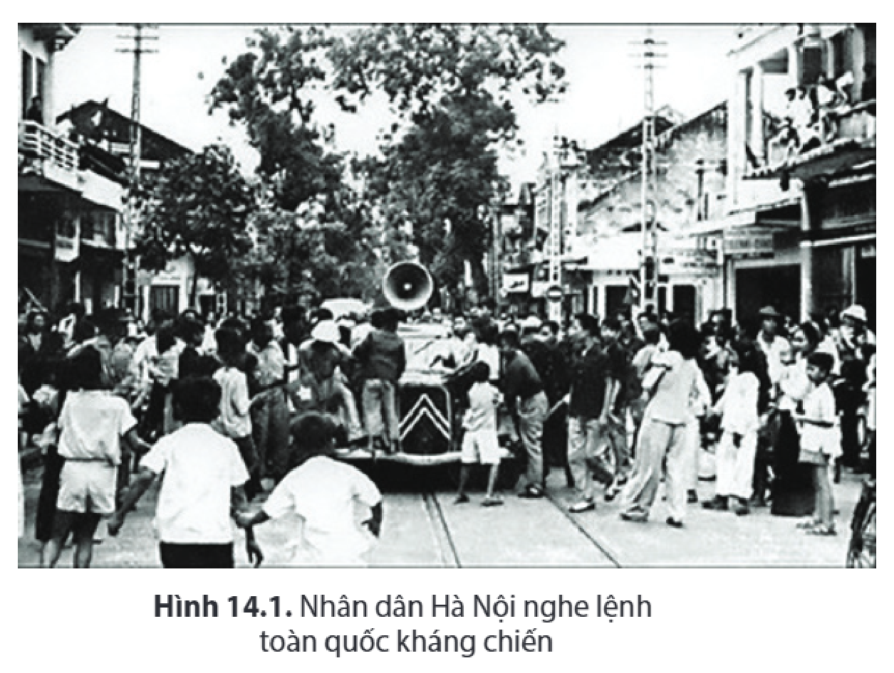
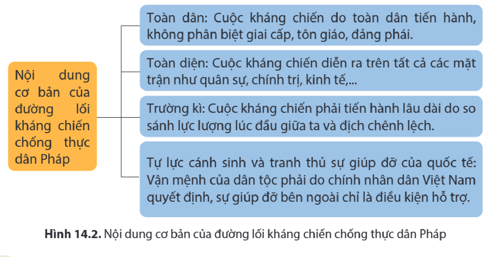
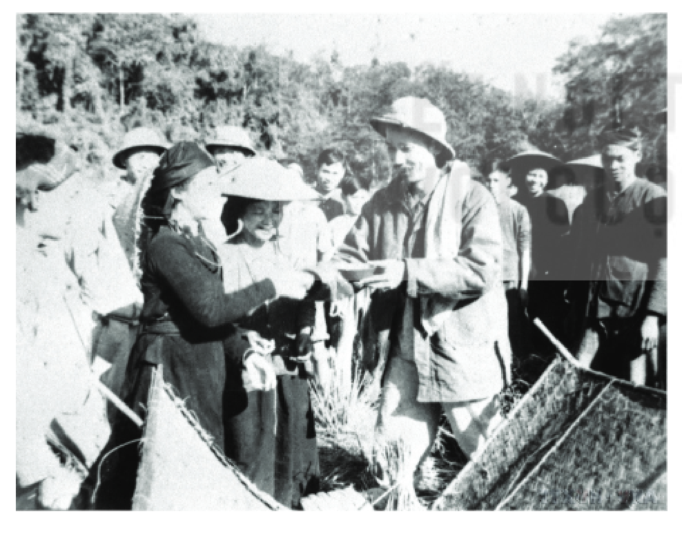
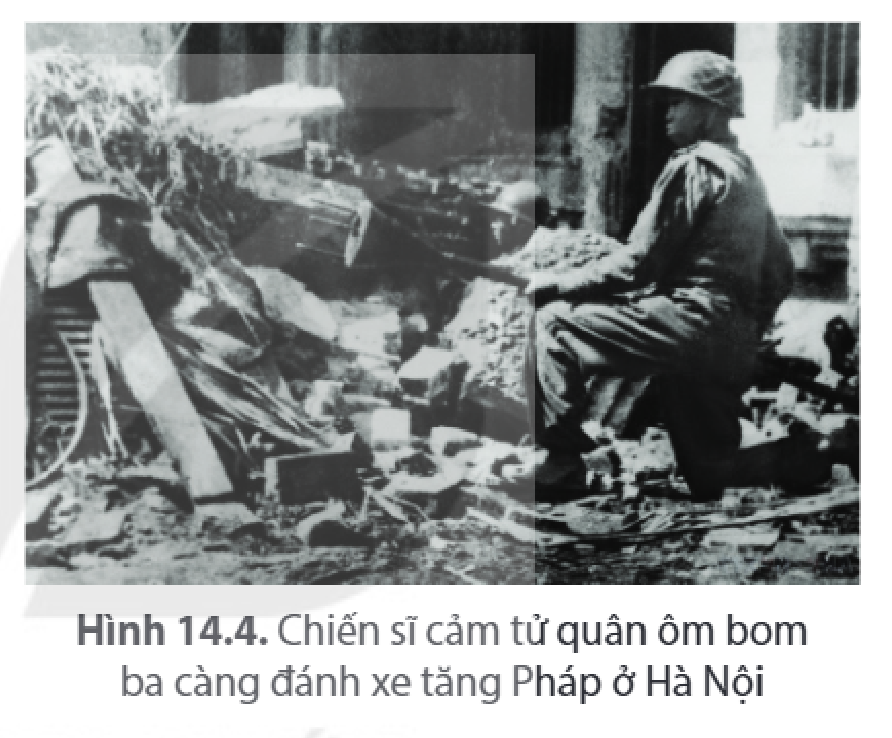
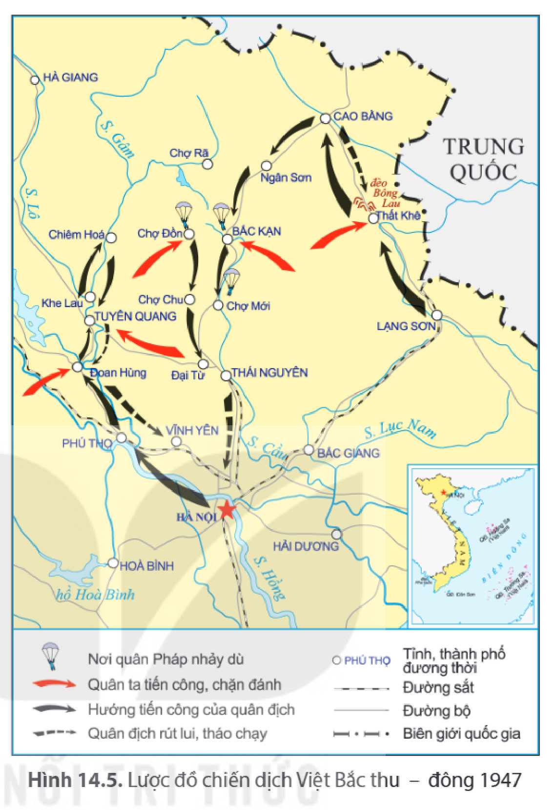
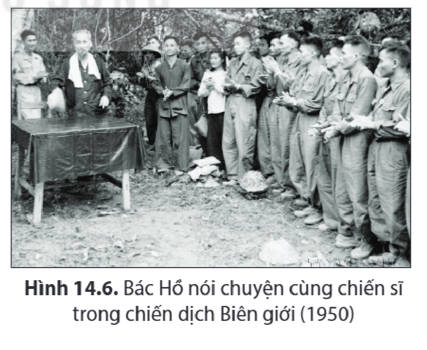
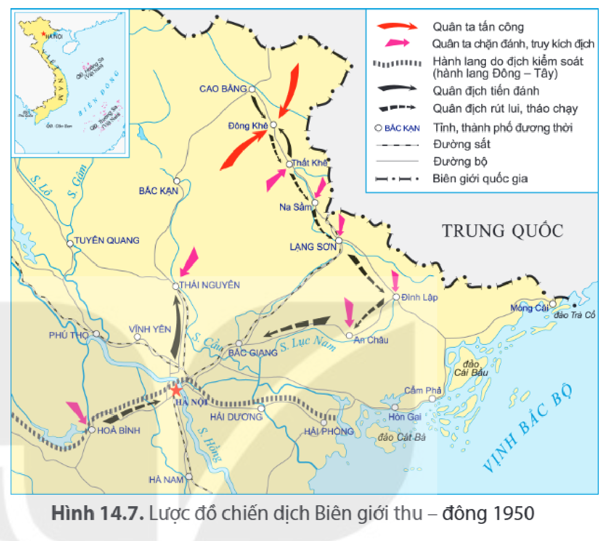

<!-- pdf:69 -->

# BÀI 14: VIỆT NAM KHÁNG CHIẾN CHỐNG THỰC DÂN PHÁP XÂM LƯỢC GIAI ĐOẠN 1946 – 1950

## 🎯 Học xong bài này, em sẽ:

- Giải thích được nguyên nhân bùng nổ cuộc kháng chiến toàn quốc chống thực dân Pháp xâm lược (1946).
- Nhận biết và giải thích được đường lối cuộc kháng chiến chống thực dân Pháp xâm lược của Đảng.
- Trình bày được những thắng lợi tiêu biểu trên mặt trận quân sự (hoàn cảnh lịch sử, nét chính diễn biến của cuộc chiến đấu ở các đô thị phía Bắc vĩ tuyến 16, chiến dịch Việt Bắc thu – đông 1947, chiến dịch Biên giới thu – đông 1950), kinh tế, văn hoá, ngoại giao,... trong cuộc kháng chiến chống thực dân Pháp giai đoạn 1946 – 1950.

## 🔴 Mở đầu

Trong bức thư gửi Liên hợp quốc (12 – 1946), Chủ tịch Hồ Chí Minh đã viết: “Chúng tôi trịnh trọng tuyên bố rằng nhân dân chúng tôi thành thật mong muốn hoà bình. Nhưng nhân dân chúng tôi cũng kiên quyết chiến đấu đến cùng để bảo vệ những quyền thiêng liêng nhất: toàn vẹn lãnh thổ cho Tổ quốc và độc lập cho đất nước”.

Theo em, vì sao cuộc kháng chiến toàn quốc chống thực dân Pháp xâm lược bùng nổ vào tháng 12 – 1946? Trong giai đoạn 1946 – 1950, quân và dân Việt Nam giành được những thắng lợi nào trên các mặt trận quân sự, chính trị, ngoại giao, kinh tế, văn hoá,...?

## 1. Cuộc kháng chiến toàn quốc chống thực dân Pháp xâm lược bùng nổ

### a) Nguyên nhân bùng nổ

Những hiệp định, tạm ước đã kí kết trong năm 1946 là nỗ lực “cứu vãn nền hoà bình” của Việt Nam Dân chủ Cộng hoà, đồng thời kéo dài thời gian hoà hoãn để xây dựng lực lượng cho cuộc kháng chiến.

> 💡 **Em có biết?**
>
> Trong chuyến thăm nước Pháp năm 1946, khi tham quan Khu di tích lịch sử Noóc-măng-di cùng các quan chức Pháp, Chủ tịch Hồ Chí Minh đã lấy bàn tay bịt nòng khẩu đại bác. Hành động này thể hiện thông điệp của nhân dân Việt Nam đối với Chính phủ Pháp: *Giữ gìn hoà bình! Ngăn chặn chiến tranh!*

Tuy nhiên, thực dân Pháp đã bội ước, liên tiếp có những hành động gây hấn, khiêu khích và vi phạm các văn bản kí kết.

Quân Pháp đã chiếm đóng trái phép Sở Tài chính, Phủ Toàn quyền cũ ở Hà Nội (25 – 6 – 1946), thực hiện kế hoạch lật đổ Chính phủ Việt Nam Dân chủ Cộng hoà, lập “Chính phủ Nam Kì tự trị”,... Tháng 11 – 1946, quân Pháp đánh chiếm nhiều nơi ở Hải Phòng, Lạng Sơn, Đà Nẵng,...

Ngày 17 – 12 – 1946, quân Pháp gây ra vụ thảm sát ở phố Hàng Bún và phố Yên Ninh (thành phố Hà Nội). Ngay sau đó, chúng liên tiếp gửi các tối hậu thư đòi Chính phủ ta giải tán lực lượng tự vệ chiến đấu, để cho quân Pháp làm nhiệm vụ giữ gìn trị an ở Hà Nội và quyền kiểm soát Thủ đô.

<!-- pdf:70 -->

Trước tình thế cấp bách, ngày 18 và 19 – 12 – 1946, Hội nghị Ban Thường vụ Trung ương Đảng đã họp và quyết định phát động cuộc kháng chiến trên toàn quốc.

<!-- term: Lời kêu gọi toàn quốc kháng chiến -->
Tối 19 – 12 – 1946, Chủ tịch Hồ Chí Minh ra *Lời kêu gọi toàn quốc kháng chiến*. Hưởng ứng lời kêu gọi, nhân dân trong cả nước đã đứng lên kháng chiến chống thực dân Pháp.

*Hình 14.1. Nhân dân Hà Nội nghe lệnh toàn quốc kháng chiến*

> ❓ 1. Nêu một số hoạt động thể hiện âm mưu xâm lược toàn bộ Việt Nam của thực dân Pháp.
>
> 2. Hãy giải thích nguyên nhân bùng nổ cuộc kháng chiến toàn quốc chống thực dân Pháp xâm lược.

### b) Đường lối kháng chiến chống thực dân Pháp

<!-- term: Đường lối kháng chiến chống thực dân Pháp -->
Đường lối kháng chiến chống thực dân Pháp được thể hiện trong Chỉ thị *Toàn dân kháng chiến* của Ban thường vụ Trung ương Đảng (12 – 12 – 1946), *Lời kêu gọi toàn quốc kháng chiến* của Chủ tịch Hồ Chí Minh (19 – 12 – 1946) và tác phẩm *Kháng chiến nhất định thắng lợi* của Tổng Bí thư Trường Chinh (9 – 1947).

<!-- term: Lời kêu gọi toàn quốc kháng chiến -->
> **Tư liệu 1.** *Lời kêu gọi toàn quốc kháng chiến* của Chủ tịch Hồ Chí Minh có đoạn:
>
> “Hỡi đồng bào! Chúng ta phải đứng lên!
>
> ... Bất kì đàn ông, đàn bà, bất kì người già, người trẻ, không chia tôn giáo, đảng phái, dân tộc. Hễ là người Việt Nam thì phải đứng lên đánh thực dân Pháp để cứu Tổ quốc. Ai có súng dùng súng. Ai có gươm dùng gươm, không có gươm thì dùng cuốc, thuổng, gậy gộc. Ai cũng phải ra sức chống thực dân Pháp cứu nước.”
>
> (*Hồ Chí Minh: Toàn tập*, Tập 4, Sđd, tr. 534)

*Hình 14.2. Nội dung cơ bản của đường lối kháng chiến chống thực dân Pháp*

<!-- term: Đường lối kháng chiến chống thực dân Pháp -->
> **Nội dung cơ bản của đường lối kháng chiến chống thực dân Pháp:**
> - Toàn dân: Cuộc kháng chiến do toàn dân tiến hành, không phân biệt giai cấp, tôn giáo, đảng phái.
> - Toàn diện: Cuộc kháng chiến diễn ra trên tất cả các mặt trận như quân sự, chính trị, kinh tế,...
> - Trường kì: Cuộc kháng chiến phải tiến hành lâu dài do so sánh lực lượng lúc đầu giữa ta và địch chênh lệch.
> - Tự lực cánh sinh và tranh thủ sự giúp đỡ của quốc tế: Vận mệnh của dân tộc phải do chính nhân dân Việt Nam quyết định, sự giúp đỡ bên ngoài chỉ là điều kiện hỗ trợ.

<!-- pdf:71 -->

> ❓ Khai thác tư liệu 1 và thông tin trong mục, hãy trình bày nội dung và giải thích đường lối kháng chiến chống thực dân Pháp xâm lược của Đảng.

## 2. Một số thắng lợi tiêu biểu trong kháng chiến chống thực dân Pháp giai đoạn 1946 – 1950

### a) Chính trị, ngoại giao

Sau khi toàn quốc kháng chiến bùng nổ, việc di chuyển kịp thời và an toàn các cơ quan Đảng, Chính phủ, Mặt trận,... lên căn cứ địa Việt Bắc là thắng lợi quan trọng để xây dựng lực lượng chuẩn bị bước vào cuộc kháng chiến lâu dài.

Chính quyền dân chủ nhân dân từ trung ương đến cơ sở được kiện toàn và củng cố để thực hiện nhiệm vụ vừa kháng chiến, vừa kiến quốc.

Đầu năm 1950, Chủ tịch Hồ Chí Minh đã thay mặt Chính phủ tuyên bố sẵn sàng đặt quan hệ ngoại giao với các nước. Ngay sau đó, Trung Quốc, Liên Xô, các nước xã hội chủ nghĩa khác như Tiệp Khắc, Ru-ma-ni, Ba Lan,... đã lần lượt công nhận và đặt quan hệ ngoại giao với Việt Nam Dân chủ Cộng hoà.

> ❓ Trình bày những thắng lợi tiêu biểu trên mặt trận chính trị, ngoại giao trong những năm đầu kháng chiến chống Pháp xâm lược (1946 – 1950).

### b) Kinh tế

Nền kinh tế kháng chiến được xây dựng để đảm bảo khả năng tự cấp, tự túc. Các hoạt động tăng gia sản xuất, trước hết là sản xuất nông nghiệp được đẩy mạnh.

> **Tư liệu 2.** Chủ tịch Hồ Chí Minh căn dặn: “... đồng bào ai làm nghề gì, trong lúc tản cư cứ làm nghề ấy. Ai cũng ra sức tăng gia sản xuất.”
>
> (*Hồ Chí Minh: Toàn tập*, Tập 5, NXB Chính trị quốc gia, 2011, tr. 64)

*Hình 14.3. Chủ tịch Hồ Chí Minh thăm nông dân Bắc Kạn (nay thuộc tỉnh Thái Nguyên) thu hoạch lúa mùa (1950)*

Về công nghiệp, một số xí nghiệp quốc phòng và dân dụng có quy mô thích hợp đã lần lượt được xây dựng ở các vùng tự do, căn cứ kháng chiến. Các ngành khai khoáng, cơ khí, hoá chất, diêm, giấy,... từng bước đi vào hoạt động.

> ❓ Trình bày những thắng lợi tiêu biểu trên mặt trận kinh tế trong những năm đầu kháng chiến chống Pháp xâm lược (1946 – 1950).

<!-- pdf:72 -->

### c) Văn hoá, giáo dục

Văn hoá, giáo dục được chú trọng nhằm bồi dưỡng sức mạnh tinh thần và trí tuệ của nhân dân để vừa kháng chiến, vừa kiến quốc.

Hội nghị Văn hoá toàn quốc lần thứ hai (1948) đã nhấn mạnh nhiệm vụ xây dựng và phát triển văn hoá phục vụ cuộc kháng chiến. Phong trào Bình dân học vụ được tiếp tục đẩy mạnh. Đến tháng 6 – 1950, khoảng 10 triệu người đã được xoá nạn mù chữ.

<!-- term: Cải cách giáo dục phổ thông lần thứ nhất -->
Cũng trong năm 1950, cuộc Cải cách giáo dục phổ thông lần thứ nhất được triển khai với mục tiêu đưa giáo dục phục vụ tích cực kháng chiến, xây dựng nền giáo dục dân tộc, dân chủ.

> ❓ Trình bày những thắng lợi tiêu biểu trên mặt trận văn hoá, giáo dục trong những năm đầu kháng chiến chống Pháp xâm lược (1946 – 1950).

### d) Quân sự

• *Cuộc chiến đấu ở các đô thị phía Bắc vĩ tuyến 16 (1946 – 1947)*

<!-- term: Cuộc chiến đấu ở các đô thị phía Bắc vĩ tuyến 16 -->
Thực dân Pháp liên tục bội ước, đẩy mạnh chiến tranh xâm lược, âm mưu đánh úp cơ quan đầu não cách mạng. Trước bối cảnh đó, thực hiện mục tiêu làm thất bại kế hoạch “đánh nhanh, thắng nhanh” của thực dân Pháp, quân dân Hà Nội và các đô thị ở phía Bắc vĩ tuyến 16 đã chủ động tiến công quân Pháp, tổ chức các trận đánh làm tiêu hao một bộ phận sinh lực địch,...

Ở Hà Nội, các trận đánh ác liệt diễn ra ở khu vực Bắc Bộ Phủ, Bưu điện Bờ Hồ, ga Hàng Cỏ, phố Khâm Thiên,... Ở thành phố Nam Định (nay thuộc tỉnh Ninh Bình), thực dân Pháp bị vây hãm cho tới tháng 3 – 1947. Quân dân thành phố Vinh (tỉnh Nghệ An) đã buộc địch phải đầu hàng,...

*Hình 14.4. Chiến sĩ cảm tử quân ôm bom ba càng đánh xe tăng Pháp ở Hà Nội*

<!-- term: Cuộc chiến đấu ở các đô thị phía Bắc vĩ tuyến 16 -->
Cuộc chiến đấu đã giam chân quân địch ở Hà Nội và các thành phố, thị xã phía Bắc vĩ tuyến 16. Sau gần ba tháng chiến đấu quyết liệt, lực lượng quân chủ lực của ta đã rút lui an toàn ra vùng hậu phương để chuẩn bị cho cuộc kháng chiến trường kì.

• *Chiến dịch Việt Bắc thu – đông 1947 (từ tháng 10 đến tháng 12 – 1947)*

<!-- term: Chiến dịch Việt Bắc thu – đông 1947 -->
Đầu năm 1947, thực dân Pháp âm mưu tiến công Việt Bắc nhằm tiêu diệt cơ quan đầu não kháng chiến và quân chủ lực của Việt Nam, khoá chặt biên giới Việt – Trung, nhanh chóng kết thúc chiến tranh.

<!-- term: Chiến dịch Việt Bắc thu – đông 1947 -->
Tháng 10 – 1947, thực dân Pháp đã huy động khoảng 12 000 quân và hầu hết máy bay ở Đông Dương tiến công lên Việt Bắc.

Trước tình hình đó, Đảng chỉ thị: *“Phải phá tan cuộc tiến công mùa đông của giặc Pháp”*.

Ở hướng đông, quân ta phục kích, chặn đánh địch trên Đường số 4, giành thắng lợi lớn ở tại Bản Sao (tỉnh Lạng Sơn) – đèo Bông Lau (tỉnh Cao Bằng). Ở hướng tây, quân ta phục kích chặn đánh nhiều trận trên sông Lô, giành thắng lợi quan trọng ở Đoan Hùng (tỉnh Phú Thọ), Khe Lau (tỉnh Tuyên Quang),...

<!-- pdf:73 -->

<!-- term: Chiến dịch Việt Bắc thu – đông 1947 -->
Sau hơn hai tháng, đại bộ phận quân Pháp phải rút chạy khỏi Việt Bắc, cơ quan đầu não của cuộc kháng chiến được bảo vệ an toàn. Đây là chiến dịch phản công lớn đầu tiên trong cuộc kháng chiến chống Pháp, giúp bộ đội chủ lực trưởng thành và thu được nhiều vũ khí. Chiến thắng Việt Bắc cũng làm thất bại hoàn toàn chiến lược “đánh nhanh, thắng nhanh” của thực dân Pháp.

*Hình 14.5. Lược đồ chiến dịch Việt Bắc thu – đông 1947*

• *Chiến dịch Biên giới thu – đông 1950 (từ tháng 9 đến tháng 10 – 1950)*

Bước sang năm 1950, tình hình thế giới có nhiều thay đổi. Những thành tựu trong công cuộc xây dựng chủ nghĩa xã hội ở Liên Xô, sự ra đời của nước Cộng hoà nhân dân Trung Hoa tạo chỗ dựa vững chắc cho phong trào giải phóng dân tộc ở các nước thuộc địa, phụ thuộc. Trong khi đó, Mỹ từng bước can thiệp sâu hơn vào tình hình Đông Dương.

<!-- term: Kế hoạch Rơ-ve -->
Với viện trợ của Mỹ, thực dân Pháp thực hiện *Kế hoạch Rơ-ve*: tăng cường hệ thống phòng thủ trên Đường số 4, lập hành lang Đông – Tây và chuẩn bị tiến công Việt Bắc lần thứ hai.

<!-- term: Chiến dịch Biên giới thu – đông 1950 -->
Để đối phó với âm mưu của thực dân Pháp, tháng 6 – 1950, Đảng và Chính phủ đã quyết định mở chiến dịch Biên giới nhằm tiêu diệt một bộ phận sinh lực địch, mở rộng và củng cố căn cứ địa Việt Bắc, mở đường liên lạc quốc tế với các nước xã hội chủ nghĩa, đồng thời tạo điều kiện thuận lợi cho cuộc kháng chiến.

*Hình 14.6. Bác Hồ nói chuyện cùng chiến sĩ trong chiến dịch Biên giới (1950)*

Vào giữa tháng 9, trận tiến công mở đầu chiến dịch của quân ta vào cứ điểm Đông Khê (tỉnh Cao Bằng) giành thắng lợi đã cô lập thị xã Cao Bằng, uy hiếp cứ điểm Thất Khê (tỉnh Lạng Sơn) và phá thế trận phòng thủ của quân Pháp trên Đường số 4. Pháp nhanh chóng

<!-- pdf:74 -->

điều động quân tiếp viện nhằm chiếm lại Đông Khê và đón binh đoàn từ Cao Bằng rút về. Trước tình hình trên, quân ta mai phục chặn đánh trên Đường số 4 khiến cho hai cánh quân này bị thiệt hại nặng nề và không thể liên lạc được với nhau. Kết quả, sau gần một tháng, quân Pháp bị buộc phải rút khỏi các cứ điểm trên Đường số 4 như: Cao Bằng, Thất Khê, Na Sầm, Lạng Sơn,...

<!-- term: Chiến dịch Biên giới thu – đông 1950 -->
Đây là chiến dịch chủ động tiến công lớn đầu tiên của bộ đội chủ lực Việt Nam, giải phóng được vùng biên giới rộng lớn và mở đường liên lạc quốc tế, bảo vệ được căn cứ địa Việt Bắc, chọc thủng hành lang Đông – Tây, làm phá sản *Kế hoạch Rơ-ve* của Pháp. Từ đây, quân đội Việt Nam đã giành được thế chủ động trên chiến trường chính Bắc Bộ, mở ra bước phát triển mới của cuộc kháng chiến.

*Hình 14.7. Lược đồ chiến dịch Biên giới thu – đông 1950*

> ❓ 1. Trình bày những thắng lợi tiêu biểu trên mặt trận quân sự trong những năm đầu kháng chiến chống Pháp xâm lược (1946 – 1950).
>
> 2. Vì sao chiến thắng Biên giới năm 1950 được coi là bước ngoặt của cuộc kháng chiến toàn quốc chống Pháp xâm lược?

## ✏️ Luyện tập – Vận dụng

1. Hãy chứng minh câu nói của Chủ tịch Hồ Chí Minh trong *Lời kêu gọi toàn quốc kháng chiến* (12 – 1946): “Chúng ta muốn hoà bình, chúng ta phải nhân nhượng. Nhưng chúng ta càng nhân nhượng, thực dân Pháp càng lấn tới, vì chúng quyết tâm cướp nước ta lần nữa”.

2. Hoàn thành bảng (theo gợi ý dưới đây vào vở) về các thắng lợi hoặc thành tựu tiêu biểu trong những năm đầu của cuộc kháng chiến chống thực dân Pháp (1946 – 1950).

| Lĩnh vực | Thắng lợi/thành tựu tiêu biểu |
| --- | --- |
| Chính trị, ngoại giao | ? |
| Kinh tế | ? |
| Văn hoá | ? |
| Quân sự | ? |

### 🚀 Vận dụng

Theo em, nội dung nào trong đường lối kháng chiến chống thực dân Pháp xâm lược có thể vận dụng vào công cuộc xây dựng và bảo vệ Tổ quốc hiện nay? Vì sao?

## 📷 Danh sách hình trong bài

| Mã hình | Trang PDF | Trang sách | Chú thích |
| --- | --- | --- | --- |
| H9-lich_su_va_dia_ly-ls-b14-01 | 70 | 68 | Hình 14.1. Nhân dân Hà Nội nghe lệnh toàn quốc kháng chiến |
| H9-lich_su_va_dia_ly-ls-b14-02 | 70 | 68 | Hình 14.2. Nội dung cơ bản của đường lối kháng chiến chống thực dân Pháp |
| H9-lich_su_va_dia_ly-ls-b14-03 | 71 | 69 | Hình 14.3. Chủ tịch Hồ Chí Minh thăm nông dân Bắc Kạn (nay thuộc tỉnh Thái Nguyên) thu hoạch lúa mùa (1950) |
| H9-lich_su_va_dia_ly-ls-b14-04 | 72 | 70 | Hình 14.4. Chiến sĩ cảm tử quân ôm bom ba càng đánh xe tăng Pháp ở Hà Nội |
| H9-lich_su_va_dia_ly-ls-b14-05 | 73 | 71 | Hình 14.5. Lược đồ chiến dịch Việt Bắc thu – đông 1947 |
| H9-lich_su_va_dia_ly-ls-b14-06 | 73 | 71 | Hình 14.6. Bác Hồ nói chuyện cùng chiến sĩ trong chiến dịch Biên giới (1950) |
| H9-lich_su_va_dia_ly-ls-b14-07 | 74 | 72 | Hình 14.7. Lược đồ chiến dịch Biên giới thu – đông 1950 |
