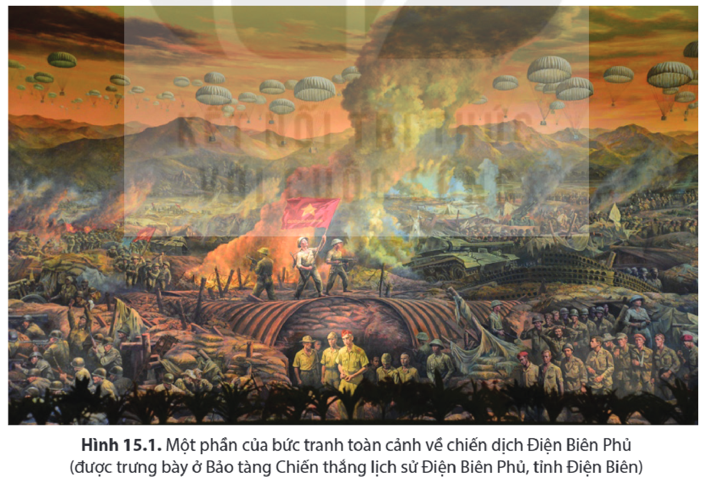
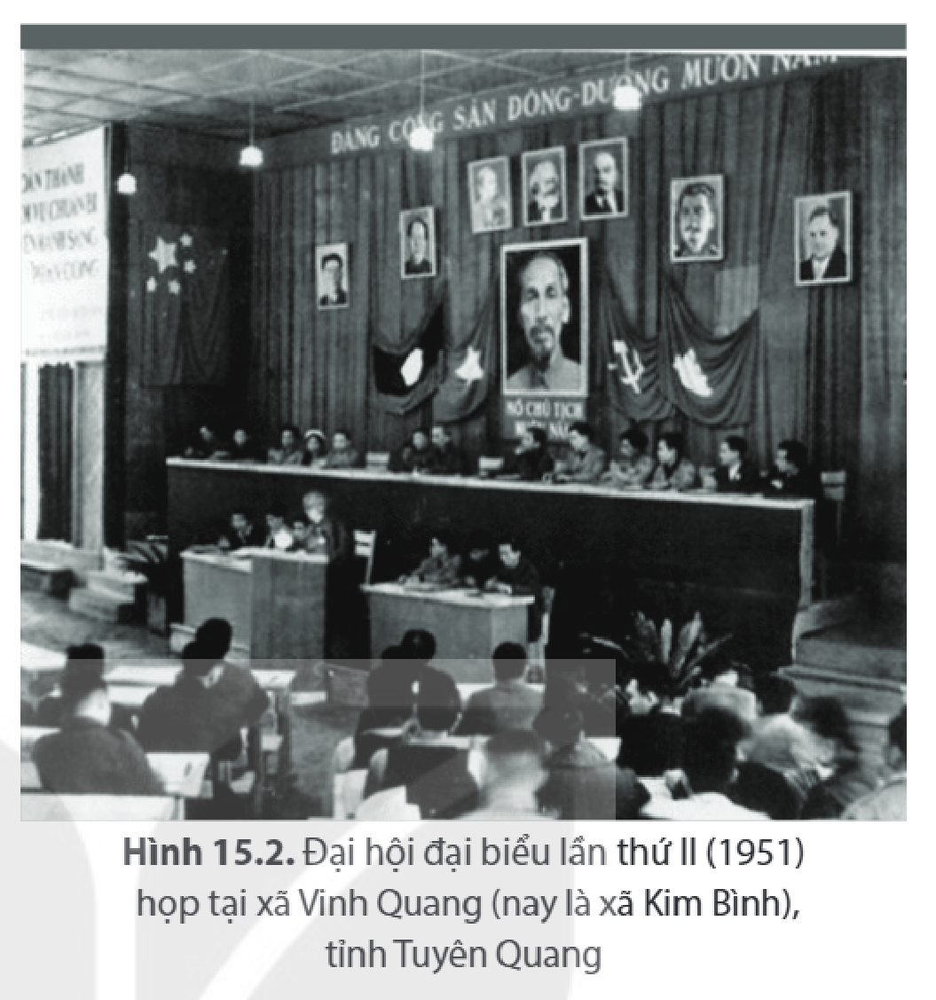
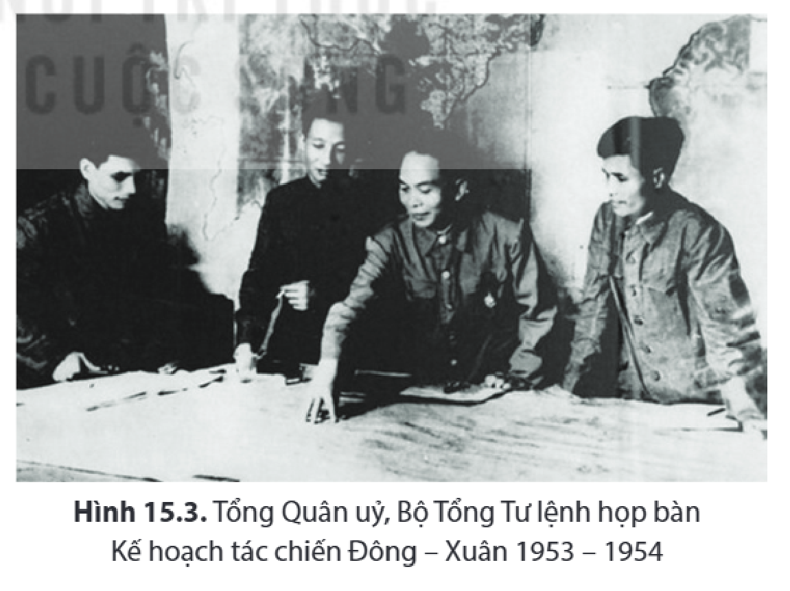
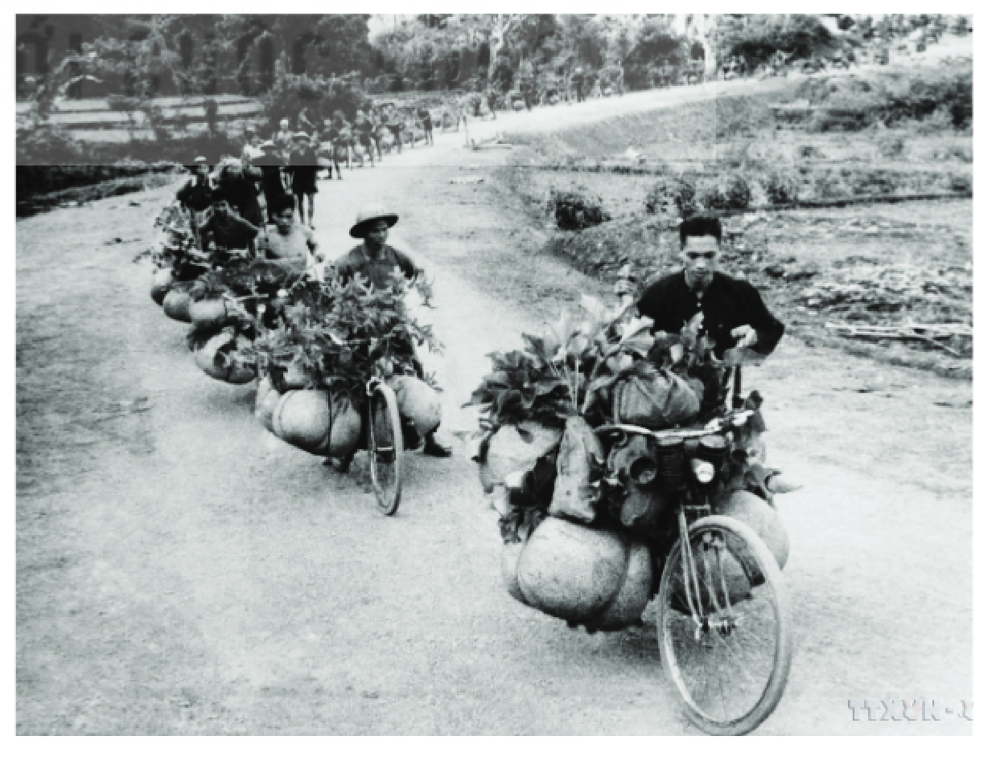
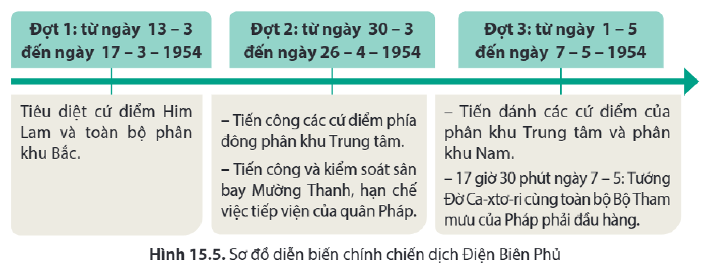
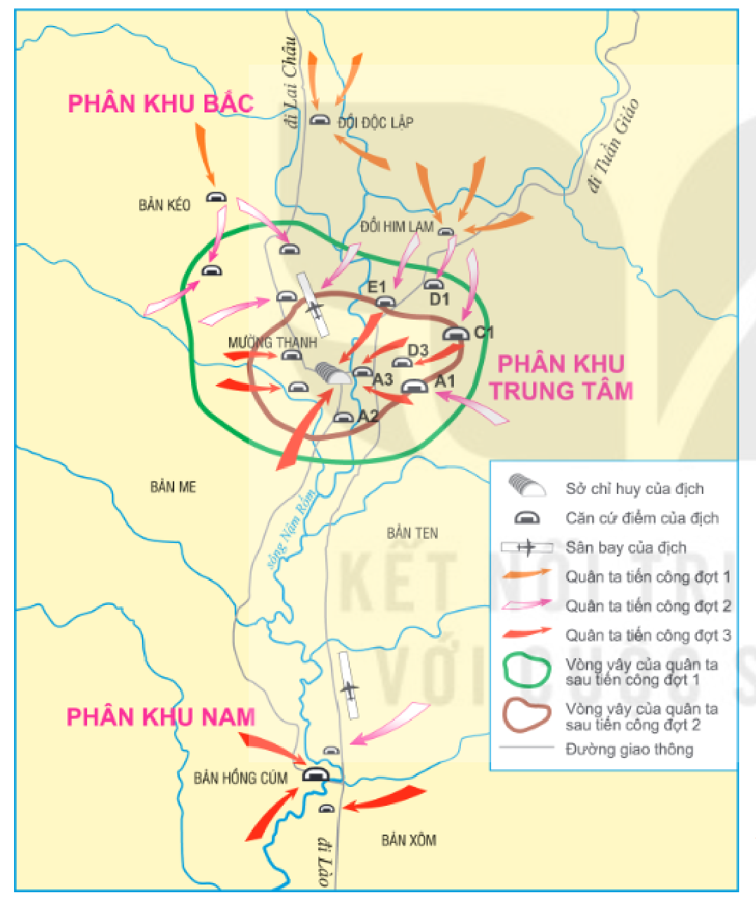
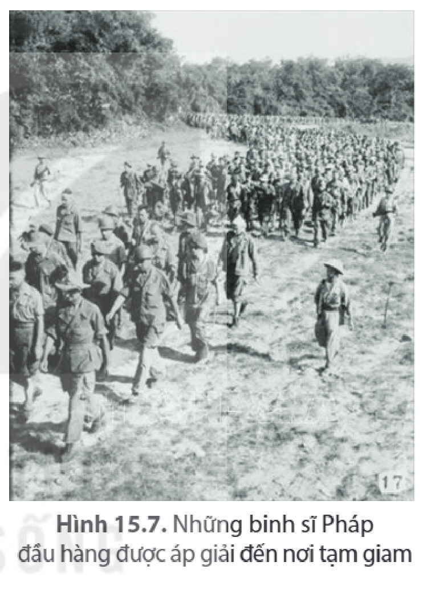
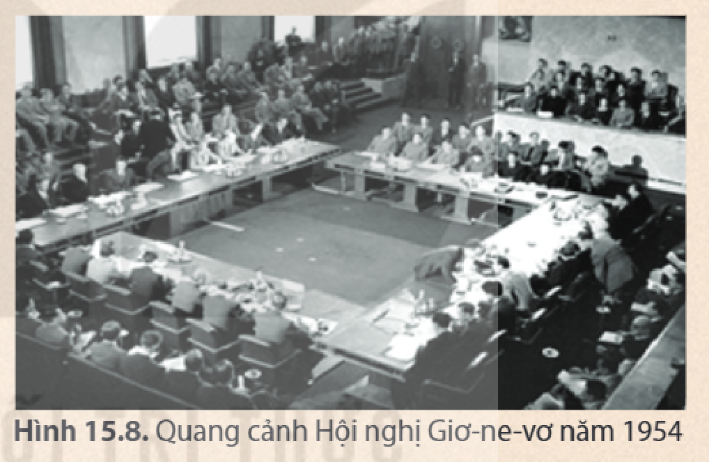

<!-- pdf:75 -->

# BÀI 15: VIỆT NAM KHÁNG CHIẾN CHỐNG THỰC DÂN PHÁP XÂM LƯỢC GIAI ĐOẠN 1951 – 1954

## 🎯 Học xong bài này, em sẽ:

- Trình bày được những thắng lợi tiêu biểu trên mặt trận quân sự (hoàn cảnh lịch sử, nét chính diễn biến của Chiến cuộc Đông – Xuân 1953 – 1954 và chiến dịch lịch sử Điện Biên Phủ), kinh tế, văn hoá, ngoại giao,... trong cuộc kháng chiến chống thực dân Pháp giai đoạn 1951 – 1954.
- Nêu được ý nghĩa lịch sử và nguyên nhân thắng lợi của cuộc kháng chiến chống thực dân Pháp (1945 – 1954).

## 🔴 Mở đầu

Hình dưới đây tái hiện một phần về chiến thắng lịch sử Điện Biên Phủ “lừng lẫy năm châu, chấn động địa cầu” của dân tộc Việt Nam trong thế kỉ XX. Theo em, vì sao chiến thắng Điện Biên Phủ được đánh giá với tầm vóc vĩ đại như vậy? Hãy chia sẻ những hiểu biết của em về chiến thắng này và một số thắng lợi khác trong cuộc kháng chiến chống thực dân Pháp giai đoạn 1951 – 1954.

*Hình 15.1. Một phần của bức tranh toàn cảnh về chiến dịch Điện Biên Phủ (được trưng bày ở Bảo tàng Chiến thắng lịch sử Điện Biên Phủ, tỉnh Điện Biên)*

<!-- pdf:76 -->

## 1. Những thắng lợi tiêu biểu trên mặt trận chính trị, kinh tế, văn hoá

### a) Chính trị

<!-- term: Đại hội đại biểu lần thứ II của Đảng Cộng sản Đông Dương -->
Từ năm 1951, tình hình chiến trường Đông Dương có nhiều biến đổi. Lực lượng kháng chiến của Việt Nam trưởng thành về mọi mặt. Pháp lần lượt triển khai các kế hoạch quân sự nhằm đẩy cuộc chiến tranh xâm lược Việt Nam lên quy mô lớn. Trong bối cảnh đó, Đại hội đại biểu lần thứ II của Đảng Cộng sản Đông Dương đã họp vào tháng 2 – 1951, khẳng định đường lối kháng chiến chống Pháp và quyết định nhiều vấn đề chiến lược của cách mạng Việt Nam. Đây là mốc đánh dấu bước phát triển mới trong quá trình trưởng thành và lãnh đạo cách mạng của Đảng, là Đại hội kháng chiến thắng lợi.

*Hình 15.2. Đại hội đại biểu lần thứ II (1951) họp tại xã Vinh Quang (nay là xã Kim Bình), tỉnh Tuyên Quang*

<!-- term: Mặt trận Liên Việt -->
Để tăng cường mặt trận dân tộc thống nhất, Mặt trận Liên hiệp quốc dân Việt Nam (gọi tắt là Mặt trận Liên Việt) được thành lập trên cơ sở hợp nhất Mặt trận Việt Minh và Hội Liên Việt (3 – 1951).

> 💡 **Em có biết?**
>
> Đại hội Chiến sĩ thi đua và Cán bộ gương mẫu toàn quốc lần thứ nhất đã vinh danh các anh hùng: Cù Chính Lan, Nguyễn Quốc Trị, La Văn Cầu, Nguyễn Thị Chiên, Trần Đại Nghĩa, Ngô Gia Khảm, Hoàng Hanh.

Đại hội Chiến sĩ thi đua và Cán bộ gương mẫu toàn quốc lần thứ nhất được tổ chức (1952) để tổng kết, biểu dương thành tích trong sản xuất và chiến đấu.

> ❓ Trình bày những thắng lợi tiêu biểu trên mặt trận chính trị trong kháng chiến chống thực dân Pháp giai đoạn 1951 – 1954.

### b) Kinh tế

Phong trào thi đua sản xuất lập công, vận động sản xuất và thực hành tiết kiệm được triển khai rộng khắp góp phần tăng cường tiềm lực vật chất cho cuộc kháng chiến.

Để bồi dưỡng sức dân, đầu năm 1953, Chính phủ phát động quần chúng triệt để thực hiện giảm tô và cải cách ruộng đất,...

Công nghiệp quốc phòng, cơ khí đã cung cấp hàng nghìn tấn vũ khí, đạn dược, quân trang, quân dụng cho bộ đội.

Ngoài ra, cuộc kháng chiến của nhân dân Việt Nam còn nhận được nguồn viện trợ vật chất từ nhiều nước trên thế giới như: Trung Quốc, Liên Xô,...

> ❓ Trình bày một số thành tựu tiêu biểu trên lĩnh vực kinh tế trong kháng chiến chống thực dân Pháp giai đoạn 1951 – 1954.

<!-- pdf:77 -->

### c) Văn hoá

Cải cách giáo dục tiếp tục được triển khai với phương châm “phục vụ kháng chiến, phục vụ dân sinh, phục vụ sản xuất”. Nhiều trường chuyên nghiệp, trường sư phạm, trường đại học được thành lập nhằm đào tạo cán bộ kháng chiến, kiến quốc.

Nền văn học, nghệ thuật cách mạng đạt được nhiều thành tựu với nhiều tác phẩm phản ánh về cuộc kháng chiến của dân tộc.

> ❓ Trình bày một số thành tựu tiêu biểu trên mặt trận văn hoá trong kháng chiến chống thực dân Pháp giai đoạn 1951 – 1954.

## 2. Những thắng lợi tiêu biểu trên mặt trận quân sự

Tháng 12 – 1950, Mỹ kí với Pháp *Hiệp định phòng thủ chung Đông Dương*, cung cấp viện trợ quân sự, kinh tế nhằm giúp Pháp giành lại quyền chủ động chiến lược trên chiến trường, nhanh chóng kết thúc chiến tranh. Lực lượng kháng chiến của Việt Nam từ sau chiến thắng Biên giới năm 1950 liên tiếp giành được nhiều thắng lợi quan trọng trong các chiến dịch Hoà Bình (1951 – 1952), Tây Bắc (10 – 1952), Thượng Lào (4 – 1953),... từng bước phá tan âm mưu đẩy mạnh chiến tranh của Pháp – Mỹ và giữ vững quyền chủ động trên chiến trường.

• *Kế hoạch Na-va*

<!-- term: Kế hoạch Na-va -->
Từ giữa năm 1953, thực dân Pháp và can thiệp Mỹ đã triển khai Kế hoạch Na-va với hi vọng sẽ giành được thắng lợi quân sự quyết định trong vòng 18 tháng để “kết thúc chiến tranh trong danh dự”.

<!-- term: Kế hoạch Na-va -->
Điểm mấu chốt của kế hoạch là tập trung lực lượng cơ động chiến lược mạnh ở đồng bằng Bắc Bộ, lúc cao điểm lên đến 44 tiểu đoàn, nhằm giành lại sự chủ động chiến lược xoay chuyển tình thế trên chiến trường Đông Dương, thực hiện đòn tiến công mang tính quyết định khi có điều kiện.

• *Cuộc Tiến công chiến lược Đông – Xuân 1953 – 1954*

<!-- term: Cuộc Tiến công chiến lược Đông – Xuân 1953 – 1954 -->
Trước tình hình mới, Bộ Chính trị Trung ương Đảng đã đề ra Kế hoạch tác chiến Đông – Xuân 1953 – 1954. Phương hướng chiến lược là tập trung lực lượng tiến công vào một số địa bàn có tầm quan trọng về chiến lược mà quân Pháp tương đối yếu, nhằm tiêu diệt một bộ phận sinh lực địch, giải phóng đất đai và buộc chúng phải phân tán lực lượng đối phó.

*Hình 15.3. Tổng Quân uỷ, Bộ Tổng Tư lệnh họp bàn Kế hoạch tác chiến Đông – Xuân 1953 – 1954*

Thực hiện phương hướng chiến lược đề ra, bộ đội chủ lực Việt Nam mở nhiều chiến dịch tiến công trên nhiều hướng, ở hầu khắp các chiến trường Đông Dương.

<!-- pdf:78 -->

Ngày 20 – 11 – 1953, Pháp cho quân nhảy dù chiếm Điện Biên Phủ nhằm khống chế Tây Bắc và Thượng Lào. Đầu tháng 12 – 1953, bộ đội chủ lực tiến công Tây Bắc, giải phóng Lai Châu (trừ Điện Biên Phủ), buộc Pháp tăng cường binh lực ở đây.

Cuối năm 1953, ta tiến công Trung Lào, giải phóng tỉnh Thà Khẹt, uy hiếp Xê-nô.

Tháng 1 – 1954, ta mở chiến dịch ở Thượng Lào, giải phóng Phong Xa-lì, buộc Pháp tăng viện binh cho Luông Pha-bang và Mường Sài.

Đầu tháng 2 – 1954, quân ta tiến công địch ở Bắc Tây Nguyên, giải phóng Kon Tum (nay thuộc tỉnh Quảng Ngãi), uy hiếp Plây-ku (tỉnh Gia Lai).

<!-- term: Cuộc Tiến công chiến lược Đông – Xuân 1953 – 1954 -->
Trước các đòn tiến công liên tiếp của ta, quân Pháp buộc phải phân tán lực lượng thành năm nơi tập trung quân (đồng bằng Bắc Bộ, Điện Biên Phủ, Xê-nô, Luông Pha-bang, Plây-ku), bị động đối phó. Cuộc Tiến công chiến lược Đông – Xuân 1953 – 1954 của ta đã làm phá sản bước đầu Kế hoạch Na-va của Pháp – Mỹ.

• *Chiến dịch Điện Biên Phủ (1954)*

Điện Biên Phủ là thung lũng rộng lớn, nằm ở phía tây vùng rừng núi Tây Bắc, gần biên giới với Lào, có vị trí chiến lược ở Đông Dương và Đông Nam Á nên Pháp cố nắm giữ. Từ cuối năm 1953, thực dân Pháp được Mỹ giúp sức đã xây dựng Điện Biên Phủ thành tập đoàn cứ điểm mạnh nhất ở Đông Dương.

Điện Biên Phủ là nơi tập trung hàng chục tiểu đoàn bộ binh, pháo binh, xe tăng,... với lực lượng lúc đông nhất là hơn 16 200 quân, được bố trí thành 49 cứ điểm, chia thành ba phân khu. Điện Biên Phủ được Pháp – Mỹ đánh giá là “pháo đài bất khả xâm phạm”.

<!-- term: Chiến dịch Điện Biên Phủ -->
Đầu tháng 12 – 1953, Bộ Chính trị quyết định mở chiến dịch Điện Biên Phủ, cử Đại tướng Võ Nguyên Giáp là Bí thư Đảng uỷ kiêm Tư lệnh Mặt trận và thông qua phương án tác chiến là “đánh nhanh, thắng nhanh”. Tuy nhiên, sau khi đánh giá tình hình lực lượng giữa hai bên, phương án tác chiến đã được chuyển sang “đánh chắc, tiến chắc”. Công tác chuẩn bị cho chiến dịch được xúc tiến khẩn trương với khẩu hiệu “Tất cả cho tiền tuyến, tất cả để chiến thắng”.

> 💡 **Em có biết?**
>
> Nhận xét về việc tiếp tế cho Điện Biên Phủ, một viên sĩ quan Pháp đã thừa nhận: “Than ôi! Máy bay của ta lại thua đôi bồ dân công của Việt Minh”.

*Hình 15.4. Dân công vận chuyển lương thực, vũ khí, đạn dược phục vụ chiến dịch Điện Biên Phủ*

<!-- pdf:79 -->

<!-- term: Chiến dịch Điện Biên Phủ -->
Chiến dịch Điện Biên Phủ diễn ra từ ngày 13 – 3 đến ngày 7 – 5 – 1954 và chia làm ba đợt.

*Hình 15.5. Sơ đồ diễn biến chính chiến dịch Điện Biên Phủ*

<!-- term: Chiến dịch Điện Biên Phủ -->
> **Sơ đồ diễn biến chính chiến dịch Điện Biên Phủ:**
> - Đợt 1: từ ngày 13 – 3 đến ngày 17 – 3 – 1954: Tiêu diệt cứ điểm Him Lam và toàn bộ phân khu Bắc.
> - Đợt 2: từ ngày 30 – 3 đến ngày 26 – 4 – 1954:
>   - Tiến công các cứ điểm phía đông phân khu Trung tâm.
>   - Tiến công và kiểm soát sân bay Mường Thanh, hạn chế việc tiếp viện của quân Pháp.
> - Đợt 3: từ ngày 1 – 5 đến ngày 7 – 5 – 1954:
>   - Tiến đánh các cứ điểm của phân khu Trung tâm và phân khu Nam.
>   - 17 giờ 30 phút ngày 7 – 5: Tướng Đờ Ca-xtơ-ri cùng toàn bộ Bộ Tham mưu của Pháp phải đầu hàng.

*Hình 15.6. Lược đồ diễn biến chính chiến dịch Điện Biên Phủ*

*Hình 15.7. Những binh sĩ Pháp đầu hàng được áp giải đến nơi tạm giam*

<!-- term: Chiến dịch Điện Biên Phủ -->
Cuộc Tiến công chiến lược Đông – Xuân 1953 – 1954, đỉnh cao là chiến dịch Điện Biên Phủ đã đập tan Kế hoạch Na-va, làm xoay chuyển cục diện chiến tranh ở Đông Dương, tạo điều kiện cho cuộc đấu tranh ngoại giao giành thắng lợi. Chiến thắng này cũng là nguồn cổ vũ to lớn đối với phong trào giải phóng dân tộc trên thế giới.

> ❓ 1. Trình bày bối cảnh lịch sử của cuộc kháng chiến chống thực dân Pháp trong giai đoạn 1951 – 1954.
>
> 2. Hãy trình bày những thắng lợi tiêu biểu trong cuộc Tiến công chiến lược Đông – Xuân 1953 – 1954 và chiến dịch Điện Biên Phủ.

<!-- pdf:80 -->

## 3. Những thắng lợi tiêu biểu trên mặt trận ngoại giao

Tháng 3 – 1951, Liên minh nhân dân Việt – Miên – Lào thành lập đã thúc đẩy sự kết hợp chặt chẽ giữa quân dân ba nước Đông Dương. Cuộc kháng chiến của nhân dân Việt Nam cũng nhận được sự ủng hộ tích cực của các lực lượng yêu chuộng hoà bình ở Pháp và nhiều quốc gia trên thế giới.

<!-- term: Hiệp định Giơ-ne-vơ -->
Thắng lợi lớn nhất trong đấu tranh ngoại giao là việc đoàn đại biểu Chính phủ Việt Nam Dân chủ Cộng hoà tham gia đàm phán và kí kết Hiệp định Giơ-ne-vơ về lập lại hoà bình ở Đông Dương.

<!-- term: Hiệp định Giơ-ne-vơ -->
Hội nghị Giơ-ne-vơ (Thuỵ Sĩ) bàn về vấn đề Đông Dương diễn ra từ ngày 8 – 5 đến ngày 21 – 7 – 1954 với sự tham gia của đại diện các nước: Anh, Pháp, Mỹ, Liên Xô, Cộng hoà Nhân dân Trung Hoa, Việt Nam Dân chủ Cộng hoà, Quốc gia Việt Nam, Vương quốc Lào, Vương quốc Cam-pu-chia, đã đạt được thoả thuận chung về đình chỉ chiến sự, lập lại hoà bình cho các nước Đông Dương. Cũng theo quyết định của Hội nghị, ở Việt Nam, vĩ tuyến 17 được lấy làm ranh giới quân sự tạm thời và tổng tuyển cử thống nhất đất nước sẽ diễn ra vào tháng 7 – 1956 với sự kiểm soát của Uỷ ban quốc tế.

*Hình 15.8. Quang cảnh Hội nghị Giơ-ne-vơ năm 1954*

> **Tư liệu** – [...] việc giải quyết các vấn đề chính trị, thực hiện trên cơ sở tôn trọng nguyên tắc độc lập thống nhất và toàn vẹn lãnh thổ, phải làm cho nhân dân Việt Nam được hưởng những tự do căn bản ...
>
> – [...] mỗi nước tham gia Hội nghị Giơ-ne-vơ cam kết tôn trọng chủ quyền, độc lập, thống nhất và toàn vẹn lãnh thổ những nước trên [Việt Nam, Lào, Cam-pu-chia] và tuyệt đối không can thiệp vào nội trị của những nước đó.
>
> (Trích *Tuyên bố cuối cùng của Hội nghị Giơ-ne-vơ về việc lập lại hoà bình ở Đông Dương* (21 – 7 – 1954), lưu tại Kho lưu trữ Trung ương Đảng)

<!-- term: Hiệp định Giơ-ne-vơ -->
Chiến thắng Điện Biên Phủ và việc kí kết Hiệp định Giơ-ne-vơ đã buộc thực dân Pháp phải rút quân về nước, Mỹ thất bại trong âm mưu kéo dài, mở rộng, quốc tế hoá chiến tranh xâm lược Đông Dương.

> ❓ Khai thác tư liệu và thông tin trong mục, hãy trình bày những thắng lợi tiêu biểu trên mặt trận ngoại giao trong kháng chiến chống thực dân Pháp giai đoạn 1951 – 1954.

## 4. Nguyên nhân thắng lợi và ý nghĩa lịch sử của kháng chiến chống thực dân Pháp

### a) Nguyên nhân thắng lợi

Cuộc kháng chiến chống thực dân Pháp giành thắng lợi là sự tổng hợp của nhiều nguyên nhân chủ quan và khách quan. Đó là:

Sự lãnh đạo sáng suốt của Đảng, đứng đầu là Chủ tịch Hồ Chí Minh, với đường lối kháng chiến đúng đắn, sáng tạo.

<!-- pdf:81 -->

Truyền thống yêu nước của dân tộc, chủ nghĩa anh hùng cách mạng được phát huy mạnh mẽ đã củng cố, mở rộng mặt trận dân tộc thống nhất vì mục tiêu độc lập dân tộc.

Hệ thống chính quyền dân chủ nhân dân trong cả nước ngày càng vững mạnh. Hậu phương được củng cố và phát triển vững chắc; lực lượng vũ trang ba thứ quân được xây dựng và không ngừng trưởng thành trong chiến đấu.

Sự liên minh đoàn kết với cuộc kháng chiến của nhân dân Lào và nhân dân Cam-pu-chia cùng chống kẻ thù chung là thực dân Pháp xâm lược; sự đồng tình ủng hộ của các nước xã hội chủ nghĩa như: Trung Quốc, Liên Xô và các lực lượng yêu chuộng hoà bình trên thế giới.

### b) Ý nghĩa lịch sử

Cuộc kháng chiến chống thực dân Pháp kết thúc thắng lợi đã chấm dứt cuộc chiến tranh xâm lược và ách thống trị của thực dân Pháp trong gần một thế kỉ ở Việt Nam. Miền Bắc được giải phóng, chuyển sang giai đoạn tiến hành cách mạng xã hội chủ nghĩa, tạo cơ sở cho sự nghiệp đấu tranh giải phóng miền Nam, thống nhất đất nước.

Thắng lợi đó đã giáng đòn nặng nề vào tham vọng xâm lược, nô dịch của chủ nghĩa thực dân, góp phần làm tan rã hệ thống thuộc địa kiểu cũ, cổ vũ phong trào giải phóng dân tộc các nước Á, Phi và Mỹ La-tinh.

> ❓ Hãy nêu nguyên nhân thắng lợi và ý nghĩa lịch sử của cuộc kháng chiến chống thực dân Pháp.

## ✏️ Luyện tập – Vận dụng

1. Hoàn thành bảng (theo gợi ý dưới đây vào vở) về các thắng lợi tiêu biểu của quân dân Việt Nam trong giai đoạn 1951 – 1954.

| Nội dung | Thắng lợi tiêu biểu |
| --- | --- |
| Chính trị | ? |
| Kinh tế | ? |
| Văn hoá | ? |
| Quân sự | ? |
| Ngoại giao | ? |

2. Vì sao nói: Chiến thắng Điện Biên Phủ là sự kiện "lừng lẫy năm châu, chấn động địa cầu"?

### 🚀 Vận dụng

1. Sưu tầm tư liệu từ sách, báo và internet, xây dựng infographic giới thiệu về một thắng lợi quân sự tiêu biểu trong cuộc kháng chiến chống thực dân Pháp.

2. Hãy sưu tầm một số tác phẩm văn học, nghệ thuật tiêu biểu được sáng tác trong cuộc kháng chiến chống thực dân Pháp (1945 – 1954).

## 📷 Danh sách hình trong bài

| Mã hình | Trang PDF | Trang sách | Chú thích |
| --- | --- | --- | --- |
| H9-lich_su_va_dia_ly-ls-b15-01 | 75 | 73 | Hình 15.1. Một phần của bức tranh toàn cảnh về chiến dịch Điện Biên Phủ (được trưng bày ở Bảo tàng Chiến thắng lịch sử Điện Biên Phủ, tỉnh Điện Biên) |
| H9-lich_su_va_dia_ly-ls-b15-02 | 76 | 74 | Hình 15.2. Đại hội đại biểu lần thứ II (1951) họp tại xã Vinh Quang (nay là xã Kim Bình), tỉnh Tuyên Quang |
| H9-lich_su_va_dia_ly-ls-b15-03 | 77 | 75 | Hình 15.3. Tổng Quân uỷ, Bộ Tổng Tư lệnh họp bàn Kế hoạch tác chiến Đông – Xuân 1953 – 1954 |
| H9-lich_su_va_dia_ly-ls-b15-04 | 78 | 76 | Hình 15.4. Dân công vận chuyển lương thực, vũ khí, đạn dược phục vụ chiến dịch Điện Biên Phủ |
| H9-lich_su_va_dia_ly-ls-b15-05 | 79 | 77 | Hình 15.5. Sơ đồ diễn biến chính chiến dịch Điện Biên Phủ |
| H9-lich_su_va_dia_ly-ls-b15-06 | 79 | 77 | Hình 15.6. Lược đồ diễn biến chính chiến dịch Điện Biên Phủ |
| H9-lich_su_va_dia_ly-ls-b15-07 | 79 | 77 | Hình 15.7. Những binh sĩ Pháp đầu hàng được áp giải đến nơi tạm giam |
| H9-lich_su_va_dia_ly-ls-b15-08 | 80 | 78 | Hình 15.8. Quang cảnh Hội nghị Giơ-ne-vơ năm 1954 |
