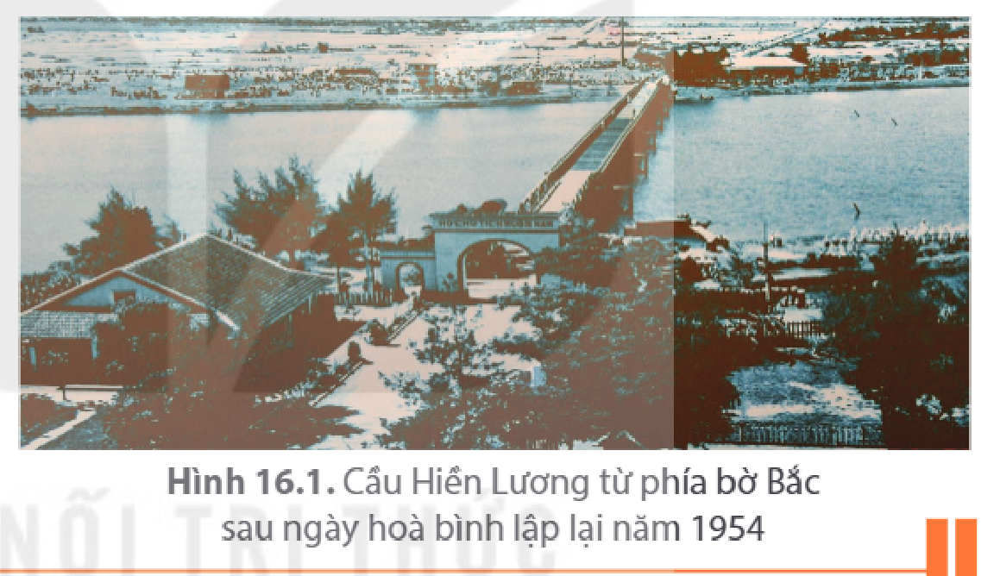
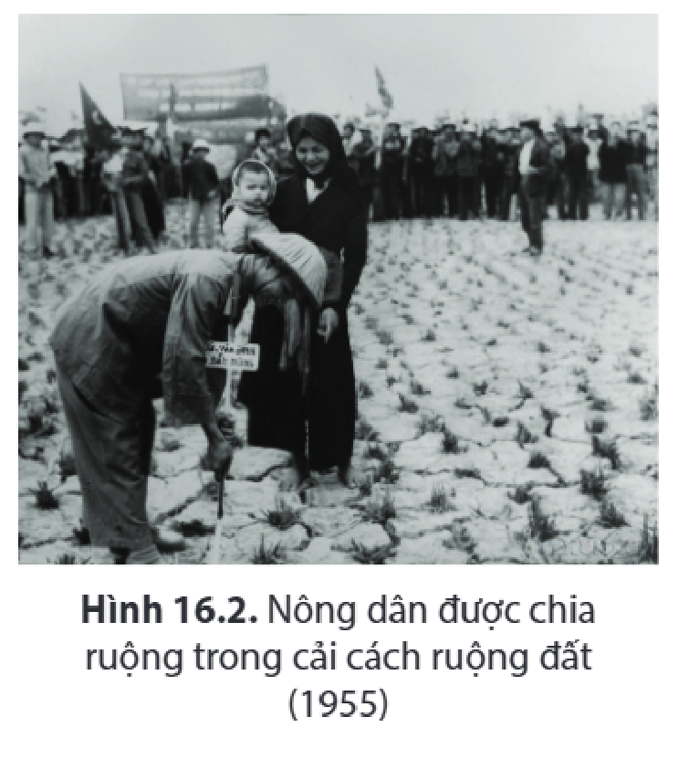
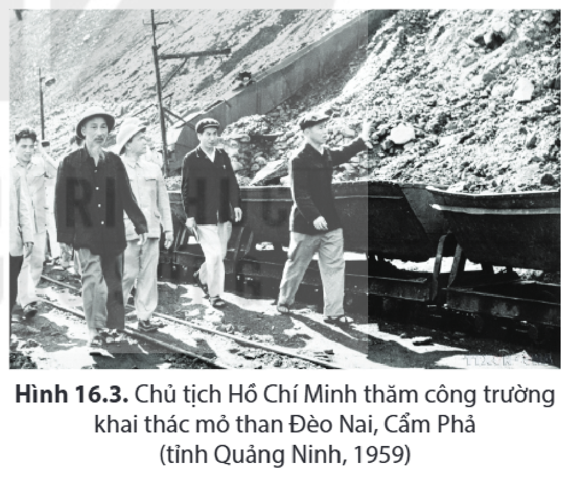
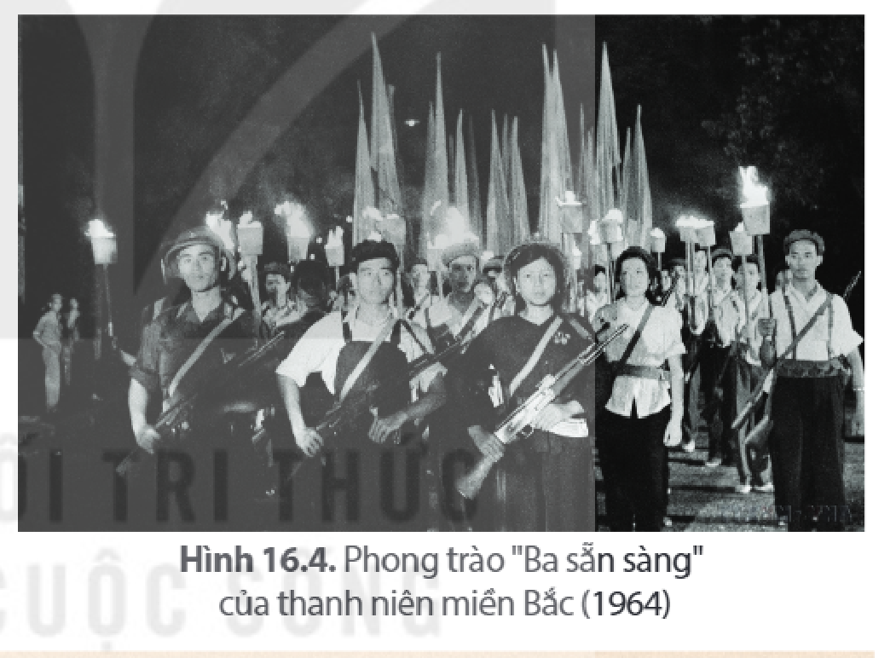
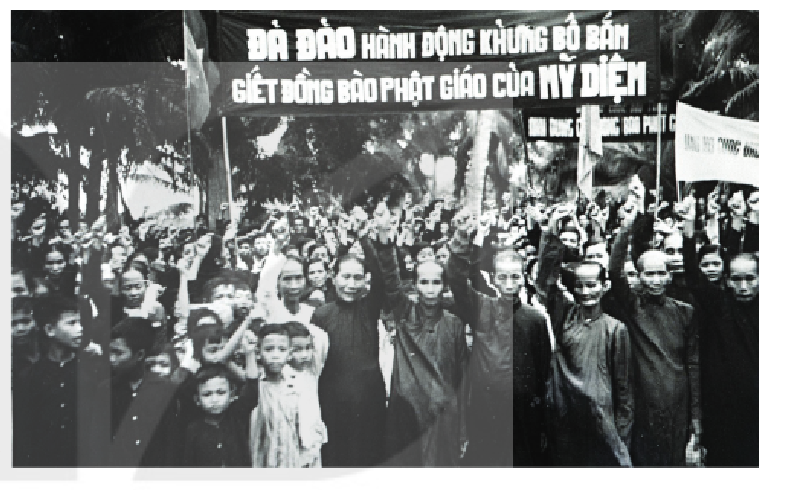
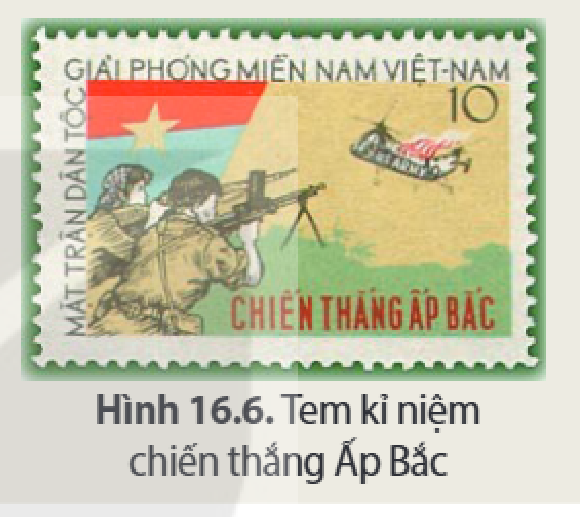

<!-- pdf:82 -->

# BÀI 16: VIỆT NAM KHÁNG CHIẾN CHỐNG MỸ, CỨU NƯỚC, THỐNG NHẤT ĐẤT NƯỚC GIAI ĐOẠN 1954 – 1965

## 🎯 Học xong bài này, em sẽ:

- Giới thiệu được những thành tựu tiêu biểu trong công cuộc xây dựng miền Bắc xã hội chủ nghĩa (hoàn thành cải cách ruộng đất, khôi phục và phát triển kinh tế, chi viện cho cách mạng miền Nam,...).
- Trình bày được các thắng lợi tiêu biểu về quân sự của nhân dân miền Nam trong kháng chiến chống Mỹ, cứu nước giai đoạn 1954 – 1965 (phong trào Đồng khởi, chiến đấu chống lại chiến lược “Chiến tranh đặc biệt”).

## 🔴 Mở đầu

Hình ảnh cây cầu Hiền Lương (trong di tích Đôi bờ Hiền Lương, tỉnh Quảng Trị) gợi cho em nhớ đến hoàn cảnh nào của nước ta sau năm 1954? Hãy chia sẻ những hiểu biết của em về những thành tựu của miền Bắc và những thắng lợi về quân sự của nhân dân miền Nam trong giai đoạn 1954 – 1965.

*Hình 16.1. Cầu Hiền Lương từ phía bờ Bắc sau ngày hoà bình lập lại năm 1954*

## 1. Những thành tựu tiêu biểu trong công cuộc xây dựng miền Bắc xã hội chủ nghĩa (1954 – 1965)

### a) Hoàn thành cải cách ruộng đất, khôi phục kinh tế và hàn gắn vết thương chiến tranh (1954 – 1957)

<!-- term: Cải cách ruộng đất ở miền Bắc -->
Sau khi Hiệp định Giơ-ne-vơ được kí kết, miền Bắc hoàn toàn giải phóng, song cũng phải đối mặt với nhiều khó khăn do hậu quả của chiến tranh để lại. Để đáp ứng yêu cầu của thực tế, Đảng và Chính phủ quyết định "Đẩy mạnh phát động quần chúng thực hiện cải cách ruộng đất".

<!-- term: Cải cách ruộng đất ở miền Bắc -->
Qua 5 đợt cải cách (tiến hành từ cuối năm 1953 đến năm 1956), trên 81 vạn héc-ta ruộng đất của đế quốc và địa chủ đã bị tịch thu, trưng thu, trưng mua và đem chia cho khoảng 2,2 triệu hộ nông dân và dân nghèo ở nông thôn (chiếm 72,8% số hộ ở nông thôn miền Bắc).

*Hình 16.2. Nông dân được chia ruộng trong cải cách ruộng đất (1955)*

<!-- pdf:83 -->

> 💡 **Em có biết?**
>
> Việc tiến hành cải cách ruộng đất còn phạm phải những sai lầm như đánh giá chưa đúng một số địa chủ kháng chiến, người có công với cách mạng,... Đảng và Chính phủ đã kịp thời có chủ trương, biện pháp sửa sai, khắc phục hậu quả.

<!-- term: Cải cách ruộng đất ở miền Bắc -->
Khẩu hiệu “Người cày có ruộng” đã trở thành hiện thực. Sau cải cách ruộng đất, bộ mặt nông thôn miền Bắc thay đổi cơ bản, giai cấp địa chủ phong kiến bị xoá bỏ, giai cấp nông dân được giải phóng và trở thành người làm chủ ở nông thôn.

Trong những năm 1955 – 1957, miền Bắc thực hiện khôi phục kinh tế, hàn gắn vết thương chiến tranh. Đến cuối năm 1957, sản lượng nông nghiệp tăng vượt mức so với trước Chiến tranh thế giới thứ hai, giải quyết cơ bản nạn đói.

Về công nghiệp, bên cạnh việc khôi phục, mở rộng các nhà máy đã có, nhiều nhà máy mới được xây dựng trong thời kì này như: Cơ khí Hà Nội, Diêm Thống Nhất, Thuốc lá Thăng Long (thành phố Hà Nội),... Hệ thống mậu dịch quốc doanh và hợp tác xã mua bán được mở rộng, giao lưu hàng hoá phát triển. Cuối năm 1957, miền Bắc đã đặt quan hệ buôn bán với 27 nước.

Trong giao thông vận tải, đường sắt và đường ô tô được khôi phục và phát triển, các bến cảng như Hải Phòng; Hòn Gai (tỉnh Quảng Ninh); Bến Thuỷ (tỉnh Nghệ An);... được tu sửa và mở rộng, đặc biệt, đường hàng không dân dụng quốc tế được khai thông.

> ❓ Trình bày những thành tựu tiêu biểu của miền Bắc trong cải cách ruộng đất, công cuộc khôi phục kinh tế và hàn gắn vết thương chiến tranh từ năm 1954 đến năm 1957.

### b) Cải tạo quan hệ sản xuất, bước đầu phát triển kinh tế, văn hoá và chi viện cho miền Nam (1958 – 1960)

Trong những năm 1958 – 1960, miền Bắc tiến hành cải tạo quan hệ sản xuất, bước đầu phát triển kinh tế – văn hoá và đạt nhiều thành tựu. Trong đó, trọng tâm là việc phát triển thành phần kinh tế quốc doanh, kinh tế tập thể (Nhà nước, tập thể quản lí).

Cuối năm 1960, miền Bắc có 40 000 hợp tác xã nông nghiệp, 172 cơ sở công nghiệp lớn do Trung ương quản lí và 500 cơ sở do địa phương quản lí, hơn 105 000 người buôn bán nhỏ (chiếm 45%) tham gia các hình thức hợp tác.

*Hình 16.3. Chủ tịch Hồ Chí Minh thăm công trường khai thác mỏ than Đèo Nai, Cẩm Phả (tỉnh Quảng Ninh, 1959)*

Tiến bộ về kinh tế đã tạo điều kiện cho văn hoá, giáo dục, y tế phát triển.

Đến cuối năm 1960, miền Bắc căn bản xoá được nạn mù chữ ở miền xuôi cho những người dưới 50 tuổi. Cơ sở y tế tăng hơn 11 lần so với năm 1955.

<!-- term: Đường Trường Sơn – Đường Hồ Chí Minh -->
> 💡 **Em có biết?**
>
> Ngày 19 – 5 – 1959 trở thành ngày truyền thống của Đoàn 559, Đường Trường Sơn – Đường Hồ Chí Minh và Bộ đội Trường Sơn. Năm 2013, Thủ tướng Chính phủ đã quyết định xếp hạng Di tích lịch sử Đường Trường Sơn – Đường Hồ Chí Minh là Di tích quốc gia đặc biệt.

<!-- term: Đường Trường Sơn – Đường Hồ Chí Minh -->
Trong cuộc kháng chiến chống Mỹ, cứu nước, miền Bắc còn làm nghĩa vụ của hậu phương lớn, chi viện cho miền Nam. Nhiều đơn vị vũ trang, cán bộ quân sự, chính trị, văn hoá, giáo dục, y tế được huấn luyện và đưa vào chiến trường tham gia hoặc phục vụ chiến đấu, xây dựng vùng giải phóng. Từ năm 1959,

<!-- pdf:84 -->

<!-- term: Đường Trường Sơn – Đường Hồ Chí Minh -->
tuyến chi viện chiến lược – đường Trường Sơn trên bộ, trên biển đã được hình thành và ngày càng phát triển, có vai trò quan trọng trong cuộc kháng chiến chống Mỹ, cứu nước.

> ❓ Hãy giới thiệu tóm tắt những thành tựu tiêu biểu của miền Bắc trong cải tạo quan hệ sản xuất, bước đầu phát triển kinh tế, văn hoá (1958 – 1960). Trong giai đoạn này, miền Bắc đã chi viện cho miền Nam như thế nào?

### c) Bước đầu xây dựng cơ sở vật chất, kĩ thuật của chủ nghĩa xã hội và chi viện cho miền Nam (1961 – 1965)

<!-- term: Kế hoạch 5 năm lần thứ nhất -->
Thực hiện nghị quyết Đại hội đại biểu toàn quốc lần thứ III của Đảng Lao động Việt Nam (9 – 1960), miền Bắc thực hiện kế hoạch 5 năm lần thứ nhất (1961 – 1965) nhằm xây dựng cơ sở vật chất – kĩ thuật của chủ nghĩa xã hội. Trong nông nghiệp, Nhà nước ưu tiên xây dựng và phát triển các nông trường, lâm trường quốc doanh. Công nghiệp nặng và công nghiệp nhẹ đều được đầu tư phát triển. Thương nghiệp quốc doanh chiếm lĩnh thị trường, góp phần ổn định đời sống nhân dân.

<!-- term: Kế hoạch 5 năm lần thứ nhất -->
Hơn 90% hộ nông dân vào hợp tác xã, trong đó 50% hộ vào hợp tác xã bậc cao. Nhiều nơi đạt năng suất 5 tấn thóc trên 1 héc-ta. Công nghiệp quốc doanh chiếm tỉ trọng 93,1% tổng giá trị sản lượng công nghiệp toàn miền Bắc.

Mạng lưới đường bộ, đường sắt, đường sông, đường biển được xây dựng, hoàn thiện phục vụ nhu cầu giao lưu kinh tế và chi viện cho miền Nam. Nhờ đó, chỉ trong 5 năm (1961 – 1965), một khối lượng lớn lương thực, vũ khí, đạn dược, thuốc men được chuyển vào chiến trường miền Nam. Từ năm 1961 đến năm 1963, khoảng 4 vạn cán bộ, chiến sĩ đã được bổ sung cho chiến trường miền Nam.

*Hình 16.4. Phong trào "Ba sẵn sàng" của thanh niên miền Bắc (1964)*

> **Tư liệu.** Năm 1964, đánh giá về thành tựu miền Bắc đạt được trong 10 năm, Chủ tịch Hồ Chí Minh nhận định: “Trong 10 năm qua, miền Bắc nước ta đã tiến những bước dài chưa từng thấy trong lịch sử dân tộc. Đất nước, xã hội, con người đều đổi mới”.
>
> (*Văn kiện Đảng toàn tập*, Tập 25, NXB Chính trị quốc gia, 2002, tr. 95)

> ❓ Khai thác tư liệu và thông tin trong mục, hãy giới thiệu tóm tắt những thành tựu tiêu biểu của miền Bắc trong xây dựng cơ sở vật chất, kĩ thuật của chủ nghĩa xã hội (1961 – 1965) và chi viện cho miền Nam.

## 2. Các thắng lợi tiêu biểu về quân sự của nhân dân miền Nam trong cuộc kháng chiến chống Mỹ, cứu nước (1954 – 1965)

### a) Phong trào Đồng khởi

Sau khi Pháp rút khỏi miền Nam, đế quốc Mỹ can thiệp và dựng lên chính quyền Ngô Đình Diệm. Với âm mưu chia cắt lâu dài Việt Nam, Mỹ và chính quyền Ngô Đình Diệm

<!-- pdf:85 -->

đã từ chối tổng tuyển cử, phá bỏ Hiệp định Giơ-ne-vơ, thi hành chiến dịch “tố cộng”, “diệt cộng”, tăng cường khủng bố, đàn áp nhân dân miền Nam; thực hiện “Luật 10/59” lê máy chém khắp miền Nam, giết hại nhiều người vô tội.

Hội nghị Ban Chấp hành Trung ương Đảng lần thứ 15 (đầu năm 1959) đã quyết định để nhân dân miền Nam sử dụng bạo lực cách mạng đánh đổ chính quyền Mỹ – Diệm, phương hướng cơ bản của cách mạng miền Nam là khởi nghĩa giành chính quyền về tay nhân dân bằng lực lượng chính trị của quần chúng là chủ yếu, kết hợp với lực lượng vũ trang nhân dân. Dưới ánh sáng nghị quyết của Đảng, phong trào nổi dậy của quần chúng bùng nổ.

Từ những cuộc nổi dậy lẻ tẻ ở các địa phương như: Vĩnh Thạnh (nay thuộc tỉnh Gia Lai, 2 – 1959), Bác Ái (nay thuộc tỉnh Khánh Hoà, 2 – 1959), Trà Bồng (tỉnh Quảng Ngãi, 8 – 1959), phong trào quần chúng đã lan rộng khắp miền Nam, trở thành cao trào cách mạng, tiêu biểu là cuộc Đồng khởi ở Bến Tre (nay thuộc tỉnh Vĩnh Long).

> 💡 **Em có biết?**
>
> “Đội quân tóc dài” Bến Tre dưới sự chỉ huy của Nguyễn Thị Định đã góp phần quan trọng vào thắng lợi của phong trào Đồng khởi. Một trong những bài hát tái hiện hình ảnh của những người phụ nữ kiên cường đó là bài *“Dáng đứng Bến Tre”* của nhạc sĩ Nguyễn Văn Tý.

*Hình 16.5. Nhân dân Bến Tre đồng khởi (1 – 1960)*

<!-- term: Phong trào Đồng khởi -->
Ngày 17 – 1 – 1960, dưới sự lãnh đạo của Tỉnh uỷ Bến Tre, nhân dân ba xã ở huyện Mỏ Cày đồng loạt nổi dậy đánh đồn bốt, diệt ác ôn, giải tán chính quyền địch. Cuộc nổi dậy lan ra toàn huyện Mỏ Cày và tỉnh Bến Tre. Kết quả là từng mảng lớn bộ máy cai trị của chính quyền địch ở thôn, xã bị phá vỡ, các uỷ ban nhân dân tự quản được thành lập, ruộng đất của địa chủ, cường hào bị tịch thu và chia cho dân cày nghèo. Từ Bến Tre, phong trào Đồng khởi lan khắp Nam Bộ, Tây Nguyên và một số nơi ở miền Trung Trung Bộ.

<!-- term: Phong trào Đồng khởi -->
<!-- term: Mặt trận Dân tộc giải phóng miền Nam Việt Nam -->
Phong trào Đồng khởi đã giáng đòn mạnh mẽ vào chính sách thực dân mới của Mỹ ở miền Nam, làm lung lay tận gốc chính quyền Ngô Đình Diệm. Thắng lợi của phong trào đã đánh dấu bước phát triển nhảy vọt của cách mạng miền Nam, chuyển cách mạng từ thế giữ gìn lực lượng sang thế tiến công. Trong khí thế đó, Mặt trận Dân tộc giải phóng miền Nam Việt Nam ra đời (20 – 12 – 1960).

> ❓ 1. Phong trào Đồng khởi nổ ra trong hoàn cảnh lịch sử nào? Nêu diễn biến, kết quả của phong trào.
>
> 2. Vì sao nói phong trào Đồng khởi đã đánh dấu bước phát triển nhảy vọt của cách mạng miền Nam?

### b) Chống chiến lược “Chiến tranh đặc biệt” của Mỹ (1961 – 1965)

<!-- term: Chiến lược “Chiến tranh đặc biệt” -->
“Chiến tranh đặc biệt” là một chiến lược chiến tranh xâm lược thực dân mới của Mỹ, được tiến hành bằng quân đội tay sai do cố vấn Mỹ chỉ huy, dựa vào vũ khí, trang bị kĩ thuật, phương tiện chiến tranh của Mỹ nhằm thực hiện âm mưu "dùng người Việt đánh người Việt".

<!-- pdf:86 -->

<!-- term: Chiến lược “Chiến tranh đặc biệt” -->
Với âm mưu bình định miền Nam trong vòng 18 tháng, Mỹ tăng cường viện trợ quân sự cho chính quyền Ngô Đình Diệm, tiến hành "dồn dân, lập ấp chiến lược", sử dụng phổ biến các chiến thuật mới như: "trực thăng vận", "thiết xa vận".

<!-- term: Mặt trận Dân tộc giải phóng miền Nam Việt Nam -->
Dưới sự lãnh đạo của Đảng và Mặt trận Dân tộc giải phóng miền Nam Việt Nam, quân dân miền Nam đã từng bước đánh bại chiến lược "Chiến tranh đặc biệt".

<!-- term: Chiến thắng Ấp Bắc -->
> **TÓM TẮT NHỮNG THẮNG LỢI TIÊU BIỂU VỀ QUÂN SỰ CỦA QUÂN DÂN MIỀN NAM GIAI ĐOẠN 1961 – 1965**
> - **Năm 1962:**
>   - Đánh bại nhiều cuộc hành quân càn quét của quân đội Sài Gòn vào chiến khu D, căn cứ U Minh, Tây Ninh,...
>   - Đấu tranh phá “ấp chiến lược”, làm thất bại âm mưu bình định của Mỹ và chính quyền Sài Gòn.
> - **Năm 1963:** Đánh bại cuộc hành quân càn quét của hơn 2 000 quân Sài Gòn do cố vấn Mỹ chỉ huy ở Ấp Bắc (nay thuộc tỉnh Đồng Tháp) vào ngày 2 – 1, mở ra khả năng quân dân miền Nam có thể đánh bại được chiến lược “Chiến tranh đặc biệt” của Mỹ. Phong trào "Thi đua Ấp Bắc, giết giặc lập công" dấy lên trên khắp miền Nam.
> - **1964 – 1965:** Mở những chiến dịch tiến công trên quy mô lớn và giành thắng lợi ở An Lão (nay thuộc tỉnh Gia Lai), Ba Gia (tỉnh Quảng Ngãi), Đồng Xoài (nay thuộc tỉnh Đồng Nai), làm phá sản hoàn toàn chiến lược "Chiến tranh đặc biệt" của Mỹ.

*Hình 16.6. Tem kỉ niệm chiến thắng Ấp Bắc*

> ❓ 1. Hãy trình bày những thắng lợi tiêu biểu của quân dân miền Nam trong chiến đấu chống chiến lược “Chiến tranh đặc biệt” của Mỹ.
>
> 2. Khẩu hiệu “Thi đua Ấp Bắc, giết giặc lập công” cho em biết thêm điều gì về ý nghĩa của chiến thắng Ấp Bắc?

## ✏️ Luyện tập – Vận dụng

1. Lập bảng hệ thống về những thành tựu tiêu biểu trong công cuộc xây dựng chủ nghĩa xã hội của nhân dân miền Bắc và những thắng lợi về quân sự của quân dân miền Nam trong giai đoạn 1954 – 1965.

2. Em có ấn tượng nhất với thành tựu nào của miền Bắc hoặc thắng lợi tiêu biểu nào của miền Nam trong giai đoạn 1954 – 1965? Vì sao?

### 🚀 Vận dụng

Lựa chọn một trong hai nhiệm vụ sau:

1. Tìm hiểu thông tin từ sách, báo, internet, hãy chọn tư liệu phù hợp để chứng minh sự chi viện sức người, sức của của hậu phương miền Bắc đã góp phần quan trọng vào những thắng lợi quân sự ở tiền tuyến miền Nam từ năm 1961 đến năm 1965.

2. Tìm hiểu thông tin từ sách, báo, internet, hãy giới thiệu về khu di tích Chiến thắng Ấp Bắc và nêu lí do nên đến tham quan, học tập tại di tích này.

## 📷 Danh sách hình trong bài

| Mã hình | Trang PDF | Trang sách | Chú thích |
| --- | --- | --- | --- |
| H9-lich_su_va_dia_ly-ls-b16-01 | 82 | 80 | Hình 16.1. Cầu Hiền Lương từ phía bờ Bắc sau ngày hoà bình lập lại năm 1954 |
| H9-lich_su_va_dia_ly-ls-b16-02 | 82 | 80 | Hình 16.2. Nông dân được chia ruộng trong cải cách ruộng đất (1955) |
| H9-lich_su_va_dia_ly-ls-b16-03 | 83 | 81 | Hình 16.3. Chủ tịch Hồ Chí Minh thăm công trường khai thác mỏ than Đèo Nai, Cẩm Phả (tỉnh Quảng Ninh, 1959) |
| H9-lich_su_va_dia_ly-ls-b16-04 | 84 | 82 | Hình 16.4. Phong trào "Ba sẵn sàng" của thanh niên miền Bắc (1964) |
| H9-lich_su_va_dia_ly-ls-b16-05 | 85 | 83 | Hình 16.5. Nhân dân Bến Tre đồng khởi (1 – 1960) |
| H9-lich_su_va_dia_ly-ls-b16-06 | 86 | 84 | Hình 16.6. Tem kỉ niệm chiến thắng Ấp Bắc |
