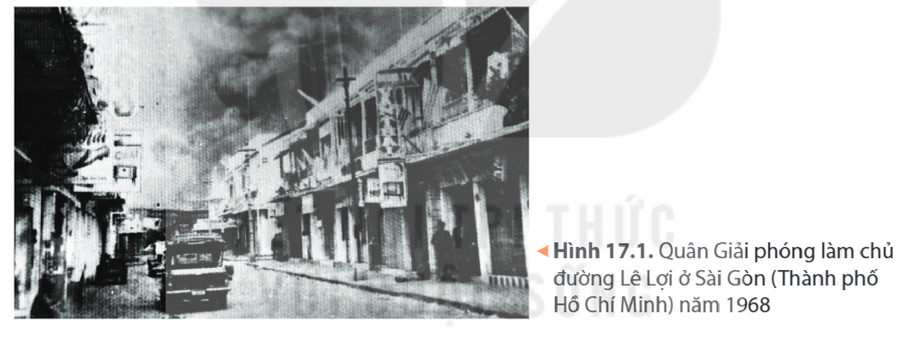
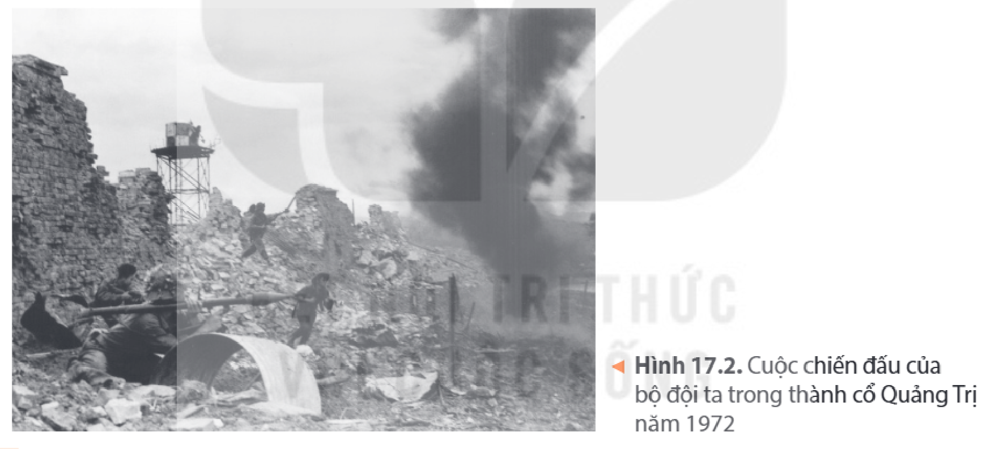
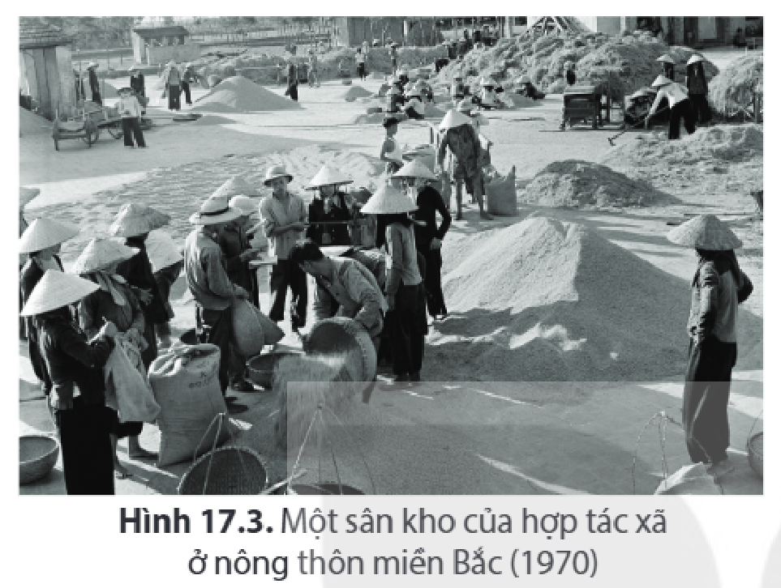
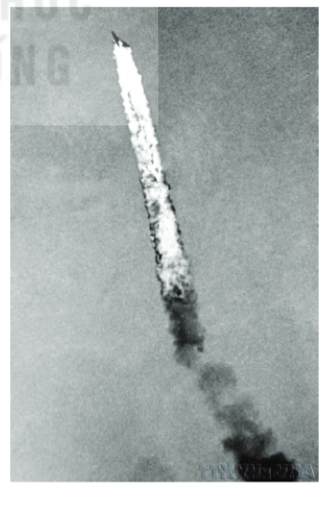
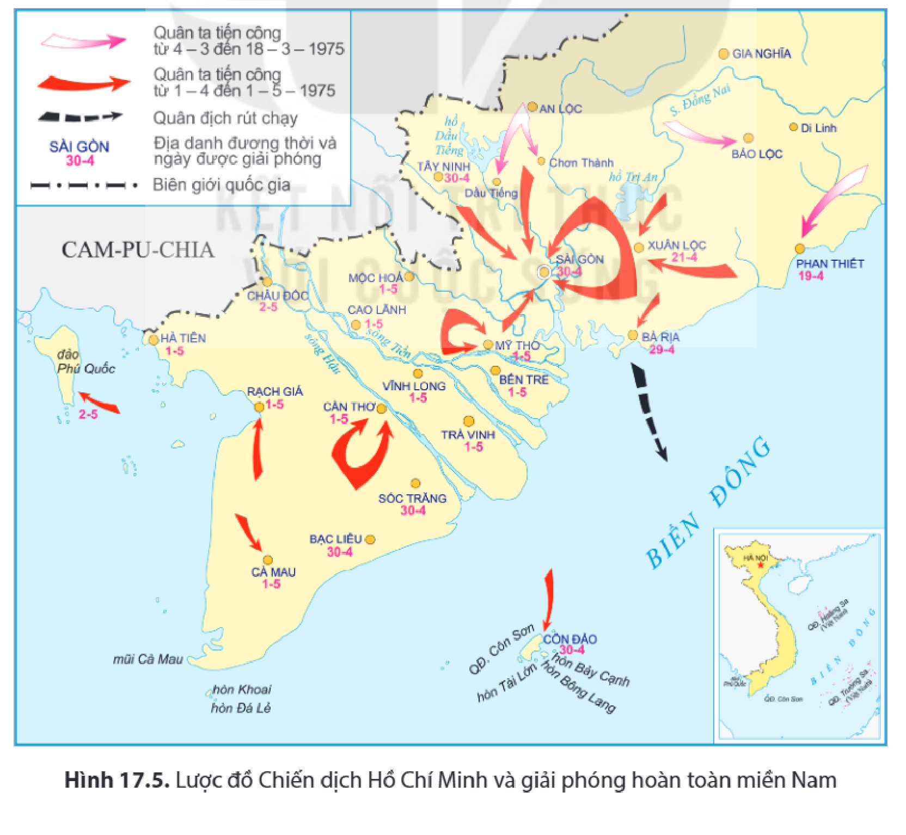
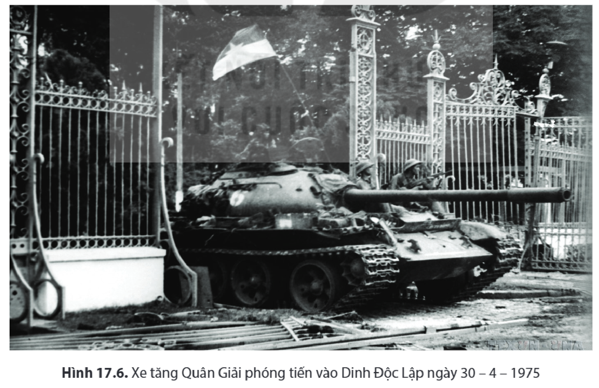

<!-- pdf:87 -->

# BÀI 17: VIỆT NAM KHÁNG CHIẾN CHỐNG MỸ, CỨU NƯỚC, THỐNG NHẤT ĐẤT NƯỚC GIAI ĐOẠN 1965 – 1975

## 🎯 Học xong bài này, em sẽ:

- Giới thiệu được những thành tựu tiêu biểu trong công cuộc xây dựng miền Bắc xã hội chủ nghĩa giai đoạn 1965 – 1975 (chi viện cho cách mạng miền Nam, chống chiến tranh phá hoại của đế quốc Mỹ,...).
- Trình bày được các thắng lợi tiêu biểu về quân sự của nhân dân miền Nam trong kháng chiến chống Mỹ, cứu nước giai đoạn 1965 – 1975 (chiến đấu chống lại các chiến lược “Chiến tranh cục bộ” và “Việt Nam hoá chiến tranh” của Mỹ, Tổng tiến công nổi dậy Mậu Thân năm 1968; Tổng tiến công và nổi dậy Xuân 1975,...).
- Nêu được nguyên nhân thắng lợi và ý nghĩa lịch sử của cuộc kháng chiến chống Mỹ, cứu nước.

## 🔴 Mở đầu

Trong bài thơ chúc Tết năm 1968, Chủ tịch Hồ Chí Minh viết:

> *Xuân này hơn hẳn mấy xuân qua,*
> *Thắng trận tin vui khắp nước nhà.*
> *Nam Bắc thi đua đánh giặc Mỹ.*
> *Tiến lên! Toàn thắng ắt về ta!*

Theo em, quân dân hai miền Nam, Bắc đã giành được những thắng lợi tiêu biểu nào trong giai đoạn 1965 – 1975? Thắng lợi nào là dấu mốc kết thúc cuộc kháng chiến chống Mỹ, cứu nước của nhân dân Việt Nam?

## 1. Cả nước trực tiếp chiến đấu chống Mỹ, cứu nước (1965 – 1973)

### a) Miền Nam chống chiến lược “Chiến tranh cục bộ” (1965 – 1968)

<!-- term: Chiến lược “Chiến tranh cục bộ” -->
“Chiến tranh cục bộ” là một chiến lược chiến tranh xâm lược thực dân mới của Mỹ, được tiến hành bằng lực lượng quân đội Mỹ, quân một số nước đồng minh và quân đội tay sai Sài Gòn, trong đó quân Mỹ giữ vai trò chủ yếu. Dựa vào vũ khí, phương tiện chiến tranh hiện đại, Mỹ mở các cuộc hành quân “tìm diệt”, “bình định” ở miền Nam và gây chiến tranh phá hoại miền Bắc.

Quân dân miền Nam đã từng bước đánh bại chiến lược “Chiến tranh cục bộ” của Mỹ.

<!-- pdf:88 -->

<!-- term: Cuộc Tổng tiến công và nổi dậy Xuân Mậu Thân 1968 -->
> **TÓM TẮT NHỮNG THẮNG LỢI TIÊU BIỂU VỀ QUÂN SỰ CỦA QUÂN DÂN MIỀN NAM GIAI ĐOẠN 1965 – 1968**
> - **Năm 1965:** Đẩy lùi cuộc hành quân của quân Mỹ nhằm “tìm diệt” bộ đội chủ lực của ta ở Vạn Tường (tỉnh Quảng Ngãi) ngày 18 – 8. Trận Vạn Tường đã mở đầu cao trào "Tìm Mỹ mà đánh, lùng nguỵ mà diệt" trên khắp miền Nam.
> - **1965 – 1967:** Đánh bại cuộc phản công mùa khô 1965 – 1966 nhằm vào các căn cứ ở Đông Nam Bộ, khu V và cuộc phản công mùa khô 1966 – 1967 với ba cuộc hành quân lớn “tìm diệt”, “bình định” của quân Mỹ và quân đội tay sai Sài Gòn (trong đó lớn nhất là cuộc hành quân đánh vào căn cứ Dương Minh Châu nhằm tiêu diệt quân chủ lực và cơ quan đầu não của ta).
> - **Năm 1968:**
>   - Tiến hành cuộc Tổng tiến công và nổi dậy Xuân Mậu Thân, quân dân miền Nam đồng loạt tiến công và nổi dậy ở hầu khắp các đô thị; tiến công các vị trí đầu não của địch ở Sài Gòn như toà Đại sứ Mỹ, Dinh Độc lập, sân bay,... (đêm 30, rạng sáng 31 – 1).
>   - Mỹ buộc phải tuyên bố “phi Mỹ hoá” chiến tranh xâm lược (thừa nhận sự thất bại của chiến lược “Chiến tranh cục bộ”), chấp nhận đàm phán ở Pa-ri (Pháp) để bàn về chấm dứt chiến tranh.

*Hình 17.1. Quân Giải phóng làm chủ đường Lê Lợi ở Sài Gòn (Thành phố Hồ Chí Minh) năm 1968*

### b) Miền Nam chống chiến lược “Việt Nam hoá chiến tranh” của Mỹ (1969 – 1973)

<!-- term: Chiến lược “Việt Nam hoá chiến tranh” -->
Sau thất bại của chiến lược “Chiến tranh cục bộ”, Mỹ chuyển sang chiến lược “Việt Nam hoá chiến tranh” ở miền Nam Việt Nam và mở rộng chiến tranh ra toàn Đông Dương. Chiến lược “Việt Nam hoá chiến tranh” cũng là một chiến lược chiến tranh xâm lược thực dân mới của Mỹ, được tiến hành bằng lực lượng quân đội Sài Gòn là chủ yếu (quân Mỹ và quân đồng minh rút dần khỏi chiến tranh), phối hợp với hoả lực, không quân Mỹ và vẫn do cố vấn Mỹ chỉ huy.

Trước tình hình đó, Đảng chủ trương tiếp tục đẩy mạnh tổng công kích, tổng khởi nghĩa, đẩy mạnh ba mũi giáp công, kết hợp với đấu tranh ngoại giao để đánh bại chiến lược “Việt Nam hoá chiến tranh” của Mỹ.

<!-- term: Chính phủ Cách mạng lâm thời Cộng hoà miền Nam Việt Nam -->
Sự ra đời của Chính phủ Cách mạng lâm thời Cộng hoà miền Nam Việt Nam ngày 6 – 6 – 1969 là thắng lợi quan trọng về chính trị, mở đầu cho giai đoạn chống chiến lược “Việt Nam hoá chiến tranh” của Mỹ. Giữa lúc cuộc kháng chiến đang trên đà thắng lợi thì Chủ tịch Hồ Chí Minh qua đời. Đây là một tổn thất lớn của dân tộc Việt Nam.

Trong bản *Di chúc*, Người đã viết: "Dù khó khăn gian khổ đến mấy, nhân dân ta nhất định sẽ hoàn toàn thắng lợi. Đế quốc Mỹ nhất định phải cút khỏi nước ta. Tổ quốc ta nhất định sẽ thống nhất. Đồng bào Nam Bắc nhất định sẽ sum họp một nhà".

<!-- pdf:89 -->

Vượt qua mọi khó khăn, thử thách, quân dân miền Nam đã giành được những thắng lợi trên các mặt trận.

<!-- term: Cuộc Tiến công chiến lược năm 1972 -->
> **TÓM TẮT NHỮNG THẮNG LỢI TIÊU BIỂU VỀ QUÂN SỰ CỦA QUÂN DÂN MIỀN NAM GIAI ĐOẠN 1969 – 1973**
> - **Từ ngày 30 – 4 đến ngày 30 – 6 – 1970:** Quân dân Việt Nam có sự phối hợp của quân dân Cam-pu-chia đã đập tan cuộc hành quân xâm lược Cam-pu-chia của 10 vạn quân Mỹ và quân đội Sài Gòn.
> - **Từ ngày 12 – 2 đến ngày 23 – 3 – 1971:** Quân dân Việt Nam có sự phối hợp của quân dân Lào đã đập tan cuộc hành quân mang tên “Lam Sơn – 719” của 4,5 vạn quân Mỹ và quân đội Sài Gòn.
> - **Từ ngày 30 – 3 đến cuối tháng 6 – 1972:** Quân dân Việt Nam mở cuộc Tiến công chiến lược vào Quảng Trị (hướng tiến công chủ yếu) rồi phát triển ra toàn chiến trường miền Nam. Chỉ trong thời gian ngắn (đến cuối tháng 6 – 1972), quân ta chọc thủng ba phòng tuyến của địch là Quảng Trị, Tây Nguyên, Đông Nam Bộ, loại khỏi vòng chiến đấu hơn 20 vạn quân địch. Chiến lược “Việt Nam hoá chiến tranh” của Mỹ thất bại.

*Hình 17.2. Cuộc chiến đấu của bộ đội ta trong thành cổ Quảng Trị năm 1972*

> ❓ 1. Hãy trình bày những thắng lợi tiêu biểu của quân dân miền Nam trong các giai đoạn 1965 – 1968, 1969 – 1973.
>
> 2. Thắng lợi nào của quân dân miền Nam đã đánh dấu thất bại của Mỹ trong chiến lược “Chiến tranh cục bộ” và “Việt Nam hoá chiến tranh”?

### c) Miền Bắc chống chiến tranh phá hoại của đế quốc Mỹ và tiếp tục chi viện cho miền Nam (1965 – 1973)

Ngày 5 – 8 – 1964, sau khi dựng lên sự kiện Vịnh Bắc Bộ, Mỹ cho máy bay ném bom bắn phá một số nơi ở miền Bắc. Tiếp đó, ngày 7 – 2 – 1965, lấy cớ “trả đũa” Quân Giải phóng miền Nam tiến công quân Mỹ ở Plây-ku, Mỹ cho máy bay ném bom bắn phá thị xã Đồng Hới, đảo Cồn Cỏ (tỉnh Quảng Trị),... chính thức gây ra cuộc chiến tranh phá hoại miền Bắc lần thứ nhất bằng không quân và hải quân.

Ngay từ ngày đầu Mỹ mở rộng chiến tranh, quân dân miền Bắc đã chuyển mọi hoạt động sang thời chiến, vừa chiến đấu chống chiến tranh phá hoại, vừa sản xuất và chi viện cho miền Nam. Miền Bắc dấy lên phong trào thi đua “Quyết tâm đánh thắng giặc Mỹ xâm lược”.

<!-- pdf:90 -->

Trong hơn 4 năm, miền Bắc bắn rơi, phá huỷ 3 243 máy bay, trong đó có 6 máy bay B52, loại khỏi vòng chiến đấu hàng nghìn phi công, bắn cháy và chìm 143 tàu chiến.

Mặc dù bị địch đánh phá ác liệt song giao thông vận tải ở miền Bắc vẫn được đảm bảo thông suốt, đáp ứng yêu cầu phục vụ sản xuất và đời sống.

Bị thất bại nặng nề ở cả hai miền Nam – Bắc, ngày 1 – 11 – 1968, Mỹ phải tuyên bố ngừng chiến tranh phá hoại miền Bắc lần thứ nhất.

*Hình 17.3. Một sân kho của hợp tác xã ở nông thôn miền Bắc (1970)*

> 💡 **Em có biết?**
>
> Để giữ vững mạch máu giao thông từ Bắc vào Nam được thông suốt, tại Ngã ba Đồng Lộc (tỉnh Hà Tĩnh) – nằm trên đường Hồ Chí Minh, hàng nghìn chiến sĩ và nhân dân đã ngã xuống. Trong đó phải kể đến sự hi sinh anh dũng của 10 cô gái thanh niên xung phong với tuổi đời còn rất trẻ. Ngã ba Đồng Lộc được xếp hạng là Khu di tích lịch sử cấp quốc gia (1989).

Miền Bắc tiếp tục thực hiện nghĩa vụ của “hậu phương lớn” đối với “tiền tuyến lớn” miền Nam. Nhờ hai tuyến đường vận chuyển chiến lược Bắc – Nam (trên bộ và trên biển), trong giai đoạn 1965 – 1973, tính chung sức người, sức của từ miền Bắc chi viện cho miền Nam đã tăng gấp nhiều lần so với giai đoạn trước.

Qua 4 năm (1965 – 1968), hơn 30 vạn cán bộ, bộ đội đã được cử vào Nam tham gia và phục vụ chiến đấu, xây dựng kinh tế, văn hoá tại các vùng giải phóng; hàng chục vạn tấn vũ khí, đạn dược, quân trang, quân dụng, xăng dầu, lương thực, thực phẩm, thuốc men,... cũng được chi viện cho miền Nam.

<!-- term: Trận “Điện Biên Phủ trên không” -->
Ngày 16 – 4 – 1972, Mỹ bắt đầu cuộc chiến tranh phá hoại miền Bắc lần thứ hai bằng không quân và hải quân. Trong tư thế sẵn sàng chiến đấu, quân dân miền Bắc đã chủ động, kịp thời chống trả ngay từ trận đầu, đặc biệt đã đánh bại hoàn toàn cuộc tập kích chiến lược đường không bằng máy bay B52 của Mỹ vào Hà Nội, Hải Phòng và nhiều thành phố khác ở miền Bắc trong 12 ngày đêm (từ 18 đến 29 – 12 – 1972). Thắng lợi này được coi như trận “Điện Biên Phủ trên không”, buộc Mỹ phải trở lại bàn hội nghị và kí Hiệp định Pa-ri về chấm dứt chiến tranh, lập lại hoà bình ở Việt Nam (1973).

*Hình 17.4. Máy bay Mỹ bị quân dân Hà Nội bắn rơi bốc cháy trên bầu trời trong trận "Điện Biên Phủ trên không"*

> ❓ Hãy cho biết những thành tựu tiêu biểu của quân dân miền Bắc trong giai đoạn 1965 – 1973.

<!-- pdf:91 -->

## 2. Hoàn thành giải phóng miền Nam, thống nhất đất nước (1973 – 1975)

<!-- term: Hiệp định Pa-ri -->
Ngày 27 – 1 – 1973, Hiệp định Pa-ri về chấm dứt chiến tranh, lập lại hoà bình ở Việt Nam được kí kết, trong đó điều khoản quan trọng nhất là Hoa Kỳ và các nước khác cam kết tôn trọng độc lập, chủ quyền, thống nhất và toàn vẹn lãnh thổ của Việt Nam.

Hoà bình lập lại ở miền Bắc, nhân dân bắt tay vào khắc phục hậu quả chiến tranh, khôi phục và phát triển kinh tế, văn hoá, tiếp tục chi viện cho miền Nam.

Cuối tháng 3 – 1973, Mỹ buộc phải rút quân khỏi miền Nam nhưng vẫn giữ lại cố vấn quân sự và tiếp tục viện trợ cho chính quyền Sài Gòn. Chính quyền Sài Gòn ngang nhiên phá hoại Hiệp định Pa-ri, tiến hành chiến dịch “tràn ngập lãnh thổ”, liên tiếp mở các cuộc hành quân, bình định, lấn chiếm vùng giải phóng của ta. Quân dân miền Nam vừa kiên quyết đánh trả các cuộc hành quân “bình định – lấn chiếm” của địch để bảo vệ vùng giải phóng, vừa chủ động tiến công, mở rộng vùng giải phóng.

Đến cuối năm 1974, đầu năm 1975, tình hình so sánh lực lượng ở miền Nam thay đổi có lợi cho cách mạng, đặc biệt là sau chiến thắng Phước Long (1 – 1975), Bộ Chính trị Trung ương Đảng đã quyết tâm hoàn chỉnh kế hoạch giải phóng hoàn toàn miền Nam trong hai năm 1975 – 1976 và nhấn mạnh: “Nếu thời cơ đến vào đầu hoặc cuối năm 1975, thì lập tức giải phóng miền Nam trong năm 1975”.

<!-- term: Cuộc Tổng tiến công và nổi dậy Xuân 1975 -->
Cuộc Tổng tiến công và nổi dậy Xuân 1975 trải qua ba chiến dịch lớn: chiến dịch Tây Nguyên, chiến dịch Huế – Đà Nẵng và Chiến dịch Hồ Chí Minh.

*Hình 17.5. Lược đồ Chiến dịch Hồ Chí Minh và giải phóng hoàn toàn miền Nam*

<!-- pdf:92 -->

<!-- term: Cuộc Tổng tiến công và nổi dậy Xuân 1975 -->
<!-- term: Chiến dịch Hồ Chí Minh -->
> **TÓM TẮT DIỄN BIẾN CHÍNH CỦA TỔNG TIẾN CÔNG VÀ NỔI DẬY XUÂN 1975**
> - **Chiến dịch Tây Nguyên (4 – 3 đến 24 – 3 – 1975):**
>   - Ngày 10 – 3, trận đánh then chốt mở màn ở Buôn Ma Thuột (tỉnh Đắk Lắk) thắng lợi.
>   - Hệ thống phòng thủ Tây Nguyên rung chuyển, quân địch buộc phải rút chạy khỏi địa bàn chiến lược quan trọng này.
>   - Ngày 24 – 3, Tây Nguyên được hoàn toàn giải phóng.
> - **Chiến dịch Huế – Đà Nẵng (21 – 3 đến 29 – 3 – 1975):**
>   - Ngày 25 – 3, quân ta tiến vào cố đô Huế, đến ngày 26 – 3 đã giải phóng thành phố và toàn tỉnh Thừa Thiên (nay là thành phố Huế).
>   - Ngày 29 – 3, thành phố Đà Nẵng hoàn toàn được giải phóng.
>   - Nhiều tỉnh, các đảo ở miền Trung và phía nam Tây Nguyên nổi dậy giành quyền làm chủ.
> - **Chiến dịch Hồ Chí Minh (26 – 4 đến 30 – 4 – 1975):**
>   - 5 giờ chiều 26 – 4, Chiến dịch Hồ Chí Minh bắt đầu với phương châm “Thần tốc, táo bạo, bất ngờ, chắc thắng”.
>   - Năm cánh quân cùng lúc tiến vào trung tâm thành phố đánh chiếm các cơ quan đầu não của chính quyền Sài Gòn.
>   - 10 giờ 45 phút ngày 30 – 4, xe tăng Quân Giải phóng tiến vào Dinh Độc Lập, bắt toàn bộ nội các của chính quyền Sài Gòn. Tổng thống Dương Văn Minh phải tuyên bố đầu hàng vô điều kiện.
>   - 11 giờ 30 phút ngày 30 – 4, lá cờ cách mạng bay trên nóc dinh, báo hiệu sự toàn thắng của chiến dịch.

*Hình 17.6. Xe tăng Quân Giải phóng tiến vào Dinh Độc Lập ngày 30 – 4 – 1975*

Sau chiến dịch Tây Nguyên và Huế – Đà Nẵng, từ ngày 1 – 4 đến 29 – 4, Quân Giải phóng làm chủ nhiều đảo thuộc quần đảo Trường Sa. Sau khi Sài Gòn được giải phóng, lực lượng vũ trang và nhân dân các tỉnh còn lại đã thừa thắng tiến công và nổi dậy.

<!-- pdf:93 -->

<!-- term: Cuộc Tổng tiến công và nổi dậy Xuân 1975 -->
Ngày 2 – 5, Châu Đốc (nay thuộc tỉnh An Giang) là tỉnh cuối cùng ở miền Nam được giải phóng. Cuộc Tổng tiến công và nổi dậy Xuân 1975 kết thúc thắng lợi. Cuộc kháng chiến chống Mỹ, cứu nước của nhân dân Việt Nam toàn thắng.

> ❓ Khai thác lược đồ hình 17.5 và thông tin trong mục, hãy trình bày diễn biến, kết quả của Tổng tiến công và nổi dậy Xuân 1975.

## 3. Nguyên nhân thắng lợi, ý nghĩa lịch sử của cuộc kháng chiến chống Mỹ, cứu nước (1954 – 1975)

### a) Nguyên nhân thắng lợi

Cuộc kháng chiến chống Mỹ, cứu nước của nhân dân Việt Nam thắng lợi nhờ có sự lãnh đạo sáng suốt của Đảng với đường lối chính trị, quân sự độc lập, tự chủ. Đảng lãnh đạo nhân dân cả nước tiến hành đồng thời cách mạng xã hội chủ nghĩa ở miền Bắc và cách mạng dân tộc dân chủ nhân dân ở miền Nam.

Thắng lợi to lớn đó còn do nhân dân hai miền đoàn kết nhất trí, giàu lòng yêu nước, lao động cần cù, chiến đấu dũng cảm. Hậu phương miền Bắc không ngừng lớn mạnh, đáp ứng kịp thời các yêu cầu của cuộc chiến đấu ở hai miền.

Sự đồng tình, ủng hộ, giúp đỡ to lớn của các lực lượng cách mạng, hoà bình, dân chủ trên thế giới, nhất là của Liên Xô, Trung Quốc và các nước xã hội chủ nghĩa khác; sự phối hợp chiến đấu, đoàn kết giúp đỡ nhau trong đấu tranh chống kẻ thù chung của nhân dân ba nước Đông Dương là những nhân tố khách quan góp phần quan trọng tạo nên thắng lợi của dân tộc Việt Nam.

> ❓ Hãy nêu nguyên nhân thắng lợi của cuộc kháng chiến chống Mỹ, cứu nước (1954 – 1975).

### b) Ý nghĩa lịch sử

Cuộc kháng chiến thắng lợi đã kết thúc 21 năm chiến đấu chống Mỹ và 30 năm chiến tranh giải phóng dân tộc, bảo vệ Tổ quốc từ sau Cách mạng tháng Tám năm 1945; chấm dứt hoàn toàn ách thống trị của chủ nghĩa đế quốc ở Việt Nam. Với thắng lợi này, nhân dân Việt Nam đã hoàn thành cuộc cách mạng dân tộc dân chủ nhân dân trên phạm vi cả nước, thống nhất đất nước. Thắng lợi của cuộc kháng chiến chống Mỹ, cứu nước đã mở ra kỉ nguyên mới trong lịch sử dân tộc – kỉ nguyên đất nước độc lập, thống nhất, đi lên chủ nghĩa xã hội.

> **Tư liệu.** “Năm tháng sẽ trôi qua, nhưng thắng lợi của nhân dân ta trong sự nghiệp chống Mỹ, cứu nước mãi mãi được ghi vào lịch sử dân tộc ta như một trong những trang chói lọi nhất, một biểu tượng sáng ngời về sự toàn thắng của chủ nghĩa anh hùng cách mạng và trí tuệ con người và đi vào lịch sử thế giới như một chiến công vĩ đại của thế kỉ XX, một sự kiện có tầm quan trọng quốc tế to lớn và có tính thời đại sâu sắc”.
>
> (*Văn kiện Đảng toàn tập*, Tập 37, NXB Chính trị quốc gia, 2004, tr. 457)

<!-- pdf:94 -->

> 💡 **Em có biết?**
>
> *Bức tường Chiến tranh Việt Nam* bằng đá đen được dựng tại Thủ đô Oa-sinh-tơn – nơi lưu lại họ tên của hơn 58 000 lính Mỹ tử trận trong cuộc chiến tranh Việt Nam – là một trong những địa điểm thu hút nhiều du khách nhất khi tới Mỹ. Bức tường cũng là lời nhắc nhở về sự bi thảm của cuộc chiến tranh gây ám ảnh đối với người Mỹ trong suốt nhiều thập kỉ qua.

Thắng lợi của nhân dân Việt Nam đã tác động mạnh đến tình hình nước Mỹ và thế giới, là nguồn cổ vũ to lớn đối với phong trào cách mạng thế giới, nhất là đối với phong trào giải phóng dân tộc.

> ❓ Khai thác tư liệu trên và thông tin trong mục, hãy nêu ý nghĩa lịch sử của cuộc kháng chiến chống Mỹ, cứu nước (1954 – 1975).

## ✏️ Luyện tập – Vận dụng

1. Hãy lấy dẫn chứng để chứng minh vai trò "hậu phương lớn" của miền Bắc đối với "tiền tuyến lớn" miền Nam trong giai đoạn 1965 – 1975.

2. Hãy lập bảng hệ thống các thắng lợi tiêu biểu của quân dân miền Nam trong giai đoạn 1965 – 1975.

### 🚀 Vận dụng

1. Tìm hiểu thông tin từ sách, báo và internet, hãy viết bài giới thiệu hoặc sưu tầm các bài hát, bài thơ về một nhân vật hoặc sự kiện lịch sử tiêu biểu trong cuộc kháng chiến chống Mỹ, cứu nước (1965 – 1975).

2. Nêu những việc làm cụ thể để thể hiện lòng biết ơn của em đối với các anh hùng liệt sĩ và những người có đóng góp tiêu biểu cho cuộc kháng chiến chống Mỹ, cứu nước (1954 – 1975).

## 📷 Danh sách hình trong bài

| Mã hình | Trang PDF | Trang sách | Chú thích |
| --- | --- | --- | --- |
| H9-lich_su_va_dia_ly-ls-b17-01 | 88 | 86 | Hình 17.1. Quân Giải phóng làm chủ đường Lê Lợi ở Sài Gòn (Thành phố Hồ Chí Minh) năm 1968 |
| H9-lich_su_va_dia_ly-ls-b17-02 | 89 | 87 | Hình 17.2. Cuộc chiến đấu của bộ đội ta trong thành cổ Quảng Trị năm 1972 |
| H9-lich_su_va_dia_ly-ls-b17-03 | 90 | 88 | Hình 17.3. Một sân kho của hợp tác xã ở nông thôn miền Bắc (1970) |
| H9-lich_su_va_dia_ly-ls-b17-04 | 90 | 88 | Hình 17.4. Máy bay Mỹ bị quân dân Hà Nội bắn rơi bốc cháy trên bầu trời trong trận "Điện Biên Phủ trên không" |
| H9-lich_su_va_dia_ly-ls-b17-05 | 91 | 89 | Hình 17.5. Lược đồ Chiến dịch Hồ Chí Minh và giải phóng hoàn toàn miền Nam |
| H9-lich_su_va_dia_ly-ls-b17-06 | 92 | 90 | Hình 17.6. Xe tăng Quân Giải phóng tiến vào Dinh Độc Lập ngày 30 – 4 – 1975 |
