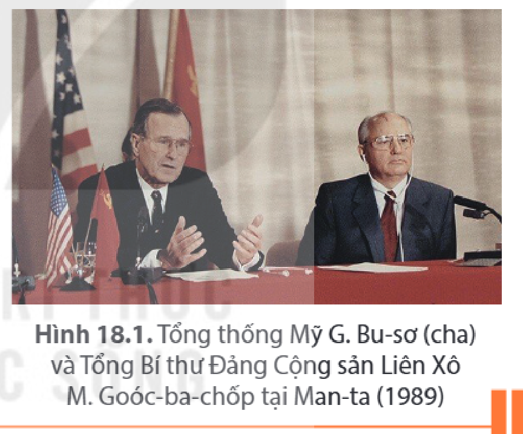
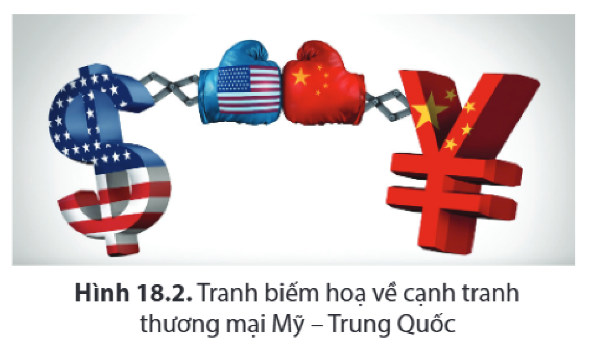
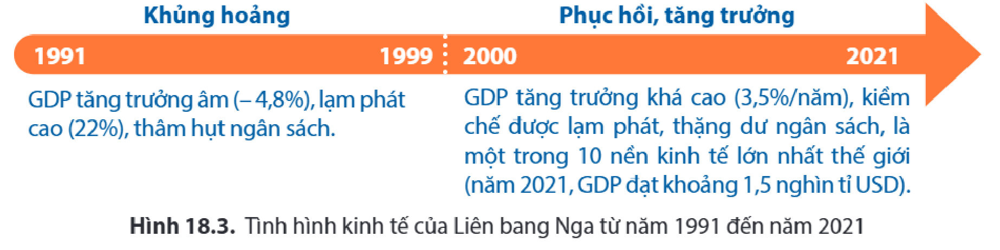
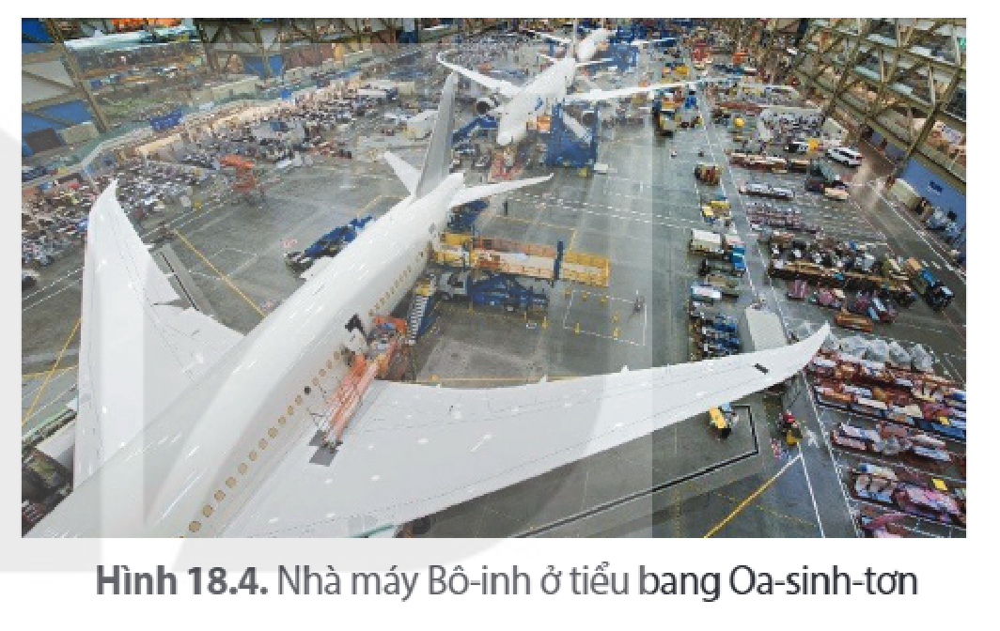

<!-- pdf:95 -->

# BÀI 18: TRẬT TỰ THẾ GIỚI MỚI TỪ NĂM 1991 ĐẾN NAY. LIÊN BANG NGA VÀ NƯỚC MỸ TỪ NĂM 1991 ĐẾN NAY

## 🎯 Học xong bài này, em sẽ:

- Nhận biết được xu hướng và sự hình thành trật tự thế giới mới sau Chiến tranh lạnh.
- Nêu được tình hình chính trị, kinh tế của Liên bang Nga từ năm 1991 đến nay.
- Trình bày được tình hình chính trị, kinh tế của nước Mỹ từ năm 1991 đến nay.

## 🔴 Mở đầu

Trong cuộc gặp gỡ không chính thức với Tổng thống Mỹ G. Bu-sơ tại Man-ta (1989), Tổng Bí thư Đảng Cộng sản Liên Xô M. Goóc-ba-chốp đã phát biểu về Chiến tranh lạnh: "Chạy đua vũ trang, nghi ngờ, đấu tranh về tâm lí và ý thức hệ, tất cả những điều ấy nên để lại quá khứ".

Theo em, điều mà M. Goóc-ba-chốp muốn “để lại quá khứ” là gì? Những gì sẽ tiếp diễn sau khi quá khứ đó được khép lại? Hãy chia sẻ hiểu biết của em về tình hình Liên bang Nga và nước Mỹ trong bối cảnh đó.

*Hình 18.1. Tổng thống Mỹ G. Bu-sơ (cha) và Tổng Bí thư Đảng Cộng sản Liên Xô M. Goóc-ba-chốp tại Man-ta (1989)*

## 1. Xu hướng vận động và sự hình thành trật tự thế giới từ năm 1991 đến nay

<!-- term: Trật tự hai cực I-an-ta -->
Năm 1991, sự kiện Liên Xô sụp đổ là dấu mốc kết thúc sự tồn tại của Trật tự hai cực I-an-ta (1945 – 1991). Tình hình thế giới có những chuyển biến căn bản.

<!-- term: Trật tự hai cực I-an-ta -->
> 💡 **Em có biết?**
>
> Trong Trật tự hai cực I-an-ta (1945 – 1991), thế giới bị chi phối bởi hai cực – hai siêu cường: Mỹ và Liên Xô. Thế giới bị phân chia thành hai hệ thống đối lập, luôn đối đầu lẫn nhau: hệ thống tư bản chủ nghĩa do Mỹ đứng đầu và hệ thống xã hội chủ nghĩa do Liên Xô đứng đầu.

Xu hướng đối đầu trong Chiến tranh lạnh dần được thay thế bằng xu thế đối thoại, hoà hoãn,... Hầu hết các quốc gia đều điều chỉnh chiến lược phát triển, lấy kinh tế làm trọng tâm, tích cực tham gia liên kết kinh tế trong các tổ chức khu vực và quốc tế. Hoà bình là xu thế chủ đạo, tuy nhiên, nội chiến, xung đột dân tộc, sắc tộc, tôn giáo vẫn diễn ra ở một số khu vực.

<!-- term: Xu hướng đa cực -->
Trong sự chuyển biến đó, một trật tự thế giới mới đang dần hình thành theo xu hướng đa cực, nhiều trung tâm với sự cạnh tranh của các cường quốc như: Mỹ, Liên minh châu Âu (EU), Nhật Bản, Trung Quốc và Liên bang Nga.

<!-- pdf:96 -->

<!-- term: Xu hướng đa cực -->
Sau khi Liên Xô tan rã, Trật tự hai cực sụp đổ, Mỹ tham vọng thiết lập trật tự đơn cực do Mỹ chi phối. Tuy nhiên, từ đầu thế kỉ XXI, nhiều quốc gia, khu vực vươn lên cạnh tranh với Mỹ. EU ngày càng lớn mạnh với quá trình liên kết sâu rộng. Nhật Bản đang tìm cách đạt được vị thế chính trị tương xứng. Liên bang Nga – quốc gia kế thừa chủ yếu tiềm lực, địa vị quốc tế của Liên Xô – đang phục hồi và trỗi dậy.

Đặc biệt, Trung Quốc – nền kinh tế lớn thứ hai thế giới (sau Mỹ) – từ năm 2010, đã và đang là đối thủ cạnh tranh quyết liệt vị thế siêu cường với Mỹ.

*Hình 18.2. Tranh biếm hoạ về cạnh tranh thương mại Mỹ – Trung Quốc*

> ❓ 1. Trình bày xu hướng và sự hình thành trật tự thế giới mới sau Chiến tranh lạnh.
>
> 2. Vì sao từ năm 1991 đến nay, Mỹ không thể thiết lập trật tự đơn cực?

## 2. Liên bang Nga từ năm 1991 đến nay

• *Chính trị*

<!-- term: Chính thể Cộng hoà Tổng thống của Liên bang Nga -->
Trong những năm 90 của thế kỉ XX, tình hình Liên bang Nga bất ổn do mâu thuẫn giữa các đảng phái về việc xác lập một thể chế chính trị mới. Tháng 12 – 1993, Hiến pháp mới được ban hành, xác lập chính thể Cộng hoà Tổng thống của Liên bang Nga. Tuy nhiên, sau đó những mâu thuẫn về các vấn đề liên quan đến chính sách đối nội, đối ngoại của quốc gia vẫn âm ỉ kéo dài.

> 💡 **Em có biết?**
>
> Liên bang Nga giữ vai trò chủ chốt trong một số tổ chức quốc tế đa phương như: Tổ chức Hợp tác Thượng Hải (SCO), Diễn đàn kinh tế phương Đông (EEF),...
<!-- ocr-ok: đã đối chiếu p096.png, OCR dính chữ trong hộp Em có biết? và ghép lẫn cột phải -->

Thời gian này, Liên bang Nga vừa theo đuổi chính sách đối ngoại thân phương Tây với hi vọng nhận được sự ủng hộ của các nước này về chính trị và kinh tế, vừa khôi phục và phát triển mối quan hệ với các nước châu Á.

<!-- term: Chính sách cân bằng Âu – Á -->
Sang đầu thế kỉ XXI, tình hình chính trị Liên bang Nga dần ổn định, địa vị quốc tế được nâng cao. Nước Nga chú trọng thực hiện chính sách cân bằng Âu – Á, đẩy mạnh quan hệ hợp tác với Cộng đồng các quốc gia độc lập (SNG), Trung Quốc, Ấn Độ, Hiệp hội các quốc gia Đông Nam Á (ASEAN),...

• *Kinh tế*

Liên bang Nga thực hiện cải cách, chuyển đổi nền kinh tế kế hoạch hoá tập trung quan liêu bao cấp sang nền kinh tế thị trường qua hai giai đoạn.

*Hình 18.3. Tình hình kinh tế của Liên bang Nga từ năm 1991 đến năm 2021*

> **Tình hình kinh tế của Liên bang Nga từ năm 1991 đến năm 2021:**
> - Khủng hoảng (1991 – 1999): GDP tăng trưởng âm (– 4,8%), lạm phát cao (22%), thâm hụt ngân sách.
> - Phục hồi, tăng trưởng (2000 – 2021): GDP tăng trưởng khá cao (3,5%/năm), kiềm chế được lạm phát, thặng dư ngân sách, là một trong 10 nền kinh tế lớn nhất thế giới (năm 2021, GDP đạt khoảng 1,5 nghìn tỉ USD).

Năm 2012, Liên bang Nga gia nhập Tổ chức Thương mại thế giới (WTO). Công nghiệp quốc phòng, công nghiệp năng lượng, khai khoáng, hàng không – vũ trụ,... vẫn là những ngành mũi nhọn của kinh tế Liên bang Nga.

<!-- pdf:97 -->

> ❓ Nêu tình hình chính trị, kinh tế Liên bang Nga từ năm 1991 đến nay.

## 3. Nước Mỹ từ năm 1991 đến nay

• *Chính trị*

Nước Mỹ vẫn duy trì nền dân chủ tư sản dưới sự cầm quyền của một trong hai đảng: Đảng Dân chủ và Đảng Cộng hoà. Mỹ nhất quán trong việc thực hiện mục tiêu, tham vọng chi phối và lãnh đạo thế giới. Đặc biệt, sau khi Liên Xô tan rã, Mỹ đã triển khai các chính sách nhằm tận dụng vị thế siêu cường duy nhất để thúc đẩy việc thiết lập trật tự thế giới đơn cực.

<!-- term: Chiến lược “Cam kết và mở rộng” -->
Vào những năm 90 của thế kỉ XX, Tổng thống B. Clin-tơn thực hiện chiến lược “Cam kết và mở rộng” với mục tiêu: đảm bảo an ninh của Mỹ với lực lượng quân sự mạnh; tăng cường khôi phục và phát triển sức mạnh kinh tế; thúc đẩy khẩu hiệu “dân chủ” để can thiệp vào công việc nội bộ của các nước khác,...

• *Kinh tế*

Nước Mỹ là quốc gia có nền kinh tế, tài chính, công nghệ lớn mạnh hàng đầu thế giới với các lĩnh vực sản xuất đa dạng như: dầu mỏ, thép, ô tô, hàng không vũ trụ, hoá chất, điện tử, hàng tiêu dùng, nông sản và chế biến thực phẩm.

*Hình 18.4. Nhà máy Bô-inh ở tiểu bang Oa-sinh-tơn*

GDP của Mỹ vẫn đứng đầu thế giới, chiếm hơn 30% GDP toàn thế giới (2000), 24% (2021); GDP bình quân đầu người luôn thuộc nhóm 10 quốc gia cao nhất thế giới (hơn 70 000 USD, 2021). Năm 2021, Mỹ đứng đầu thế giới về xuất khẩu dầu mỏ tinh chế, hàng không vũ trụ, thiết bị y tế, rau quả,...; đứng thứ hai thế giới về xuất khẩu lúa mì, thịt gia cầm,... Mỹ giữ vai trò lãnh đạo và chi phối trong hầu hết các tổ chức kinh tế – tài chính quốc tế như: Tổ chức Thương mại thế giới (WTO), Ngân hàng Thế giới (WB), Quỹ Tiền tệ quốc tế (IMF),...

Tuy nhiên, nền kinh tế Mỹ cũng trải qua những đợt suy thoái ngắn do tác động của các cuộc khủng hoảng kinh tế, tài chính (1997 – 1998, 2008 – 2009, 2014 – 2015).

> ❓ Trình bày tình hình kinh tế, chính trị của nước Mỹ từ năm 1991 đến nay.

## ✏️ Luyện tập – Vận dụng

1. Vẽ sơ đồ tư duy mô tả tóm tắt xu hướng vận động và sự hình thành trật tự thế giới từ sau Chiến tranh lạnh đến nay.

2. Hãy lập bảng tóm tắt về tình hình chính trị, kinh tế của Liên bang Nga và nước Mỹ từ năm 1991 đến nay.

### 🚀 Vận dụng

Theo em, xu thế hình thành trật tự thế giới mới từ sau Chiến tranh lạnh đã đặt ra những thời cơ và thách thức như thế nào đối với Việt Nam trong xây dựng và phát triển đất nước?

## 📷 Danh sách hình trong bài

| Mã hình | Trang PDF | Trang sách | Chú thích |
| --- | --- | --- | --- |
| H9-lich_su_va_dia_ly-ls-b18-01 | 95 | 93 | Hình 18.1. Tổng thống Mỹ G. Bu-sơ (cha) và Tổng Bí thư Đảng Cộng sản Liên Xô M. Goóc-ba-chốp tại Man-ta (1989) |
| H9-lich_su_va_dia_ly-ls-b18-02 | 96 | 94 | Hình 18.2. Tranh biếm hoạ về cạnh tranh thương mại Mỹ – Trung Quốc |
| H9-lich_su_va_dia_ly-ls-b18-03 | 96 | 94 | Hình 18.3. Tình hình kinh tế của Liên bang Nga từ năm 1991 đến năm 2021 |
| H9-lich_su_va_dia_ly-ls-b18-04 | 97 | 95 | Hình 18.4. Nhà máy Bô-inh ở tiểu bang Oa-sinh-tơn |
