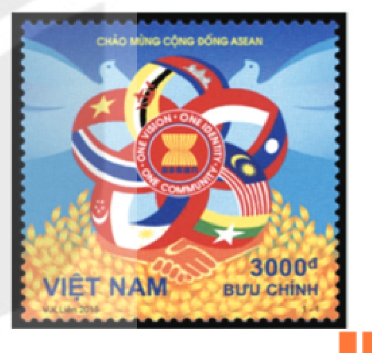
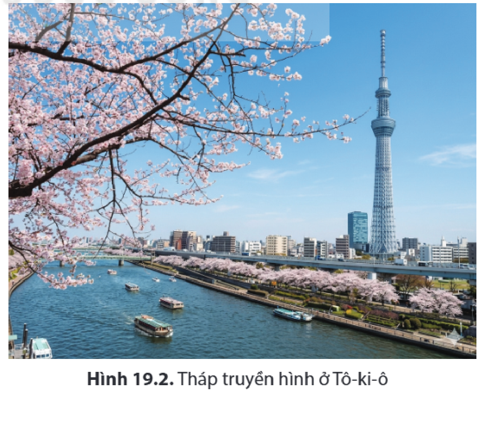
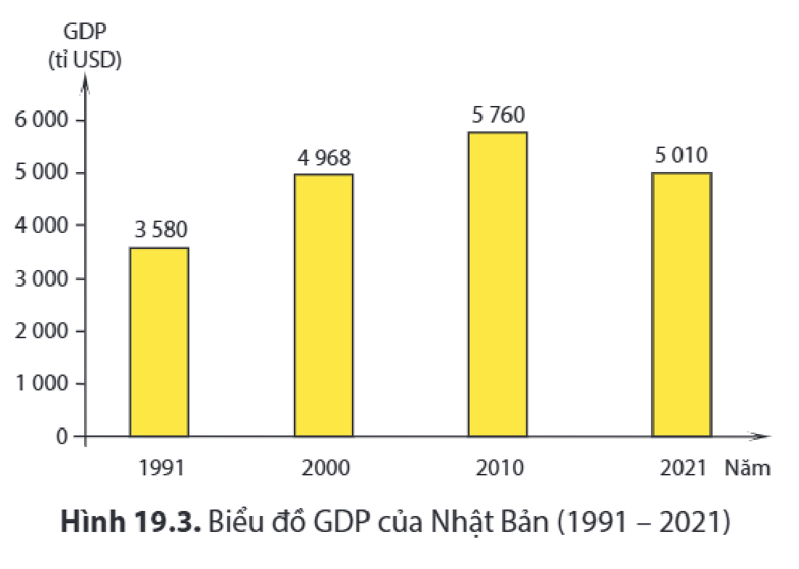
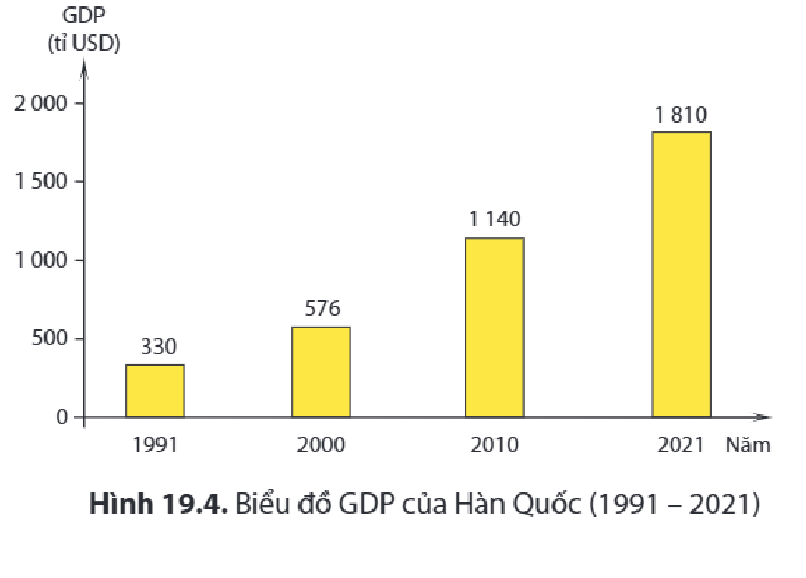
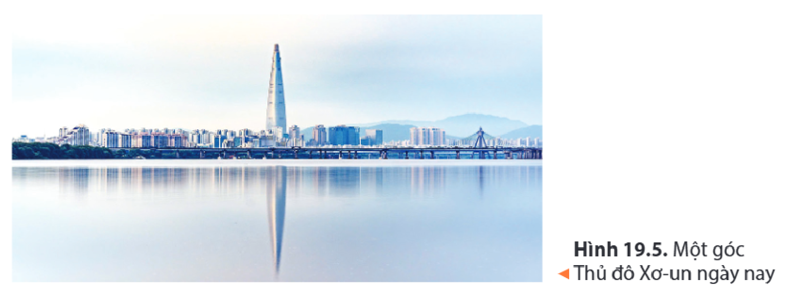
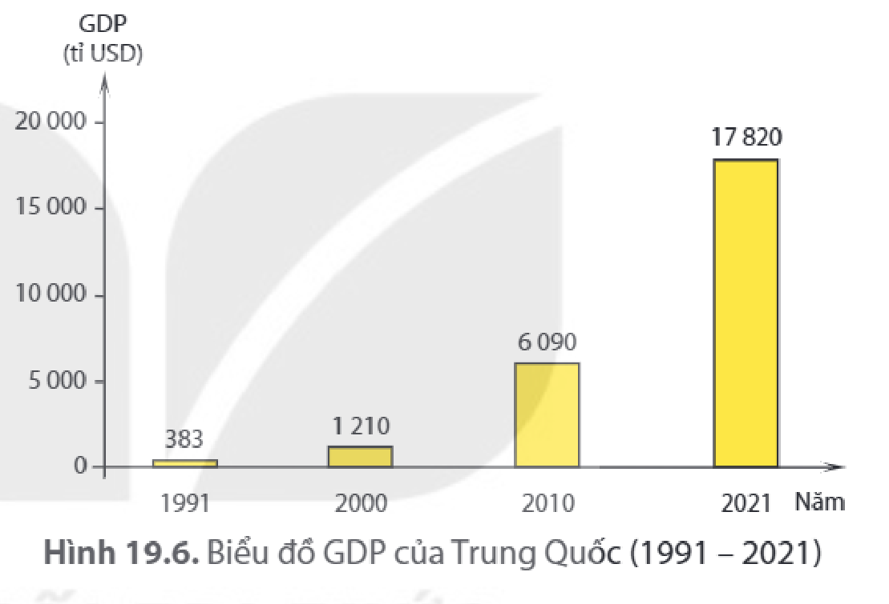
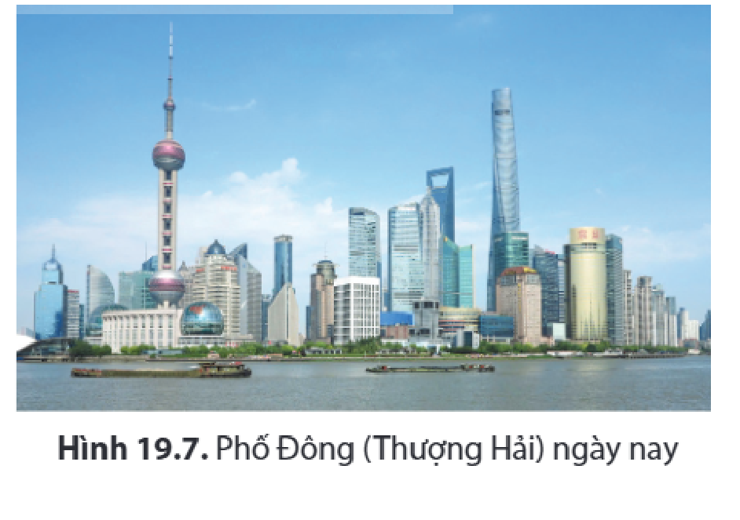
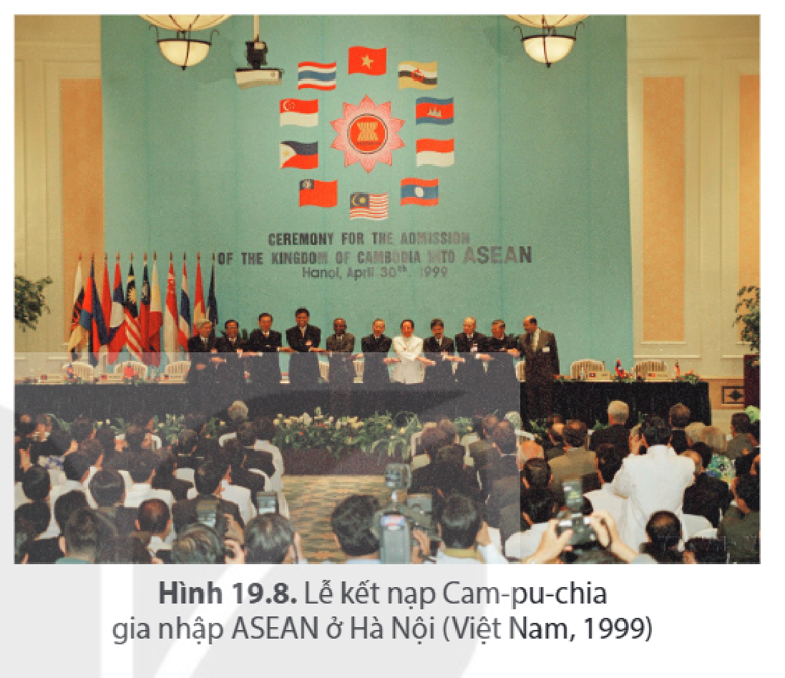
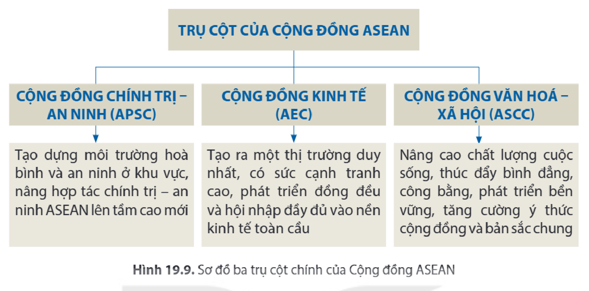
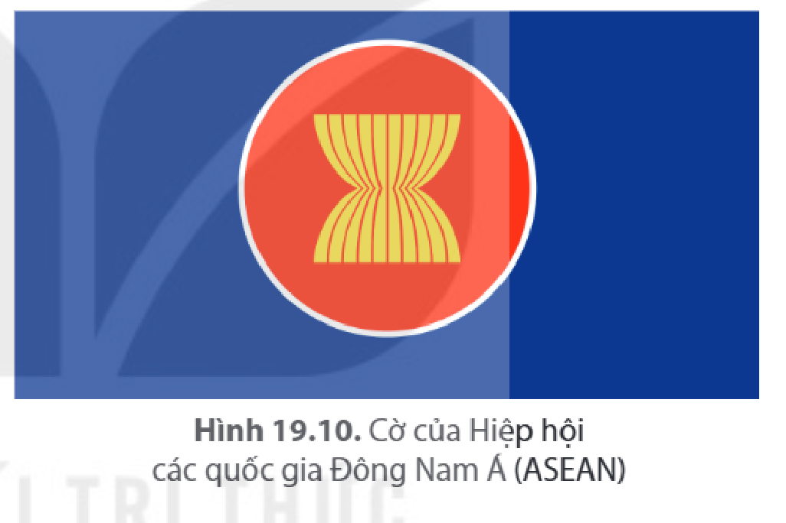

<!-- pdf:98 -->

# BÀI 19: CHÂU Á TỪ NĂM 1991 ĐẾN NAY

## 🎯 Học xong bài này, em sẽ:

- Giới thiệu được sự phát triển kinh tế – xã hội của các nước Đông Bắc Á (Trung Quốc, Nhật Bản, Hàn Quốc) từ năm 1991 đến nay.
- Mô tả được quá trình phát triển của ASEAN từ năm 1991 đến nay và những nét chính của Cộng đồng ASEAN.

## 🔴 Mở đầu

Theo thống kê của Ngân hàng Thế giới: Đông Bắc Á là một khu vực kinh tế quan trọng của thế giới, chỉ tính riêng ba nền kinh tế chủ yếu là Trung Quốc, Nhật Bản và Hàn Quốc đã chiếm tới 1/5 GDP và 1/4 dân số thế giới vào đầu thế kỉ XXI.

Từ các thông tin trên và quan sát hình 19.1, hãy chia sẻ thêm những hiểu biết của em về sự phát triển của một số quốc gia và tổ chức đã được đề cập đến từ sau năm 1991.

*Hình 19.1. Con tem Việt Nam phát hành năm 2015 chào mừng Cộng đồng ASEAN*

## 1. Các nước Đông Bắc Á từ năm 1991 đến nay

### a) Nhật Bản

Từ năm 1991 đến nay, nền kinh tế Nhật Bản vẫn chưa thoát khỏi trì trệ, xen lẫn giữa suy thoái và tăng trưởng yếu ớt. Tuy nhiên, Nhật Bản vẫn là một trong những trung tâm kinh tế – tài chính lớn của thế giới, là quốc gia có chất lượng cuộc sống cao với hệ thống y tế, chăm sóc sức khoẻ đảm bảo và toàn diện.

Năm 2010, vị thế nền kinh tế lớn thứ hai thế giới được xác lập trong hơn bốn thập kỉ của Nhật Bản đã bị Trung Quốc vượt qua.

*Hình 19.2. Tháp truyền hình ở Tô-ki-ô*

<!-- pdf:99 -->

Tuy nhiên, đến nay, Nhật Bản vẫn là quốc gia có thu nhập bình quân đầu người cao, đạt hơn 39 000 USD; chỉ số phát triển con người (HDI) ở mức cao của thế giới, tuổi thọ trung bình thuộc nhóm nước cao nhất thế giới (khoảng 85 tuổi). Chi tiêu cho y tế của Nhật Bản chiếm khoảng 10% GDP và có xu hướng tăng.

*Hình 19.3. Biểu đồ GDP của Nhật Bản (1991 – 2021)*

> ❓ 1. Khai thác hình 19.3, em có nhận xét gì về tình hình kinh tế Nhật Bản từ năm 1991 đến năm 2021?
>
> 2. Hãy giới thiệu sự phát triển kinh tế – xã hội của Nhật Bản từ năm 1991 đến nay.

### b) Hàn Quốc

Từ năm 1991, Hàn Quốc đã trở thành một nước công nghiệp mới (NIC) và là một trong bốn “con rồng” châu Á, nhưng tốc độ tăng trưởng kinh tế chậm lại. Cũng từ đây, Hàn Quốc đã có thay đổi đáng kể trong định hướng sản xuất với mũi nhọn là các ngành công nghệ cao.

<!-- term: Bốn “con rồng” châu Á -->
> 💡 **Em có biết?**
>
> Bốn "con rồng" châu Á là một thuật ngữ dùng để chỉ nền kinh tế của bốn quốc gia và vùng lãnh thổ có tốc độ tăng trưởng cao từ những năm 60, 70 của thế kỉ XX đến nay, bao gồm: Hàn Quốc, Hồng Công, Đài Loan và Xin-ga-po.

Đầu thế kỉ XXI, nền kinh tế Hàn Quốc duy trì được mức tăng trưởng ổn định, cao hơn mức tăng trưởng trung bình của nền kinh tế thế giới, thuộc nhóm 15 nền kinh tế lớn nhất thế giới, dẫn đầu chuỗi cung ứng toàn cầu về chất bán dẫn và ô tô với các tập đoàn nổi tiếng như: Sam-sung, LG và Hyun-đai. Mức sống, tuổi thọ của người dân không ngừng được nâng cao.

Từ năm 1991 đến năm 2021, Hàn Quốc có quy mô GDP tăng gần 5,5 lần, GDP bình quân đầu người tăng 5,3 lần, đạt gần 35 000 USD (2021). GDP xếp thứ 15 thế giới (2000) và thứ 10 thế giới (2018, 2020, 2021). Tuổi thọ trung bình tăng từ 72 tuổi (1991) lên 84 tuổi (2021).

*Hình 19.4. Biểu đồ GDP của Hàn Quốc (1991 – 2021)*

<!-- pdf:100 -->

*Hình 19.5. Một góc Thủ đô Xơ-un ngày nay*

> ❓ Khai thác thông tin trong mục, giới thiệu sự phát triển kinh tế – xã hội của Hàn Quốc từ năm 1991 đến nay.

### c) Trung Quốc

Từ sau năm 1991, Trung Quốc chính thức nêu ra mục tiêu xây dựng kinh tế thị trường xã hội chủ nghĩa, đẩy mạnh cải cách mở cửa. Trong 30 năm (1991 – 2021), tốc độ tăng trưởng GDP của Trung Quốc luôn ở mức cao nhất thế giới và trở thành nền kinh tế lớn thứ hai thế giới (sau Mỹ vào năm 2010). Năm 2021, GDP của Trung Quốc chiếm khoảng 18% toàn thế giới. Trung Quốc trở thành công xưởng mới của thế giới, trong đó sản xuất công nghệ cao là mũi nhọn. Quá trình đô thị hoá cũng diễn ra với tốc độ nhanh. Mức sống của người dân không ngừng được nâng cao.

*Hình 19.6. Biểu đồ GDP của Trung Quốc (1991 – 2021)*

Chỉ số HDI ở mức cao, công tác chăm sóc sức khoẻ được đẩy mạnh. Tuổi thọ trung bình của người dân tăng từ 68 tuổi (1991) lên 78 tuổi (2021).

Tuy nhiên, chất lượng tăng trưởng kinh tế của Trung Quốc vẫn còn thấp, mất cân bằng, không hợp lí và thiếu bền vững do ô nhiễm môi trường và mức độ chênh lệch giàu – nghèo vẫn cao.

<!-- term: Sáng kiến “Vành đai, Con đường” -->
Trung Quốc tập trung xây dựng các khu vực thúc đẩy tăng trưởng kinh tế như Phố Đông (Thượng Hải), Thiên Tân, Thành Đô, Quảng Tây, Phúc Kiến. Từ năm 2013, sáng kiến “Vành đai, Con đường” được xem là giải pháp chiến lược, vừa thúc đẩy cải cách kinh tế trong nước, vừa phát huy vai trò đối ngoại.

*Hình 19.7. Phố Đông (Thượng Hải) ngày nay*

> ❓ Khai thác thông tin trong mục, giới thiệu sự phát triển kinh tế – xã hội của Trung Quốc từ năm 1991 đến nay.

<!-- pdf:101 -->

## 2. Quá trình phát triển của ASEAN từ năm 1991 đến nay

### a) Từ “ASEAN 6” phát triển thành “ASEAN 10”

Sau năm 1991, Chiến tranh lạnh chấm dứt, vấn đề Cam-pu-chia được giải quyết, tình hình chính trị của khu vực được cải thiện rõ rệt, tạo điều kiện cho việc mở rộng ASEAN.

Tháng 7 – 1995, Việt Nam chính thức trở thành thành viên thứ 7 của ASEAN. Tháng 7 – 1997, Lào và Mi-an-ma cũng gia nhập ASEAN. Tháng 4 – 1999, Cam-pu-chia được kết nạp và trở thành thành viên thứ 10 của ASEAN.

Năm 1999, lần đầu tiên trong lịch sử khu vực, tất cả các nước Đông Nam Á đều cùng đứng trong một tổ chức thống nhất. Đây là cơ sở để ASEAN chuyển trọng tâm hoạt động sang hợp tác kinh tế và xây dựng Đông Nam Á thành khu vực hoà bình, ổn định và phát triển phồn vinh.

*Hình 19.8. Lễ kết nạp Cam-pu-chia gia nhập ASEAN ở Hà Nội (Việt Nam, 1999)*

<!-- term: Khu vực mậu dịch tự do ASEAN -->
Năm 1992, ASEAN kí kết *Hiệp định khung về tăng cường hợp tác kinh tế ASEAN* và thoả thuận về Khu vực mậu dịch tự do ASEAN (AFTA), tạo khuôn khổ căn bản cho sự hợp tác kinh tế – thương mại trong ASEAN và đặt nền móng cho việc xây dựng Cộng đồng Kinh tế ASEAN.

<!-- term: Hiến chương ASEAN -->
Năm 2007, Hiến chương ASEAN ra đời, tạo cơ sở pháp lí để tăng cường liên kết và hợp tác ASEAN. Năm 2009, Lộ trình xây dựng Cộng đồng ASEAN được thông qua và Cộng đồng ASEAN chính thức được thành lập năm 2015, đánh dấu mốc phát triển quan trọng, đưa ASEAN bước vào giai đoạn hợp tác mới.

<!-- term: Hiệp định Đối tác kinh tế toàn diện khu vực -->
Năm 2020, Hiệp định Đối tác kinh tế toàn diện khu vực (RCEP) được kí kết giữa ASEAN và năm đối tác (Trung Quốc, Nhật Bản, Hàn Quốc, Ô-xtrây-li-a và Niu Di-lân), có hiệu lực từ tháng 1 – 2022, góp phần tạo ra một khu vực thương mại tự do lớn nhất thế giới.

> ❓ Trình bày quá trình phát triển của tổ chức ASEAN từ năm 1991 đến nay.

### b) Cộng đồng ASEAN từ năm 2015 đến nay

<!-- term: Cộng đồng ASEAN -->
Ý tưởng về Cộng đồng ASEAN xuất hiện từ rất sớm, ngay từ năm 1997, khi các nhà lãnh đạo thông qua *Tầm nhìn ASEAN 2020*. Ngày 31 – 12 – 2015, Cộng đồng ASEAN (AC) được thành lập. Mục tiêu tổng quát của AC là xây dựng ASEAN trở thành một cộng đồng gắn kết về chính trị, liên kết về kinh tế, chia sẻ trách nhiệm xã hội và hợp tác rộng mở với bên ngoài, hoạt động theo luật lệ và hướng tới người dân.

Để xây dựng Cộng đồng ASEAN, tháng 1 – 2009, các nhà lãnh đạo ASEAN đã thông qua *Lộ trình xây dựng Cộng đồng ASEAN (2009 – 2015)* cùng các kế hoạch triển khai với nhiều biện pháp và hoạt động cụ thể.

<!-- pdf:102 -->

*Hình 19.9. Sơ đồ ba trụ cột chính của Cộng đồng ASEAN*

<!-- term: Cộng đồng ASEAN -->
> **Sơ đồ ba trụ cột chính của Cộng đồng ASEAN:**
> - Cộng đồng Chính trị – An ninh (APSC): Tạo dựng môi trường hoà bình và an ninh ở khu vực, nâng hợp tác chính trị – an ninh ASEAN lên tầm cao mới
> - Cộng đồng Kinh tế (AEC): Tạo ra một thị trường duy nhất, có sức cạnh tranh cao, phát triển đồng đều và hội nhập đầy đủ vào nền kinh tế toàn cầu
> - Cộng đồng Văn hoá – Xã hội (ASCC): Nâng cao chất lượng cuộc sống, thúc đẩy bình đẳng, công bằng, phát triển bền vững, tăng cường ý thức cộng đồng và bản sắc chung

<!-- term: Cộng đồng ASEAN -->
Sự ra đời của Cộng đồng ASEAN là kết quả hợp tác ASEAN trong gần 50 năm, phản ánh mức độ liên kết của ASEAN ngày càng cao, chặt chẽ hơn và có vai trò quan trọng ở khu vực. Tuy nhiên, Cộng đồng vẫn là sự “thống nhất trong đa dạng” vì vẫn còn sự khác biệt khá lớn giữa các nước thành viên.

*Hình 19.10. Cờ của Hiệp hội các quốc gia Đông Nam Á (ASEAN)*

> ❓ Trình bày những nét chính về sự thành lập, mục tiêu, trụ cột chính, ý nghĩa của Cộng đồng ASEAN.

## ✏️ Luyện tập – Vận dụng

1. Lập bảng tóm tắt tình hình kinh tế, xã hội của các nước Nhật Bản, Hàn Quốc và Trung Quốc từ năm 1991 đến nay.

2. Vẽ trục thời gian (theo ý tưởng của em) thể hiện quá trình phát triển của ASEAN từ năm 1991 đến nay.

### 🚀 Vận dụng

1. Tìm hiểu thông tin từ sách, báo, internet, hãy viết bài giới thiệu một thành tựu tiêu biểu về kinh tế, xã hội của Trung Quốc hoặc Nhật Bản, Hàn Quốc từ sau năm 1991.

2. Nêu những việc em có thể làm để góp phần xây dựng và phát triển Cộng đồng ASEAN vững mạnh trong thời gian tới.

## 📷 Danh sách hình trong bài

| Mã hình | Trang PDF | Trang sách | Chú thích |
| --- | --- | --- | --- |
| H9-lich_su_va_dia_ly-ls-b19-01 | 98 | 96 | Hình 19.1. Con tem Việt Nam phát hành năm 2015 chào mừng Cộng đồng ASEAN |
| H9-lich_su_va_dia_ly-ls-b19-02 | 98 | 96 | Hình 19.2. Tháp truyền hình ở Tô-ki-ô |
| H9-lich_su_va_dia_ly-ls-b19-03 | 99 | 97 | Hình 19.3. Biểu đồ GDP của Nhật Bản (1991 – 2021) |
| H9-lich_su_va_dia_ly-ls-b19-04 | 99 | 97 | Hình 19.4. Biểu đồ GDP của Hàn Quốc (1991 – 2021) |
| H9-lich_su_va_dia_ly-ls-b19-05 | 100 | 98 | Hình 19.5. Một góc Thủ đô Xơ-un ngày nay |
| H9-lich_su_va_dia_ly-ls-b19-06 | 100 | 98 | Hình 19.6. Biểu đồ GDP của Trung Quốc (1991 – 2021) |
| H9-lich_su_va_dia_ly-ls-b19-07 | 100 | 98 | Hình 19.7. Phố Đông (Thượng Hải) ngày nay |
| H9-lich_su_va_dia_ly-ls-b19-08 | 101 | 99 | Hình 19.8. Lễ kết nạp Cam-pu-chia gia nhập ASEAN ở Hà Nội (Việt Nam, 1999) |
| H9-lich_su_va_dia_ly-ls-b19-09 | 102 | 100 | Hình 19.9. Sơ đồ ba trụ cột chính của Cộng đồng ASEAN |
| H9-lich_su_va_dia_ly-ls-b19-10 | 102 | 100 | Hình 19.10. Cờ của Hiệp hội các quốc gia Đông Nam Á (ASEAN) |
