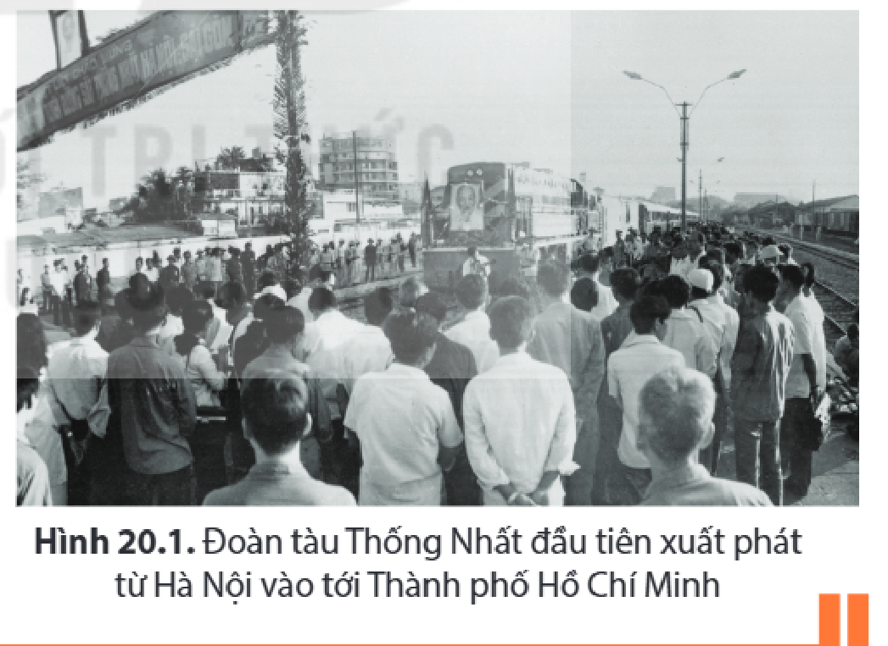
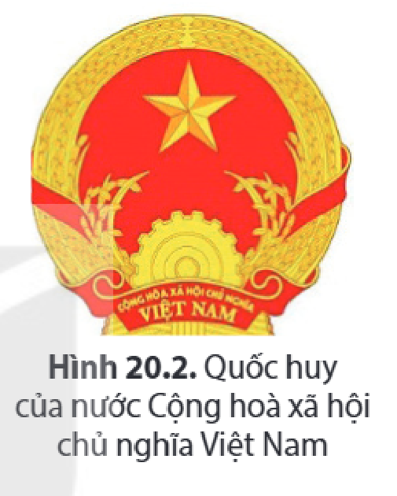
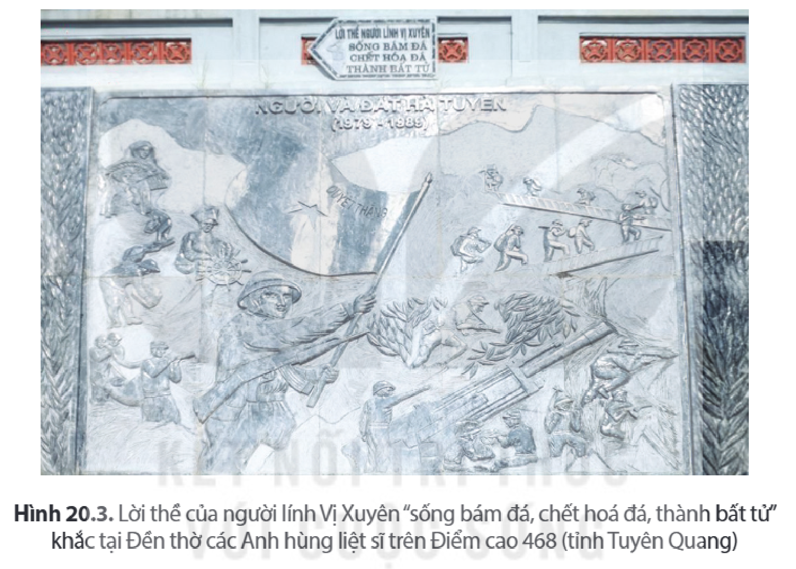
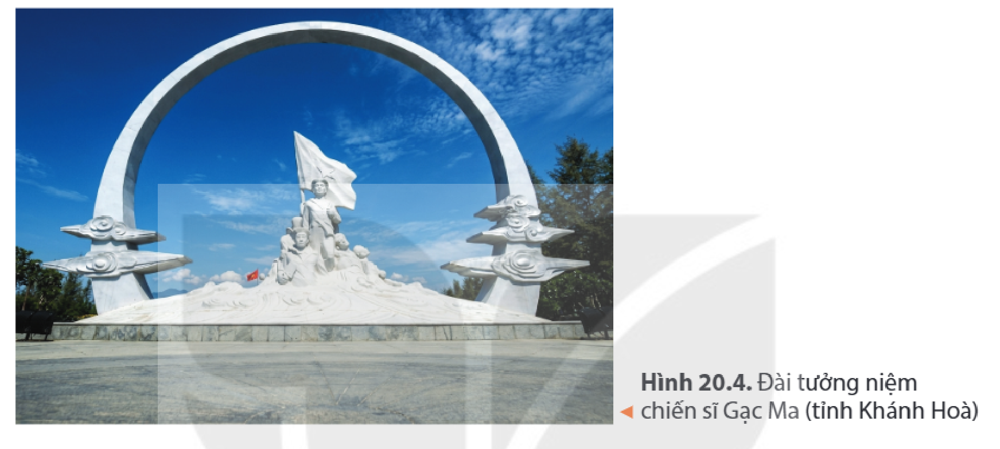
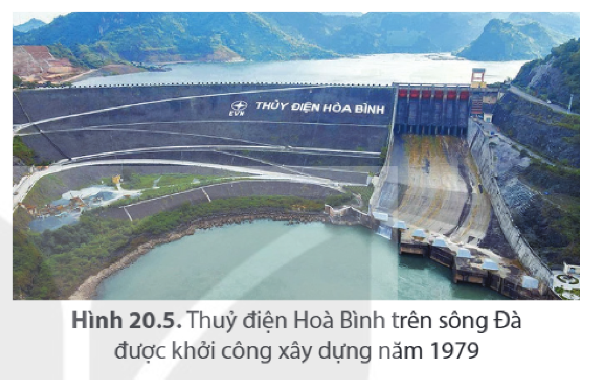
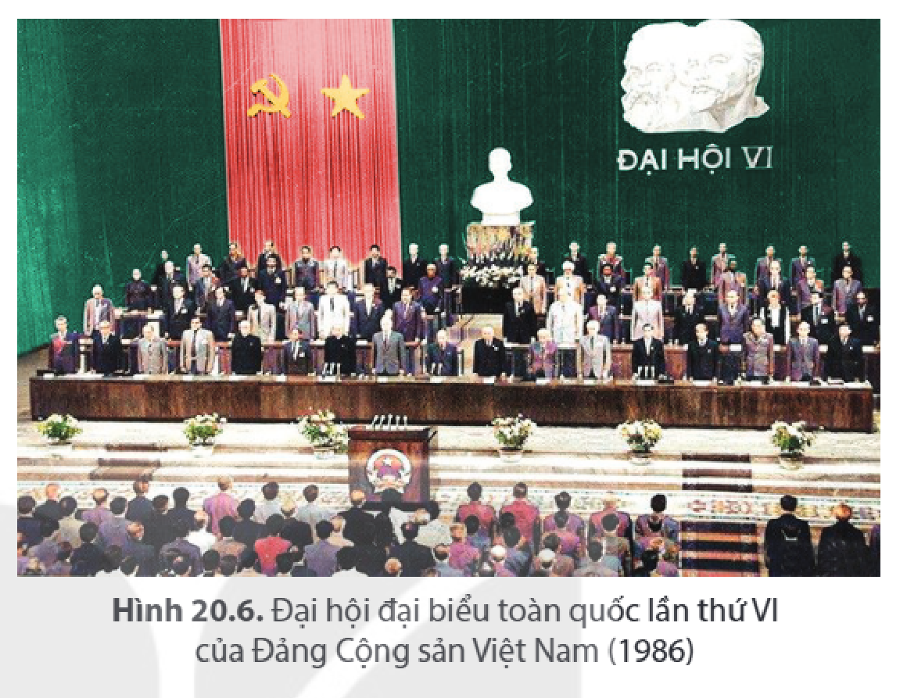
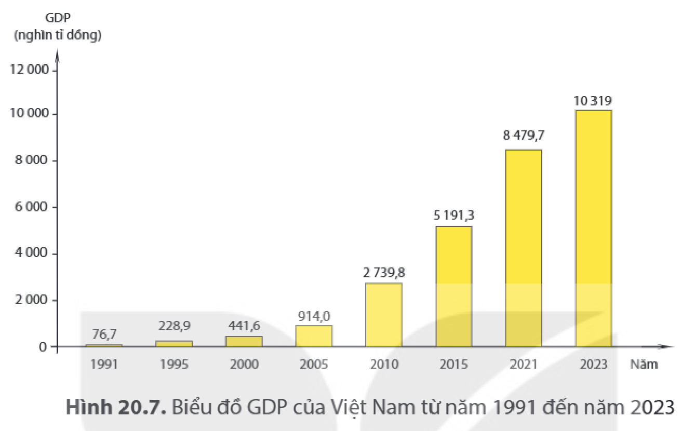
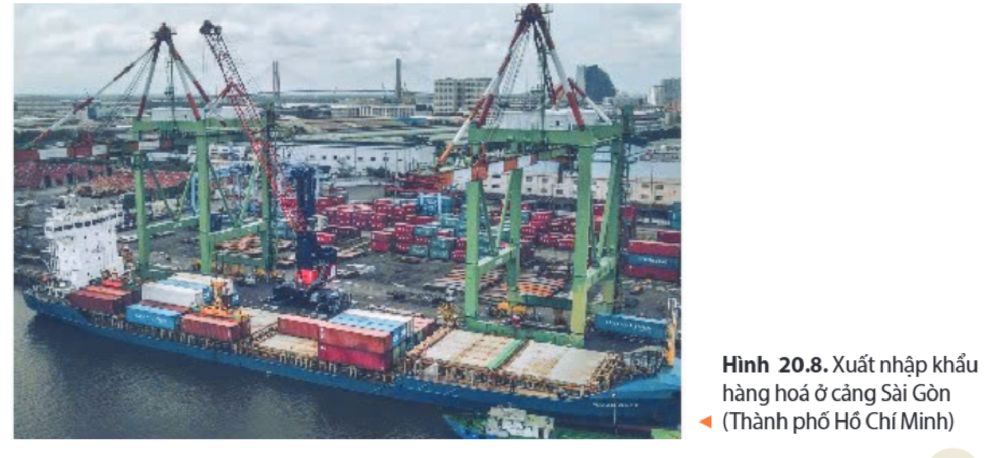
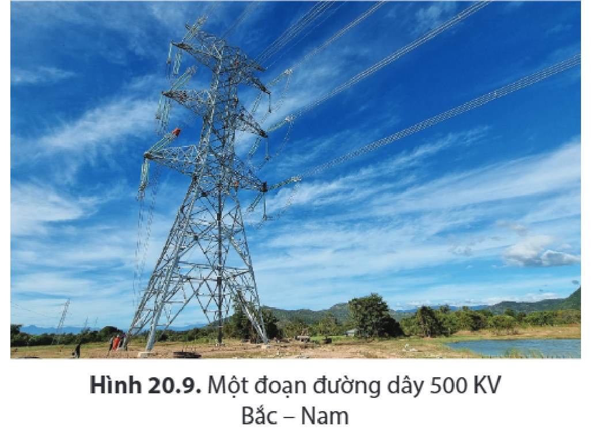
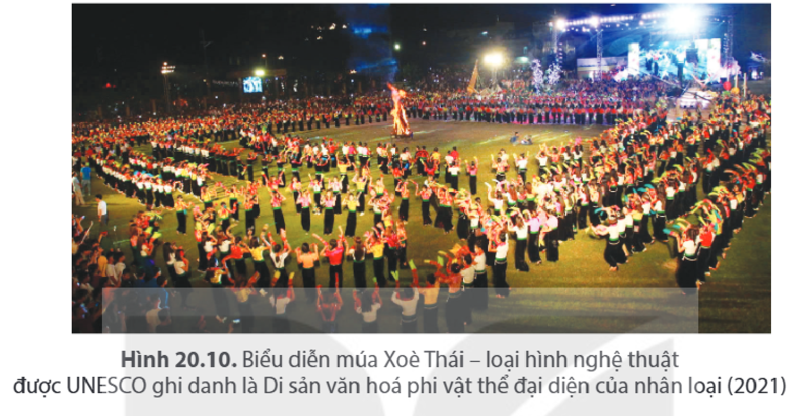

<!-- pdf:103 -->

# BÀI 20: VIỆT NAM TỪ NĂM 1976 ĐẾN NAY

## 🎯 Học xong bài này, em sẽ:

- Trình bày được sự thống nhất đất nước về mặt Nhà nước, cuộc đấu tranh bảo vệ Tổ quốc ở vùng biên giới Tây Nam và vùng biên giới phía Bắc trong những năm 1975 – 1989, đấu tranh bảo vệ chủ quyền biển đảo sau năm 1975.
- Nêu được tình hình chính trị, kinh tế, xã hội Việt Nam trong những năm 1976 – 1985.
- Nêu được nguyên nhân, nội dung đường lối đổi mới của Đảng và những thành tựu tiêu biểu của công cuộc đổi mới từ năm 1986 đến nay (trên các lĩnh vực kinh tế, chính trị, xã hội, văn hoá, quốc phòng – an ninh).
- Đánh giá được thành tựu và hạn chế trong việc thực hiện đường lối đổi mới.

## 🔴 Mở đầu

Vào ngày cuối năm 1976, hai con tàu Thống Nhất đồng thời xuất phát từ ga Hà Nội và ga Sài Gòn, mang theo ý chí và quyết tâm của toàn dân tộc về sự thống nhất trọn vẹn của đất nước. Hãy chia sẻ những hiểu biết của em về những nhiệm vụ mà nhân dân Việt Nam đã hoàn thành để thống nhất đất nước, giữ vững độc lập, chủ quyền và tiến vững chắc trên con đường xây dựng chủ nghĩa xã hội trong giai đoạn lịch sử mới.

*Hình 20.1. Đoàn tàu Thống Nhất đầu tiên xuất phát từ Hà Nội vào tới Thành phố Hồ Chí Minh*

## 1. Thống nhất đất nước về mặt Nhà nước

Sau Đại thắng Xuân 1975, đất nước đã thống nhất về mặt lãnh thổ, song ở mỗi miền lại tồn tại một hình thức tổ chức nhà nước khác nhau: Chính phủ Việt Nam Dân chủ Cộng hoà và Chính phủ lâm thời Cộng hoà miền Nam Việt Nam. Do đó, Hội nghị lần thứ 24 Ban Chấp hành Trung ương Đảng (9 – 1975) đã đề ra nhiệm vụ thống nhất đất nước về mặt Nhà nước.

<!-- pdf:104 -->

> **Tư liệu 1.** "Thống nhất đất nước tạo ra sức mạnh mới, những thuận lợi mới để phát triển kinh tế, văn hoá và củng cố quốc phòng. Thống nhất đất nước càng tăng cường ảnh hưởng của Việt Nam trên trường quốc tế. Vì vậy, thống nhất càng sớm thì càng phát huy sức mạnh toàn diện của Tổ quốc”.
>
> (*Văn kiện Đảng toàn tập*, Tập 36, NXB Chính trị quốc gia, 2004, tr. 373 – 374)

<!-- term: Hội nghị Hiệp thương chính trị thống nhất đất nước -->
Hội nghị Hiệp thương chính trị thống nhất đất nước giữa hai đoàn đại biểu Nam, Bắc diễn ra tại Sài Gòn (từ ngày 15 đến ngày 21 – 11 – 1975), đã nhất trí về chủ trương, biện pháp thống nhất đất nước về mặt Nhà nước.

<!-- term: Quốc hội Khoá VI -->
Ngày 25 – 4 – 1976, cuộc Tổng tuyển cử bầu Quốc hội chung (Quốc hội Khoá VI) được tiến hành trong cả nước.

<!-- term: Quốc hội Khoá VI -->
Trong kì họp thứ nhất (từ ngày 24 – 6 đến ngày 3 – 7 – 1976), Quốc hội đã thông qua chính sách đối nội và đối ngoại; quyết định tên nước là Cộng hoà xã hội chủ nghĩa Việt Nam, quyết định Quốc huy, Quốc kì là lá cờ đỏ sao vàng, Quốc ca là bài *Tiến quân ca*, Thủ đô là Hà Nội, thành phố Sài Gòn – Gia Định được đổi tên là Thành phố Hồ Chí Minh.

*Hình 20.2. Quốc huy của nước Cộng hoà xã hội chủ nghĩa Việt Nam*

> ❓ 1. Khai thác tư liệu trong mục, hãy cho biết vì sao cần phải hoàn thành thống nhất đất nước về mặt Nhà nước?
>
> 2. Trình bày nét chính về quá trình thống nhất đất nước về mặt Nhà nước.

## 2. Đấu tranh bảo vệ chủ quyền và toàn vẹn lãnh thổ

• *Bảo vệ biên giới Tây Nam*

<!-- term: Cuộc đấu tranh bảo vệ biên giới Tây Nam -->
Ngay sau thắng lợi của Việt Nam trong cuộc kháng chiến chống Mỹ, cứu nước, chính quyền Pôn Pốt ở Cam-pu-chia đã có nhiều hoạt động khiêu khích, xâm phạm chủ quyền của Việt Nam: đánh chiếm đảo Phú Quốc, đảo Thổ Chu (tỉnh An Giang), tàn sát dân thường tại An Giang, Tây Ninh,... Trước tình hình đó, Việt Nam đã ra tuyên bố nêu rõ hành động sai trái của chính quyền Pôn Pốt, thể hiện thái độ thiện chí muốn giải quyết vấn đề biên giới bằng con đường thương lượng hoà bình. Tuy nhiên, chính quyền Pôn Pốt đều từ chối và cắt quan hệ ngoại giao với Việt Nam.

Tháng 12 – 1978, chính quyền Pôn Pốt huy động 19 sư đoàn bộ binh cùng nhiều đơn vị pháo binh, xe tăng đơn phương tấn công Tây Ninh để mở đường tiến sâu vào lãnh thổ Việt Nam.

<!-- term: Cuộc đấu tranh bảo vệ biên giới Tây Nam -->
Thực hiện quyền tự vệ chính đáng, từ ngày 23 – 12 – 1978, quân đội Việt Nam mở cuộc tổng phản công và chỉ trong thời gian ngắn đã đánh bại quân xâm lược, giữ vững chủ quyền, toàn vẹn lãnh thổ Tổ quốc. Chiến thắng biên giới Tây Nam cũng tạo thời cơ lớn cho cách mạng Cam-pu-chia giành thắng lợi.

<!-- pdf:105 -->

• *Bảo vệ biên giới phía Bắc*

Từ năm 1978, Trung Quốc đơn phương chấm dứt các viện trợ kinh tế, kĩ thuật và có nhiều hành động khiêu khích, xâm phạm ở khu vực biên giới phía Bắc của Việt Nam.

<!-- term: Cuộc chiến đấu bảo vệ biên giới phía Bắc -->
Ngày 17 – 2 – 1979, khoảng 60 vạn quân Trung Quốc tấn công dọc tuyến biên giới phía Bắc, từ huyện Móng Cái (tỉnh Quảng Ninh) đến huyện Phong Thổ (tỉnh Lai Châu).

Quân dân các tỉnh biên giới phía Bắc đã kiên cường chiến đấu bảo vệ Tổ quốc. Nhiều trận chiến quyết liệt đã diễn ra ở các tỉnh: Lạng Sơn, Cao Bằng, Lào Cai,...

<!-- term: Cuộc chiến đấu bảo vệ biên giới phía Bắc -->
Trước cuộc chiến đấu của quân dân Việt Nam và sự phản đối mạnh mẽ của dư luận, Trung Quốc phải tuyên bố rút quân (5 – 3 – 1979). Tuy nhiên, tình hình trên tuyến biên giới phía Bắc tiếp tục căng thẳng kéo dài cho tới cuối những năm 80 của thế kỉ XX, đặc biệt là ở mặt trận Vị Xuyên (nay thuộc tỉnh Tuyên Quang).

*Hình 20.3. Lời thề của người lính Vị Xuyên “sống bám đá, chết hoá đá, thành bất tử” khắc tại Đền thờ các Anh hùng liệt sĩ trên Điểm cao 468 (tỉnh Tuyên Quang)*

Cuộc chiến đấu chính nghĩa bảo vệ biên giới phía Bắc thắng lợi đã khẳng định ý chí, quyết tâm của nhân dân Việt Nam trong bảo vệ độc lập, chủ quyền và toàn vẹn lãnh thổ của Tổ quốc.

• *Đấu tranh bảo vệ chủ quyền biển đảo sau năm 1975*

<!-- term: Đấu tranh bảo vệ chủ quyền biển đảo sau năm 1975 -->
Sau khi thống nhất đất nước, Việt Nam tiếp tục quản lí, thực thi và bảo vệ chủ quyền, các quyền và lợi ích hợp pháp ở Biển Đông, trong đó có quần đảo Hoàng Sa (đã bị Trung Quốc chiếm đóng vào năm 1974) và quần đảo Trường Sa. Đây là những hoạt động quan trọng trong công cuộc bảo vệ Tổ quốc.

Các đơn vị hành chính được thành lập như: huyện Bạch Long Vĩ, nay là đặc khu Bạch Long Vĩ (thành phố Hải Phòng), huyện Hoàng Sa, nay là đặc khu Hoàng Sa (thành phố Đà Nẵng), huyện Trường Sa, nay là đặc khu Trường Sa (tỉnh Khánh Hoà),..

Nhiều văn bản pháp lí liên quan đến các vùng biển và thềm lục địa của Việt Nam được ban hành. Nhiều tuyên bố về chủ quyền biển, đảo của Nhà nước Việt Nam cũng được công khai tại các diễn đàn quốc tế.

<!-- pdf:106 -->

<!-- term: Đấu tranh bảo vệ chủ quyền biển đảo sau năm 1975 -->
Tuy nhiên, các hành động xâm phạm chủ quyền biển đảo Việt Nam ở Biển Đông liên tiếp diễn ra, đặc biệt là từ phía Trung Quốc. Tháng 3 – 1988, quân đội Trung Quốc huy động lực lượng lớn tấn công một số đảo chìm và bãi ngầm thuộc quần đảo Trường Sa của Việt Nam (Gạc Ma, Cô Lin, Len Đao). Trong cuộc chiến đấu bảo vệ chủ quyền tại đảo Gạc Ma, 64 chiến sĩ Hải quân Việt Nam đã anh dũng hi sinh. Ngay lúc đó, Chính phủ Việt Nam đã thông báo cho Liên hợp quốc về vấn đề này, đồng thời gửi nhiều công hàm phản đối và đề nghị hai bên Việt Nam – Trung Quốc thương lượng để giải quyết vấn đề tranh chấp bằng biện pháp hoà bình,...

*Hình 20.4. Đài tưởng niệm chiến sĩ Gạc Ma (tỉnh Khánh Hoà)*

<!-- term: Đấu tranh bảo vệ chủ quyền biển đảo sau năm 1975 -->
Hiện nay, Việt Nam thực hiện các biện pháp toàn diện kết hợp giữa chính trị, kinh tế, ngoại giao, quân sự để bảo vệ chủ quyền biển đảo, kiên định giải quyết tranh chấp bằng giải pháp hoà bình trên cơ sở luật pháp quốc tế.

> ❓ 1. Trình bày cuộc đấu tranh bảo vệ Tổ quốc ở vùng biên giới Tây Nam, vùng biên giới phía Bắc trong những năm 1975 – 1989.
>
> 2. Việt Nam đã có những hoạt động gì nhằm đấu tranh bảo vệ chủ quyền biển đảo?

## 3. Tình hình chính trị, kinh tế và xã hội từ năm 1976 đến năm 1985

• *Về chính trị*

Sau khi thống nhất đất nước về mặt Nhà nước, cách mạng Việt Nam chuyển sang giai đoạn mới: đất nước độc lập, thống nhất và đi lên chủ nghĩa xã hội. Các đại hội đại biểu toàn quốc lần thứ IV (1976), lần thứ V (1982) của Đảng Cộng sản Việt Nam đã đề ra và phát triển đường lối xây dựng chủ nghĩa xã hội trong phạm vi cả nước. Hiến pháp mới của nước Cộng hoà xã hội chủ nghĩa Việt Nam được thông qua (12 – 1980); bộ máy chính quyền trung ương và địa phương tiếp tục được củng cố và kiện toàn,...

Việt Nam phát triển quan hệ đoàn kết hữu nghị, hợp tác toàn diện, thân thiện với các nước xã hội chủ nghĩa; từng bước thiết lập quan hệ với các nước ASEAN, gia nhập tổ chức Liên hợp quốc (1977),...

<!-- pdf:107 -->

• *Về kinh tế*

> 💡 **Em có biết?**
>
> Một số công trình lớn được xây dựng là thuỷ điện Hoà Bình (tỉnh Phú Thọ); thuỷ điện Trị An (tỉnh Đồng Nai); nhiệt điện Phả Lại (thành phố Hải Phòng); cầu Thăng Long, cầu Chương Dương (thành phố Hà Nội); giàn khoan dầu khí tại mỏ Bạch Hổ (Thành phố Hồ Chí Minh),...

Thực hiện hai kế hoạch Nhà nước 5 năm phát triển kinh tế – xã hội (1976 – 1980 và 1981 – 1985), nhân dân Việt Nam đã từng bước khắc phục những hậu quả nặng nề của chiến tranh; khôi phục phần lớn cơ sở công nghiệp, nông nghiệp, giao thông ở miền Bắc và xây dựng lại các vùng nông thôn ở miền Nam; khai thông giao lưu hàng hoá giữa hai miền Bắc – Nam.

Các ngành sản xuất trong cả nước được tổ chức theo hướng sản xuất lớn xã hội chủ nghĩa dựa trên nguyên tắc tập trung. Thành phần kinh tế quốc doanh và tập thể được tăng cường. Nhiều công trình hạ tầng lớn cũng được xây dựng.

*Hình 20.5. Thuỷ điện Hoà Bình trên sông Đà được khởi công xây dựng năm 1979*

Tuy nhiên, trong giai đoạn này, sản xuất không đủ cung ứng, đặc biệt là sản xuất lương thực, lạm phát tăng cao và kéo dài.

• *Về xã hội*

Hoạt động giáo dục, văn hoá được đẩy mạnh để xây dựng nền văn hoá mới và con người mới xã hội chủ nghĩa.

Cải cách giáo dục được tiến hành, đã thống nhất giáo dục phổ thông trong cả nước. Hệ thống giáo dục từ mầm non, phổ thông đến đại học được xây dựng khá hoàn chỉnh. Số người đi học trong năm học 1979 – 1980 là khoảng 15 triệu người,...

Mặc dù thu nhập của người dân được cải thiện song đời sống còn gặp nhiều khó khăn. Nhà ở, điều kiện vệ sinh, sinh hoạt văn hoá ở nhiều nơi còn thiếu thốn, nghèo nàn.

> ❓ Hãy trình bày tình hình chính trị, kinh tế và xã hội của Việt Nam trong những năm 1976 – 1985.

## 4. Công cuộc Đổi mới đất nước từ năm 1986 đến nay

### a) Nguyên nhân tiến hành đổi mới đất nước

Vào những năm 70, 80 của thế kỉ XX, bối cảnh thế giới có nhiều thay đổi do tác động của cách mạng khoa học – kĩ thuật và xu thế toàn cầu hoá.

Tình hình các nước xã hội chủ nghĩa cũng có nhiều biến động. Năm 1978, Trung Quốc tiến hành công cuộc cải cách, mở cửa và bước đầu đạt được kết quả tích cực. Năm 1985, Liên Xô cũng tiến hành công cuộc cải tổ đất nước.

Ở Việt Nam, đất nước cũng ở trong tình trạng khủng hoảng, trước hết là khủng hoảng về kinh tế – xã hội, hơn nữa còn bị bao vây về kinh tế và cô lập về chính trị.

Tình hình thế giới và trong nước như vậy đã đặt ra yêu cầu cấp bách là cần phải tiến hành đổi mới nhằm đưa đất nước vượt qua khủng hoảng, tiến vững chắc trên con đường xây dựng chủ nghĩa xã hội.

<!-- pdf:108 -->

> ❓ Giải thích vì sao Đảng Cộng sản Việt Nam quyết định tiến hành công cuộc Đổi mới toàn diện đất nước?

### b) Nội dung đường lối đổi mới

<!-- term: Đại hội đại biểu toàn quốc lần thứ VI của Đảng Cộng sản Việt Nam -->
Đại hội đại biểu toàn quốc lần thứ VI của Đảng Cộng sản Việt Nam (12 – 1986) đã đề ra chủ trương đổi mới toàn diện đất nước. Nội dung đường lối đổi mới với những mục tiêu, nhiệm vụ cụ thể trong từng giai đoạn lịch sử đã được bổ sung và phát triển trong các đại hội Đảng từ năm 1991 đến nay.

*Hình 20.6. Đại hội đại biểu toàn quốc lần thứ VI của Đảng Cộng sản Việt Nam (1986)*

<!-- term: Đường lối Đổi mới -->
> **TÓM TẮT NỘI DỤNG ĐƯỜNG LỐI ĐỔI MỚI**
> - **Về kinh tế:**
>   - Xoá bỏ mô hình quản lí kinh tế tập trung quan liêu bao cấp.
>   - Xây dựng nền kinh tế hàng hoá nhiều thành phần vận động theo cơ chế thị trường có sự quản lí của Nhà nước.
>   - Đẩy mạnh công nghiệp hoá – hiện đại hoá.
>   - Kêu gọi đầu tư nước ngoài và mở rộng kinh tế đối ngoại, hội nhập kinh tế quốc tế.
> - **Về chính trị:**
>   - Xây dựng Nhà nước pháp quyền xã hội chủ nghĩa của dân, do dân và vì dân, do Đảng Cộng sản Việt Nam lãnh đạo.
>   - Mở rộng quan hệ đối ngoại, tranh thủ điều kiện quốc tế thuận lợi cho công cuộc xây dựng chủ nghĩa xã hội và bảo vệ Tổ quốc.
>   - Hội nhập quốc tế toàn diện, sâu rộng.

> ❓ Hãy nêu nội dung cơ bản của đường lối đổi mới của Đảng.

### c) Thành tựu của công cuộc Đổi mới đất nước từ năm 1986 đến nay

Công cuộc Đổi mới đất nước từ năm 1986 đến nay đã đạt được những thành tựu to lớn và toàn diện trên tất cả các lĩnh vực.

• *Kinh tế*

<!-- term: Ba chương trình kinh tế -->
Bước đầu thực hiện đường lối đổi mới, trong kế hoạch 5 năm (1986 – 1991), việc thực hiện các mục tiêu của Ba chương trình kinh tế (Lương thực – Thực phẩm, Hàng tiêu dùng và Hàng xuất khẩu) đã giúp phục hồi sản xuất, tăng trưởng kinh tế,...

Tăng trưởng GDP của nền kinh tế đạt khoảng 4,4%/năm, giá trị sản xuất công – nông nghiệp và xuất khẩu đều tăng. Từ năm 1989, sản xuất lương thực đã đủ ăn, có dự trữ và còn có phần để xuất khẩu.

<!-- pdf:109 -->

Từ năm 1991 đến nay, đất nước từng bước ra khỏi khủng hoảng kinh tế, có sự thay đổi cơ bản và toàn diện.

Tăng trưởng kinh tế khá và tương đối bền vững, do đó tiềm lực cũng như quy mô nền kinh tế được mở rộng. Cơ cấu kinh tế chuyển biến tích cực theo hướng hiện đại, thể hiện ở tỉ trọng khá cao của khu vực công nghiệp, xây dựng và dịch vụ.

*Hình 20.7. Biểu đồ GDP của Việt Nam từ năm 1991 đến năm 2023*

Nền kinh tế hàng hoá nhiều thành phần vận động theo cơ chế thị trường, có sự quản lí của Nhà nước đã có những bước tiến lớn, đặc biệt là sự gia tăng đóng góp của thành phần kinh tế tư nhân và có vốn đầu tư nước ngoài đối với phát triển kinh tế.

Trong kinh tế đối ngoại, thị trường xuất nhập khẩu mở rộng và nguồn vốn đầu tư của nước ngoài tăng lên, nhất là từ sau khi Việt Nam chính thức trở thành thành viên của Tổ chức Thương mại thế giới (WTO) năm 2007.

Việt Nam có quan hệ thương mại với hơn 200 nước và vùng lãnh thổ, kí kết hơn 90 hiệp định thương mại song phương với các nước.

Nhiều khu công nghiệp, khu kinh tế hiện đại được xây dựng, thu hút đầu tư của các nước phát triển, góp phần tăng trưởng kinh tế, tạo việc làm và nâng cao thu nhập cho người dân.

> 💡 **Em có biết?**
>
> Năm 1989, những tấn gạo và dầu thô của Việt Nam lần đầu tiên được xuất khẩu. Tới năm 2005, Việt Nam đứng đầu thế giới về xuất khẩu hạt tiêu; thứ hai về các mặt hàng gạo, cà phê, hạt điều; thứ tư về cao su.
<!-- ocr-ok: đã đối chiếu p109.png, OCR ghép lẫn dòng hộp Em có biết? cột phải với đoạn văn cột trái -->

*Hình 20.8. Xuất nhập khẩu hàng hoá ở cảng Sài Gòn (Thành phố Hồ Chí Minh)*

<!-- pdf:110 -->

Hệ thống cơ sở hạ tầng được xây dựng hiện đại phục vụ cho công cuộc phát triển kinh tế cũng như đời sống của người dân.

*Hình 20.9. Một đoạn đường dây 500 KV Bắc – Nam*

> ❓ Hãy trình bày những thành tựu tiêu biểu về kinh tế mà Việt Nam đạt được trong công cuộc Đổi mới từ năm 1986 đến nay.

• *Chính trị*

Độc lập chủ quyền của đất nước được giữ vững, tình hình chính trị ổn định đã tạo ra môi trường hoà bình để phát triển đất nước. Bộ máy chính quyền nhà nước và hệ thống luật pháp ngày càng hoàn thiện.

<!-- term: Nhà nước pháp quyền xã hội chủ nghĩa Việt Nam -->
Các bản Hiến pháp mới được ban hành vào các năm 1992 và 2013 thể hiện rõ nét mục tiêu xây dựng mô hình Nhà nước pháp quyền xã hội chủ nghĩa và tạo cơ sở chính trị – pháp lí quan trọng trong thực hiện công cuộc Đổi mới.

<!-- term: Nhà nước pháp quyền xã hội chủ nghĩa Việt Nam -->
> **Tư liệu 2.** Nhà nước Cộng hoà xã hội chủ nghĩa Việt Nam là Nhà nước pháp quyền xã hội chủ nghĩa của nhân dân, do nhân dân, vì nhân dân.
>
> (Trích Điều 2, *Hiến pháp của nước Cộng hoà xã hội chủ nghĩa Việt Nam*, năm 2013)

Về đối ngoại, Việt Nam đã phá thế bị bao vây, cấm vận và mở rộng quan hệ hữu nghị, hợp tác bình đẳng, cùng có lợi với nhiều quốc gia, tổ chức quốc tế theo hướng đa phương hoá, đa dạng hoá. Hội nhập quốc tế diễn ra chủ động, tích cực và đạt nhiều kết quả vượt bậc.

Năm 1995, Việt Nam đã bình thường hoá quan hệ ngoại giao với Mỹ và gia nhập Hiệp hội các quốc gia Đông Nam Á (ASEAN). Đến nay, Việt Nam đã thiết lập quan hệ ngoại giao với gần 200 quốc gia và vùng lãnh thổ trên thế giới, là thành viên của hơn 70 tổ chức, diễn đàn đa phương khu vực và toàn cầu. Đặc biệt, Việt Nam đã nâng tầm lên quan hệ đối tác chiến lược toàn diện với nhiều nước trên thế giới như: Trung Quốc, Nga, Ấn Độ, Hàn Quốc, Mỹ, Nhật Bản, Pháp, Anh,...

> ❓ Hãy trình bày một số thành tựu tiêu biểu về chính trị mà Việt Nam đạt được trong công cuộc Đổi mới từ năm 1986 đến nay.

• *Văn hoá, xã hội*

> 💡 **Em có biết?**
>
> Tổ chức Nông lương Liên hợp quốc (FAO) đã vinh danh Việt Nam là quốc gia có thành tích nổi bật trong xoá đói giảm nghèo (2013).

Tình hình xã hội có nhiều chuyển biến tích cực. Công cuộc xoá đói giảm nghèo được thực hiện thành công đưa đất nước bước ra khỏi tình trạng kém phát triển. Đời sống vật chất và tinh thần của nhân dân được cải thiện và không ngừng nâng cao.

Tỉ lệ hộ có thu nhập trung bình và hộ giàu đều tăng, tỉ lệ hộ nghèo giảm tương đối nhanh. Năm 1990, thu nhập bình quân đầu người là 0,64 triệu đồng, đến năm 2000 là 5,7 triệu đồng và đến năm 2023 đã tăng lên 102,9 triệu đồng.

Các chỉ số sức khoẻ cộng đồng và tuổi thọ trung bình của người dân đều được nâng lên. Tỉ lệ tử vong và suy dinh dưỡng ở trẻ em dưới 5 tuổi đã giảm.

Giáo dục đào tạo đạt được nhiều thành tựu. Cả nước đã đạt chuẩn quốc gia về xoá mù chữ (năm 2000) và phổ cập giáo dục trung học cơ sở (năm 2010). Giáo dục đại học, trung học

<!-- pdf:111 -->

chuyên nghiệp, các trường dạy nghề ngày càng phát triển về quy mô và loại hình đào tạo, nội dung giảng dạy nhằm đáp ứng nhu cầu thị trường lao động và thúc đẩy sự nghiệp công nghiệp hoá, hiện đại hoá đất nước.

Đời sống văn hoá – nghệ thuật được phát triển phong phú và đa dạng, hướng tới mục tiêu: xây dựng nền văn hoá Việt Nam tiên tiến, đậm đà bản sắc dân tộc.

*Hình 20.10. Biểu diễn múa Xoè Thái – loại hình nghệ thuật được UNESCO ghi danh là Di sản văn hoá phi vật thể đại diện của nhân loại (2021)*

> ❓ Hãy trình bày những thành tựu tiêu biểu của đất nước về văn hoá, xã hội, giáo dục từ năm 1986 đến nay.

• *Quốc phòng, an ninh*

Tiềm lực quốc phòng và an ninh được tăng cường. Thế trận quốc phòng toàn dân và an ninh nhân dân được củng cố nhằm góp phần bảo vệ vững chắc Tổ quốc và ổn định chính trị. Trật tự an toàn xã hội được đảm bảo.

Quân đội Nhân dân Việt Nam được tổ chức chính quy, hiện đại với các lực lượng: Lục quân, Hải quân, Phòng không – Không quân, Biên phòng, Cảnh sát biển, Tác chiến không gian mạng,...

Nhiều vũ khí, khí tài hiện đại đã được trang bị như: các loại máy bay chiến đấu, tàu ngầm Kilo, tàu hộ vệ tên lửa, tàu tên lửa,...

> 💡 **Em có biết?**
>
> Từ năm 2014, Việt Nam tham gia lực lượng gìn giữ hoà bình Liên hợp quốc. Quan hệ quốc phòng mở rộng với trên 100 nước, tổ chức và diễn đàn quốc tế.
>
> Việt Nam tích cực, chủ động tham gia có trách nhiệm tại các cơ chế hợp tác về quốc phòng, an ninh quốc tế như: Hội nghị Bộ trưởng Quốc phòng các nước ASEAN, Diễn đàn An ninh khu vực ASEAN, Đối thoại Shangri-La, Hội nghị An ninh quốc tế Mát-xcơ-va, Đối thoại Quốc phòng Xơ-un,...

> ❓ Trình bày những thành tựu chính trên lĩnh vực quốc phòng, an ninh từ năm 1986 đến nay.

### d) Ý nghĩa của công cuộc Đổi mới từ năm 1986 đến nay

Công cuộc Đổi mới toàn diện của Việt Nam từ năm 1986 đến nay đã trải qua nhiều giai đoạn với nhiều thành tựu trên tất cả các lĩnh vực, đã khẳng định sự lãnh đạo đúng đắn của Đảng trong việc đề ra và thực hiện đường lối đổi mới, phù hợp với thực tiễn Việt Nam và xu thế phát triển của thời đại.

Những thành tựu của công cuộc Đổi mới đã đưa đất nước bước ra khỏi khủng hoảng kinh tế – xã hội, góp phần ổn định chính trị – xã hội và nâng tầm vị thế, uy tín của Việt Nam trong khu vực và trên thế giới.

<!-- pdf:112 -->

> **Tư liệu 3.** Sau 35 năm đổi mới, "đất nước ta chưa bao giờ có được cơ đồ, tiềm lực, vị thế và uy tín quốc tế như ngày nay... Thế và lực, sức mạnh tổng hợp quốc gia, uy tín quốc tế, niềm tin của nhân dân ngày càng được nâng cao, tạo ra những tiền đề quan trọng để xây dựng và bảo vệ Tổ quốc".
>
> (*Văn kiện Đại hội đại biểu toàn quốc lần thứ XIII của Đảng*, Tập 1, NXB Chính trị quốc gia Sự thật, 2021, tr. 10, 44)

Tuy nhiên, đất nước cũng phải đối mặt với những thách thức trong bảo vệ chủ quyền, toàn vẹn lãnh thổ cũng như một số hạn chế chưa giải quyết được như: sự thiếu bền vững của nền kinh tế, sức cạnh tranh và trình độ công nghệ của nền kinh tế nhìn chung còn yếu; chất lượng môi trường tiếp tục xuống cấp, khoảng cách thu nhập giữa các vùng miền và bộ phận dân cư ngày càng lớn,...

Hiện nay, Đảng đề ra định hướng chiến lược đưa đất nước phát triển nhanh và bền vững, phấn đấu đến năm 2045, Việt Nam trở thành nước phát triển, có thu nhập cao, xã hội dân chủ, công bằng, văn minh; đồng thời, tiếp tục đẩy mạnh đổi mới sáng tạo, xây dựng nền kinh tế độc lập, tự chủ gắn với hội nhập quốc tế sâu rộng; giữ vững quốc phòng, an ninh và nâng cao vị thế quốc gia.

> ❓ Nêu ý nghĩa của công cuộc Đổi mới của Việt Nam từ năm 1986 đến nay.

## ✏️ Luyện tập – Vận dụng

1. Lập bảng tóm tắt một số thành tựu cơ bản của cách mạng Việt Nam trong giai đoạn đất nước độc lập, thống nhất và đi lên chủ nghĩa xã hội từ năm 1976 đến nay (theo gợi ý dưới đây vào vở).

| Nội dung | Thành tựu tiêu biểu |
| --- | --- |
| **1976 – 1985** | |
| Chính trị – đối ngoại | ? |
| Kinh tế – xã hội | ? |
| Bảo vệ Tổ quốc | ? |
| **1986 – nay** | |
| Chính trị – đối ngoại | ? |
| Kinh tế | ? |
| Văn hoá – xã hội | |
| Quốc phòng – an ninh | ? |

2. Dựa vào kiến thức đã học, hãy đánh giá những thành tựu và hạn chế trong việc thực hiện đường lối đổi mới.

### 🚀 Vận dụng

1. Sưu tầm tư liệu từ sách, báo và internet, viết một đoạn văn ngắn chứng minh: Đổi mới là lựa chọn “sống còn” đối với dân tộc Việt Nam.

2. Xây dựng một bài giới thiệu (poster, infographic,...) về sự thay đổi của một trong các lĩnh vực kinh tế, văn hoá, khoa học, giáo dục, y tế ở địa phương em (cấp tỉnh hoặc cấp xã) từ năm 1986 đến nay.

## 📷 Danh sách hình trong bài

| Mã hình | Trang PDF | Trang sách | Chú thích |
| --- | --- | --- | --- |
| H9-lich_su_va_dia_ly-ls-b20-01 | 103 | 101 | Hình 20.1. Đoàn tàu Thống Nhất đầu tiên xuất phát từ Hà Nội vào tới Thành phố Hồ Chí Minh |
| H9-lich_su_va_dia_ly-ls-b20-02 | 104 | 102 | Hình 20.2. Quốc huy của nước Cộng hoà xã hội chủ nghĩa Việt Nam |
| H9-lich_su_va_dia_ly-ls-b20-03 | 105 | 103 | Hình 20.3. Lời thề của người lính Vị Xuyên “sống bám đá, chết hoá đá, thành bất tử” khắc tại Đền thờ các Anh hùng liệt sĩ trên Điểm cao 468 (tỉnh Tuyên Quang) |
| H9-lich_su_va_dia_ly-ls-b20-04 | 106 | 104 | Hình 20.4. Đài tưởng niệm chiến sĩ Gạc Ma (tỉnh Khánh Hoà) |
| H9-lich_su_va_dia_ly-ls-b20-05 | 107 | 105 | Hình 20.5. Thuỷ điện Hoà Bình trên sông Đà được khởi công xây dựng năm 1979 |
| H9-lich_su_va_dia_ly-ls-b20-06 | 108 | 106 | Hình 20.6. Đại hội đại biểu toàn quốc lần thứ VI của Đảng Cộng sản Việt Nam (1986) |
| H9-lich_su_va_dia_ly-ls-b20-07 | 109 | 107 | Hình 20.7. Biểu đồ GDP của Việt Nam từ năm 1991 đến năm 2023 |
| H9-lich_su_va_dia_ly-ls-b20-08 | 109 | 107 | Hình 20.8. Xuất nhập khẩu hàng hoá ở cảng Sài Gòn (Thành phố Hồ Chí Minh) |
| H9-lich_su_va_dia_ly-ls-b20-09 | 110 | 108 | Hình 20.9. Một đoạn đường dây 500 KV Bắc – Nam |
| H9-lich_su_va_dia_ly-ls-b20-10 | 111 | 109 | Hình 20.10. Biểu diễn múa Xoè Thái – loại hình nghệ thuật được UNESCO ghi danh là Di sản văn hoá phi vật thể đại diện của nhân loại (2021) |
