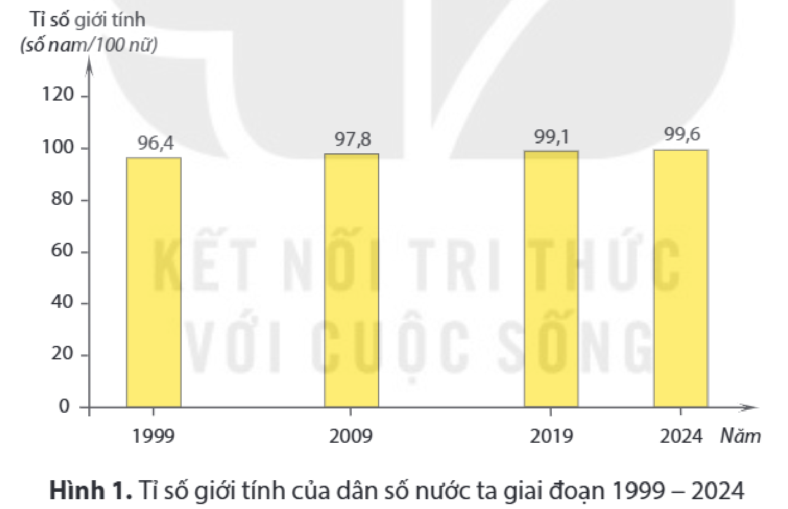

<!-- pdf:119 -->

# BÀI 1: DÂN TỘC VÀ DÂN SỐ

## 🎯 Học xong bài này, em sẽ:

- Trình bày được đặc điểm phân bố các dân tộc Việt Nam.
- Trình bày được quy mô dân số và tình hình gia tăng dân số qua các thời kì.
- Phân tích được sự thay đổi cơ cấu tuổi và giới tính của dân cư.

## 🔴 Mở đầu

Dân cư là nguồn lực đặc biệt đối với sự phát triển kinh tế. Việc tìm hiểu dân tộc, dân số có ý nghĩa quan trọng trong việc xây dựng chiến lược phát triển kinh tế – xã hội của đất nước. Hãy nêu một số hiểu biết của em về dân tộc và dân số nước ta.

## 1. Dân tộc

Nước ta có 54 dân tộc, trong đó người Kinh chiếm tỉ lệ khoảng 85% và các dân tộc thiểu số chiếm tỉ lệ khoảng 15% tổng số dân (năm 2024). Các dân tộc luôn đoàn kết, tạo nên cộng đồng các dân tộc Việt Nam. Phân bố các dân tộc ở nước ta có một số đặc điểm sau:

### a) Các dân tộc ở Việt Nam sinh sống rộng khắp trên toàn lãnh thổ

<!-- term: Phân bố các dân tộc Việt Nam -->
Người Kinh cư trú khắp cả nước nhưng tập trung nhiều hơn ở đồng bằng, ven biển và trung du. Các dân tộc thiểu số thường sinh sống ở vùng đồi núi và cao nguyên. Dân tộc Tày, HMông, Thái, Mường,... chủ yếu ở vùng Trung du và miền núi phía Bắc; dân tộc Gia-rai, Ê-đê, Ba-na,... tập trung ở vùng Duyên hải Nam Trung Bộ và Tây Nguyên (Nam Trung Bộ); dân tộc Khơ-me, Hoa cư trú nhiều ở các đồng bằng ven biển phía nam và ở vùng Đồng bằng sông Cửu Long.

### b) Phân bố dân tộc ở Việt Nam có sự thay đổi

<!-- term: Phân bố các dân tộc Việt Nam -->
Cùng với quá trình phát triển kinh tế – xã hội ở các vùng trung du và miền núi, phân bố dân tộc ở Việt Nam có sự thay đổi theo không gian: phạm vi cư trú được mở rộng và phân bố ngày càng đan xen. Các vùng Duyên hải Nam Trung Bộ và Tây Nguyên, Trung du và miền núi phía Bắc, Bắc Trung Bộ có nhiều dân tộc cùng sinh sống.

<!-- pdf:120 -->

### c) Người Việt Nam ở nước ngoài là một bộ phận của dân tộc Việt Nam

<!-- term: Người Việt Nam ở nước ngoài -->
Việt Nam có hơn 5 triệu người sinh sống, làm việc, học tập ở nước ngoài (năm 2024), là bộ phận quan trọng của cộng đồng dân tộc Việt Nam. Người Việt ở nước ngoài luôn hướng về xây dựng quê hương, đóng góp cho công cuộc phát triển đất nước.

> ❓ Dựa vào thông tin mục 1, hãy trình bày đặc điểm phân bố của các dân tộc ở Việt Nam.

## 2. Dân số

### a) Quy mô và gia tăng dân số

<!-- term: Quy mô và gia tăng dân số Việt Nam -->
Việt Nam là nước đông dân. Năm 2024, số dân nước ta là 101,3 triệu người, đứng thứ 16 trên thế giới và thứ ba trong khu vực Đông Nam Á (sau In-đô-nê-xi-a và Phi-líp-pin).

Bảng 1.1. SỐ DÂN VÀ TỈ LỆ TĂNG DÂN SỐ CỦA NƯỚC TA GIAI ĐOẠN 1999 – 2024

| Năm | 1999 | 2009 | 2019 | 2024 |
| --- | :---: | :---: | :---: | :---: |
| Số dân *(triệu người)* | 76,5 | 86,0 | 96,5 | 101,3 |
| Tỉ lệ tăng dân số *(%)* | 1,51 | 1,06 | 1,15 | 1,03 |

*(Nguồn: Cục Thống kê năm 2025)*

<!-- term: Quy mô và gia tăng dân số Việt Nam -->
Gia tăng dân số nước ta có sự khác nhau qua các thời kì. Tỉ lệ tăng dân số nước ta có xu hướng giảm, tuy nhiên do quy mô dân số đông nên mỗi năm số dân nước ta vẫn tăng khoảng 1 triệu người.

> ❓ Dựa vào thông tin mục a, hãy trình bày:
> - Sự thay đổi quy mô dân số của nước ta giai đoạn 1999 – 2024.
> - Tỉ lệ tăng dân số của nước ta giai đoạn 1999 – 2024.

### b) Cơ cấu dân số theo nhóm tuổi và giới tính

Từ năm 1999 đến năm 2024, cơ cấu dân số theo nhóm tuổi và giới tính ở nước ta có sự thay đổi.

- Cơ cấu dân số theo nhóm tuổi: Tỉ lệ dân số dưới 15 tuổi giảm, tỉ lệ dân số từ 65 tuổi trở lên tăng. Việt Nam đang ở trong thời kì dân số vàng. Do tỉ lệ sinh giảm, tuổi thọ trung bình tăng trong những thập kỉ qua nên dân số nước ta có xu hướng già hoá.

> 💡 **Em có biết?**
>
> **Cơ cấu dân số vàng** là khi bình quân cứ 1 người phụ thuộc (trẻ dưới 15 tuổi và già từ 65 tuổi trở lên) thì có 2 người trong tuổi lao động (từ 15 đến 64 tuổi).
>
> **Già hoá dân số** là khi tỉ lệ nhóm tuổi từ 65 tuổi trở lên chiếm từ 7 đến dưới 14% tổng số dân.
>
> **Dân số già** là khi tỉ lệ nhóm tuổi từ 65 tuổi trở lên chiếm từ 14 đến dưới 21% tổng số dân.
>
> *(Nguồn: Cục Thống kê năm 2025)*

<!-- pdf:121 -->

Bảng 1.2. CƠ CẤU DÂN SỐ THEO NHÓM TUỔI CỦA NƯỚC TA GIAI ĐOẠN 1999 – 2024

*(Đơn vị: %)*

| Nhóm tuổi \ Năm | 1999 | 2009 | 2019 | 2024 |
| --- | :---: | :---: | :---: | :---: |
| Dưới 15 tuổi | 33,1 | 24,5 | 24,3 | 23,3 |
| Từ 15 đến 64 tuổi | 61,1 | 69,1 | 68,0 | 67,4 |
| Từ 65 tuổi trở lên | 5,8 | 6,4 | 7,7 | 9,3 |

*(Nguồn: Cục Thống kê năm 2025)*

- Cơ cấu dân số theo giới tính: Tỉ số giới tính của dân số nước ta khá cân bằng; năm 2024, tỉ số giới tính là 99,6 nam/100 nữ. Tuy nhiên, tình trạng mất cân bằng giới tính khi sinh rất cần được quan tâm, năm 2024 có 111,4 bé trai/100 bé gái.

> 💡 **Em có biết?**
>
> **Tỉ số giới tính của dân số** phản ánh số lượng nam giới tính trên 100 nữ giới. Tỉ số giới tính được xác định theo công thức:
>
> Tỉ số giới tính của dân số = (Tổng số nam / Tổng số nữ) × 100
>
> *(Nguồn: Cục Thống kê)*

*Hình 1. Tỉ số giới tính của dân số nước ta giai đoạn 1999 – 2024*

*(Nguồn: Cục Thống kê năm 2025)*

> ❓ Dựa vào thông tin mục b, hãy phân tích sự thay đổi cơ cấu dân số theo nhóm tuổi và theo giới tính của nước ta trong giai đoạn 1999 – 2024.

## ✏️ Luyện tập – Vận dụng

- Dựa vào bảng 1.1, hãy vẽ biểu đồ thể hiện số dân và tỉ lệ tăng dân số nước ta giai đoạn 1999 – 2024.
- Tìm hiểu và trình bày đặc điểm phân bố của một dân tộc ở nước ta.

## 📷 Danh sách hình trong bài

| Mã hình | Trang PDF | Trang sách | Chú thích |
| --- | :---: | :---: | --- |
| H9-lich_su_va_dia_ly-dl-b01-01 | 121 | 119 | Hình 1. Tỉ số giới tính của dân số nước ta giai đoạn 1999 – 2024 |
