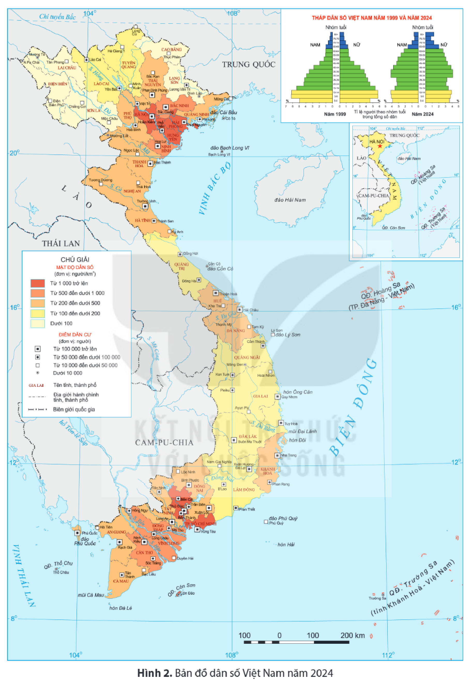

<!-- pdf:122 -->

# BÀI 2: PHÂN BỐ DÂN CƯ VÀ CÁC LOẠI HÌNH QUẦN CƯ

## 🎯 Học xong bài này, em sẽ:

- Đọc bản đồ dân số Việt Nam để rút ra được đặc điểm phân bố dân cư.
- Trình bày được sự khác biệt giữa quần cư thành thị và quần cư nông thôn.

## 🔴 Mở đầu

Phân bố dân cư chịu tác động tổng hợp của các nhân tố tự nhiên, kinh tế – xã hội. Phân bố dân cư ở nước ta có đặc điểm như thế nào? Các loại hình quần cư có những điểm gì khác biệt?

## 1. Phân bố dân cư

<!-- term: Phân bố dân cư Việt Nam -->
Mật độ dân số nước ta cao (306 người/km² năm 2024), gấp khoảng 5 lần mức bình quân của thế giới và đứng thứ ba trong khu vực Đông Nam Á (sau Xin-ga-po và Phi-líp-pin).

- *Phân bố dân cư khác nhau giữa các khu vực*

<!-- term: Phân bố dân cư Việt Nam -->
Phân bố dân cư nước ta khác nhau giữa khu vực đồng bằng và trung du, miền núi; giữa thành thị và nông thôn.

  + Giữa đồng bằng và miền núi: Các khu vực đồng bằng, ven biển có dân cư đông đúc, các khu vực miền núi có dân cư thưa thớt hơn. Năm 2024, vùng Đồng bằng sông Hồng có mật độ dân số cao nhất cả nước, với 1 034 người/km²; vùng Trung du và miền núi phía Bắc có mật độ dân số thấp nhất, chỉ 136 người/km². Các địa phương có kinh tế phát triển, nhiều cơ hội việc làm, điều kiện giáo dục, y tế tốt tập trung đông dân cư, như Hà Nội, Thành phố Hồ Chí Minh, Hải Phòng, Bắc Ninh,...

  + Giữa thành thị và nông thôn: Dân cư nước ta chủ yếu sinh sống ở nông thôn. Năm 2024, tỉ lệ dân nông thôn là 61,5%.

- *Phân bố dân cư nước ta có sự thay đổi*

<!-- term: Phân bố dân cư Việt Nam -->
Trong những thập kỉ qua, sự phân bố dân cư nước ta thay đổi theo hướng ngày càng hợp lí hơn do tác động của những nhân tố như: vị trí địa lí, điều kiện tự nhiên và tài nguyên thiên nhiên, chính sách dân số, trình độ phát triển kinh tế,...

  + Tỉ lệ dân thành thị tăng từ 19,5% năm 1990 lên 38,5% năm 2024. Một số đô thị có quy mô dân số đông, cơ sở hạ tầng hiện đại là Thành phố Hồ Chí Minh, Hà Nội, Đà Nẵng, Hải Phòng,...

  + Các vùng có kinh tế phát triển năng động thu hút đông dân cư (Đông Nam Bộ, Đồng bằng sông Hồng).

Phân bố dân cư nước ta tạo thuận lợi phát triển kinh tế ở những nơi có lợi thế nhưng cũng gây sức ép đến vấn đề môi trường, việc làm ở nơi đông dân và thiếu lao động ở nơi thưa dân.

<!-- pdf:123 -->

*Hình 2. Bản đồ dân số Việt Nam năm 2024*

> ❓ Dựa vào thông tin mục 1 và hình 2, hãy nhận xét đặc điểm phân bố dân cư nước ta.

<!-- pdf:124 -->

## 2. Các loại hình quần cư
<!-- ocr-ok: đã đối chiếu ảnh trang gốc PDF 124 (trang in 122), tiêu đề mục 2 có biểu tượng tròn số 2 bị OCR đọc nhầm chữ "Các" thành "(ác" -->

Hai loại hình quần cư ở nước ta là quần cư nông thôn và quần cư thành thị. Do ảnh hưởng của đô thị hoá, kết quả của Chương trình mục tiêu quốc gia xây dựng nông thôn mới nên quần cư nông thôn đang thay đổi mạnh mẽ về cấu trúc, hoạt động kinh tế và chức năng.

Bảng 2. ĐẶC ĐIỂM CỦA QUẦN CƯ NÔNG THÔN VÀ QUẦN CƯ THÀNH THỊ

<!-- term: Quần cư nông thôn -->
<!-- term: Quần cư thành thị -->
| Tiêu chí | Quần cư nông thôn | Quần cư thành thị |
| --- | --- | --- |
| Mật độ dân số | Mật độ dân số thấp. | Mật độ dân số cao. |
| Cấu trúc quần cư | Nơi cư trú được cấu trúc thành xã, thôn, xóm, bản,... | Nơi cư trú được cấu trúc thành phường, tổ dân phố,... |
| Hoạt động kinh tế | Nông nghiệp là hoạt động chủ yếu; chuyển dịch về cơ cấu kinh tế, phát triển thủ công nghiệp, dịch vụ,... | Công nghiệp, dịch vụ là hoạt động kinh tế chủ yếu. |
| Chức năng | Hành chính, văn hoá, xã hội; chức năng quần cư nông thôn đang thay đổi theo hướng đa dạng hoá. | Đa chức năng: trung tâm kinh tế, văn hoá, chính trị, đổi mới sáng tạo,... |

> ❓ Dựa vào thông tin mục 2 và hiểu biết của bản thân, hãy trình bày sự khác biệt giữa quần cư nông thôn và quần cư thành thị ở nước ta.

## ✏️ Luyện tập – Vận dụng

- Dựa vào hình 2, hãy:
  + Liệt kê các tỉnh và thành phố có mật độ dân số từ 1 000 người/km² trở lên.
  + Kể tên các điểm dân cư có quy mô dân số từ 100 000 người trở lên.
- Mô tả đặc điểm quần cư tại nơi em sinh sống.

## 📷 Danh sách hình trong bài

| Mã hình | Trang PDF | Trang sách | Chú thích |
| --- | :---: | :---: | --- |
| H9-lich_su_va_dia_ly-dl-b02-01 | 123 | 121 | Hình 2. Bản đồ dân số Việt Nam năm 2024 |
