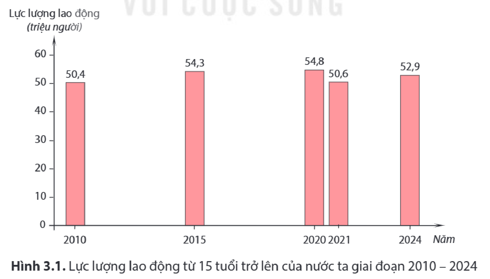
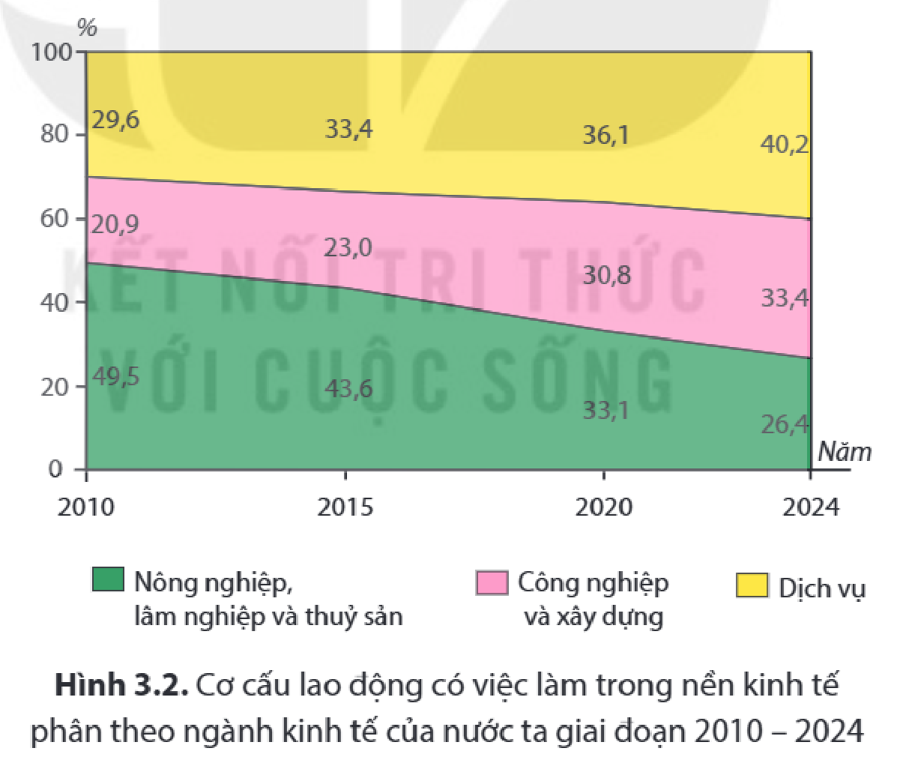

<!-- pdf:125 -->

# BÀI 3: LAO ĐỘNG VÀ VIỆC LÀM

## 🎯 Học xong bài này, em sẽ:

- Nêu được đặc điểm nguồn lao động nước ta.
- Trình bày được thực trạng sử dụng nguồn lao động ở nước ta.
- Trình bày được thực trạng vấn đề việc làm ở nước ta.
- Trình bày được phương hướng giải quyết việc làm.

## 🔴 Mở đầu

Lao động, việc làm là vấn đề xã hội quan trọng ở nước ta. Cùng với sự thay đổi của dân cư, sự phát triển kinh tế – xã hội của đất nước, việc sử dụng lao động đang diễn ra như thế nào, vấn đề việc làm cần quan tâm ra sao?

## 1. Nguồn lao động

### a) Đặc điểm nguồn lao động

- *Về số lượng*

<!-- term: Nguồn lao động Việt Nam -->
Việt Nam có nguồn lao động dồi dào. Năm 2024, lực lượng lao động nước ta chiếm 52,2% tổng số dân. Nhóm lao động trẻ (từ 15 đến 24 tuổi) giảm nhanh, trong khi lao động từ 50 tuổi trở lên tăng lên.

*Hình 3.1. Lực lượng lao động từ 15 tuổi trở lên của nước ta giai đoạn 2010 – 2024*

*(Nguồn: Niên giám thống kê Việt Nam năm 2011, 2016, 2024; Cục Thống kê năm 2025)*

<!-- pdf:126 -->

- *Về chất lượng*

<!-- term: Nguồn lao động Việt Nam -->
Người lao động nước ta chăm chỉ, sáng tạo, tích luỹ được nhiều kinh nghiệm trong sản xuất và dịch vụ. Trình độ chuyên môn kĩ thuật, khả năng ứng dụng khoa học – công nghệ của lao động đang được nâng lên. Năm 2024, tỉ lệ lao động đã qua đào tạo của nước ta là 28,4%, tăng 13,8% so với năm 2010. Đồng bằng sông Hồng là vùng có tỉ lệ lao động đã qua đào tạo lớn nhất cả nước.

<!-- term: Nguồn lao động Việt Nam -->
Tuy nhiên, lao động nước ta còn hạn chế về thể lực, kĩ năng chuyên sâu, ảnh hưởng đến năng suất lao động và quá trình hội nhập quốc tế.

### b) Sử dụng lao động

Số lao động có việc làm trong nền kinh tế của nước năm 2024 là 51,9 triệu người. Việc sử dụng lao động ảnh hưởng rất lớn đến quá trình phát triển kinh tế và nâng cao năng suất lao động ở nước ta.

- *Theo ngành kinh tế*

<!-- term: Cơ cấu lao động theo ngành kinh tế ở Việt Nam -->
Cơ cấu lao động theo ngành kinh tế ở Việt Nam đang chuyển dịch nhanh theo hướng công nghiệp hoá, hiện đại hoá và nâng cao năng suất lao động. Quá trình chuyển dịch cho thấy xu hướng lao động chuyển sang làm việc trong các ngành có trình độ và giá trị kinh tế cao.

*Hình 3.2. Cơ cấu lao động có việc làm trong nền kinh tế phân theo ngành kinh tế của nước ta giai đoạn 2010 – 2024*

*(Nguồn: Niên giám thống kê Việt Nam năm 2011, 2016, 2024; Cục Thống kê năm 2025)*

- *Theo thành phần kinh tế*

<!-- term: Cơ cấu lao động theo thành phần kinh tế ở Việt Nam -->
Cơ cấu lao động theo thành phần kinh tế ở nước ta chuyển dịch phù hợp với đường lối phát triển nền kinh tế mở, nhiều thành phần. Xu thế chuyển dịch cho thấy khả năng tạo việc làm rất lớn của các doanh nghiệp tư nhân và kết quả của quá trình mở cửa, thu hút đầu tư nước ngoài ở nước ta.

<!-- pdf:127 -->

Bảng 3.1. CƠ CẤU LAO ĐỘNG CÓ VIỆC LÀM TRONG NỀN KINH TẾ PHÂN THEO THÀNH PHẦN KINH TẾ CỦA NƯỚC TA GIAI ĐOẠN 2010 – 2024

*(Đơn vị: %)*

| Thành phần kinh tế \ Năm | 2010 | 2015 | 2020 | 2024 |
| --- | :---: | :---: | :---: | :---: |
| Kinh tế Nhà nước | 10,4 | 9,0 | 7,6 | 7,7 |
| Kinh tế ngoài Nhà nước | 86,1 | 85,0 | 83,6 | 81,9 |
| Khu vực có vốn đầu tư nước ngoài | 3,5 | 6,0 | 8,8 | 10,4 |

*(Nguồn: Niên giám thống kê Việt Nam năm 2011, 2016, 2024; Cục Thống kê năm 2025)*

> ❓ Dựa vào thông tin mục 1, hãy:
> - Nêu đặc điểm nguồn lao động nước ta.
> - Trình bày thực trạng sử dụng nguồn lao động ở nước ta.

## 2. Vấn đề việc làm và phương hướng giải quyết việc làm

### a) Vấn đề việc làm

<!-- term: Vấn đề việc làm ở Việt Nam -->
Tỉ lệ thất nghiệp và thiếu việc làm của nước ta nhìn chung ở mức thấp. Các chương trình hỗ trợ việc làm của Nhà nước, việc mở rộng sản xuất, kinh doanh của doanh nghiệp đã góp phần giảm tỉ lệ thất nghiệp. Tuy nhiên, vấn đề cần quan tâm hiện nay là tình trạng thất nghiệp, thiếu việc làm ở thanh niên còn cao.

> 💡 **Em có biết?**
>
> Tỉ lệ thất nghiệp của thanh niên trong độ tuổi từ 15 đến 24 tuổi là gần 8%, cao gấp 3,5 lần tỉ lệ chung (năm 2024). Thực trạng này đặt ra yêu cầu cấp thiết về đổi mới giáo dục nghề nghiệp, tăng cơ hội việc làm, hỗ trợ nhóm yếu thế,...
>
> *(Nguồn: Cục Thống kê năm 2025)*

Bảng 3.2. TỈ LỆ THẤT NGHIỆP VÀ THIẾU VIỆC LÀM TRONG ĐỘ TUỔI LAO ĐỘNG CỦA NƯỚC TA GIAI ĐOẠN 2010 – 2024

*(Đơn vị: %)*

| Tỉ lệ \ Năm | 2010 | 2015 | 2020 | 2024 |
| --- | :---: | :---: | :---: | :---: |
| Thất nghiệp | 2,88 | 2,33 | 2,48 | 2,24 |
| Thiếu việc làm | 3,57 | 1,89 | 2,52 | 1,85 |

*(Nguồn: Niên giám thống kê Việt Nam năm 2011, 2016, 2024; Cục Thống kê năm 2025)*

<!-- pdf:128 -->

<!-- term: Vấn đề việc làm ở Việt Nam -->
Ngành nghề đa dạng hơn, xuất hiện nhiều lĩnh vực mới như trí tuệ nhân tạo, logistics, khoa học dữ liệu,... nên lao động có thêm cơ hội việc làm. Năng suất lao động của nước ta đã cải thiện nhưng vẫn thấp do tỉ lệ lao động chưa qua đào tạo còn cao và các công việc giản đơn còn phổ biến.

### b) Phương hướng giải quyết việc làm

Một số giải pháp để giải quyết vấn đề việc làm ở nước ta:

<!-- term: Phương hướng giải quyết việc làm ở Việt Nam -->
- Thúc đẩy tạo việc làm mới thông qua đẩy mạnh phát triển các ngành kinh tế.

<!-- term: Phương hướng giải quyết việc làm ở Việt Nam -->
- Hoàn thiện chính sách, pháp luật về lao động nhằm khuyến khích, hỗ trợ, huy động mọi nguồn lực đầu tư tạo việc làm.

<!-- term: Phương hướng giải quyết việc làm ở Việt Nam -->
- Đẩy mạnh đào tạo, dạy nghề nâng cao chất lượng lao động.

<!-- term: Phương hướng giải quyết việc làm ở Việt Nam -->
- Phát triển hệ thống tư vấn, thông tin về thị trường lao động, việc làm.

<!-- term: Phương hướng giải quyết việc làm ở Việt Nam -->
- Đẩy mạnh hợp tác quốc tế về lao động.

> ❓ Dựa vào thông tin mục 2, hãy:
> - Trình bày thực trạng vấn đề việc làm ở nước ta.
> - Nêu phương hướng giải quyết việc làm ở nước ta.

## ✏️ Luyện tập – Vận dụng

- Lập bảng về nội dung thực trạng sử dụng lao động ở nước ta theo mẫu sau:

| | Theo ngành kinh tế | Theo thành phần kinh tế |
| --- | :---: | :---: |
| Biểu hiện | ? | ? |
| Nguyên nhân | ? | ? |
| Ý nghĩa | ? | ? |

- Tìm hiểu thông tin, giới thiệu về nguồn lao động và tình hình sử dụng lao động ở địa phương em.

## 📷 Danh sách hình trong bài

| Mã hình | Trang PDF | Trang sách | Chú thích |
| --- | :---: | :---: | --- |
| H9-lich_su_va_dia_ly-dl-b03-01 | 125 | 123 | Hình 3.1. Lực lượng lao động từ 15 tuổi trở lên của nước ta giai đoạn 2010 – 2024 |
| H9-lich_su_va_dia_ly-dl-b03-02 | 126 | 124 | Hình 3.2. Cơ cấu lao động có việc làm trong nền kinh tế phân theo ngành kinh tế của nước ta giai đoạn 2010 – 2024 |
