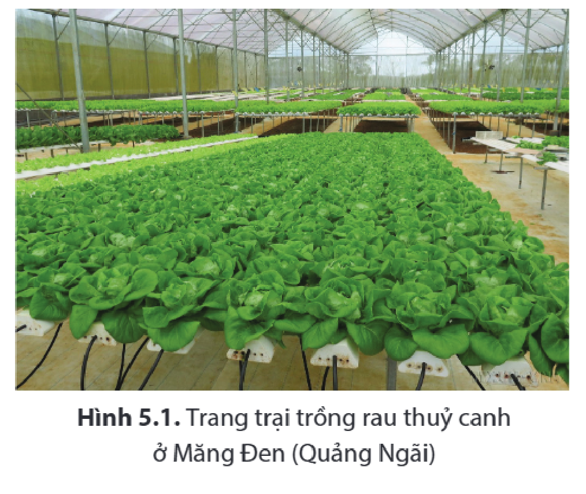
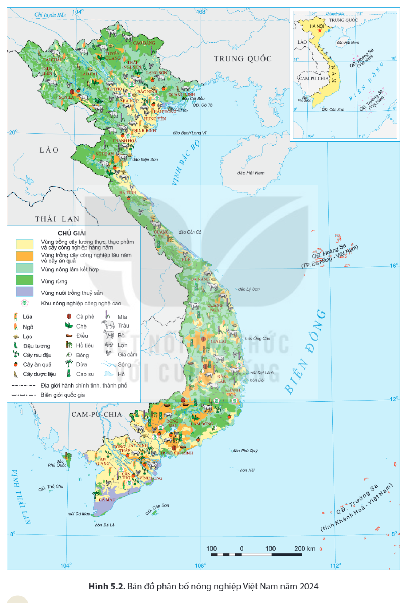
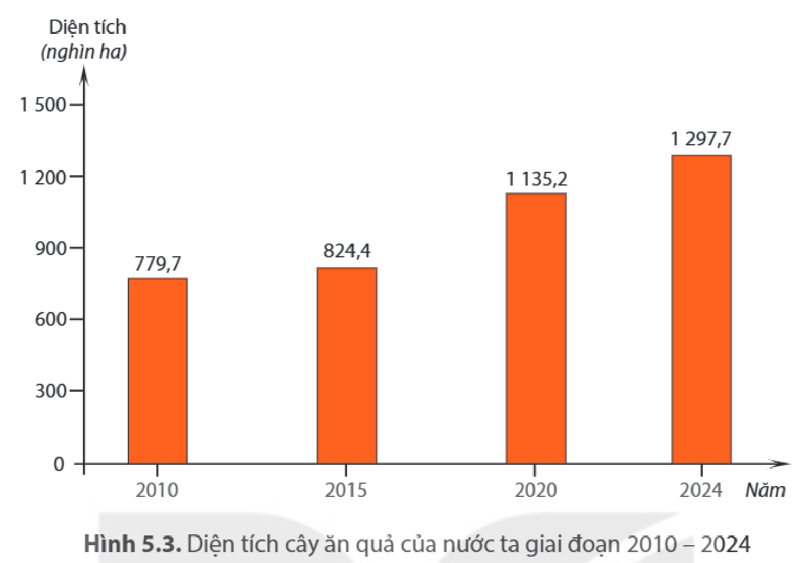

<!-- pdf:131 -->

# BÀI 5: NÔNG NGHIỆP

## 🎯 Học xong bài này, em sẽ:

- Phân tích được một trong các nhân tố chính ảnh hưởng tới sự phát triển và phân bố nông nghiệp.
- Trình bày được sự phát triển và phân bố nông nghiệp.

## 🔴 Mở đầu

Nền nông nghiệp nước ta là nền nông nghiệp nhiệt đới, chịu ảnh hưởng của các nhân tố tự nhiên và kinh tế – xã hội. Nền nông nghiệp Việt Nam hiện nay phát triển ra sao? Nêu một số hiểu biết của em về nông nghiệp Việt Nam.

## 1. Các nhân tố chính ảnh hưởng tới sự phát triển và phân bố nông nghiệp

### a) Nhân tố tự nhiên

- Địa hình và đất: Nước ta có 3/4 diện tích là đồi núi, chủ yếu là đồi núi thấp, một số vùng có các cao nguyên (Trung du và miền núi phía Bắc, Duyên hải Nam Trung Bộ và Tây Nguyên). Khu vực này có đất feralit là chủ yếu, thuận lợi cho phát triển và quy hoạch vùng chuyên canh cây công nghiệp, cây ăn quả; có các đồng cỏ lớn thích hợp chăn nuôi gia súc lớn.

Đồng bằng chiếm 1/4 diện tích với đồng bằng châu thổ sông Hồng, sông Cửu Long và các đồng bằng ven biển; đất phù sa là chủ yếu, thuận lợi cho phát triển các vùng chuyên canh cây lương thực, thực phẩm (rau, đậu,...),...

- Khí hậu: Nước ta có nguồn nhiệt ẩm dồi dào là điều kiện để phát triển nền nông nghiệp nhiệt đới; cây trồng, vật nuôi sinh trưởng nhanh và phát triển quanh năm cho năng suất cao. Khí hậu phân hoá theo chiều bắc – nam, theo độ cao địa hình và theo mùa tạo nên cơ cấu mùa vụ, sản phẩm đa dạng; đồng thời là điều kiện để quy hoạch vùng chuyên canh, chuyên môn hoá sản xuất.

- Nguồn nước: Nước ta có hệ thống sông ngòi dày đặc; nhiều hồ, đầm tự nhiên và nhân tạo phân bố khắp cả nước. Nguồn nước ngầm khá phong phú. Đây là những nguồn cung cấp nước cho sản xuất nông nghiệp.

<!-- pdf:132 -->

- Sinh vật: Nước ta có hệ động, thực vật phong phú, là cơ sở để thuần dưỡng, lai tạo nên nhiều giống cây trồng, vật nuôi. Nhiều loài có chất lượng tốt, thích nghi với điều kiện sinh thái địa phương.

Tuy nhiên, đất ở nhiều nơi đang bị thoái hoá, khí hậu nóng ẩm làm xuất hiện nhiều loại sâu bệnh, thiên tai ảnh hưởng đến chất lượng và sản lượng nông sản. Các tác động của biến đổi khí hậu cũng ảnh hưởng tới sản xuất nông nghiệp.

> ❓ Dựa vào thông tin mục a, hãy phân tích các nhân tố tự nhiên ảnh hưởng tới sự phát triển và phân bố nông nghiệp nước ta.

### b) Nhân tố kinh tế – xã hội

- Dân cư và lao động: Nước ta có số dân đông, là thị trường tiêu thụ sản phẩm nông nghiệp lớn. Lực lượng lao động nông nghiệp dồi dào với kinh nghiệm sản xuất phong phú, trình độ người lao động ngày càng nâng cao, thuận lợi cho áp dụng các biện pháp kĩ thuật tiên tiến và công nghệ hiện đại vào sản xuất.

- Chính sách phát triển nông nghiệp: Các chính sách phát triển nông nghiệp gắn với phát triển nông thôn bền vững, hỗ trợ sản xuất nông nghiệp, thu hút đầu tư vào nông nghiệp,... thúc đẩy nông nghiệp phát triển. Nhà nước thực hiện tái cơ cấu nông nghiệp, chuyển từ tư duy sản xuất nông nghiệp sang tư duy kinh tế nông nghiệp tạo sản phẩm có giá trị cao, đa dạng theo chuỗi,...

- Khoa học – công nghệ và cơ sở vật chất – kĩ thuật: Khoa học – công nghệ phát triển tạo ra nhiều giống cây trồng, vật nuôi mới phù hợp với sự thay đổi điều kiện sinh thái, nâng cao năng suất và chất lượng nông sản,...

Cơ sở vật chất – kĩ thuật ngày càng được hoàn thiện, nước ta đã xây dựng các hệ thống thuỷ lợi lớn (hồ Dầu Tiếng ở vùng Đông Nam Bộ, hệ thống thuỷ lợi Bắc Hưng Hải ở vùng Đồng bằng sông Hồng, hệ thống thuỷ lợi Cái Lớn – Cái Bé ở vùng Đồng bằng sông Cửu Long,...). Các cơ sở chế biến nông sản được đầu tư gắn với các vùng chuyên canh, thúc đẩy sản xuất nông nghiệp quy mô lớn.

- Thị trường: Thị trường tiêu thụ nông sản trong và ngoài nước được mở rộng đã thúc đẩy sản xuất, đa dạng hoá sản phẩm nông nghiệp.

Tuy nhiên, cơ sở vật chất – kĩ thuật nông nghiệp còn có hạn chế ở một số nơi, sự biến động và yếu tố cạnh tranh của thị trường đã tạo ra nhiều thách thức cho sản xuất nông nghiệp Việt Nam.

> ❓ Dựa vào thông tin mục b, hãy phân tích các nhân tố kinh tế – xã hội ảnh hưởng tới sự phát triển và phân bố nông nghiệp nước ta.

## 2. Sự phát triển và phân bố nông nghiệp

Nông nghiệp nước ta phát triển mạnh theo hướng sản xuất hàng hoá, liên kết theo chuỗi giá trị, đẩy mạnh ứng dụng khoa học – công nghệ. Năm 2024, tốc độ tăng trưởng giá trị sản xuất ngành nông nghiệp đạt 2,9% và đóng góp 74,4% tổng giá trị sản xuất toàn ngành nông nghiệp, lâm nghiệp và thuỷ sản. Cơ cấu nông nghiệp đang có xu hướng giảm tỉ trọng của ngành trồng trọt, tăng tỉ trọng của ngành chăn nuôi và dịch vụ nông nghiệp.

<!-- pdf:133 -->

Sản phẩm nông nghiệp được phát triển theo ba trục sản phẩm chủ lực: sản phẩm cấp quốc gia, sản phẩm cấp tỉnh và sản phẩm đặc sản của địa phương. Nông nghiệp công nghệ cao, nông nghiệp xanh, nông nghiệp hữu cơ, nông nghiệp sinh thái, nông nghiệp tuần hoàn được chú trọng phát triển trên khắp cả nước.

### a) Ngành trồng trọt

<!-- term: Ngành trồng trọt ở Việt Nam -->
Trồng trọt chiếm 65,3% giá trị sản xuất của ngành nông nghiệp (năm 2024). Cây trồng nước ta đa dạng, bao gồm: cây lương thực, cây rau đậu, cây công nghiệp, cây ăn quả,... Cơ cấu cây trồng có xu hướng chuyển đổi từ cây trồng có giá trị kinh tế không cao sang cây trồng khác cho giá trị kinh tế cao hơn. Trong từng loại cây trồng, có sự thay đổi về giống phù hợp điều kiện sinh thái, cho năng suất cao và chất lượng sản phẩm tốt.

<!-- term: Cây lương thực ở Việt Nam -->
- Cây lương thực: Cây lương thực gồm: lúa, ngô, khoai, sắn,... trong đó lúa là cây lương thực chính, có vai trò quan trọng nhất, góp phần đảm bảo an ninh lương thực trong nước và phục vụ xuất khẩu. Lúa được trồng trên khắp cả nước. Cơ cấu mùa vụ thay đổi tuỳ từng địa phương. Nhiều giống mới với các đặc tính chịu mặn, chịu hạn, chống chịu sâu bệnh được đưa vào sử dụng cho năng suất cao, chất lượng tốt và phù hợp với bối cảnh biến đổi khí hậu. Mức độ cơ giới hoá trong sản xuất lúa ngày càng nâng cao. Hai vùng trồng lúa trọng điểm của nước ta là Đồng bằng sông Cửu Long và Đồng bằng sông Hồng.

Bảng 5.1. DIỆN TÍCH GIEO TRỒNG VÀ SẢN LƯỢNG LƯƠNG THỰC CÓ HẠT CỦA NƯỚC TA GIAI ĐOẠN 2010 – 2024

| Tiêu chí \ Năm | 2010 | 2015 | 2020 | 2024 |
| --- | :---: | :---: | :---: | :---: |
| Diện tích gieo trồng *(triệu ha)* | 8,6 | 9,0 | 8,2 | 8,0 |
| – Trong đó: Lúa | 7,5 | 7,8 | 7,3 | 7,1 |
| Sản lượng *(triệu tấn)* | 44,6 | 50,4 | 47,4 | 47,9 |
| – Trong đó: Lúa | 40,0 | 45,1 | 42,8 | 43,5 |

*(Nguồn: Niên giám thống kê Việt Nam năm 2011, 2016, 2024; Cục Thống kê năm 2025)*

- Cây rau đậu: Diện tích trồng cây rau đậu ngày càng tăng để đáp ứng nhu cầu thị trường. Cây rau đậu được trồng rộng khắp ở các địa phương trên cả nước, tập trung nhiều ở vùng Duyên hải Nam Trung Bộ và Tây Nguyên, Đồng bằng sông Cửu Long, Đồng bằng sông Hồng,...

*Hình 5.1. Trang trại trồng rau thuỷ canh ở Măng Đen (Quảng Ngãi)*

<!-- pdf:134 -->

*Hình 5.2. Bản đồ phân bố nông nghiệp Việt Nam năm 2024*

<!-- pdf:135 -->

<!-- term: Cây công nghiệp ở Việt Nam -->
- Cây công nghiệp: Diện tích trồng cây công nghiệp chiếm 17,9 % tổng diện tích các loại cây trồng của nước ta (năm 2024). Cơ cấu cây công nghiệp đa dạng, bao gồm cây công nghiệp hàng năm (mía, lạc, đậu tương, bông,...) và cây công nghiệp lâu năm (cà phê, cao su, hồ tiêu, điều,...).

Cây công nghiệp hàng năm có diện tích, sản lượng lớn là lạc, đậu tương (ở vùng Trung du và miền núi phía Bắc, Bắc Trung Bộ); mía (ở vùng Bắc Trung Bộ, Đông Nam Bộ,...), bông (ở vùng Duyên hải Nam Trung Bộ và Tây Nguyên,...).

<!-- term: Cây công nghiệp ở Việt Nam -->
Cây công nghiệp lâu năm có diện tích lớn ở nước ta là chè, cà phê, điều, hồ tiêu, cao su,... Chè được phát triển mạnh ở vùng Trung du và miền núi phía Bắc, Duyên hải Nam Trung Bộ và Tây Nguyên. Cà phê, điều, hồ tiêu, cao su được trồng chủ yếu ở vùng Duyên hải Nam Trung Bộ và Tây Nguyên, Đông Nam Bộ. Ngoài ra, một số cây công nghiệp lâu năm được mở rộng diện tích canh tác như cà phê ở vùng Trung du và miền núi phía Bắc; hồ tiêu, cao su ở vùng Bắc Trung Bộ,...

Bảng 5.2. DIỆN TÍCH VÀ SẢN LƯỢNG MỘT SỐ CÂY CÔNG NGHIỆP LÂU NĂM CỦA NƯỚC TA GIAI ĐOẠN 2010 – 2024

| Cây | Cao su | Cao su | Cao su | Cà phê | Cà phê | Cà phê | Chè\* | Chè\* | Chè\* |
| --- | :---: | :---: | :---: | :---: | :---: | :---: | :---: | :---: | :---: |
| **Năm** | **2010** | **2015** | **2024** | **2010** | **2015** | **2024** | **2010** | **2015** | **2024** |
| Diện tích *(nghìn ha)* | 748,7 | 985,6 | 909,3 | 554,8 | 643,3 | 731,9 | 129,9 | 133,6 | 121,9 |
| Sản lượng *(nghìn tấn)* | 751,7 | 1 013,3 | 1 327,7 | 1 100,5 | 1 473,4 | 2 015,2 | 834,6 | 967,8 | 1 154,1 |
<!-- ocr-ok: đã đối chiếu từng con số với ảnh trang gốc PDF 135 (trang in 133), Bảng 5.2 bị OCR ghép vạch cột với chữ số và dấu phẩy thập phân -->

*\* Sản lượng chè búp tươi*

*(Nguồn: Niên giám thống kê Việt Nam năm 2011, 2016, 2024; Cục Thống kê năm 2025)*

<!-- term: Cây ăn quả ở Việt Nam -->
- Cây ăn quả: Nước ta có thể trồng được nhiều loại cây ăn quả có nguồn gốc nhiệt đới, cận nhiệt và ôn đới, nhiều loại được phát triển thành các vùng đặc sản có chỉ dẫn địa lí (vải thiều Lục Ngạn – Bắc Ninh, bưởi Phúc Trạch – Hà Tĩnh, xoài cát Hoà Lộc – Đồng Tháp,...). Nhiều giống cây ăn quả đã được lai tạo cho sản lượng cao, chất lượng tốt. Các mô hình trồng trọt theo hướng công nghệ cao, theo hướng hữu cơ, theo mô hình VietGAP, GlobalGAP được áp dụng và nhân rộng trên toàn quốc.

> 💡 **Em có biết?**
>
> Ở nhiều địa phương, cây ăn quả đang trở thành cây trồng chủ lực, đem lại thu nhập hàng trăm triệu đồng/ha/năm. Một số tỉnh phía Bắc hình thành các khu vực trồng cây ăn quả hàng hoá như: Sơn La, Phú Thọ,...
<!-- ocr-ok: đã đối chiếu ảnh trang gốc PDF 135 (trang in 133), hộp Em có biết? ở cột phải bị OCR trộn dòng với đoạn Cây ăn quả bên trái -->

<!-- term: Cây ăn quả ở Việt Nam -->
Diện tích trồng cây ăn quả ngày càng tăng. Vùng trồng cây ăn quả lớn nhất nước ta là Đồng bằng sông Cửu Long, Trung du và miền núi phía Bắc, Đông Nam Bộ.

<!-- pdf:136 -->

*Hình 5.3. Diện tích cây ăn quả của nước ta giai đoạn 2010 – 2024*

*(Nguồn: Niên giám thống kê Việt Nam năm 2011, 2016, 2024; Cục Thống kê năm 2025)*

Thị trường xuất khẩu hoa quả mở rộng, tiếp cận được các thị trường Hoa Kỳ, Nhật Bản, Ô-xtrây-li-a,... góp phần nâng cao giá trị và thu nhập cho nông dân.

> ❓ Dựa vào thông tin mục a và hình 5.2, hãy trình bày sự phát triển và phân bố ngành trồng trọt ở nước ta.

### b) Ngành chăn nuôi

<!-- term: Ngành chăn nuôi ở Việt Nam -->
Chăn nuôi chiếm 30,6% giá trị sản xuất ngành nông nghiệp (năm 2024) và có xu hướng tăng lên. Chăn nuôi đang phát triển theo hướng ứng dụng công nghệ cao, sản xuất theo quy mô công nghiệp tập trung. Nước ta ưu tiên phát triển chăn nuôi bền vững theo hướng hữu cơ, đáp ứng tiêu chuẩn an toàn thực phẩm, chú trọng đến khâu chế biến và tiêu thụ sản phẩm.

- Chăn nuôi trâu, bò: phát triển theo hướng nuôi thịt, mở rộng quy mô đàn bò sữa. Năm 2024, trâu được nuôi nhiều nhất ở vùng Trung du và miền núi phía Bắc; bò được nuôi nhiều nhất ở vùng Duyên hải Nam Trung Bộ và Tây Nguyên. Chăn nuôi bò sữa tập trung chủ yếu ở vùng Đông Nam Bộ, Bắc Trung Bộ, Duyên hải Nam Trung Bộ và Tây Nguyên.

- Chăn nuôi lợn: đang có xu hướng chuyển dịch từ chăn nuôi quy mô nhỏ sang phát triển các mô hình trang trại tập trung và hình thành các mô hình chăn nuôi khép kín từ nhân giống, sản xuất thức ăn, chế biến thành phẩm. Chăn nuôi lợn tập trung nhiều nhất ở vùng Trung du và miền núi phía Bắc, tiếp đến là Đông Nam Bộ.

<!-- pdf:137 -->

- Chăn nuôi gia cầm: phát triển theo quy mô hộ gia đình và quy mô trang trại với nhiều hình thức nuôi. Hiện nay có đa dạng giống gia cầm như gia cầm siêu thịt, gia cầm siêu trứng. Chăn nuôi gia cầm phát triển trên cả nước nhưng nhiều nhất ở vùng Đồng bằng sông Hồng, tiếp theo là Duyên hải Nam Trung Bộ và Tây Nguyên.

Bảng 5.3. SỐ LƯỢNG MỘT SỐ VẬT NUÔI CỦA NƯỚC TA GIAI ĐOẠN 2010 – 2024

*(Đơn vị: triệu con)*

| Vật nuôi \ Năm | 2010 | 2015 | 2020 | 2024 |
| --- | :---: | :---: | :---: | :---: |
| Trâu | 2,9 | 2,6 | 2,3 | 2,0 |
| Bò | 5,9 | 5,7 | 6,3 | 6,2 |
| Lợn | 27,3 | 28,9 | 22,0 | 26,5 |
| Gia cầm | 301,9 | 369,5 | 512,7 | 584,1 |

*(Nguồn: Niên giám thống kê Việt Nam năm 2011, 2016, 2024; Cục Thống kê năm 2025)*

> ❓ Dựa vào thông tin mục b và hình 5.2, hãy trình bày sự phát triển và phân bố ngành chăn nuôi ở nước ta.

## ✏️ Luyện tập – Vận dụng

- 1. Vẽ sơ đồ thể hiện các nhân tố ảnh hưởng đến sự phát triển và phân bố nông nghiệp ở nước ta.
- 2. Dựa vào bảng 5.1, hãy vẽ biểu đồ thể hiện diện tích gieo trồng cây lương thực có hạt và lúa của nước ta giai đoạn 2010 – 2024. Nêu nhận xét.
- Tìm hiểu thông tin, giới thiệu về tình hình sản xuất và phân bố một cây trồng hoặc vật nuôi quan trọng ở địa phương em.

## 📷 Danh sách hình trong bài

| Mã hình | Trang PDF | Trang sách | Chú thích |
| --- | :---: | :---: | --- |
| H9-lich_su_va_dia_ly-dl-b05-01 | 133 | 131 | Hình 5.1. Trang trại trồng rau thuỷ canh ở Măng Đen (Quảng Ngãi) |
| H9-lich_su_va_dia_ly-dl-b05-02 | 134 | 132 | Hình 5.2. Bản đồ phân bố nông nghiệp Việt Nam năm 2024 |
| H9-lich_su_va_dia_ly-dl-b05-03 | 136 | 134 | Hình 5.3. Diện tích cây ăn quả của nước ta giai đoạn 2010 – 2024 |
