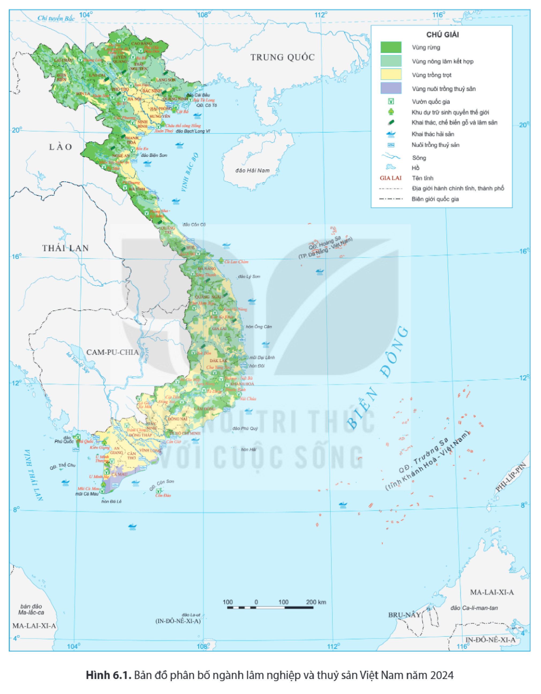
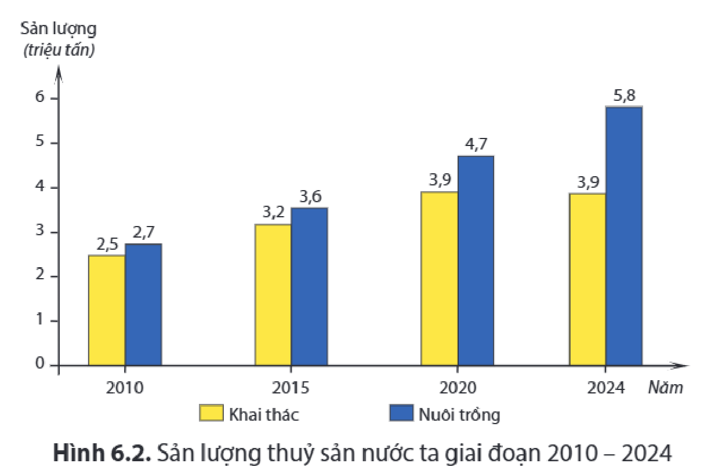

<!-- pdf:138 -->

# BÀI 6: LÂM NGHIỆP VÀ THUỶ SẢN

## 🎯 Học xong bài này, em sẽ:

- Phân tích được một trong các nhân tố chính ảnh hưởng tới sự phát triển và phân bố lâm nghiệp, thuỷ sản.
- Trình bày được sự phát triển và phân bố lâm nghiệp, thuỷ sản.

## 🔴 Mở đầu

Lâm nghiệp và thuỷ sản có vai trò quan trọng đối với phát triển kinh tế – xã hội, bảo vệ môi trường và ứng phó với biến đổi khí hậu. Ngành lâm nghiệp và thuỷ sản nước ta chịu ảnh hưởng của các nhân tố nào, phát triển và phân bố ra sao?

## 1. Lâm nghiệp

### a) Các nhân tố chính ảnh hưởng tới sự phát triển và phân bố lâm nghiệp

- *Nhân tố tự nhiên*

  + Tài nguyên rừng: Rừng đóng vai trò quan trọng trong sự phát triển và phân bố ngành lâm nghiệp. Rừng cung cấp nguyên liệu cho ngành công nghiệp chế biến, tạo việc làm và thu nhập, góp phần ổn định đời sống cho người dân sống dựa vào rừng. Tính đến năm 2024, tổng diện tích rừng của nước ta đạt khoảng 14,9 triệu ha với tỉ lệ che phủ rừng đạt 42%. Vùng Trung du và miền núi phía Bắc có diện tích rừng lớn nhất, chiếm gần 36% tổng diện tích rừng cả nước (năm 2024).

> 💡 **Em có biết?**
>
> Theo nguồn gốc hình thành, rừng được phân thành rừng tự nhiên và rừng trồng.
>
> Theo mục đích sử dụng, rừng được phân thành rừng sản xuất, rừng phòng hộ và rừng đặc dụng. **Rừng sản xuất** có chức năng cung cấp gỗ. **Rừng phòng hộ** có chức năng điều tiết nước, chắn sóng, chắn cát và bảo vệ môi trường. **Rừng đặc dụng** là các vườn quốc gia, khu bảo tồn thiên nhiên,... chứa đựng các hệ sinh thái tự nhiên quan trọng có các loài đặc hữu cần được bảo vệ.
>
> *(Nguồn: Luật Lâm nghiệp 2017)*

  + Địa hình và đất: Địa hình nước ta chủ yếu là đồi núi, có nhiều loại đất khác nhau, tạo điều kiện thuận lợi cho rừng phát triển.

  + Khí hậu: Nước ta có khí hậu nhiệt đới ẩm gió mùa với lượng mưa lớn, độ ẩm cao, phân hoá đa dạng tạo điều kiện cho các loại rừng phát triển, nhất là rừng nhiệt đới. Đặc điểm về nhiệt độ, lượng mưa và ánh sáng tạo sự đa dạng sinh học cao và góp phần cải thiện chất lượng rừng.

<!-- pdf:139 -->

- *Nhân tố kinh tế – xã hội*

  + Chính sách phát triển và bảo vệ rừng: Nhà nước đã ban hành nhiều chính sách như giao đất rừng, bảo vệ rừng và quy hoạch, định hướng phát triển lâm nghiệp bền vững góp phần trồng mới và phục hồi rừng hiệu quả.

  + Khoa học – công nghệ: Khoa học – công nghệ thúc đẩy phát triển lâm nghiệp thông qua ứng dụng giống cây mới và kĩ thuật trồng rừng hiện đại, nâng cao năng suất và chất lượng rừng. Công nghệ khai thác, chế biến tiên tiến giúp gia tăng giá trị lâm sản. Các công nghệ số giúp hỗ trợ quản lí và bảo vệ rừng hiệu quả.

  + Thị trường tiêu thụ: Nhu cầu về các sản phẩm từ gỗ và lâm sản khác ngày càng tăng; những yêu cầu của thị trường quốc tế về truy xuất nguồn gốc và tuân thủ chống phá rừng, chứng chỉ rừng,... góp phần phát triển lâm nghiệp bền vững.

  + Dân cư và lao động: Nhận thức của người dân về bảo vệ rừng ngày càng được cải thiện góp phần nâng cao hiệu quả quản lí, bảo vệ và khai thác rừng. Lao động có kĩ năng và kinh nghiệm giúp tăng năng suất khai thác, trồng rừng và chế biến lâm sản.

Tuy nhiên, các thiên tai như sạt lở, hạn hán, cháy rừng,... đã làm giảm diện tích và chất lượng rừng; các hoạt động phá rừng, khai thác trái phép lâm sản và chuyển đổi mục đích sử dụng đất sai quy hoạch đã phá vỡ hệ sinh thái, ảnh hưởng tiêu cực đến phát triển bền vững ngành lâm nghiệp.

### b) Sự phát triển và phân bố lâm nghiệp

Năm 2024, tốc độ tăng trưởng giá trị sản xuất ngành lâm nghiệp đạt 5,0%, đóng góp gần 3% tổng giá trị sản xuất toàn ngành nông nghiệp, lâm nghiệp và thuỷ sản. Hoạt động lâm nghiệp bao gồm khai thác, chế biến lâm sản; trồng rừng, khoanh nuôi và bảo vệ rừng (lâm sinh).

- *Khai thác, chế biến lâm sản*

<!-- term: Khai thác, chế biến lâm sản ở Việt Nam -->
Diện tích rừng sản xuất chiếm hơn 53% tổng diện tích rừng (năm 2024). Sản lượng gỗ khai thác ngày càng tăng, năm 2024 đạt khoảng 24 triệu m³, gấp 6 lần so với năm 2010. Các vùng có sản lượng gỗ khai thác lớn là Duyên hải Nam Trung Bộ và Tây Nguyên, Trung du và miền núi phía Bắc.

<!-- term: Khai thác, chế biến lâm sản ở Việt Nam -->
Ngoài gỗ, rừng còn cung cấp các lâm sản khác như măng, mộc nhĩ, dược liệu,... Công nghiệp chế biến gỗ và lâm sản phát triển gắn với các vùng nguyên liệu.

- *Trồng rừng, khoanh nuôi và bảo vệ rừng*

<!-- term: Trồng rừng, khoanh nuôi và bảo vệ rừng ở Việt Nam -->
Hoạt động trồng rừng được quan tâm đẩy mạnh. Diện tích rừng trồng mới ngày càng mở rộng, năm 2024 đạt khoảng 304 nghìn ha, trong đó rừng sản xuất được trồng mới nhiều nhất (chiếm hơn 97% tổng diện tích rừng trồng mới). Nghề trồng dược liệu dưới tán rừng phát triển, tạo thêm sinh kế ổn định cho người dân vùng rừng.

<!-- term: Trồng rừng, khoanh nuôi và bảo vệ rừng ở Việt Nam -->
Công tác khoanh nuôi và bảo vệ rừng ngày càng được đẩy mạnh, tăng cường khoanh nuôi rừng tự nhiên, xây dựng và quản lí chặt chẽ các vườn quốc gia, khu bảo tồn thiên nhiên.

<!-- pdf:140 -->

*Hình 6.1. Bản đồ phân bố ngành lâm nghiệp và thuỷ sản Việt Nam năm 2024*

<!-- pdf:141 -->

> ❓ Dựa vào thông tin mục 1 và hình 6.1, hãy:
> - Phân tích các nhân tố ảnh hưởng tới sự phát triển và phân bố ngành lâm nghiệp nước ta.
> - Trình bày sự phát triển và phân bố ngành lâm nghiệp nước ta.

## 2. Thuỷ sản

### a) Các nhân tố chính ảnh hưởng tới sự phát triển và phân bố thuỷ sản

- *Nhân tố tự nhiên*

  + Nguồn lợi thuỷ sản: Nguồn lợi thuỷ sản của nước ta rất phong phú với hơn 500 loài cá nước ngọt; vùng biển có hơn 2 000 loài cá, hàng trăm loài tôm, mực với tổng trữ lượng khoảng 4 triệu tấn, trong đó có nhiều loài có giá trị kinh tế cao. Đây chính là điều kiện cơ bản thúc đẩy phát triển ngành thuỷ sản nước ta.

  + Địa hình: Việt Nam có đường bờ biển dài với nhiều vũng vịnh, đầm phá, rừng ngập mặn thuận lợi cho nuôi trồng thuỷ sản. Vùng biển rộng thuận lợi cho hoạt động khai thác hải sản. Các vùng đồng bằng ven biển là nơi thuận lợi cho nuôi trồng thuỷ sản.

  + Khí hậu, thuỷ văn: Nước ta có khí hậu nhiệt đới, biển ấm, thích hợp cho nhiều loài thuỷ sản phát triển. Các hệ thống sông ngòi, cửa sông giàu dinh dưỡng thúc đẩy sự phát triển thuỷ sản nước ngọt và nước lợ. Dòng biển hoạt động theo mùa ảnh hưởng trực tiếp đến sự di cư, tập trung của các loài cá và thời gian, khu vực đánh bắt.

- *Nhân tố kinh tế – xã hội*

  + Thị trường: Thị trường tiêu thụ thuỷ sản ngày càng mở rộng cả trong và ngoài nước, sản phẩm thuỷ sản của nước ta đã thâm nhập được vào các thị trường đòi hỏi chất lượng cao thúc đẩy quy mô sản xuất và sự đa dạng hoá sản phẩm. Các yêu cầu của thị trường quốc tế như truy xuất nguồn gốc sản phẩm, đảm bảo tiêu chuẩn về an toàn và môi trường,... góp phần phát triển bền vững ngành thuỷ sản nước ta.

  + Khoa học – công nghệ và cơ sở vật chất – kĩ thuật: Tàu thuyền, cảng cá, kho lạnh, nhà máy chế biến và công nghệ nuôi trồng ngày càng hiện đại quyết định năng suất, hiệu quả và chất lượng sản phẩm.

  + Chính sách phát triển thuỷ sản: Các chính sách liên quan đã được ban hành nhằm thúc đẩy thuỷ sản thành ngành có quy mô lớn, tham gia sâu vào chuỗi cung ứng toàn cầu và bền vững; kết hợp phát triển kinh tế với bảo vệ vững chắc chủ quyền quốc gia trên các vùng biển, đảo của Tổ quốc.

  + Dân cư và lao động: Dân cư ven biển, ngư dân có kinh nghiệm lâu đời, đội ngũ chuyên gia và lao động có trình độ kĩ thuật cao là yếu tố quan trọng thúc đẩy phát triển và nâng cao giá trị ngành thuỷ sản.

Tuy nhiên, nguồn lợi thuỷ sản của nước ta đang bị suy giảm do khai thác quá mức; biến đổi khí hậu, ô nhiễm môi trường gây khó khăn cho phát triển ngành thuỷ sản.

### b) Sự phát triển và phân bố thuỷ sản

Năm 2024, giá trị sản xuất thuỷ sản chiếm 22,6% toàn ngành nông nghiệp, lâm nghiệp và thuỷ sản; tốc độ tăng trưởng đạt 4,1%. Sản lượng thuỷ sản nuôi trồng cao, chiếm gần 60% tổng sản lượng thuỷ sản (năm 2024).

<!-- pdf:142 -->

*Hình 6.2. Sản lượng thuỷ sản nước ta giai đoạn 2010 – 2024*

*(Nguồn: Niên giám thống kê Việt Nam năm 2011, 2016, 2024; Cục Thống kê năm 2025)*

- *Khai thác thuỷ sản*

<!-- term: Khai thác thuỷ sản ở Việt Nam -->
Sản lượng thuỷ sản khai thác có xu hướng tăng, trong đó chủ yếu là khai thác hải sản, đặc biệt là cá biển (chiếm 73,7% tổng sản lượng khai thác năm 2024). Vùng Đồng bằng sông Cửu Long có sản lượng thuỷ sản khai thác cao nhất cả nước. Khai thác thuỷ sản xa bờ trên cơ sở tuân thủ các quy định của luật pháp, trong đó có các quy định chống khai thác IUU đang được đẩy mạnh. Các tàu đánh cá và trang thiết bị được đầu tư hiện đại hơn.

> 💡 **Em có biết?**
>
> **IUU** là viết tắt của cụm từ Illegal, Unreported and Unregulated Fishing, có nghĩa là khai thác hải sản bất hợp pháp, không khai báo và không theo quy định. Quy định này được Uỷ ban châu Âu (EC) ban hành và có hiệu lực từ ngày 01 – 10 – 2010 nhằm thiết lập một hệ thống trên toàn EU để ngăn chặn và loại bỏ việc nhập khẩu các sản phẩm hải sản bị khai thác IUU vào thị trường EU.

- *Nuôi trồng thuỷ sản*

<!-- term: Nuôi trồng thuỷ sản ở Việt Nam -->
Nuôi trồng thuỷ sản phát triển nhanh, chủ yếu là nuôi tôm và cá. Đồng bằng sông Cửu Long là vùng có sản lượng thuỷ sản nuôi trồng lớn nhất. Nuôi trồng thuỷ sản đang phát triển theo hình thức trang trại công nghệ cao, nuôi hữu cơ. Sản phẩm thuỷ sản nuôi trồng ngày càng đáp ứng yêu cầu về an toàn thực phẩm, truy xuất nguồn gốc và các tiêu chuẩn quốc tế.

Thuỷ sản của nước ta đã xuất khẩu đến nhiều thị trường lớn trên thế giới như: Hoa Kỳ, EU,... Xuất khẩu thuỷ sản thúc đẩy các hoạt động khai thác, nuôi trồng và chế biến thuỷ sản.

> ❓ Dựa vào thông tin mục 2 và hình 6.1, hãy:
> - Phân tích các nhân tố ảnh hưởng tới sự phát triển và phân bố ngành thuỷ sản nước ta.
> - Trình bày sự phát triển và phân bố ngành thuỷ sản nước ta.

## ✏️ Luyện tập – Vận dụng

- Dựa vào hình 6.2, hãy:
  + Tính cơ cấu sản lượng thuỷ sản phân theo khai thác và nuôi trồng của nước ta giai đoạn 2010 – 2024.
  + Nhận xét sự thay đổi cơ cấu sản lượng thuỷ sản của nước ta giai đoạn 2010 – 2024.
- Tìm hiểu và giới thiệu về hoạt động trồng rừng ở địa phương em.

## 📷 Danh sách hình trong bài

| Mã hình | Trang PDF | Trang sách | Chú thích |
| --- | :---: | :---: | --- |
| H9-lich_su_va_dia_ly-dl-b06-01 | 140 | 138 | Hình 6.1. Bản đồ phân bố ngành lâm nghiệp và thuỷ sản Việt Nam năm 2024 |
| H9-lich_su_va_dia_ly-dl-b06-02 | 142 | 140 | Hình 6.2. Sản lượng thuỷ sản nước ta giai đoạn 2010 – 2024 |
