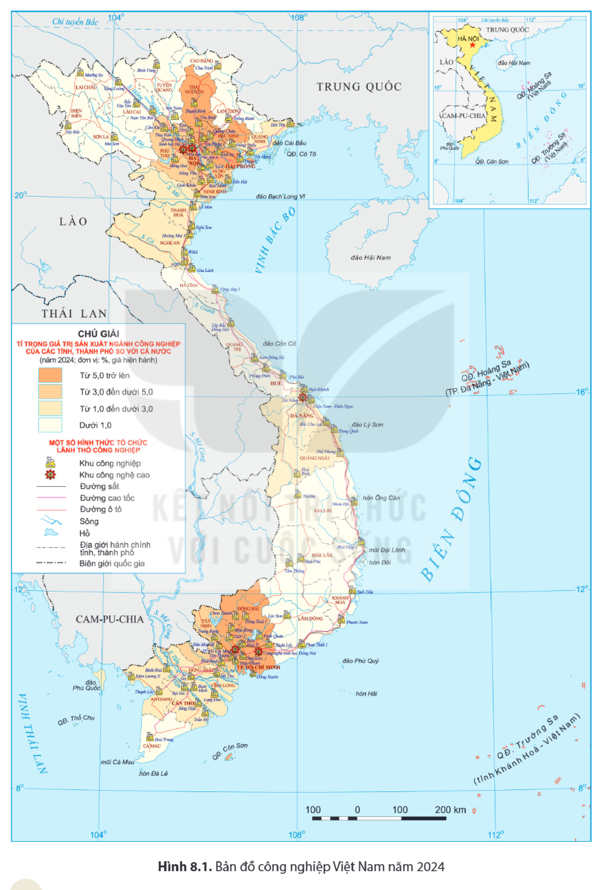
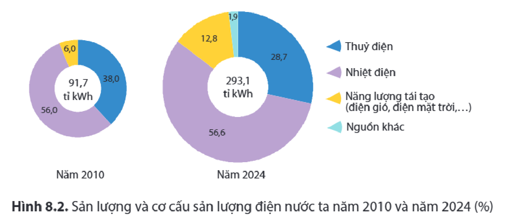
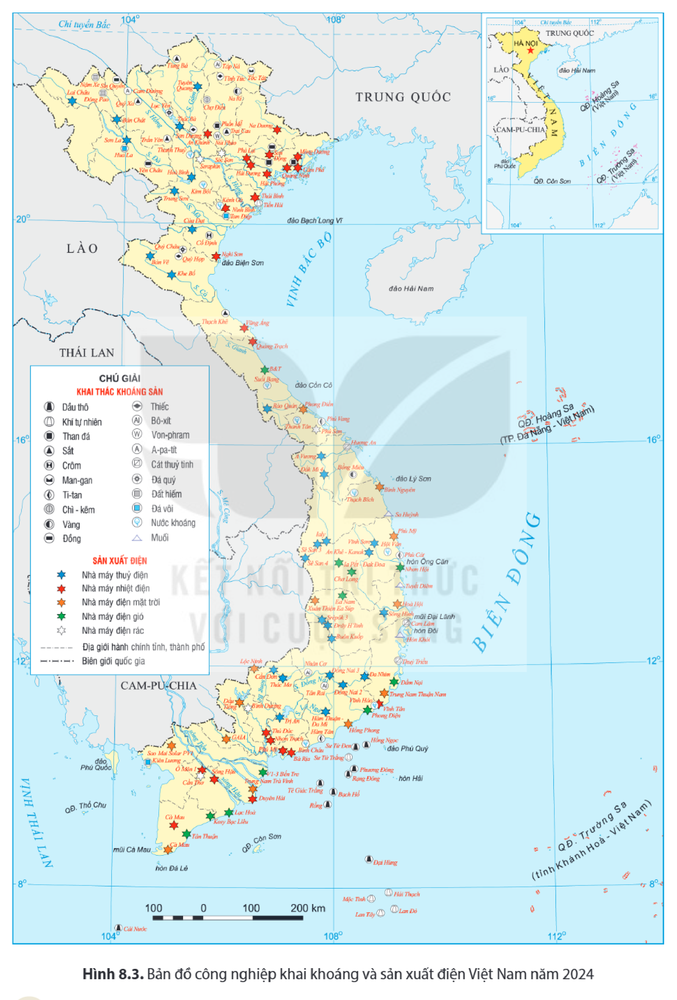
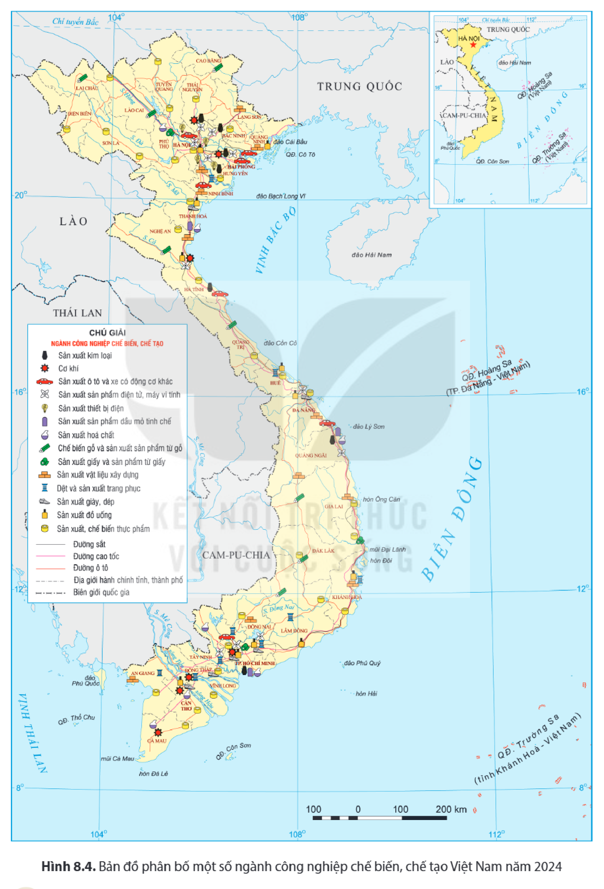

<!-- pdf:144 -->

# BÀI 8: CÔNG NGHIỆP

## 🎯 Học xong bài này, em sẽ:

- Phân tích được vai trò của một trong các nhân tố quan trọng ảnh hưởng đến sự phát triển và phân bố công nghiệp.
- Trình bày được sự phát triển và phân bố của một trong các ngành công nghiệp chủ yếu.
- Giải thích được tại sao cần phát triển công nghiệp xanh.

## 🔴 Mở đầu

Hiện nay, nước ta đang đẩy mạnh tái cấu trúc các ngành công nghiệp theo hướng phát triển công nghiệp xanh. Có những nhân tố nào ảnh hưởng đến sự phát triển và phân bố công nghiệp nước ta? Các ngành công nghiệp chủ yếu ở nước ta có sự phát triển và phân bố như thế nào? Tại sao nước ta hướng đến phát triển công nghiệp xanh?

## 1. Các nhân tố ảnh hưởng đến sự phát triển và phân bố công nghiệp

### a) Nhân tố tự nhiên

- Vị trí địa lí: Nước ta ở gần trung tâm của khu vực Đông Nam Á, khu vực phát triển năng động trên thế giới, thuận lợi cho thu hút đầu tư nước ngoài, phát triển công nghiệp.

- Khoáng sản: Cơ cấu khoáng sản của nước ta đa dạng, trong đó một số khoáng sản có trữ lượng lớn như than đá, than nâu, khí tự nhiên, dầu mỏ, đá vôi, a-pa-tít, bô-xít,... tạo thuận lợi phát triển các ngành công nghiệp khai khoáng, sản xuất kim loại,...

- Nguồn nước: Việt Nam có mạng lưới sông ngòi dày, nguồn nước ngầm dồi dào cung cấp nước cho các ngành công nghiệp. Sông chảy qua địa hình dốc nên có tiềm năng thuỷ điện lớn, tạo điều kiện thuận lợi cho phát triển thuỷ điện.

- Sinh vật: Nước ta có nguồn tài nguyên sinh vật phong phú, đa dạng, nhiều loài có giá trị kinh tế và giá trị dược liệu cao; nguồn hải sản dồi dào. Đây là nguồn nguyên liệu cho ngành công nghiệp sản xuất, chế biến thực phẩm, dược phẩm.

- Ngoài ra, khí hậu nhiệt đới gió mùa cũng tạo điều kiện để nước ta phát triển nền nông nghiệp đa dạng, năng suất cao, cung cấp nguồn nguyên liệu dồi dào cho ngành công nghiệp sản xuất, chế biến thực phẩm. Việt Nam có số giờ nắng cao, gió ổn định quanh năm là cơ sở để phát triển điện mặt trời, điện gió.

Tuy nhiên, phần lớn các mỏ khoáng sản nước ta có quy mô nhỏ, phân bố không tập trung, nhiều loại có nguy cơ cạn kiệt; khí hậu nhiệt đới ẩm làm tăng chi phí làm mát, bảo quản máy móc,... là những khó khăn cho phát triển công nghiệp ở nước ta.

> ❓ Dựa vào thông tin mục a, hãy phân tích vai trò của các nhân tố tự nhiên ảnh hưởng đến sự phát triển và phân bố ngành công nghiệp nước ta.

<!-- pdf:145 -->

### b) Nhân tố kinh tế – xã hội

- Dân cư và lao động: Dân số nước ta đông, tạo thị trường tiêu thụ rộng lớn. Lực lượng lao động dồi dào, trình độ người lao động ngày càng được nâng lên, tạo điều kiện tiếp thu và ứng dụng công nghệ tiên tiến vào sản xuất. Lao động trong các làng nghề, cơ sở sản xuất tiểu thủ công nghiệp có tay nghề cao, kinh nghiệm sản xuất phong phú.

- Chính sách: Các chính sách công nghiệp như chính sách phân bố không gian và chuyển dịch cơ cấu ngành công nghiệp, phát triển các ngành công nghiệp ưu tiên, chính sách tạo lập môi trường đầu tư, kinh doanh thuận lợi cho phát triển công nghiệp, chính sách khoa học – công nghệ cho phát triển công nghiệp,... tạo môi trường thuận lợi cho phát triển và phân bố hợp lí các ngành công nghiệp.

- Thị trường: Thị trường trong nước và quốc tế ngày càng được mở rộng, góp phần phát triển các ngành công nghiệp. Việt Nam đã tham gia kí kết các hiệp định thương mại tự do với EU, Nhật Bản,... Nhiều sản phẩm công nghiệp đã xuất khẩu sang thị trường các nước phát triển (Hoa Kỳ, Nhật Bản, EU,...).

- Khoa học – công nghệ, vốn và cơ sở vật chất – kĩ thuật: Nước ta tăng cường đầu tư cho nghiên cứu và chuyển giao công nghệ, áp dụng nhiều công nghệ tiên tiến vào sản xuất như hệ thống điều khiển tự động, công nghệ nano, vật liệu mới, công nghệ sinh học,... góp phần nâng cao năng suất và giá trị của các sản phẩm công nghiệp. Vốn đầu tư cho công nghiệp ngày càng tăng. Cơ sở vật chất – kĩ thuật được đầu tư phát triển hiện đại.

Tuy nhiên, thị trường ngày càng cạnh tranh, cơ sở vật chất – kĩ thuật một số ngành công nghiệp đã lạc hậu,... là những khó khăn cho phát triển công nghiệp ở nước ta.

> ❓ Dựa vào thông tin mục b, hãy phân tích vai trò của các nhân tố kinh tế – xã hội ảnh hưởng đến sự phát triển và phân bố ngành công nghiệp nước ta.

## 2. Một số ngành công nghiệp chủ yếu

Công nghiệp là ngành có đóng góp quan trọng vào tăng trưởng và phát triển kinh tế cả nước, chiếm tỉ trọng cao trong cơ cấu kinh tế. Giá trị sản xuất ngành công nghiệp tăng nhanh trong giai đoạn 2010 – 2024, đạt 16 929,7 nghìn tỉ đồng năm 2024.

Cơ cấu công nghiệp chuyển dịch theo hướng tăng tỉ trọng ngành công nghiệp chế biến, chế tạo và các ngành có hàm lượng công nghệ cao, ứng dụng khoa học – công nghệ trong sản xuất được đẩy mạnh.

> 💡 **Em có biết?**
>
> Công nghiệp nước ta có cơ cấu đa dạng, bao gồm: công nghiệp khai khoáng; công nghiệp chế biến, chế tạo (sản xuất, chế biến thực phẩm; sản xuất đồ uống; dệt và sản xuất trang phục; chế biến gỗ và sản xuất sản phẩm từ gỗ; sản xuất hoá chất; sản xuất thiết bị điện;...); sản xuất và phân phối điện, khí đốt, nước nóng, hơi nước và điều hoà không khí; cung cấp nước, hoạt động quản lí và xử lí rác thải, nước thải.

Một số hình thức tổ chức lãnh thổ công nghiệp như khu công nghiệp, khu công nghệ cao ngày càng được phát triển. Phân bố công nghiệp nước ta thay đổi theo hướng phát huy thế mạnh của mỗi vùng. Hoạt động công nghiệp tập trung nhất ở vùng Đồng bằng sông Hồng và Đông Nam Bộ.

Một số ngành công nghiệp chủ yếu của nước ta là công nghiệp khai khoáng; sản xuất điện; sản xuất, chế biến thực phẩm; sản xuất sản phẩm điện tử, máy vi tính; dệt và sản xuất trang phục; sản xuất giày, dép.

<!-- pdf:146 -->

*Hình 8.1. Bản đồ công nghiệp Việt Nam năm 2024*

<!-- pdf:147 -->

- *Công nghiệp khai khoáng*

<!-- term: Công nghiệp khai khoáng ở Việt Nam -->
Ngành công nghiệp khai khoáng có lịch sử phát triển lâu đời. Tỉ lệ đóng góp vào giá trị sản xuất ngành công nghiệp và sản lượng khai thác của ngành có xu hướng giảm dần.

Bảng 8.1. SẢN LƯỢNG KHAI THÁC MỘT SỐ KHOÁNG SẢN Ở NƯỚC TA GIAI ĐOẠN 2010 – 2024

| Sản lượng \ Năm | 2010 | 2015 | 2020 | 2024 |
| --- | :---: | :---: | :---: | :---: |
| Dầu thô *(triệu tấn)* | 15,0 | 18,7 | 11,5 | 9,9 |
| – Trong đó: Khai thác trong nước | 14,8 | 16,9 | 9,7 | 8,1 |
| Than sạch *(triệu tấn)* | 44,8 | 41,7 | 44,6 | 45,3 |
| Khí tự nhiên *(tỉ m³)* | 9,4 | 10,7 | 9,2 | 6,4 |

*(Nguồn: Niên giám thống kê Việt Nam năm 2011, 2016, 2024; Cục Thống kê năm 2025)*

<!-- term: Công nghiệp khai khoáng ở Việt Nam -->
Than khai thác chủ yếu ở Quảng Ninh; dầu thô, khí tự nhiên ở thềm lục địa phía nam; ti-tan, bô-xít ở vùng Duyên hải Nam Trung Bộ và Tây Nguyên; sắt, a-pa-tít ở vùng Trung du và miền núi phía Bắc,...

Ngành khai khoáng đã đầu tư vào nghiên cứu, áp dụng nhiều công nghệ mới trong sản xuất (công nghệ mô phỏng mỏ khai thác, công nghệ khai thác dầu trong đá móng), góp phần nâng cao chất lượng, hiệu quả, giảm thất thoát tài nguyên và ô nhiễm môi trường.

> 💡 **Em có biết?**
>
> Hiện nay, hệ thống thực tế ảo tạo ra mô hình 3D của các mỏ dưới lòng đất, giúp các kĩ sư hình dung được bố cục của mỏ. Công nghệ mô phỏng mỏ khai thác giúp quá trình thiết kế các mỏ chính xác hơn, ngăn ngừa nguy cơ mất an toàn lao động và giúp khai thác khoáng sản hiệu quả hơn.
>
> *(Nguồn: Tập đoàn Công nghiệp Than – Khoáng sản Việt Nam)*

- *Công nghiệp sản xuất điện*

<!-- term: Công nghiệp sản xuất điện ở Việt Nam -->
Sản lượng điện hằng năm tăng nhanh, đạt 293,1 tỉ kWh năm 2024. Khoa học – công nghệ hiện đại được áp dụng trong sản xuất, phát triển nguồn điện, vận hành và quản lí hệ thống lưới điện thông minh,...

<!-- term: Công nghiệp sản xuất điện ở Việt Nam -->
Cơ cấu sản lượng điện nước ta đa dạng, đang thay đổi theo hướng tăng tỉ trọng điện gió, điện mặt trời và các loại điện tái tạo khác.

*Hình 8.2. Sản lượng và cơ cấu sản lượng điện nước ta năm 2010 và năm 2024 (%)*

*(Nguồn: Tập đoàn Điện lực Việt Nam năm 2025)*

<!-- pdf:148 -->

*Hình 8.3. Bản đồ công nghiệp khai khoáng và sản xuất điện Việt Nam năm 2024*

<!-- pdf:149 -->

  + Thuỷ điện: Các nhà máy thuỷ điện phân bố ở khu vực miền núi. Một số nhà máy thuỷ điện lớn là Sơn La (Sơn La), Hoà Bình (Phú Thọ), Lai Châu (Lai Châu), Ialy (Gia Lai),...

  + Nhiệt điện bao gồm nhiệt điện than (Mông Dương – Quảng Ninh, Vũng Áng – Hà Tĩnh, Vĩnh Tân– Lâm Đồng,...) và nhiệt điện khí (Phú Mỹ – Thành phố Hồ Chí Minh, Cà Mau – Cà Mau,...).

  + Điện gió phát triển mạnh ở vùng Duyên hải Nam Trung Bộ và Tây Nguyên, Đồng bằng sông Cửu Long. Các nhà máy lớn tập trung ở các tỉnh Quảng Trị, Khánh Hoà, Cà Mau,...

  + Điện mặt trời được phát triển chủ yếu ở vùng Duyên hải Nam Trung Bộ và Tây Nguyên, Đồng bằng sông Cửu Long, nhất là các tỉnh Khánh Hoà, Lâm Đồng, Đắk Lắk, An Giang, Vĩnh Long.

<!-- term: Công nghiệp sản xuất, chế biến thực phẩm ở Việt Nam -->
- *Công nghiệp sản xuất, chế biến thực phẩm* chiếm tỉ trọng cao trong công nghiệp chế biến, chế tạo nước ta. Ngành công nghiệp sản xuất, chế biến thực phẩm đang đẩy mạnh áp dụng các công nghệ mới vào sản xuất như: công nghệ đông khô, sấy lạnh trong việc bảo quản, in 3D, công nghệ sinh học,... Công nghiệp sản xuất, chế biến thực phẩm phân bố rộng khắp cả nước, phát triển mạnh ở các địa phương như Thành phố Hồ Chí Minh, Hà Nội, Hải Phòng, Đồng Nai và Đà Nẵng.

Bảng 8.2. SẢN LƯỢNG MỘT SỐ SẢN PHẨM CỦA NGÀNH CÔNG NGHIỆP SẢN XUẤT, CHẾ BIẾN THỰC PHẨM Ở NƯỚC TA GIAI ĐOẠN 2010 – 2024

| Sản phẩm \ Năm | 2010 | 2015 | 2020 | 2024 |
| --- | :---: | :---: | :---: | :---: |
| Sữa tươi *(triệu lít)* | 520,6 | 1 027,9 | 1 296,8 | 1 601,6 |
| Thuỷ sản ướp đông *(triệu tấn)* | 1,3 | 1,7 | 2,2 | 2,1 |
| Gạo xay xát *(triệu tấn)* | 33,5 | 40,8 | 43,5 | 47,4 |
| Đường kính *(triệu tấn)* | 1,1 | 1,8 | 1,7 | 2,0 |
| Dầu thực vật tinh luyện *(triệu tấn)* | 0,6 | 1,0 | 1,3 | 1,7 |

*(Nguồn: Niên giám thống kê Việt Nam năm 2011, 2016, 2024; Cục Thống kê năm 2025)*

<!-- term: Công nghiệp sản xuất sản phẩm điện tử, máy vi tính ở Việt Nam -->
- *Công nghiệp sản xuất sản phẩm điện tử, máy vi tính* là ngành có hàm lượng công nghệ cao, áp dụng nhiều công nghệ hiện đại vào sản xuất như: trí tuệ nhân tạo, dữ liệu lớn, tự động hoá,... đem lại giá trị kinh tế lớn. Sản lượng các sản phẩm của ngành tăng nhanh. Cơ cấu của ngành rất đa dạng, gồm các hoạt động như sản xuất linh kiện điện tử, sản xuất máy vi tính, thiết bị truyền thông, điện dân dụng. Các địa phương có ngành này phát triển mạnh là Hà Nội, Bắc Ninh, Thái Nguyên, Thành phố Hồ Chí Minh,...

<!-- pdf:150 -->

*Hình 8.4. Bản đồ phân bố một số ngành công nghiệp chế biến, chế tạo Việt Nam năm 2024*

<!-- pdf:151 -->

Bảng 8.3. SẢN LƯỢNG MỘT SỐ SẢN PHẨM CỦA NGÀNH CÔNG NGHIỆP SẢN XUẤT SẢN PHẨM ĐIỆN TỬ, MÁY VI TÍNH Ở NƯỚC TA GIAI ĐOẠN 2010 – 2024

*(Đơn vị: triệu cái)*

| Sản phẩm \ Năm | 2010 | 2015 | 2020 | 2024 |
| --- | :---: | :---: | :---: | :---: |
| Ti vi lắp ráp | 2,8 | 5,5 | 13,6 | 15,1 |
| Điện thoại di động | 37,5 | 235,6 | 201,6 | 149,4 |
| Tủ lạnh, tủ đông dùng trong gia đình | 1,5 | 1,6 | 2,3 | 4,0 |

*(Nguồn: Niên giám thống kê Việt Nam năm 2011, 2016, 2024; Cục Thống kê năm 2025)*

<!-- term: Công nghiệp dệt và sản xuất trang phục; sản xuất giày, dép ở Việt Nam -->
- *Công nghiệp dệt và sản xuất trang phục; sản xuất giày, dép* là các ngành sản xuất hàng tiêu dùng quan trọng của nước ta. Các sản phẩm của ngành được xuất khẩu đi nhiều nước trên thế giới và cũng là mặt hàng xuất khẩu chủ lực của nước ta. Công nghiệp dệt và sản xuất trang phục; sản xuất giày, dép phát triển mạnh ở Thành phố Hồ Chí Minh, Hà Nội, Đà Nẵng, Ninh Bình,... Việc ứng dụng công nghệ tự động hoá, in 3D, trí tuệ nhân tạo,... vào quá trình sản xuất của ngành ngày càng phổ biến.

> 💡 **Em có biết?**
>
> Ngành dệt may nhiều năm gần đây ứng dụng rộng rãi công nghệ in 3D trong sản xuất. Các ứng dụng in 3D phổ biến là thiết kế (công nghệ 3D sẽ tạo ra thiết kế dựa trên máy quét 3D để tạo ra số đo); sản xuất vải (máy dệt kim 3D), nhuộm màu vải, may (máy in 3D),...
>
> *(Nguồn: Hiệp hội Dệt may Việt Nam)*

Bảng 8.4. SẢN LƯỢNG MỘT SỐ SẢN PHẨM CỦA NGÀNH CÔNG NGHIỆP DỆT VÀ SẢN XUẤT TRANG PHỤC; SẢN XUẤT GIÀY, DÉP Ở NƯỚC TA GIAI ĐOẠN 2010 – 2024

| Sản phẩm \ Năm | 2010 | 2015 | 2020 | 2024 |
| --- | :---: | :---: | :---: | :---: |
| Vải *(tỉ m²)* | 1,2 | 1,5 | 2,4 | 3,2 |
| Quần áo mặc thường *(tỉ cái)* | 2,6 | 4,3 | 5,4 | 5,9 |
| Giày, dép da *(triệu đôi)* | 192,2 | 253,0 | 287,2 | 344,2 |
<!-- ocr-ok: đã đối chiếu từng con số với ảnh trang gốc PDF 151 (trang in 149), Bảng 8.4 bị OCR đọc nhầm dấu phẩy thập phân và ghép vạch cột -->

*(Nguồn: Niên giám thống kê Việt Nam năm 2011, 2016, 2024; Cục Thống kê năm 2025)*

Ngoài ra, các ngành công nghiệp khác của nước ta như sản xuất kim loại, cơ khí, sản xuất hoá chất, sản xuất vật liệu xây dựng,... vẫn duy trì được tốc độ phát triển khá, góp phần phát triển kinh tế đất nước.

> ❓ Dựa vào thông tin mục 2 và hình 8.3, 8.4, hãy trình bày sự phát triển và phân bố của một trong các ngành công nghiệp chủ yếu ở nước ta.

<!-- pdf:152 -->

## 3. Vấn đề phát triển công nghiệp xanh

Theo Tổ chức Phát triển Công nghiệp Liên hợp quốc (UNIDO), **công nghiệp xanh** là nền công nghiệp thân thiện với môi trường, sản xuất ra các sản phẩm thân thiện với môi trường và giúp cho các điều kiện tự nhiên của môi trường tốt hơn.

Phát triển công nghiệp xanh giúp tái sử dụng các chất thải, nâng cao hiệu quả sử dụng tài nguyên và năng lượng, bảo vệ môi trường và giảm nhẹ biến đổi khí hậu, đảm bảo sức khoẻ của người dân và tạo ra các sản phẩm an toàn, thông qua sử dụng các công nghệ tiên tiến.

Ở Việt Nam, phát triển công nghiệp xanh giúp giải quyết một số vấn đề trong phát triển công nghiệp hiện nay như:

- Giảm thiểu chất thải công nghiệp, qua đó khắc phục và giải quyết được tình trạng ô nhiễm môi trường nhờ vận hành chuỗi sản xuất khép kín, tuần hoàn giữa các doanh nghiệp (đầu ra của doanh nghiệp này là đầu vào của doanh nghiệp khác).

- Tạo ra sản phẩm công nghiệp chất lượng cao, đáp ứng được các tiêu chuẩn khắt khe của thị trường thế giới (Hoa Kỳ, Nhật Bản, EU), đồng thời chịu mức thuế thấp hơn khi xuất khẩu vào các thị trường này.

- Tiết kiệm chi phí đầu vào, nhiên liệu, nguyên liệu và năng lượng trong sản xuất.

Ở Việt Nam, xu hướng phát triển công nghiệp xanh thể hiện ở sự phát triển một số ngành như điện mặt trời, điện gió, điện rác, công nghiệp xử lí nước thải,... góp phần thúc đẩy tăng trưởng xanh. Một số khu công nghiệp xanh đang được triển khai ở các địa phương như: Bắc Ninh, Hải Phòng, Thành phố Hồ Chí Minh,...

> ❓ Dựa vào thông tin mục 3, hãy giải thích tại sao cần phát triển công nghiệp xanh.

## ✏️ Luyện tập – Vận dụng

- 1. Vẽ sơ đồ thể hiện các nhân tố ảnh hưởng đến sự phát triển và phân bố công nghiệp ở nước ta.
- 2. Dựa vào bảng 8.3, hãy nhận xét sự thay đổi về sản lượng một số sản phẩm của ngành công nghiệp sản xuất sản phẩm điện tử, máy vi tính ở nước ta giai đoạn 2010 – 2024.
- Tìm hiểu về xu hướng phát triển công nghiệp xanh ở nước ta.

## 📷 Danh sách hình trong bài

| Mã hình | Trang PDF | Trang sách | Chú thích |
| --- | :---: | :---: | --- |
| H9-lich_su_va_dia_ly-dl-b08-01 | 146 | 144 | Hình 8.1. Bản đồ công nghiệp Việt Nam năm 2024 |
| H9-lich_su_va_dia_ly-dl-b08-02 | 147 | 145 | Hình 8.2. Sản lượng và cơ cấu sản lượng điện nước ta năm 2010 và năm 2024 (%) |
| H9-lich_su_va_dia_ly-dl-b08-03 | 148 | 146 | Hình 8.3. Bản đồ công nghiệp khai khoáng và sản xuất điện Việt Nam năm 2024 |
| H9-lich_su_va_dia_ly-dl-b08-04 | 150 | 148 | Hình 8.4. Bản đồ phân bố một số ngành công nghiệp chế biến, chế tạo Việt Nam năm 2024 |
