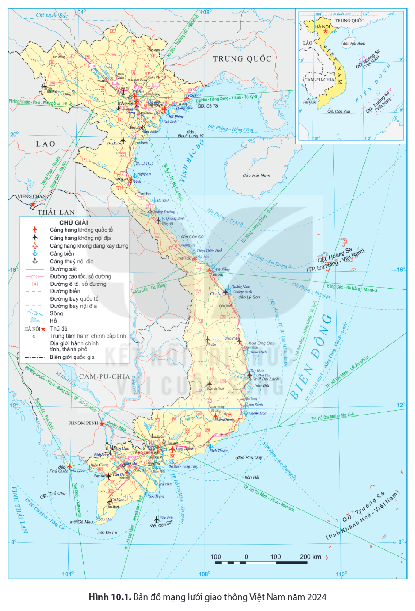
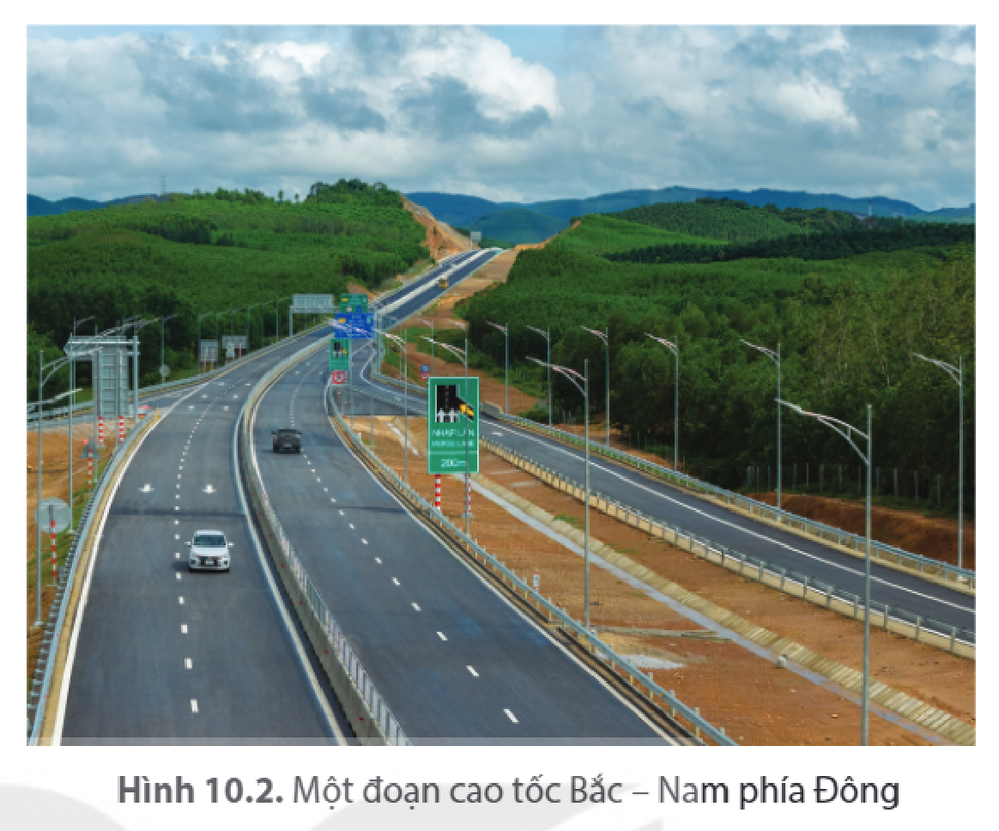

<!-- pdf:154 -->

# BÀI 10: DỊCH VỤ

## 🎯 Học xong bài này, em sẽ:

- Phân tích được vai trò của một trong các nhân tố quan trọng ảnh hưởng đến sự phát triển và phân bố các ngành dịch vụ.
- Xác định được trên bản đồ các tuyến đường bộ huyết mạch, các tuyến đường sắt, các cảng biển lớn và các sân bay quốc tế chính.
- Trình bày được sự phát triển và phân bố ngành bưu chính viễn thông.

## 🔴 Mở đầu

Ngành dịch vụ chiếm tỉ trọng cao trong cơ cấu kinh tế nước ta và phát triển ngày càng đa dạng. Các nhân tố nào ảnh hưởng đến sự phát triển và phân bố các ngành dịch vụ? Một số ngành dịch vụ của nước ta phát triển ra sao?

## 1. Các nhân tố ảnh hưởng đến sự phát triển và phân bố các ngành dịch vụ

### a) Sự phát triển kinh tế

Sự phát triển kinh tế có ảnh hưởng quyết định đến sự phát triển của ngành dịch vụ. Kinh tế phát triển làm tăng quy mô, đẩy nhanh tốc độ tăng trưởng ngành dịch vụ. Các ngành sản xuất phát triển giúp gia tăng nhu cầu sử dụng dịch vụ vận tải, viễn thông,... Đông Nam Bộ, Đồng bằng sông Hồng là những vùng có kinh tế phát triển năng động nên ngành dịch vụ phát triển đa dạng.

> 💡 **Em có biết?**
>
> **Dịch vụ** là ngành kinh tế tạo ra các sản phẩm phi vật chất nhằm thoả mãn nhu cầu của sản xuất và đời sống con người.
>
> Ngành dịch vụ bao gồm dịch vụ kinh doanh (tài chính ngân hàng, giao thông vận tải, thương mại,...), dịch vụ công (dịch vụ hành chính công, thủ tục hành chính,...), dịch vụ tiêu dùng (y tế, giáo dục, du lịch,...).

### b) Dân cư và nguồn lao động

Số dân nước ta đông là thị trường tiêu thụ lớn. Mức sống của người dân ngày càng cao dẫn đến sức mua tăng, góp phần đa dạng hoá các loại hình dịch vụ. Nguồn lao động nước ta dồi dào, chất lượng lao động đang được cải thiện, tạo điều kiện nâng cao chất lượng ngành dịch vụ.

<!-- pdf:155 -->

### c) Vốn và khoa học – công nghệ

Nguồn vốn và việc đổi mới khoa học – công nghệ làm thay đổi toàn diện hoạt động dịch vụ ở nước ta, góp phần nâng cao chất lượng và mở rộng nhiều loại hình dịch vụ mới như: giao thông thông minh, truyền thông số, thương mại điện tử,...

### d) Cơ sở hạ tầng

Cơ sở hạ tầng nước ta đang được hiện đại hoá, góp phần thu hút đầu tư và nâng cao chất lượng, hiệu quả hoạt động dịch vụ. Một số đô thị trở thành trung tâm đổi mới sáng tạo ngành dịch vụ và cửa ngõ hợp tác quốc tế, như: Hà Nội, Thành phố Hồ Chí Minh.

### e) Chính sách

Hệ thống chính sách có vai trò định hướng và tạo cơ hội phát triển các ngành dịch vụ. Việc kí kết các hiệp định thương mại với nhiều đối tác như EU, Trung Quốc, Nhật Bản,... giúp nước ta mở rộng thị trường và hội nhập quốc tế. Các chính sách thúc đẩy chuyển đổi số làm tăng hiệu quả và sức cạnh tranh của các ngành dịch vụ.

Tuy nhiên, trình độ phát triển kinh tế giữa các vùng có sự chênh lệch, cơ sở hạ tầng một số nơi thiếu đồng bộ và xuống cấp, gây khó khăn cho hoạt động dịch vụ.

### g) Vị trí địa lí và điều kiện tự nhiên

- Vị trí địa lí: Nước ta ở gần trung tâm Đông Nam Á, trong khu vực kinh tế phát triển năng động châu Á – Thái Bình Dương, tạo thuận lợi mở rộng thị trường xuất nhập khẩu, xây dựng các tuyến du lịch, giao thông với khu vực và thế giới.

- Điều kiện tự nhiên tạo tiền đề cho việc phát triển các ngành dịch vụ.

Khí hậu nhiệt đới thuận lợi cho các hoạt động dịch vụ diễn ra quanh năm. Các khu vực đồi núi, cao nguyên, bãi biển, cảnh quan đẹp thích hợp phát triển du lịch như: Sa Pa, Lâm Viên, Hạ Long,... Bờ biển có nhiều vũng vịnh thuận tiện xây dựng cảng như ở Hải Phòng, Đà Nẵng, Khánh Hoà,... Mạng lưới sông ngòi dày đặc có thể phát triển du lịch sông nước và giao thông đường sông.

Tuy nhiên, địa hình nhiều đồi núi, chia cắt mạnh; các thiên tai gây khó khăn cho hoạt động của một số ngành dịch vụ.

> ❓ Dựa vào thông tin mục 1, hãy phân tích vai trò của một trong các nhân tố ảnh hưởng đến sự phát triển và phân bố các ngành dịch vụ ở nước ta.

## 2. Một số ngành dịch vụ

### a) Giao thông vận tải

<!-- term: Giao thông vận tải ở Việt Nam -->
Nước ta có đầy đủ các loại hình giao thông vận tải: đường bộ, đường sắt, đường biển, đường thuỷ nội địa, đường hàng không. Hệ thống đường giao thông đã tạo thành mạng lưới phủ khắp các địa phương và đang được nâng cao chất lượng, hiện đại hoá. Các đầu mối giao thông vận tải có vai trò thúc đẩy kinh tế vùng và cả nước là Hà Nội, Đà Nẵng, Thành phố Hồ Chí Minh,...

<!-- pdf:156 -->

*Hình 10.1. Bản đồ mạng lưới giao thông Việt Nam năm 2024*

<!-- pdf:157 -->

- Đường bộ: Đường bộ là loại hình giao thông quan trọng nhất ở nước ta. Các tuyến đường huyết mạch kết nối các vùng, miền và trung tâm kinh tế, hành chính; nối liền với các cảng biển, cảng hàng không, cửa khẩu quốc tế. Một số tuyến đường bộ quan trọng của nước ta theo chiều bắc – nam là quốc lộ 1, đường Hồ Chí Minh, đường cao tốc Bắc – Nam phía Đông,...; theo chiều đông – tây là quốc lộ 7, 8, 9, 51,...

*Hình 10.2. Một đoạn cao tốc Bắc – Nam phía Đông*

- Đường sắt: Tuyến quan trọng nhất là đường sắt Thống Nhất (Hà Nội – Thành phố Hồ Chí Minh). Một số tuyến khác là Hà Nội – Hải Phòng, Hà Nội – Lào Cai,... Một số tuyến đường sắt đang được xây dựng là đường sắt đô thị ở Hà Nội và Thành phố Hồ Chí Minh, tuyến đường sắt xuyên Á,...

- Đường biển: Nước ta có 34 cảng biển (năm 2024), trong đó hai cảng đặc biệt là Hải Phòng và Bà Rịa – Vũng Tàu. Một số tuyến đường biển quốc tế quan trọng của nước ta là Hải Phòng – Tô-ky-ô, Thành phố Hồ Chí Minh – Xin-ga-po,...

- Đường thuỷ nội địa: Các tuyến đường thuỷ nội địa được phát triển trên hệ thống sông Hồng và hệ thống sông Cửu Long.

- Đường hàng không: Mạng lưới đường bay nội địa và quốc tế được mở rộng gắn với các cảng hàng không. Năm 2024, nước ta có 23 cảng hàng không, trong đó có 12 cảng hàng không quốc tế và 11 cảng hàng không nội địa. Ba cảng hàng không quốc tế quan trọng của nước ta là Nội Bài (Hà Nội), Đà Nẵng (Đà Nẵng) và Tân Sơn Nhất (Thành phố Hồ Chí Minh).

> 💡 **Em có biết?**
>
> Theo quyết định số 648/QĐ-TTg năm 2023 của Thủ tướng Chính phủ về Phê duyệt Quy hoạch tổng thể phát triển hệ thống cảng hàng không, sân bay toàn quốc thời kì 2024 – 2030, tầm nhìn đến năm 2050, nước ta có 14 cảng hàng không quốc tế, bao gồm: Vân Đồn, Cát Bi, Nội Bài, Thọ Xuân, Vinh, Phú Bài, Đà Nẵng, Chu Lai, Cam Ranh, Liên Khương, Long Thành, Tân Sơn Nhất, Cần Thơ và Phú Quốc. Đến năm 2025, quy hoạch bổ sung thêm cảng hàng không quốc tế Gia Bình (Bắc Ninh).

> ❓ Dựa vào thông tin mục a và hình 10.1, hãy xác định trên bản đồ:
> - Các tuyến đường bộ huyết mạch, các tuyến đường sắt: tên đường, hướng đường, điểm bắt đầu và kết thúc.
> - Vị trí một số cảng biển, cảng hàng không quốc tế.

<!-- pdf:158 -->

### b) Bưu chính viễn thông

<!-- term: Bưu chính viễn thông ở Việt Nam -->
Bưu chính viễn thông là ngành quan trọng, góp phần vào việc nâng cao đời sống người dân, tăng trưởng kinh tế và hội nhập quốc tế.

<!-- term: Bưu chính viễn thông ở Việt Nam -->
Doanh thu ngành bưu chính viễn thông tăng nhanh và liên tục trong giai đoạn 2010 – 2024. Năm 2024, tổng doanh thu của ngành bưu chính viễn thông đạt 397,3 nghìn tỉ đồng. Mạng lưới bưu chính viễn thông phủ khắp cả nước. Các đô thị là nơi tập trung các dịch vụ bưu chính viễn thông hiện đại.

> 💡 **Em có biết?**
>
> - **Bưu chính** là dịch vụ vận chuyển, phát thư, gói, kiện hàng hoá qua mạng bưu chính, trừ phương thức điện tử.
> - **Viễn thông** là việc gửi, truyền, nhận và xử lí kí hiệu, tín hiệu, số liệu, chữ viết, hình ảnh, âm thanh hoặc dạng thông tin khác bằng đường cáp, sóng vô tuyến điện, phương tiện quang học và phương tiện điện tử khác.

- Bưu chính phát triển đa dạng và ngày càng hiệu quả hơn. Các dịch vụ truyền thống như chuyển, nhận thư, bưu kiện,... từng bước chuyển sang dịch vụ số. Bưu chính hợp tác với các ngành sản xuất và dịch vụ khác (tài chính ngân hàng, logistics, vận tải,...) nhằm nâng cao hiệu quả kinh tế. Hệ thống bưu cục phân bố rộng rãi với các điểm giao dịch, bưu điện văn hoá xã và các đại lí. Các bưu cục Trung ương đặt tại Hà Nội, Đà Nẵng và Thành phố Hồ Chí Minh.

- Viễn thông phát triển công nghệ tiên tiến, dịch vụ hiện đại và nâng cao chất lượng. Viễn thông tập trung vào chuyển đổi số và phát triển dịch vụ dựa trên các công nghệ 5G, internet vạn vật (IoT), dữ liệu lớn (Big Data), trí tuệ nhân tạo (AI),... Các dịch vụ mới phát triển nhanh chóng như: cung cấp phòng ảo để dạy học trực tuyến, thanh toán trực tuyến,... Cả nước có gần 24 triệu thuê bao internet (năm 2024). Việt Nam đã khai thác một số tuyến cáp quang biển quốc tế và trạm thông tin vệ tinh, trong đó có hai vệ tinh viễn thông, góp phần kết nối với mạng lưới viễn thông trên thế giới. Các trạm trung chuyển internet quốc gia đặt tại Hà Nội, Đà Nẵng và Thành phố Hồ Chí Minh.

> ❓ Dựa vào thông tin mục b, hãy trình bày sự phát triển và phân bố ngành bưu chính viễn thông ở nước ta.

## ✏️ Luyện tập – Vận dụng

- Hãy lựa chọn một số nhân tố ảnh hưởng đến sự phát triển và phân bố ngành dịch vụ và hoàn thành bảng theo gợi ý sau vào vở.

| Nhân tố | Ảnh hưởng |
| :---: | :---: |
| ? | ? |

- Hãy tìm hiểu và chia sẻ thông tin về hai vệ tinh viễn thông đang hoạt động của Việt Nam.

## 📷 Danh sách hình trong bài

| Mã hình | Trang PDF | Trang sách | Chú thích |
| --- | :---: | :---: | --- |
| H9-lich_su_va_dia_ly-dl-b10-01 | 156 | 154 | Hình 10.1. Bản đồ mạng lưới giao thông Việt Nam năm 2024 |
| H9-lich_su_va_dia_ly-dl-b10-02 | 157 | 155 | Hình 10.2. Một đoạn cao tốc Bắc – Nam phía Đông |
