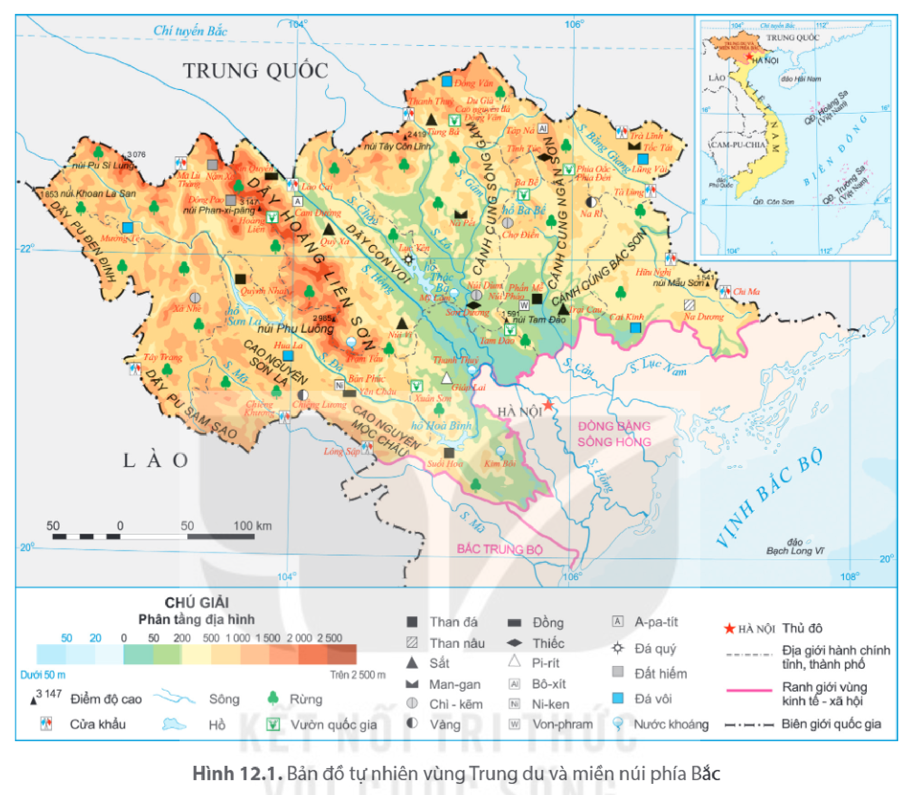
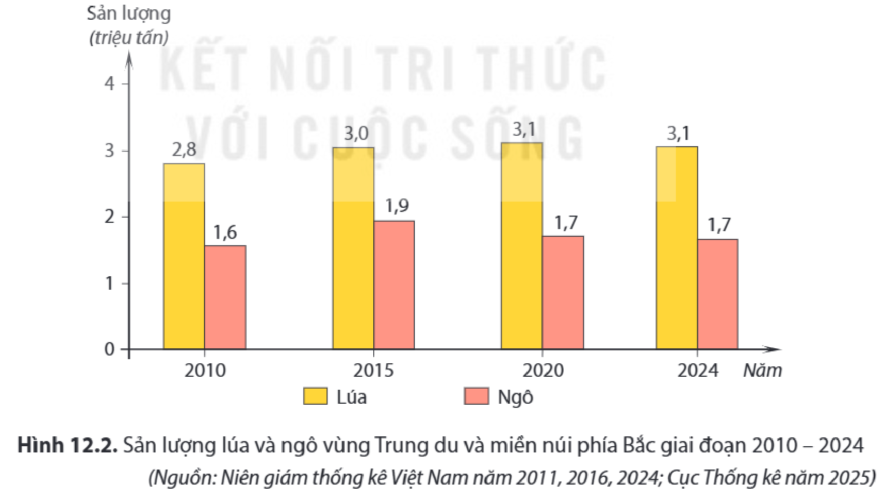
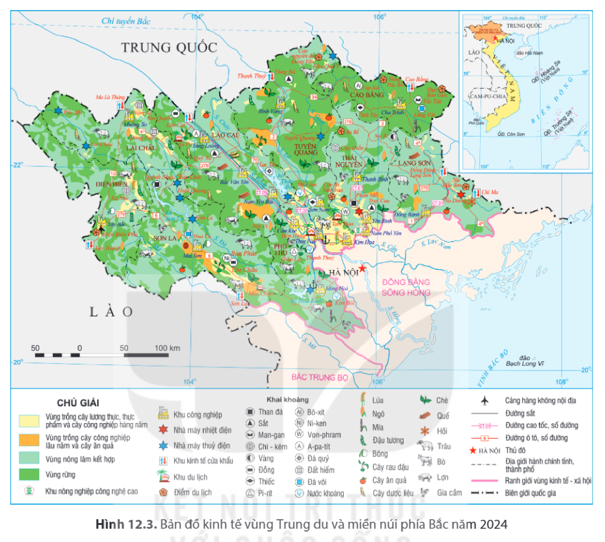

<!-- pdf:160 -->

# BÀI 12: VÙNG TRUNG DU VÀ MIỀN NÚI PHÍA BẮC

## 🎯 Học xong bài này, em sẽ:

- Xác định được trên bản đồ vị trí địa lí và phạm vi lãnh thổ của vùng.
- Trình bày được đặc điểm phân hoá thiên nhiên giữa Đông Bắc và Tây Bắc; thế mạnh để phát triển công nghiệp, lâm – nông – thuỷ sản, du lịch.
- Nhận xét được đặc điểm nổi bật về thành phần dân tộc, phân bố dân cư và chất lượng cuộc sống dân cư.
- Trình bày được sự phát triển và phân bố một trong các ngành kinh tế của vùng.
- Vẽ được sơ đồ tư duy thể hiện các thế mạnh về tự nhiên để phát triển kinh tế – xã hội của vùng Trung du và miền núi phía Bắc.

## 🔴 Mở đầu

Vùng Trung du và miền núi phía Bắc là vùng lãnh thổ rộng lớn ở phía bắc nước ta, có nhiều thế mạnh về vị trí địa lí, điều kiện tự nhiên và tài nguyên thiên nhiên để phát triển các ngành kinh tế. Điều kiện tự nhiên có ảnh hưởng như thế nào đến phát triển kinh tế – xã hội của vùng? Các ngành kinh tế trong vùng phát triển và phân bố ra sao?

## 1. Vị trí địa lí và phạm vi lãnh thổ

<!-- term: Vùng Trung du và miền núi phía Bắc -->
Vùng Trung du và miền núi phía Bắc có diện tích tự nhiên khoảng 92,5 nghìn km² (chiếm 27,9% diện tích cả nước năm 2024); bao gồm các tỉnh: Cao Bằng, Tuyên Quang, Lào Cai, Thái Nguyên, Lạng Sơn, Phú Thọ, Điện Biên, Lai Châu, Sơn La.

<!-- term: Vùng Trung du và miền núi phía Bắc -->
Vùng Trung du và miền núi phía Bắc tiếp giáp với vùng Đồng bằng sông Hồng và Bắc Trung Bộ; các nước láng giềng Trung Quốc và Lào, có nhiều cửa khẩu quốc tế quan trọng như: Hữu Nghị, Lào Cai, Tây Trang,...

<!-- term: Vùng Trung du và miền núi phía Bắc -->
Vị trí địa lí của vùng thuận lợi trong việc thúc đẩy giao thương quốc tế và kết nối với các vùng khác trong cả nước, đồng thời có ý nghĩa quan trọng về quốc phòng, an ninh.

> 💡 **Em có biết?**
>
> Theo Nghị quyết số 252/2025/QH15 ngày 10 – 12 – 2025 của Quốc hội, nước ta có 6 vùng kinh tế – xã hội là vùng Trung du và miền núi phía Bắc, vùng Đồng bằng sông Hồng, vùng Bắc Trung Bộ, vùng Duyên hải Nam Trung Bộ và Tây Nguyên, vùng Đông Nam Bộ và vùng Đồng bằng sông Cửu Long.

> ❓ Dựa vào thông tin mục 1 và hình 12.1, hãy xác định trên bản đồ vị trí địa lí và phạm vi lãnh thổ của vùng Trung du và miền núi phía Bắc.

<!-- pdf:161 -->

## 2. Điều kiện tự nhiên và tài nguyên thiên nhiên

### a) Phân hoá thiên nhiên giữa Đông Bắc và Tây Bắc

Vùng Trung du và miền núi phía Bắc có địa hình chủ yếu là đồi núi. Giữa Đông Bắc và Tây Bắc có sự phân hoá về điều kiện tự nhiên.

Bảng 12.1. SỰ PHÂN HOÁ THIÊN NHIÊN VÙNG TRUNG DU VÀ MIỀN NÚI PHÍA BẮC

| | Đông Bắc | Tây Bắc |
| --- | --- | --- |
| Địa hình | Núi trung bình và núi thấp chiếm diện tích lớn, hướng cánh cung là chủ yếu; khu vực trung du có địa hình đồi bát úp. Địa hình các-xtơ phổ biến (Cao Bằng, Tuyên Quang,...). | Địa hình cao, có dãy Hoàng Liên Sơn cao nhất nước ta, hướng nghiêng chung của địa hình là hướng tây bắc – đông nam; địa hình chia cắt và hiểm trở; xen kẽ là các cao nguyên. |
| Khí hậu | Nhiệt đới ẩm gió mùa có mùa đông lạnh nhất nước ta. | Nhiệt đới ẩm gió mùa có mùa đông lạnh, có sự phân hoá theo độ cao rõ rệt, đầu mùa hạ chịu ảnh hưởng mạnh của gió Tây khô nóng. |
| Sông ngòi | Sông ngòi dày đặc, có giá trị về giao thông và thuỷ lợi. | Sông ngòi có độ dốc lớn, lưu lượng nước dồi dào, có tiềm năng lớn về thuỷ điện, điển hình là sông Đà, sông Mã. |
| Khoáng sản | Phong phú chủng loại như: a-pa-tít, sắt, chì – kẽm, đá vôi, than,... | Có một số loại trữ lượng lớn như: đất hiếm, đồng,... |
| Sinh vật | Phong phú, gồm sinh vật nhiệt đới và cận nhiệt đới. | Nhiều loài sinh vật nhiệt đới, cận nhiệt đới và ôn đới núi cao. |

> ❓ Dựa vào thông tin mục a và hình 12.1, hãy trình bày đặc điểm phân hoá thiên nhiên giữa Đông Bắc và Tây Bắc.

### b) Thế mạnh để phát triển kinh tế

<!-- term: Thế mạnh tự nhiên vùng Trung du và miền núi phía Bắc -->
- Địa hình chủ yếu là đồi núi nên thuận lợi cho phát triển lâm nghiệp. Trong vùng có một số cao nguyên xen các đồi núi thấp với đất feralit có thể phát triển vùng chuyên canh cây công nghiệp, cây ăn quả và chăn nuôi gia súc lớn. Một số cánh đồng như Than Uyên, Nghĩa Lộ, Điện Biên, Bảo Lạc,... có đất phù sa thuận lợi trồng lúa, cung cấp lương thực tại chỗ. Địa hình núi cao với nhiều hang động các-xtơ và thắng cảnh thuận lợi cho phát triển du lịch.

<!-- term: Thế mạnh tự nhiên vùng Trung du và miền núi phía Bắc -->
- Khí hậu có mùa đông lạnh, phân hoá theo độ cao tạo cho vùng thế mạnh đặc biệt để phát triển cây công nghiệp có nguồn gốc cận nhiệt và ôn đới (chè), cây ăn quả đặc sản (đào, lê,...), cây dược liệu, rau và hoa. Ngoài ra còn đem lại thế mạnh cho phát triển du lịch.

<!-- term: Thế mạnh tự nhiên vùng Trung du và miền núi phía Bắc -->
- Nguồn nước: Hệ thống sông ngòi dày, kết hợp địa hình chia cắt mạnh tạo cho vùng có trữ năng thuỷ điện lớn nhất cả nước. Các hồ tự nhiên và nhân tạo như Ba Bể, Hoà Bình, Sơn La,... có giá trị phát triển khai thác và nuôi trồng thuỷ sản, du lịch. Nguồn nước khoáng phong phú, thuận lợi cho phát triển du lịch.

<!-- pdf:162 -->

*Hình 12.1. Bản đồ tự nhiên vùng Trung du và miền núi phía Bắc*

<!-- term: Thế mạnh tự nhiên vùng Trung du và miền núi phía Bắc -->
- Tài nguyên khoáng sản đa dạng, một số loại có trữ lượng đáng kể như than, sắt, a-pa-tít,... là cơ sở quan trọng để phát triển công nghiệp khai khoáng, chế biến khoáng sản và nhiều ngành công nghiệp khác.

<!-- term: Thế mạnh tự nhiên vùng Trung du và miền núi phía Bắc -->
- Tài nguyên rừng dồi dào, tạo thế mạnh phát triển lâm nghiệp, công nghiệp chế biến gỗ và sản xuất sản phẩm từ gỗ. Hệ thống các vườn quốc gia, khu bảo tồn như Hoàng Liên (Lào Cai), Du Già – Cao nguyên đá Đồng Văn (Tuyên Quang), Ba Bể (Thái Nguyên),... có nhiều loài sinh vật đặc hữu là tài nguyên đặc sắc để phát triển du lịch sinh thái.

> ❓ Dựa vào thông tin mục b và hình 12.1, hãy nêu thế mạnh để phát triển công nghiệp, lâm nghiệp, nông nghiệp, thuỷ sản và du lịch của vùng Trung du và miền núi phía Bắc.

## 3. Dân cư, xã hội
<!-- ocr-ok: đã đối chiếu ảnh trang gốc PDF 162 (trang in 160), tiêu đề mục 3 "Dân cư, xã hội" bị OCR đọc nhầm vòng tròn số 3 và thiếu dấu chữ "cư" -->

### a) Thành phần dân tộc

Năm 2024, vùng có số dân là 12,6 triệu người, chiếm 12,4% số dân cả nước; tỉ lệ tăng dân số là 1,21%.

<!-- pdf:163 -->

- Vùng Trung du và miền núi phía Bắc có thành phần dân tộc đa dạng: Kinh, Thái, Mường, Dao, HMông, Tày, Nùng,... Dân tộc thiểu số chiếm hơn 50% tổng số dân toàn vùng.

- Sự phân bố dân tộc thay đổi theo hướng đan xen nhưng vẫn có khu vực cư trú đặc trưng. Người Thái, Mường sống nhiều hơn ở khu vực Tây Bắc; người Tày, Nùng,... sống nhiều hơn ở khu vực Đông Bắc.

Vùng Trung du và miền núi phía Bắc có văn hoá, phong tục tập quán đa dạng. Người dân có nhiều kinh nghiệm canh tác trên đất dốc, kết hợp sản xuất nông nghiệp với lâm nghiệp, chăn nuôi gia súc lớn, trồng cây dược liệu và rau quả ôn đới.

<!-- term: Ruộng bậc thang -->
> 💡 **Em có biết?**
>
> Ruộng bậc thang là loại hình canh tác độc đáo trên đất dốc của đồng bào dân tộc thiểu số, không chỉ cung cấp lương thực, thực phẩm phục vụ đời sống mà còn là di sản văn hoá được công nhận là danh thắng quốc gia (ruộng bậc thang Sa Pa và Mù Cang Chải – Lào Cai, Hoàng Su Phì – Tuyên Quang), thu hút khách du lịch.
>
> *(Nguồn: Bộ Dân tộc và Tôn giáo)*

> ❓ Dựa vào thông tin mục a, hãy nhận xét đặc điểm nổi bật về thành phần dân tộc ở vùng Trung du và miền núi phía Bắc.

### b) Phân bố dân cư

Mật độ dân số toàn vùng thấp hơn so với trung bình cả nước (136 người/km² năm 2024). Tuy nhiên, dân cư trong vùng có sự phân bố khác nhau giữa khu vực trung du và miền núi, giữa các tỉnh. Các tỉnh khu vực trung du có mật độ dân số cao hơn các tỉnh khu vực miền núi (mật độ dân số thấp nhất là tỉnh Lai Châu với 55 người/km², mật độ dân số cao nhất là tỉnh Phú Thọ với 391 người/km²).

Dân cư chủ yếu sinh sống ở nông thôn, số dân nông thôn chiếm 76,1% số dân toàn vùng (năm 2024).

> ❓ Dựa vào thông tin mục b, hãy nhận xét đặc điểm phân bố dân cư ở vùng Trung du và miền núi phía Bắc.

### c) Chất lượng cuộc sống

Nhờ thành tựu của công cuộc Đổi mới và các chương trình phát triển kinh tế – xã hội, đời sống của người dân vùng Trung du và miền núi phía Bắc được cải thiện: trình độ dân trí được nâng lên, tỉ lệ người lớn biết chữ ngày càng tăng, tỉ lệ hộ nghèo ngày càng giảm, thu nhập bình quân đầu người/tháng theo giá hiện hành tăng từ 0,9 triệu đồng năm 2010 lên 3,7 triệu đồng năm 2024.

> ❓ Dựa vào thông tin mục c, hãy nhận xét về chất lượng cuộc sống dân cư vùng Trung du và miền núi phía Bắc.

## 4. Sự phát triển và phân bố kinh tế

Tổng sản phẩm trên địa bàn (GRDP) của vùng Trung du và miền núi phía Bắc tăng liên tục, chiếm khoảng 8,3% tổng sản phẩm trong nước (GDP) cả nước (năm 2024). Cơ cấu kinh tế chuyển dịch theo hướng giảm tỉ trọng nông nghiệp, lâm nghiệp và thuỷ sản; tăng tỉ trọng công nghiệp và xây dựng; dịch vụ chiếm tỉ trọng cao.

<!-- pdf:164 -->

Bảng 12.2. CƠ CẤU GRDP (GIÁ HIỆN HÀNH) CỦA VÙNG TRUNG DU VÀ MIỀN NÚI PHÍA BẮC GIAI ĐOẠN 2010 – 2024

*(Đơn vị: %)*

| Cơ cấu GRDP \ Năm | 2010 | 2015 | 2020 | 2024 |
| --- | :---: | :---: | :---: | :---: |
| Nông nghiệp, lâm nghiệp và thuỷ sản | 22,0 | 19,3 | 18,1 | 15,6 |
| Công nghiệp và xây dựng | 27,8 | 34,4 | 37,6 | 40,0 |
| Dịch vụ | 37,3 | 35,9 | 35,1 | 36,3 |
| Thuế sản phẩm trừ trợ cấp sản phẩm | 12,9 | 10,4 | 9,2 | 8,1 |

*(Nguồn: Niên giám thống kê các tỉnh năm 2011, 2016, 2024; Cục Thống kê năm 2025)*

### a) Nông nghiệp, lâm nghiệp và thuỷ sản

Nông nghiệp, lâm nghiệp và thuỷ sản trong vùng đang phát triển theo hướng sản xuất hàng hoá, áp dụng khoa học – công nghệ trong sản xuất và chế biến, ưu tiên phát triển nông nghiệp xanh, nông nghiệp công nghệ cao và nông nghiệp hữu cơ.

- Nông nghiệp

  + Trồng trọt: Lúa và ngô là các cây lương thực chính của vùng. Lúa được trồng nhiều ở các cánh đồng Mường Thanh (Điện Biên), Mường Lò (Lào Cai); nhiều vùng đất dốc được cải tạo thành ruộng bậc thang để trồng lúa. Việc trồng lúa góp phần giải quyết cơ bản nhu cầu lương thực của vùng. Trung du và miền núi phía Bắc có diện tích trồng ngô lớn nhất cả nước, các địa phương có diện tích ngô nhiều là Sơn La, Tuyên Quang, Cao Bằng,...

*Hình 12.2. Sản lượng lúa và ngô vùng Trung du và miền núi phía Bắc giai đoạn 2010 – 2024*
*(Nguồn: Niên giám thống kê Việt Nam năm 2011, 2016, 2024; Cục Thống kê năm 2025)*

Trung du và miền núi phía Bắc có thế mạnh trồng cây công nghiệp, cây ăn quả và cây dược liệu. Vùng đã phát triển các khu vực sản xuất tập trung như: chè (Thái Nguyên, Phú Thọ, Tuyên Quang), hồi (Lạng Sơn), quế (Lào Cai), thảo quả (Tuyên Quang, Lào Cai,...), cây ăn quả (Sơn La, Phú Thọ, Lạng Sơn),...

<!-- pdf:165 -->

  + Chăn nuôi: Trung du và miền núi phía Bắc có thế mạnh về chăn nuôi gia súc. Số lượng trâu và lợn của vùng lớn nhất cả nước (chiếm hơn 55% tổng số trâu và khoảng 22% tổng số lợn cả nước năm 2024). Số lượng bò có xu hướng tăng qua các năm, đứng thứ hai cả nước (chiếm hơn 19% tổng số bò cả nước năm 2024). Bò sữa được chú trọng phát triển ở Sơn La, Phú Thọ,... Chăn nuôi đang phát triển theo hình thức trang trại, ứng dụng công nghệ cao vào sản xuất, đặc biệt trong chăn nuôi lợn, bò.

Bảng 12.3. SỐ LƯỢNG TRÂU, BÒ VÀ LỢN CỦA VÙNG TRUNG DU VÀ MIỀN NÚI PHÍA BẮC GIAI ĐOẠN 2010 – 2024

*(Đơn vị: triệu con)*

| Vật nuôi \ Năm | 2010 | 2015 | 2020 | 2024 |
| --- | :---: | :---: | :---: | :---: |
| Trâu | 1,6 | 1,4 | 1,3 | 1,1 |
| Bò | 1,0 | 0,9 | 1,2 | 1,2 |
| Lợn | 6,0 | 6,1 | 5,2 | 5,8 |

*(Nguồn: Niên giám thống kê Việt Nam năm 2011, 2016, 2024; Cục Thống kê năm 2025)*

- Lâm nghiệp là ngành có thế mạnh ở vùng với diện tích rừng khoảng 5,3 triệu ha năm 2024 (chiếm gần 36% tổng diện tích rừng cả nước).

  + Khai thác, chế biến lâm sản: Sản lượng gỗ khai thác từ rừng trồng ngày càng tăng. Đồng thời, các lâm sản khác như măng, mộc nhĩ, dược liệu,... cũng được khai thác giúp tăng thu nhập, cải thiện sinh kế cho các hộ gia đình.

  + Trồng rừng, khoanh nuôi và bảo vệ rừng: Chính sách giao đất và giao rừng đã góp phần tạo công ăn việc làm, ổn định đời sống cho người dân và góp phần bảo vệ, phát triển rừng. Diện tích rừng trồng toàn vùng đạt 1,6 triệu ha năm 2024. Công tác khoanh nuôi, bảo vệ rừng được chú trọng, đặc biệt ở các vườn quốc gia, khu bảo tồn thiên nhiên.

- Thuỷ sản: Hoạt động khai thác và nuôi trồng thuỷ sản tập trung ở sông Đà, sông Hồng, hồ Hoà Bình, hồ Thác Bà,... góp phần cung cấp thực phẩm cho người dân trong vùng, đồng thời tạo ra những mặt hàng đặc sản có giá trị kinh tế cao (cá hồi, cá tầm, cá lăng,...). Nhiều trang trại nuôi thuỷ sản được đầu tư công nghệ cao với quy mô lớn ở một số địa phương như: Lào Cai, Phú Thọ, Cao Bằng,...

> ❓ Dựa vào thông tin mục a và hình 12.3, hãy trình bày sự phát triển và phân bố ngành nông nghiệp, lâm nghiệp và thuỷ sản của vùng Trung du và miền núi phía Bắc.

### b) Công nghiệp

Ngành công nghiệp của vùng tăng trưởng vượt bậc trong giai đoạn 2010 – 2024. Cơ cấu ngành công nghiệp khá đa dạng, trong đó một số ngành nổi bật là khai khoáng; sản xuất điện; sản xuất, chế biến thực phẩm; sản xuất sản phẩm điện tử, máy vi tính,...

<!-- pdf:166 -->

*Hình 12.3. Bản đồ kinh tế vùng Trung du và miền núi phía Bắc năm 2024*

- Công nghiệp khai khoáng có ở hầu hết các tỉnh, các sản phẩm chủ yếu là quặng sắt (Lào Cai, Tuyên Quang,...), a-pa-tít (Lào Cai), đá vôi (Lạng Sơn, Sơn La,...), nước khoáng (Phú Thọ, Tuyên Quang,...), than (Thái Nguyên, Lạng Sơn,...),...

- Sản xuất điện là ngành công nghiệp đóng góp quan trọng cho phát triển kinh tế – xã hội của vùng. Trong vùng phát triển cả thuỷ điện và nhiệt điện. Các nhà máy thuỷ điện lớn như Hoà Bình (2 400 MW), Sơn La (2 400 MW), Lai Châu (1 200 MW), Tuyên Quang (342 MW),... ngoài vai trò sản xuất điện còn góp phần kiểm soát lũ cho Đồng bằng sông Hồng và tạo cảnh quan phát triển du lịch. Một số nhà máy nhiệt điện trong vùng là An Khánh (Thái Nguyên), Na Dương (Lạng Sơn),...

- Công nghiệp sản xuất, chế biến thực phẩm phát triển, gồm chế biến sữa, chế biến hoa quả, chế biến chè,... trên cơ sở sử dụng nguồn nguyên liệu dồi dào trong vùng. Các địa phương có ngành công nghiệp sản xuất, chế biến thực phẩm phát triển là Phú Thọ, Sơn La, Thái Nguyên,...

<!-- pdf:167 -->

- Công nghiệp sản xuất sản phẩm điện tử, máy vi tính có vai trò ngày càng quan trọng với vùng và cả nước, phát triển nhanh tại các tỉnh Thái Nguyên, Phú Thọ,... nhờ thu hút đầu tư từ nước ngoài.

Trong vùng đã hình thành nhiều khu công nghiệp, tập trung chủ yếu ở Phú Thọ và Thái Nguyên.

> ❓ Dựa vào thông tin mục b và hình 12.3, hãy trình bày sự phát triển và phân bố ngành công nghiệp của vùng Trung du và miền núi phía Bắc.

### c) Dịch vụ

Ngành dịch vụ đóng vai trò quan trọng đối với sự phát triển kinh tế của vùng. Các hoạt động giao thông vận tải, thương mại, du lịch được chú trọng phát triển ở tất cả các địa phương.

- Giao thông vận tải: Vùng có vị trí thuận lợi để kết nối với vùng Đồng bằng sông Hồng và Trung Quốc, Lào bằng đường bộ, đường sắt, đường thuỷ nội địa, đường hàng không. Đường quốc lộ, cao tốc được nâng cấp và xây dựng, tạo động lực thúc đẩy phát triển các hành lang kinh tế như: cao tốc Hà Nội – Lạng Sơn, cao tốc Hà Nội – Lào Cai, quốc lộ 6,... Giao thông vận tải trong vùng đang phát triển đồng bộ dịch vụ hỗ trợ vận tải, hiện đại hoá các phương tiện vận tải và nâng cao chất lượng dịch vụ.

<!-- term: Kinh tế cửa khẩu vùng Trung du và miền núi phía Bắc -->
- Thương mại: Hoạt động nội thương ngày càng phát triển và đa dạng với nhiều hình thức, mạng lưới phân phối hàng hoá được mở rộng ở các địa phương; hệ thống chợ, điểm mua bán, siêu thị gia tăng. Hoạt động ngoại thương chú trọng khai thác thế mạnh kinh tế cửa khẩu, đẩy mạnh giao thương với các tỉnh Vân Nam, Quảng Tây (Trung Quốc) và các tỉnh khu vực Thượng Lào.

- Du lịch: Du lịch trở thành thế mạnh kinh tế của vùng, với nhiều sản phẩm và điểm du lịch nổi tiếng. Du lịch sinh thái phát triển ở các vườn quốc gia, khu bảo tồn thiên nhiên, các danh lam thắng cảnh như: hồ Ba Bể, thác Bản Giốc, Sa Pa,... Du lịch văn hoá gắn với các điểm di tích như: hang Pác Bó (Cao Bằng), Đền Hùng (Phú Thọ), di tích Điện Biên Phủ (Điện Biên),...

> ❓ Dựa vào thông tin mục c và hình 12.3, hãy:
> - Trình bày sự phát triển và phân bố ngành dịch vụ của vùng Trung du và miền núi phía Bắc.
> - Kể tên một số điểm du lịch nổi tiếng của vùng Trung du và miền núi phía Bắc.

## ✏️ Luyện tập – Vận dụng

- Vẽ sơ đồ tư duy thể hiện các thế mạnh về tự nhiên để phát triển kinh tế – xã hội của vùng Trung du và miền núi phía Bắc.
- Tìm hiểu và giới thiệu với bạn về một địa điểm du lịch nổi tiếng của vùng Trung du và miền núi phía Bắc.

## 📷 Danh sách hình trong bài

| Mã hình | Trang PDF | Trang sách | Chú thích |
| --- | :---: | :---: | --- |
| H9-lich_su_va_dia_ly-dl-b12-01 | 162 | 160 | Hình 12.1. Bản đồ tự nhiên vùng Trung du và miền núi phía Bắc |
| H9-lich_su_va_dia_ly-dl-b12-02 | 164 | 162 | Hình 12.2. Sản lượng lúa và ngô vùng Trung du và miền núi phía Bắc giai đoạn 2010 – 2024 |
| H9-lich_su_va_dia_ly-dl-b12-03 | 166 | 164 | Hình 12.3. Bản đồ kinh tế vùng Trung du và miền núi phía Bắc năm 2024 |
