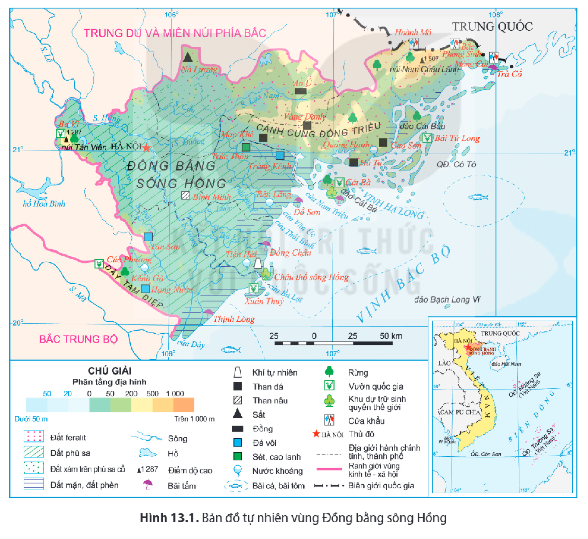
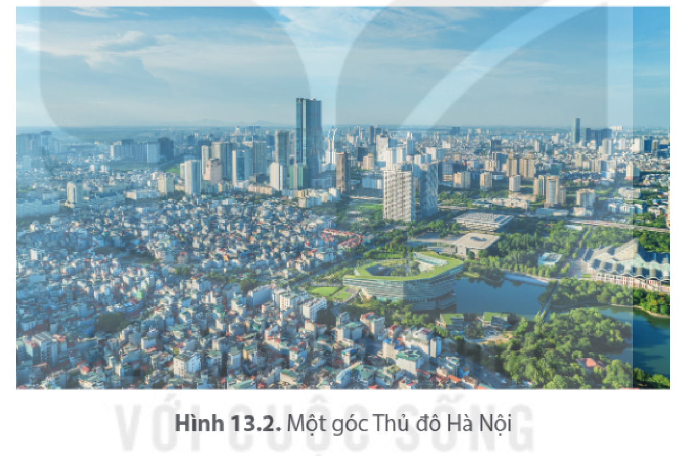
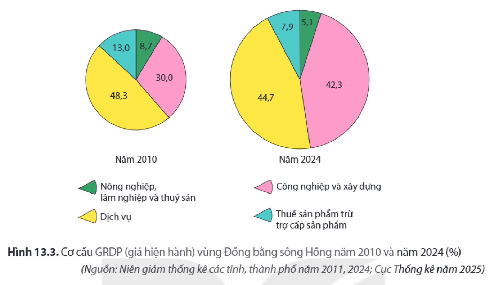
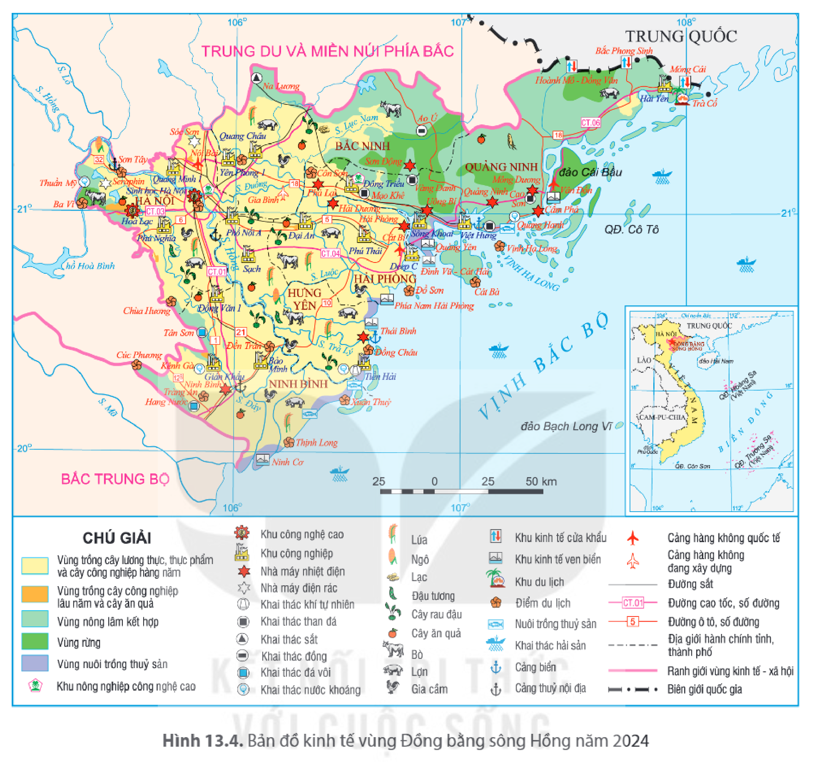

<!-- pdf:168 -->

# BÀI 13: VÙNG ĐỒNG BẰNG SÔNG HỒNG

## 🎯 Học xong bài này, em sẽ:

- Trình bày được đặc điểm vị trí địa lí và phạm vi lãnh thổ của vùng.
- Phân tích được thế mạnh của vùng về tài nguyên thiên nhiên đối với sự phát triển nông nghiệp, lâm nghiệp và thuỷ sản; vấn đề phát triển kinh tế biển.
- Phân tích được đặc điểm dân cư, nguồn lao động và ảnh hưởng của các nhân tố này đến sự phát triển kinh tế – xã hội của vùng.
- Phân tích được vấn đề đô thị hoá ở Đồng bằng sông Hồng; vị thế của Thủ đô Hà Nội.
- Trình bày được sự phát triển và phân bố kinh tế ở vùng Đồng bằng sông Hồng.

## 🔴 Mở đầu

Vùng Đồng bằng sông Hồng có lịch sử khai thác lãnh thổ lâu đời, có vai trò quan trọng đối với cả nước. Điều kiện tự nhiên, tài nguyên thiên nhiên, dân cư và nguồn lao động có ảnh hưởng như thế nào đến phát triển kinh tế – xã hội của vùng? Các ngành kinh tế của vùng phát triển và phân bố ra sao?

## 1. Vị trí địa lí và phạm vi lãnh thổ

<!-- term: Vùng Đồng bằng sông Hồng -->
Vùng Đồng bằng sông Hồng có diện tích tự nhiên khoảng 23,94 nghìn km² (chiếm 7,2% diện tích cả nước năm 2024); bao gồm Thủ đô Hà Nội, thành phố Hải Phòng và các tỉnh: Bắc Ninh, Quảng Ninh, Hưng Yên, Ninh Bình.

<!-- term: Vùng Đồng bằng sông Hồng -->
Vùng Đồng bằng sông Hồng giáp với vùng Trung du và miền núi phía Bắc, Bắc Trung Bộ và nước láng giềng Trung Quốc; phía đông có vùng biển rộng thuộc vịnh Bắc Bộ với nhiều đảo như Cô Tô, Cái Bầu (Quảng Ninh); Cát Bà, Bạch Long Vĩ (Hải Phòng),...

<!-- term: Vùng Đồng bằng sông Hồng -->
Vị trí địa lí của Đồng bằng sông Hồng thuận lợi cho kết nối, giao thương với các vùng trong cả nước và thế giới.

> ❓ Dựa vào thông tin mục 1 và hình 13.1, hãy trình bày đặc điểm vị trí địa lí và phạm vi lãnh thổ của vùng Đồng bằng sông Hồng.

<!-- pdf:169 -->

## 2. Điều kiện tự nhiên và tài nguyên thiên nhiên

### a) Thế mạnh về tài nguyên thiên nhiên đối với phát triển nông nghiệp, lâm nghiệp và thuỷ sản

- Địa hình và đất: Phần lớn diện tích vùng Đồng bằng sông Hồng có địa hình tương đối bằng phẳng, đất phù sa màu mỡ, thích hợp trồng cây lương thực (nhất là cây lúa), cây rau đậu và cây ăn quả. Khu vực đồi núi có đất feralit thích hợp để phát triển rừng, cây công nghiệp, cây ăn quả, cây dược liệu. Ngoài ra, ven biển còn có đất mặn, đất phèn; một số nơi có đất xám trên phù sa cổ cũng có thể khai thác cho sản xuất nông nghiệp.

- Khí hậu: Vùng có khí hậu nhiệt đới ẩm gió mùa, có một mùa đông lạnh. Nhìn chung, khí hậu thuận lợi cho sản xuất nông nghiệp phát triển quanh năm, cơ cấu cây trồng đa dạng.

*Hình 13.1. Bản đồ tự nhiên vùng Đồng bằng sông Hồng*

<!-- pdf:170 -->

- Nguồn nước: Mạng lưới sông ngòi dày đặc với hai hệ thống sông lớn là hệ thống sông Hồng và hệ thống sông Thái Bình; có nhiều ao hồ và vùng biển rộng, nguồn nước ngầm phong phú nên thuận lợi cho sản xuất nông nghiệp và nuôi trồng thuỷ sản.

- Sinh vật: Đồng bằng sông Hồng có tài nguyên sinh vật phong phú và đa dạng. Rừng có ở khu vực đồi núi, ven biển, trên một số đảo. Ở đây có các vườn quốc gia và khu dự trữ sinh quyển thế giới với nhiều loài động vật và thực vật quý hiếm. Các hệ thống sông và vùng biển có nhiều loài thuỷ sản cho giá trị kinh tế cao.

> ❓ Dựa vào thông tin mục a và hình 13.1, hãy phân tích thế mạnh về tài nguyên thiên nhiên đối với sự phát triển nông nghiệp, lâm nghiệp và thuỷ sản của vùng Đồng bằng sông Hồng.

### b) Vấn đề phát triển kinh tế biển

<!-- term: Kinh tế biển vùng Đồng bằng sông Hồng -->
Biển là thế mạnh để phát triển kinh tế ở vùng Đồng bằng sông Hồng. Vùng có đường bờ biển kéo dài từ Quảng Ninh đến Ninh Bình với nhiều vũng vịnh, cửa sông thuận lợi để xây dựng cảng biển, phát triển giao thông vận tải đường biển, nổi bật là ở Hải Phòng và Quảng Ninh. Vùng biển có nhiều cảnh đẹp để phát triển du lịch, nhất là ở vịnh Hạ Long, quần đảo Cát Bà,... Tài nguyên hải sản phong phú, tạo điều kiện để phát triển khai thác hải sản; ven bờ và ven các đảo thuận lợi để nuôi trồng hải sản. Ngoài ra, vùng còn có tiềm năng về cát thuỷ tinh, khí tự nhiên, muối,...

<!-- term: Kinh tế biển vùng Đồng bằng sông Hồng -->
Các thế mạnh về biển ở Đồng bằng sông Hồng ngày càng được khai thác, phát huy hiệu quả. Vùng đã hình thành một số khu kinh tế ven biển, cảng biển hiện đại, khu nghỉ dưỡng ven biển chất lượng cao,...

<!-- term: Kinh tế biển vùng Đồng bằng sông Hồng -->
Tuy nhiên, việc phát triển kinh tế biển ở vùng Đồng bằng sông Hồng cũng gây ra một số vấn đề về ô nhiễm môi trường và suy thoái tài nguyên. Do vậy, cần chú trọng phát triển kinh tế biển theo hướng tăng trưởng xanh, bảo tồn đa dạng sinh học và các hệ sinh thái biển.

> ❓ Dựa vào thông tin mục b và hình 13.1, hãy phân tích vấn đề phát triển kinh tế biển của vùng Đồng bằng sông Hồng.

## 3. Dân cư, xã hội

### a) Dân cư

- Quy mô và gia tăng dân số: Đồng bằng sông Hồng có quy mô dân số lớn nhất cả nước, năm 2024 là khoảng 24,75 triệu người (chiếm 24,4% số dân cả nước). Quy mô dân số của vùng tăng do tỉ lệ tăng dân số tự nhiên còn cao và nhập cư.

- Cơ cấu dân số: Năm 2024, nhóm người dưới 15 tuổi chiếm 24,0%, nhóm người từ 15 đến 64 tuổi chiếm 64,6%, nhóm người từ 65 tuổi trở lên chiếm 11,4%. Đồng bằng sông Hồng đang trong giai đoạn già hoá dân số.

- Phân bố dân cư: Năm 2024, mật độ dân số ở vùng là 1 034 người/km² (cao gấp 3,4 lần cả nước). Dân cư sinh sống ở khu vực nông thôn nhiều hơn khu vực thành thị.

- Thành phần dân tộc: Trong vùng có các dân tộc cùng chung sống là Kinh, Dao, Tày, Sán Dìu, Sán Chay, Mường,...

<!-- pdf:171 -->

Dân số đông tạo nên thị trường tiêu thụ lớn, thúc đẩy các ngành kinh tế phát triển; tuy nhiên cũng gây sức ép tới chỗ ở, giáo dục, y tế, môi trường,...

> ❓ Dựa vào thông tin mục a, hãy:
> - Phân tích đặc điểm dân cư vùng Đồng bằng sông Hồng.
> - Nêu ảnh hưởng của dân cư đến sự phát triển kinh tế – xã hội ở vùng.

### b) Nguồn lao động

- Số lượng: Đồng bằng sông Hồng có nguồn lao động dồi dào. Lực lượng lao động từ 15 tuổi trở lên có khoảng 12,3 triệu người, chiếm 49,6% tổng số dân toàn vùng (năm 2024).

- Chất lượng: Lao động vùng Đồng bằng sông Hồng có nhiều kinh nghiệm trong sản xuất nông nghiệp, tiểu thủ công nghiệp. Trình độ lao động ngày càng nâng cao, tỉ lệ lao động đã qua đào tạo đứng đầu cả nước.

- Phân bố: Lao động ở khu vực công nghiệp và xây dựng, dịch vụ chiếm tỉ lệ lớn và ngày càng tăng. Lao động có trình độ cao tập trung ở các đô thị, nhất là Hà Nội và Hải Phòng.

Nguồn lao động dồi dào và có trình độ cao là cơ sở thu hút đầu tư, tạo động lực phát triển kinh tế. Tuy nhiên, lao động tập trung ở các đô thị cũng gây khó khăn cho vấn đề giải quyết việc làm.

> ❓ Dựa vào thông tin mục b, hãy:
> - Phân tích đặc điểm nguồn lao động của vùng Đồng bằng sông Hồng.
> - Nêu ảnh hưởng của nguồn lao động đến sự phát triển kinh tế – xã hội của vùng.

### c) Đô thị hoá

<!-- term: Đô thị hoá vùng Đồng bằng sông Hồng -->
Đô thị ở vùng Đồng bằng sông Hồng được hình thành từ rất sớm. Thành Cổ Loa là đô thị đầu tiên của nước ta được xây dựng ở vùng này (từ thế kỉ III trước Công nguyên). Tuy nhiên, suốt một thời gian dài, quá trình đô thị hoá diễn ra chậm, trình độ đô thị hoá thấp.

<!-- term: Đô thị hoá vùng Đồng bằng sông Hồng -->
Từ khi thực hiện công cuộc Đổi mới đất nước, do tác động của công nghiệp hoá, hiện đại hoá nên quá trình đô thị hoá ở Đồng bằng sông Hồng diễn ra nhanh hơn. Số dân thành thị và tỉ lệ dân thành thị của vùng ngày càng tăng. Quy mô đô thị mở rộng, trong vùng có Hà Nội là đô thị đặc biệt.

Bảng 13.1. SỐ DÂN THÀNH THỊ VÀ TỈ LỆ DÂN THÀNH THỊ CỦA VÙNG ĐỒNG BẰNG SÔNG HỒNG GIAI ĐOẠN 1999 – 2024

| Năm | 1999 | 2009 | 2019 | 2024 |
| --- | :---: | :---: | :---: | :---: |
| Số dân thành thị *(triệu người)* | 3,3 | 5,7 | 8,0 | 9,4 |
| Tỉ lệ dân thành thị *(%)* | 20,8 | 28,1 | 34,6 | 38,1 |
<!-- ocr-ok: đã đối chiếu ảnh trang gốc PDF 171 (trang in 169), bảng 13.1 bị OCR đọc nhầm dấu phẩy thập phân (3,3 -> 33; 9,4 -> 94; 28,1 -> 251; 38,1 -> 381) -->

*(Nguồn: Niên giám thống kê Việt Nam năm 2000, 2010, 2024; Cục Thống kê năm 2025)*

<!-- pdf:172 -->

<!-- term: Đô thị hoá vùng Đồng bằng sông Hồng -->
Đô thị hoá ở Đồng bằng sông Hồng góp phần thúc đẩy quá trình sản xuất hàng hoá, chuyển dịch cơ cấu lao động và cơ cấu kinh tế theo hướng tích cực, nâng cao đời sống người dân trong vùng,...

Tuy nhiên, sự tập trung đông dân cư vào các đô thị lớn cũng gây ra một số khó khăn cần giải quyết như ô nhiễm môi trường, ùn tắc giao thông, nhà ở,...

<!-- term: Đô thị hoá vùng Đồng bằng sông Hồng -->
Xu hướng đô thị hoá của vùng là hình thành các đô thị hiện đại, đô thị thông minh, đô thị xanh, đô thị vệ tinh,... chú trọng phát triển các đô thị hai bên bờ sông Hồng và các sông lớn trong vùng.

> ❓ Dựa vào thông tin mục c, hãy phân tích vấn đề đô thị hoá ở vùng Đồng bằng sông Hồng.

## 4. Vị thế của Thủ đô Hà Nội

<!-- term: Vị thế của Thủ đô Hà Nội -->
Thủ đô Hà Nội có vị thế đặc biệt quan trọng đối với vùng Đồng bằng sông Hồng và cả nước. Hà Nội là trung tâm đầu não chính trị – hành chính quốc gia, là trung tâm lớn về kinh tế, văn hoá, khoa học, giáo dục, giao dịch quốc tế,...

*Hình 13.2. Một góc Thủ đô Hà Nội*

<!-- term: Vị thế của Thủ đô Hà Nội -->
Năm 2024, GRDP của Hà Nội chiếm khoảng 41% GRDP toàn vùng Đồng bằng sông Hồng và khoảng 12,4% GDP cả nước. Hà Nội thu hút vốn đầu tư trực tiếp nước ngoài và có trị giá xuất khẩu đứng hàng đầu cả nước.

<!-- term: Vị thế của Thủ đô Hà Nội -->
Hà Nội có sức lan toả, thúc đẩy vùng Đồng bằng sông Hồng và cả nước cùng phát triển. Trong tương lai, Hà Nội phấn đấu trở thành thành phố kết nối toàn cầu, phát triển ngang tầm thủ đô các nước phát triển trong khu vực.

> ❓ Dựa vào thông tin mục 4 và hiểu biết của bản thân, hãy phân tích vị thế của Thủ đô Hà Nội.

## 5. Sự phát triển và phân bố kinh tế

Đồng bằng sông Hồng là địa bàn chiến lược đặc biệt quan trọng về chính trị, kinh tế, quốc phòng, an ninh, đối ngoại của cả nước. GRDP của vùng tăng nhanh, chiếm khoảng 30,1% GDP của cả nước (năm 2024). Cơ cấu ngành kinh tế khá hiện đại và chuyển dịch tích cực.

<!-- pdf:173 -->

*Hình 13.3. Cơ cấu GRDP (giá hiện hành) vùng Đồng bằng sông Hồng năm 2010 và năm 2024 (%)*
*(Nguồn: Niên giám thống kê các tỉnh, thành phố năm 2011, 2024; Cục Thống kê năm 2025)*

### a) Nông nghiệp, lâm nghiệp và thuỷ sản

- Nông nghiệp

  + Trồng trọt: Đồng bằng sông Hồng là vùng sản xuất cây lương thực lớn thứ hai cả nước, sau vùng Đồng bằng sông Cửu Long. Lúa là cây lương thực chủ yếu của vùng, được trồng nhiều ở Ninh Bình, Hưng Yên,... Diện tích và sản lượng lúa có xu hướng giảm dần do chuyển đổi mục đích sử dụng đất từ trồng lúa sang nuôi trồng thuỷ sản, trồng cây ăn quả; xây dựng cơ sở hạ tầng, khu công nghiệp, nhà ở,... Năng suất lúa của vùng đứng hàng đầu cả nước do trình độ thâm canh cao, ứng dụng khoa học – công nghệ trong sản xuất.

Bảng 13.2. DIỆN TÍCH GIEO TRỒNG VÀ SẢN LƯỢNG LƯƠNG THỰC CÓ HẠT CỦA VÙNG ĐỒNG BẰNG SÔNG HỒNG GIAI ĐOẠN 2010 – 2024

| Năm | 2010 | 2015 | 2020 | 2024 |
| --- | :---: | :---: | :---: | :---: |
| Diện tích gieo trồng *(triệu ha)* | 1,30 | 1,25 | 1,10 | 1,03 |
| – Trong đó: Lúa | 1,20 | 1,16 | 1,03 | 0,97 |
| Sản lượng *(triệu tấn)* | 7,50 | 7,43 | 6,63 | 5,84 |
| – Trong đó: Lúa | 7,09 | 7,02 | 6,31 | 5,54 |

*(Nguồn: Niên giám thống kê Việt Nam năm 2011, 2016, 2024; Cục Thống kê năm 2025)*

<!-- term: Cây vụ đông vùng Đồng bằng sông Hồng -->
Vùng có thế mạnh trồng cây rau đậu, mang lại hiệu quả kinh tế cao, nhất là cây vụ đông như: khoai tây, su hào, cải bắp, cà chua, cà rốt,...

Cây ăn quả có xu hướng mở rộng về diện tích. Một số địa phương đã hình thành vùng trồng cây ăn quả tập trung, quy mô lớn, như: nhãn Hưng Yên, vải thiều Hải Phòng, Bắc Ninh,...

<!-- pdf:174 -->

*Hình 13.4. Bản đồ kinh tế vùng Đồng bằng sông Hồng năm 2024*

  + Chăn nuôi được chú trọng phát triển, phương thức chăn nuôi hiện đại, quy mô lớn ngày càng phổ biến. Lợn và gia cầm là những vật nuôi chủ lực của vùng. Năm 2024, vùng có số lượng lợn chiếm khoảng 19,6%, số lượng gia cầm chiếm khoảng 24,5% cả nước. Các địa phương nuôi nhiều lợn và gia cầm là Hà Nội, Ninh Bình, Hưng Yên,... Ngoài ra, bò cũng được nuôi nhiều ở Hà Nội, Bắc Ninh.

- Lâm nghiệp: Diện tích rừng và sản lượng gỗ khai thác của vùng còn ít. Quảng Ninh và Bắc Ninh là những tỉnh có diện tích rừng và sản lượng gỗ khai thác lớn nhất vùng. Rừng đặc dụng, nhất là ở các vườn quốc gia, khu dự trữ sinh quyển được chú trọng bảo vệ. Rừng phòng hộ ven biển và rừng sản xuất được mở rộng,...

- Thuỷ sản: Hoạt động khai thác và nuôi trồng thuỷ sản của vùng được đẩy mạnh. Sản lượng thuỷ sản tăng liên tục.

<!-- pdf:175 -->

Bảng 13.3. SẢN LƯỢNG THUỶ SẢN CỦA VÙNG ĐỒNG BẰNG SÔNG HỒNG GIAI ĐOẠN 2010 – 2024

*(Đơn vị: nghìn tấn)*

| Năm | 2010 | 2015 | 2020 | 2024 |
| --- | :---: | :---: | :---: | :---: |
| Sản lượng thuỷ sản | 600,1 | 842,7 | 1 180,0 | 1 350,4 |
| Trong đó: – Nuôi trồng | 399,3 | 595,5 | 834,8 | 976,0 |
| – Khai thác | 200,8 | 247,2 | 345,2 | 374,4 |

*(Nguồn: Niên giám thống kê Việt Nam năm 2011, 2016, 2024; Cục Thống kê năm 2025)*

Phương tiện khai thác ngày càng hiện đại, nuôi trồng theo hình thức công nghiệp ngày càng phổ biến. Hưng Yên, Hải Phòng, Ninh Bình là những địa phương dẫn đầu về sản lượng thuỷ sản trong vùng.

> ❓ Dựa vào thông tin mục a và hình 13.4, hãy:
> - Trình bày sự phát triển và phân bố ngành nông nghiệp, lâm nghiệp và thuỷ sản ở vùng Đồng bằng sông Hồng.
> - Cho biết tại sao diện tích lúa ở vùng Đồng bằng sông Hồng có xu hướng giảm.

### b) Công nghiệp

Công nghiệp ở vùng Đồng bằng sông Hồng hình thành sớm nhất cả nước và phát triển ngày càng mạnh. Năm 2024, giá trị sản xuất công nghiệp của vùng chiếm 36,5% tổng giá trị sản xuất công nghiệp của cả nước.

Cơ cấu ngành công nghiệp của vùng đa dạng, trong đó nổi bật là công nghiệp sản xuất, chế biến thực phẩm (có ở khắp các địa phương); sản xuất đồ uống (Hà Nội, Hải Phòng,...); dệt và sản xuất trang phục (Hưng Yên, Ninh Bình,...); sản xuất sản phẩm điện tử, máy vi tính (Bắc Ninh, Hà Nội,...); sản xuất ô tô và xe có động cơ khác (Hải Phòng, Ninh Bình,...); nhiệt điện (Quảng Ninh, Hưng Yên,...); khai thác than (Quảng Ninh); sản xuất vật liệu xây dựng (Ninh Bình, Quảng Ninh,...).

Bảng 13.4. MỘT SỐ SẢN PHẨM CÔNG NGHIỆP CỦA VÙNG ĐỒNG BẰNG SÔNG HỒNG GIAI ĐOẠN 2010 – 2024

| Sản phẩm \ Năm | 2010 | 2015 | 2020 | 2024 |
| --- | :---: | :---: | :---: | :---: |
| Ô tô *(chiếc)* | 28 288 | 48 590 | 99 128 | 184 115 |
| Quần áo mặc thường *(triệu cái)* | 536,4 | 1 657,0 | 3 298,0 | 4 460,0 |
| Điện sản xuất *(tỉ kWh)* | 13,0 | 29,0 | 55,6 | 65,3 |
| Xi măng *(triệu tấn)* | 26,0 | 31,0 | 36,6 | 34,8 |

*(Nguồn: Niên giám thống kê các tỉnh, thành phố năm 2011, 2016, 2024; Cục Thống kê năm 2025)*

<!-- pdf:176 -->

Vùng Đồng bằng sông Hồng có mức độ tập trung công nghiệp vào loại cao nhất cả nước. Hà Nội, Bắc Ninh, Hải Phòng là những địa phương có ngành công nghiệp phát triển nhất vùng.

Sự phát triển công nghiệp đã làm cho kinh tế của vùng Đồng bằng sông Hồng thay đổi tích cực, tuy nhiên cũng dẫn đến nguy cơ suy giảm tài nguyên, ô nhiễm môi trường,... Đây là những thách thức lớn đối với quá trình phát triển bền vững của vùng. Hiện nay, công nghiệp của vùng đang phát triển theo hướng hiện đại, công nghệ cao, ít phát thải khí nhà kính, có khả năng cạnh tranh,...

> ❓ Dựa vào thông tin mục b và hình 13.4, hãy trình bày sự phát triển và phân bố ngành công nghiệp ở vùng Đồng bằng sông Hồng.

### c) Dịch vụ

Dịch vụ của vùng Đồng bằng sông Hồng rất phát triển. Hoạt động dịch vụ đa dạng, trong đó nổi bật là thương mại, giao thông vận tải, tài chính ngân hàng, du lịch,...

- Thương mại

  + Hoạt động nội thương phát triển khắp các địa phương, hàng hoá đa dạng, hình thức mua bán phong phú, hiện đại. Tổng mức bán lẻ hàng hoá và doanh thu dịch vụ tiêu dùng tăng nhanh, chiếm tỉ trọng cao so với cả nước. Hà Nội là trung tâm thương mại lớn nhất của vùng.

Bảng 13.5. TỔNG MỨC BÁN LẺ HÀNG HOÁ VÀ DOANH THU DỊCH VỤ TIÊU DÙNG (GIÁ HIỆN HÀNH) CỦA VÙNG ĐỒNG BẰNG SÔNG HỒNG GIAI ĐOẠN 2010 – 2024

| Năm | 2010 | 2015 | 2020 | 2024 |
| --- | :---: | :---: | :---: | :---: |
| Tổng mức bán lẻ hàng hoá và doanh thu dịch vụ tiêu dùng *(nghìn tỉ đồng)* | 354,0 | 711,6 | 1 116,0 | 1 602,3 |
| Tỉ trọng % so với cả nước (cả nước = 100%) | 21,1 | 22,1 | 23,0 | 24,9 |

*(Nguồn: Niên giám thống kê Việt Nam năm 2011, 2016, 2024; Cục Thống kê năm 2025)*

  + Hoạt động ngoại thương có vai trò quan trọng, trị giá xuất khẩu của vùng chiếm 39,6% cả nước (năm 2024). Các địa phương có trị giá xuất khẩu hàng đầu trong vùng và cả nước là Bắc Ninh, Hải Phòng. Cảng biển Hải Phòng, Quảng Ninh và cửa khẩu Móng Cái (Quảng Ninh) là những nơi diễn ra hoạt động xuất nhập khẩu chủ yếu của vùng.

- Giao thông vận tải ngày càng hiện đại, với nhiều loại hình khác nhau, giúp kết nối các địa phương trong vùng và cả nước cũng như quốc tế được thuận tiện. Trong vùng có các tuyến đường bộ quan trọng như quốc lộ 1, 5, 18, cao tốc Hà Nội – Hải Phòng,...; tuyến đường sắt Thống Nhất, Hà Nội – Hải Phòng,...; các cảng hàng không quốc tế Nội Bài, Cát Bi, Vân Đồn; các cảng biển Hải Phòng, Quảng Ninh,... đảm nhiệm việc vận chuyển số lượng lớn về hàng hoá và hành khách. Hà Nội và Hải Phòng là hai đầu mối giao thông vận tải quan trọng nhất ở vùng Đồng bằng sông Hồng.

<!-- pdf:177 -->

- Tài chính ngân hàng: Vùng có dân số đông, kinh tế phát triển nên lĩnh vực tài chính ngân hàng phát triển rộng khắp để hỗ trợ cho các hoạt động sản xuất và kinh doanh. Hà Nội là một trong hai trung tâm tài chính ngân hàng lớn nhất cả nước.

- Du lịch là ngành có nhiều tiềm năng phát triển và đang dần trở thành ngành kinh tế mũi nhọn của vùng. Doanh thu du lịch lữ hành của vùng chiếm 37,1% cả nước (năm 2024). Các sản phẩm du lịch đặc trưng của vùng là tham quan trải nghiệm các di sản thế giới; tìm hiểu văn hoá, tín ngưỡng dân gian; du lịch làng nghề, lễ hội;... Một số điểm du lịch nổi tiếng là vịnh Hạ Long – quần đảo Cát Bà, Tràng An, Chùa Hương,... có sức thu hút lớn đối với khách du lịch.

- Ngoài ra, các hoạt động dịch vụ khác như bưu chính viễn thông, logistics, giáo dục – đào tạo, y tế,... cũng phát triển mạnh mẽ.

Định hướng phát triển của vùng Đồng bằng sông Hồng là trở thành trung tâm dịch vụ hiện đại của khu vực Đông Nam Á; trong đó, Thủ đô Hà Nội trở thành trung tâm tài chính, thương mại, du lịch mang tầm khu vực và quốc tế; thành phố Hải Phòng trở thành trung tâm logistics quốc tế hiện đại.

> ❓ Dựa vào thông tin mục c và hình 13.4, hãy:
> - Nêu tên một số tuyến đường giao thông, cảng hàng không, cảng biển, điểm du lịch ở vùng Đồng bằng sông Hồng.
> - Trình bày sự phát triển và phân bố ngành dịch vụ ở vùng Đồng bằng sông Hồng.

> 💡 **Em có biết?**
>
> Nghị quyết số 252/2025/QH15 ngày 10 – 12 – 2025 của Quốc hội có nêu định hướng xây dựng vùng Đồng bằng sông Hồng là động lực phát triển hàng đầu, có vai trò định hướng, dẫn dắt quá trình cơ cấu lại nền kinh tế và xác lập mô hình tăng trưởng mới của đất nước. Tập trung phát triển các ngành sản xuất công nghiệp và dịch vụ hiện đại; phát triển nông nghiệp ứng dụng công nghệ cao, nông nghiệp sạch, hữu cơ,...

## ✏️ Luyện tập – Vận dụng

1. Tại sao Đồng bằng sông Hồng có dân cư tập trung đông nhất cả nước?
2. Dựa vào bảng 13.2, hãy vẽ biểu đồ thể hiện diện tích gieo trồng và sản lượng lúa của vùng Đồng bằng sông Hồng giai đoạn 2010 – 2024. Nêu nhận xét.

Lựa chọn và hoàn thành một trong hai nhiệm vụ:
1. Sưu tầm tư liệu để tìm hiểu thêm về Thủ đô Hà Nội.
2. Tìm hiểu thông tin và giới thiệu về một số điểm du lịch ở vùng Đồng bằng sông Hồng.

## 📷 Danh sách hình trong bài

| Mã hình | Trang PDF | Trang sách | Chú thích |
| --- | :---: | :---: | --- |
| H9-lich_su_va_dia_ly-dl-b13-01 | 169 | 167 | Hình 13.1. Bản đồ tự nhiên vùng Đồng bằng sông Hồng |
| H9-lich_su_va_dia_ly-dl-b13-02 | 172 | 170 | Hình 13.2. Một góc Thủ đô Hà Nội |
| H9-lich_su_va_dia_ly-dl-b13-03 | 173 | 171 | Hình 13.3. Cơ cấu GRDP (giá hiện hành) vùng Đồng bằng sông Hồng năm 2010 và năm 2024 (%) |
| H9-lich_su_va_dia_ly-dl-b13-04 | 174 | 172 | Hình 13.4. Bản đồ kinh tế vùng Đồng bằng sông Hồng năm 2024 |
