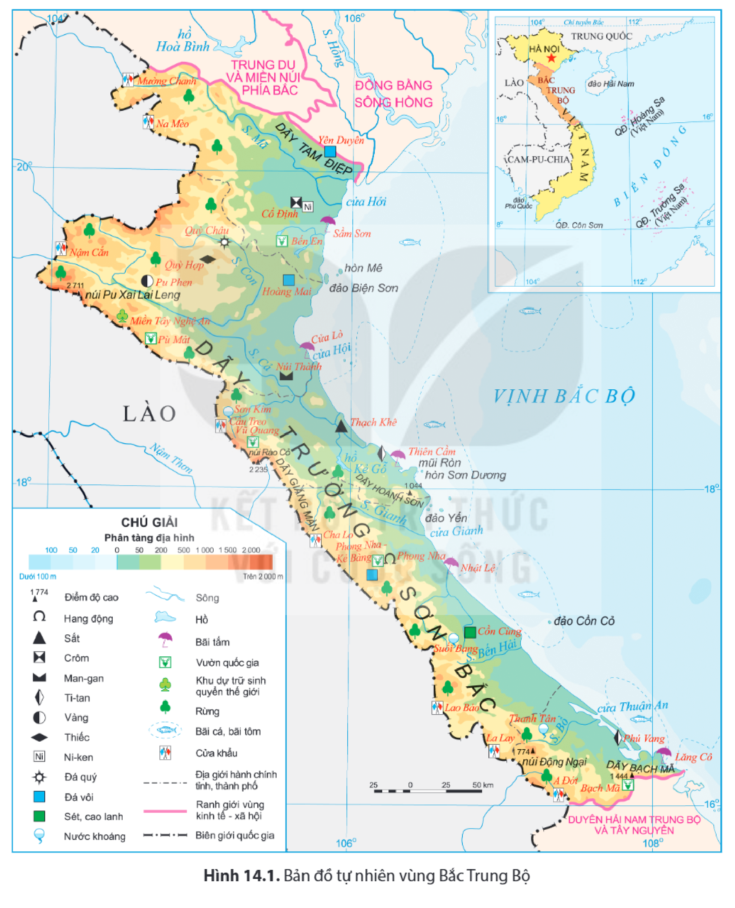
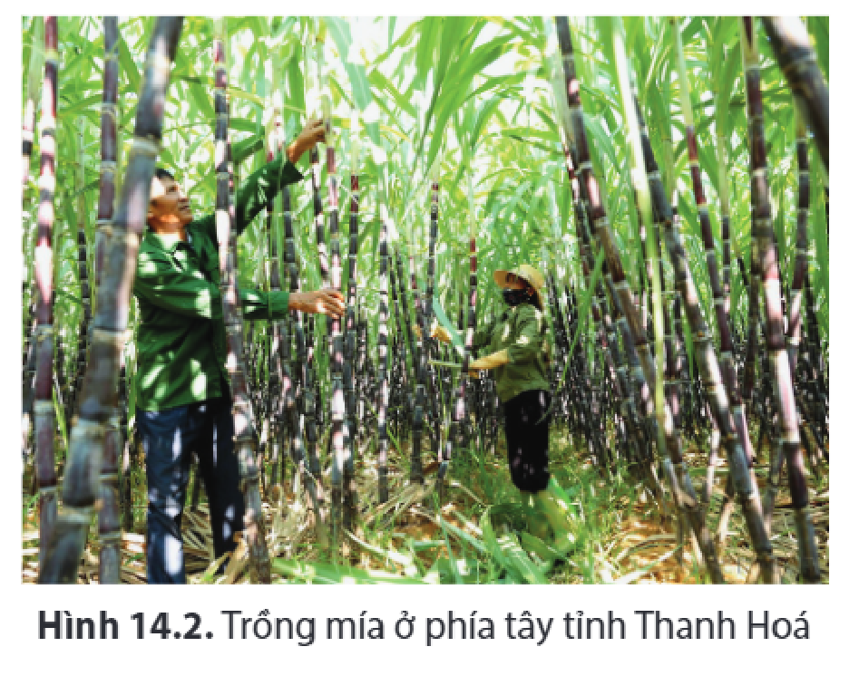
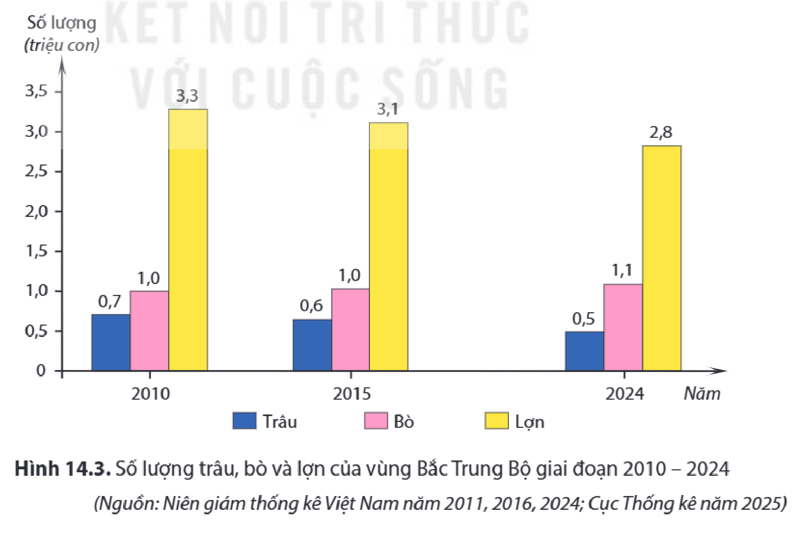
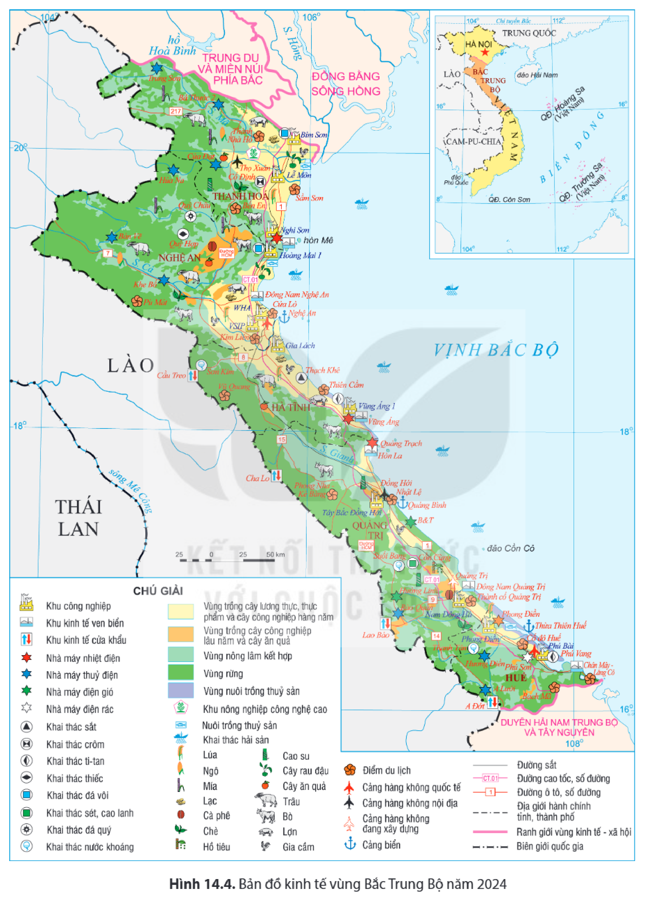
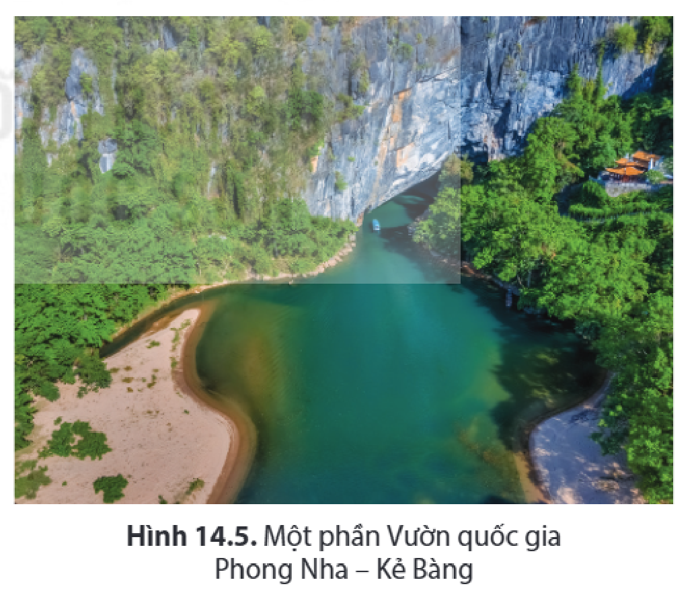

<!-- pdf:178 -->

# BÀI 14: VÙNG BẮC TRUNG BỘ

## 🎯 Học xong bài này, em sẽ:

- Xác định được trên bản đồ vị trí địa lí và phạm vi lãnh thổ của vùng.
- Trình bày được đặc điểm phân hoá của tự nhiên và giải thích ảnh hưởng của tự nhiên đến sự hình thành cơ cấu kinh tế của vùng.
- Trình bày và giải thích được đặc điểm phân bố dân cư ở Bắc Trung Bộ.
- Phân tích được sự phát triển và phân bố kinh tế ở Bắc Trung Bộ.
- Phân tích được thế mạnh về du lịch ở Bắc Trung Bộ.
- Phân tích được vấn đề phát triển kinh tế biển ở Bắc Trung Bộ.

## 🔴 Mở đầu

Bắc Trung Bộ là vùng có điều kiện tự nhiên và tài nguyên thiên nhiên phong phú, văn hoá đa dạng. Điều kiện tự nhiên và dân cư của Bắc Trung Bộ có đặc điểm như thế nào? Bắc Trung Bộ có thế mạnh gì trong phát triển kinh tế?

## 1. Vị trí địa lí và phạm vi lãnh thổ

<!-- term: Vùng Bắc Trung Bộ -->
Vùng Bắc Trung Bộ có diện tích tự nhiên khoảng 51,2 nghìn km² (chiếm 15,5% diện tích cả nước năm 2024); bao gồm thành phố Huế và các tỉnh: Thanh Hoá, Nghệ An, Hà Tĩnh, Quảng Trị.

<!-- term: Vùng Bắc Trung Bộ -->
Bắc Trung Bộ giáp vùng Trung du và miền núi phía Bắc, Đồng bằng sông Hồng, Duyên hải Nam Trung Bộ và Tây Nguyên và nước láng giềng Lào. Phía đông của Bắc Trung Bộ có vùng biển rộng lớn. Trong vùng biển có một số đảo ven bờ có ý nghĩa quan trọng về kinh tế và quốc phòng, an ninh như: hòn Mê (Thanh Hoá), hòn Ngư (Nghệ An), đảo Yến, đảo Cồn Cỏ (Quảng Trị).

<!-- term: Vùng Bắc Trung Bộ -->
Vị trí địa lí tạo cho Bắc Trung Bộ trở thành cầu nối giao lưu kinh tế, văn hoá giữa các vùng trên cả nước, với nước láng giềng và thuận lợi phát triển tổng hợp kinh tế biển.

> ❓ Dựa vào thông tin mục 1 và hình 14.1, hãy xác định vị trí địa lí và phạm vi lãnh thổ của vùng Bắc Trung Bộ.

## 2. Điều kiện tự nhiên và tài nguyên thiên nhiên

<!-- term: Phân hoá tự nhiên vùng Bắc Trung Bộ -->
Tự nhiên của Bắc Trung Bộ có sự phân hoá theo chiều tây – đông, ảnh hưởng tới sự hình thành cơ cấu kinh tế của vùng.

<!-- pdf:179 -->

<!-- term: Phân hoá tự nhiên vùng Bắc Trung Bộ -->
- Địa hình và đất: Gồm ba dạng chính: đồi núi ở phía tây, loại đất chủ yếu là feralit; đồng bằng chuyển tiếp, chủ yếu là đất phù sa và các cồn cát; biển, thềm lục địa, đảo ở phía đông. Điều kiện địa hình và đất tạo thuận lợi cho vùng hình thành cơ cấu kinh tế nông nghiệp, lâm nghiệp, thuỷ sản; đồng thời cũng tạo thế mạnh cho phát triển hoạt động du lịch.

*Hình 14.1. Bản đồ tự nhiên vùng Bắc Trung Bộ*

<!-- pdf:180 -->

<!-- term: Phân hoá tự nhiên vùng Bắc Trung Bộ -->
- Khí hậu: Khí hậu nhiệt đới ẩm gió mùa có một mùa đông lạnh, có sự phân hoá theo chiều đông – tây và theo độ cao địa hình cho phép phát triển nền nông nghiệp nhiệt đới với cơ cấu sản phẩm nông nghiệp đa dạng. Sự phân hoá khí hậu cũng có tác động đến các ngành kinh tế khác.

- Nguồn nước: Sông của vùng thường ngắn và dốc, có giá trị về thuỷ điện, thuỷ lợi. Bắc Trung Bộ có nhiều hồ, đầm (Kẻ Gỗ, Cầu Hai,...) có thể phát triển nuôi trồng thuỷ sản và du lịch. Ngoài ra, vùng có một số nguồn nước khoáng có giá trị trong công nghiệp và du lịch như: Sơn Kim (Hà Tĩnh), Suối Bang (Quảng Trị), Thanh Tân (Huế),...

- Sinh vật: Hệ sinh thái rừng đa dạng gồm rừng nhiệt đới ẩm và rừng cận nhiệt đới. Rừng Bắc Trung Bộ có một số loài gỗ quý như: lim, táu,... Rừng phòng hộ đầu nguồn các sông và ven biển có vai trò quan trọng trong phòng, chống và giảm nhẹ thiên tai. Vùng có nhiều khu bảo tồn thiên nhiên, vườn quốc gia như Miền Tây Nghệ An, Phong Nha – Kẻ Bàng, Bạch Mã,... là cơ sở để phát triển du lịch sinh thái.

- Khoáng sản: Bắc Trung Bộ có tài nguyên khoáng sản khá phong phú. Một số loại khoáng sản có trữ lượng lớn là sắt, đá vôi, crôm, thiếc, ti-tan, tạo điều kiện thuận lợi cho phát triển nhiều ngành công nghiệp.

- Biển, đảo: Vùng biển rộng với đường bờ biển kéo dài, cùng hệ thống các đảo (hòn Mê, Cồn Cỏ,...), đầm phá (Tam Giang – Cầu Hai,...), vũng vịnh (Vũng Áng, Chân Mây,...), bãi tắm đẹp (Sầm Sơn, Lăng Cô,...) thuận lợi cho phát triển tổng hợp kinh tế biển.

> ❓ Dựa vào thông tin mục 2 và hình 14.1, hãy:
> - Trình bày đặc điểm phân hoá tự nhiên ở vùng Bắc Trung Bộ.
> - Giải thích ảnh hưởng của tự nhiên đến sự hình thành cơ cấu kinh tế của vùng Bắc Trung Bộ.

## 3. Phân bố dân cư

<!-- term: Phân bố dân cư vùng Bắc Trung Bộ -->
Năm 2024, số dân của vùng Bắc Trung Bộ khoảng 11,3 triệu người, chiếm 11,2% số dân cả nước, mật độ dân số khoảng 221 người/km².

<!-- term: Phân bố dân cư vùng Bắc Trung Bộ -->
Dân cư phân bố khác nhau giữa khu vực đồi núi phía tây và đồng bằng ven biển phía đông, giữa nông thôn và thành thị. Khu vực đồng bằng có dân cư tập trung đông đúc, khu vực đồi núi dân cư thưa thớt hơn. Dân cư sinh sống chủ yếu ở nông thôn (tỉ lệ dân nông thôn chiếm hơn 74% tổng số dân năm 2024).

<!-- term: Phân bố dân cư vùng Bắc Trung Bộ -->
Bắc Trung Bộ có nhiều dân tộc cùng sinh sống như: Kinh, Thái, Mường, Tày, Bru – Vân Kiều,... Phân bố dân tộc có sự đan xen và phân hoá giữa khu vực phía tây và phía đông. Người Kinh phân bố rộng khắp nhưng tập trung chủ yếu ở khu vực đồng bằng ven biển. Các dân tộc thiểu số phân bố chủ yếu ở khu vực đồi núi phía tây.

<!-- term: Phân bố dân cư vùng Bắc Trung Bộ -->
Phân bố dân cư của Bắc Trung Bộ có sự thay đổi theo thời gian. Trước đây, phân bố dân cư theo các khu vực nhất định. Hiện nay, do tác động của quá trình chuyển cư, đô thị hoá và công nghiệp hoá, sự phân bố dân cư ở vùng có sự thay đổi, mật độ dân số của khu vực phía tây tăng lên.

Bắc Trung Bộ có văn hoá đa dạng, trình độ dân trí và chất lượng cuộc sống của người dân ngày càng được nâng cao. Các dân tộc trong vùng đoàn kết, hỗ trợ nhau cùng phát triển.

<!-- pdf:181 -->

> ❓ Dựa vào thông tin mục 3, hãy:
> - Trình bày đặc điểm phân bố dân cư ở vùng Bắc Trung Bộ.
> - Giải thích sự phân bố dân cư của vùng.

## 4. Sự phát triển và phân bố kinh tế

GRDP của Bắc Trung Bộ tăng khá nhanh qua các năm, chiếm 7,3% GDP cả nước (năm 2024). Cơ cấu kinh tế chuyển dịch theo hướng tăng tỉ trọng công nghiệp và xây dựng; dịch vụ chiếm tỉ trọng cao. Các ngành kinh tế có giá trị gia tăng cao được chú trọng phát triển, nhất là các ngành kinh tế biển.

Bảng 14.1. CƠ CẤU GRDP (GIÁ HIỆN HÀNH) CỦA VÙNG BẮC TRUNG BỘ GIAI ĐOẠN 2010 – 2024

*(Đơn vị: %)*

| Cơ cấu GRDP \ Năm | 2010 | 2015 | 2020 | 2024 |
| --- | :---: | :---: | :---: | :---: |
| Nông nghiệp, lâm nghiệp và thuỷ sản | 26,1 | 22,5 | 18,9 | 16,0 |
| Công nghiệp và xây dựng | 23,3 | 28,5 | 35,0 | 39,6 |
| Dịch vụ | 47,1 | 43,0 | 39,5 | 38,5 |
| Thuế sản phẩm trừ trợ cấp sản phẩm | 3,5 | 6,0 | 6,6 | 5,9 |

*(Nguồn: Niên giám thống kê các tỉnh, thành phố năm 2011, 2016, 2024; Cục Thống kê năm 2025)*

### a) Nông nghiệp và lâm nghiệp

Nông nghiệp và lâm nghiệp là thế mạnh của Bắc Trung Bộ. Các địa phương đẩy mạnh phát triển nông nghiệp công nghệ cao, hình thành các vùng sản xuất tập trung, phát huy tối đa lợi thế của lãnh thổ.

- Nông nghiệp

Sản xuất nông nghiệp ở Bắc Trung Bộ đang chuyển dần từ sản xuất nhỏ lẻ dựa vào kinh tế hộ gia đình sang sản xuất hàng hoá tập trung, thâm canh, ứng dụng công nghệ cao, nông nghiệp hữu cơ. Công nghệ gen, lai tạo giống,... đã được áp dụng vào sản xuất để tạo ra giống cây trồng, vật nuôi có giá trị kinh tế cao, có khả năng thích ứng với bệnh dịch và hạn hán. Cơ cấu cây trồng, vật nuôi ở vùng khá đa dạng.

*Hình 14.2. Trồng mía ở phía tây tỉnh Thanh Hoá*

<!-- pdf:182 -->

  + Trồng trọt

Lúa là cây lương thực chính, được trồng chủ yếu ở đồng bằng Thanh Hoá, Nghệ An và Hà Tĩnh. Nhờ áp dụng kĩ thuật canh tác tiên tiến, giống cho năng suất cao nên sản lượng lúa tăng, đáp ứng cơ bản nhu cầu lương thực trong vùng.

Bảng 14.2. DIỆN TÍCH GIEO TRỒNG VÀ SẢN LƯỢNG LÚA CỦA VÙNG BẮC TRUNG BỘ GIAI ĐOẠN 2010 – 2024

| Tiêu chí \ Năm | 2010 | 2015 | 2020 | 2024 |
| --- | :---: | :---: | :---: | :---: |
| Diện tích gieo trồng *(nghìn ha)* | 690,0 | 701,5 | 673,5 | 655,8 |
| Sản lượng *(triệu tấn)* | 3,4 | 3,8 | 3,8 | 3,9 |

*(Nguồn: Niên giám thống kê Việt Nam năm 2011, 2016, 2024; Cục Thống kê năm 2025)*

Cây công nghiệp hàng năm trong vùng có lạc, vừng,... được trồng với diện tích khá lớn trên các vùng đất cát duyên hải ở hầu hết các địa phương; mía được trồng chủ yếu ở vùng gò đồi phía tây các tỉnh Thanh Hoá, Nghệ An.

Cây công nghiệp lâu năm được phát triển ở một số nơi như: cà phê (Nghệ An, Quảng Trị), hồ tiêu (Quảng Trị), chè (Nghệ An, Thanh Hoá),... Bắc Trung Bộ cũng phát triển một số cây ăn quả như cam, bưởi, dứa,... ở vùng gò đồi từ Thanh Hoá đến Hà Tĩnh.

  + Chăn nuôi

Số lượng trâu của Bắc Trung Bộ chiếm 24,2% cả nước, số lượng bò chiếm 17,6% cả nước (năm 2024). Chăn nuôi trâu, bò phát triển mạnh ở Nghệ An, Thanh Hoá, Hà Tĩnh. Lợn và gia cầm được nuôi ở hầu khắp các tỉnh.

*Hình 14.3. Số lượng trâu, bò và lợn của vùng Bắc Trung Bộ giai đoạn 2010 – 2024*
*(Nguồn: Niên giám thống kê Việt Nam năm 2011, 2016, 2024; Cục Thống kê năm 2025)*

<!-- pdf:183 -->

*Hình 14.4. Bản đồ kinh tế vùng Bắc Trung Bộ năm 2024*

<!-- pdf:184 -->

- Lâm nghiệp

Bắc Trung Bộ có diện tích rừng lớn, với khoảng 3,2 triệu ha (năm 2024), trong đó rừng tự nhiên chiếm khoảng 70%. Nghề rừng từng bước phát triển nhờ chính sách giao đất giao rừng. Các mô hình sản xuất nông lâm kết hợp, canh tác trên đất dốc được mở rộng đem lại hiệu quả kinh tế và góp phần phòng, chống thiên tai.

Năm 2024, sản lượng gỗ khai thác toàn vùng đạt 6,3 triệu m³. Khai thác gỗ tập trung ở vùng đồi núi phía tây các tỉnh. Nghệ An là tỉnh có sản lượng gỗ khai thác lớn nhất, chiếm 31,9% sản lượng gỗ của vùng. Ngoài gỗ, người dân Bắc Trung Bộ còn khai thác các lâm sản khác như: luồng, tre, mây, măng, dược liệu,...

Công tác trồng rừng, khoanh nuôi và bảo vệ rừng rất được chú trọng. Rừng đặc dụng trong các vườn quốc gia và khu bảo tồn được bảo vệ nghiêm ngặt.

> ❓ Dựa vào thông tin mục a và hình 14.4, hãy:
> - Phân tích tình hình phát triển và phân bố ngành nông nghiệp ở vùng Bắc Trung Bộ.
> - Nhận xét sự phát triển và phân bố ngành lâm nghiệp ở vùng Bắc Trung Bộ.

### b) Công nghiệp

Giá trị sản xuất ngành công nghiệp ở Bắc Trung Bộ tăng nhanh qua các năm. Công nghiệp đang được tái cấu trúc theo hướng gia tăng các ngành công nghiệp công nghệ cao, tận dụng lợi thế cạnh tranh của vùng và chiến lược phát triển công nghiệp của đất nước.

Cơ cấu công nghiệp của vùng khá đa dạng, các ngành công nghiệp quan trọng nhất là khai khoáng; sản xuất điện; sản xuất vật liệu xây dựng; sản xuất, chế biến thực phẩm; chế biến gỗ và sản xuất sản phẩm từ gỗ.

- Công nghiệp khai khoáng chủ yếu là khai thác đá vôi ở Thanh Hoá, Nghệ An, Hà Tĩnh,...; khai thác nước khoáng ở Hà Tĩnh, Quảng Trị, Huế.

- Công nghiệp sản xuất điện bao gồm thuỷ điện, nhiệt điện, tập trung chủ yếu ở Thanh Hoá (nhiệt điện Nghi Sơn), Nghệ An (thuỷ điện Bản Vẽ,...), Hà Tĩnh (nhiệt điện Vũng Áng) và Huế (thuỷ điện Hương Điền, A Lưới),... Điện gió, điện mặt trời phát triển mạnh ở Quảng Trị.

- Công nghiệp sản xuất vật liệu xây dựng với các sản phẩm chủ yếu là xi măng, gạch, đá xây dựng,... tập trung ở Thanh Hoá, Nghệ An,...

- Công nghiệp sản xuất, chế biến thực phẩm; chế biến gỗ và sản xuất sản phẩm từ gỗ được phát triển với quy mô vừa và nhỏ ở hầu hết các địa phương.

Bảng 14.3. SẢN LƯỢNG MỘT SỐ SẢN PHẨM CÔNG NGHIỆP CHỦ YẾU CỦA VÙNG BẮC TRUNG BỘ GIAI ĐOẠN 2010 – 2024

| Năm | 2010 | 2015 | 2020 | 2024 |
| --- | :---: | :---: | :---: | :---: |
| Đá khai thác *(triệu m³)* | 18,0 | 27,1 | 23,0 | 31,0 |
| Đường *(nghìn tấn)* | 239,4 | 297,2 | 187,6 | 199,8 |
| Xi măng *(triệu tấn)* | 12,4 | 13,4 | 27,1 | 30,9 |
| Điện sản xuất *(tỉ kWh)* | 1,1 | 7,0 | 22,4 | 32,0 |

*(Nguồn: Niên giám thống kê các tỉnh, thành phố năm 2011, 2016, 2024; Cục Thống kê năm 2025)*

<!-- pdf:185 -->

> ❓ Dựa vào thông tin mục b và hình 14.4, hãy phân tích sự phát triển và phân bố ngành công nghiệp của vùng Bắc Trung Bộ.

### c) Giao thông vận tải và du lịch

- Giao thông vận tải: Bắc Trung Bộ có đầy đủ các loại hình giao thông, đảm bảo thực hiện vai trò trung chuyển hàng hoá giữa hai miền Bắc – Nam; từ Trung Lào, Đông Bắc Thái Lan ra Biển Đông và ngược lại.

Mạng lưới giao thông của vùng đang được đầu tư tương đối đồng bộ và hiện đại. Các cảng hàng không, cảng biển có vai trò quan trọng để phát triển kinh tế theo hướng mở như: cảng hàng không Vinh, Phú Bài; cảng biển Thanh Hoá, Nghệ An, Thừa Thiên Huế.

Năm 2024, khối lượng hàng hoá vận chuyển của Bắc Trung Bộ chiếm 14,7% so với cả nước, đứng thứ ba sau vùng Đồng bằng sông Hồng và Đông Nam Bộ.

Bảng 14.4. SỐ LƯỢT HÀNH KHÁCH VÀ KHỐI LƯỢNG HÀNG HOÁ VẬN CHUYỂN CỦA VÙNG BẮC TRUNG BỘ GIAI ĐOẠN 2010 – 2024

| Năm | 2010 | 2015 | 2020 | 2024 |
| --- | :---: | :---: | :---: | :---: |
| Số lượt hành khách vận chuyển *(triệu lượt người)* | 84,5 | 127,6 | 157,1 | 230,9 |
| Khối lượng hàng hoá vận chuyển *(triệu tấn)* | 88,4 | 156,2 | 247,6 | 378,6 |

*(Nguồn: Niên giám thống kê Việt Nam năm 2011, 2016, 2024; Cục Thống kê năm 2025)*

- Du lịch

  + Bắc Trung Bộ có vị trí địa lí thuận lợi và tài nguyên du lịch hấp dẫn, là thế mạnh để phát triển du lịch. Tài nguyên du lịch tự nhiên của vùng rất đa dạng, nổi bật là hệ thống hang động Phong Nha – Kẻ Bàng (Quảng Trị); bãi biển Sầm Sơn (Thanh Hoá), Cửa Lò (Nghệ An), Lăng Cô (Huế); các khu dự trữ sinh quyển, vườn quốc gia,... Tài nguyên du lịch văn hoá là các Di sản văn hoá thế giới như: Quần thể di tích Cố đô Huế, Thành nhà Hồ, Nhã nhạc cung đình Huế, Dân ca Ví, Giặm Nghệ Tĩnh,...

*Hình 14.5. Một phần Vườn quốc gia Phong Nha – Kẻ Bàng*

  + Số lượng khách du lịch trong nước và quốc tế đến Bắc Trung Bộ tăng nhanh. Các sản phẩm du lịch của vùng đa dạng, nổi bật là du lịch biển, du lịch di sản, du lịch sinh thái, du lịch mạo hiểm,... Nhiều điểm du lịch của vùng trở thành điểm đến nổi tiếng thế giới như: Quần thể di tích Cố đô Huế (Huế), Sầm Sơn (Thanh Hoá), Phong Nha – Kẻ Bàng (Quảng Trị).

<!-- pdf:186 -->

> ❓ Dựa vào thông tin mục c và hình 14.4, hãy:
> - Trình bày sự phát triển và phân bố ngành giao thông vận tải và du lịch của vùng Bắc Trung Bộ.
> - Phân tích thế mạnh để phát triển du lịch của vùng Bắc Trung Bộ.

## 5. Vấn đề phát triển kinh tế biển, đảo

Phát triển kinh tế biển, đảo có vai trò quan trọng đối với phát triển kinh tế – xã hội của Bắc Trung Bộ và đảm bảo quốc phòng, an ninh của cả nước.

<!-- term: Kinh tế biển, đảo vùng Bắc Trung Bộ -->
Bắc Trung Bộ phát triển tổng hợp kinh tế biển, đảo với các ngành khai thác, nuôi trồng hải sản; giao thông vận tải biển; du lịch biển, đảo; điện gió,... Một số khu kinh tế ven biển trong vùng đang khai thác có hiệu quả như: Nghi Sơn (Thanh Hoá), Vũng Áng (Hà Tĩnh), Chân Mây – Lăng Cô (Huế),... Tuy nhiên, vùng còn nhiều khó khăn, thách thức trong phát triển kinh tế biển, đảo như: thiên tai, biến đổi khí hậu, vấn đề môi trường biển, nguồn lợi hải sản suy giảm,...

Để khai thác hiệu quả và bền vững tiềm năng kinh tế biển, đảo, Bắc Trung Bộ cần tập trung vào một số giải pháp:

- Phát triển kinh tế biển kết hợp với bảo đảm quốc phòng, an ninh.
- Phát triển tổng hợp các ngành kinh tế biển: du lịch và dịch vụ biển, kinh tế hàng hải, khai thác các tài nguyên khoáng sản biển, nuôi trồng và khai thác hải sản, công nghiệp ven biển, năng lượng tái tạo và các ngành kinh tế khác.
- Nâng cao hiệu quả hệ thống cảng biển, các khu kinh tế ven biển, khu công nghiệp; ưu tiên phát triển các khu kinh tế ven biển tập trung vào một số ngành trọng điểm phù hợp với các địa phương, tạo đột phá tăng trưởng.
- Bảo vệ môi trường, bảo tồn, phát triển bền vững đa dạng sinh học biển.
- Chủ động ứng phó với biến đổi khí hậu, nước biển dâng và phòng, chống thiên tai.

> ❓ Dựa vào thông tin mục 5, hãy phân tích vấn đề phát triển kinh tế biển, đảo ở vùng Bắc Trung Bộ.

## ✏️ Luyện tập – Vận dụng

- Dựa vào hình 14.4, hãy hoàn thành bảng sau vào vở:

PHÂN BỐ MỘT SỐ CÂY TRỒNG, VẬT NUÔI Ở VÙNG BẮC TRUNG BỘ

| Cây trồng, vật nuôi | Tỉnh, thành phố |
| --- | --- |
| ? | ? |

- Sưu tầm thông tin và hình ảnh, viết bài giới thiệu cho du khách về một điểm du lịch nổi tiếng ở vùng Bắc Trung Bộ.

## 📷 Danh sách hình trong bài

| Mã hình | Trang PDF | Trang sách | Chú thích |
| --- | :---: | :---: | --- |
| H9-lich_su_va_dia_ly-dl-b14-01 | 179 | 177 | Hình 14.1. Bản đồ tự nhiên vùng Bắc Trung Bộ |
| H9-lich_su_va_dia_ly-dl-b14-02 | 181 | 179 | Hình 14.2. Trồng mía ở phía tây tỉnh Thanh Hoá |
| H9-lich_su_va_dia_ly-dl-b14-03 | 182 | 180 | Hình 14.3. Số lượng trâu, bò và lợn của vùng Bắc Trung Bộ giai đoạn 2010 – 2024 |
| H9-lich_su_va_dia_ly-dl-b14-04 | 183 | 181 | Hình 14.4. Bản đồ kinh tế vùng Bắc Trung Bộ năm 2024 |
| H9-lich_su_va_dia_ly-dl-b14-05 | 185 | 183 | Hình 14.5. Một phần Vườn quốc gia Phong Nha – Kẻ Bàng |
