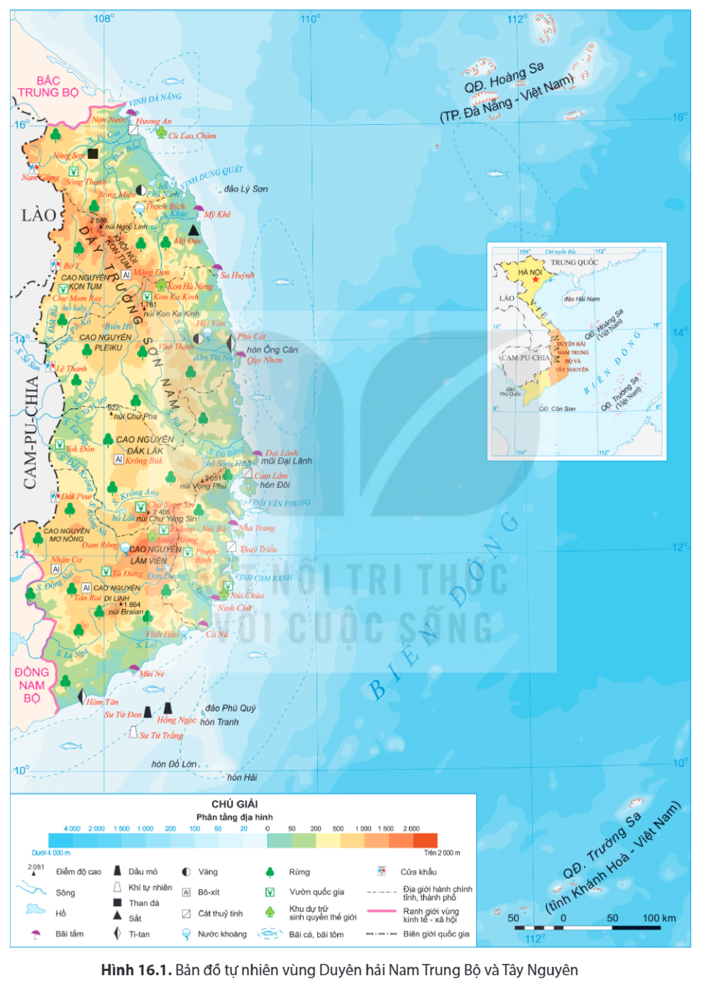
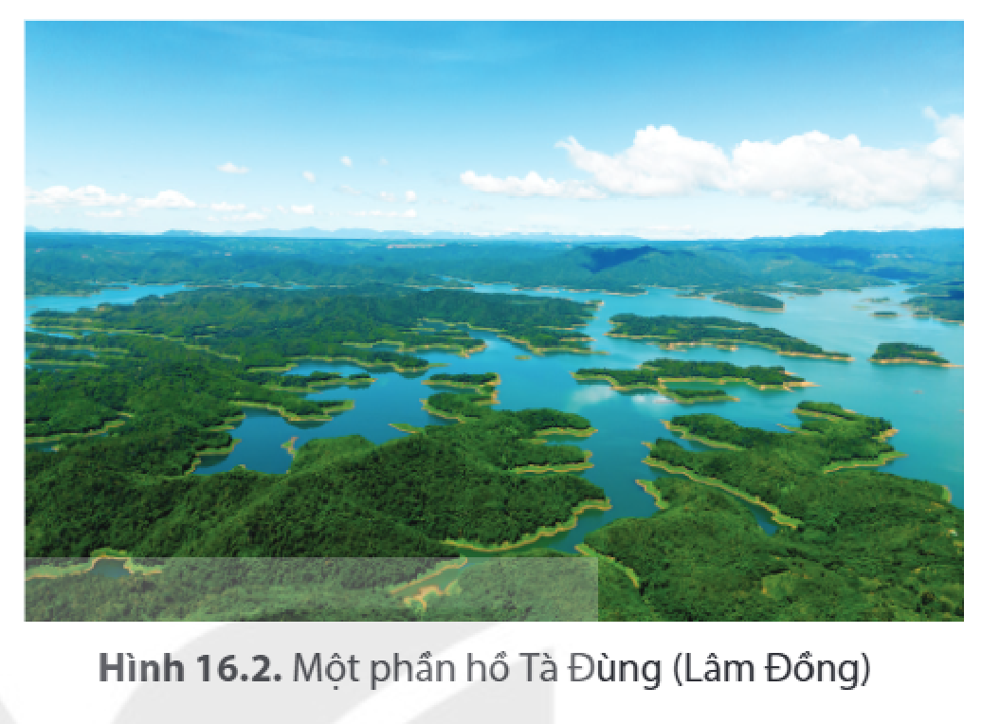
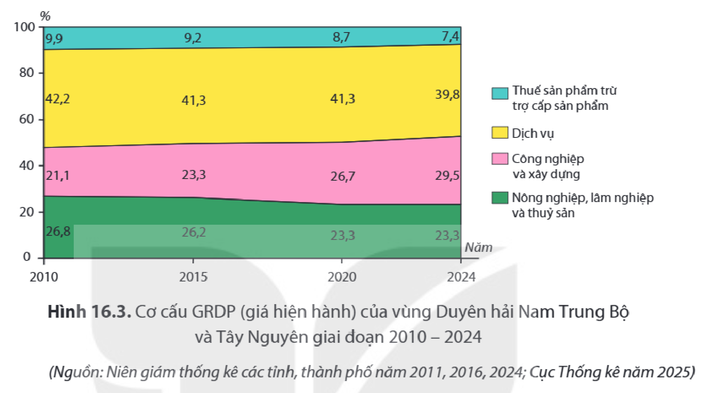
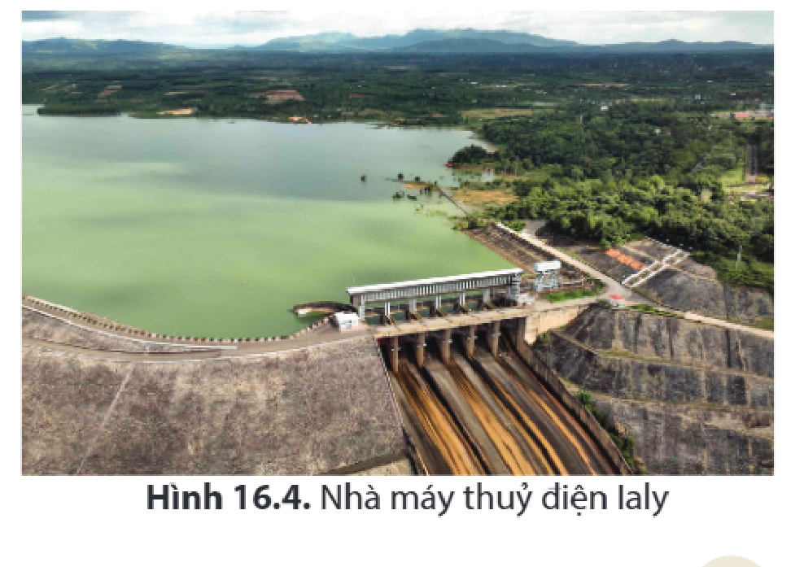
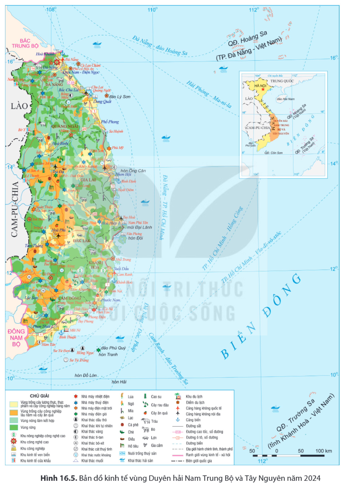
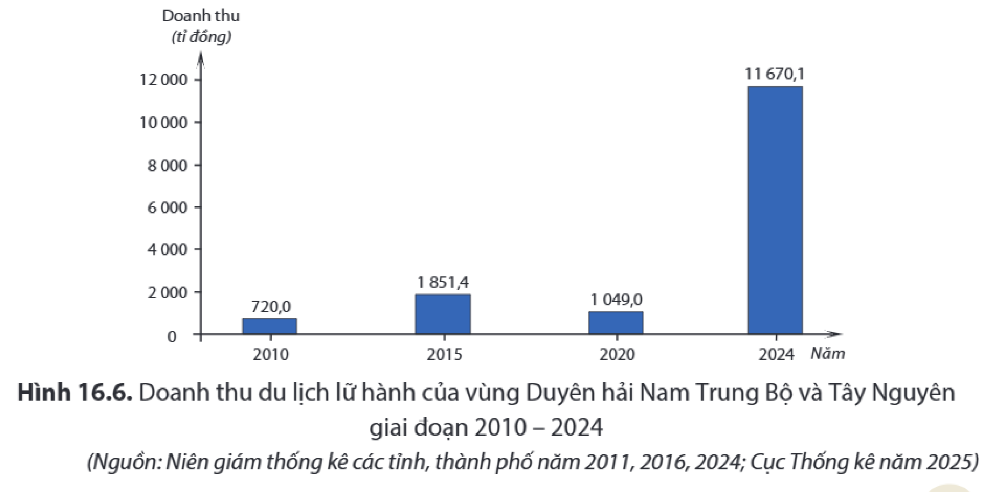

<!-- pdf:188 -->

# BÀI 16: VÙNG DUYÊN HẢI NAM TRUNG BỘ VÀ TÂY NGUYÊN

## 🎯 Học xong bài này, em sẽ:

- Trình bày được đặc điểm vị trí địa lí và phạm vi lãnh thổ của vùng.
- Trình bày được đặc điểm tự nhiên và tài nguyên thiên nhiên, các thế mạnh và hạn chế chính.
- Trình bày được sự phân bố dân cư, dân tộc, văn hoá.
- Phân tích được tình hình phát triển của một số ngành kinh tế thế mạnh của vùng.
- Phân tích được các vấn đề môi trường trong phát triển ở vùng.

## 🔴 Mở đầu

Duyên hải Nam Trung Bộ và Tây Nguyên (Nam Trung Bộ) có vị trí địa lí quan trọng về quốc phòng, an ninh và bản sắc văn hoá đa dạng, đặc sắc. Vùng có không gian phát triển rộng, nhiều tiềm năng để phát triển kinh tế. Điều kiện tự nhiên và tài nguyên thiên nhiên của vùng có những thế mạnh và hạn chế gì? Ngành nào được xác định là ngành kinh tế thế mạnh của vùng?

## 1. Vị trí địa lí và phạm vi lãnh thổ

<!-- term: Vùng Duyên hải Nam Trung Bộ và Tây Nguyên -->
Duyên hải Nam Trung Bộ và Tây Nguyên có diện tích tự nhiên lớn nhất nước ta với khoảng 99,2 nghìn km² (chiếm 29,9% diện tích cả nước năm 2024); bao gồm thành phố Đà Nẵng và các tỉnh: Quảng Ngãi, Gia Lai, Đắk Lắk, Khánh Hoà, Lâm Đồng.

<!-- term: Vùng Duyên hải Nam Trung Bộ và Tây Nguyên -->
Vùng giáp với Bắc Trung Bộ và Đông Nam Bộ, nước láng giềng Lào và Cam-pu-chia; phía đông có vùng biển rộng lớn với nhiều đảo, quần đảo có vị trí chiến lược quan trọng về quốc phòng, an ninh và phát triển kinh tế biển, đảo như: Hoàng Sa (Đà Nẵng), Trường Sa (Khánh Hoà), Lý Sơn (Quảng Ngãi), Phú Quý (Lâm Đồng).

<!-- term: Vùng Duyên hải Nam Trung Bộ và Tây Nguyên -->
Duyên hải Nam Trung Bộ và Tây Nguyên là cầu nối giữa các vùng phía bắc với các vùng phía nam, cửa ngõ ra biển của Lào và Cam-pu-chia; gần với các tuyến hàng hải quốc tế nhộn nhịp bậc nhất thế giới, tạo điều kiện thuận lợi trong thu hút đầu tư và phát triển kinh tế theo hướng mở.

> ❓ Dựa vào thông tin mục 1 và hình 16.1, hãy trình bày đặc điểm vị trí địa lí và phạm vi lãnh thổ của vùng Duyên hải Nam Trung Bộ và Tây Nguyên.

## 2. Điều kiện tự nhiên và tài nguyên thiên nhiên

### a) Thế mạnh

- Địa hình và đất: Phía tây của vùng chủ yếu là các cao nguyên xếp tầng có mặt bằng rộng lớn, đất badan màu mỡ tạo điều kiện thuận lợi cho phát triển các vùng chuyên canh cây công nghiệp lâu năm, cây ăn quả quy mô lớn. Phía bắc có nhiều dãy núi chạy ra sát biển, tạo nên các vịnh biển, đất feralit chiếm diện tích lớn, phù hợp phát triển kinh tế tổng hợp. Phía đông là dải đồng bằng ven biển nhỏ hẹp, đất phù sa và các cồn cát ven biển, thuận lợi trồng cây lương thực, cây công nghiệp hàng năm,...

<!-- pdf:189 -->

*Hình 16.1. Bản đồ tự nhiên vùng Duyên hải Nam Trung Bộ và Tây Nguyên*

<!-- pdf:190 -->

- Khí hậu: Khí hậu mang tính chất cận xích đạo, nền nhiệt cao, số giờ nắng trong năm nhiều, có mùa mưa và mùa khô rõ rệt, thích hợp cho việc trồng các loại cây công nghiệp, cây ăn quả, đồng thời đem lại tiềm năng lớn cho khai thác năng lượng tái tạo. Các cao nguyên với độ cao trên 1 000 m có khí hậu mát mẻ là lợi thế để phát triển du lịch.

- Nguồn nước: Vùng có nguồn nước dồi dào từ các sông Krông Pô Kô, Đắk Krông, Ba, Đồng Nai, ,... đem lại tiềm năng thuỷ điện lớn; nhiều thác nước, hồ như Phú Ninh, Tà Đùng, Biển Hồ,... tạo cảnh quan để phát triển du lịch, cung cấp nước cho sản xuất và sinh hoạt. Vùng có nhiều suối khoáng nóng như Thạch Bích, Vĩnh Hảo,... thuận lợi phát triển công nghiệp sản xuất đồ uống và chăm sóc sức khoẻ,...

*Hình 16.2. Một phần hồ Tà Đùng (Lâm Đồng)*

- Sinh vật: Vùng có diện tích rừng lớn, chiếm khoảng 34% diện tích rừng cả nước (năm 2024). Rừng có đa dạng sinh học cao, nhiều loài sinh vật quý hiếm, có nhiều khu bảo tồn thiên nhiên và vườn quốc gia như Yok Đôn, Núi Chúa, Sông Thanh,... là cơ sở để phát triển lâm nghiệp, du lịch sinh thái và nghiên cứu khoa học.

- Khoáng sản: Khoáng sản nổi bật nhất trong vùng là bô-xít với trữ lượng lớn nhất cả nước. Ngoài ra còn có dầu khí, nước khoáng, cát thuỷ tinh, ti-tan,... là nguồn nguyên liệu cho phát triển công nghiệp khai thác và chế biến khoáng sản,...

- Biển, đảo: Vùng biển rộng với đường bờ biển khúc khuỷu, có nhiều đảo, quần đảo, nhiều vũng vịnh, bãi biển đẹp, nguồn lợi thuỷ sản phong phú với các ngư trường lớn,... là lợi thế cho phát triển tổng hợp kinh tế biển.

### b) Hạn chế

Điều kiện tự nhiên cũng gây một số hạn chế trong phát triển kinh tế – xã hội ở Duyên hải Nam Trung Bộ và Tây Nguyên như: mùa khô kéo dài gây thiếu nước, nguy cơ cháy rừng cao; nhiều thiên tai (bão, hạn hán,...), sa mạc hoá và ảnh hưởng của biến đổi khí hậu tác động tiêu cực đến sản xuất và đời sống.

> ❓ Dựa vào thông tin mục 2 và hình 16.1, hãy trình bày đặc điểm tự nhiên và tài nguyên thiên nhiên, các thế mạnh và hạn chế của vùng Duyên hải Nam Trung Bộ và Tây Nguyên.

## 3. Đặc điểm dân cư, xã hội

### a) Dân cư, dân tộc

Năm 2024, vùng Duyên hải Nam Trung Bộ và Tây Nguyên có số dân khoảng 15,9 triệu người, chiếm 15,7% số dân cả nước.

Mật độ dân số của vùng thấp hơn trung bình cả nước. Dân cư tập trung đông ở đồng bằng ven biển và các đô thị, thưa hơn ở khu vực đồi núi và cao nguyên. Tỉ lệ dân thành thị của vùng thấp hơn trung bình cả nước. Nguồn lao động dồi dào, lao động có nhiều kinh nghiệm trong sản xuất nông nghiệp, thuỷ sản.

<!-- pdf:191 -->

Bảng 16.1. MỘT SỐ TIÊU CHÍ VỀ DÂN CƯ CỦA VÙNG DUYÊN HẢI NAM TRUNG BỘ VÀ TÂY NGUYÊN, CẢ NƯỚC NĂM 2024

| Tiêu chí | Duyên hải Nam Trung Bộ và Tây Nguyên | Cả nước |
| --- | :---: | :---: |
| Mật độ dân số *(người/km²)* | 160 | 306 |
| Tuổi thọ trung bình *(năm)* | 73,7 | 74,7 |
| Tỉ lệ dân thành thị *(%)* | 37,1 | 38,5 |

*(Nguồn: Niên giám thống kê các tỉnh, thành phố và Niên giám thống kê Việt Nam năm 2024; Cục Thống kê năm 2025)*

Vùng Duyên hải Nam Trung Bộ và Tây Nguyên là địa bàn có thành phần dân tộc đa dạng nhất cả nước. Các dân tộc đan xen, cùng sinh sống nhưng cũng có khu vực cư trú đặc trưng. Người Kinh phân bố rộng khắp, tập trung ở đồng bằng ven biển và các đô thị. Người Chăm sinh sống nhiều ở đồng bằng ven biển phía đông nam; người Ê-đê, Mnông, Ba-na, Cơ-ho, Gia-rai,... tập trung nhiều ở khu vực cao nguyên phía tây.

### b) Đặc điểm văn hoá

Duyên hải Nam Trung Bộ và Tây Nguyên có nền văn hoá đa dạng, độc đáo, đậm đà bản sắc dân tộc. Vùng là nơi giao thoa và lưu giữ nhiều di sản văn hoá có giá trị, trong đó có các di sản văn hoá thế giới như: Phố cổ Hội An, Khu đền tháp Mỹ Sơn, Không gian văn hoá Cồng chiêng Tây Nguyên.

<!-- term: Không gian văn hoá Cồng chiêng Tây Nguyên -->
> 💡 **Em có biết?**
>
> Không gian văn hoá Cồng chiêng Tây Nguyên là Di sản phi vật thể thứ hai của Việt Nam được UNESCO ghi danh vào năm 2005, là kiệt tác văn hoá phi vật thể và truyền khẩu của nhân loại. Chủ nhân của loại hình văn hoá đặc sắc này là cư dân các dân tộc khu vực Tây Nguyên như: Ba-na, Mnông, Cơ-ho, Ê-đê, Gia-rai,...
>
> *(Nguồn: Bộ Văn hoá, Thể thao và Du lịch)*

Văn hoá trong vùng có sự phân hoá theo không gian. Khu vực phía đông mang đậm dấu ấn văn hoá biển và sự giao thoa văn hoá Việt – Chăm – các tộc người bản địa. Cư dân có lối sống phóng khoáng, kiên cường, thích nghi cao với điều kiện tự nhiên khô hạn, gió bão. Khu vực phía tây đặc trưng bởi không gian văn hoá cồng chiêng của cộng đồng các dân tộc Tây Nguyên. Đời sống văn hoá gắn chặt với buôn làng, nhà Rông, rừng, đề cao tính cộng đồng. Lễ hội, sử thi và luật tục phản ánh mối quan hệ hài hoà giữa con người với thiên nhiên.

Văn hoá trong vùng ngày càng đa dạng do vừa tiếp thu các yếu tố văn hoá mới vừa bảo tồn, phát huy các giá trị văn hoá truyền thống.

> ❓ Dựa vào thông tin mục 3, hãy:
> - Trình bày sự phân bố dân cư, dân tộc của vùng Duyên hải Nam Trung Bộ và Tây Nguyên.
> - Trình bày đặc điểm văn hoá nổi bật của vùng Duyên hải Nam Trung Bộ và Tây Nguyên.

<!-- pdf:192 -->

## 4. Sự phát triển và phân bố các ngành kinh tế

Năm 2024, GRDP của vùng chiếm khoảng 12,2% GDP của cả nước. Cơ cấu kinh tế chuyển dịch theo hướng tăng tỉ trọng công nghiệp và xây dựng; giảm tỉ trọng nông nghiệp, lâm nghiệp và thuỷ sản; dịch vụ chiếm tỉ trọng cao.

*Hình 16.3. Cơ cấu GRDP (giá hiện hành) của vùng Duyên hải Nam Trung Bộ và Tây Nguyên giai đoạn 2010 – 2024*
*(Nguồn: Niên giám thống kê các tỉnh, thành phố năm 2011, 2016, 2024; Cục Thống kê năm 2025)*

Một số ngành kinh tế thế mạnh của vùng là nông nghiệp và thuỷ sản, công nghiệp, dịch vụ.

### a) Nông nghiệp và thuỷ sản

- Phát triển cây công nghiệp lâu năm và cây ăn quả: Duyên hải Nam Trung Bộ và Tây Nguyên là vùng chuyên canh cây công nghiệp lâu năm lớn nhất cả nước với các cây trồng chính là cà phê, hồ tiêu, điều, cao su, chè,... Vùng có diện tích cà phê và hồ tiêu đứng đầu, cao su và điều đứng thứ hai cả nước. Các loại cây ăn quả có giá trị và được trồng nhiều trong vùng là sầu riêng, bơ, chôm chôm, nho,...

Bảng 16.2. DIỆN TÍCH VÀ TỈ LỆ MỘT SỐ CÂY TRỒNG CHÍNH CỦA VÙNG DUYÊN HẢI NAM TRUNG BỘ VÀ TÂY NGUYÊN SO VỚI CẢ NƯỚC NĂM 2024

| Cây trồng | Diện tích *(nghìn ha)* | Tỉ lệ so với cả nước *(%)* |
| --- | :---: | :---: |
| Cà phê | 678,6 | 92,7 |
| Hồ tiêu | 74,0 | 67,4 |
| Cao su | 285,2 | 31,4 |
| Sầu riêng | 89 | 49,5 |

*(Nguồn: Niên giám thống kê các tỉnh, thành phố và Niên giám thống kê Việt Nam năm 2024; Cục Thống kê năm 2025)*

- Khai thác và nuôi trồng thuỷ sản: Tổng sản lượng thuỷ sản của vùng đứng thứ hai cả nước sau vùng Đồng bằng sông Cửu Long.

<!-- pdf:193 -->

Bảng 16.3. SẢN LƯỢNG THUỶ SẢN CỦA VÙNG DUYÊN HẢI NAM TRUNG BỘ VÀ TÂY NGUYÊN GIAI ĐOẠN 2010 – 2024

*(Đơn vị: nghìn tấn)*

| Sản lượng thuỷ sản \ Năm | 2010 | 2015 | 2020 | 2024 |
| --- | :---: | :---: | :---: | :---: |
| Khai thác | 647,1 | 890,3 | 1 154,8 | 1 249,3 |
| Nuôi trồng | 99,2 | 115,4 | 138,4 | 165,9 |

*(Nguồn: Niên giám thống kê Việt Nam năm 2011, 2016, 2024; Cục Thống kê năm 2025)*

Sản lượng thuỷ sản tăng nhanh, chủ yếu là từ hoạt động khai thác. Sản lượng cá biển khai thác của vùng lớn, đạt 1 011,7 nghìn tấn, chiếm 35,9% cả nước (năm 2024). Các địa phương có ngành khai thác thuỷ sản phát triển nhất là Gia Lai, Khánh Hoà, Lâm Đồng.

Hoạt động nuôi trồng thuỷ sản đang được đẩy mạnh theo hướng áp dụng công nghệ cao, nuôi trồng bền vững, góp phần nâng cao chất lượng sản phẩm và bảo vệ môi trường. Các sản phẩm thuỷ sản nuôi trồng chính là tôm hùm, rong biển, trai lấy ngọc,... trở thành đặc sản, vừa đem lại hiệu quả kinh tế cao vừa thúc đẩy phát triển du lịch. Các địa phương nuôi trồng thuỷ sản nhiều nhất là Khánh Hoà, Gia Lai, Đắk Lắk.

> ❓ Dựa vào thông tin mục a và hình 16.5, hãy phân tích tình hình phát triển ngành nông nghiệp và thuỷ sản của vùng Duyên hải Nam Trung Bộ và Tây Nguyên.

### b) Công nghiệp

Giá trị sản xuất công nghiệp của vùng tăng qua các năm và chiếm khoảng 6,4% giá trị sản xuất công nghiệp của cả nước (năm 2024). Vùng có cơ cấu ngành công nghiệp khá đa dạng.

- Công nghiệp khai khoáng: Khai thác bô-xít trong vùng được phát triển nhờ trữ lượng bô-xít lớn nhất cả nước. Sản lượng khai thác quặng bô-xít trong vùng ngày càng tăng, năm 2024 đạt trên 5 triệu tấn. Vùng có hai tổ hợp khai thác bô-xít – a-lu-min ở Tân Rai và Nhân Cơ (Lâm Đồng). Trong vùng còn khai thác một số loại khoáng sản khác như: dầu khí ở Lâm Đồng; cát thuỷ tinh, muối ở Khánh Hoà và Lâm Đồng; ti-tan ở Gia Lai, Lâm Đồng;...

- Công nghiệp sản xuất điện: Các nhà máy thuỷ điện có công suất lớn, cung cấp nguồn điện cho vùng và cả nước là Ialy (720 MW), Sê San 4 (360 MW), Đồng Nai 4 (340 MW),... Vùng còn phát triển mạnh điện gió, điện mặt trời; tập trung chủ yếu ở Đắk Lắk, Lâm Đồng, Khánh Hoà, Gia Lai.

*Hình 16.4. Nhà máy thuỷ điện Ialy*

<!-- pdf:194 -->

*Hình 16.5. Bản đồ kinh tế vùng Duyên hải Nam Trung Bộ và Tây Nguyên năm 2024*

<!-- pdf:195 -->

- Duyên hải Nam Trung Bộ và Tây Nguyên còn phát triển các ngành công nghiệp truyền thống như cơ khí; sản xuất, chế biến thực phẩm và đồ uống; dệt và sản xuất trang phục; sản xuất giày, dép;... ở Đà Nẵng, Khánh Hoà,... Nhiều ngành công nghiệp mới cũng đang được đẩy mạnh phát triển như: sản xuất ô tô và xe có động cơ khác, phụ trợ ngành cơ khí, sản xuất sản phẩm dầu mỏ tinh chế, sản xuất kim loại,... ở Đà Nẵng, Quảng Ngãi,...

Bảng 16.4. SẢN LƯỢNG MỘT SỐ SẢN PHẨM CÔNG NGHIỆP CHỦ YẾU CỦA VÙNG DUYÊN HẢI NAM TRUNG BỘ VÀ TÂY NGUYÊN GIAI ĐOẠN 2010 – 2024

| Sản phẩm \ Năm | 2010 | 2015 | 2020 | 2024 |
| --- | :---: | :---: | :---: | :---: |
| Thuỷ sản chế biến *(nghìn tấn)* | 132,0 | 179,9 | 199,9 | 231,2 |
| Quần áo may sẵn *(triệu cái)* | 124,0 | 265,3 | 351,1 | 501,5 |
| Ô tô lắp ráp các loại *(nghìn chiếc)* | 16,2 | 74,8 | 82,2 | 81,8 |
| Điện sản xuất *(tỉ KWh)* | 13,2 | 30,6 | 62,6 | 81,2 |

*(Nguồn: Niên giám thống kê các tỉnh, thành phố năm 2011, 2016, 2024; Cục Thống kê năm 2025)*

> ❓ Dựa vào thông tin mục b và hình 16.5, hãy phân tích tình hình phát triển ngành công nghiệp của vùng Duyên hải Nam Trung Bộ và Tây Nguyên.

### c) Dịch vụ

Dịch vụ chiếm tỉ trọng cao trong cơ cấu GRDP của vùng với nhiều ngành dịch vụ.

- Giao thông vận tải biển: Duyên hải Nam Trung Bộ và Tây Nguyên có một số cảng biển quan trọng đối với quốc gia và khu vực là Đà Nẵng, Quảng Ngãi, Khánh Hoà,..., trong đó có nhiều bến cảng nước sâu. Các tuyến đường biển trọng yếu như Đà Nẵng – Hải Phòng, Đà Nẵng – Tô-ky-ô,... đang được tăng cường năng lực vận chuyển. Hoạt động giao thông vận tải biển phát triển mạnh, đặc biệt là vận chuyển hàng hoá xuất nhập khẩu, tàu du lịch quốc tế.

- Du lịch: Số lượt khách, doanh thu và cơ sở hạ tầng du lịch phát triển nhanh. Các sản phẩm du lịch của vùng rất đa dạng, tiêu biểu là du lịch biển, đảo, du lịch văn hoá, du lịch sinh thái, du lịch cộng đồng, du lịch nghỉ dưỡng,... Các điểm du lịch nổi tiếng trong vùng là Hội An (Đà Nẵng), Nha Trang (Khánh Hoà),...

*Hình 16.6. Doanh thu du lịch lữ hành của vùng Duyên hải Nam Trung Bộ và Tây Nguyên giai đoạn 2010 – 2024*
*(Nguồn: Niên giám thống kê các tỉnh, thành phố năm 2011, 2016, 2024; Cục Thống kê năm 2025)*

<!-- pdf:196 -->

- Thương mại: Nội thương phát triển thể hiện qua sự tăng nhanh tổng mức bán lẻ hàng hoá và doanh thu dịch vụ tiêu dùng cũng như sự đa dạng, hiện đại của hệ thống cung ứng hàng hoá. Năm 2024, toàn vùng có 162 siêu thị và 38 trung tâm thương mại, tập trung chủ yếu ở Đà Nẵng và Khánh Hoà. Ngoại thương được chú trọng phát triển, các địa phương có trị giá xuất khẩu lớn trong vùng là Đà Nẵng và Quảng Ngãi.

> ❓ Dựa vào thông tin mục c và hình 16.5, hãy phân tích tình hình phát triển ngành dịch vụ của vùng Duyên hải Nam Trung Bộ và Tây Nguyên.

## 5. Các vấn đề môi trường trong phát triển

Trong phát triển kinh tế – xã hội, Duyên hải Nam Trung Bộ và Tây Nguyên đang phải đối mặt với một số vấn đề về môi trường:

<!-- term: Vấn đề môi trường vùng Nam Trung Bộ -->
- Diện tích rừng tự nhiên đang bị suy giảm cả về số lượng và chất lượng, làm phá vỡ cân bằng sinh thái, xói mòn đất, hạ mực nước ngầm, ảnh hưởng tới năng suất cây công nghiệp lâu năm và đời sống người dân.

<!-- term: Vấn đề môi trường vùng Nam Trung Bộ -->
- Việc khai thác khoáng sản mang lại nhiều lợi ích về kinh tế nhưng cũng ảnh hưởng xấu đến môi trường sinh thái và làm thu hẹp diện tích đất nông, lâm nghiệp.

<!-- term: Vấn đề môi trường vùng Nam Trung Bộ -->
- Hạn hán, sa mạc hoá ở phía nam tỉnh Khánh Hoà, phía đông tỉnh Lâm Đồng gây thiếu nước cho sản xuất và sinh hoạt, tăng nguy cơ cháy rừng,...

<!-- term: Vấn đề môi trường vùng Nam Trung Bộ -->
- Hiện tượng mưa lũ ngày càng nghiêm trọng kết hợp với đặc điểm sông ngắn và dốc cùng việc vận hành xả nước của các đập thuỷ điện đã gây ảnh hưởng đến sản xuất và đời sống của người dân.

> ❓ Dựa vào thông tin mục 5, hãy phân tích vấn đề môi trường trong phát triển kinh tế – xã hội ở vùng Duyên hải Nam Trung Bộ và Tây Nguyên.

## ✏️ Luyện tập – Vận dụng

1. Tại sao nói vùng Duyên hải Nam Trung Bộ và Tây Nguyên có vị trí chiến lược quan trọng về quốc phòng, an ninh, phát triển kinh tế và đối ngoại?
2. Hoàn thành bảng về một số ngành kinh tế thế mạnh của vùng Duyên hải Nam Trung Bộ và Tây Nguyên theo mẫu sau vào vở:

| Ngành thế mạnh | Lợi thế phát triển |
| --- | --- |
| ? | ? |

- Sưu tầm thông tin, hình ảnh về một số nét văn hoá đặc sắc (nhạc cụ, kiến trúc, lễ hội) của vùng Duyên hải Nam Trung Bộ và Tây Nguyên.

## 📷 Danh sách hình trong bài

| Mã hình | Trang PDF | Trang sách | Chú thích |
| --- | :---: | :---: | --- |
| H9-lich_su_va_dia_ly-dl-b16-01 | 189 | 187 | Hình 16.1. Bản đồ tự nhiên vùng Duyên hải Nam Trung Bộ và Tây Nguyên |
| H9-lich_su_va_dia_ly-dl-b16-02 | 190 | 188 | Hình 16.2. Một phần hồ Tà Đùng (Lâm Đồng) |
| H9-lich_su_va_dia_ly-dl-b16-03 | 192 | 190 | Hình 16.3. Cơ cấu GRDP (giá hiện hành) của vùng Duyên hải Nam Trung Bộ và Tây Nguyên giai đoạn 2010 – 2024 |
| H9-lich_su_va_dia_ly-dl-b16-04 | 193 | 191 | Hình 16.4. Nhà máy thuỷ điện Ialy |
| H9-lich_su_va_dia_ly-dl-b16-05 | 194 | 192 | Hình 16.5. Bản đồ kinh tế vùng Duyên hải Nam Trung Bộ và Tây Nguyên năm 2024 |
| H9-lich_su_va_dia_ly-dl-b16-06 | 195 | 193 | Hình 16.6. Doanh thu du lịch lữ hành của vùng Duyên hải Nam Trung Bộ và Tây Nguyên giai đoạn 2010 – 2024 |
