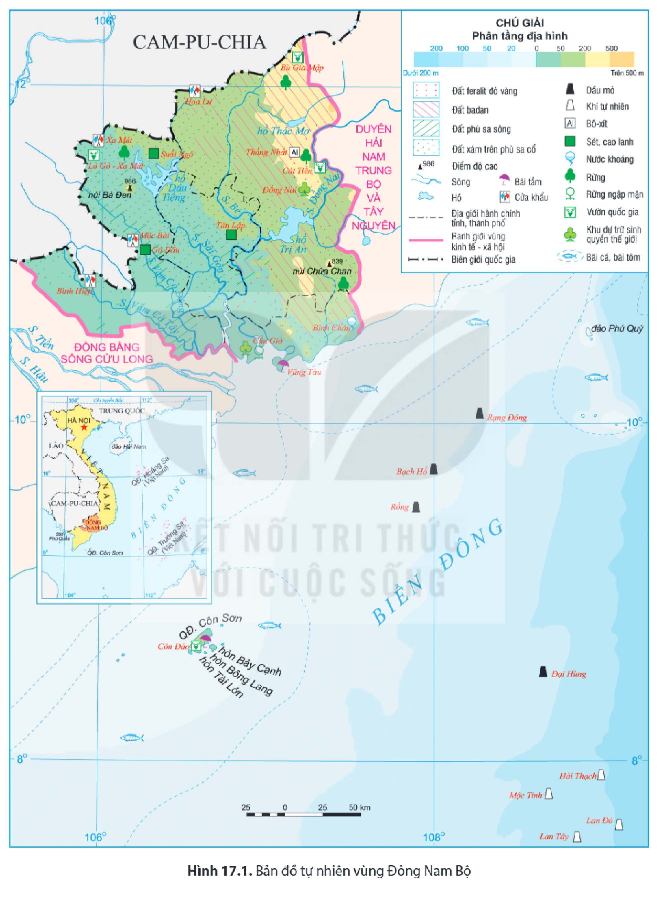
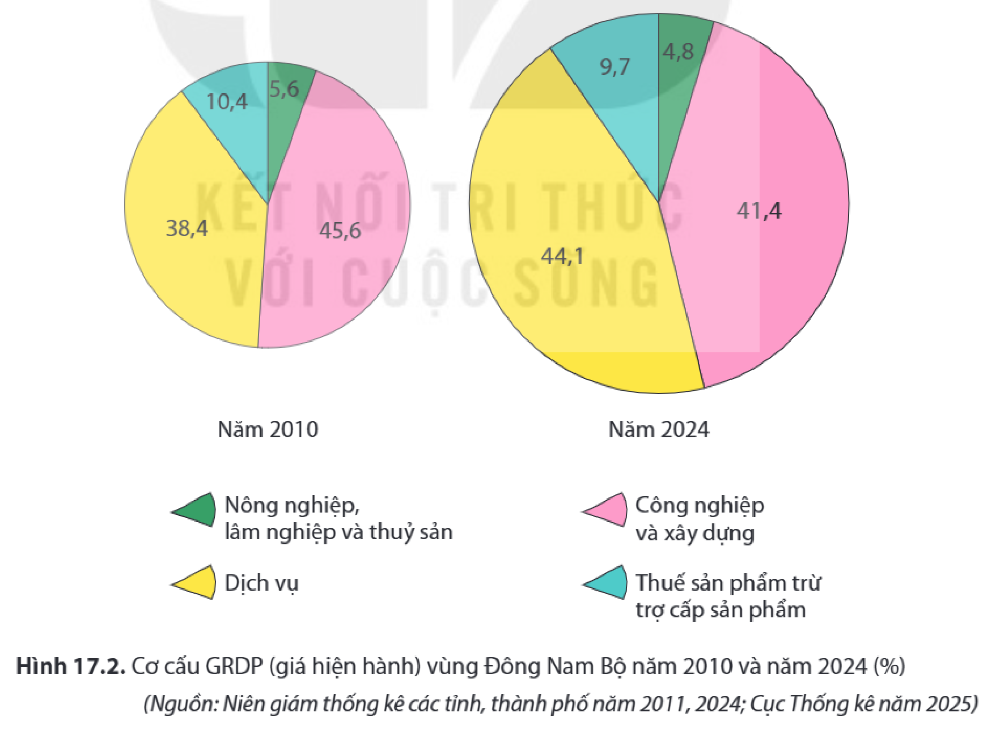
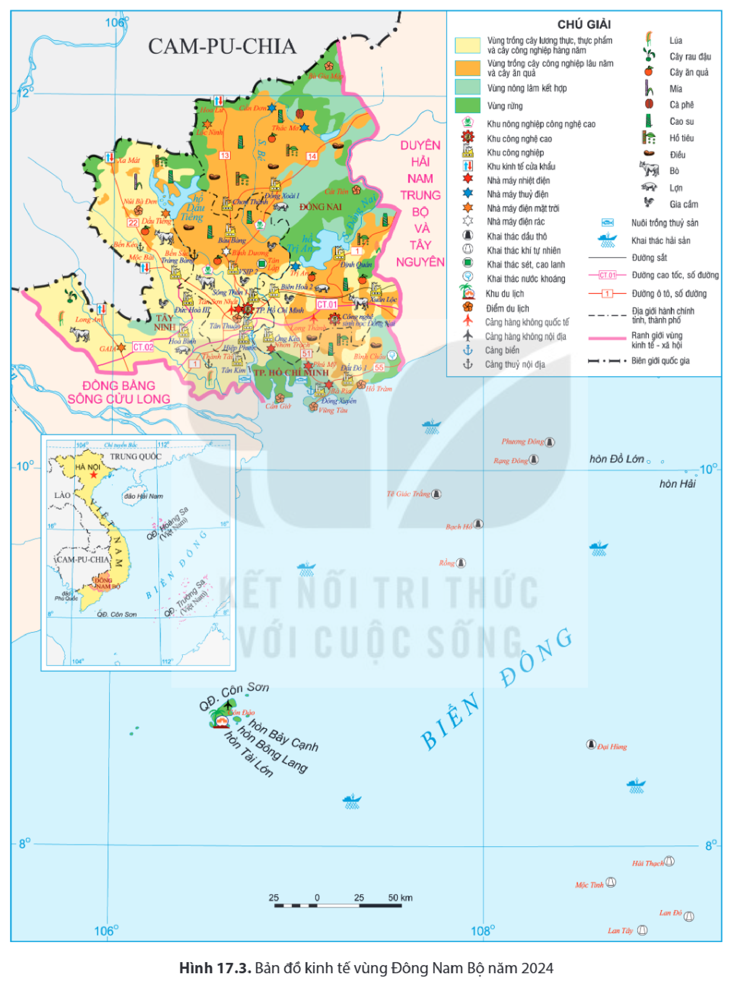
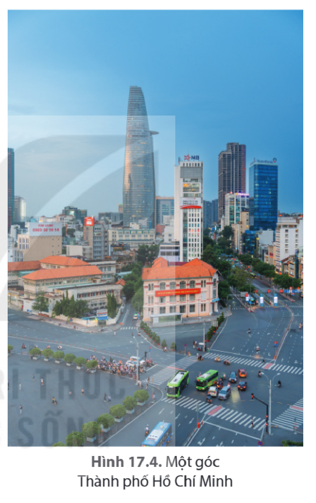

<!-- pdf:197 -->

# BÀI 17: VÙNG ĐÔNG NAM BỘ

## 🎯 Học xong bài này, em sẽ:

- Trình bày được đặc điểm vị trí địa lí và phạm vi lãnh thổ của vùng.
- Phân tích được các thế mạnh, hạn chế về điều kiện tự nhiên và tài nguyên thiên nhiên của vùng.
- Trình bày được đặc điểm về dân cư, đô thị hoá ở vùng Đông Nam Bộ.
- Trình bày được sự phát triển và phân bố một trong các ngành kinh tế thế mạnh của vùng.
- Phân tích được vị thế của Thành phố Hồ Chí Minh.

## 🔴 Mở đầu

Đông Nam Bộ là một trong những vùng kinh tế phát triển nhất cả nước. Đó là kết quả khai thác hiệu quả tổng hợp thế mạnh của vùng. Vậy những thế mạnh nổi bật về điều kiện tự nhiên và tài nguyên thiên nhiên của vùng là gì? Đặc điểm dân cư và đô thị hoá của vùng như thế nào? Sự phát triển và phân bố một số ngành kinh tế thế mạnh của vùng ra sao?

## 1. Vị trí địa lí và phạm vi lãnh thổ

<!-- term: Vùng Đông Nam Bộ -->
Vùng Đông Nam Bộ có diện tích tự nhiên là hơn 28,0 nghìn km² (chiếm 8,5% diện tích cả nước năm 2024); bao gồm Thành phố Hồ Chí Minh và các tỉnh: Đồng Nai, Tây Ninh.

<!-- term: Vùng Đông Nam Bộ -->
Đông Nam Bộ giáp với vùng Đồng bằng sông Cửu Long, Duyên hải Nam Trung Bộ và Tây Nguyên, nước láng giềng Cam-pu-chia; phía đông nam có vùng biển rộng với một số đảo, quần đảo, trong đó quần đảo Côn Sơn có diện tích lớn nhất vùng.

<!-- term: Vùng Đông Nam Bộ -->
Vùng là cầu nối giữa Đồng bằng sông Cửu Long với Duyên hải Nam Trung Bộ và Tây Nguyên, có Thành phố Hồ Chí Minh là một trong những trung tâm kinh tế lớn nhất cả nước. Vị trí của Đông Nam Bộ thuận lợi để phát triển đầy đủ các loại hình giao thông, kết nối với cả nước và quốc tế.

> ❓ Dựa vào hình 17.1 và thông tin mục 1, hãy trình bày đặc điểm vị trí địa lí và phạm vi lãnh thổ của vùng Đông Nam Bộ.

## 2. Điều kiện tự nhiên và tài nguyên thiên nhiên

### a) Thế mạnh

- Địa hình và đất: Vùng Đông Nam Bộ có địa hình tương đối bằng phẳng, thuận lợi cho xây dựng các cơ sở công nghiệp, giao thông vận tải, đô thị. Đất badan và đất xám trên phù sa cổ là chủ yếu, thuận lợi trồng cây công nghiệp lâu năm và cây ăn quả quy mô lớn; ngoài ra còn có đất phù sa ở ven sông, thích hợp với trồng cây lương thực, rau đậu,...

<!-- pdf:198 -->

*Hình 17.1. Bản đồ tự nhiên vùng Đông Nam Bộ*

<!-- pdf:199 -->

- Khí hậu mang tính chất cận xích đạo với nhiệt độ cao, lượng mưa lớn, có mùa mưa và mùa khô rõ rệt, thuận lợi cho các hoạt động kinh tế diễn ra quanh năm.

- Nguồn nước: Đông Nam Bộ có một số sông, hồ lớn (điển hình là sông Đồng Nai, hồ Dầu Tiếng và hồ Trị An) cùng với nguồn nước ngầm phong phú, cung cấp nước cho sản xuất và sinh hoạt của người dân. Ngoài ra còn có nước khoáng được khai thác để phát triển du lịch,...

- Sinh vật tương đối đa dạng, trong vùng có các vườn quốc gia Cát Tiên, Côn Đảo,... và khu dự trữ sinh quyển thế giới Đồng Nai, Cần Giờ, có ý nghĩa bảo tồn đa dạng sinh học và phát triển du lịch.

- Biển, đảo: Đông Nam Bộ có vùng biển rộng, tài nguyên sinh vật đa dạng, nhiều bãi biển đẹp, tài nguyên dầu mỏ và khí tự nhiên phong phú kết hợp cùng địa thế ven biển tạo điều kiện thuận lợi để phát triển tổng hợp kinh tế biển.

### b) Hạn chế

Vùng Đông Nam Bộ có một số thiên tai như hạn hán, triều cường, xâm nhập mặn,... gây khó khăn cho sản xuất và sinh hoạt.

> ❓ Dựa vào hình 17.1 và thông tin mục 2, hãy phân tích các thế mạnh, hạn chế về điều kiện tự nhiên và tài nguyên thiên nhiên đối với phát triển kinh tế – xã hội của vùng Đông Nam Bộ.

## 3. Dân cư và đô thị hoá

### a) Dân cư

- Quy mô và gia tăng dân số: Đông Nam Bộ là vùng có quy mô dân số lớn, năm 2024 là gần 21,0 triệu người (chiếm khoảng 20,7% số dân cả nước). Dân số của vùng tăng nhanh chủ yếu do nhập cư.

- Cơ cấu dân số: Năm 2024, nhóm người dưới 15 tuổi chiếm 19,9%, nhóm người từ 15 đến 64 tuổi chiếm 73,0%, nhóm người từ 65 tuổi trở lên chiếm 7,1%. Đông Nam Bộ là vùng có cơ cấu dân số vàng và đang chuyển sang giai đoạn già hoá dân số.

- Thành phần dân tộc: Vùng Đông Nam Bộ có nhiều dân tộc cùng chung sống như: Kinh, Hoa, Khơ-me, Xtiêng, Cơ-ho, Chăm,...

- Phân bố dân cư: Năm 2024, mật độ dân số của vùng là 749 người/km², cao hơn 2,4 lần so với cả nước. Dân cư vùng Đông Nam Bộ sinh sống ở khu vực thành thị nhiều hơn khu vực nông thôn.

> ❓ Dựa vào thông tin mục a, hãy trình bày đặc điểm dân cư ở vùng Đông Nam Bộ.

### b) Đô thị hoá

<!-- term: Đô thị hoá vùng Đông Nam Bộ -->
Đông Nam Bộ có lịch sử khai thác lãnh thổ khoảng hơn 300 năm trước, từ đó các đô thị dần hình thành và phát triển. Từ công cuộc Đổi mới, quá trình đô thị hoá ở Đông Nam Bộ diễn ra nhanh do tác động của công nghiệp hoá, hiện đại hoá.

<!-- term: Đô thị hoá vùng Đông Nam Bộ -->
Đông Nam Bộ có số dân thành thị, tỉ lệ dân thành thị tăng nhanh và cao nhất cả nước. Trong vùng có Thành phố Hồ Chí Minh là đô thị lớn nhất nước ta.

<!-- pdf:200 -->

Bảng 17.1. SỐ DÂN THÀNH THỊ VÀ TỈ LỆ DÂN THÀNH THỊ CỦA VÙNG ĐÔNG NAM BỘ GIAI ĐOẠN 1999 – 2024

| Năm | 1999 | 2009 | 2019 | 2024 |
| --- | :---: | :---: | :---: | :---: |
| Số dân thành thị *(triệu người)* | 5,9 | 8,4 | 11,9 | 13,2 |
| Tỉ lệ dân thành thị *(%)* | 51,0 | 53,7 | 60,6 | 62,8 |

*(Nguồn: Niên giám thống kê Việt Nam năm 2000, 2010, 2024; Cục Thống kê năm 2025)*

<!-- term: Đô thị hoá vùng Đông Nam Bộ -->
Quá trình đô thị hoá diễn ra nhanh đã thúc đẩy phát triển kinh tế vùng Đông Nam Bộ, tuy nhiên cũng gây áp lực tới môi trường, nhà ở, giao thông,...

<!-- term: Đô thị hoá vùng Đông Nam Bộ -->
Xu hướng đô thị hoá ở vùng Đông Nam Bộ là dần hình thành hệ thống đô thị thông minh và hiện đại, đô thị xanh,...

> ❓ Dựa vào thông tin mục b, hãy trình bày đặc điểm đô thị hoá ở vùng Đông Nam Bộ.

## 4. Sự phát triển và phân bố các ngành kinh tế

Đông Nam Bộ là vùng kinh tế năng động, đi đầu trong đổi mới sáng tạo, đóng góp lớn vào tăng trưởng kinh tế của cả nước. Năm 2024, GRDP của Đông Nam Bộ chiếm 31,5% tổng GDP cả nước. Cơ cấu kinh tế chuyển dịch tích cực theo hướng hiện đại hoá.

*Hình 17.2. Cơ cấu GRDP (giá hiện hành) vùng Đông Nam Bộ năm 2010 và năm 2024 (%)*
*(Nguồn: Niên giám thống kê các tỉnh, thành phố năm 2011, 2024; Cục Thống kê năm 2025)*

Các ngành kinh tế thế mạnh của vùng Đông Nam Bộ là công nghiệp, dịch vụ, phát triển cây công nghiệp lâu năm và cây ăn quả, kinh tế biển.

<!-- pdf:201 -->

*Hình 17.3. Bản đồ kinh tế vùng Đông Nam Bộ năm 2024*

<!-- pdf:202 -->

### a) Công nghiệp

Công nghiệp ở vùng Đông Nam Bộ phát triển bậc nhất cả nước. Năm 2024, giá trị sản xuất công nghiệp của vùng chiếm 34,9% tổng giá trị sản xuất công nghiệp cả nước.

Cơ cấu ngành công nghiệp vùng Đông Nam Bộ rất đa dạng với những ngành có thế mạnh là khai thác dầu khí; sản xuất hoá chất; sản xuất sản phẩm điện tử, máy vi tính; sản xuất ô tô và xe có động cơ khác; sản xuất, chế biến thực phẩm; dệt và sản xuất trang phục; sản xuất giày, dép,... Hoạt động công nghiệp tập trung chủ yếu ở Thành phố Hồ Chí Minh, Đồng Nai.

Công nghiệp vùng Đông Nam Bộ đang chuyển dịch, ưu tiên phát triển một số ngành công nghệ cao như: điện tử – viễn thông, sản xuất rô-bốt, điều khiển từ xa, sản xuất phần mềm, hoá phẩm, dược phẩm, sản xuất vật liệu mới,...; phát triển công nghiệp xanh, năng lượng sạch, sử dụng năng lượng tái tạo gắn với bảo vệ môi trường; chuyển dịch nhanh những ngành công nghiệp sử dụng nhiều tài nguyên, ít hàm lượng giá trị cao sang các ngành sử dụng công nghệ cao, có hàm lượng giá trị cao.

> ❓ Dựa vào hình 17.3 và thông tin mục a, hãy trình bày sự phát triển và phân bố ngành công nghiệp vùng Đông Nam Bộ.

### b) Dịch vụ

Ngành dịch vụ ở Đông Nam Bộ rất phát triển, chiếm tỉ trọng ngày càng cao trong cơ cấu GRDP của vùng. Hoạt động dịch vụ đa dạng, trong đó phát triển hàng đầu cả nước là thương mại, du lịch, giao thông vận tải, tài chính ngân hàng,...

- Thương mại

  + Hoạt động nội thương: Đông Nam Bộ là vùng đông dân, thu nhập bình quân đầu người đứng đầu cả nước, nhu cầu mua sắm lớn, thúc đẩy nội thương phát triển. Các trung tâm thương mại, siêu thị, chợ, cửa hàng bán lẻ phân bố rộng khắp vùng, nhất là ở Thành phố Hồ Chí Minh.

Bảng 17.2. TỔNG MỨC BÁN LẺ HÀNG HOÁ VÀ DOANH THU DỊCH VỤ TIÊU DÙNG (GIÁ HIỆN HÀNH) CỦA VÙNG ĐÔNG NAM BỘ GIAI ĐOẠN 2010 – 2024

| Năm | 2010 | 2015 | 2020 | 2024 |
| --- | :---: | :---: | :---: | :---: |
| Tổng mức bán lẻ hàng hoá và doanh thu dịch vụ tiêu dùng *(nghìn tỉ đồng)* | 634,4 | 1 118,7 | 1 654,8 | 1 862,8 |
| Tỉ trọng % so với cả nước (cả nước = 100%) | 37,8 | 34,7 | 34,1 | 28,9 |

*(Nguồn: Niên giám thống kê Việt Nam năm 2011, 2016, 2024; Cục Thống kê năm 2025)*

  + Hoạt động ngoại thương: Ngoại thương phát triển, trị giá xuất khẩu của vùng chiếm khoảng 33,3% cả nước (năm 2024). Các địa phương có trị giá xuất khẩu hàng đầu trong vùng và cả nước là Thành phố Hồ Chí Minh, Đồng Nai.

<!-- pdf:203 -->

- Du lịch

Tài nguyên du lịch phong phú, cơ sở phục vụ du lịch hiện đại, giao thông thuận tiện, dễ dàng kết nối với các điểm du lịch trong và ngoài vùng nên Đông Nam Bộ có sức hút lớn đối với khách du lịch trong nước và quốc tế.

Năm 2024, doanh thu du lịch lữ hành của vùng chiếm 41,1% cả nước. Các sản phẩm du lịch đặc trưng của vùng là tìm hiểu các di tích lịch sử văn hoá, di tích cách mạng; hội nghị, hội thảo, sự kiện; du lịch đô thị gắn với công nghiệp văn hoá; du lịch nghỉ dưỡng biển, đảo.

Những điểm và khu du lịch nổi tiếng của vùng là Bến Nhà Rồng, Núi Bà Đen, Vũng Tàu, Côn Đảo,...

- Giao thông vận tải

Vùng Đông Nam Bộ có đủ các loại hình giao thông vận tải, phát triển nhanh và hiện đại, giúp kết nối các địa phương trong và ngoài vùng, cũng như với các nước thuận lợi.

Trong vùng có các cảng biển lớn là Thành phố Hồ Chí Minh và Bà Rịa – Vũng Tàu, các cảng hàng không quốc tế Tân Sơn Nhất và Long Thành, cảng hàng không nội địa Côn Đảo, các tuyến quốc lộ 1, 13, 14,... và các tuyến đường cao tốc Thành phố Hồ Chí Minh – Trung Lương – Mỹ Thuận, Thành phố Hồ Chí Minh – Long Thành – Dầu Giây,... đường sắt Thống Nhất. Các cảng biển, cảng hàng không, đường cao tốc, đường sắt,... tiếp tục được nâng cấp, xây dựng để đáp ứng nhu cầu vận chuyển hàng hoá và đi lại của người dân cũng như hội nhập quốc tế. Khối lượng hàng hoá và số lượt hành khách vận chuyển ở Đông Nam Bộ đứng hàng đầu cả nước.

Thành phố Hồ Chí Minh là đầu mối giao thông vận tải lớn nhất, quan trọng nhất của vùng và cả nước.

- Hoạt động tài chính ngân hàng ở vùng rất phát triển. Đông Nam Bộ có trung tâm tài chính quốc tế Thành phố Hồ Chí Minh và nhiều ngân hàng, sàn giao dịch chứng khoán, công ti bảo hiểm,...

- Các hoạt động dịch vụ khác như bưu chính viễn thông, tư vấn đầu tư, chuyển giao công nghệ, logistics,... đang ngày càng phát triển.

> ❓ Dựa vào hình 17.3 và thông tin mục b, hãy trình bày sự phát triển và phân bố ngành dịch vụ vùng Đông Nam Bộ.

### c) Phát triển cây công nghiệp lâu năm và cây ăn quả

Đông Nam Bộ là một trong những vùng chuyên canh cây công nghiệp lâu năm lớn ở nước ta. Năm 2024, diện tích cây công nghiệp lâu năm của vùng là 773,4 nghìn ha, chiếm 35,7% diện tích cây công nghiệp lâu năm của cả nước. Các cây công nghiệp lâu năm quan trọng của vùng là cao su, điều, hồ tiêu, cà phê,... trong đó cao su và điều là các cây có diện tích lớn nhất.

<!-- pdf:204 -->

Bảng 17.3. DIỆN TÍCH CAO SU VÀ ĐIỀU Ở ĐÔNG NAM BỘ SO VỚI CẢ NƯỚC NĂM 2010 VÀ NĂM 2024

| Cây công nghiệp | Năm 2010: Diện tích *(nghìn ha)* | Năm 2010: Tỉ lệ so với cả nước *(%)* | Năm 2024: Diện tích *(nghìn ha)* | Năm 2024: Tỉ lệ so với cả nước *(%)* |
| --- | :---: | :---: | :---: | :---: |
| Cao su | 441,4 | 58,9 | 537,5 | 59,1 |
| Điều | 225,7 | 59,5 | 183,2 | 61,9 |

*(Nguồn: Niên giám thống kê các tỉnh, thành phố năm 2011, 2024; Cục Thống kê năm 2025)*

Đông Nam Bộ còn là vùng có thế mạnh trồng cây ăn quả. Năm 2024, diện tích cây ăn quả của vùng là 176,1 nghìn ha, chiếm 13,6% diện tích cây ăn quả cả nước. Các cây ăn quả chủ yếu là chôm chôm, sầu riêng, bưởi, xoài, mít,... được trồng tập trung với quy mô lớn theo tiêu chuẩn VietGAP, GlobalGAP. Đồng Nai có diện tích cây ăn quả lớn nhất vùng.

Việc phát triển cây công nghiệp lâu năm và cây ăn quả trong vùng tạo nguồn nguyên liệu cho công nghiệp chế biến, là mặt hàng xuất khẩu, góp phần bảo vệ môi trường,...

> ❓ Dựa vào hình 17.3 và thông tin mục c, hãy trình bày sự phát triển và phân bố cây công nghiệp lâu năm và cây ăn quả ở vùng Đông Nam Bộ.

### d) Kinh tế biển, đảo

Kinh tế biển, đảo là thế mạnh của Đông Nam Bộ và đang được đẩy mạnh phát triển.

<!-- term: Kinh tế biển, đảo vùng Đông Nam Bộ -->
- Khai thác khoáng sản biển: Đông Nam Bộ là vùng có trữ lượng dầu khí lớn bậc nhất cả nước. Hiện nay sản lượng khai thác dầu thô và khí tự nhiên của nước ta chủ yếu là ở vùng này. Việc khai thác dầu khí đã thúc đẩy sự phát triển công nghiệp chế biến dầu khí, công nghiệp hỗ trợ và các dịch vụ ngành dầu khí.

<!-- term: Kinh tế biển, đảo vùng Đông Nam Bộ -->
- Khai thác và nuôi trồng hải sản: Vùng đẩy mạnh khai thác xa bờ trên cơ sở tuân thủ các quy định của luật pháp, nuôi trồng hải sản có giá trị cao kết hợp với công nghiệp chế biến.

<!-- term: Kinh tế biển, đảo vùng Đông Nam Bộ -->
- Giao thông vận tải biển: Vùng có các cảng biển lớn và hiện đại bậc nhất cả nước (Thành phố Hồ Chí Minh, Bà Rịa – Vũng Tàu), đóng vai trò quan trọng trong việc vận chuyển hàng hoá trong và ngoài nước.

<!-- term: Kinh tế biển, đảo vùng Đông Nam Bộ -->
- Du lịch biển, đảo: Trong vùng có nhiều bãi tắm đẹp, có sức hấp dẫn du khách như ở Cần Giờ, Vũng Tàu, Côn Đảo,... Hoạt động du lịch biển, đảo diễn ra quanh năm, mang lại thu nhập lớn cho vùng.

> ❓ Dựa vào hình 17.3 và thông tin mục d, hãy trình bày sự phát triển kinh tế biển, đảo ở vùng Đông Nam Bộ.

<!-- pdf:205 -->

> 💡 **Em có biết?**
>
> Nghị quyết số 252/2025/QH15 ngày 10 – 12 – 2025 của Quốc hội có nêu định hướng xây dựng Đông Nam Bộ trở thành vùng phát triển năng động, có tốc độ tăng trưởng kinh tế cao, động lực tăng trưởng lớn nhất cả nước; trung tâm khoa học – công nghệ và đổi mới sáng tạo, công nghiệp công nghệ cao, logistics và trung tâm tài chính quốc tế có tính cạnh tranh cao trong khu vực; đi đầu trong đổi mới mô hình tăng trưởng, chuyển đổi số.

## 5. Vị thế của Thành phố Hồ Chí Minh

<!-- term: Vị thế của Thành phố Hồ Chí Minh -->
Thành phố Hồ Chí Minh là đô thị đặc biệt, trung tâm lớn về kinh tế, tài chính, thương mại, văn hoá, khoa học – công nghệ, đổi mới sáng tạo, giáo dục – đào tạo của cả nước.

<!-- term: Vị thế của Thành phố Hồ Chí Minh -->
Thành phố Hồ Chí Minh là siêu đô thị có diện tích, dân số, quy mô kinh tế lớn nhất cả nước. Năm 2024, GRDP của Thành phố chiếm khoảng 74,4% GRDP vùng Đông Nam Bộ và 23,6% GDP cả nước.

<!-- term: Vị thế của Thành phố Hồ Chí Minh -->
Thành phố Hồ Chí Minh luôn nằm trong số các tỉnh, thành phố đứng đầu cả nước về thu nhập bình quân đầu người, về số dự án và tổng số vốn đầu tư trực tiếp nước ngoài. Thành phố là địa phương có ngành công nghiệp, dịch vụ phát triển hàng đầu cả nước.

<!-- term: Vị thế của Thành phố Hồ Chí Minh -->
Thành phố Hồ Chí Minh có sức lan toả, thúc đẩy phát triển kinh tế vùng Đông Nam Bộ và cả nước. Mục tiêu hướng tới của Thành phố là phát triển ngang tầm các đô thị lớn trên thế giới, trở thành trung tâm kinh tế, tài chính, dịch vụ của châu Á.

*Hình 17.4. Một góc Thành phố Hồ Chí Minh*

> ❓ Dựa vào thông tin trong mục 5, hãy phân tích vị thế của Thành phố Hồ Chí Minh.

## ✏️ Luyện tập – Vận dụng

1. Dựa vào bảng 17.1, hãy:
   - Vẽ biểu đồ kết hợp cột và đường thể hiện số dân thành thị và tỉ lệ dân thành thị của vùng Đông Nam Bộ giai đoạn 1999 – 2024.
   - Nhận xét sự thay đổi số dân thành thị và tỉ lệ dân thành thị của vùng.
2. Vì sao Đông Nam Bộ là vùng chuyên canh cây công nghiệp lâu năm lớn ở nước ta?

- Sưu tầm thông tin, tư liệu để tìm hiểu thêm về Thành phố Hồ Chí Minh.

## 📷 Danh sách hình trong bài

| Mã hình | Trang PDF | Trang sách | Chú thích |
| --- | :---: | :---: | --- |
| H9-lich_su_va_dia_ly-dl-b17-01 | 198 | 196 | Hình 17.1. Bản đồ tự nhiên vùng Đông Nam Bộ |
| H9-lich_su_va_dia_ly-dl-b17-02 | 200 | 198 | Hình 17.2. Cơ cấu GRDP (giá hiện hành) vùng Đông Nam Bộ năm 2010 và năm 2024 (%) |
| H9-lich_su_va_dia_ly-dl-b17-03 | 201 | 199 | Hình 17.3. Bản đồ kinh tế vùng Đông Nam Bộ năm 2024 |
| H9-lich_su_va_dia_ly-dl-b17-04 | 205 | 203 | Hình 17.4. Một góc Thành phố Hồ Chí Minh |
