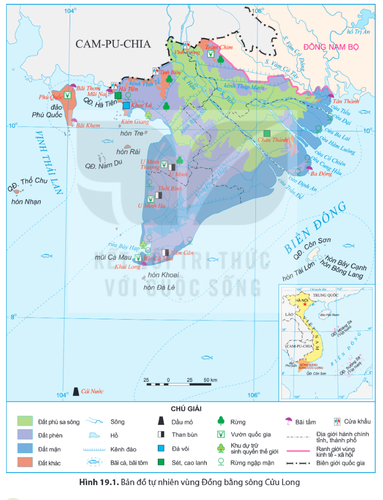
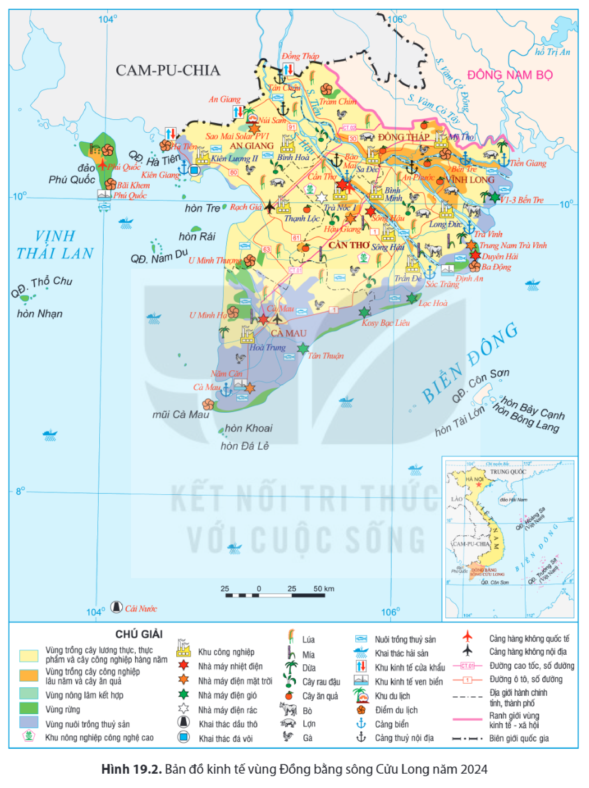
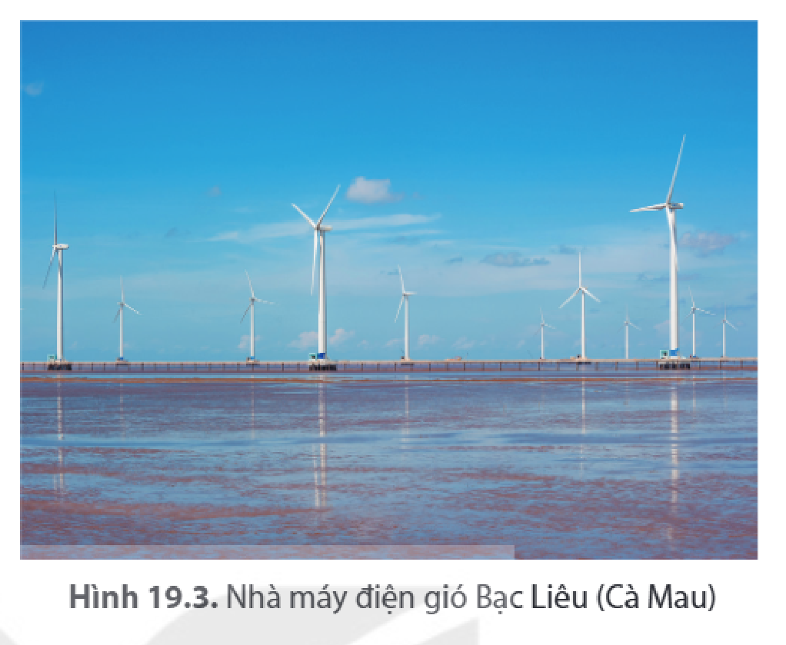

<!-- pdf:207 -->

# BÀI 19: VÙNG ĐỒNG BẰNG SÔNG CỬU LONG

## 🎯 Học xong bài này, em sẽ:

- Trình bày được đặc điểm vị trí địa lí và phạm vi lãnh thổ của vùng.
- Phân tích được các thế mạnh và hạn chế về điều kiện tự nhiên và tài nguyên thiên nhiên của vùng.
- Phân tích được đặc điểm dân cư; một số vấn đề xã hội của vùng.
- Trình bày được sự phát triển và phân bố một số ngành kinh tế thế mạnh của vùng.

## 🔴 Mở đầu

Đồng bằng sông Cửu Long là vùng châu thổ trù phú, nơi sản xuất lương thực, nuôi trồng thuỷ sản và trồng cây ăn quả nhiệt đới lớn nhất cả nước. Vậy điều kiện tự nhiên và tài nguyên thiên nhiên của vùng có những thế mạnh và hạn chế gì? Dân cư và một số vấn đề xã hội của vùng ra sao? Các ngành kinh tế nào được xác định là thế mạnh của vùng?

## 1. Vị trí địa lí và phạm vi lãnh thổ

<!-- term: Vùng Đồng bằng sông Cửu Long -->
Đồng bằng sông Cửu Long có diện tích tự nhiên khoảng 36,4 nghìn km² (chiếm 11,0 % diện tích cả nước năm 2024); bao gồm thành phố Cần Thơ và các tỉnh: Vĩnh Long, Đồng Tháp, An Giang, Cà Mau.

<!-- term: Vùng Đồng bằng sông Cửu Long -->
Đồng bằng sông Cửu Long nằm ở phía tây nam của Tổ quốc, giáp vùng Đông Nam Bộ, nước láng giềng Cam-pu-chia; phía tây và phía đông nam có một vùng biển rộng, với nhiều đảo và quần đảo như: đảo Phú Quốc, quần đảo Thổ Chu, Nam Du,...

<!-- term: Vùng Đồng bằng sông Cửu Long -->
Vị trí địa lí và phạm vi lãnh thổ tạo điều kiện thuận lợi để vùng Đồng bằng sông Cửu Long phát triển kinh tế trên đất liền cũng như trên biển, mở rộng mối quan hệ hợp tác với các nước trong lưu vực sông Mê Công.

> ❓ Dựa vào hình 19.1 và thông tin mục 1, hãy trình bày đặc điểm vị trí địa lí và phạm vi lãnh thổ của vùng Đồng bằng sông Cửu Long.

## 2. Điều kiện tự nhiên và tài nguyên thiên nhiên

### a) Thế mạnh

<!-- term: Nhóm đất phù sa Đồng bằng sông Cửu Long -->
- Địa hình và đất: Vùng Đồng bằng sông Cửu Long có địa hình thấp và bằng phẳng, thuận lợi cho cư trú và sản xuất. Đất chủ yếu là nhóm đất phù sa, được chia thành ba loại chính. Đất phù sa sông phân bố thành một dải dọc sông Tiền và sông Hậu, đây là loại đất tốt, độ phì cao, thích hợp cho sản xuất nông nghiệp. Đất phèn tập trung ở Đồng Tháp Mười, Tứ giác Long Xuyên và vùng trũng ở bán đảo Cà Mau; đất mặn phân bố ở ven biển. Đất phèn, đất mặn có thể cải tạo để trồng lúa, cây ăn quả, cây rau đậu hoặc nuôi trồng thuỷ sản, phát triển rừng.

<!-- pdf:208 -->

- Khí hậu có tính chất cận xích đạo, phân hoá thành mùa mưa và mùa khô rõ rệt. Nền nhiệt cao và ổn định, lượng mưa dồi dào, thuận lợi cho sản xuất nông nghiệp.

*Hình 19.1. Bản đồ tự nhiên vùng Đồng bằng sông Cửu Long*

<!-- pdf:209 -->

- Nguồn nước: Mạng lưới sông ngòi, kênh rạch dày đặc, tạo thuận lợi cho giao thông đường thuỷ, sản xuất và sinh hoạt. Đồng thời, sông ngòi là nơi khai thác và nuôi trồng thuỷ sản quan trọng của vùng.

- Tài nguyên sinh vật phong phú và đa dạng. Thảm thực vật điển hình là rừng ngập mặn ở ven biển, rừng tràm ở các vùng trũng ngập nước. Trong vùng có nhiều thuỷ sản, các loài chim,...

- Tài nguyên biển phong phú, có ngư trường trọng điểm Cà Mau – An Giang với nhiều cá tôm, nhiều đảo và quần đảo với các bãi tắm đẹp, vùng thềm lục địa có triển vọng về dầu mỏ và khí tự nhiên, ven biển có tiềm năng xây dựng cảng biển và phát triển điện gió,...

### b) Hạn chế

- Đồng bằng sông Cửu Long có diện tích đất nhiễm phèn và nhiễm mặn lớn.
- Mùa khô kéo dài khoảng 5 tháng, từ tháng 11 đến tháng 4 năm sau gây thiếu nước cho sản xuất và sinh hoạt.
- Tác động của biến đổi khí hậu làm gia tăng tình trạng xâm nhập mặn, hạn hán, lũ lụt, sạt lở bờ sông, bờ biển,...
- Trên đất liền nghèo khoáng sản.

> ❓ Dựa vào hình 19.1 và thông tin mục 2, hãy phân tích các thế mạnh, hạn chế về điều kiện tự nhiên và tài nguyên thiên nhiên đối với phát triển kinh tế – xã hội của vùng Đồng bằng sông Cửu Long.

## 3. Dân cư, xã hội

- Dân cư

  + Quy mô và gia tăng dân số: Vùng Đồng bằng sông Cửu Long có quy mô dân số khoảng 15,8 triệu người, chiếm 15,6% số dân cả nước (năm 2024). Gia tăng dân số chậm do tỉ lệ tăng dân số tự nhiên thấp và xuất cư.

  + Cơ cấu dân số: Năm 2024, nhóm người dưới 15 tuổi chiếm 19,8%, nhóm người từ 15 đến 64 tuổi chiếm 70,2%, nhóm người từ 65 tuổi trở lên chiếm 10,0%. Đồng bằng sông Cửu Long có cơ cấu dân số vàng và đang chuyển sang giai đoạn già hoá dân số.

  + Thành phần dân tộc: Trong vùng có người Kinh, Khơ-me, Hoa, Chăm,... cùng chung sống.

  + Phân bố dân cư: Năm 2024, Đồng bằng sông Cửu Long có mật độ dân số là 434 người/km², cao hơn mức trung bình cả nước. Dân cư phân bố tập trung khá đông ở ven sông Tiền, sông Hậu; vùng bán đảo Cà Mau dân cư thưa hơn. Tỉ lệ dân thành thị còn thấp, mới đạt 28,6% (năm 2024).

- Xã hội

<!-- term: Văn hoá sông nước Nam Bộ -->
  + Đồng bằng sông Cửu Long là địa bàn cư trú của nhiều dân tộc. Sự giao thoa của các cộng đồng dân tộc tạo nên nét đặc sắc về văn hoá Nam Bộ, đó là văn hoá sông nước, lễ hội truyền thống (đua ghe Ngo, đua bò,...), nghệ thuật dân gian (Đờn ca tài tử, dân ca Nam Bộ,...),...

  + Trong những năm qua, đời sống của dân cư trong vùng ngày càng được nâng lên, thể hiện qua các tiêu chí như: thu nhập bình quân đầu người, tỉ lệ dân số từ 15 tuổi trở lên biết chữ, tuổi thọ trung bình,... đều tăng.

<!-- pdf:210 -->

> ❓ Dựa vào thông tin mục 3, hãy phân tích đặc điểm dân cư và một số vấn đề xã hội ở vùng Đồng bằng sông Cửu Long.

## 4. Sự phát triển và phân bố một số ngành kinh tế

Kinh tế vùng Đồng bằng sông Cửu Long ngày càng phát triển. Năm 2024, GRDP của vùng chiếm 10,6% GDP cả nước. Cơ cấu kinh tế đang có sự chuyển dịch theo hướng tiến bộ, tuy nhiên còn chậm. Nông nghiệp, lâm nghiệp và thuỷ sản vẫn chiếm tỉ trọng cao trong cơ cấu ngành kinh tế của vùng.

Bảng 19.1. CƠ CẤU GRDP (GIÁ HIỆN HÀNH) CỦA VÙNG ĐỒNG BẰNG SÔNG CỬU LONG NĂM 2010 VÀ NĂM 2024

*(Đơn vị: %)*

| Cơ cấu GRDP \ Năm | 2010 | 2024 |
| --- | :---: | :---: |
| Nông nghiệp, lâm nghiệp và thuỷ sản | 42,6 | 32,3 |
| Công nghiệp và xây dựng | 19,1 | 24,2 |
| Dịch vụ | 33,8 | 38,6 |
| Thuế sản phẩm trừ trợ cấp sản phẩm | 4,5 | 4,9 |

*(Nguồn: Niên giám thống kê các tỉnh, thành phố năm 2011, 2024; Cục Thống kê năm 2025)*

Một số ngành kinh tế thế mạnh của vùng được chú trọng phát triển là nông nghiệp và thuỷ sản; công nghiệp sản xuất, chế biến thực phẩm, sản xuất điện; dịch vụ.

### a) Nông nghiệp và thuỷ sản

- Nông nghiệp

  + Trồng trọt: Đồng bằng sông Cửu Long là vùng sản xuất nông nghiệp trọng điểm của cả nước với nhiều sản phẩm chủ lực, đặc biệt là lúa và cây ăn quả.

Đồng bằng sông Cửu Long là vùng sản xuất lúa lớn nhất, với diện tích và sản lượng chiếm gần 50% của cả nước. Do áp dụng công nghệ hiện đại trong sản xuất nên năng suất lúa tăng nhanh và cao nhất cả nước; nhiều giống lúa chất lượng cao, thích ứng với biến đổi khí hậu được đưa vào gieo trồng.

Bảng 19.2. DIỆN TÍCH GIEO TRỒNG VÀ SẢN LƯỢNG LƯƠNG THỰC CÓ HẠT CỦA VÙNG ĐỒNG BẰNG SÔNG CỬU LONG VÀ CẢ NƯỚC NĂM 2010 VÀ NĂM 2024

| Chỉ số | Năm 2010: Đồng bằng sông Cửu Long | Năm 2010: Cả nước | Năm 2024: Đồng bằng sông Cửu Long | Năm 2024: Cả nước |
| --- | :---: | :---: | :---: | :---: |
| Diện tích gieo trồng *(triệu ha)* | 3,51 | 8,62 | 3,34 | 8,00 |
| – Trong đó: Lúa | 3,47 | 7,49 | 3,32 | 7,13 |
| Sản lượng *(triệu tấn)* | 19,5 | 44,6 | 21,5 | 47,9 |
| – Trong đó: Lúa | 19,3 | 40,0 | 21,3 | 43,5 |

*(Nguồn: Niên giám thống kê Việt Nam năm 2011, 2024; Cục Thống kê năm 2025)*

<!-- pdf:211 -->

*Hình 19.2. Bản đồ kinh tế vùng Đồng bằng sông Cửu Long năm 2024*

Bình quân sản lượng lúa theo đầu người toàn vùng đạt 1 348,1 kg/người, gấp hơn 3 lần trung bình cả nước (năm 2024). An Giang, Cần Thơ và Đồng Tháp là những địa phương có diện tích gieo trồng và sản lượng lúa lớn nhất vùng và cả nước.

<!-- pdf:212 -->

Đồng bằng sông Cửu Long là vùng trồng cây ăn quả lớn nhất cả nước với nhiều loại như xoài, chôm chôm, sầu riêng, cam, bưởi,... được sản xuất theo tiêu chuẩn VietGAP, GlobalGAP, có chỉ dẫn địa lí,... Năm 2024, diện tích cây ăn quả của vùng là 386,8 nghìn ha, chiếm 29,8% tổng diện tích cây ăn quả cả nước. Cây ăn quả trong vùng được trồng nhiều ở Vĩnh Long, Cần Thơ, Đồng Tháp,...

Đồng bằng sông Cửu Long còn được biết đến là vùng trồng nhiều dừa nhất cả nước, trong đó Vĩnh Long là tỉnh đứng đầu.

  + Chăn nuôi: trong vùng phát triển mạnh chăn nuôi gia cầm, nhất là vịt. Chăn nuôi lợn và bò cũng được chú trọng phát triển.

- Thuỷ sản là thế mạnh hàng đầu của vùng Đồng bằng sông Cửu Long. Sản lượng thuỷ sản của vùng tăng liên tục, chiếm trên 50% tổng sản lượng thuỷ sản của cả nước (năm 2024).

Bảng 19.3. SẢN LƯỢNG THUỶ SẢN CỦA VÙNG ĐỒNG BẰNG SÔNG CỬU LONG VÀ CẢ NƯỚC GIAI ĐOẠN 2010 – 2024

*(Đơn vị: triệu tấn)*

| Năm | 2010 | 2015 | 2020 | 2024 |
| --- | :---: | :---: | :---: | :---: |
| Cả nước | 5,2 | 6,7 | 8,6 | 9,7 |
| Đồng bằng sông Cửu Long | 3,0 | 3,6 | 4,8 | 5,3 |
| – Khai thác | 1,0 | 1,2 | 1,5 | 1,3 |
| – Nuôi trồng | 2,0 | 2,4 | 3,3 | 4,0 |

*(Nguồn: Niên giám thống kê Việt Nam năm 2011, 2016, 2024; Cục Thống kê năm 2025)*

Sản lượng thuỷ sản nuôi trồng lớn hơn và tăng nhanh hơn sản lượng thuỷ sản khai thác. Đối tượng nuôi chủ yếu là cá da trơn, tôm. Hiện nay, việc khai thác và nuôi trồng thuỷ sản ở Đồng bằng sông Cửu Long được đẩy mạnh ứng dụng công nghệ hiện đại để đáp ứng yêu cầu thị trường.

An Giang, Cà Mau, Đồng Tháp là những địa phương có sản lượng thuỷ sản lớn nhất vùng và cả nước.

> ❓ Dựa vào hình 19.2 và thông tin mục a, hãy trình bày sự phát triển và phân bố nông nghiệp và thuỷ sản ở vùng Đồng bằng sông Cửu Long.

### b) Công nghiệp

Mặc dù giá trị sản xuất công nghiệp của vùng Đồng bằng sông Cửu Long còn thấp so với cả nước (6,3% năm 2024) nhưng công nghiệp trong vùng đang có nhiều chuyển biến tích cực. Cơ cấu ngành công nghiệp của vùng khá đa dạng, trong đó công nghiệp sản xuất, chế biến thực phẩm; công nghiệp sản xuất điện là những ngành có thế mạnh.

- Công nghiệp sản xuất, chế biến thực phẩm là ngành quan trọng hàng đầu ở vùng Đồng bằng sông Cửu Long. Nguồn nguyên liệu dồi dào của ngành nông nghiệp và thuỷ sản, nhu cầu thức ăn cho chăn nuôi và nuôi trồng thuỷ sản lớn đã thúc đẩy ngành công nghiệp này phát triển và phân bố rộng khắp vùng. Các sản phẩm chủ yếu của ngành là gạo xay xát, thuỷ sản ướp đông, rau quả đóng hộp, thức ăn chăn nuôi,... Ngoài việc cung cấp trong nước, một số sản phẩm của ngành còn là mặt hàng xuất khẩu quan trọng, mang lại giá trị kinh tế cao.

<!-- pdf:213 -->

- Công nghiệp sản xuất điện: Sản lượng điện của vùng tăng nhanh do nhiều nhà máy điện được xây dựng để đáp ứng nhu cầu sản xuất và sinh hoạt. Bên cạnh các nhà máy nhiệt điện (ở Vĩnh Long, Cà Mau, Cần Thơ,...), các nhà máy điện năng lượng tái tạo như: điện gió (ở Cà Mau, Cần Thơ,...), điện mặt trời (ở Cần Thơ, An Giang,...) cũng được xây dựng ngày càng nhiều. Việc đầu tư phát triển điện gió, điện mặt trời góp phần bảo vệ tài nguyên, môi trường và giảm nhẹ biến đổi khí hậu.

*Hình 19.3. Nhà máy điện gió Bạc Liêu (Cà Mau)*

Bảng 19.4. SẢN LƯỢNG MỘT SỐ SẢN PHẨM CÔNG NGHIỆP CỦA VÙNG ĐỒNG BẰNG SÔNG CỬU LONG GIAI ĐOẠN 2010 – 2024

| Sản phẩm \ Năm | 2010 | 2015 | 2020 | 2024 |
| --- | :---: | :---: | :---: | :---: |
| Gạo xay xát *(triệu tấn)* | 17,0 | 19,4 | 16,4 | 20,3 |
| Thuỷ sản ướp đông *(triệu tấn)* | 1,1 | 1,3 | 1,5 | 2,3 |
| Thức ăn chăn nuôi gia súc, gia cầm và thuỷ sản *(triệu tấn)* | 1,1 | 3,0 | 9,6 | 17,8 |
| Điện sản xuất *(tỉ kWh)* | 9,8 | 9,3 | 30,6 | 99,4 |

*(Nguồn: Niên giám thống kê các tỉnh, thành phố năm 2011, 2016, 2024; Cục Thống kê năm 2025)*

> ❓ Dựa vào hình 19.2 và thông tin mục b, hãy:
> - Trình bày sự phát triển và phân bố một số ngành công nghiệp thế mạnh ở vùng Đồng bằng sông Cửu Long.
> - Xác định vị trí một số nhà máy điện trên bản đồ.

### c) Dịch vụ

Dịch vụ ở Đồng bằng sông Cửu Long phát triển nhanh. Một số hoạt động dịch vụ có thế mạnh của vùng là thương mại, giao thông vận tải, logistics, du lịch.

<!-- term: Chợ nổi trên sông -->
- Thương mại: Hoạt động nội thương phát triển đa dạng, chợ nổi trên sông đã trở thành nét văn hoá đặc trưng của vùng Đồng bằng sông Cửu Long. Các trung tâm thương mại, siêu thị có ở nhiều nơi, nhất là ở Cần Thơ, Đồng Tháp, An Giang,... Hoạt động ngoại thương được đẩy mạnh. Các mặt hàng xuất khẩu chủ lực của vùng, đứng đầu cả nước là gạo, thuỷ sản ướp đông và rau quả.

<!-- pdf:214 -->

- Giao thông vận tải: Giao thông đường thuỷ nội địa phát triển rộng khắp, đảm nhiệm vai trò quan trọng hàng đầu trong việc vận chuyển hàng hoá của vùng. Một số tuyến đường bộ cao tốc được xây dựng, các cảng hàng không, cảng biển được nâng cấp giúp Đồng bằng sông Cửu Long kết nối với các vùng khác trong nước và quốc tế.

- Dịch vụ logistics được chú trọng phát triển, hỗ trợ hiệu quả hoạt động giao thông vận tải, thương mại, nhất là xuất khẩu nông sản và thuỷ sản,... Cần Thơ là trung tâm logistics của vùng.

- Du lịch là ngành kinh tế có vai trò ngày càng quan trọng với vùng Đồng bằng sông Cửu Long. Các sản phẩm du lịch đặc trưng của vùng là du lịch sông nước, miệt vườn; tìm hiểu văn hoá; nghỉ dưỡng biển, đảo;... Phú Quốc và Cần Thơ là hai địa bàn thu hút nhiều khách du lịch trong và ngoài nước.

> ❓ Dựa vào hình 19.2 và thông tin mục c, hãy trình bày sự phát triển và phân bố một số hoạt động dịch vụ thế mạnh ở vùng Đồng bằng sông Cửu Long.

> 💡 **Em có biết?**
>
> Nghị quyết số 252/2025/QH15 ngày 10 – 12 – 2025 của Quốc hội có nêu định hướng phát triển vùng Đồng bằng sông Cửu Long thành trung tâm kinh tế nông nghiệp hiện đại, bền vững, năng động và hiệu quả cao của cả nước, khu vực và thế giới. Tập trung phát triển sản xuất nông nghiệp hàng hóa, nông nghiệp số, nông nghiệp thông minh; phát triển công nghiệp xanh, năng lượng tái tạo; phát triển mạnh kinh tế biển; xây dựng thương hiệu quốc tế về du lịch nông nghiệp, nông thôn, du lịch sinh thái và du lịch biển, đảo; đồng thời, chủ động thích ứng với biến đổi khí hậu và nước biển dâng.

## ✏️ Luyện tập – Vận dụng

1. Dựa vào bảng 19.2, hãy tính tỉ lệ diện tích gieo trồng, sản lượng lúa của vùng Đồng bằng sông Cửu Long so với cả nước năm 2010 và năm 2024. Nêu nhận xét.
2. Vì sao công nghiệp sản xuất, chế biến thực phẩm là ngành quan trọng hàng đầu ở vùng Đồng bằng sông Cửu Long?

- Tìm hiểu một số biện pháp để khắc phục hạn chế về điều kiện tự nhiên và tài nguyên thiên nhiên ở vùng Đồng bằng sông Cửu Long.

## 📷 Danh sách hình trong bài

| Mã hình | Trang PDF | Trang sách | Chú thích |
| --- | :---: | :---: | --- |
| H9-lich_su_va_dia_ly-dl-b19-01 | 208 | 206 | Hình 19.1. Bản đồ tự nhiên vùng Đồng bằng sông Cửu Long |
| H9-lich_su_va_dia_ly-dl-b19-02 | 211 | 209 | Hình 19.2. Bản đồ kinh tế vùng Đồng bằng sông Cửu Long năm 2024 |
| H9-lich_su_va_dia_ly-dl-b19-03 | 213 | 211 | Hình 19.3. Nhà máy điện gió Bạc Liêu (Cà Mau) |
