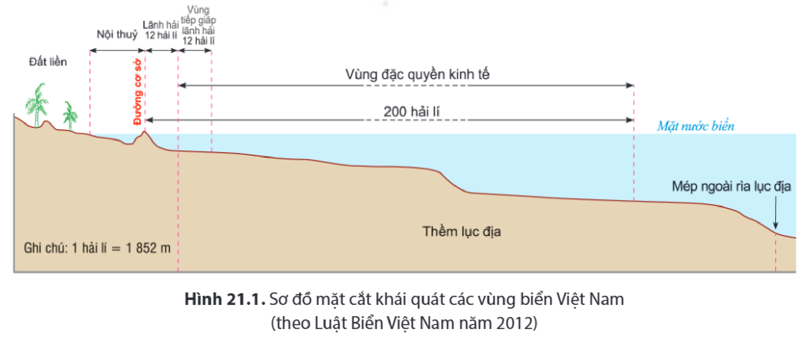
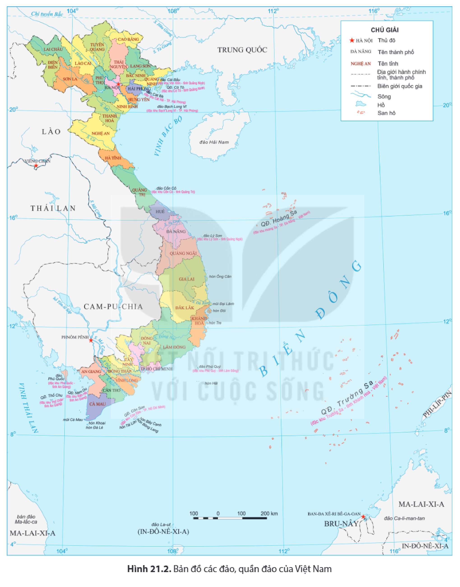
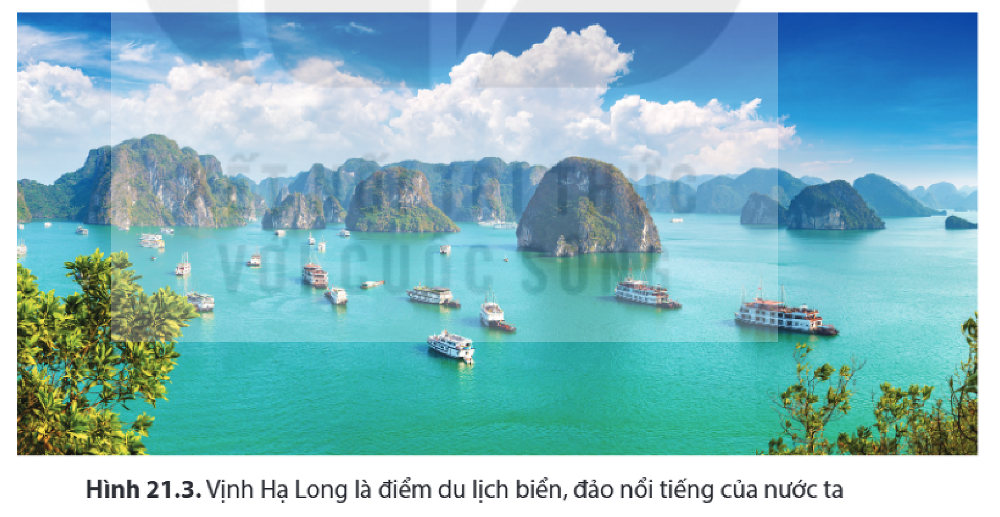
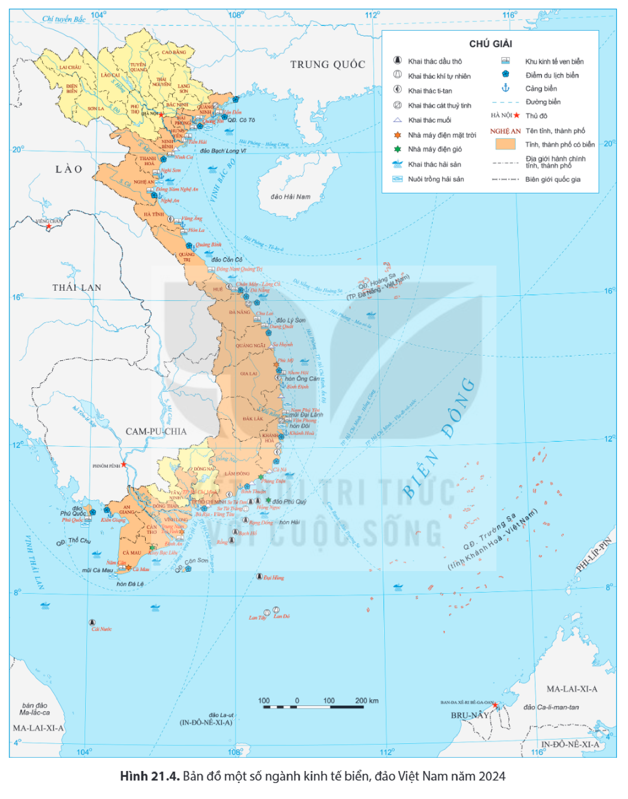
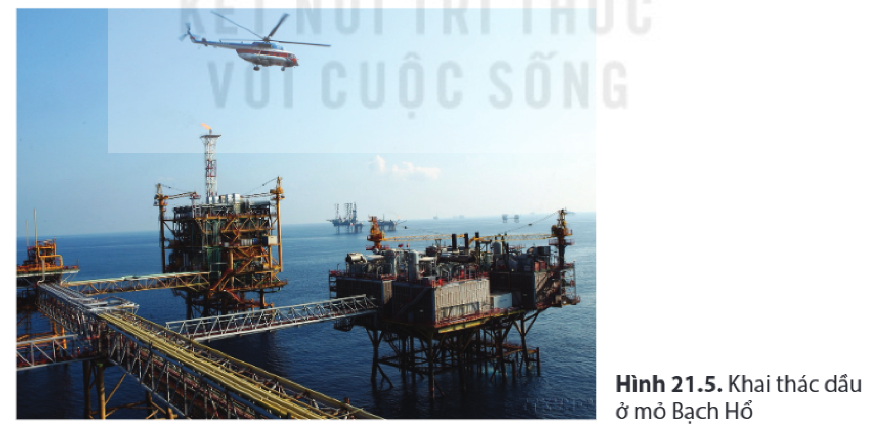
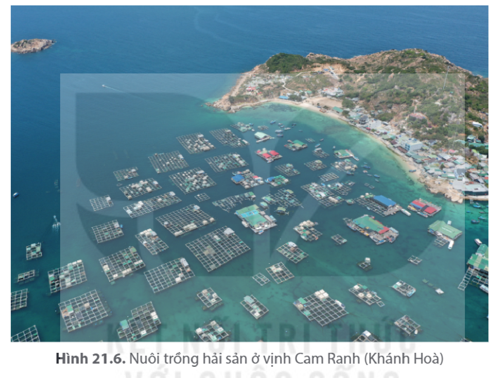

<!-- pdf:216 -->

# BÀI 21: PHÁT TRIỂN TỔNG HỢP KINH TẾ VÀ BẢO VỆ TÀI NGUYÊN, MÔI TRƯỜNG BIỂN, ĐẢO

## 🎯 Học xong bài này, em sẽ:

- Trình bày được trên sơ đồ các vùng biển quốc gia; xác định trên bản đồ một số đảo và các tỉnh có các đảo đó.
- Phân tích được vấn đề phát triển tổng hợp kinh tế biển và bảo vệ môi trường biển, đảo ở Việt Nam.
- Trình bày được ý nghĩa của việc phát triển tổng hợp kinh tế biển, đảo đối với việc bảo vệ tài nguyên, môi trường và giữ vững chủ quyền, các quyền và lợi ích hợp pháp của Việt Nam ở Biển Đông.

## 🔴 Mở đầu

Việt Nam có một vùng biển rộng với nhiều đảo và quần đảo. Nguồn tài nguyên biển, đảo phong phú, đa dạng là tiền đề để phát triển tổng hợp kinh tế biển. Vì sao phải phát triển tổng hợp kinh tế biển và bảo vệ tài nguyên, môi trường biển, đảo?

## 1. Biển và đảo Việt Nam

<!-- term: Các vùng biển Việt Nam -->
Việt Nam có đường bờ biển dài 3 260 km và vùng biển rộng khoảng 1 triệu km². Vùng biển Việt Nam bao gồm: nội thuỷ, lãnh hải, vùng tiếp giáp lãnh hải, vùng đặc quyền kinh tế và thềm lục địa. Cả nước có 21 tỉnh và thành phố giáp biển.

*Hình 21.1. Sơ đồ mặt cắt khái quát các vùng biển Việt Nam (theo Luật Biển Việt Nam năm 2012)*

<!-- pdf:217 -->

*Hình 21.2. Bản đồ các đảo, quần đảo của Việt Nam*

<!-- pdf:218 -->

Vùng biển Việt Nam có hàng nghìn đảo lớn nhỏ, tập hợp các đảo gần nhau tạo thành quần đảo. Một số đảo và quần đảo của nước ta đã được tổ chức thành đơn vị hành chính cấp xã với tên gọi là đặc khu.

> 💡 **Em có biết?**
>
> Năm 2025, sau khi thực hiện sắp xếp đơn vị hành chính các cấp, nước ta có 13 đặc khu là Cô Tô, Vân Đồn (Quảng Ninh), Bạch Long Vĩ, Cát Hải (Hải Phòng), Cồn Cỏ (Quảng Trị), Hoàng Sa (Đà Nẵng), Lý Sơn (Quảng Ngãi), Trường Sa (Khánh Hoà), Phú Quý (Lâm Đồng), Côn Đảo (Thành phố Hồ Chí Minh), Kiên Hải, Phú Quốc, Thổ Châu (An Giang).

> ❓ 1. Dựa vào hình 21.1 và kiến thức đã học, hãy trình bày các vùng biển của Việt Nam.
> 2. Dựa vào hình 21.2, hãy xác định một số đảo và các tỉnh, thành phố có các đảo đó.

## 2. Phát triển tổng hợp kinh tế biển, đảo

<!-- term: Phát triển tổng hợp kinh tế biển, đảo -->
Hoạt động kinh tế biển, đảo rất đa dạng, bao gồm: du lịch biển, đảo; giao thông vận tải biển; khai thác khoáng sản biển; khai thác và nuôi trồng hải sản;... Chỉ có phát triển tổng hợp kinh tế biển, đảo mới đem lại hiệu quả kinh tế cao, góp phần bảo vệ tài nguyên và môi trường.

- Du lịch biển, đảo

Việt Nam có tài nguyên du lịch biển, đảo phong phú. Dọc bờ biển nước ta có hàng trăm bãi biển đẹp, thuận lợi cho việc xây dựng các khu du lịch và nghỉ dưỡng. Ven bờ có nhiều đảo với phong cảnh kì thú, hấp dẫn khách du lịch. Đặc biệt, Vịnh Hạ Long – quần đảo Cát Bà đã được UNESCO ghi danh là Di sản thiên nhiên thế giới.

*Hình 21.3. Vịnh Hạ Long là điểm du lịch biển, đảo nổi tiếng của nước ta*

Du lịch biển, đảo là ngành kinh tế biển được ưu tiên phát triển hàng đầu ở nước ta. Những năm qua, ngành du lịch biển, đảo phát triển nhanh, thu hút nhiều khách du lịch trong và ngoài nước.

Sự phát triển ngành du lịch biển, đảo tác động tới nhiều ngành kinh tế, góp phần nâng cao đời sống người dân và bảo tồn các giá trị văn hoá vùng biển,...

Để phát triển du lịch biển, đảo bền vững cần chú trọng đầu tư hạ tầng du lịch, tạo điều kiện để các thành phần kinh tế tham gia, xây dựng thương hiệu du lịch biển, đảo đẳng cấp quốc tế.

<!-- pdf:219 -->

*Hình 21.4. Bản đồ một số ngành kinh tế biển, đảo Việt Nam năm 2024*

<!-- pdf:220 -->

- Giao thông vận tải biển

Nước ta gần nhiều tuyến đường biển quốc tế quan trọng. Ven biển có nhiều vũng vịnh có thể xây dựng cảng nước sâu. Những điều kiện trên cho phép nước ta phát triển giao thông đường biển giữa các địa phương ven biển, cũng như giữa nước ta với các nước khác.

Các cảng biển ngày càng hiện đại, đội tàu biển quốc gia được tăng cường để đáp ứng nhu cầu xuất nhập khẩu hàng hoá ngày càng gia tăng.

Phát triển giao thông vận tải biển sẽ thúc đẩy phát triển ngành ngoại thương, công nghiệp đóng tàu và các dịch vụ hàng hải như logistics, kho bãi, hải quan,...

Việc phát triển giao thông vận tải biển cần chú trọng khai thác có hiệu quả các cảng biển và dịch vụ vận tải biển, đẩy mạnh phát triển đội tàu vận tải biển với cơ cấu hợp lí, ứng dụng công nghệ hiện đại, bảo vệ môi trường.

- Khai thác khoáng sản biển

Vùng biển nước ta có nhiều tài nguyên khoáng sản, quan trọng nhất là dầu mỏ và khí tự nhiên, phân bố ở các bể trầm tích Nam Côn Sơn, Cửu Long, Sông Hồng, Phú Khánh, Malay – Thổ Chu,... Ngoài ra, ven biển còn có ti-tan, cát thuỷ tinh, một số nơi thuận lợi cho khai thác muối.

Trong khai thác khoáng sản, dầu khí là ngành kinh tế biển mũi nhọn, có vị trí quan trọng hàng đầu trong sự nghiệp công nghiệp hoá, hiện đại hoá đất nước. Nước ta hiện nay không những phát triển về khai thác mà còn phát triển chế biến dầu khí. Ngành công nghiệp lọc hoá dầu ở Dung Quất (Quảng Ngãi), Nghi Sơn (Thanh Hoá),... đã đáp ứng một phần nhu cầu xăng dầu trong nước và tiến tới giảm dần nhập khẩu mặt hàng này. Ngành công nghiệp chế biến khí tự nhiên ở Thành phố Hồ Chí Minh, Cà Mau,... phục vụ cho sản xuất điện, phân đạm, khí hoá lỏng,... Các ngành khác như khai thác muối, ti-tan, cát thuỷ tinh cũng được chú trọng phát triển.

*Hình 21.5. Khai thác dầu ở mỏ Bạch Hổ*

Việc khai thác, chế biến khoáng sản biển đã thúc đẩy sự phát triển công nghiệp khai khoáng, dịch vụ vận tải biển, tạo nguồn hàng xuất khẩu có giá trị, giải quyết việc làm,...

Ngành khai thác khoáng sản biển cần đẩy mạnh công tác tìm kiếm, thăm dò, nâng cao hiệu quả khai thác gắn với chế biến sâu, chú ý bảo vệ môi trường, bảo tồn đa dạng sinh học biển.

<!-- pdf:221 -->

- Khai thác và nuôi trồng hải sản

Vùng biển nước ta có trữ lượng hải sản lớn với nhiều ngư trường. Dọc bờ biển và ven các đảo có nhiều điều kiện thuận lợi để nuôi trồng hải sản.

<!-- term: Khai thác hải sản IUU -->
Sản lượng hải sản khai thác ngày càng tăng. Hoạt động khai thác hải sản được khuyến khích đẩy mạnh tại các vùng biển xa bờ trên cơ sở tuân thủ các quy định của luật pháp, trong đó có các quy định chống khai thác hải sản bất hợp pháp, không khai báo và không theo quy định (IUU). Công tác quản lí nghề cá trên biển ngày càng chặt chẽ và hiện đại. Nuôi trồng hải sản ngày càng mở rộng diện tích và đa dạng đối tượng nuôi trồng, đang chuyển từ phương thức truyền thống sang mô hình công nghiệp, ứng dụng công nghệ cao.

*Hình 21.6. Nuôi trồng hải sản ở vịnh Cam Ranh (Khánh Hoà)*

Ngành khai thác và nuôi trồng hải sản cung cấp nguyên liệu quan trọng cho ngành công nghiệp chế biến, thúc đẩy phát triển du lịch, tạo mặt hàng xuất khẩu có giá trị; đồng thời góp phần nâng cao đời sống cho người dân vùng biển và bảo vệ quốc phòng, an ninh.

Để phát triển ngành khai thác và nuôi trồng hải sản bền vững cần tăng cường bảo vệ, tái sinh nguồn lợi hải sản, nghiêm cấm các hoạt động khai thác mang tính tận diệt.

Ngoài ra, nước ta còn phát triển các ngành kinh tế biển, đảo khác như: công nghiệp ven biển, năng lượng tái tạo, dược liệu biển,...

> ❓ Dựa vào hình 21.4 và thông tin mục 2, hãy phân tích vấn đề phát triển tổng hợp kinh tế biển, đảo ở nước ta.

## 3. Ý nghĩa của việc phát triển tổng hợp kinh tế biển, đảo

Biển, đảo luôn có vị trí, vai trò quan trọng đối với phát triển kinh tế, quốc phòng, an ninh đất nước. Để trở thành một đất nước mạnh về biển, giàu từ biển, phát triển bền vững, cần chú trọng đến việc phát triển tổng hợp kinh tế biển, đảo. Phát triển tổng hợp kinh tế biển, đảo có ý nghĩa quan trọng đối với:

<!-- pdf:222 -->

<!-- term: Phát triển tổng hợp kinh tế biển, đảo -->
- Bảo vệ tài nguyên, môi trường: Thông qua phát triển tổng hợp kinh tế biển, đảo sẽ khai thác hiệu quả nguồn tài nguyên, góp phần bảo vệ tài nguyên và môi trường, hướng tới phát triển bền vững.

<!-- term: Phát triển tổng hợp kinh tế biển, đảo -->
- Giữ vững chủ quyền, các quyền và lợi ích hợp pháp của Việt Nam ở Biển Đông, góp phần khẳng định chủ quyền biển, đảo của Việt Nam; thể hiện các quyền và lợi ích hợp pháp của Việt Nam trên vùng biển quốc gia.

> ❓ Dựa vào thông tin mục 3, hãy trình bày ý nghĩa của việc phát triển tổng hợp kinh tế biển, đảo của nước ta đối với việc bảo vệ tài nguyên, môi trường và giữ vững chủ quyền, các quyền và lợi ích hợp pháp của Việt Nam ở Biển Đông.

## 4. Bảo vệ môi trường biển, đảo

<!-- term: Bảo vệ môi trường biển, đảo -->
Công tác quản lí, bảo vệ môi trường biển, đảo, ứng phó với biến đổi khí hậu, nước biển dâng ở nước ta ngày càng được chú trọng. Tuy nhiên, một số tài nguyên biển vẫn bị khai thác quá mức; ô nhiễm môi trường biển còn xảy ra ở một số nơi, ô nhiễm rác thải nhựa trở thành vấn đề cấp bách; các hệ sinh thái biển, đa dạng sinh học biển bị suy giảm; công tác ứng phó với biến đổi khí hậu còn nhiều hạn chế. Vì thế, việc bảo vệ môi trường biển, đảo cần:

<!-- term: Bảo vệ môi trường biển, đảo -->
- Khai thác tài nguyên biển một cách hợp lí.

<!-- term: Bảo vệ môi trường biển, đảo -->
- Ngăn ngừa, kiểm soát và giảm ô nhiễm môi trường biển, đảo, nhất là ô nhiễm rác thải nhựa.

<!-- term: Bảo vệ môi trường biển, đảo -->
- Quản lí và bảo vệ tốt các hệ sinh thái biển, ven biển và hải đảo; tăng diện tích các khu bảo tồn biển, đảo; phục hồi diện tích rừng ngập mặn ven biển.

<!-- term: Bảo vệ môi trường biển, đảo -->
- Tăng cường hợp tác khu vực và toàn cầu trong phòng, chống ô nhiễm môi trường biển, đảo.

<!-- term: Bảo vệ môi trường biển, đảo -->
- Tuyên truyền, giáo dục người dân có ý thức và hành động bảo vệ tài nguyên và môi trường biển, đảo.

> ❓ Dựa vào thông tin mục 4, hãy phân tích vấn đề bảo vệ môi trường biển, đảo ở nước ta.

## ✏️ Luyện tập – Vận dụng

1. Vẽ sơ đồ thể hiện vấn đề phát triển tổng hợp kinh tế biển, đảo nước ta.
2. Tại sao cần phải bảo vệ môi trường biển, đảo?

- Lựa chọn và tìm hiểu về tình hình phát triển kinh tế biển, đảo ở một đặc khu của nước ta.

## 📷 Danh sách hình trong bài

| Mã hình | Trang PDF | Trang sách | Chú thích |
| --- | :---: | :---: | --- |
| H9-lich_su_va_dia_ly-dl-b21-01 | 216 | 214 | Hình 21.1. Sơ đồ mặt cắt khái quát các vùng biển Việt Nam (theo Luật Biển Việt Nam năm 2012) |
| H9-lich_su_va_dia_ly-dl-b21-02 | 217 | 215 | Hình 21.2. Bản đồ các đảo, quần đảo của Việt Nam |
| H9-lich_su_va_dia_ly-dl-b21-03 | 218 | 216 | Hình 21.3. Vịnh Hạ Long là điểm du lịch biển, đảo nổi tiếng của nước ta |
| H9-lich_su_va_dia_ly-dl-b21-04 | 219 | 217 | Hình 21.4. Bản đồ một số ngành kinh tế biển, đảo Việt Nam năm 2024 |
| H9-lich_su_va_dia_ly-dl-b21-05 | 220 | 218 | Hình 21.5. Khai thác dầu ở mỏ Bạch Hổ |
| H9-lich_su_va_dia_ly-dl-b21-06 | 221 | 219 | Hình 21.6. Nuôi trồng hải sản ở vịnh Cam Ranh (Khánh Hoà) |
