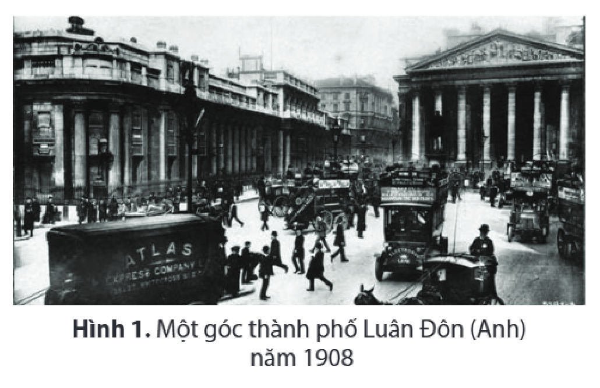
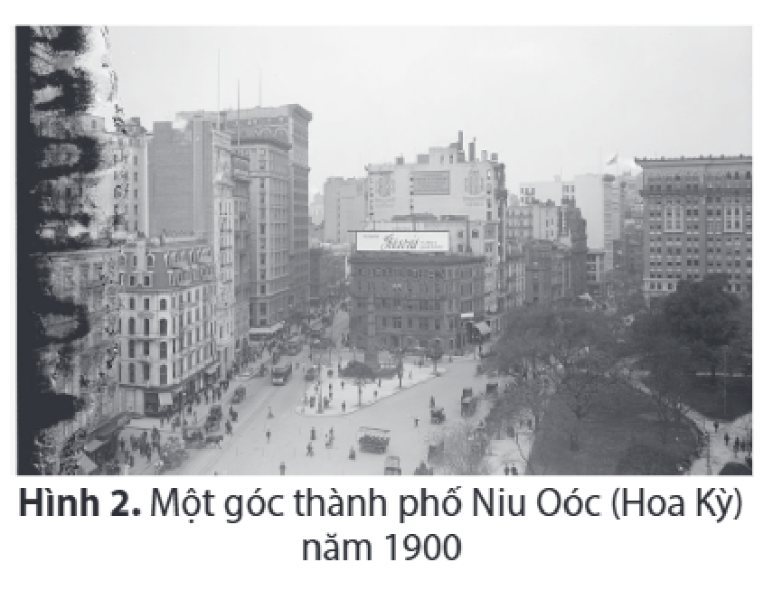
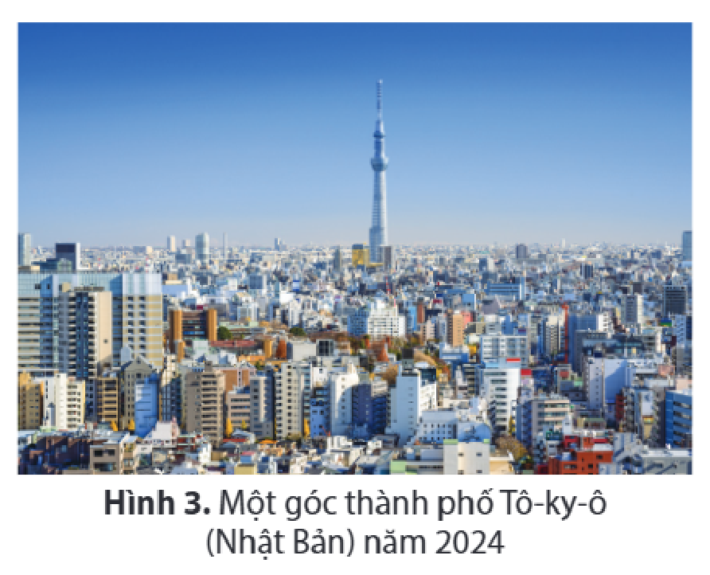
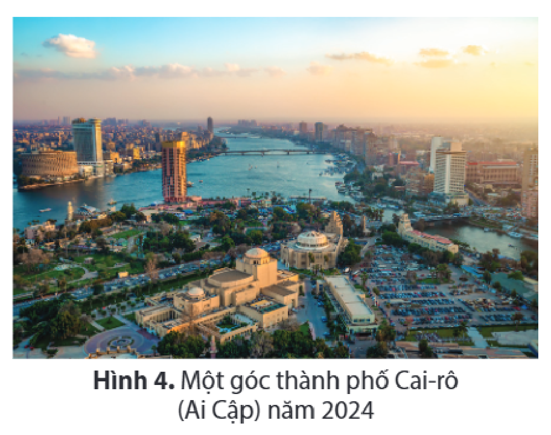

<!-- pdf:223 -->

# CHỦ ĐỀ CHUNG 1: ĐÔ THỊ: LỊCH SỬ VÀ HIỆN TẠI (2)

## 🎯 Học xong bài này, em sẽ:

- Trình bày được vai trò của đô thị đối với sự phát triển vùng với tư cách là trung tâm quyền lực và kinh tế của vùng, đất nước, khu vực.
- Mô tả được quá trình đô thị hoá thời kì xã hội công nghiệp và hậu công nghiệp.
- Nêu được tác động của đô thị hoá đối với sự phát triển kinh tế – xã hội.

## 🔴 Mở đầu

Năm 1950, thế giới chỉ có hai đô thị trên 10 triệu dân là Niu Oóc và Tô-ky-ô. Đến năm 2024, thế giới đã có 33 siêu đô thị. Quá trình phát triển các đô thị hiện đại đã diễn ra như thế nào? Đô thị ngày nay có vai trò và tác động ra sao đến sự phát triển kinh tế – xã hội của vùng, đất nước và khu vực?

## 1. Vai trò của đô thị

<!-- term: Vai trò của đô thị -->
Đô thị đóng vai trò là trung tâm quyền lực và kinh tế của vùng, đất nước, khu vực.

<!-- term: Vai trò của đô thị -->
- Là hạt nhân kinh tế của khu vực, động lực phát triển: tạo việc làm, thúc đẩy kinh doanh, sản xuất, góp phần chuyển dịch cơ cấu kinh tế, lao động,...

<!-- term: Vai trò của đô thị -->
- Thúc đẩy đổi mới sáng tạo: hỗ trợ hiện đại hoá các ngành kinh tế, nghiên cứu, ứng dụng công nghệ cao.

<!-- term: Vai trò của đô thị -->
- Tăng cường liên kết, hội nhập: Đô thị là các đầu mối giao thông, thông tin, trung tâm thương mại, tài chính nên góp phần liên kết các vùng trong nước và quốc tế.

<!-- term: Vai trò của đô thị -->
- Lan toả về văn hoá, xã hội: Đô thị là trung tâm văn hoá, xã hội, có sức ảnh hưởng đến các vùng lân cận.

<!-- term: Vai trò của đô thị -->
- Thúc đẩy tăng trưởng xanh: Đô thị đi đầu trong giải quyết khủng hoảng môi trường, biến đổi khí hậu.

> ❓ Dựa vào thông tin mục 1, hãy trình bày vai trò của đô thị đối với sự phát triển vùng.

## 2. Quá trình đô thị hoá thời kì xã hội công nghiệp và hậu công nghiệp

### a) Quá trình đô thị hoá thời kì xã hội công nghiệp

<!-- term: Đô thị hoá thời kì xã hội công nghiệp -->
Thời kì xã hội công nghiệp bắt đầu từ nửa cuối thế kỉ XVIII, gắn liền với cuộc cách mạng công nghiệp lần thứ nhất. Máy móc thay thế lao động thủ công làm cho năng suất lao động tăng lên, kinh tế phát triển mạnh. Từ cuối thế kỉ XIX, nền sản xuất cơ khí

<!-- pdf:224 -->

<!-- term: Đô thị hoá thời kì xã hội công nghiệp -->
hoá chuyển sang nền sản xuất điện khí hoá, cơ cấu lao động thay đổi và số dân ở các trung tâm công nghiệp tăng nhanh.

<!-- term: Đô thị hoá thời kì xã hội công nghiệp -->
- Số dân thành thị và tỉ lệ dân thành thị tăng liên tục, tuy nhiên có sự khác nhau giữa các nhóm nước.

  + Các nước phát triển: Quá trình đô thị hoá diễn ra sớm và gắn liền với quá trình công nghiệp hoá. Quá trình công nghiệp hoá làm gia tăng số dân ở đô thị.

  + Các nước đang phát triển: Quá trình đô thị hoá gắn với công nghiệp hoá ở giai đoạn đầu. Quá trình công nghiệp hoá vẫn đang tiếp tục, trình độ đô thị hoá khác nhau làm cho tỉ lệ dân thành thị ở các nước đang phát triển khác nhau. Các đô thị lớn tập trung ở Trung Quốc, Ấn Độ.

Bảng 1. SỐ DÂN THÀNH THỊ VÀ TỈ LỆ DÂN THÀNH THỊ THẾ GIỚI GIAI ĐOẠN 1900 – 1970

| Năm | 1900 | 1950 | 1970 |
| --- | :---: | :---: | :---: |
| Số dân thành thị *(triệu người)* | 217,6 | 750,9 | 1 354,2 |
| Tỉ lệ dân thành thị *(%)* | 13,6 | 29,2 | 36,6 |

*(Nguồn: Liên hợp quốc)*

> 💡 **Em có biết?**
>
> Đầu thời kì xã hội công nghiệp, các cơ sở công nghiệp cần lượng lớn nước để sản xuất và vận chuyển nguyên liệu, sản phẩm. Do đó, đa số đô thị lớn nằm ở ven biển hoặc gần các dòng sông như: Niu Oóc, Luân Đôn, Xít-ni,...

<!-- term: Đô thị hoá thời kì xã hội công nghiệp -->
- Quy mô đô thị có xu hướng tăng lên: Năm 1900, thế giới có 1 thành phố trên 5 triệu người (Luân Đôn); đến năm 1970, toàn thế giới có 18 thành phố trên 5 triệu người, trong đó thành phố có số dân lớn nhất là Tô-ky-ô (23,3 triệu người). Các thành phố mở rộng do sự phát triển của hệ thống giao thông công cộng, dịch vụ nên người lao động có thể sinh sống ở xa trung tâm thành phố.

<!-- term: Đô thị hoá thời kì xã hội công nghiệp -->
- Đô thị gắn với sản xuất công nghiệp và dịch vụ: Các thành phố công nghiệp điển hình là Man-che-xtơ (Anh), Si-ca-gô (Hoa Kỳ),.... các thành phố có hoạt động dịch vụ phát triển là Niu Oóc (Hoa Kỳ), Pa-ri (Pháp),...

<!-- term: Đô thị hoá thời kì xã hội công nghiệp -->
- Đô thị phát triển thiếu kiểm soát: Sự mở rộng các đô thị đã làm giảm diện tích đất nông nghiệp. Đô thị hoá tự phát ở một số thành phố đã dẫn đến các tác động tiêu cực như: ô nhiễm môi trường, tệ nạn xã hội,...

*Hình 1. Một góc thành phố Luân Đôn (Anh) năm 1908*

*Hình 2. Một góc thành phố Niu Oóc (Hoa Kỳ) năm 1900*

> ❓ Dựa vào thông tin mục a, hãy mô tả quá trình đô thị hoá thời kì xã hội công nghiệp.

<!-- pdf:225 -->

### b) Quá trình đô thị hoá thời kì xã hội hậu công nghiệp

<!-- term: Đô thị hoá thời kì xã hội hậu công nghiệp -->
Xã hội hậu công nghiệp bắt đầu từ cuối thế kỉ XX, chủ yếu diễn ra ở các nước phát triển. Sự ra đời của internet và nền kinh tế tri thức làm thay đổi cơ cấu sản xuất và phương thức tổ chức đô thị.

<!-- term: Đô thị hoá thời kì xã hội hậu công nghiệp -->
- Số dân thành thị và tỉ lệ dân thành thị tăng nhanh: Ở các nước phát triển, quá trình đô thị hoá đã ổn định, số dân thành thị và tỉ lệ dân thành thị ở mức cao và tăng chậm. Cơ sở hạ tầng hiện đại và đồng bộ. Ở các nước đang phát triển, quá trình đô thị hoá diễn ra nhanh và xuất hiện ngày càng nhiều siêu đô thị. Năm 2024, thế giới có 33 siêu đô thị, trong đó 27 siêu đô thị ở các nước đang phát triển.

Bảng 2. SỐ DÂN THÀNH THỊ VÀ TỈ LỆ DÂN THÀNH THỊ NHÓM NƯỚC PHÁT TRIỂN VÀ ĐANG PHÁT TRIỂN GIAI ĐOẠN 1980 – 2024

| Năm | | 1980 | 2000 | 2024 |
| --- | --- | :---: | :---: | :---: |
| Số dân thành thị *(triệu người)* | Nhóm nước phát triển | 762,1 | 883,9 | 1 024,8 |
| | Nhóm nước đang phát triển | 992,1 | 1 984,4 | 3 673,1 |
| Tỉ lệ dân thành thị *(%)* | Nhóm nước phát triển | 70,3 | 74,2 | 80,0 |
| | Nhóm ước đang phát triển | 29,4 | 40,1 | 54,0 |
<!-- ocr-ok: đã đối chiếu trực tiếp ảnh trang gốc PDF 225 (trang in 223), OCR lỗi dấu phẩy số liệu trong Bảng 2 và giữ nguyên lỗi in sách "Nhóm ước đang phát triển" -->

*(Nguồn: Liên hợp quốc)*

- Quy mô các đô thị mở rộng thành vùng đô thị, dải siêu đô thị: **Vùng đô thị** là khu vực gồm các thành phố, các thị trấn và vùng ngoại ô, cấu trúc tương tự như các thành phố nhỏ trong một thành phố lớn. **Dải siêu đô thị** được hình thành khi các vùng ngoại ô và thành phố phát triển lớn đến mức hợp nhất với các vùng ngoại ô và thành phố khác, tạo thành một khu vực đô thị gần như liên tục.

> 💡 **Em có biết?**
>
> Vùng đô thị Tô-ky-ô, Nhật Bản gồm thành phố Tô-ky-ô và một số thành phố của 6 tỉnh lân cận. Tô-ky-ô là thành phố đông dân nhất thế giới và chiếm gần 30% dân số Nhật Bản (năm 2024).
>
> Dải siêu đô thị Hành lang Đông Bắc của Hoa Kỳ từ Bô-xtơn tới Oa-sinh-tơn dài hàng trăm ki-lô-mét và gần như không bị gián đoạn.
>
> *(Nguồn: Liên hợp quốc)*

<!-- term: Đô thị hoá thời kì xã hội hậu công nghiệp -->
- Hoạt động kinh tế của đô thị tập trung vào công nghiệp hiện đại và kinh tế tri thức: Các thành phố đi đầu trong việc sử dụng công nghệ thông tin và tự động hoá sản xuất, làm tăng năng suất lao động. Sản xuất ngày càng được tự động hoá và thông minh hơn. Lao động tập trung trong lĩnh vực dịch vụ, xuất hiện nhiều dịch vụ mới như phân tích dữ liệu, truyền thông số.

<!-- term: Đô thị xanh, đô thị thông minh -->
- Đô thị phát triển theo xu hướng đô thị xanh, đô thị thông minh: Các thành phố tập trung vào các lĩnh vực như: phát triển không gian xanh, thành phố không giấy, tăng cường kết nối, chuyển đổi số,...

<!-- pdf:226 -->

*Hình 3. Một góc thành phố Tô-ky-ô (Nhật Bản) năm 2024*
<!-- ocr-ok: đã đối chiếu trực tiếp ảnh trang gốc PDF 226 (trang in 224), OCR bỏ sót dòng đầu chú thích Hình 3 -->

*Hình 4. Một góc thành phố Cai-rô (Ai Cập) năm 2024*

> ❓ Dựa vào thông tin mục b, hãy nêu những nét nổi bật về quá trình đô thị hoá thời kì xã hội hậu công nghiệp.

## 3. Tác động của đô thị hoá đối với sự phát triển kinh tế – xã hội ở Việt Nam

<!-- term: Tác động của đô thị hoá ở Việt Nam -->
Đô thị hoá ở Việt Nam gắn với công nghiệp hoá, hiện đại hoá. Năm 2024, tỉ lệ dân thành thị của nước ta là 38,5%. Thành phố Hồ Chí Minh, Hà Nội là hai đô thị lớn nhất nước ta, trở thành cực tăng trưởng kinh tế và trung tâm đổi mới sáng tạo của cả nước. Đô thị hoá có tác động lớn đến sự phát triển kinh tế – xã hội Việt Nam.

<!-- term: Tác động của đô thị hoá ở Việt Nam -->
- Đô thị hoá tạo động lực phát triển kinh tế cả nước, góp phần chuyển dịch cơ cấu kinh tế và cơ cấu lao động. Đô thị là trung tâm khoa học – công nghệ, đổi mới sáng tạo, thúc đẩy tăng trưởng kinh tế và thực hiện chuyển đổi số quốc gia.

<!-- term: Tác động của đô thị hoá ở Việt Nam -->
- Đô thị có thuận lợi về cơ sở hạ tầng hiện đại, lao động chất lượng cao nên thu hút đầu tư về vốn và khoa học – công nghệ.

<!-- term: Tác động của đô thị hoá ở Việt Nam -->
- Đô thị hoá giúp tạo việc làm, nâng cao chất lượng cuộc sống cho người lao động, phổ biến lối sống thành thị.

<!-- term: Tác động của đô thị hoá ở Việt Nam -->
- Các đô thị tạo hiệu ứng lan toả, phát triển kinh tế vùng nông thôn, tạo nên sự phát triển hài hoà giữa các khu vực. Đô thị nhỏ ven đô hỗ trợ nông thôn qua các mối liên kết đô thị – nông thôn, như ngoại thành Hà Nội, Thành phố Hồ Chí Minh.

<!-- term: Tác động của đô thị hoá ở Việt Nam -->
- Một số nơi ở các đô thị còn tình trạng quá tải cơ sở hạ tầng, ô nhiễm môi trường, thiếu việc làm,...

> ❓ Dựa vào thông tin mục 3, hãy nêu những tác động của đô thị hoá đối với sự phát triển kinh tế – xã hội ở Việt Nam.

## ✏️ Luyện tập – Vận dụng

- Nêu sự khác nhau giữa quá trình đô thị hoá ở thời kì xã hội công nghiệp và hậu công nghiệp.
- Tìm hiểu thông tin và giới thiệu về một thành phố của nước ta.

## 📷 Danh sách hình trong bài

| Mã hình | Trang PDF | Trang sách | Chú thích |
| --- | :---: | :---: | --- |
| H9-lich_su_va_dia_ly-cdc-01-01 | 224 | 222 | Hình 1. Một góc thành phố Luân Đôn (Anh) năm 1908 |
| H9-lich_su_va_dia_ly-cdc-01-02 | 224 | 222 | Hình 2. Một góc thành phố Niu Oóc (Hoa Kỳ) năm 1900 |
| H9-lich_su_va_dia_ly-cdc-01-03 | 226 | 224 | Hình 3. Một góc thành phố Tô-ky-ô (Nhật Bản) năm 2024 |
| H9-lich_su_va_dia_ly-cdc-01-04 | 226 | 224 | Hình 4. Một góc thành phố Cai-rô (Ai Cập) năm 2024 |
