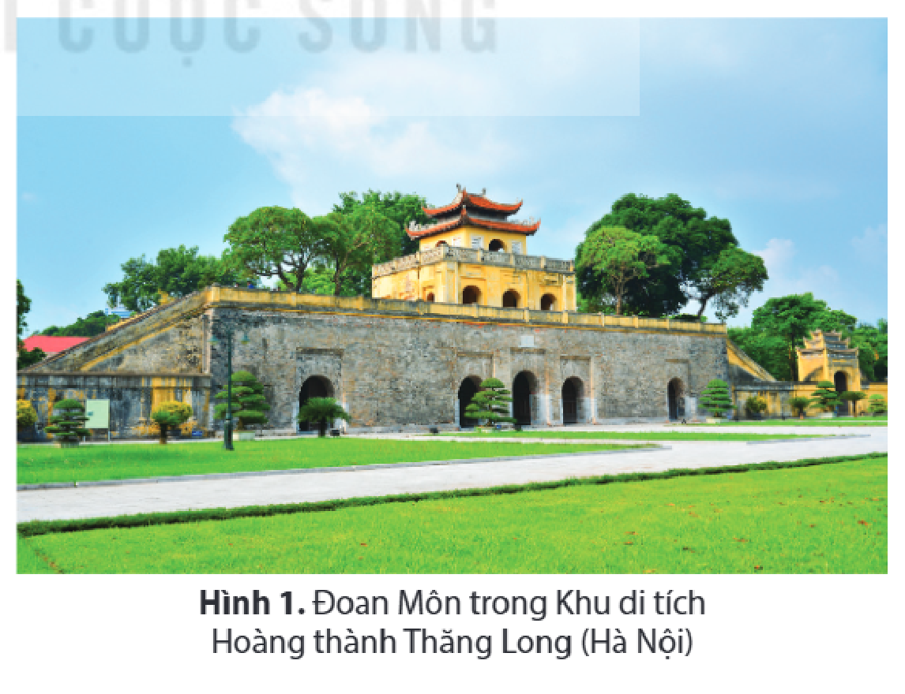
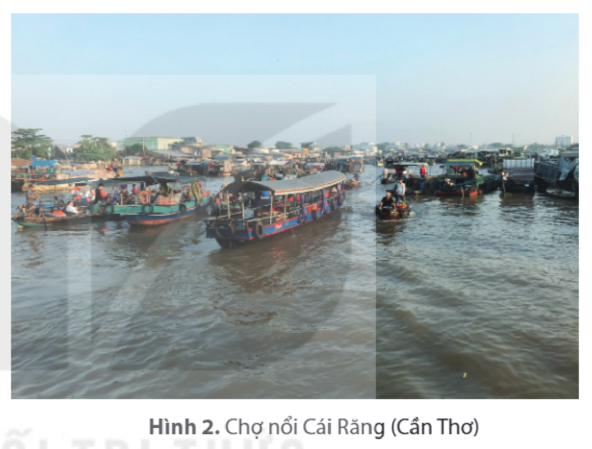
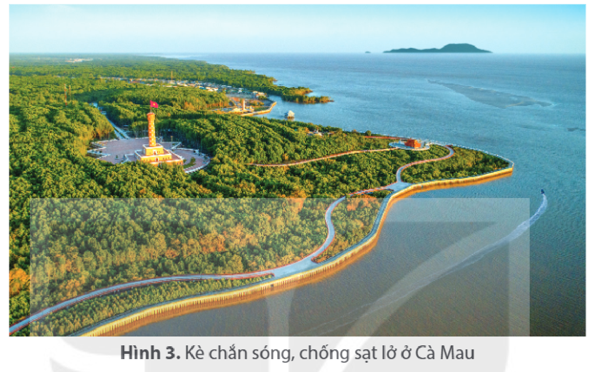

<!-- pdf:227 -->

# CHỦ ĐỀ CHUNG 2: VĂN MINH CHÂU THỔ SÔNG HỒNG VÀ SÔNG CỬU LONG (2)

## 🎯 Học xong bài này, em sẽ:

- Trình bày được những nét đặc sắc về văn hoá ở châu thổ sông Hồng và sông Cửu Long thông qua việc tìm hiểu về văn minh các dòng sông.
- Phân tích được những biểu hiện của biến đổi khí hậu ở hai vùng châu thổ sông Hồng và sông Cửu Long.
- Nêu được tác động của biến đổi khí hậu đối với sự phát triển kinh tế – xã hội ở châu thổ sông Hồng và sông Cửu Long.
- Đề xuất được ở mức độ đơn giản một số biện pháp ứng phó với biến đổi khí hậu liên quan đến vùng châu thổ của hai đồng bằng hiện đại.

## 🔴 Mở đầu

Châu thổ sông Hồng và sông Cửu Long có nhiều nét văn hoá đặc sắc. Đây là hai vùng chịu tác động lớn của biến đổi khí hậu. Hãy chia sẻ những hiểu biết của em về văn hoá hoặc biến đổi khí hậu ở hai châu thổ này.

## 1. Văn hoá ở châu thổ sông Hồng và sông Cửu Long

### a) Một số nét đặc sắc về văn hoá ở châu thổ sông Hồng

<!-- term: Di sản văn hoá ở châu thổ sông Hồng -->
Châu thổ sông Hồng là một trong những cái nôi của nền văn minh lúa nước. Dấu ấn của nền văn minh này thể hiện qua những nét đặc sắc về văn hoá được lưu giữ qua nhiều thế hệ, trở thành những di sản văn hoá.

<!-- term: Di sản văn hoá ở châu thổ sông Hồng -->
Các di sản văn hoá vật thể ở châu thổ sông Hồng gắn liền với công cuộc dựng nước và giữ nước của dân tộc như: Thành Cổ Loa, Cố đô Hoa Lư, Hoàng thành Thăng Long, Văn Miếu – Quốc Tử Giám,...

*Hình 1. Đoan Môn trong Khu di tích Hoàng thành Thăng Long (Hà Nội)*

<!-- pdf:228 -->

<!-- term: Di sản văn hoá ở châu thổ sông Hồng -->
Các di sản văn hoá phi vật thể ở châu thổ sông Hồng rất phong phú, đặc sắc, bao gồm: văn hoá ẩm thực với các món ăn truyền thống gắn với đồng ruộng, lúa gạo; các nghề thủ công truyền thống như: gốm Bát Tràng (Hà Nội), đúc đồng Đại Bái (Bắc Ninh), thêu ren Văn Lâm (Ninh Bình),...; các lễ hội độc đáo (hội Lim, lễ hội chùa Hương, hội Gióng,...); các loại hình nghệ thuật, diễn xướng dân gian (dân ca Quan họ Bắc Ninh, nghệ thuật Ca trù,...);... Ngoài ra, văn hoá châu thổ sông Hồng còn thể hiện rõ nét qua nếp sống của cộng đồng dân cư và văn học dân gian (ca dao, tục ngữ, truyền thuyết,...).

### b) Một số nét đặc sắc về văn hoá ở châu thổ sông Cửu Long

<!-- term: Văn hoá sông nước ở châu thổ sông Cửu Long -->
Trong quá trình khai khẩn, con người ở châu thổ sông Cửu Long đã thích ứng với thiên nhiên, tạo nên nền văn hoá sông nước đặc sắc.

<!-- term: Văn hoá sông nước ở châu thổ sông Cửu Long -->
Cuộc sống và hoạt động sản xuất của người dân châu thổ sông Cửu Long gắn liền với sông nước. Kiến trúc nhà nổi, buôn bán trên sông khá phổ biến, nhiều điểm tập trung thành các chợ nổi như: Cái Răng, Phụng Hiệp, Ngã Năm,... Việc di chuyển bằng ghe, xuồng rất phổ biến.

*Hình 2. Chợ nổi Cái Răng (Cần Thơ)*

<!-- term: Văn hoá sông nước ở châu thổ sông Cửu Long -->
Nét văn hoá ẩm thực ở châu thổ sông Cửu Long gắn liền với sản vật từ sông nước (các loại mắm, cá khô,... ), lúa gạo (các loại bánh làm từ gạo). Một số nghề thủ công tiêu biểu như: đóng ghe xuồng ở Cần Thơ, làm bột gạo ở Sa Đéc (Đồng Tháp), làm đường thốt nốt ở An Giang,...

<!-- term: Đờn ca tài tử Nam Bộ -->
Tại châu thổ sông Cửu Long có rất nhiều lễ hội và nghệ thuật dân gian như: lễ hội miếu Bà Chúa Xứ, lễ hội Nghinh Ông, lễ hội Chôl Chnăm Thmây, lễ hội Đua ghe Ngo; đặc biệt nghệ thuật Đờn ca tài tử Nam Bộ đã được tổ chức UNESCO ghi danh là Di sản văn hoá phi vật thể của thế giới.

> ❓ Dựa vào thông tin mục 1, hãy trình bày những nét đặc sắc về văn hoá ở châu thổ sông Hồng và sông Cửu Long.

## 2. Biến đổi khí hậu ở châu thổ sông Hồng và châu thổ sông Cửu Long

### a) Biểu hiện của biến đổi khí hậu ở châu thổ sông Hồng và châu thổ sông Cửu Long

<!-- term: Biểu hiện biến đổi khí hậu ở châu thổ sông Hồng và sông Cửu Long -->
Biểu hiện của biến đổi khí hậu ở châu thổ sông Hồng và châu thổ sông Cửu Long trong giai đoạn 1961 – 2020 thể hiện qua các yếu tố:

<!-- term: Biểu hiện biến đổi khí hậu ở châu thổ sông Hồng và sông Cửu Long -->
- Nhiệt độ trung bình năm có xu thế tăng lên ở cả hai châu thổ.

<!-- pdf:229 -->

Bảng 1. NHIỆT ĐỘ TRUNG BÌNH NĂM THEO THẬP KỈ CỦA TRẠM KHÍ TƯỢNG THÁI BÌNH VÀ CẦN THƠ GIAI ĐOẠN 1961 – 2020

*(Đơn vị: °C)*

| Trạm | 1961 – 1970 | 1971 – 1980 | 1981 – 1990 | 1991 – 2000 | 2001 – 2010 | 2011 – 2020 |
| --- | :---: | :---: | :---: | :---: | :---: | :---: |
| Thái Bình (Hưng Yên) | 23,2 | 23,2 | 23,3 | 23,3 | 23,6 | 24,0 |
| Cần Thơ (Cần Thơ) | 26,5 | 26,5 | 26,6 | 26,8 | 27,1 | 27,6 |
<!-- ocr-ok: đã đối chiếu trực tiếp ảnh trang gốc PDF 229 (trang in 227), OCR lỗi dấu phẩy số liệu nhiệt độ trong Bảng 1 -->

*(Nguồn: Trung tâm Thông tin và Dữ liệu khí tượng thuỷ văn)*

<!-- term: Biểu hiện biến đổi khí hậu ở châu thổ sông Hồng và sông Cửu Long -->
- Lượng mưa có sự biến động qua các thập niên.

Bảng 2. TỔNG LƯỢNG MƯA TRUNG BÌNH NĂM THEO THẬP KỈ CỦA TRẠM KHÍ TƯỢNG THÁI BÌNH VÀ CẦN THƠ GIAI ĐOẠN 1961 – 2020

*(Đơn vị: mm)*

| Trạm | 1961 – 1970 | 1971 – 1980 | 1981 – 1990 | 1991 – 2000 | 2001 – 2010 | 2011 – 2020 |
| --- | :---: | :---: | :---: | :---: | :---: | :---: |
| Thái Bình (Hưng Yên) | 1 803 | 1 950 | 1 589 | 1 403 | 1 571 | 1 680 |
| Cần Thơ (Cần Thơ) | 1 816 | 1 520 | 1 585 | 1 720 | 1 556 | 1 730 |
<!-- ocr-ok: đã đối chiếu trực tiếp ảnh trang gốc PDF 229 (trang in 227), OCR dính liền khoảng cách hàng nghìn trong Bảng 2 -->

*(Nguồn: Trung tâm Thông tin và Dữ liệu khí tượng thuỷ văn)*

<!-- term: Biểu hiện biến đổi khí hậu ở châu thổ sông Hồng và sông Cửu Long -->
- Các hiện tượng thời tiết cực đoan trở nên bất thường, khó dự báo và gây ra hậu quả nặng nề hơn. Ở châu thổ sông Hồng, số ngày nắng nóng (từ 35°C trở lên) có xu thế tăng, số ngày rét đậm, rét hại có xu thế giảm. Ở châu thổ sông Cửu Long, số ngày nắng nóng có xu thế tăng lên, gia tăng số lượng các đợt hạn,...

<!-- term: Biểu hiện biến đổi khí hậu ở châu thổ sông Hồng và sông Cửu Long -->
- Mực nước biển có xu thế tăng lên ở ven biển hai châu thổ, trung bình 2,7 mm/năm (theo *Kịch bản biến đổi khí hậu và nước biển dâng cho Việt Nam*, Bộ Nông nghiệp và Môi trường năm 2021).

> ❓ Dựa vào thông tin mục a, hãy phân tích những biểu hiện của biến đổi khí hậu ở hai vùng châu thổ sông Hồng và sông Cửu Long.

### b) Tác động của biến đổi khí hậu đối với sự phát triển kinh tế – xã hội ở châu thổ sông Hồng và sông Cửu Long

<!-- term: Tác động của biến đổi khí hậu ở châu thổ sông Hồng và sông Cửu Long -->
- Tác động của biến đổi khí hậu đối với sự phát triển kinh tế – xã hội ở châu thổ sông Hồng:

<!-- pdf:230 -->

<!-- term: Tác động của biến đổi khí hậu ở châu thổ sông Hồng và sông Cửu Long -->
  + Các đợt nắng nóng kéo dài làm tăng chi phí cho các thiết bị làm mát trong sản xuất và xây dựng, ảnh hưởng tiêu cực đến sức khoẻ người dân.

<!-- term: Tác động của biến đổi khí hậu ở châu thổ sông Hồng và sông Cửu Long -->
  + Số ngày rét có xu thế giảm, mùa lạnh ngắn đi làm ảnh hưởng đến sản xuất cây vụ đông.

<!-- term: Tác động của biến đổi khí hậu ở châu thổ sông Hồng và sông Cửu Long -->
  + Bão, mưa lớn xuất hiện nhiều hơn dẫn đến ngập lụt gây thiệt hại về người và tài sản. Các hiện tượng thời tiết cực đoan gia tăng làm sản xuất nông nghiệp càng trở nên bấp bênh hơn.

<!-- term: Tác động của biến đổi khí hậu ở châu thổ sông Hồng và sông Cửu Long -->
- Tác động của biến đổi khí hậu đối với sự phát triển kinh tế – xã hội ở châu thổ sông Cửu Long:

<!-- term: Tác động của biến đổi khí hậu ở châu thổ sông Hồng và sông Cửu Long -->
  + Nhiệt độ có xu thế tăng làm gia tăng sâu bệnh, dịch hại cho cây trồng, vật nuôi.

<!-- term: Tác động của biến đổi khí hậu ở châu thổ sông Hồng và sông Cửu Long -->
  + Mùa khô ngày càng gay gắt hơn, hạn hán xảy ra ở nhiều nơi gây thiếu nước cho sản xuất nông nghiệp, thuỷ sản, tăng nguy cơ cháy rừng. Tình trạng thiếu nước cho sinh hoạt trầm trọng hơn.

<!-- term: Tác động của biến đổi khí hậu ở châu thổ sông Hồng và sông Cửu Long -->
  + Nước biển dâng gây sạt lở bờ biển, khiến diện tích đất nông nghiệp, rừng ngập mặn bị thu hẹp. Trong mùa khô, nước biển xâm nhập sâu vào vùng cửa sông, ven biển làm cho đất bị nhiễm phèn, nhiễm mặn ảnh hưởng đến cây trồng.

<!-- term: Tác động của biến đổi khí hậu ở châu thổ sông Hồng và sông Cửu Long -->
  + Biến đổi khí hậu ảnh hưởng đến việc làm và thu nhập của người dân, ảnh hưởng đến an sinh xã hội.

> ❓ Dựa vào thông tin mục b, hãy nêu tác động của biến đổi khí hậu đối với sự phát triển kinh tế – xã hội ở châu thổ sông Hồng và sông Cửu Long.

### c) Biện pháp ứng phó với biến đổi khí hậu tại vùng châu thổ của hai đồng bằng hiện đại

Để ứng phó với biến đổi khí hậu ở hai châu thổ cần thực hiện đồng thời các biện pháp giảm nhẹ và thích ứng với biến đổi khí hậu. Ngoài các biện pháp chung để giảm nhẹ biến đổi khí hậu bằng cách giảm thiểu lượng khí nhà kính phát thải vào khí quyển và tăng cường sự hấp thụ các chất khí nhà kính, mỗi châu thổ cần có những biện pháp phù hợp để thích ứng với biến đổi khí hậu ở từng vùng.

<!-- term: Biện pháp thích ứng với biến đổi khí hậu ở châu thổ sông Hồng -->
- Một số biện pháp thích ứng với biến đổi khí hậu ở châu thổ sông Hồng:

<!-- term: Biện pháp thích ứng với biến đổi khí hậu ở châu thổ sông Hồng -->
  + Trong nông nghiệp: áp dụng các kĩ thuật canh tác, công nghệ sản xuất để hạn chế tác động của các hiện tượng thời tiết cực đoan, sâu bệnh; thay đổi thời gian mùa vụ, đặc biệt là các cây trồng vụ đông.

<!-- term: Biện pháp thích ứng với biến đổi khí hậu ở châu thổ sông Hồng -->
  + Trong công nghiệp: đổi mới công nghệ trong sản xuất để giảm phát thải khí nhà kính.

<!-- term: Biện pháp thích ứng với biến đổi khí hậu ở châu thổ sông Hồng -->
  + Đối với cộng đồng: để bảo vệ sức khoẻ cần theo dõi thường xuyên các thông tin về thời tiết để có thể đưa ra phương án phòng, chống thiên tai hiệu quả, đặc biệt trong các đợt nắng nóng, rét đậm, rét hại.

<!-- pdf:231 -->

<!-- term: Biện pháp thích ứng với biến đổi khí hậu ở châu thổ sông Cửu Long -->
- Một số biện pháp thích ứng với biến đổi khí hậu ở châu thổ sông Cửu Long:

<!-- term: Biện pháp thích ứng với biến đổi khí hậu ở châu thổ sông Cửu Long -->
  + Trong nông nghiệp: tạo nên các giống cây trồng chịu mặn, chịu hạn; chuyển đổi đất trồng lúa sang trồng cây khác hoặc nuôi trồng thuỷ sản ở các khu vực đất bị nhiễm phèn, nhiễm mặn, hạn hán. Xây dựng các mô hình kinh tế sống chung với lũ; thích ứng nước lợ, nước mặn, thích ứng với thiên tai; trồng rừng và bảo vệ rừng ngập mặn; xây dựng kênh mương, xây dựng đê biển, kè chắn sóng, cống ngăn mặn,...

*Hình 3. Kè chắn sóng, chống sạt lở ở Cà Mau*

<!-- term: Biện pháp thích ứng với biến đổi khí hậu ở châu thổ sông Cửu Long -->
  + Trong du lịch: khai thác những loại hình du lịch thích ứng với biến đổi khí hậu, trọng tâm là du lịch sinh thái gắn với sông nước, miệt vườn, rừng ngập mặn, rừng tràm; phát triển du lịch cộng đồng thân thiện với môi trường, bảo vệ cảnh quan thiên nhiên.

<!-- term: Biện pháp thích ứng với biến đổi khí hậu ở châu thổ sông Cửu Long -->
  + Đối với cộng đồng: cần có các biện pháp để đảm bảo nguồn nước sạch phục vụ sinh hoạt, đặc biệt là trong mùa khô.

> ❓ Dựa vào thông tin mục c, hãy đề xuất một số biện pháp ứng phó với biến đổi khí hậu liên quan đến vùng châu thổ của hai đồng bằng hiện đại.

## ✏️ Luyện tập – Vận dụng

- Hoàn thành bảng liệt kê một số nét văn hoá phi vật thể đặc sắc ở châu thổ sông Hồng và châu thổ sông Cửu Long theo mẫu sau vào vở:

| Châu thổ sông Hồng | Châu thổ sông Cửu Long |
| :---: | :---: |
| ? | ? |

- Thiết kế sản phẩm tuyên truyền một số biện pháp đơn giản để thích ứng với biến đổi khí hậu ở vùng châu thổ sông Hồng hoặc châu thổ sông Cửu Long.

## 📷 Danh sách hình trong bài

| Mã hình | Trang PDF | Trang sách | Chú thích |
| --- | :---: | :---: | --- |
| H9-lich_su_va_dia_ly-cdc-02-01 | 227 | 225 | Hình 1. Đoan Môn trong Khu di tích Hoàng thành Thăng Long (Hà Nội) |
| H9-lich_su_va_dia_ly-cdc-02-02 | 228 | 226 | Hình 2. Chợ nổi Cái Răng (Cần Thơ) |
| H9-lich_su_va_dia_ly-cdc-02-03 | 231 | 229 | Hình 3. Kè chắn sóng, chống sạt lở ở Cà Mau |
