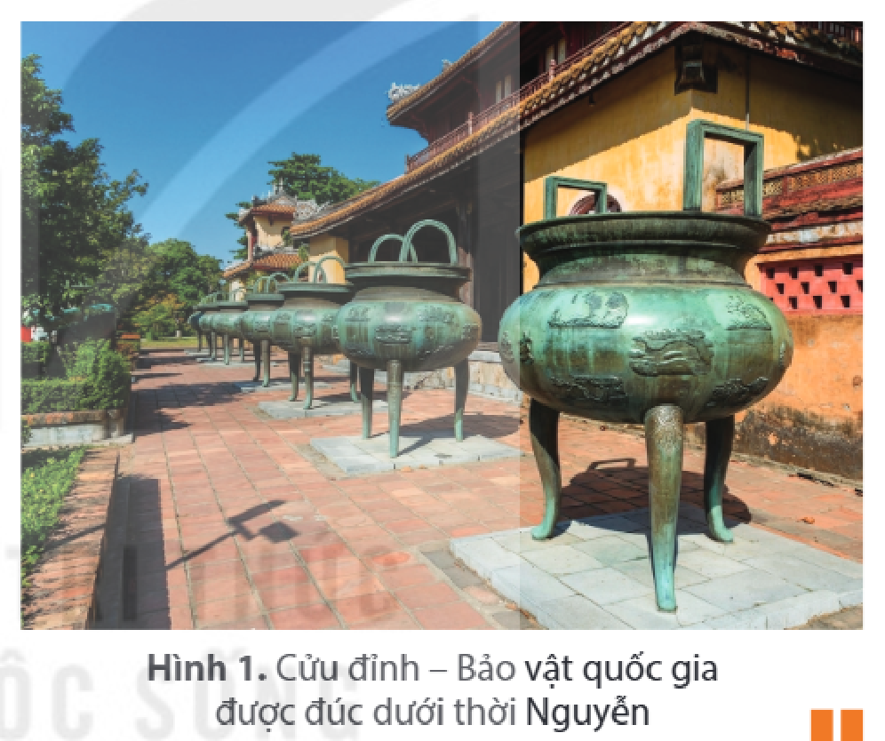
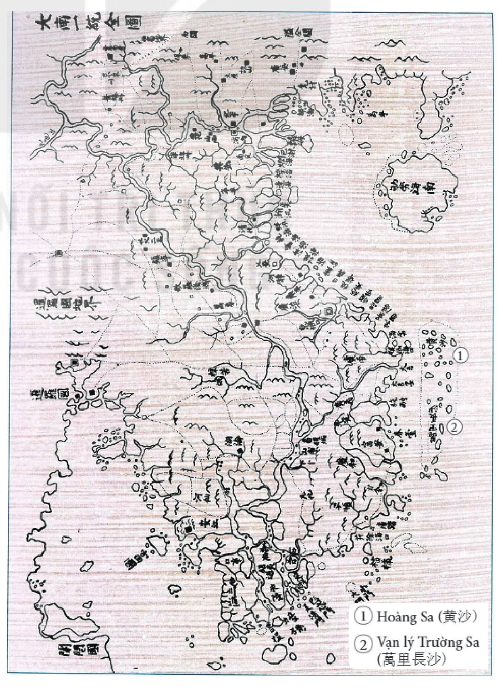
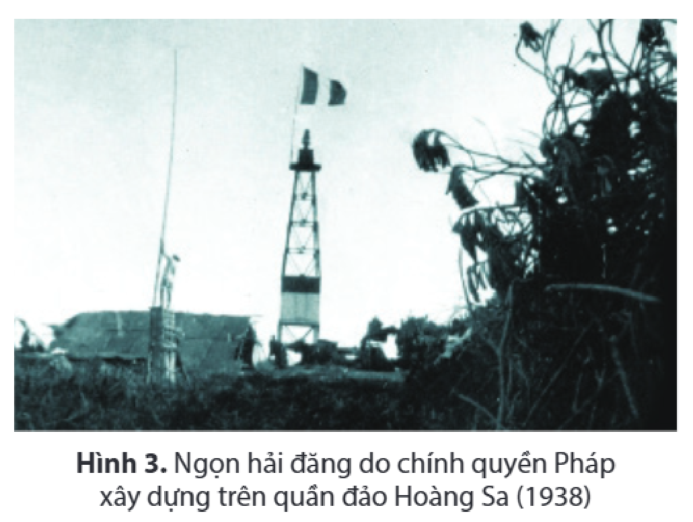
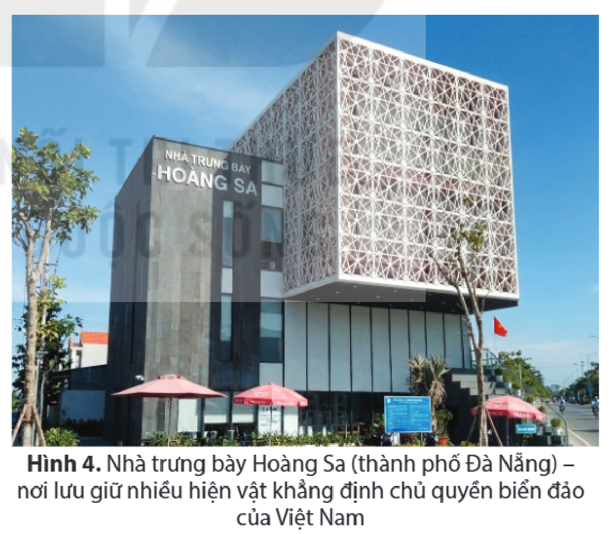
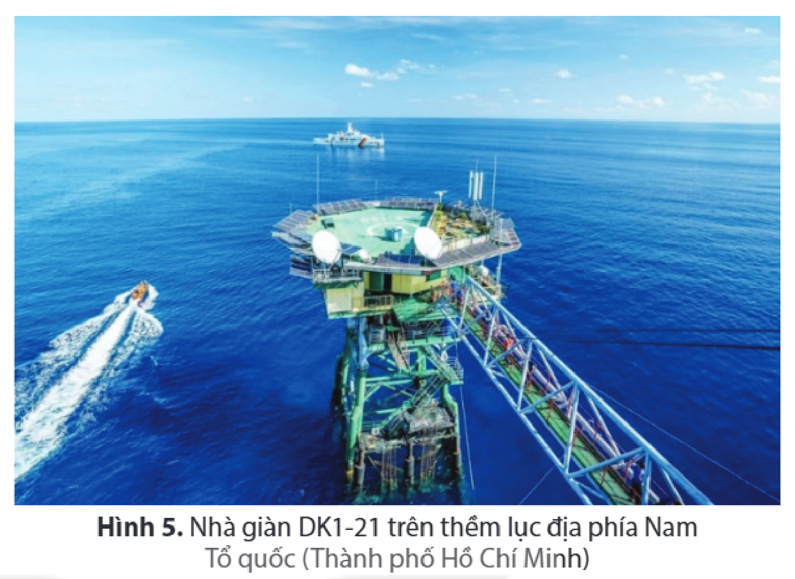

<!-- pdf:232 -->

# CHỦ ĐỀ CHUNG 3: BẢO VỆ CHỦ QUYỀN, CÁC QUYỀN VÀ LỢI ÍCH HỢP PHÁP CỦA VIỆT NAM Ở BIỂN ĐÔNG (2)

## 🎯 Học xong bài này, em sẽ:

- Trình bày được những chứng cứ lịch sử, pháp lí về chủ quyền biển đảo Việt Nam.
- Nêu được vai trò chiến lược của biển đảo Việt Nam trong việc khẳng định và bảo vệ chủ quyền, các quyền và lợi ích hợp pháp của Việt Nam ở Biển Đông.
- Có hành động cụ thể thể hiện trách nhiệm đối với việc bảo vệ chủ quyền, các quyền và lợi ích hợp pháp của Việt Nam ở Biển Đông.

## 🔴 Mở đầu

Trên Cửu đỉnh (Hình 1), nhiều địa danh của đất nước được chạm nổi rõ ràng, trong đó có Biển Đông, quần đảo Trường Sa và quần đảo Hoàng Sa. Theo em, hiện vật này chứng tỏ điều gì về ý thức chủ quyền biển đảo của cha ông ta? Hãy chia sẻ hiểu biết của em về những chứng cứ khẳng định chủ quyền biển đảo của Việt Nam. Biển đảo có vai trò như thế nào trong việc khẳng định và bảo vệ chủ quyền, các quyền và lợi ích hợp pháp của Việt Nam ở Biển Đông?

*Hình 1. Cửu đỉnh – Bảo vật quốc gia được đúc dưới thời Nguyễn*
<!-- ocr-ok: đã đối chiếu trực tiếp ảnh trang gốc PDF 232 (trang in 230), OCR bỏ sót dòng đầu chú thích Hình 1 -->

## 1. Chứng cứ lịch sử và cơ sở pháp lí về chủ quyền biển đảo của Việt Nam

### a) Chứng cứ lịch sử

Nhiều tư liệu hiện vật, chữ viết, truyền miệng,... của Việt Nam và thế giới đã cung cấp chứng cứ lịch sử về các hoạt động xác lập và thực thi chủ quyền biển đảo liên tục của dân tộc trên Biển Đông qua các thời kì lịch sử.

- *Trước năm 1884*

  + *Di chỉ khảo cổ học:*

<!-- term: Chứng cứ lịch sử về chủ quyền biển đảo Việt Nam trước năm 1884 -->
Các di chỉ khảo cổ học thuộc các nền văn hoá biển Hạ Long, Bàu Tró, Hoa Lộc,... được phát hiện ở các khu vực ven biển Việt Nam cho thấy người Việt cổ đã cư trú sát biển và có cuộc sống gắn liền với Biển Đông.

<!-- term: Chứng cứ lịch sử về chủ quyền biển đảo Việt Nam trước năm 1884 -->
Nhiều dấu vết tàu đắm, hiện vật đồ gốm được tìm thấy ở Hội An, Cù Lao Chàm,... cho thấy Vương quốc Chăm-pa đã có những mối giao lưu rộng rãi với Ấn Độ và vùng Tây Á,... còn cư dân Óc Eo đã có những mối liên hệ xa bằng đường biển đến tận vùng Địa Trung Hải.

<!-- pdf:233 -->

  + *Tư liệu của Việt Nam:*

<!-- term: Chứng cứ lịch sử về chủ quyền biển đảo Việt Nam trước năm 1884 -->
Nhiều công trình sử học và địa lí cổ của Việt Nam đã ghi chép tường tận về cương vực, lãnh thổ và hoạt động thực thi, bảo vệ chủ quyền của các triều đại quân chủ Việt Nam ở khu vực Biển Đông, đặc biệt ở quần đảo Hoàng Sa và quần đảo Trường Sa.

<!-- term: Chứng cứ lịch sử về chủ quyền biển đảo Việt Nam trước năm 1884 -->
Tiêu biểu như: *Đại Việt sử ký toàn thư* của Ngô Sỹ Liên, *Dư địa chí* của Nguyễn Trãi, *Phủ biên tạp lục* của Lê Quý Đôn, *Lịch triều hiến chương loại chí* của Phan Huy Chú, *Đại Nam nhất thống chí* của Quốc sử quán Triều Nguyễn,...

> 💡 **Kết nối với văn học**
>
> Biển Đông nhiều lần xuất hiện trong thơ văn thời trung đại:
>
> *Sông Đằng một dải dài ghê,*
> *Luồng to gió lớn tuôn về bể Đông*
> *(Phú sông Bạch Đằng, Trương Hán Siêu)*
>
> *Biển Đông vạn dặm giang tay giữ*
> *Đất Việt muôn năm vững trị bình*
> *(Cự ngao đới sơn, Nguyễn Bỉnh Khiêm)*

> **Tư liệu 1.** "Kỷ Tỵ năm thứ 10 (1149) mùa xuân, tháng hai, thuyền buôn ba nước Trảo Oa, Lộ Lạc, Xiêm La vào Hải Đông, xin cư trú buôn bán, [vua Lý Anh Tông] bèn cho lập trang ở nơi hải đảo, gọi là Vân Đồn để mua bán hàng hoá quý, dâng tiến sản vật địa phương” .
>
> (Ngô Sỹ Liên, *Đại Việt sử ký toàn thư*, Tập I, NXB Khoa học xã hội, 1993, tr. 137)

<!-- term: Chứng cứ lịch sử về chủ quyền biển đảo Việt Nam trước năm 1884 -->
Các bản đồ cổ của Việt Nam thời quân chủ đã vẽ khu vực Biển Đông (với tên gọi Hải Đông), quần đảo Hoàng Sa và quần đảo Trường Sa (với tên gọi Bãi Cát Vàng, Vạn lý Hoàng Sa, Đại Trường Sa, Vạn lý Trường Sa) thuộc lãnh thổ Việt Nam.

<!-- term: Chứng cứ lịch sử về chủ quyền biển đảo Việt Nam trước năm 1884 -->
*Toản tập Thiên Nam tứ chí lộ đồ thư* (thế kỉ XVII) vẽ hình dải cát ở ngoài khơi với tên gọi là Bãi Cát Vàng. Địa danh Bãi Cát Vàng cũng xuất hiện trên *Giáp Ngọ niên bình Nam đồ* (thế kỉ XVIII). Trong *Đại Nam nhất thống toàn đồ* (1838) ghi rõ hình thể và vị trí của Hoàng Sa và Vạn lý Trường Sa.

*Hình 2. Đại Nam nhất thống toàn đồ (1838)*

<!-- pdf:234 -->

<!-- term: Chứng cứ lịch sử về chủ quyền biển đảo Việt Nam trước năm 1884 -->
Bên cạnh đó, nhiều văn bản hành chính của Nhà nước quân chủ Việt Nam đã ghi chép các hoạt động xác lập, thực thi và bảo vệ chủ quyền biển đảo của Việt Nam ở khu vực Biển Đông, đặc biệt là đối với quần đảo Hoàng Sa, quần đảo Trường Sa.

<!-- term: Châu bản Triều Nguyễn về chủ quyền biển đảo -->
*Châu bản Triều Nguyễn* (văn bản hành chính của Triều đình) là bằng chứng quan trọng khẳng định Nhà nước phong kiến Việt Nam đã triển khai nhiều hoạt động thực thi chủ quyền đối với các đảo, quần đảo trên Biển Đông như: đo đạc, vẽ bản đồ, cắm mốc chủ quyền, điều thuỷ quân, cứu hộ, cứu nạn tàu thuyền gặp nạn,...

  + *Tư liệu của người nước ngoài:*

<!-- term: Chứng cứ lịch sử về chủ quyền biển đảo Việt Nam trước năm 1884 -->
Từ khoảng thế kỉ XVI, người Bồ Đào Nha, Hà Lan, Pháp, Anh,... đã vẽ nhiều bản đồ vùng biển Đông Nam Á, trong đó đều thể hiện khá rõ bờ biển, Biển Đông và hải đảo của Việt Nam đương thời.

<!-- term: Chứng cứ lịch sử về chủ quyền biển đảo Việt Nam trước năm 1884 -->
Một số tấm bản đồ tiêu biểu như: *Vương quốc An Nam* (Rô-ma, thế kỉ XVII), *Bản đồ của Công ty Đông Ấn* (Anh, thế kỉ XIX), bộ *Át-lát thế giới* (Bỉ, 1827), *An Nam đại quốc hoạ đồ* (1838),...

<!-- term: Chứng cứ lịch sử về chủ quyền biển đảo Việt Nam trước năm 1884 -->
Trong các chuyến du hành tới Đông Nam Á và Việt Nam, nhiều nhà hàng hải, giáo sĩ phương Tây cũng ghi chép về hoạt động xác lập, thực thi chủ quyền của Việt Nam tại các đảo, quần đảo trên Biển Đông trong hồi kí, thư từ, báo cáo của họ.

<!-- term: Chứng cứ lịch sử về chủ quyền biển đảo Việt Nam trước năm 1884 -->
Nhiều bản ghi chép cho thấy chúa Nguyễn thường xuyên cử thuyền ra các đảo trên Biển Đông khai thác hải sản quý hiếm, thu nhặt di vật từ những tàu đắm và thực hiện tuần phòng, kiểm soát vùng biển, đảo.

> **Tư liệu 2.** Trong ghi chép về Phú Xuân (Huế), P. Poa-vơ-gơ viết: "Người ta còn thấy ở đây những hộp nhỏ đựng vũ khí của vua Chân Lạp do người Bồ Đào Nha đúc, cũng như những khẩu thần công bằng sắt... có trang trí chữ ghi của Công ty Đông Ấn Hà Lan, những khẩu súng này thu lượm được ở Pa-ra-xen (Hoàng Sa) trong số các di vật của các tàu từ Trung Hoa đi qua bị đắm...".
>
> (Theo *Nhật kí hành trình* của P. Poa-vơ-gơ được xuất bản ở Pa-ri, 1885)

- *Từ sau năm 1884*

<!-- term: Chứng cứ lịch sử về chủ quyền biển đảo Việt Nam từ sau năm 1884 -->
Từ sau Hiệp ước Pa-tơ-nốt (1884), chính quyền Pháp đại diện cho Việt Nam trong quan hệ đối ngoại, đã có nhiều hoạt động khẳng định, bảo vệ chủ quyền biển đảo của Việt Nam. Những người đứng đầu chính quyền thuộc địa cũng đưa ra nhiều tuyên bố chủ quyền biển đảo của Việt Nam tại nhiều sự kiện, hội nghị quốc tế và phản đối các hành động xâm nhập trái phép của quân đội nước ngoài ở các đảo, quần đảo trên Biển Đông.

<!-- term: Chứng cứ lịch sử về chủ quyền biển đảo Việt Nam từ sau năm 1884 -->
Tuyên bố của Toàn quyền Đông Dương (3 – 1925) đã khẳng định quần đảo Hoàng Sa và quần đảo Trường Sa là của Việt Nam.

<!-- term: Chứng cứ lịch sử về chủ quyền biển đảo Việt Nam từ sau năm 1884 -->
Nhiều văn bản, nghị định thời kì này cho thấy chính quyền Pháp ở Đông Dương đã thực hiện các biện pháp quản lí thông qua việc thành lập đơn vị hành chính trên các đảo, quần đảo ở Biển Đông như: Cô Tô, Phú Quốc, Hoàng Sa, Trường Sa,...

<!-- term: Chứng cứ lịch sử về chủ quyền biển đảo Việt Nam từ sau năm 1884 -->
Ngoài ra, việc chính quyền Pháp ở Đông Dương xây dựng bia chủ quyền, trạm khí tượng, cử quân đội đồn trú tại các đảo và tuần tra vùng biển,... cũng là những chứng cứ quan trọng thể hiện chủ quyền biển đảo của Việt Nam.

<!-- pdf:235 -->

<!-- term: Chứng cứ lịch sử về chủ quyền biển đảo Việt Nam từ sau năm 1884 -->
Bia chủ quyền, hải đăng, trạm khí tượng, đài vô tuyến điện,... được xây dựng ở các đảo Hoàng Sa, Phú Lâm, Ba Bình,... thuộc quần đảo Hoàng Sa và quần đảo Trường Sa.

<!-- term: Chứng cứ lịch sử về chủ quyền biển đảo Việt Nam từ sau năm 1884 -->
Tại Hội nghị Hoà bình Xan Phran-xi-xcô (9 – 1951), chủ quyền của Việt Nam đối với quần đảo Hoàng Sa và quần đảo Trường Sa tiếp tục được tuyên bố mà không bị các quốc gia tham dự hội nghị phản đối.

*Hình 3. Ngọn hải đăng do chính quyền Pháp xây dựng trên quần đảo Hoàng Sa (1938)*

<!-- term: Chứng cứ lịch sử về chủ quyền biển đảo Việt Nam từ sau năm 1884 -->
Sau Hiệp định Giơ-ne-vơ năm 1954, các chính quyền ở Việt Nam đã ban hành nhiều sắc lệnh, quy định, thể hiện sự quản lí và thực thi chủ quyền biển đảo của Việt Nam ở khu vực Biển Đông, cũng như đưa ra các tuyên bố công khai về chủ quyền biển đảo của Việt Nam tại nhiều diễn đàn quốc tế. Những hoạt động bảo vệ, khai thác, phát triển kinh tế tại khu vực ven biển và trên các đảo bước đầu được quan tâm và triển khai.

<!-- term: Chứng cứ lịch sử về chủ quyền biển đảo Việt Nam từ sau năm 1884 -->
Về hành chính, ở miền Bắc, đảo Bạch Long Vĩ thuộc thành phố Hải Phòng, đảo Cô Tô thuộc tỉnh Hải Ninh (nay thuộc tỉnh Quảng Ninh). Ở miền Nam, quần đảo Trường Sa trực thuộc tỉnh Phước Tuy (đến năm 1982, thuộc tỉnh Đồng Nai; từ năm 1989 đến nay, thuộc tỉnh Khánh Hoà) và quần đảo Hoàng Sa thuộc tỉnh Quảng Nam (nay thuộc thành phố Đà Nẵng),...

<!-- term: Chứng cứ lịch sử về chủ quyền biển đảo Việt Nam từ sau năm 1884 -->
Sau khi đất nước thống nhất, Nhà nước Cộng hoà xã hội chủ nghĩa Việt Nam tiếp tục quản lí, bảo vệ và thực hiện chủ quyền đối với các đảo, quần đảo, thềm lục địa thuộc Biển Đông. Việt Nam đã nhiều lần khẳng định chủ quyền của Việt Nam đối với quần đảo Hoàng Sa và quần đảo Trường Sa trong các tuyên bố chính thức của Bộ Ngoại giao, tại Hội nghị của Tổ chức Khí tượng Thế giới (1980), Hội nghị Địa chất Thế giới (1980),...

*Hình 4. Nhà trưng bày Hoàng Sa (thành phố Đà Nẵng) – nơi lưu giữ nhiều hiện vật khẳng định chủ quyền biển đảo của Việt Nam*

<!-- term: “Sách Trắng” về chủ quyền đối với quần đảo Hoàng Sa và Trường Sa -->
“Sách Trắng” về chủ quyền, của Việt Nam đối với quần đảo Hoàng Sa và quần đảo Trường Sa (công bố vào các năm 1979, 1981, 1988), khẳng định hai quần đảo này là một bộ phận không thể tách rời của lãnh thổ Việt Nam, phù hợp với quy định của luật pháp và thực tiễn quốc tế.

> ❓ 1. Khai thác tư liệu 1, 2 và thông tin trong mục, hãy trình bày những chứng cứ lịch sử trước năm 1884 thể hiện chủ quyền biển đảo của Việt Nam.
>
> 2. Trình bày các chứng cứ lịch sử từ sau năm 1884 về chủ quyền biển đảo của Việt Nam ở Biển Đông.

<!-- pdf:236 -->

### b) Cơ sở pháp lí

<!-- term: Cơ sở pháp lí bảo vệ chủ quyền biển đảo của Việt Nam ở Biển Đông -->
Nhiều văn bản luật pháp quốc tế đã cung cấp những cơ sở pháp lí quan trọng khẳng định chủ quyền, quyền chủ quyền và quyền tài phán của Việt Nam ở Biển Đông.

<!-- term: Cơ sở pháp lí bảo vệ chủ quyền biển đảo của Việt Nam ở Biển Đông -->
Việt Nam đã đàm phán và kí kết *Hiệp định về vùng nước lịch sử giữa Việt Nam và Cam-pu-chia (1982)*, *Thoả thuận hợp tác khai thác chung trong vùng chồng lấn với Ma-lai-xi-a (1992)*, *Hiệp định phân định ranh giới trên biển giữa Việt Nam và Thái Lan trong Vịnh Thái Lan (1997)*, *Hiệp định phân định Vịnh Bắc Bộ với Trung Quốc (2000)*, *Hiệp định phân định biển với In-đô-nê-xi-a (2003)*.

<!-- term: Cơ sở pháp lí bảo vệ chủ quyền biển đảo của Việt Nam ở Biển Đông -->
Việt Nam phê chuẩn và trở thành thành viên có trách nhiệm của Công ước Liên hợp quốc về *Luật Biển năm 1982* (UNCLOS). Đây là cơ sở pháp lí quốc tế quan trọng khẳng định chủ quyền, các quyền và lợi ích hợp pháp của Việt Nam ở Biển Đông.

<!-- term: Cơ sở pháp lí bảo vệ chủ quyền biển đảo của Việt Nam ở Biển Đông -->
Trên cơ sở các quy định của UNCLOS và luật pháp quốc tế có liên quan, Việt Nam đã ban hành nhiều văn bản pháp luật trong nước về biển, khai thác biển như: *Luật Biên giới quốc gia*, *Luật Dầu khí*, *Luật Cảnh sát biển Việt Nam*,... Đặc biệt, *Luật Biển Việt Nam* được thông qua vào năm 2012 đã cụ thể hoá các quy định của Công ước trên nhiều vấn đề như: biên giới lãnh thổ, hàng hải, thuỷ sản, dầu khí, bảo vệ môi trường biển và hải đảo,...

> ❓ Trình bày những cơ sở pháp lí về chủ quyền biển đảo của Việt Nam.

## 2. Vai trò chiến lược của biển đảo Việt Nam

### a) Là tuyến phòng thủ của đất nước

<!-- term: Vai trò chiến lược của biển đảo Việt Nam -->
Biển đảo Việt Nam là một bộ phận lãnh thổ thiêng liêng của Tổ quốc, đóng vai trò trọng yếu trong công cuộc bảo vệ sự toàn vẹn đất nước.

<!-- term: Vai trò chiến lược của biển đảo Việt Nam -->
Hệ thống các đảo, cụm đảo trải đều trên Biển Đông của Việt Nam có ý nghĩa lớn trong triển khai phòng thủ, bảo vệ đất liền và kiểm soát vùng biển, vùng trời trên biển của quốc gia. Đây là những căn cứ tiền tiêu trên tuyến phòng thủ hướng đông bảo vệ chủ quyền và toàn vẹn lãnh thổ, cũng như thực hiện các nhiệm vụ quốc tế về cứu hộ, cứu nạn trên biển.

<!-- term: Vai trò chiến lược của biển đảo Việt Nam -->
Một số đảo như Bạch Long Vĩ, Cồn Cỏ, quần đảo Hoàng Sa và quần đảo Trường Sa,... có vị trí địa lí thuận lợi cho việc đặt các trạm thông tin, xây dựng các trạm trung chuyển, dừng chân tiếp nhiên liệu cho tàu thuyền, phục vụ cho tuyến đường vận tải và an ninh trên biển.

### b) Cung cấp tài nguyên phát triển đất nước

<!-- term: Vai trò chiến lược của biển đảo Việt Nam -->
Vùng biển và thềm lục địa rộng lớn của Việt Nam chứa đựng nguồn tài nguyên thiên nhiên phong phú và đa dạng. Các đảo, quần đảo cũng nằm ở vị trí án ngữ nhiều trục giao thông huyết mạch trên biển và có nguồn lợi về tài nguyên phát triển kinh tế biển đầy tiềm năng. Đây là cơ sở để nâng cao tiềm lực quốc gia, phục vụ hoạt động khẳng định, bảo vệ chủ quyền biển đảo cũng như xây dựng thế trận quốc phòng toàn dân.

> **Tư liệu 3.** “Việt Nam phải trở thành quốc gia mạnh về biển, giàu từ biển, phát triển bền vững, thịnh vượng, an ninh và an toàn; phát triển bền vững kinh tế biển gắn liền với bảo đảm quốc phòng, an ninh, giữ vững độc lập, chủ quyền và toàn vẹn lãnh thổ”.
>
> (*Chiến lược kinh tế biển Việt Nam đến năm 2030, tầm nhìn 2045*)

<!-- pdf:237 -->

<!-- term: Vai trò chiến lược của biển đảo Việt Nam -->
Phát triển toàn diện, bền vững các ngành kinh tế biển (khai thác, nuôi trồng hải sản; du lịch và dịch vụ biển; khai thác khoáng sản biển; giao thông vận tải biển;...) là động lực tăng trưởng quan trọng của đất nước, góp phần khẳng định, bảo vệ chủ quyền, các quyền và lợi ích hợp pháp của Việt Nam ở Biển Đông.

*Hình 5. Nhà giàn DK1-21 trên thềm lục địa phía Nam Tổ quốc (Thành phố Hồ Chí Minh)*

> ❓ Hãy nêu vai trò của biển đảo Việt Nam trong việc khẳng định và bảo vệ chủ quyền, các quyền và lợi ích hợp pháp của Việt Nam ở Biển Đông.

## ✏️ Luyện tập – Vận dụng

1. Lập bảng tóm tắt (theo gợi ý dưới đây vào vở) về những chứng cứ lịch sử và cơ sở pháp lí về chủ quyền biển đảo Việt Nam.

| Thời gian | Chứng cứ lịch sử/cơ sở pháp lí |
| --- | :---: |
| Trước năm 1884 | ? |
| Từ năm 1884 đến nay | ? |

2. Xây dựng sơ đồ tư duy tóm tắt ý nghĩa của biển đảo Việt Nam đối với việc khẳng định, bảo vệ chủ quyền, các quyền và lợi ích hợp pháp của Việt Nam ở Biển Đông.

- Vận dụng:
  1. Theo em, các tư liệu được nêu trong mục 1 có ý nghĩa như thế nào đối với việc bảo vệ chủ quyền biển đảo của Việt Nam hiện nay?
  2. Hãy nêu những việc làm cụ thể mà em có thể thực hiện để góp phần bảo vệ chủ quyền, các quyền và lợi ích hợp pháp của Việt Nam ở Biển Đông.

## 📷 Danh sách hình trong bài

| Mã hình | Trang PDF | Trang sách | Chú thích |
| --- | :---: | :---: | --- |
| H9-lich_su_va_dia_ly-cdc-03-01 | 232 | 230 | Hình 1. Cửu đỉnh – Bảo vật quốc gia được đúc dưới thời Nguyễn |
| H9-lich_su_va_dia_ly-cdc-03-02 | 233 | 231 | Hình 2. Đại Nam nhất thống toàn đồ (1838) |
| H9-lich_su_va_dia_ly-cdc-03-03 | 235 | 233 | Hình 3. Ngọn hải đăng do chính quyền Pháp xây dựng trên quần đảo Hoàng Sa (1938) |
| H9-lich_su_va_dia_ly-cdc-03-04 | 235 | 233 | Hình 4. Nhà trưng bày Hoàng Sa (thành phố Đà Nẵng) – nơi lưu giữ nhiều hiện vật khẳng định chủ quyền biển đảo của Việt Nam |
| H9-lich_su_va_dia_ly-cdc-03-05 | 237 | 235 | Hình 5. Nhà giàn DK1-21 trên thềm lục địa phía Nam Tổ quốc (Thành phố Hồ Chí Minh) |
