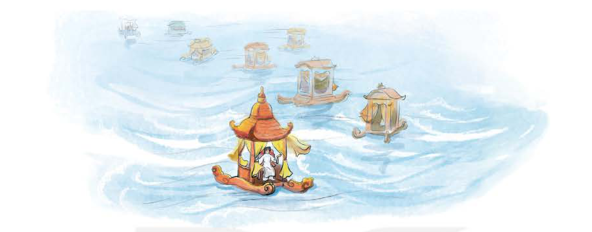
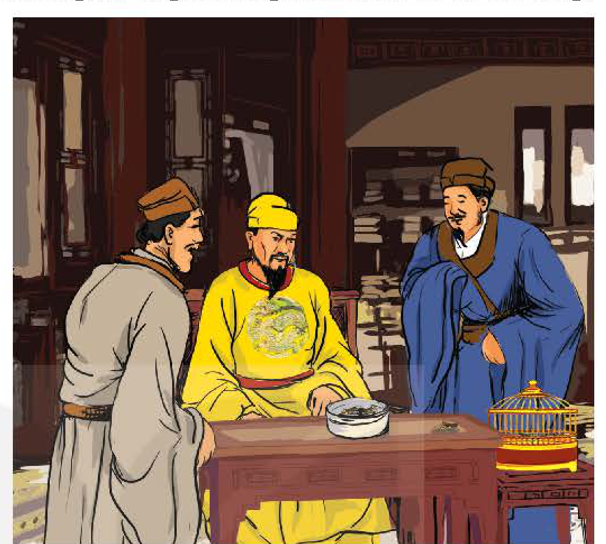

<!-- pdf:10 -->

# BÀI 1: THẾ GIỚI KÌ ẢO

*Mọi thứ bạn nhìn đều có thể trở thành một câu chuyện cổ tích*
*và bạn có thể có được một câu chuyện từ bất cứ thứ gì mình chạm vào.*
<!-- ocr-ok: câu đề từ chữ trắng trên nền xanh trang PDF 10 bị OCR bỏ sót, đã đối chiếu ảnh p010.png -->

Han Cri-xti-an An-đéc-xen (Hans Christian Andersen)
<!-- ocr-ok: tên tác giả câu đề từ trên nền màu trang PDF 10 bị OCR đọc lỗi ("Gri-xii-Ổan... Haris Chrislian"), đã đối chiếu ảnh p010.png -->

## Giới thiệu bài học

- Trong văn học, sự sáng tạo của con người là không có giới hạn. Cảm hứng sáng tạo bao giờ cũng được khơi nguồn từ thực tế đời sống, nhưng trí tưởng tượng phong phú, bay bổng giúp nhà văn tạo ra những thế giới mới mẻ, lạ lùng, kì ảo, làm nên sức cuốn hút đặc biệt của tác phẩm.
- Hai văn bản đọc chính trong bài học này đều là truyện truyền kì sử dụng các yếu tố hoang đường, kì ảo, với những câu chuyện li kì, trong đó nhân vật có thể là người trần, thần tiên hoặc ma quỷ,... Văn bản đọc kết nối về chủ đề là tác phẩm kể lại bằng thơ một truyền thuyết khá quen thuộc trong kho tàng truyện dân gian Việt Nam, giúp em hiểu thêm một cách thức sáng tạo văn học.

## 🎯 Yêu cầu cần đạt

<!-- term: truyện truyền kì -->
<!-- term: không gian -->
<!-- term: thời gian -->
<!-- term: chi tiết -->
<!-- term: cốt truyện -->
<!-- term: nhân vật chính -->
<!-- term: lời người kể chuyện -->
<!-- term: đề tài -->
<!-- term: câu chuyện -->
<!-- term: nhân vật -->
<!-- term: điển tích -->
<!-- term: điển cố -->
<!-- term: yếu tố Hán Việt -->
<!-- term: bài văn nghị luận về một vấn đề cần giải quyết -->
<!-- term: trình bày ý kiến về một sự việc có tính thời sự -->
- Nhận biết và phân tích được một số yếu tố trong truyện truyền kì như: không gian, thời gian, chi tiết, cốt truyện, nhân vật chính, lời người kể chuyện.
- Nêu được nội dung bao quát của văn bản; bước đầu biết phân tích các chi tiết tiêu biểu, đề tài, câu chuyện, nhân vật trong tính chỉnh thể của tác phẩm.
- Vận dụng được một số hiểu biết về lịch sử văn học Việt Nam để đọc hiểu văn bản văn học.
- Nhận biết được điển tích, điển cố và phân tích được tác dụng của chúng; nhận biết được sự khác biệt về nghĩa của một số yếu tố Hán Việt dễ nhầm lẫn.
- Viết được bài văn nghị luận về một vấn đề cần giải quyết; trình bày được giải pháp khả thi và có sức thuyết phục.
- Trình bày được ý kiến về một sự việc có tính thời sự.
- Trung thực trong các mối quan hệ ứng xử; yêu quý, trân trọng những con người có phẩm chất tốt đẹp.

<!-- pdf:11 -->

## Đọc

### TRI THỨC NGỮ VĂN

**Truyện truyền kì**

<!-- term: truyện truyền kì -->
<!-- term: yếu tố kì ảo -->
<!-- term: cốt truyện -->
<!-- term: nhân vật -->
<!-- term: không gian -->
<!-- term: thời gian -->
<!-- term: ngôn ngữ -->
- **Truyện truyền kì** là thể loại văn xuôi tự sự, phát triển mạnh mẽ từ thời trung đại, dùng yếu tố kì ảo làm phương thức nghệ thuật để phản ánh cuộc sống. Truyện truyền kì thuộc bộ phận văn học viết, tuy nhiên, trong quá trình sáng tạo, các tác giả cũng sử dụng nhiều yếu tố của văn học dân gian. Trong mỗi truyện truyền kì, yếu tố kì ảo và yếu tố hiện thực kết hợp, đan xen một cách linh hoạt. Qua những chi tiết kì ảo, người đọc có thể nhận thấy những vấn đề cốt lõi của hiện thực cũng như quan niệm và thái độ của tác giả.
- **Cốt truyện**: Truyện truyền kì có khi mô phỏng cốt truyện dân gian hoặc dã sử lưu truyền rộng rãi trong nhân dân; có khi mượn từ truyện truyền kì Trung Quốc. Cốt truyện của truyện truyền kì được tổ chức chủ yếu dựa trên chuỗi sự kiện sắp xếp theo trật tự tuyến tính, có quan hệ nhân quả.
- **Nhân vật**: Thế giới nhân vật trong truyện truyền kì khá đa dạng, phong phú, trong đó nổi bật nhất là ba nhóm: thần tiên, người trần và yêu quái. Các nhân vật thường có những nét kì lạ, biểu hiện ở nguồn gốc ra đời, ngoại hình hay năng lực siêu nhiên,...
- **Không gian và thời gian**: Không gian trong truyện truyền kì thường có sự pha trộn giữa cõi trần, cõi tiên, cõi âm; các hình thức không gian này không tồn tại tách biệt mà liên thông với nhau. Thời gian cũng có sự kết hợp chặt chẽ giữa thời gian thực và thời gian kì ảo. Thời gian thực với các điểm mốc, các niên đại xác định góp phần tạo nên giá trị hiện thực của truyện truyền kì. Thời gian kì ảo thường được sử dụng khi nói về cõi tiên, cõi âm – nơi mọi thứ ngưng đọng, không biến đổi, không giới hạn.
- **Ngôn ngữ**: Truyện truyền kì sử dụng nhiều điển tích, điển cố.

**Điển tích, điển cố**

<!-- term: điển tích -->
<!-- term: điển cố -->
- **Điển tích** là câu chuyện trong sách xưa, được dẫn lại một cách cô đúc trong văn bản của các tác giả đời sau.
- **Điển cố** là sự việc hay câu chữ trong sách xưa, được dẫn lại trong văn bản của các tác giả đời sau.
- Những tích truyện, kinh sách, từ ngữ, lời thơ,... khi đã thành điển tích, điển cố đều được xem là mẫu mực, giàu ý nghĩa, cho nên các tác giả thường sử dụng để gia tăng tính hàm súc, uyên bác, gợi liên tưởng phong phú cho người đọc. Điển tích, điển cố có quá trình hình thành và phát triển lâu dài, gắn với văn hoá, văn học của thời xa xưa. Do đó, để hiểu được ý nghĩa của điển tích, điển cố trong tác phẩm, người đọc cần tìm hiểu qua chú giải hoặc tra cứu tài liệu có liên quan.

*Lưu ý:* Điển tích, điển cố là hai khái niệm gần gũi nhau, sự phân biệt chỉ có tính tương đối. Vì thế, nhiều lúc điển tích, điển cố được gọi chung là điển.

**Sự khác biệt về nghĩa của một số yếu tố Hán Việt dễ nhầm lẫn**

<!-- term: yếu tố Hán Việt -->
Trong lớp từ Hán Việt, nhiều từ có những yếu tố đồng âm hoặc gần âm. Các yếu tố này có nghĩa khác nhau, do đó dễ gây nhầm lẫn.

<!-- pdf:12 -->

### VĂN BẢN ĐỌC

- **VĂN BẢN 1.** *Chuyện người con gái Nam Xương*, Nguyễn Dữ
- **VĂN BẢN 2.** *Dế chọi*, Bồ Tùng Linh
- **VĂN BẢN 3.** *Sơn Tinh – Thuỷ Tinh* (trích), Nguyễn Nhược Pháp

### VĂN BẢN 1: Chuyện người con gái Nam Xương

**Trước khi đọc**

1. Em biết gì về vị thế của người phụ nữ Việt Nam trong thời phong kiến?
2. Em có ấn tượng sâu sắc với tác phẩm nào viết về người phụ nữ? Hãy chia sẻ ấn tượng đó của em.

**Đọc văn bản**

**Chuyện người con gái Nam Xương**(1)
**(Nam Xương nữ tử truyện)**

NGUYỄN DỮ

Vũ Thị Thiết, người con gái quê ở Nam Xương, tính đã thuỳ mị, nết na, lại thêm tư dung(2) tốt đẹp. Trong làng có chàng Trương Sinh, mến vì dung hạnh(3), xin với mẹ đem trăm lạng vàng cưới về. Song Trương có tính đa nghi, đối với vợ phòng ngừa quá sức. Nàng cũng giữ gìn khuôn phép, không từng để lúc nào vợ chồng phải đến thất hoà. Cuộc sum vầy chưa được bao lâu thì xảy ra việc triều đình bắt lính đi đánh giặc Chiêm(4). Trương tuy con nhà hào phú(5) nhưng không có học, nên tên phải ghi trong số lính đi vào loại đầu. Buổi ra đi mẹ chàng có dặn rằng:

> **Theo dõi:** Những chi tiết giới thiệu nhân vật Vũ Thị Thiết và Trương Sinh.

– Nay con phải tạm ra tòng quân, xa lìa dưới gối. Tuy hội công danh từ xưa ít gặp, nhưng trong chỗ binh cách phải biết giữ mình làm trọng, gặp khó nên lui, lường sức mà tiến, đừng nên tham miếng mồi thơm để lỡ mắc vào cạm bẫy. Quan cao tước lớn nhường để người ta. Có như thế, mẹ ở nhà mới khỏi lo lắng vì con được.

> (1) *Nam Xương*: huyện thuộc trấn Sơn Nam, nay thuộc huyện Lý Nhân, tỉnh Hà Nam.
> (2) *Tư dung*: dáng vẻ và nhan sắc.
> (3) *Dung hạnh*: nhan sắc và đức hạnh.
> (4) *Đi đánh giặc Chiêm*: cuối thời Trần (nửa sau thế kỉ XIV), quân Chiêm thường sang đánh phá, cướp bóc nước ta, quân ta nhiều phen phải chống đỡ vất vả.
> (5) *Hào phú*: giàu và có thế lực.
<!-- ocr-ok: khối cước chú (1)–(5) cỡ nhỏ trên trang PDF 12 bị OCR đọc sai nhiều dấu và chữ cái, đã đối chiếu ảnh p012.png -->

<!-- pdf:13 -->

Chàng quỳ xuống đất vâng lời dạy. Nàng rót chén rượu đầy tiễn chồng mà rằng:

– Chàng đi chuyến này, thiếp chẳng dám mong đeo được ấn phong hầu, mặc áo gấm trở về quê cũ(1), chỉ xin ngày về mang theo được hai chữ bình yên, thế là đủ rồi. Chỉ e việc quân khó liệu, thế giặc khôn lường. Giặc cuồng còn lẩn lút, quân triều còn gian lao, rồi thế chẻ tre(2) chưa có, mà mùa dưa chín quá kì(3), khiến cho tiện thiếp(4) băn khoăn, mẹ hiền lo lắng. Nhìn trăng soi thành cũ, lại sửa soạn áo rét, gửi người ải xa, trông liễu rủ bãi hoang, lại thổn thức tâm tình, thương người đất thú(5)! Dù có thư tín nghìn hàng, cũng sợ không có cánh hồng bay bổng.

Nàng nói đến đây, mọi người đều ứa hai hàng lệ. Rồi đó, tiệc tiễn vừa tàn, áo chàng đành rứt. Ngước mắt cảnh vật vẫn còn như cũ, mà lòng người đã nhuộm mối tình muôn dặm quan san(6)!
<!-- ocr-ok: đoạn văn cạnh thẻ Dự đoán bên lề trên trang PDF 13 bị OCR trộn dòng và đọc sai dấu, đã đối chiếu ảnh p013.png -->

> **Dự đoán:** Theo em, kết cục của cuộc hôn nhân giữa Trương Sinh và Vũ Nương sẽ như thế nào?

Bấy giờ, nàng đương có mang, sau khi xa chồng vừa đầy tuần(7) thì sinh ra một đứa con trai, đặt tên là Đản. Ngày qua tháng lại, thoắt đã nửa năm, mỗi khi thấy bướm lượn đầy vườn, mây che kín núi, thì nỗi buồn góc bể chân trời không thể nào ngăn được. Bà mẹ cũng vì nhớ con mà dần sinh ốm. Nàng hết sức thuốc thang lễ bái thần phật và lấy lời ngọt ngào khôn khéo khuyên lơn. Song bệnh tình mỗi ngày một trầm trọng, bà biết không sống được, bèn trối(8) lại với nàng rằng:

– Ngắn dài có số, tươi héo bởi trời. Mẹ không phải không muốn đợi chồng con về, mà không gắng ăn miếng cơm miếng cháo đặng cùng vui sum họp. Song, lòng tham vô cùng mà vận trời khó tránh. Nước hết chuông rền(9), số cùng khí kiệt(10). Một tấm thân tàn, nguy trong sớm tối, việc sống chết không khỏi phiền đến con. Chồng con nơi xa xôi chưa biết sống chết thế nào, không thể về đền ơn được. Sau này, trời xét lòng lành, ban cho phúc đức, giống dòng tươi tốt, con cháu đông đàn, xanh(11) kia quyết chẳng phụ con, cũng như con đã chẳng phụ mẹ.

Bà cụ nói xong thì mất. Nàng hết lời thương xót, phàm việc ma chay tế lễ, lo liệu như đối với cha mẹ đẻ mình.

Qua năm sau, giặc ngoan cố đã chịu trói, việc quân kết thúc. Trương Sinh về tới nhà, được biết mẹ đã qua đời, con vừa học nói. Chàng hỏi mồ mẹ, rồi bế đứa con nhỏ đi thăm; đứa trẻ không chịu, ra đến đồng, nó quấy khóc. Sinh dỗ dành:

> (1) *Đeo được ấn phong hầu, mặc áo gấm trở về quê cũ*: ý nói thắng trận trở về, được ban thưởng.
> (2) *Thế chẻ tre*: thế của quân đội mạnh như chẻ tre, có thể thắng trận nhanh chóng.
> (3) *Mùa dưa chín quá kì*: ngày xưa, người đi lính thú, cứ đến mùa dưa chín thì được thay phiên nhau để về nhà; ý ở đây: sợ rằng đến hạn thay phiên mà chồng vẫn chưa được về.
> (4) *Tiện thiếp*: từ người phụ nữ thời xưa dùng để tự xưng một cách khiêm nhường.
> (5) *Đất thú*: nơi xa xôi ngoài biên ải.
> (6) *Quan san*: chỉ nơi xa xôi (*quan* là cửa ải, *san* hay *sơn* là núi).
> (7) *Tuần*: đơn vị tính thời gian của người xưa, gồm 10 ngày; mỗi tháng có 3 tuần, gọi là thượng tuần (10 ngày đầu tháng), trung tuần (10 ngày giữa tháng), hạ tuần (10 ngày cuối tháng).
> (8) *Trối* (như *trăng trối*): dặn dò trước khi chết.
> (9) *Nước hết chuông rền*: người xưa dùng đồng hồ nước, cho chảy theo kiểu nhỏ giọt để đo thời gian, khi nước chảy hết là lúc chuông báo sáng; ở đây ý nói thời gian qua nhanh, đời người đã đến lúc kết thúc.
> (10) *Số cùng*: số phận đã ở vào thế cùng tận; *khí kiệt*: sức sống đã cạn kiệt; *số cùng khí kiệt* có nghĩa là đã cận kề cái chết.
> (11) *Xanh*: ông trời – đấng siêu nhiên, có quyền năng tối thượng (theo quan niệm của người xưa).

<!-- pdf:14 -->

– Nín đi con, đừng khóc. Cha về, bà đã mất, lòng cha buồn khổ lắm rồi.

Đứa con ngây thơ nói:

– Ô hay! Thế ra ông cũng là cha tôi ư? Ông lại biết nói, chứ không như cha tôi trước kia chỉ nín thin thít.

Chàng ngạc nhiên gạn hỏi. Đứa con nhỏ nói:

– Trước đây, thường có một người đàn ông, đêm nào cũng đến, mẹ Đản đi cũng đi, mẹ Đản ngồi cũng ngồi, nhưng chẳng bao giờ bế Đản cả.

Tính chàng hay ghen, nghe con nói vậy, đinh ninh là vợ hư, mối nghi ngờ ngày càng sâu, không có gì gỡ ra được.

> **Theo dõi:** Trương Sinh có thái độ như thế nào sau khi nghe những lời nói của con?

Về đến nhà, chàng la um lên cho hả giận. Vợ chàng khóc mà rằng:

– Thiếp vốn con kẻ khó, được nương tựa nhà giàu. Sum họp chưa thoả tình chăn gối, chia phôi vì động việc lửa binh. Cách biệt ba năm giữ gìn một tiết(1). Tô son điểm phấn từng đã nguôi lòng, ngõ liễu tường hoa(2) chưa hề bén gót. Đâu có sự mất nết hư thân như lời chàng nói. Dám xin bày tỏ để cởi mối nghi ngờ. Mong chàng đừng một mực nghi oan cho thiếp.

Chàng vẫn không tin. Nhưng nàng hỏi chuyện kia do ai nói ra thì lại giấu không kể lời con nói; chỉ lấy chuyện bóng gió này nọ mà mắng nhiếc nàng, và đánh đuổi đi. Họ hàng làng xóm bênh vực và biện bạch cho nàng cũng chẳng ăn thua gì cả. Nàng bất đắc dĩ nói:

– Thiếp sở dĩ nương tựa vào chàng vì có cái thú vui nghi gia nghi thất(3). Nay đã bình rơi trâm gãy, mây tạnh mưa tan, sen rũ trong ao, liễu tàn trước gió; khóc tuyết bông hoa rụng cuống, kêu xuân cái én lìa đàn, nước thẳm buồm xa, đâu còn có thể lại lên núi Vọng Phu(4) kia nữa.
<!-- ocr-ok: lời thoại kèm số cước chú (3), (4) trên trang PDF 14 bị OCR đọc sai dấu ("nghị gia nghị thất", "trâm gấy", "mua tan", "nước thắm"), đã đối chiếu ảnh p014.png -->

Đoạn rồi nàng tắm gội chay sạch, ra bến Hoàng Giang ngửa mặt lên trời mà than rằng:

– Kẻ bạc mệnh này duyên phận hẩm hiu, chồng con rẫy bỏ, điều đâu bay buộc, tiếng chịu nhuốc nhơ, thần sông có linh, xin ngài chứng giám. Thiếp nếu đoan trang giữ tiết, trinh bạch gìn lòng, vào nước xin làm ngọc Mị Nương(5), xuống đất xin làm cỏ Ngu mĩ(6). Nhược bằng lòng chim dạ cá(7), lừa chồng dối con, dưới xin làm mồi cho cá tôm, trên xin làm cơm cho diều quạ, và xin chịu khắp mọi người phỉ nhổ.

> (1) *Giữ gìn một tiết*: ý nói giữ trọn lòng chung thuỷ với chồng.
> (2) *Ngõ liễu tường hoa*: nơi diễn ra chuyện không đứng đắn trong quan hệ trai gái.
> (3) *Nghi gia nghi thất*: nên cửa nên nhà, ý nói thành vợ thành chồng, cùng gây dựng hạnh phúc gia đình.
> (4) *Núi Vọng Phu*: núi đá hình dáng giống người đàn bà bồng con, có ở Lạng Sơn, Thanh Hoá, Nghệ An, Bình Định, Đắk Lắk,... nhắc sự tích người đàn bà bồng con ngóng chồng đến hoá đá.
> (5) *Ngọc Mị Nương*: theo tích ngọc trai giếng nước trong truyền thuyết *Mị Châu – Trọng Thuỷ*, ý nói đến chết vẫn giữ lòng trong sáng.
> (6) *Cỏ Ngu mĩ*: điển tích về nàng Ngu Cơ, vợ Hạng Vũ. (Khi Hạng Vũ thua trận, thế cùng, chạy đến Cai Hạ, Ngu Cơ rút gươm tự vẫn; tục truyền hồn nàng nhập vào cỏ bên bờ sông Ô thành cỏ Ngu mĩ nhân, thứ cỏ này khi thấy người ta xướng lên khúc *Ngu mĩ nhân*, kể chuyện Hạng Vũ – Ngu Cơ thì cành lá đều rung rinh, có vẻ như cảm động.)
> (7) *Lòng chim dạ cá*: lòng dạ đổi thay, không chung thuỷ.

<!-- pdf:15 -->

Nói xong nàng gieo mình xuống sông mà chết. Chàng tuy giận là nàng thất tiết, nhưng thấy nàng tự tận(1) cũng động lòng thương, tìm vớt thây nàng, nhưng chẳng thấy tăm hơi đâu cả. Một đêm phòng không vắng vẻ, chàng ngồi buồn dưới ngọn đèn khuya, chợt đứa con nói rằng:

> **Đối chiếu:** Kết cục cuộc hôn nhân của Vũ Nương và Trương Sinh có đúng như dự đoán của em không?

– Cha Đản lại đến kia kìa!

Chàng hỏi đâu. Nó chỉ bóng chàng ở trên vách:

– Đây này!

Thì ra, ngày thường, ở một mình, nàng hay đùa con, trỏ bóng mình mà bảo là cha Đản. Bấy giờ chàng mới tỉnh ngộ, thấu nỗi oan của vợ, nhưng việc trót đã qua rồi!

Cùng làng với nàng, có người tên là Phan Lang, khi trước làm đầu mục(2) ở bến đò Hoàng Giang, một đêm chiêm bao thấy người con gái áo xanh đến kêu xin tha mạng. Sáng dậy, Phan Lang thấy có người phường chài đem vào biếu một con rùa mai xanh, sực nghĩ đến chuyện mộng, bèn đem thả con rùa ấy. Cuối đời Khai Đại(3) nhà Hồ, quân Minh mượn tiếng đưa Trần Thiêm Bình(4) về nước, phạm vào cửa ải Chi Lăng(5), nhân dân trong nước, nhiều người sợ hãi phải chạy trốn ra ngoài bể, không may đắm thuyền đều chết đuối cả. Thây Phan Lang dạt vào một cái động rùa ở hải đảo, có người đàn bà là Linh Phi trông thấy nói rằng:

> **Suy luận:** Câu chuyện sẽ như thế nào nếu không xuất hiện nhân vật Phan Lang?

– Đây là vị ân nhân cứu sống ta thuở xưa.

Linh Phi bèn lấy khăn dấu mà lau, lấy thuốc thần mà đổ, một chốc Phan Lang liền tỉnh lại. Phan trông thấy cung gấm đền dao(6) thật nguy nga lộng lẫy, mà chưa biết mình đã lọt vào cung nước của rùa thần. Linh Phi bấy giờ mình mặc áo gấm dát ngọc, chân đi giày có vân nạm vàng, cười bảo Phan Lang rằng:

– Tôi là Linh Phi trong động rùa, vợ vua biển Nam Hải, nhớ hồi còn nhỏ đi chơi ở bến sông bị người phường chài bắt được, ngẫu nhiên báo mộng, quả được nhờ ơn. Gặp gỡ ngày nay, há chẳng phải lòng trời xui khiến cho tôi có dịp đền ơn trả nghĩa?

Phi bèn đặt yến ở gác Triêu Dương để thết đãi Phan Lang. Dự tiệc hôm ấy có vô số những mĩ nhân, quần áo thướt tha, mái tóc búi xế. Trong số đó, có một người mặt chỉ hơi điểm qua một chút son phấn trông rất giống Vũ Nương. Phan có ý nhìn trộm, nhưng không dám nhận. Tiệc xong, người đàn bà ấy nói với Phan Lang rằng:

> (1) *Tự tận*: tự kết liễu đời mình, đồng nghĩa với *tự tử*.
> (2) *Đầu mục*: người đứng đầu một cộng đồng ở địa phương.
> (3) *Khai Đại*: niên hiệu của vua Hồ Hán Thương, vua thứ hai thời nhà Hồ.
> (4) *Trần Thiêm Bình*: một người tự nhận là con trai vua Trần Nghệ Tông, trốn sang Trung Quốc cầu viện nhà Minh để đánh nhà Hồ; tháng 5 năm 1406, quân Minh hộ tống Trần Thiêm Bình về nước, đến ải Chi Lăng, Trần Thiêm Bình bị phục binh quân đội nhà Hồ đón đánh, bắt được, đem về xử tội.
> (5) *Chi Lăng*: tên làng, nay thuộc xã Chi Lăng, huyện Chi Lăng, tỉnh Lạng Sơn; nơi đây có thung lũng dài và hẹp (gọi là Quỷ Môn Quan), nhiều lần là tử địa đối với các đội quân xâm lược phương Bắc.
> (6) *Cung gấm đền dao*: chốn cung điện được làm bằng ngọc quý và trang hoàng bằng gấm vóc, chỉ cung điện sang trọng nói chung.

<!-- pdf:16 -->

– Tôi với ông vốn người cùng làng, cách mặt chưa bao, đã quên nhau rồi ư?

Bấy giờ Phan mới nhận đích người ấy là Vũ Nương và gạn hỏi duyên cớ. Nàng nói:

– Tôi ngày trước không may bị người vu oan, phải gieo mình xuống sông tự tử. Các nàng tiên trong cung nước thương tôi vô tội, rẽ một đường nước cho tôi thoát chết, nếu không thì đã vùi vào bụng cá, còn đâu mà gặp ông.

Phan nói:

– Nương tử(1) nghĩa khác Tào Nga, hờn không Tinh Vệ(2) mà phải ôm mối hận gieo mình xuống nước. Nay thóc cũ không còn, thóc mới vừa gặt, há lại không tưởng nhớ đến quê hương ư?

Vũ Nương nói:

– Tôi bị chồng ruồng rẫy, thà già ở chốn làng mây cung nước, chứ còn mặt mũi nào về nhìn thấy người ta nữa!

Phan nói:

– Nhà cửa tiên nhân(3) của nương tử, cây cối thành rừng, phần mộ tiên nhân của nương tử, cỏ gai rợp mắt. Nương tử dù không nghĩ đến, nhưng tiên nhân còn mong đợi nương tử thì sao?

Nghe đến đấy, Vũ Nương ứa nước mắt khóc, rồi quả quyết đổi giọng mà rằng:

– Có lẽ không thể gửi hình ẩn bóng ở đây được mãi, để mang tiếng xấu xa. Vả chăng, ngựa Hồ gầm gió bắc, chim Việt đậu cành nam(4). Cảm vì nỗi ấy, tôi tất phải tìm về có ngày.

> **Theo dõi:** Điều gì khiến Vũ Nương muốn tìm về gặp chồng?
<!-- ocr-ok: thẻ Theo dõi cột phải trên trang PDF 16 bị OCR đọc nhầm "chồng" thành "công", đã đối chiếu ảnh p016.png -->

Hôm sau, Linh Phi lấy một cái túi bằng lụa tía, đựng mười hạt minh châu, sai sứ giả Xích Hỗn(5) đưa Phan ra khỏi nước. Vũ Nương nhân đó cũng đưa gửi một chiếc hoa vàng mà dặn:

– Nhờ nói hộ với chàng Trương, nếu còn nhớ chút tình xưa nghĩa cũ, xin lập một đàn giải oan ở bến sông, đốt cây đèn thần chiếu xuống nước, tôi sẽ trở về.

Lúc đến nhà, Phan đem chuyện kể lại với họ Trương. Ban đầu Trương không tin. Nhưng khi nhận được chiếc hoa vàng, chàng mới sợ hãi mà nói:

– Đây quả là vật dùng mà vợ tôi mang lúc ra đi.

> (1) *Nương tử*: từ người đàn ông thời xưa dùng để chỉ hoặc gọi người phụ nữ một cách tôn kính.
> (2) *Tào Nga*: tương truyền vào thời Đông Hán (Trung Quốc), Tào Nga khi ấy 14 tuổi, cha bị chết đuối, khóc thương thảm thiết, sau nàng gieo mình xuống sông, ít ngày sau, người ta thấy thi thể nàng ôm xác cha nổi lên; *Tinh Vệ*: con gái vua Viêm Đế, khi chết đuối hoá thành chim Tinh Vệ ngậm đá toan lấp biển; hai điển tích được dùng để nói: Vũ Nương chết vì bị nghi oan, khác cái chết của hai người con gái nói trên, Phan Lang dùng điển tích này có ý khuyên nàng nghĩ đến quê hương, gia đình, chồng con.
> (3) *Tiên nhân*: người đời trước, chỉ cha ông, tổ tiên.
> (4) *Ngựa Hồ gầm gió bắc, chim Việt đậu cành nam*: đất Hồ ở phương bắc lắm ngựa quý, đất Việt ở phương nam lắm chim lạ, ngựa và chim ấy đưa vào Trung Quốc vẫn nhớ nước cũ; mỗi khi thấy gió bắc, dù ở đâu, ngựa Hồ vẫn hí lên; chim Việt luôn nhớ khí hậu ấm áp ở phương nam nên thường tìm cành cây phía nam để đậu. (Nàng Vũ Nương dùng điển tích này để nói nỗi lòng nhớ nhà, nhớ quê của mình.)
> (5) *Hỗn*: tên một loài cá quả; *xích hỗn*: cá quả đỏ.

<!-- pdf:17 -->

Chàng bèn theo lời, lập một đàn tràng ba ngày đêm ở bến Hoàng Giang. Rồi quả thấy Vũ Nương ngồi trên một chiếc kiệu hoa đứng ở giữa dòng, theo sau có đến năm mươi chiếc xe cờ tán, võng lọng, rực rỡ đầy sông, lúc ẩn, lúc hiện.

Chàng vội gọi, nàng vẫn ở giữa dòng mà nói vọng vào:
<!-- ocr-ok: câu dẫn ngắn trên trang PDF 17 bị OCR đọc sai dấu ("Chảng vôi gọi, nàng vận"), đã đối chiếu ảnh p017.png -->

– Thiếp cảm ơn đức của Linh Phi, đã thề sống chết cũng không bỏ. Đa tạ tình chàng, thiếp chẳng thể trở về nhân gian được nữa.

Rồi trong chốc lát, bóng nàng loang loáng mờ nhạt dần mà biến đi mất.

***Lời bình***

*Than ôi! Những việc từa tựa như nhau, thật là khó tỏ mà dễ hoặc(1). Cho nên quăng thoi đứng dậy, tuy mẹ bậc đại hiền cũng phải phân vân(2), mất búa đổ ngờ(3), tuy con người láng giềng cũng khó chối cãi, ý dĩ đầy xe, Quang Võ đổ ngờ lão tướng(4), trói lại mà giết, Tào Tháo đến phụ ân nhân(5), việc thị Thiết cũng giống như vậy. Nếu không được trời xét tâm thành, nước không làm hại, thì xương hoa vóc ngọc, đã chôn vào họng cá ở dưới lòng sông, còn đâu được lại thông tin tức để nết trinh thuần được nhất nhất bộc bạch ra hết. Làm người đàn ông, tưởng đừng nên để cho giai nhân oan uổng thế này.*

(Nguyễn Dữ, *Truyền kì mạn lục*, Trúc Khê Ngô Văn Triện *dịch*, theo *Ngữ văn 9*, tập một, NXB Giáo dục, 2008, tr. 43 – 48)

> (1) *Hoặc*: nghi ngờ.
> (2) *Quăng thoi đứng dậy, tuy mẹ bậc đại hiền cũng phải phân vân*: sách *Ngữ vận* kể chuyện ông Tăng Sâm là bậc đại hiền, có kẻ trùng tên ông gây án giết người, người ta tưởng là chính ông, đến báo cho mẹ ông biết, bà không tin; người thứ hai đến báo, bà vẫn chưa tin vì bà biết con bà không đời nào như thế; nhưng người thứ ba đến báo, bà đã đâm ngờ, đang ngồi dệt bỗng quăng thoi mà đứng dậy.
> (3) *Mất búa đổ ngờ*: sách *Liệt tử* kể chuyện có người mất búa, nghi cho đứa con nhà láng giềng lấy, cho nên nhìn cách đi đứng, nói năng của nó đều thấy ra vẻ đứa ăn trộm; nhưng sau khi tìm được búa thì lại thấy đứa con nhà láng giềng không có vẻ gì là đứa ăn trộm cả.
> (4) *Ý dĩ đầy xe, Quang Võ đổ ngờ lão tướng*: theo sách *Hán sử*, thời Đông Hán, Mã Viện đem quân sang cướp nước ta, thích ăn món ý dĩ, khi về nước, Mã Viện chở theo cả một xe ý dĩ. Sau khi Mã Viện chết, có người dâng thư lên vua Hán nói là xe ấy chở toàn ngọc minh châu và da tê, vua Quang Võ nhà Hán tin là thật, đùng đùng nổi giận.
> (5) *Tào Tháo đến phụ ân nhân*: sách *Tam quốc chí* kể chuyện Tào Tháo khi trốn chạy, đến nhà người bạn của cha là Lã Bá Xa. Lã Bá Xa sang thôn bên cạnh mua rượu để thết khách. Ở nhà, Tào Tháo nghe đằng sau có tiếng mài dao, rồi có người nói “Trói lại mà giết”, Tào Tháo xông vào giết sạch cả nhà người ta. Vào đến vườn sau, thấy con lợn bị trói nằm đó, Tào Tháo mới biết giết nhầm người tốt, vội vã bỏ đi. Đi được vài dặm, gặp Lã Bá Xa cưỡi lừa mang rượu về, Tào Tháo chém chết luôn vì sợ khi ông ta về thấy người nhà bị hại thì sẽ tìm cách giết mình.

<!-- pdf:18 -->

**Sau khi đọc**

> - **Nguyễn Dữ** (chưa rõ năm sinh và năm mất) quê ở Hải Dương, sống ở thế kỉ XVI (thời Lê – Mạc), từng đỗ cử nhân, làm quan một thời gian ngắn rồi về quê ẩn dật. Nguyễn Dữ có đóng góp quan trọng ở thể loại truyện truyền kì. *Truyền kì mạn lục* là tác phẩm tiêu biểu nhất của Nguyễn Dữ, viết bằng chữ Hán, được đánh giá là “thiên cổ kì bút”.
> - *Chuyện người con gái Nam Xương* là truyện thứ 16 trong số 20 truyện của tập *Truyền kì mạn lục*. Với việc kết hợp nhuần nhuyễn giữa yếu tố kì ảo và yếu tố hiện thực trong tác phẩm, nhà văn đã thể hiện niềm xót xa, thương cảm đối với số phận bi kịch của người phụ nữ trong xã hội phong kiến cũng như tấm lòng nâng niu, trân trọng đối với những phẩm chất đẹp đẽ của họ.

**Trả lời câu hỏi**

<!-- term: cốt truyện -->
<!-- term: nhân vật -->
<!-- term: lời người kể chuyện -->
<!-- term: ngôn ngữ -->
<!-- term: truyện truyền kì -->
<!-- term: không gian -->
<!-- term: thời gian -->
<!-- term: chi tiết -->
<!-- term: yếu tố kì ảo -->
<!-- term: chủ đề -->
1. Trình bày cốt truyện và nêu bố cục của tác phẩm.
2. Ở phần đầu tác phẩm, Nguyễn Dữ đã làm nổi bật những nét gì ở nhân vật Vũ Nương và Trương Sinh? Lời người kể chuyện có vai trò như thế nào trong việc khắc hoạ nhân vật?
3. Phân tích lời than của nhân vật Vũ Nương trước khi gieo mình xuống sông để làm rõ các khía cạnh:
   a. Nỗi đau đớn của nhân vật.
   b. Đặc điểm ngôn ngữ nhân vật trong truyện truyền kì.
4. Cho biết những nguyên nhân gây ra bi kịch của Vũ Nương. Nguyên nhân nào là chủ yếu?
5. Trong tác phẩm, nhân vật Phan Lang được khắc hoạ ở những không gian, thời gian nào? Nhân vật này có vai trò gì trong truyện?
6. Hình ảnh Vũ Nương hiện về khi Trương Sinh lập đàn giải oan trên bến Hoàng Giang được tác giả miêu tả qua những chi tiết nào? Theo em, đoạn kết có màu sắc kì ảo này có tác dụng gì trong việc thể hiện chủ đề của tác phẩm?
7. Nêu chủ đề tác phẩm *Chuyện người con gái Nam Xương* và trình bày suy nghĩ của em về chủ đề đó.

#### Viết kết nối với đọc
<!-- ocr-ok: tiêu đề màu cam trên trang PDF 18 bị OCR đọc nhầm thành "VIẾT KẾT NũI Vũ ĐỤD", đã đối chiếu ảnh p018.png -->

Viết đoạn văn (khoảng 7 – 9 câu) trình bày suy nghĩ của em về chi tiết “cái bóng” trong truyện.

<!-- pdf:19 -->

### Thực hành tiếng Việt

*ĐIỂN TÍCH, ĐIỂN CỐ*

<!-- term: điển tích -->
<!-- term: điển cố -->
> **Nhận biết điển tích, điển cố**
>
> - Một **điển tích, điển cố** xuất hiện trong văn bản chỉ là từ ngữ. Nhưng đằng sau từ ngữ là một câu chuyện, sự tích, câu kinh, câu thơ nào đó. Ví dụ:
>   (1) *Sương in mặt tuyết pha thân,*
>   *Sen vàng lãng đãng như gần như xa.*
>   (Nguyễn Du, *Truyện Kiều*)
>   Vua Hậu Chủ thời Ngũ Đại (Trung Quốc), do yêu bà phi, lấy vàng đúc thành những đoá sen, đem lót xuống đất bảo phi đặt chân lên đó mà dạo bước, rồi nói: mỗi bước đi nở một đoá sen vàng. *Sen vàng* thành điển tích chỉ bước chân của người đẹp.
>   (2) *Khoé thu ba gợn sóng khuynh thành.*
>   (Nguyễn Gia Thiều, *Cung oán ngâm khúc*)
>   *Khuynh thành* có nghĩa là nghiêng thành, lấy từ câu thơ của Lý Diên Niên thời Hán (Trung Quốc): *Nhất cố khuynh nhân thành*/ *Tái cố khuynh nhân quốc* (Ngoảnh lại một lần làm nghiêng thành, ngoảnh lại lần nữa làm nghiêng nước). *Khuynh thành khuynh quốc* hay *nghiêng nước nghiêng thành* là điển cố dùng để nói về sức mạnh của sắc đẹp ở người phụ nữ.
> - Điển tích, điển cố được sử dụng trong văn bản của người Việt chủ yếu có nguồn gốc từ Trung Quốc hoặc từ văn học cổ trong nước. Bên cạnh đó, còn có một số điển tích xuất phát từ văn học châu Âu. Chẳng hạn, chúng ta tiếp thu một số điển tích từ thần thoại Hy Lạp cổ đại như: *gót chân A-sin* (Achilleus) nghĩa là điểm yếu chết người của cá nhân, đối tượng nào đó; *quả táo bất hoà* chỉ nguyên nhân hay mấu chốt của một cuộc tranh cãi, xung đột gây tác hại lớn; *ngựa gỗ thành Tơ-roa* (Troy) chỉ đối tượng làm nội ứng để phá hoại một tổ chức, một quốc gia,... từ bên trong.
> - Vì luôn gắn với câu chuyện, sự việc hay câu chữ thời xưa cho nên điển tích, điển cố thường khó hiểu đối với người đọc ngày nay. Đọc tác phẩm, gặp điển tích, điển cố, thường phải xem chú giải. Không chú ý điều này, người đọc rất khó nắm được ý nghĩa của câu thơ, câu văn.
>
> **Tác dụng của điển tích, điển cố**
>
> - Dùng điển tích, điển cố có tác dụng làm cho câu thơ, câu văn hàm súc, trang nhã. Ví dụ:
>   *Bấy lâu nghe tiếng má đào*
>   *Mắt xanh chẳng để ai vào có không?*
>   (Nguyễn Du, *Truyện Kiều*)
>   *Mắt xanh* chữ Hán là “thanh nhãn”, lấy tích Nguyễn Tịch thời Tấn khi tiếp người mình ưa thì nhìn thẳng nên để lộ tròng mắt xanh, khi tiếp người mình ghét thì nhìn nghiêng để lộ tròng mắt trắng. Trong lời Từ Hải, điển tích này có ý đánh giá rất cao cách nhìn người của Thuý Kiều.
> - Đối với văn nghị luận, điển tích, điển cố giúp người viết củng cố lí lẽ, làm tăng sức thuyết phục của văn bản. Ví dụ: Trong *Hịch tướng sĩ* của Trần Quốc Tuấn, điển cố *đặt mồi lửa vào dưới đống củi* vốn từ câu *Ôm mồi lửa đặt dưới đống củi rồi nằm lên trên, lửa chưa kịp cháy vẫn cho là yên* ở sách *Hán thư*. Điển cố này được dùng với hàm ý: làm việc gì cũng luôn phải tính đến nguy cơ, hiểm hoạ.
> - Điển tích, điển cố được dùng rộng rãi trong các loại văn bản (thơ, truyện, chèo, tuồng, nghị luận,...), rất phổ biến trong văn học trung đại. Về sau, khi ý thức sáng tạo của cá nhân được đề cao, các tác giả hạn chế dùng điển tích, điển cố. Nếu lạm dụng điển tích, điển cố, văn bản sẽ trở nên nặng nề, khó hiểu, mòn sáo, hạn chế tính độc đáo.

1. Đọc lại các chú thích ở chân trang của văn bản *Chuyện người con gái Nam Xương* và cho biết những trường hợp sử dụng điển tích, điển cố. Nếu sách giáo khoa không giải thích, em có hiểu được ý nghĩa của các câu văn có sử dụng điển tích, điển cố đó không? Vì sao?

2. Đọc các câu sau và thực hiện yêu cầu nêu ở dưới:

   – *Nay đã bình rơi trâm gãy, mây tạnh mưa tan, sen rũ trong ao, liễu tàn trước gió; khóc tuyết bông hoa rụng cuống, kêu xuân cái én lìa đàn, nước thẳm buồm xa,* ***đâu còn có thể lại lên núi Vọng Phu kia nữa.***
<!-- ocr-ok: câu trích dẫn cột hẹp trên trang PDF 19 bị OCR đọc sai nhiều chữ ("lrâm", "mua tan, san rũ trong a0", "cái án la đàn"), đã đối chiếu ảnh p019.png -->

   – *Thiếp nếu đoan trang giữ tiết, trinh bạch gìn lòng,* ***vào nước xin làm ngọc Mị Nương, xuống đất xin làm cỏ Ngu mĩ.***

   – *Nương tử* ***nghĩa khác Tào Nga, hờn không Tinh Vệ*** *mà phải ôm mối hận gieo mình xuống nước.*

<!-- pdf:20 -->

   – *Vả chăng,* ***ngựa Hồ gầm gió bắc, chim Việt đậu cành nam.***

   a. Cho biết các cụm từ in đậm có đặc điểm gì chung.

   b. Đọc chú thích để biết nghĩa của các cụm từ in đậm trong các câu trên.

   c. Nêu tác dụng của việc sử dụng những cụm từ đó trong ngữ cảnh.

### VĂN BẢN 2: Dế chọi
<!-- ocr-ok: nhãn VĂN BẢN 2 trên thẻ màu trang PDF 20 bị OCR đọc nhầm thành "VĂN BÀN 2", đã đối chiếu ảnh p020.png -->

**Trước khi đọc**

1. Em đã chơi hay quan sát trò chọi dế bao giờ chưa? Em hiểu gì về trò chơi này?
2. Em suy nghĩ thế nào về hậu quả của việc một ông vua lại mê chơi trò chọi dế?

**Đọc văn bản**

**Dế chọi**

BỒ TÙNG LINH

Đời Tuyên Đức nhà Minh, trong cung rất chuộng trò chọi dế, hàng năm bắt dân gian dâng nộp. Vật này không phải sản ở Thiểm Tây(1) nhưng Tri huyện Hoa Âm (tỉnh Thiểm Tây) muốn lấy lòng quan trên đem hiến một con, quan tỉnh cho chọi thử thấy hay bèn đòi dâng nộp thường xuyên. Tri huyện lại đòi lí trưởng phải cung ứng, bọn du thủ du thực(2) ở chợ tìm bắt được con nào hay là nhốt vào lồng nuôi, coi như món hàng quý. Còn bọn lí dịch(3) giảo hoạt lấy lệ dâng nộp dế để sách nhiễu dân chúng, mỗi con nộp lên đủ làm mấy nhà khuynh gia bại sản.

> **Theo dõi:** Thời gian, không gian và sự việc liên quan đến nhan đề của truyện.

> (1) *Không phải sản ở Thiểm Tây*: không phải là thứ mà dân Thiểm Tây phải nộp.
> (2) *Du thủ du thực*: chỉ những kẻ lêu lổng, không có nghề nghiệp và chỗ ở cố định.
> (3) *Lí dịch*: chỉ chung những người có chức quyền ở địa phương ngày xưa.

<!-- pdf:21 -->

Trong huyện có Thành đã dự khoa Đồng tử(1) nhưng lâu không thi đỗ, tính chất phác nên bị bọn lí dịch gian giảo ép làm chức lí chính(2), tìm đủ cách chối từ mà không được, chưa đầy một năm thì chút ít gia sản đã cạn kiệt. Gặp kì nộp dế, Thành không dám sách nhiễu dân nhưng không có gì để bù, lo buồn chỉ muốn chết. Vợ nói “Chết thì có ích gì, chẳng bằng cứ tự tìm bắt, biết đâu cũng được một con”, Thành cho là phải. Bèn sáng đi tối về, cầm ống trúc lồng tơ bới đất lật đá khắp bãi hoang tường đổ, làm đủ cách mà không được, có bắt được hai ba con thì nhỏ yếu không đủ quy cách. Quan trên theo hạn trách phạt, qua hơn mười ngày Thành đã bị đánh trăm trượng, hai mông máu me bê bết, ngay cả sâu con cũng không sao đi mà bắt nữa, trăn trở trên giường chỉ nghĩ tới việc tự tử.

> **Theo dõi:** Hoàn cảnh của nhân vật chính trong truyện.

Lúc ấy trong thôn có bà đồng gù lưng tới, bói toán như thần. Vợ Thành đem tiền lễ tới, thấy gái non bà già đứng chật cổng ngõ. Vào trong nhà thì có phòng kín buông rèm, ngoài rèm bày hương án, người tới bói thắp hương trong đỉnh(3) rồi vái lạy, bà đồng đứng bên hướng lên không khấn khứa, môi mấp máy không biết là nói gì, ai cũng kính cẩn đứng chờ. Lát sau trong rèm ném ra tờ giấy ghi rõ về việc người ấy muốn hỏi, không sai chút nào. Vợ Thành đặt tiền lễ lên án rồi thắp hương vái lạy như những người trước, khoảng ăn xong bữa cơm thì tấm rèm lay động, mảnh giấy ném ra. Giở ra xem không phải là chữ mà là bức vẽ, trong vẽ điện gác là chùa chiền, phía sau có hòn núi nhỏ đầy những tảng đá hình thù kì quái, gai góc tua tủa, có con dế nằm dưới, bên cạnh có con ếch như sắp nhảy lên, mở xem không hiểu nhưng thấy có con dế ám hợp với việc mình cầu khẩn nên cất vào người đem về đưa Thành xem.

> **Theo dõi:** Cô đồng bói toán có liên quan đến những sự việc nào trong truyện?

Thành giở đi giở lại, nghĩ “Hay là bức vẽ này chỉ ta chỗ bắt dế chăng?”. Nhìn kĩ quang cảnh trong đó thấy rất giống gác Đại Phật ở phía đông thôn, bèn gượng dậy chống gậy cầm bức vẽ tới sau chùa. Ở đó có ngôi mộ cổ, lần quanh thấy đá nằm ngổn ngang đúng như trong bức vẽ, bèn dò dẫm trong đám cây cỏ lắng nghe như tìm mũi kim hạt cải, bao nhiêu tâm trí sức mắt sức tai đều dốc ra hết nhưng không thấy gì cả. Đang còn tìm kiếm thì chợt có một con ếch nhảy ra, Thành càng ngạc nhiên vội đuổi theo. Con ếch nhảy vào đám cỏ, Thành theo vết vạch cỏ tìm thì thấy một con dế núp dưới gốc cây gai, vội chụp lấy thì nó chui vào kẽ đá, lấy cọng cỏ chọc vào nó vẫn nằm ì ra đó, đem ống đổ nước vào mới chịu chui ra, dáng vẻ rất khoẻ mạnh, Thành đuổi theo vồ được. Nhìn kĩ thấy nó mình to đuôi dài, cổ xanh cánh vàng, mừng quá nhốt vào lồng mang về. Cả nhà vui mừng, dù là được ngọc báu liên thành(4) cũng không bằng. Rồi thả nó vào chậu nuôi, cho ăn chu đáo, gìn giữ nâng niu chờ tới kì hạn nộp quan.

> (1) *Khoa Đồng tử*: khoa thi dành cho người trẻ tuổi hiểu kinh sách, làm được thơ văn, quy định về tuổi được dự thi có khác nhau qua các thời kì, như thời Hán thì từ 10 tuổi trở xuống, thời Đường thì 16 tuổi trở xuống; đến các thời Tống, Nguyên, Minh, Thanh, tuy gọi là khoa, song không phải là khoa thi thật sự, mà chỉ là quan lại phủ huyện sát hạch đưa danh sách lên, người trong danh sách có thể được hưởng một số ưu đãi, nhưng chỉ gọi là dự khoa Đồng tử chứ không có đỗ khoa Đồng tử.
> (2) *Lí chính*: tương tự lí trưởng ở Việt Nam thời trước.
> (3) *Đỉnh*: đồ bằng đồng, miệng rộng, có ba chân, dùng để đốt trầm hương.
> (4) *Ngọc báu liên thành*: ngọc quý có giá trị sánh ngang nhiều đất đai, thành quách. (Thời Chiến Quốc, Tần Vương nói với vua nước Triệu xin đem năm thành của nước Tần đổi lấy viên ngọc Biện Hoà của nước Triệu. Thành ngữ *ngọc báu liên thành* là lấy từ tích ấy.)

<!-- pdf:22 -->

Thành có đứa con trai chín tuổi rình lúc cha không có nhà lén mở chậu ra xem. Con dế thừa cơ nhảy ra, nó đuổi theo mãi không được, đến khi chụp được vào tay thì dế đã gãy cẳng vỡ bụng, lát sau thì chết. Đứa nhỏ sợ quá khóc lóc tới kể với mẹ, mẹ nó nghe thế mặt tái mét, hoảng sợ nói “Đồ oan nghiệt hết sống rồi, cha ngươi về sẽ nói chuyện với ngươi”, đứa nhỏ khóc lóc bỏ đi. Lát sau Thành về, nghe vợ kể lại như bị dội băng tuyết lên người, nổi giận đi tìm con nhưng không thấy đâu, kế(1) tìm thấy xác con dưới giếng, đổi giận thành thương gào khóc muốn tắt hơi. Vợ chồng quay mặt vào vách, nhà tranh không khói lửa nấu cơm, im lặng nhìn nhau không còn hi vọng gì nữa. Trời gần tối liệm xác con, tới bế lên thì thấy còn thoi thóp thở, cả mừng bế đặt lên giường, nửa đêm thì đứa nhỏ sống lại. Hai vợ chồng hơi nhẹ lòng, nhưng đứa nhỏ thần thái ngây ngốc như người gỗ, cứ ngủ mê mệt. Thành nhìn tới lồng dế rỗng không thì đứt hơi nghẹn cổ, cũng không nghĩ gì tới con nữa, từ đêm đến sáng không sao chợp mắt, trời đã sáng rõ vẫn nằm đờ buồn bã.

> **Dự đoán:** Điều gì xảy ra sau khi con Thành sống lại nhưng “thần thái ngây ngốc như người gỗ, cứ ngủ mê mệt”?

Bỗng nghe tiếng dế gáy ngoài cửa, Thành giật mình vùng dậy nhìn thì dế vẫn còn sờ sờ, mừng rỡ chụp lấy. Con dế kêu to một tiếng nhảy đi, Thành đuổi mau theo lấy bàn tay chụp lên thì thấy trống không như không có gì, giở tay lên thì nó lại nhảy vọt lên. Thành đuổi mau theo tới góc tường thì không thấy đâu, ngơ ngẩn nhìn quanh thấy nó đậu trên vách, nhìn lại thấy vừa nhỏ vừa ngắn mà màu tía, không phải là con trước, cho là loại dở nhưng vẫn quanh quẩn nhìn ngó. Chợt con dế từ vách nhảy xuống tay áo, Thành ngắm kĩ thấy hình dáng như con chó, cánh hoa mai, đầu vuông chân dài, có vẻ như dế hay, bèn mừng giữ lại. Định đem lên nộp quan nhưng thấp thỏm lo không vừa ý quan, bèn nghĩ cho chọi thử xem sao.

> **Theo dõi:** Con dế mới bắt được có gì kì lạ?

Trong thôn có gã thiếu niên hiếu sự nuôi một con dế, nói là loại “giải xác thanh” (dế xanh vỏ cua), hàng ngày đem chọi với dế của bạn bè đều thắng, muốn giữ để kiếm lợi, ai trả giá cao cũng không chịu bán. Nhân qua thăm Thành thấy con dế Thành nuôi, y bịt miệng ôm bụng cười, đưa dế của mình ra, bỏ vào lồng chọi. Thành nhìn thấy nó to lớn khoẻ mạnh càng thêm xấu hổ, không dám cho chọi thử. Thiếu niên cố ép, Thành nghĩ nuôi dế dở rốt lại cũng vô dụng, chi bằng cứ cho chọi thử mua vui, bèn cho dế vào lồng chọi. Con dế nhỏ nằm mọp xuống không động đậy, ngơ ngơ như gà gỗ. Thiếu niên lại cười rộ, lấy lông heo chọc vào râu, nó vẫn nằm im, thiếu niên lại cười, lại chọc. Con dế nổi giận xông thẳng ra, lúc sắp đánh thì phùng cánh gáy lớn, rồi vểnh râu cong đuôi nhảy xổ tới cắn cổ địch thủ. Thiếu niên cả sợ vội gạt hai con dế ra không cho chọi nữa, con dế hiên ngang gáy vang như báo cho chủ biết nó đã thắng trận. Thành mừng quá, đang cùng nhau ngắm nghía chợt có con gà sấn sổ xông tới mổ luôn một nhát vào dế. Thành kinh hãi bật dậy la hoảng, may là gà mổ không trúng, con dế nhảy ra hơn một thước.

> (1) *Kế*: tiếp theo, sau đó.

<!-- pdf:23 -->

Gà sấn theo mổ lia lịa, con dế đã nằm dưới móng gà, Thành thảng thốt không biết làm sao cứu, dẫm chân tái mặt. Nhưng gà lại rướn cổ lăn ra, tới gần nhìn thì thấy dế đã trên mào gà, cắn chặt không buông. Thành càng kinh ngạc mừng rỡ, vội bắt dế bỏ vào lồng.
<!-- ocr-ok: đoạn đầu trang PDF 23 bị OCR đọc sai nhiều dấu ("sân theo mô", "con dễ đã năm đưới", "thẳng thốt", "cặn chặt"), đã đối chiếu ảnh p023.png -->

Hôm sau đem dâng tri huyện, quan thấy dế nhỏ quát Thành, Thành kể lại chuyện lạ, quan không tin, cho chọi thử với dế của người khác đều thắng, lại đem gà ra thử thì quả như lời Thành nói. Tri huyện bèn thưởng cho Thành, hiến dế cho tuần phủ. Tuần phủ cả mừng liền cho dế vào lồng vàng hiến vua, dâng sớ tâu rõ cái hay của nó. Vào tới cung cho chọi thử với đủ thứ dế kì lạ của các nơi dâng lên như hồ điệp (dế bướm), đường lang (dế bọ ngựa), du lợi đạt (dế đánh dầu), thanh ti đầu (dế trán tơ xanh) thì con nào cũng thua. Mỗi khi nghe tiếng đàn sáo thì nó lại nhảy nhót theo điệu nhạc, mọi người càng lấy làm lạ. Vua rất vừa lòng, ban chiếu thưởng cho tuần phủ ngựa hay vải quý. Tuần phủ không quên kẻ hiến dế, không bao lâu tâu xin thưởng cho tri huyện một cấp trác dị(1). Tri huyện mừng, cho Thành được miễn sai dịch, dặn học quan(2) cho Thành đỗ tú tài. Hơn năm sau con Thành bình phục, kể rằng mình hoá thành dế, khoẻ mạnh chọi giỏi, nay mới sống lại. Quan tỉnh lại trọng thưởng, không quá vài năm nhà Thành ruộng vườn trăm khoảnh, lầu gác nguy nga, trâu dê cả ngàn con, ra khỏi nhà thì mặc áo cừu cưỡi ngựa tốt, giàu sang hơn cả các nhà thế gia(3).

> **Đối chiếu:** Điều em dự đoán ở trên có chính xác không?

***Dị Sử thị nói:***

*Họ Thành vì sâu mọt mà nghèo, nhờ dế chọi mà giàu, áo cừu ngựa tốt vênh vang, lúc làm lí chính bị trách phạt chắc không nghĩ rằng mình được thế đâu. Trời đền đáp cho kẻ trưởng giả trọng hậu, tới nỗi tuần phủ tri huyện cũng được hưởng phúc ấm(4) nhờ con dế. Thường nghe một người lên trời, gà chó cũng thành tiên(5), đúng lắm thay!*

(Bồ Tùng Linh, *Liêu Trai chí dị*, Cao Tự Thanh *dịch*, NXB Văn hoá – Văn nghệ, Thành phố Hồ Chí Minh, 2013, tr. 394 – 397)

> (1) *Trác dị*: ngày xưa có lệ định kì kiểm tra công tội để thưởng phạt quan lại, những công lao đặc biệt và đột xuất được thưởng ngoài quy định và không theo niên hạn, được gọi chung là *trác dị*.
> (2) *Học quan*: quan phụ trách việc học hành, thi cử ngày xưa.
> (3) *Thế gia*: gia tộc nhiều đời có người làm quan, có danh vọng và của cải.
> (4) *Phúc ấm*: phúc đức của tổ tiên để lại cho con cháu.
> (5) *Một người lên trời, gà chó cũng thành tiên*: dùng điển tích Hoài Nam Vương Lưu An tu luyện đắc đạo bay lên trời, lũ gà chó trong nhà được ăn thuốc luyện còn dư cũng đều trở thành tiên.

<!-- pdf:24 -->

**Sau khi đọc**

> - **Bồ Tùng Linh** (1640 – 1715) là nhà văn nổi tiếng của Trung Quốc thời nhà Thanh. Ông để lại một khối lượng lớn tác phẩm thuộc nhiều thể loại, trong đó, tiêu biểu nhất là *Liêu Trai chí dị*.
> - *Liêu Trai chí dị* là tập sách gồm gần 500 truyện, khai thác cốt truyện từ nhiều truyện dân gian và từ những truyện kì lạ, hoang đường của một số tác giả thời trước. Bồ Tùng Linh đã mượn chuyện thần tiên, ma quái, loài vật để phê phán mạnh mẽ nền chính trị và những thói hư tật xấu của xã hội Trung Quốc thời bấy giờ. *Liêu Trai chí dị* được dịch ra nhiều thứ tiếng trên thế giới. Tập truyện bắt đầu được phổ biến ở Việt Nam từ thế kỉ XIX và cho đến nay đã có nhiều bản dịch khác nhau.

**Trả lời câu hỏi**

<!-- term: cốt truyện -->
<!-- term: không gian -->
<!-- term: thời gian -->
<!-- term: nhân vật chính -->
<!-- term: yếu tố kì ảo -->
<!-- term: chi tiết -->
<!-- term: lời người kể chuyện -->
<!-- term: truyện truyền kì -->
1. Nêu các sự kiện tạo nên cốt truyện và nhận xét ngắn gọn về không gian, thời gian, nhân vật chính trong truyện.
2. Vì dế chọi mà gia đình Thành lâm vào cảnh ngộ như thế nào? Cũng nhờ dế chọi mà sau đó gia đình Thành được hưởng những gì? Phân tích ý nghĩa của sự đối lập giữa hai tình huống.
3. Truyện có những yếu tố kì ảo nào? Các yếu tố kì ảo đó có ý nghĩa, vai trò gì trong truyện?
4. Tính chất hiện thực của truyện được thể hiện qua những chi tiết, sự việc nào? Em có suy nghĩ gì về thái độ của tác giả khi miêu tả hiện thực đó?
5. Phân tích lời người kể chuyện trong đoạn văn từ “Thành giở đi giở lại” đến “kì hạn nộp quan”.
6. Những đặc điểm nào của truyện truyền kì được thể hiện trong truyện *Dế chọi*?

#### Viết kết nối với đọc
<!-- ocr-ok: tiêu đề màu cam trên trang PDF 24 bị OCR đọc nhầm thành "VIẾT KẾT NỮI VI ĐỤU", đã đối chiếu ảnh p024.png -->

Viết đoạn văn (khoảng 7 – 9 câu) nêu nhận xét của em về tính chất kì ảo của truyện *Dế chọi*.

### Thực hành tiếng Việt

*MỘT SỐ YẾU TỐ HÁN VIỆT DỄ NHẦM LẪN VÀ CÁCH PHÂN BIỆT*

<!-- term: yếu tố Hán Việt -->
<!-- term: yếu tố Hán Việt đồng âm -->
<!-- term: yếu tố Hán Việt gần âm -->
> **Nhận biết một số yếu tố Hán Việt dễ nhầm lẫn**
>
> - **Các yếu tố Hán Việt đồng âm**
>   Trong lớp từ Hán Việt, có không ít **yếu tố đồng âm** nhưng nghĩa hoàn toàn khác nhau. Ví dụ:
>   – ***ai₁***: bụi bặm (*trần ai*); ***ai₂***: buồn (*ai oán, ai điếu, bi ai*,...)
>   – ***bảo₁***: chăm sóc, giữ gìn (*bảo vệ, bảo dưỡng, bảo tàng*,...); ***bảo₂***: quý (*bảo vật, bảo kiếm, quốc bảo*,...)
>   Trong tiếng Hán, từ hoặc yếu tố đồng âm như vậy được biểu thị bằng những chữ viết khác nhau, nhờ vậy, nghĩa của chúng có sự phân biệt rõ ràng. Trong tiếng Việt hiện đại, chữ quốc ngữ là hệ thống chữ viết ghi âm, nên các yếu tố đồng âm gốc Hán hầu hết được viết giống nhau. Đây là một trong những nguyên nhân dễ nảy sinh hiện tượng nhầm lẫn về nghĩa. Một số người có thể không phân biệt được nghĩa của những yếu tố đồng âm ở các từ như *thương* ***thảo*** – *phương* ***thảo***; ***thủ*** *trưởng* – ***thủ*** *môn*; ***đại*** *diện* – ***đại*** *ngôn*;...
> - **Các yếu tố Hán Việt gần âm**
>   Một số **yếu tố Hán Việt gần âm** cũng có thể gây nhầm lẫn về nghĩa. Ví dụ: ***tri*** là biết; ***trí*** là khả năng nhận thức, hiểu biết. Không phân biệt được nghĩa của ***tri*** và ***trí*** dễ dẫn đến việc dùng từ sai. Ví dụ: *Đội ngũ* ***tri thức*** *phải tiên phong trong công cuộc phát triển khoa học, công nghệ.* Câu này dùng từ ***trí thức*** mới đúng.
>
> **Cách phân biệt nghĩa của một số yếu tố Hán Việt dễ nhầm lẫn**
>
> - **Dựa vào từ có chứa yếu tố Hán Việt đồng âm để suy luận**
>   Ví dụ: *di cư* và *di sản* đều có yếu tố đồng âm ***di***. Nếu hiểu *di cư* nghĩa là “chuyển đến nơi khác, nước khác để sinh sống”; *di sản* là “tài sản của người đã mất để lại” thì sẽ biết rằng yếu tố ***di*** trong hai từ trên không cùng nghĩa. ***Di*** trong *di sản* nghĩa là “để lại”; ***di*** trong *di cư* nghĩa là “chuyển dịch”. Khi đã hiểu được như vậy, ta có thể suy luận để biết ***di*** trong *di cảo, di động, di chứng, di dân, di truyền*,... thuộc về nghĩa nào.
> - **Tra cứu từ điển**
>   Khi có sự phân vân về nghĩa của yếu tố Hán Việt nào đó, cần tra cứu từ điển. Tìm hiểu cách giải nghĩa từng yếu tố kèm theo một số ví dụ về từ được từ điển nêu ra sẽ giúp ta nắm được nghĩa của yếu tố một cách chính xác. Ví dụ: tra cứu mục từ ***đăng***, ta sẽ thấy ***đăng*** có nghĩa là “đèn” (*hải đăng, minh đăng, hoa đăng*,...); cùng âm ***đăng*** còn có nghĩa “bước lên” (*đăng cao, đăng sơn, đăng đài, đăng đàn*,...) hoặc ***đăng*** cũng có nghĩa là “ghi vào” (*đăng kí, đăng bạ*,...); ***đăng*** là “in lên báo chí” (*đăng tải, đăng bài*,...).

1. Phân biệt nghĩa của các yếu tố Hán Việt trong mỗi trường hợp sau:

   a. ***sinh*** trong từ *sinh thành* và ***sinh*** trong từ *sinh viên*
<!-- ocr-ok: ý a bài tập 1 cột trái trang PDF 24 bị OCR dính chữ và trộn cột ("a.sinhtrongtừ... sinhtrongtừ"), đã đối chiếu ảnh p024.png -->

   b. ***bá*** trong từ *bá chủ* và ***bá*** trong cụm từ *nhất hô bá ứng*

<!-- pdf:25 -->

   c. ***bào*** trong từ *đồng bào* và ***bào*** trong từ *chiến bào*

   d. ***bằng*** trong từ *công bằng* và ***bằng*** trong từ *bằng hữu*

2. Tìm một từ Hán Việt có yếu tố đồng âm khác nghĩa với yếu tố được in đậm trong các câu sau:

   a. *Thành càng* ***kinh*** *ngạc mừng rỡ, vội bắt dế bỏ vào lồng.*

      (Bồ Tùng Linh, *Dế chọi*)
<!-- ocr-ok: dòng xuất xứ ngắn trên trang PDF 25 bị OCR đọc nhầm "Dế chọi" thành "Dố chọi", đã đối chiếu ảnh p025.png -->

   b. *Vào tới cung cho chọi thử với đủ thứ dế* ***kì*** *lạ của các nơi dâng lên như hồ điệp (dế bướm), đường lang (dế bọ ngựa), du lợi đạt (dế đánh dầu), thanh ti đầu (dế trán tơ xanh) thì con nào cũng thua.*

      (Bồ Tùng Linh, *Dế chọi*)
<!-- ocr-ok: dòng xuất xứ ngắn trên trang PDF 25 bị OCR đọc nhầm "Dế chọi" thành "Dố chọi", đã đối chiếu ảnh p025.png -->

   c. *Song Trương có tính đa* ***nghi***, *đối với vợ phòng ngừa quá sức.*

      (Nguyễn Dữ, *Chuyện người con gái Nam Xương*)

   d. *Bấy giờ chàng mới tỉnh* ***ngộ***, *thấu nỗi oan của vợ, nhưng việc trót đã qua rồi!*

      (Nguyễn Dữ, *Chuyện người con gái Nam Xương*)

3. Đặt 4 câu, mỗi câu sử dụng một từ tìm được ở bài tập 2.

4. Những từ in đậm trong các câu sau có yếu tố Hán Việt bị dùng sai. Hãy tìm hiểu nghĩa của các yếu tố đó để chỉnh sửa.

   a. Mỗi tác phẩm văn học là một **chính thể**, trong đó, các bộ phận có quan hệ với nhau rất chặt chẽ.

   b. Trên thế giới có nhiều hình thức tổ chức nhà nước, thể hiện sự đa dạng về ***chỉnh thể***.

<!-- pdf:26 -->

5. Nghĩa của từ ***cải biên*** khác với nghĩa của từ ***cải biến*** như thế nào? Điều gì tạo nên sự khác nhau về nghĩa giữa hai từ đó?

### VĂN BẢN 3: Sơn Tinh – Thuỷ Tinh

**Đọc văn bản**

**Sơn Tinh – Thuỷ Tinh**

*Trích*, NGUYỄN NHƯỢC PHÁP(1)

I
Ngày xưa, khi rừng mây u ám,
Sông núi còn vang um tiếng thần,
Con vua Hùng Vương thứ mười tám,
Mị Nương, xinh như tiên trên trần.
Tóc xanh viền má hây hây đỏ;
Miệng nàng hé thắm như san hô;
Tay ngà trắng nõn, hai chân nhỏ;
Mê nàng, bao nhiêu người làm thơ.
Hùng Vương thường nhìn con yêu quá,
Chắp tay ngẩng lên giời tạ ân;
Rồi cười bảo xứng ngôi phò mã,
Trừ có ai ngang vị thần nhân.
Hay đâu thần tiên đi lấy vợ!
Sơn Tinh, Thuỷ Tinh lòng tơ vương,
Không quản rừng cao, sông cách trở
Cùng đến Phong Châu xin Mị Nương.
Sơn Tinh có một mắt ở trán,
Thuỷ Tinh râu ria quăn xanh rì.

> (1) Nguyễn Nhược Pháp (1914 – 1938) quê ở Hà Nội. Sáng tác của ông thuộc nhiều thể loại như kịch, truyện ngắn, thơ nhưng người đọc biết đến ông nhiều hơn cả ở tư cách nhà thơ với những bài thơ tiêu biểu như: *Ngày xưa*, *Chùa Hương*, *Tay ngà*,... *Sơn Tinh – Thuỷ Tinh* được đánh giá là một trong những bài thơ đặc sắc nhất của Nguyễn Nhược Pháp.

<!-- pdf:27 -->

Một thần phi bạch hổ trên cạn,
Một thần cưỡi lưng rồng uy nghi.
Hai thần bên cửa thành thi lễ,
Hùng Vương âu yếm nhìn con yêu.
Nhưng có một nàng mà hai rể,
Vua cho rằng thế cũng hơi nhiều.
Thuỷ Tinh khoe thần có phép lạ;
Dứt lời tay hất chòm râu xanh,
Bắt quyết(1) hô mây to nước cả,
Giậm chân rung khắp làng gần quanh.
Ào ào mưa đổ xuống như thác,
Cây xiêu, cầu gãy, nước hò reo,
Lăn, cuốn, gầm, lay, tung sóng bạc.
Bò lợn và cột nhà trôi theo.
Mị Nương ôm Hùng Vương kinh hãi,
Sơn Tinh cười, xin nàng đừng lo;
Vung tay niệm chú: Núi từng dải,
Nhà lớn, đồi con lổm cổm(2) bò
Chạy mưa. Vua tuỳ con kén chọn,
Mị Nương khép nép như cành hoa:
“Con đây phận đào tơ bé mọn,
Nhân duyên cúi để quyền mẹ cha.”
Vua nghĩ lâu hơn bàn việc nước,
Rồi bảo mai lửa hồng nhuốm sương(3),
Lễ vật thần nào mang tới trước,
Vui lòng vua gả nàng Mị Nương.
[...]

> (1) *Bắt quyết*: động tác của bàn tay khi những nhân vật có khả năng siêu phàm làm phép hoặc các thầy pháp hành lễ.
> (2) *Lổm cổm* (như *lổm ngổm*): từ gợi tả dáng bò thân nhô cao hẳn lên trên mặt nền, không có trật tự, không ra hàng lối.
> (3) *Lửa hồng nhuốm sương*: ý nói khi mặt trời lên.

<!-- pdf:28 -->

III
Sơn Tinh đang kèm theo sau kiệu.
Áo bào phơ phất nụ cười bay.
(Vui chi mê ai xinh mới hiểu.)
Thần trông kiệu nhỏ hồn thêm say.
Choàng nghe sóng vỗ reo như sấm,
Bạch hổ dừng chân, lùi, vểnh tai.
Mị Nương tung bức rèm đỏ thắm,
Sơn Tinh trông thấy càng giương oai.
Sóng cả gầm reo lăn như chớp.
Thuỷ Tinh cưỡi lưng rồng hung hăng.
Cá voi quác mồm to muốn đớp;
Cá mập quẫy đuôi cuồng nhe răng;
Càng cua lởm chởm giơ như mác;
Tôm kềnh chạy quắp đuôi xôn xao.
Sơn Tinh hiểu thần ghen, tức khắc
Niệm chú đất nẩy vù lên cao.
Hoa tay thần vẫy hùm, voi, báo;
Đuôi quắp, nhe nanh, giơ vuốt đồng,
Đạp long đất núi, gầm, xông xáo.
Máu vọt phì reo muôn ngấn hồng.
Mây đen hăm hở bay mù mịt,
Sấm ran, sét động nổ loè xanh.
Tôm cá xưa nay yên thin thít,
Mở quác mồm to kêu thất thanh...
Mị Nương kinh hãi ngồi trong kiệu.
Bỗng chợt nàng kêu, mắt lệ nhoà
(Giọng kiêu hay buồn không ai hiểu,
Nhưng thật dễ thương): “Ô! Vì ta!”

<!-- pdf:29 -->

Thuỷ Tinh năm năm dâng nước bể(1),
Đục núi hò reo đòi Mị Nương.
Trần gian đâu có người dai thế,
Cũng bởi thần yêu nên khác thường.

(Nguyễn Nhược Pháp, *Hoa một mùa*, NXB Phụ nữ, Hà Nội, 2018, tr. 217 – 223)
<!-- ocr-ok: dòng xuất xứ trên trang PDF 29 bị OCR đọc lỗi ("#oa một mùc, NXEB Phụ nữ"), đã đối chiếu ảnh p029.png -->

**Sau khi đọc**

**Trả lời câu hỏi**

<!-- term: cốt truyện -->
<!-- term: người kể chuyện -->
<!-- term: chi tiết -->
<!-- term: nhân vật -->
<!-- term: yếu tố kì ảo -->
1. Nêu những điểm giống nhau và khác nhau về cốt truyện, cách kể giữa truyền thuyết *Sơn Tinh, Thuỷ Tinh* với bài thơ cùng tên của Nguyễn Nhược Pháp.
2. Phép thuật của Sơn Tinh và Thuỷ Tinh thể hiện cụ thể như thế nào? Theo em, người kể chuyện có bộc lộ thái độ thiên vị đối với nhân vật nào không? Dựa vào đâu em kết luận như vậy?
3. Liệt kê những chi tiết miêu tả Mị Nương. Những chi tiết đó giúp em hình dung thế nào về nhân vật?
4. Cảnh giao tranh giữa Sơn Tinh và Thuỷ Tinh được nhà thơ miêu tả bằng những chi tiết nào? Phân tích một chi tiết gây ấn tượng mạnh đối với em.
5. Tính chất kì ảo thể hiện như thế nào trong câu chuyện được kể bằng thơ này? Cách miêu tả những yếu tố kì ảo có gì đặc sắc?
6. Theo em, điều gì làm nên sức hấp dẫn của bài thơ *Sơn Tinh – Thuỷ Tinh*? Vì sao?

## Viết

<!-- term: bài văn nghị luận về một vấn đề cần giải quyết -->
**Viết bài văn nghị luận về một vấn đề cần giải quyết (con người trong mối quan hệ với tự nhiên)**

Con người vốn không thể tách rời tự nhiên. Chất lượng cuộc sống của con người phụ thuộc rất nhiều vào việc xử lí mối quan hệ đó. Tuy nhiên, nhiều người vẫn rất mơ hồ về vấn đề này, dẫn đến những hành vi gây tổn hại cho môi trường tự nhiên, để lại hậu quả đáng tiếc. Trong phần Viết của bài học này, em hãy tập trung bàn luận về mối quan hệ qua lại giữa con người với tự nhiên, nhằm giúp người đọc nhận thức thấu đáo hơn ý nghĩa, tầm quan trọng của vấn đề, từ đó xác lập thái độ đúng đắn và biết hành động theo hướng tích cực.

> (1) *Năm năm dâng nước bể*: hằng năm dâng nước biển.

<!-- pdf:30 -->

*Yêu cầu:*

<!-- term: bài văn nghị luận về một vấn đề cần giải quyết -->
<!-- term: luận điểm -->
<!-- term: lí lẽ -->
<!-- term: bằng chứng -->
<!-- term: ý kiến trái chiều -->
- Nêu được vấn đề thể hiện mối quan hệ giữa con người với tự nhiên để bàn luận.
- Trình bày được mối quan hệ hai chiều giữa con người với tự nhiên (trong phạm vi vấn đề nghị luận), triển khai hệ thống luận điểm chặt chẽ, sử dụng lí lẽ sắc bén, bằng chứng xác thực và tiêu biểu.
- Nêu được quan điểm trái chiều về vấn đề hoặc khía cạnh nào đó của vấn đề và phản bác một cách có cơ sở.
- Đề xuất được giải pháp khả thi để giải quyết những bất ổn trong ứng xử của con người với tự nhiên.

### Phân tích bài viết tham khảo
<!-- ocr-ok: nhãn hộp màu xanh "Phân tích bài viết tham khảo" trên trang PDF 30 bị OCR bỏ sót, đã đối chiếu ảnh p030.png -->

**Con người đã làm gì với tự nhiên?**

“Đối với đồng bào tôi, mỗi tấc đất là thiêng liêng, mỗi lá thông óng ánh, mỗi bờ cát, mỗi hạt sương long lanh trong những cánh rừng rậm rạp, mỗi bãi đất hoang và tiếng thì thầm của côn trùng là những điều thiêng liêng trong kí ức và kinh nghiệm của đồng bào tôi.” – đó là lời khẳng định của thủ lĩnh da đỏ Xi-át-tơn (Seattle) khi ông thay mặt cộng đồng mình bày tỏ thái độ đối với đất đai của tổ tiên và thế giới tự nhiên trước khi những thứ đó rơi vào tay người da trắng. Xét về ý nghĩa, những lời trên đây của Xi-át-tơn đã chạm tới một vấn đề vô cùng hệ trọng, không chỉ với riêng cộng đồng người da đỏ, mà còn với nhân loại nói chung: mối quan hệ mật thiết giữa con người với tự nhiên.

> Giới thiệu vấn đề nghị luận.

Quả vậy, giữa con người với tự nhiên có mối quan hệ phong phú, đa chiều. Đó là vấn đề muôn thuở. Tuy nhiên không phải bao giờ con người cũng nhận thức được một cách sâu sắc, thấu đáo để biết ứng xử đúng đắn với tự nhiên.

> Trình bày ý kiến về vấn đề.

Trước hết phải hiểu rằng, về bản chất, con người mang tính tự nhiên và là một phần của tự nhiên. Thể xác của chúng ta là hiện thân của tự nhiên vì nó tuân thủ các quy luật như bất kì hiện tượng tự nhiên nào khác. Để duy trì sự sống, con người cần hít thở không khí, cần ăn uống cũng như trao đổi chất với môi trường. Khi ốm đau, bệnh tật, con người cần được chữa trị để trở lại trạng thái bình ổn tự nhiên. Nhờ những khám phá của sinh học, y học, chúng ta nhận biết rằng thân thể con người là một công trình kì diệu của tự nhiên. Việc hiểu biết bản chất tự nhiên của con người giúp ta có thái độ đúng đắn, biết tự trang bị những tri thức cơ bản để sống phù hợp với quy luật.

> Dùng lí lẽ và bằng chứng làm sáng tỏ luận điểm 1: Thể chất của con người mang tính tự nhiên.

<!-- pdf:31 -->

Tự nhiên còn là cả một thế giới bao quanh con người. Cỏ cây, hoa lá, chim muông, sông suối, núi rừng, mây gió, trăng sao, vũ trụ,... tất cả đều thuộc giới tự nhiên. Cái mát mẻ của tiết thu, cái lạnh giá của mùa đông, cái nóng nực của ngày hè; những nắng mưa, sấm chớp, bão tố, lụt lội, sóng thần, động đất,... đều là những hiện tượng tự nhiên. Hiểu như vậy mới thấy, cuộc sống của con người phụ thuộc vào tự nhiên đến mức nào. Tự nhiên cung cấp lương thực, thực phẩm; tự nhiên dạy cho con người biết sáng tạo trong lao động để làm ra những sản vật thiết yếu cho cuộc sống.

> Dùng lí lẽ và bằng chứng làm sáng tỏ luận điểm 2: Tự nhiên là thế giới bao quanh con người.

Không chỉ là nguồn sống về thể chất, tự nhiên còn là nguồn sống của tâm hồn con người, thông qua con đường sáng tạo nghệ thuật. So với muôn loài, sự kì diệu của con người thể hiện ở đời sống tâm hồn. Chỉ con người mới có nhu cầu sáng tạo nghệ thuật để tâm hồn được sống đủ đầy. Mọi hoạt động sáng tạo từ xưa đến nay đều không hề xa rời tự nhiên. Thanh âm của thế giới xung quanh gợi cho người nhạc sĩ những giai điệu lạ lùng; sắc điệu xanh tinh tế của bầu trời, dòng sông, cây cối,... đánh thức ở người hoạ sĩ cảm quan bén nhạy về sắc màu; vạn vật biến ảo theo mùa tác động đến cảm xúc con người luôn vẫy gọi ngòi bút các nhà thơ,... Biết bao tác phẩm văn học, hội hoạ, âm nhạc, điện ảnh,... hấp dẫn bởi đã tái hiện một cách linh diệu vẻ đẹp của các đối tượng trong tự nhiên. Nhà văn Nga Mi-khai-in Pri-sơ-vin (Mikhail Prishvin) tâm sự: “Tôi đã tìm thấy thú vui lúc rảnh rang của mình như thế: tìm kiếm và khám phá trong tự nhiên những nét đẹp của tâm hồn con người” (*Đôi mắt của Mẹ Đất*). Thử hình dung, nếu loại bỏ tất cả những gì liên quan đến tự nhiên trong các tác phẩm nghệ thuật thì sự thể sẽ ra sao? Chắc chắn kho tàng nghệ thuật của nhân loại sẽ trống đi một mảng vô cùng lớn, không gì có thể bù đắp được.

> Dùng lí lẽ và bằng chứng làm sáng tỏ luận điểm 3: Tự nhiên còn là nguồn sống của tâm hồn con người.

Mặc dù có vai trò quan trọng như vậy, nhưng tự nhiên đã phải chịu sự đối sử hết sức tệ bạc của con người. Bao nhiêu sông suối đục ngầu vì chất thải từ các nhà máy. Biển cả ngập ngụa rác rưởi đến mức có những con cá voi khổng lồ chết vì hàng chục ki-lô-gam nhựa trong dạ dày. Khói bụi đầu độc bầu khí quyển bao quanh hành tinh xanh. Đất đai thấm nhiễm bao nhiêu thứ hoá chất độc hại. Những cánh rừng tự nhiên bị đốn chặt bừa bãi, khiến nhiều vùng đất biến thành sa mạc. Tài nguyên dưới lòng đất bị khai thác đến cạn kiệt... Sự can thiệp thô bạo của con người làm mất cân bằng sinh thái theo chiều hướng đáng sợ như vậy từng được gọi là “chinh phục tự nhiên”. Thái độ ấy ngạo mạn biết bao!

> Dùng lí lẽ và bằng chứng làm sáng tỏ luận điểm 4: Con người đã đối xử tệ bạc với tự nhiên.

<!-- pdf:32 -->

Con người đã phải trả giá đắt vì sự thiếu sáng suốt đó. Hiện tượng thời tiết bất thường diễn ra ngày càng nghiêm trọng. Trái Đất đang nóng lên, băng ở hai cực tan nhanh khiến nhiều vùng đất màu mỡ sẽ bị nước biển nhấn chìm. Nhiều loài sinh vật đứng trước nguy cơ tuyệt chủng. Tầng ô-dôn bị thủng, đe doạ sức khoẻ của con người... “Hiểm hoạ sinh thái” – lời cảnh báo đáng sợ đó đã vang lên ở nhiều diễn đàn quốc tế, buộc những người có trọng trách phải tìm cách cứu hành tinh xanh. Điều đó đang thu hút nỗ lực của nhiều nhà lãnh đạo các quốc gia có trách nhiệm, nhiều nhà khoa học có lương tri, những phong trào xã hội tiến bộ,... Gần đây, một số tín hiệu lạc quan đã xuất hiện cho thấy những nỗ lực kia không hoàn toàn vô vọng. Rạn san hô dưới đáy một số vùng biển đang dần dần hồi sinh, tầng ô-dôn trên bầu trời với nhiều lỗ thủng phần nào được phục hồi,... là những minh chứng sinh động. Song việc cải thiện mối quan hệ giữa con người với tự nhiên để cuộc sống nhân loại được duy trì và phát triển bền vững là một hành trình dài dằng dặc, đầy thách thức.

> Dùng lí lẽ và bằng chứng làm sáng tỏ luận điểm 5: Con người phải trả giá vì đã tác động vào tự nhiên một cách thiếu khoa học.

Như vậy, trả lại cho tự nhiên trạng thái bình thường, hợp quy luật được xem là việc bức thiết của nhân loại hiện nay. Hẳn có người cho rằng, việc lớn lao này là trách nhiệm của một số người có vị trí quan trọng trong xã hội. Nhận thức như thế là chưa đúng. Trên hành trình dài và đầy khó khăn đó, mỗi người trong chúng ta, không ai là người ngoài cuộc. Mọi việc dù lớn dù nhỏ đều có thể góp phần cải thiện tình hình. Trồng thêm một cây xanh, tắt bớt một thiết bị điện khi không cần thiết, hạn chế sử dụng hoá chất trong sản xuất nông nghiệp, tiết kiệm nguồn nước, giữ gìn môi trường sống quanh mình,... những việc tưởng nhỏ nhặt, thực ra rất có ý nghĩa, vì nó giúp ta hình thành một thói quen tốt, từ đó ý thức rõ hơn giá trị của việc mình làm, để có thể lan toả, tác động tích cực đến thái độ của nhiều người. Một khi thành nề nếp của cộng đồng, tác dụng của nó là không hề nhỏ.

> Phản bác ý kiến trái chiều về một khía cạnh của vấn đề.

Tóm lại, tự nhiên luôn gắn bó khăng khít với mọi mặt trong cuộc sống của con người, nhưng chính con người đã tác động thô bạo, gây nhiều tổn hại nghiêm trọng đối với tự nhiên và đã phải gánh chịu hậu quả vì điều đó. Thực tế này đòi hỏi mỗi cá nhân cũng như cộng đồng phải có sự thay đổi. Sống hài hoà với tự nhiên, tôn trọng và bảo vệ tự nhiên bằng những hành động thiết thực,... đó là trách nhiệm của tất cả chúng ta.

> Khái quát lại vấn đề nghị luận, nêu trách nhiệm của mọi người và đề xuất phương hướng hành động.
<!-- ocr-ok: hộp chỉ dẫn cột phải trên trang PDF 32 bị OCR trộn dòng với văn bản bên trái, đã đối chiếu ảnh p032.png -->

(*Theo* Hoàng Vĩnh, *Con người đã làm gì với tự nhiên?*, tạp chí *Văn học và Tuổi trẻ*, tháng 4/2023)

<!-- pdf:33 -->

**Thực hành viết theo các bước**
<!-- ocr-ok: nhãn hộp màu xanh "Thực hành viết theo các bước" trên trang PDF 33 bị OCR bỏ sót, đã đối chiếu ảnh p033.png -->

### 1. TRƯỚC KHI VIẾT

<!-- term: mục đích viết -->
<!-- term: người đọc -->
> **Mục đích viết**
> Thuyết phục người đọc đồng tình với quan điểm của người viết về mối quan hệ giữa con người với tự nhiên, góp phần giúp cộng đồng thấy được trách nhiệm trong việc bảo vệ tự nhiên.
>
> **Người đọc**
> Những người quan tâm đến mối quan hệ giữa con người với tự nhiên và vấn đề bảo vệ môi trường.

**a. Lựa chọn đề tài**

Em cần huy động vốn kiến thức của mình, tham khảo sách báo, theo dõi thông tin trên các phương tiện truyền thông và quan sát thế giới xung quanh để chọn đề tài đáp ứng được yêu cầu. Có thể tham khảo một số đề tài sau:

– Vấn đề khai thác và sử dụng tài nguyên thiên nhiên phục vụ sản xuất ở địa phương em.

– Khai thác và bảo vệ nguồn lợi hải sản trong phát triển kinh tế biển của nước ta.

– Quan điểm “sống xanh” và ý nghĩa của nó.

– Tình trạng thiếu nguồn nước sạch trong cuộc sống của con người hiện nay.

– Tác động của biến đổi khí hậu đối với cuộc sống của con người.

**b. Tìm ý**

<!-- term: luận đề -->
<!-- term: luận điểm -->
<!-- term: lí lẽ -->
<!-- term: bằng chứng -->
<!-- term: ý kiến trái chiều -->
Để tìm ý cho bài viết, có thể đặt ra và trả lời một số câu hỏi sau:

– *Vấn đề cần được giải quyết là gì?*

Câu hỏi này nhằm giúp người viết xác định rõ luận đề, làm cơ sở cho việc triển khai hệ thống luận điểm. Từ đó, hình thành ý tưởng, lựa chọn thông tin giúp người đọc hiểu tầm quan trọng của vấn đề và sự cần thiết phải bàn luận về vấn đề. Ví dụ, bài viết tham khảo nêu vấn đề mối quan hệ giữa con người với tự nhiên; ý nghĩa của mối quan hệ này; sự nhận thức chưa thấu đáo của một số người về điều đó; nhu cầu bàn luận sâu hơn về vấn đề.

– *Ý kiến của em về vấn đề như thế nào?*

Người viết cần trình bày rõ ý kiến của mình qua hệ thống luận điểm. Mỗi luận điểm dựa trên một khía cạnh của vấn đề. Chẳng hạn, ở bài viết tham khảo, người viết đã nêu các luận điểm gắn với những nội dung cụ thể (luận điểm 1: Thể chất của con người mang tính tự nhiên; luận điểm 2: Tự nhiên là thế giới bao quanh con người; luận điểm 3: Tự nhiên còn là nguồn sống của tâm hồn con người;...). Từng luận điểm đều được làm sáng tỏ bằng lí lẽ và bằng chứng.

– *Có thể xuất hiện ý kiến nào trái ngược với ý kiến của người viết? Cần dùng những lí lẽ, bằng chứng nào để phản bác?*

Khi bàn về từng khía cạnh của vấn đề, người viết cần hình dung những ý kiến trái chiều để tìm cách phản bác nhằm khẳng định chắc chắn hơn quan điểm của mình. Trong phạm vi các đề tài liên quan đến mối quan hệ giữa con người với tự nhiên, có thể nảy sinh xu hướng coi đó là vấn đề to lớn, không phù hợp với khả năng giải quyết của từng cá nhân; hoặc đề cao tính cấp thiết của phát triển kinh tế mà coi nhẹ việc

<!-- pdf:34 -->

bảo vệ môi trường sống,... Bài viết tham khảo đã đề cập một trong những quan niệm vừa nêu để phản bác.

– *Cần có giải pháp nào để giải quyết vấn đề?*

Tuỳ vào vấn đề cụ thể và góc nhìn, trải nghiệm của mình mà người viết đề xuất giải pháp phù hợp. Chẳng hạn, bàn về mối quan hệ giữa con người với tự nhiên, bài viết tham khảo nêu giải pháp có tính đồng bộ: từ nhận thức tới hành động; từ vai trò của cá nhân đến vai trò của cộng đồng;... Các giải pháp gắn với chủ thể hành động và có tính khả thi.

**c. Lập dàn ý**

Trả lời các câu hỏi ở mục b, người viết sẽ tìm được các ý. Trên cơ sở đó, phân bổ, sắp xếp từng ý vào các phần của dàn ý; điều chỉnh, thay đổi vị trí của các ý sao cho hợp lí.

> **Dàn ý**
>
> - *Mở bài:* Giới thiệu vấn đề thể hiện mối quan hệ giữa con người với tự nhiên, nêu sự cần thiết của việc bàn luận về vấn đề.
> - *Thân bài:*
>   + Triển khai các luận điểm thể hiện quan điểm của người viết xét trên từng khía cạnh của vấn đề.
>     * Luận điểm 1: Bản chất của vấn đề nghị luận; quan hệ giữa con người với tự nhiên thể hiện ở vấn đề (nêu lí lẽ và bằng chứng).
>     * Luận điểm 2: Mặt tích cực của mối quan hệ giữa con người với tự nhiên và lợi ích có thể thu được (nêu lí lẽ và bằng chứng).
>     * Luận điểm 3: Mặt tiêu cực của mối quan hệ giữa con người với tự nhiên và hậu quả có thể gánh chịu (nêu lí lẽ và bằng chứng).
>     * ...
>   + Nêu ý kiến trái chiều và phản bác.
>   + Đề xuất giải pháp có tính khả thi để giải quyết vấn đề.
> - *Kết bài:* Khẳng định tầm quan trọng của việc nhận thức đúng và giải quyết hiệu quả vấn đề nêu ra.

### 2. VIẾT BÀI

– Bám sát dàn ý, nắm vững yêu cầu về nội dung của từng phần để viết bài.

– Vận dụng kinh nghiệm đã có và đọc lại bài viết tham khảo để viết phần Mở bài cho hấp dẫn; triển khai các luận điểm của phần Thân bài cho chặt chẽ, lô-gíc; viết phần Kết bài gây được ấn tượng.

– Phần Mở bài, Kết bài cũng như từng luận điểm của phần Thân bài nên viết thành một đoạn văn. Căn cứ yêu cầu cụ thể của việc triển khai ý để lựa chọn viết kiểu đoạn văn diễn dịch, quy nạp, song song hay phối hợp.

<!-- pdf:35 -->

– Chú ý sử dụng từ ngữ liên kết để các câu trong đoạn và các đoạn trong bài có quan hệ chặt chẽ, mạch lạc.

– Dù viết ở lớp hay ở nhà, bài viết cũng cần được thực hiện trong thời lượng nhất định. Tuân thủ nghiêm túc điều này, em sẽ có khả năng chủ động về thời gian khi làm bài thi.

### 3. CHỈNH SỬA BÀI VIẾT

Dựa vào yêu cầu của kiểu bài, đối chiếu với dàn ý, đọc soát từng phần của bài viết để chỉnh sửa, hoàn thiện. Khi chỉnh sửa, cần chú ý các tiêu chí:

– Sự rõ ràng của vấn đề được nêu để bàn luận (ở phần Mở bài).

– Sự đầy đủ của các luận điểm cần triển khai (ở phần Thân bài).

– Sự chặt chẽ trong lập luận (thể hiện ở cách sử dụng lí lẽ và bằng chứng, sức thuyết phục trong cách nêu ý kiến bác bỏ quan điểm trái chiều,...).

– Mức độ đáp ứng yêu cầu về quy cách trình bày, chính tả và diễn đạt (dùng từ, đặt câu,...).

## Nói và nghe

<!-- term: trình bày ý kiến về một sự việc có tính thời sự -->
**Trình bày ý kiến về một sự việc có tính thời sự (con người trong mối quan hệ với tự nhiên)**

### 1. TRƯỚC KHI NÓI

<!-- term: mục đích nói -->
<!-- term: người nghe -->
> **Mục đích nói**
> Giúp người nghe hiểu đúng về một sự việc có tính thời sự liên quan đến mối quan hệ giữa con người với tự nhiên, từ đó có thái độ và hành động phù hợp.
>
> **Người nghe**
> Những người quan tâm đến mối quan hệ giữa con người với tự nhiên và vấn đề bảo vệ môi trường.

<!-- term: trình bày ý kiến về một sự việc có tính thời sự -->
– Chọn đề tài trình bày: Muốn chọn được đề tài phù hợp với nội dung phần Nói và nghe của bài học, trước hết em phải hiểu thế nào là *sự việc*. Khác với *vấn đề* hoặc *hiện tượng*, *sự việc* là những gì đã diễn ra trong thực tế, gắn với thời gian, địa điểm, con người,... xác thực. Từ đó, em nhớ lại những gì đã biết qua các phương tiện truyền thông hoặc được chứng kiến hay nghe kể lại để chọn một sự việc có tính thời sự làm đề tài cho bài nói. Sau đây là một số gợi ý để em tham khảo:

+ Một vụ xả nước thải chưa qua xử lí.

+ Một vụ phá rừng phòng hộ.

+ Việc triển khai một dự án trồng cây, phủ xanh đất trống đồi trọc.

+ Người dân ở một địa phương ứng phó thành công một trận bão (lũ) lớn.

+ Việc khởi động một dự án bảo tồn các loài động vật hoang dã quý hiếm.

+ ...

<!-- pdf:36 -->

– Lập dàn ý cho bài nói:

+ Sau khi chọn được đề tài phù hợp, em hãy lập dàn ý cho bài nói với đầy đủ các phần Mở đầu, Triển khai, Kết thúc.

+ Cần ghi chú một số bằng chứng (sự việc thực tế, số liệu,...), từ ngữ then chốt để chủ động khi trình bày.

### 2. TRÌNH BÀY BÀI NÓI

<!-- term: trình bày ý kiến về một sự việc có tính thời sự -->
– Mở đầu: Giới thiệu sự việc cần trình bày. Có thể kể một câu chuyện nhỏ, dẫn một tài liệu, dùng một bức ảnh hay đoạn phim để giới thiệu sự việc.

<!-- term: trình bày ý kiến về một sự việc có tính thời sự -->
– Triển khai: Bám sát dàn ý để trình bày nội dung theo trật tự hợp lí, giúp người nghe dễ theo dõi, nắm bắt ý kiến. Có thể đặt câu hỏi về từng khía cạnh của sự việc để thu hút sự chú ý của người nghe (Ví dụ: *Bản chất của sự việc là gì? Sự việc có ảnh hưởng gì đến cuộc sống của con người và sự phát triển của xã hội? Có ý kiến trái chiều nào về sự việc cần tranh luận, bác bỏ? Cần những giải pháp nào cho sự việc? Cần có hành động gì trước thực trạng đang diễn ra?*); diễn giải rõ ràng, thể hiện chủ kiến của người nói trước những khía cạnh đó.

<!-- term: trình bày ý kiến về một sự việc có tính thời sự -->
– Kết thúc: Nêu ý nghĩa của sự việc đã trình bày, liên hệ trách nhiệm của mỗi người.

*Lưu ý:* Khi trình bày, cần phối hợp ngôn ngữ nói với các phương tiện phi ngôn ngữ; luôn chú ý thái độ của người nghe để điều chỉnh khi cần thiết.

### 3. SAU KHI NÓI

Trao đổi về những gì đã thực hiện trong phần Nói và nghe để rút kinh nghiệm. Khi trao đổi, cần đánh giá hoạt động của cả người nói và người nghe.

| Người nghe | Người nói |
| --- | --- |
| Đánh giá về sự việc được người nói đề cập (chú ý mức độ phù hợp của đề tài so với yêu cầu đặt ra trong bài). | Giải thích lí do lựa chọn sự việc để trình bày ý kiến, phân tích thêm để thấy tính hợp lí của sự lựa chọn đó. |
| Thể hiện sự tán thành hoặc không tán thành với những ý kiến của người nói về các khía cạnh cụ thể của sự việc. | Lắng nghe để nắm bắt ý kiến trao đổi của người nghe về các khía cạnh cụ thể của sự việc. |
| Nhận xét về nội dung trình bày và cách trình bày của người nói. | Tiếp thu hoặc trao đổi lại những nhận xét, đánh giá của người nghe. |

## Củng cố, mở rộng

<!-- term: cốt truyện -->
<!-- term: nhân vật -->
<!-- term: không gian -->
<!-- term: thời gian -->
<!-- term: yếu tố kì ảo -->
<!-- term: chủ đề -->
<!-- term: truyện truyền kì -->
1. Kẻ vào vở bảng hệ thống hoá kiến thức về hai văn bản đọc (*Chuyện người con gái Nam Xương* và *Dế chọi*) gồm các mục: cốt truyện, nhân vật, không gian, thời gian, yếu tố kì ảo, chủ đề và điền thông tin phù hợp với những mục đó.

<!-- pdf:37 -->

2. Nêu vai trò của yếu tố kì ảo, chỉ ra mối quan hệ giữa thế giới kì ảo và thế giới hiện thực trong các văn bản đã đọc ở bài 1.
3. Qua hai truyện *Chuyện người con gái Nam Xương* và *Dế chọi*, hãy rút ra những đặc điểm cơ bản của thể loại truyện truyền kì.
4. Tìm đọc thêm 3 – 4 truyện truyền kì hoặc truyện hiện đại có yếu tố kì ảo, ghi chép các thông tin cơ bản về cốt truyện, nhân vật, không gian, thời gian, đặc điểm yếu tố kì ảo, chủ đề và nêu nhận xét về nội dung, nghệ thuật của từng truyện.

## Thực hành đọc

*Khi đọc văn bản dưới đây, em cần chú ý những vấn đề sau:*

- Những đặc điểm của cốt truyện, nhân vật, không gian, thời gian, lời người kể chuyện và lời nhân vật của một truyện truyền kì.
- Những tình huống truyện li kì kết hợp với các chi tiết đậm chất hoang đường tạo nên sự biến hoá bất ngờ, hấp dẫn của truyện.

**Ngọc nữ về tay chân chủ**(1)
**(Ngọc nữ quy chân chủ)**

KHUYẾT DANH

Khi đã luống tuổi, Ngọc Hoàng Thượng Đế sinh một người con gái, mặt hoa da tuyết, thợ giỏi khó vẽ hết tinh thần; nét hoạ cung đàn, tài giỏi không chỉ riêng nghề mọn. Nếu là một gã râu mày(2), thì quyết đứng hàng đầu khoa giáp(3). Tuổi vừa đôi tám(4), tên gọi là Ngọc Tỷ. Ngọc Hoàng mở một lầu kén rể, biển đề là “Đãi phượng lâu(5)”. Cho tất cả tự do đến ứng tuyển.

Sơn thần(6) nghe tin, bụng bảo dạ rằng:

– Núi là cao, hơn hết mọi nơi. Phượng lâu trúng tuyển, không ta thì ai? Ta mà lấy được Ngọc Tỷ thì sẽ coi như một vị bồ tát(7), ngày ngày đặt ngồi ngoài toà sen, cầu khẩn, ngắm chơi. Ở nhà, ta là chúa của điểu thú(8); ra ngoài, ta là phò mã của Ngọc Hoàng, tôn quý biết dường nào!

Rồi cưỡi xe hươu trắng đi thẳng lên cửa nhà trời.

> (1) *Chân chủ*: người chủ chân chính, xứng đáng. *Ngọc nữ về tay chân chủ* là truyện truyền kì được rút ra từ tập *Thánh Tông di thảo* – tập sách được viết bằng chữ Hán, gồm 19 tác phẩm, có cả truyền kì, ngụ ngôn và tạp kí. Hiện nay, các nhà nghiên cứu chưa thống nhất ý kiến về tác giả, thời điểm sáng tác của tập *Thánh Tông di thảo*.
> (2) *Gã râu mày*: nam giới.
> (3) *Khoa giáp*: người đỗ đạt trong các kì thi thời phong kiến.
> (4) *Tuổi vừa đôi tám*: khoảng 16 tuổi.
> (5) *Đãi phượng lâu*: lầu kén rể; quan niệm xưa xem trai gái kết đôi như chim phượng (con trống) và chim hoàng (con mái) quấn quýt bên nhau, theo đó, cầu hôn (hỏi vợ) được gọi một cách văn chương là *cầu hoàng*, còn kén rể thì được gọi là *đãi phượng*.
> (6) *Sơn thần*: thần cai quản mọi thứ, mọi loài trên núi (theo quan niệm của người xưa).
> (7) *Bồ tát*: người tu hành đắc đạo, đức độ cao, giàu lòng thương người (theo quan niệm của đạo Phật).
> (8) *Điểu thú*: chim chóc, muông thú.

<!-- pdf:38 -->

Thuỷ thần(1) nghe tin, cũng họp các loài thuỷ tộc bàn rằng:

– Nước chảy chỗ trũng, việc thường xưa nay. Bình phong bắn sẻ(2) không ta thì còn ai. Nếu ta lấy được Ngọc Tỷ, sẽ làm một cung bằng ngọc châu giữa bể, đêm cho nằm trong màn giao cẩm(3), mà ngắm nghía, mà chăm sóc. Dưới nước thì các loài thuỷ tộc là thần thiếp của ta, trên trời ta lại làm chủ nhân của Đế nữ, hiển vinh biết nhường nào!

Rồi cưỡi ngựa vẫy vùng, rẽ nước bay lên.

Hai thần gặp nhau ở ngoài ngọc môn(4), song song tiến vào. Một người cao mà đen, một người thấp mà trắng, cùng lạy trước sân rồng rồi song song cùng đứng.
<!-- ocr-ok: đoạn văn kèm số cước chú (4) trên trang PDF 38 bị OCR đọc sai dấu ("tiền vào", "thập mà trăng", "TÔI song song củng"), đã đối chiếu ảnh p038.png -->

Thượng Đế sai thị vệ truyền rằng:

– Hai vị ở đâu? Họ tên là gì? Đến đây có việc chi? Phải nói cho minh bạch.
<!-- ocr-ok: câu thoại ngắn trên trang PDF 38 bị OCR đọc nhầm ("Đền đây có việc chủ? Phải nói cho mình bạch"), đã đối chiếu ảnh p038.png -->

Hai thần tiến lên xưng họ tên, rồi nói tiếp:

– Nghe nói bệ hạ mở lầu “Đãi phượng”. Hai tiểu thần đây tuy không có sắc đẹp chín vẻ, tiếng khen bảy đức(5), nhưng thủ đoạn(6) cao cường, không kém gì điềm thái bình(7) ấy. Chỉ hiềm(8) chưa hiểu nguyện ước ba sinh(9) ra sao, ý định của bệ hạ thế nào mà thôi.

Ngọc Hoàng giả bộ tươi cười rằng:

– Trẫm ngự trị văn phương(10), hiện có một gái. Nếu kén được một người tài thuật tương ứng, trẫm sẽ gả ngay cho. Hai người có phép thần diệu gì, đều phải trổ tài cho trẫm xem.
<!-- ocr-ok: lời thoại kèm số cước chú (10) trên trang PDF 38 bị OCR đọc sai dấu ("Trâm", "trầm sẽ gá", "thân điệu", "trô tài"), đã đối chiếu ảnh p038.png -->

Sơn thần nghe xong, tức thì xua tay lên quãng không, chỉ vào cung khuyết(11) ở trước mặt Ngọc Hoàng, lập tức biến thành gò núi. Có ngọn lờ mờ như Bích Phong, có chỗ rõ ràng như Quần Ngọc, có chim đẹp bay đậu, có thú lạ lại qua. Không phải nhích đi một bước mà cảnh tượng đã khác ngàn vạn lần. Một lát, quỷ khốc thần sầu(12), núi reo hang ứng, có hổ gầm gấu rống, có thứ rắn mồm nuốt được con voi, có thứ chim cánh giương như mây phủ. Những người hầu chung quanh, tai nghe mà tựa hồ không muốn nghe, mắt trông mà tựa hồ không dám trông.

Ngọc Hoàng gật đầu rằng:

– Tài giỏi!

Sơn thần lại cất tay xua một cái: cung khuyết lại y nguyên như cũ.

> (1) *Thuỷ thần*: thần cai quản mọi thứ, mọi loài dưới nước (theo quan niệm của người xưa).
> (2) *Bình phong bắn sẻ*: theo *Đường thư*, Đậu Nghị muốn kén rể, vẽ một con chim sẻ vào bình phong, khấn ngầm rằng ai bắn trúng cả hai mắt sẻ thì được Đậu Nghị gả con gái cho; Lý Uyên (sau là Đường Cao Tổ) bắn trúng cả hai mắt sẻ, lấy được con gái Đậu Nghị, do đó người ta gọi việc hỏi vợ là “bắn sẻ bình phong”.
> (3) *Giao cẩm*: một thứ lụa đẹp như gấm, người xưa truyền rằng do người Giao (ở dưới nước) dệt ra.
> (4) *Ngọc môn*: cửa ngọc, ở đây chỉ cửa của lầu kén rể mà Ngọc Hoàng cho dựng lên.
> (5) *Chín vẻ, bảy đức*: những đặc điểm tốt đẹp của chim phượng (hình ảnh tượng trưng cho người con trai đến cầu hôn).
> (6) *Thủ đoạn*: phương pháp, biện pháp được áp dụng để đạt một mục đích nhất định (nghĩa trong văn bản).
> (7) *Điềm thái bình*: dấu hiệu chim phượng xuất hiện; ý cả câu muốn nói: tuy không có đủ những đặc điểm tốt đẹp của chim phượng, nhưng tài giỏi không kém gì phượng, xứng đáng được vào lầu “đãi phượng”.
> (8) *Hiềm*: ngại, e ngại.
> (9) *Nguyện ước ba sinh*: *ba sinh* là ba kiếp gồm quá khứ, hiện tại, tương lai (theo quan niệm của đạo Phật); *nguyện ước ba sinh* là lời thề nguyền gắn bó với nhau ba kiếp của lứa đôi nam nữ.
> (10) *Văn phương*: nơi tốt đẹp.
> (11) *Cung khuyết*: nhà lầu hai bên của hoàng cung, nơi vua ở.
> (12) *Quỷ khốc thần sầu* (như *quỷ khốc thần kinh*): quỷ thần cũng phải khóc, phải sợ.

<!-- pdf:39 -->

Thuỷ thần cũng thè lưỡi thư phù(1). Bỗng, vạn ngõ ngàn cửa biến thành biển. Nước bạc vỗ trời, sóng to xoáy đất. Sóng dâng một lớp, núi chìm ngập đỉnh ngàn tầm; côn(2) nhảy ba ngàn, nước dựng như trăm cây thước. Hoặc phun lửa như cá cờ, hoặc vuốt râu thành cơn mưa. Một lát, cá rồng vắng vẻ, buồm gấm hoa bay liệng cung trăng; mây sắc bao che, cung Bồng Lai lờ mờ mặt nước. Rồi tiếng bát âm(3) nhộn nhịp, rồi giọng ca nữ véo von. Tai nghe phương nào cũng có tiếng hay, mắt nhìn vật gì cũng có sắc đẹp. Trong khoảnh khắc mà biến huyễn thành muôn hình trạng.

Ngọc Hoàng cũng gật đầu nói:

– Tài giỏi!

Thuỷ thần lại lè lưỡi thư phù; cửa ngõ y nguyên như cũ.

Ngọc Hoàng lấy làm vui lòng, sắc(4) cho hai thần ngồi chiếu bên tả(5), ban trà cho uống.
<!-- ocr-ok: câu văn kèm số cước chú (4), (5) trên trang PDF 39 bị OCR đọc sai dấu ("lầy", "chiều bên tá", "bạn trà"), đã đối chiếu ảnh p039.png -->

Hai thần đang có vẻ đắc ý, chợt thấy ngoài cửa lại có một người tiến vào. Người ấy dáng rồng bước hổ, mắt Thuấn mày Nghiêu(6), có vẻ tĩnh trọng như núi, có lượng bao hàm như biển, và đứng sừng sững ở trước sân.

Thị vệ quát to rằng:

– Đây là chốn tôn nghiêm. Hạng người nào? Hạng người nào? Tại sao không sụp lạy?

Người ấy chắp tay thưa rằng:

– Phượng lâu ứng tuyển, nào phải là nghi lễ chốn triều đình? Mắt sẻ chưa xuyên(7), đâu dám vội làm lễ chào ông nhạc(8)? Xin Ngọc Hoàng hãy khoan thứ cho.
<!-- ocr-ok: lời thoại kèm số cước chú (7), (8) trên trang PDF 39 bị OCR đọc sai dấu ("ứng tuyên, nảo phải là nghị lễ chồn", "vôi làm lề chảo"), đã đối chiếu ảnh p039.png -->

Ngọc Hoàng nghe nói lấy làm lạ, cho ngồi chiếu bên hữu(9), khoan thai bảo rằng:

– Hai vị ở chiếu bên tả đều là người ứng tuyển vào lầu phượng. Giang sơn đã hẹp, nghệ thuật(10) lại cao, thực là người thứ nhất trong thiên hạ. Khách quý giường đông(11), phi người ấy thì còn ai? Ngươi có tài năng gì, mà dám đến tranh với người ta? Trẫm rất buồn cười nhà ngươi là con người bất trí(12).

Người ấy ung dung đứng lên nói:

– Bệ hạ nhầm rồi. Quỷ thần ở núi sông chỉ là một vật ở nơi đó thôi. Múa trí khoe tài, sao đáng đếm xỉa trong vòng trời đất? Sao không xem: ngôi cao vòi vọi mà những người

> (1) *Thư phù*: hoạt động của thầy phù thuỷ (theo nghi lễ mê tín xưa), dùng cây hương đang cháy vẽ (*thư*) lên không, tạo thành bùa (*phù*) để trấn yếm ma quỷ; ở đây dùng với nghĩa khái quát, chỉ sự làm phép.
> (2) *Côn*: một loại cá to ở biển, theo truyền thuyết có thể hoá thành chim bằng.
> (3) *Tiếng bát âm*: tiếng của dàn nhạc cổ truyền có sử dụng tám loại nhạc khí khác nhau để tạo thành những âm thanh cơ bản (theo quan niệm xưa).
> (4) *Sắc*: lệnh.
> (5) *Bên tả*: bên trái.
> (6) *Dáng rồng bước hổ*: chỉ sự mạnh mẽ về thể chất; *mắt Thuấn mày Nghiêu*: chỉ sự thông tuệ, sáng suốt; cả hai vế của thành ngữ này ý nói người có tướng mạo của bậc thiên tử.
> (7) *Mắt sẻ chưa xuyên*: xem chú thích “bình phong bắn sẻ”.
> (8) *Ông nhạc*: bố vợ.
> (9) *Bên hữu*: bên phải.
> (10) *Nghệ thuật*: ý nói phép thuật.
> (11) *Khách quý giường đông*: thời Tống (Trung Quốc), Hy Giản có con gái, muốn kén rể, cho người đến xem các con cháu của Vương Đạo, thấy người nào cũng giữ lễ, duy có Vương Hy Chi cứ ngồi phệ bụng ở giường bên đông, coi như không biết chuyện gì, Hy Giản liền gả con gái cho Hy Chi; do đó, người ta thường dùng “giường đông” để chỉ con rể.
> (12) *Bất trí*: không có trí tuệ, thiếu suy nghĩ.

<!-- pdf:40 -->

chiêm ngưỡng chỉ sợ đi sau; lượng biển bao la, mà những kẻ lại chầu tranh nhau đến trước. Tài trí trong thiên hạ, đều là tài trí của một người. Núi đúc khí thiêng, mong được tận trung mọi việc; sông theo dòng lớn, đâu không hiếu thuận một niềm. Thảng hoặc có thỏ nấp trong núi, kình múa ngoài khơi(1), thì sai người văn thần trọng vọng, cử người võ tướng lược thao. Bày trận theo thế rắn Thường Sơn(2), hành quân như nước dòng Giang Hán(3). Núi có thể bạt đi, gò có thể san bằng, nước lớn có thể bắt lui, sông có thể cắt đứt. Bấy giờ sông yên núi vững, chỉ thấy một vẻ thanh cao. Thái Sơn, Hoàng Hà, ghi thề đới lệ(4); Ngũ Nhạc, Tứ Độc, giữ lễ công hầu(5). Bước lên núi cao tỏ lòng trung với trời, oai trùm biển rộng, nào ai dám chống(6). Thiên tử trị bên ngoài, Hoàng hậu trị bên trong; hải vật sơn hào, hưởng những vị quý ngon trong thiên hạ, so với bọn một gáo nước đã khoe nhiều, một nắm đá đã khoe lớn, khác nhau biết là chừng nào?

Ngọc Hoàng đẹp lòng, giơ tay nói:

– Giai tế(7)! Giai tế! Nếu ngươi không nói ra, trẫm sẽ bị những kẻ khoe khoang làm mê hoặc.

Hai người ở bên tả nghe thấy thế, ngồi ngẩn một lát, rồi bỏ cả ngựa xe lén về, không dám bàn việc hôn nhân nữa.

***Lời bàn của Nam Sơn Thúc:***
<!-- ocr-ok: tiêu đề lời bàn ngắn trên trang PDF 40 bị OCR đọc nhầm "Nam" thành "Mam", đã đối chiếu ảnh p040.png -->

*Cỏ dao đầy bãi, hình như con rùa đội mai; khe thẳm một hang, tựa hồ con trai ngậm ngọc(8). Ôi, con gái nào không phải là con gái! Thế mà Sơn Thần khoe khôn, Hà Bá khoe giỏi, chung quy không ai được, chỉ vì lấy thuật bịp người thôi. Khi nghe lời nói của chân chủ, không những cao hơn hai thần kia, mà sau cùng lại có câu: “Hoàng hậu trị bên trong, thưởng những thức quý ngon trong thiên hạ”, bấy giờ lòng kén rể của Ngọc Hoàng mới quyết định. Câu nói: “Long mạch đi ngàn dặm, kết huyệt chỉ một điểm”(9), đúng như ý nghĩa bài này.*

(Khuyết danh, *Thánh Tông di thảo*, Nguyễn Bích Ngô *dịch* và *chú thích*, NXB Văn học, Hà Nội, 2001, tr. 83 – 90)

> (1) *Thỏ nấp trong núi, kình múa ngoài khơi*: ý nói có kẻ chống lại.
> (2) *Thường Sơn*: một huyện thuộc tỉnh Chiết Giang (Trung Quốc), ở đó có loài rắn tên là “suất nhiên”, loài rắn này có khả năng đặc biệt, khi bị tấn công vào đầu thì đuôi tiếp ứng và ngược lại, khi bị tấn công vào giữa thân thì đầu đuôi tiếp ứng; các nhà quân sự mô phỏng phản ứng nhanh nhạy của nó để sáng tạo Trường xà trận.
> (3) *Giang Hán*: sông Trường Giang và sông Hán Thuỷ (một chi lưu của Trường Giang), thường dùng với nghĩa khái quát, chỉ sông lớn; ở đây đoàn quân đang đi được ví như dòng sông lớn tuôn chảy.
> (4) *Đới*: cái dải lưng, *lệ*: hòn đá mài; Hán Cao Tổ lên làm vua, thề với các công thần rằng: “Hoàng Hà như đới, Thái Sơn như lệ, quốc dĩ vĩnh tồn, viên cập miêu duệ”, nghĩa là: “Nước Hoàng Hà như dải lưng, núi Thái Sơn như hòn đá mài, nhà nước còn mãi đến con cháu đời sau”; ở đây ý nói núi sông yên vững mãi mãi.
> (5) *Ngũ Nhạc*: năm ngọn núi cao, *Tứ Độc*: bốn con sông lớn; *Ngũ Nhạc, Tứ Độc, giữ lễ công hầu*: ý nói núi và sông đều quy thuận làm bầy tôi.
> (6) Từ câu “Núi đúc khí thiêng...” đến đây, câu nào cũng một nửa nói sơn, một nửa nói thuỷ, có ý nói hơn hẳn sơn thần và thuỷ thần.
> (7) *Giai tế*: rể quý, rể tốt.
> (8) *Cỏ dao đầy bãi, hình như con rùa đội mai; khe thẳm một hang, tựa hồ con trai ngậm ngọc*: cỏ xanh mướt như ngọc dao mọc trùm bãi sông, trông xa vồng lên như hình mai rùa; khe nước sâu thẳm ẩn chứa thứ trân quý, như con trai ngậm ngọc, hàm ý ca ngợi vẻ đẹp rạng rỡ mà e ấp của ngọc nữ.
> (9) *Long mạch đi ngàn dặm, kết huyệt chỉ một điểm*: trên mạch đất kéo dài ngàn dặm theo hình thái của núi sông có rất nhiều vị trí đem lại những điều tốt đẹp cho con người ở đó, nhưng chỉ có một vị trí là tốt nhất (theo quan niệm của người xưa); ý nói trong những người đến xin được kết hôn với ngọc nữ, chỉ có chân chủ là người xứng đáng nhất.

## 📷 Danh sách hình trong bài

| Mã hình | Trang PDF | Vị trí trong bài | Chú thích gốc |
| --- | --- | --- | --- |
| H9-ngu_van-b01-01 | 17 | Văn bản 1: *Chuyện người con gái Nam Xương* (trang 15) | Minh hoạ cảnh Vũ Nương trên kiệu hoa giữa bến Hoàng Giang |
| H9-ngu_van-b01-02 | 23 | Văn bản 2: *Dế chọi* (trang 21) | Minh hoạ cảnh thử dế chọi của Thành trong cung vua |
