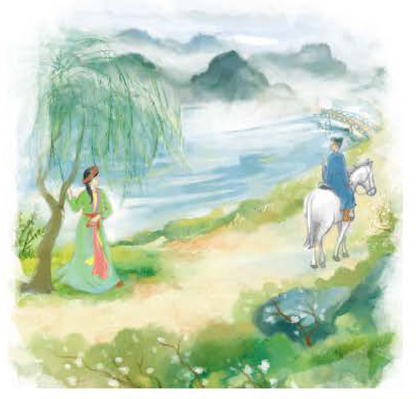
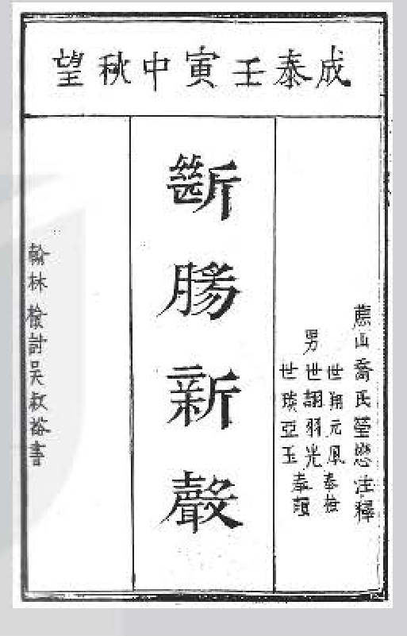
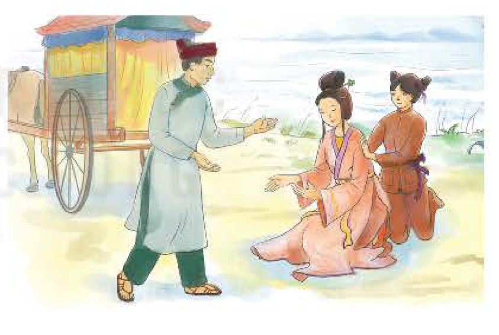

<!-- pdf:66 -->

# BÀI 3: HỒN NƯỚC NẰM TRONG TIẾNG MẸ CHA

*Họ yêu vô cùng thứ tiếng trong mấy mươi thế kỉ*
*đã chia sẻ vui buồn với cha ông.*
<!-- ocr-ok: câu đề từ chữ trắng trên nền xanh đậm bị OCR bỏ sót dòng đầu, đã đối chiếu ảnh p066.png -->

Hoài Thanh

## Giới thiệu bài học

- “Tiếng nói là thứ của cải vô cùng lâu đời và vô cùng quý báu của dân tộc” (Hồ Chí Minh). Trải qua cả ngàn năm chịu sự đô hộ của các triều đại phong kiến phương Bắc với dã tâm đồng hoá, trong đó có việc huỷ diệt ngôn ngữ, dân tộc Việt vẫn giữ gìn “thứ của cải vô cùng lâu đời và vô cùng quý báu” đó và làm cho nó ngày càng trở nên phong phú, giàu có. Tiếng Việt đã trở thành “ngôi đền” vĩ đại, lưu giữ hồn thiêng của quê hương xứ sở, bảo tồn những giá trị văn hoá truyền thống độc đáo và đặc sắc.
- Đọc hiểu các đoạn trích từ những truyện thơ Nôm tiêu biểu nhất và một bài thơ Nôm nổi tiếng, em sẽ cảm nhận được phần nào sự giàu có, phong phú của tiếng Việt. Các tác giả đã nâng niu, trân trọng tiếng nước mình, để từ đó sáng tạo nên những tác phẩm có sức lay động lòng người, có giá trị nhân văn bền vững; là minh chứng cho vẻ đẹp kì diệu, sức sống mãnh liệt của tiếng Việt và tâm hồn dân tộc.

## 🎯 Yêu cầu cần đạt

<!-- term: truyện thơ Nôm -->
<!-- term: cốt truyện -->
<!-- term: nhân vật -->
<!-- term: lời thoại -->
<!-- term: lời người kể chuyện -->
<!-- term: lời nhân vật -->
<!-- term: lời đối thoại -->
<!-- term: lời độc thoại -->
<!-- term: chữ Nôm -->
<!-- term: chữ quốc ngữ -->
<!-- term: bài văn nghị luận về một vấn đề cần giải quyết -->
<!-- term: trình bày ý kiến về một vấn đề có tính thời sự -->
- Nhận biết và phân tích được một số yếu tố của truyện thơ Nôm như: cốt truyện, nhân vật, lời thoại.
- Nhận biết và phân biệt được lời người kể chuyện và lời nhân vật; lời đối thoại và lời độc thoại trong văn bản truyện.
- Có một số hiểu biết sơ giản về chữ viết tiếng Việt: chữ Nôm và chữ quốc ngữ.
- Viết được bài văn nghị luận về một vấn đề cần giải quyết; trình bày được giải pháp khả thi và có sức thuyết phục.
- Biết trình bày ý kiến về một vấn đề có tính thời sự.
- Tự hào, trân trọng những di sản văn hoá, văn học của dân tộc; có ý thức gìn giữ và phát triển tiếng Việt.

> (1) Một câu thơ trích trong bài thơ *Phố Hàng Gai ngắn bên Hồ Kiếm* của Huy Cận.

<!-- pdf:67 -->

## Đọc

### TRI THỨC NGỮ VĂN

**Truyện thơ Nôm**

<!-- term: truyện thơ Nôm -->
<!-- term: chữ Nôm -->
<!-- term: thơ Đường luật -->
<!-- term: song thất lục bát -->
<!-- term: lục bát -->
<!-- term: đề tài -->
<!-- term: chủ đề -->
<!-- term: cốt truyện -->
<!-- term: nhân vật -->
<!-- term: lời thoại -->
<!-- term: đối thoại -->
<!-- term: độc thoại -->
<!-- term: tả cảnh ngụ tình -->
- **Truyện thơ Nôm** là thể loại tự sự bằng thơ, được viết bằng chữ Nôm; hình thành vào khoảng thế kỉ XVI – XVII, phát triển mạnh và đạt được nhiều thành tựu to lớn ở cuối thế kỉ XVIII và nửa đầu thế kỉ XIX. Ở giai đoạn đầu, một số truyện thơ Nôm được sáng tác bằng thể thơ Đường luật hoặc song thất lục bát; sau đó các tác giả chủ yếu sử dụng thể thơ lục bát.
- Truyện thơ Nôm có đề tài, chủ đề rộng mở, phong phú, giàu cảm hứng nhân đạo và có giá trị hiện thực sâu sắc. Cốt truyện của truyện thơ Nôm thường được triển khai theo trình tự thời gian với mô hình cơ bản: *gặp gỡ – chia li – đoàn tụ*. Khi tiếp thu nguồn cốt truyện từ văn học dân gian hoặc văn học Trung Quốc, các tác giả truyện thơ Nôm đã có những đóng góp riêng, tạo nên những tác phẩm mới có giá trị nội dung và nghệ thuật đặc sắc. Một số truyện thơ Nôm lấy đề tài từ đời sống thực tế và có cốt truyện do tác giả tự sáng tạo (*Phạm Tải – Ngọc Hoa*, *Sơ kính tân trang*, *Truyện Lục Vân Tiên*).
- Nhân vật chính trong truyện thơ Nôm là những cô gái, chàng trai có vẻ đẹp toàn diện (hình thể, tâm hồn, đức hạnh, trí tuệ, tài năng,...) nhưng cuộc sống thường gặp nhiều trắc trở, gian nan. Những gian nan, trắc trở ấy không chỉ phản ánh thực trạng xã hội đương thời mà còn là cái “nền” để các tác giả làm nổi bật vẻ đẹp của con người, đặc biệt là người phụ nữ. Họ hiếu thảo với mẹ cha, thuỷ chung trong tình yêu, giàu lòng nhân hậu và đức hi sinh; đồng thời rất mạnh mẽ, can đảm khi đối diện với những tai hoạ, khổ đau, bất hạnh; dũng cảm, kiên cường đấu tranh để bảo vệ tình yêu, hạnh phúc gia đình, giữ gìn phẩm giá. Nhiều nhân vật đã được khắc hoạ ở cả hai phương diện: con người bên ngoài (ngoại hình, lời nói, cử chỉ, hành động,...) và con người bên trong (cảm xúc, suy nghĩ, diễn biến tâm lí,...). Đặc biệt, lời thoại của nhân vật đã được chú ý ở cả hai hình thức: đối thoại và độc thoại. Trong một số tác phẩm, lời thoại đã được cá thể hoá và trở thành phương tiện thể hiện tính cách nhân vật. Nhiều tác giả truyện thơ Nôm đã sử dụng thành công bút pháp tả cảnh ngụ tình để thể hiện thế giới nội tâm nhân vật.
- Truyện thơ Nôm là thể loại có đóng góp to lớn vào việc phát triển ngôn ngữ văn học và thể thơ lục bát của dân tộc. Trong các tác phẩm đỉnh cao, ngôn ngữ truyện thơ Nôm giản dị, gần với lời ăn tiếng nói của nhân dân, được “tinh chế” bởi ngòi bút tài hoa, điêu luyện của tác giả; thể thơ lục bát được hoàn thiện và đạt tới sự nhuần nhuyễn, không chỉ có khả năng biểu đạt mọi cung bậc tình cảm tinh tế của con người mà còn đảm nhận xuất sắc chức năng kể chuyện.

**Lời đối thoại và lời độc thoại trong văn bản truyện**

<!-- term: lời đối thoại -->
<!-- term: lời nhân vật -->
- **Lời đối thoại** là hình thức thể hiện của lời nhân vật khi đối tượng hướng đến là một hoặc nhiều người tham gia giao tiếp trực tiếp.

<!-- pdf:68 -->

<!-- term: lời độc thoại -->
<!-- term: lời nhân vật -->
<!-- term: độc thoại nội tâm -->
- **Lời độc thoại** là hình thức thể hiện của lời nhân vật khi đối tượng hướng đến không phải là người tham gia đối thoại trực tiếp. Trong kịch, độc thoại được sử dụng để nhân vật tự nói với chính mình, khán giả chỉ là người “nghe trộm”, nhờ đó biết được những cảm xúc sâu kín của nhân vật. Trong truyện (bao gồm cả truyện thơ), đặc biệt là trong truyện ngắn, tiểu thuyết hiện đại, độc thoại được sử dụng để tái hiện tiếng nói nội tâm hay trạng thái cảm xúc, suy nghĩ của nhân vật. Lúc này, độc thoại được gọi bằng một thuật ngữ xác định hơn là **độc thoại nội tâm**.

**Chữ Nôm và chữ quốc ngữ**

<!-- term: chữ Nôm -->
<!-- term: chữ Hán -->
<!-- term: thơ Đường luật -->
<!-- term: truyện thơ Nôm -->
<!-- term: ngâm khúc -->
<!-- term: hát nói -->
<!-- term: chữ quốc ngữ -->
- **Chữ Nôm** là chữ viết cổ dùng để ghi âm tiếng Việt, được ông cha ta sáng tạo dựa theo kí hiệu văn tự Hán. Chữ Nôm được hình thành vào khoảng thế kỉ X và đã được sử dụng để sáng tác thơ văn khoảng từ thế kỉ XII – XIII. Sự ra đời của chữ Nôm thể hiện tinh thần tự cường, tự tôn dân tộc; đánh dấu bước phát triển vượt bậc về văn hoá và khẳng định vị trí, vai trò của tiếng Việt. Nhiều tác giả đã sử dụng chữ Nôm để sáng tạo nên những tác phẩm kiệt xuất, xây dựng những thể loại đặc sắc cho nền văn học trung đại Việt Nam: thơ Nôm Đường luật (Nguyễn Trãi, Nguyễn Bỉnh Khiêm, Hồ Xuân Hương, Bà Huyện Thanh Quan, Nguyễn Khuyến, Trần Tế Xương,...); truyện thơ Nôm (nhiều tác giả khuyết danh, Nguyễn Hữu Hào, Nguyễn Du, Phạm Thái, Nguyễn Đình Chiểu,...); ngâm khúc (Đoàn Thị Điểm, Nguyễn Gia Thiều, Cao Bá Nhạ,...); hát nói (Nguyễn Công Trứ, Cao Bá Quát, Chu Mạnh Trinh,...). Hàn Thuyên được cho là người có công đầu trong việc phát triển, phổ biến chữ Nôm.
- **Chữ quốc ngữ** là chữ viết dùng chữ cái Latinh để ghi âm tiếng Việt. Chữ quốc ngữ được hình thành từ đầu thế kỉ XVII, trong quá trình các tu sĩ Dòng Tên(1) truyền đạo Thiên Chúa tại Việt Nam. Trong đó những người có công lớn nhất là giáo sĩ Phran-xít-xcô đờ Pi-na(2) (Francesco de Pina) và giáo sĩ A-lếch-xăng đờ Rốt(3) (Alexandre de Rhodes). Nhiều trí thức người Việt đã có đóng góp quan trọng trong việc truyền bá, phổ biến chữ quốc ngữ thời kì đầu như: Trương Vĩnh Ký, Huỳnh Tịnh Của,... Sau khi ra đời, chữ quốc ngữ được chỉnh lí, thay thế dần chữ Hán và chữ Nôm; đến đầu thế kỉ XX, trở thành văn tự chính thức của quốc gia.

### VĂN BẢN ĐỌC

- **VĂN BẢN 1.** *Kim – Kiều gặp gỡ* (trích *Truyện Kiều*), Nguyễn Du
- **VĂN BẢN 2.** *Lục Vân Tiên đánh cướp, cứu Kiều Nguyệt Nga* (trích *Truyện Lục Vân Tiên*), Nguyễn Đình Chiểu
- **VĂN BẢN 3.** *Tự tình (bài 2)*, Hồ Xuân Hương

> (1) *Dòng Tên* (còn gọi là Dòng Chúa Giê-su): một dòng tu của Giáo hội Công giáo, được Giáo Hoàng phê chuẩn năm 1540.
> (2) Phran-xít-xcô đờ Pi-na (1585 – 1625) là giáo sĩ người Bồ Đào Nha, đến Đàng Trong năm 1617, người có công sáng tạo chữ quốc ngữ.
> (3) A-lếch-xăng đờ Rốt (1593 – 1660) là giáo sĩ người Pháp, đến Đàng Trong năm 1624, người có công hoàn thiện và phổ biến chữ quốc ngữ.

<!-- pdf:69 -->

### VĂN BẢN 1: Kim – Kiều gặp gỡ

**Trước khi đọc**

Hãy giới thiệu một tác phẩm văn học hoặc bộ phim kể về một mối tình để lại cho em ấn tượng đẹp.

**Đọc văn bản**

**Kim – Kiều gặp gỡ**(1)

Trích *Truyện Kiều*(2), NGUYỄN DU
<!-- ocr-ok: dòng xuất xứ ngắn kèm số cước chú (2) bị OCR đọc sai dấu, đã đối chiếu ảnh p069.png -->

Nẻo xa mới tỏ mặt người,
Khách(3) đà xuống ngựa tới nơi tự tình.
Hài văn(4) lần bước dặm xanh(5),
Một vùng như thể cây quỳnh cành dao(6).
<!-- ocr-ok: bốn dòng thơ kèm số cước chú (3)-(6) bị OCR đọc sai nhiều chữ, đã đối chiếu ảnh p069.png -->

> **Theo dõi:** Sự xuất hiện của nhân vật Kim Trọng.

Chàng Vương(7) quen mặt ra chào,
Hai kiều e lệ nép vào dưới hoa.
Nguyên người quanh quất đâu xa,
Họ Kim tên Trọng vốn nhà trâm anh(8).

> (1) Nhan đề đoạn trích do người biên soạn đặt.
> (2) *Truyện Kiều* có tên chữ là *Đoạn trường tân thanh* (Tiếng kêu mới về nỗi đau đứt ruột), được sáng tác bằng thể loại truyện thơ Nôm, gồm 3 254 câu thơ lục bát. Cốt truyện được triển khai thành ba phần: *gặp gỡ – chia li – đoàn tụ*, kể về cuộc đời chìm nổi của Thuý Kiều, một người con gái tài sắc, đức hạnh vẹn toàn. Phần *gặp gỡ* giới thiệu gia đình họ Vương, ca ngợi tài sắc chị em Thuý Kiều, Thuý Vân; miêu tả sự kiện Thuý Kiều và Kim Trọng gặp gỡ, tương tư, hẹn hò, đính ước, thề nguyền. Phần *chia li* kể về mười lăm năm lưu lạc của Thuý Kiều. Ngay khi Kim Trọng phải về quê hộ tang chú thì gia đình Thuý Kiều mắc nạn. Thuý Kiều nhờ Thuý Vân trả nghĩa cho Kim Trọng, còn nàng quyết bán mình cứu cha. Kiều bị Mã Giám Sinh, Tú Bà, Sở Khanh lừa đẩy vào lầu xanh của Tú Bà. Sau đó nàng được Thúc Sinh chuộc về làm vợ lẽ nhưng bị vợ cả là Hoạn Thư ghen tuông, hành hạ nên phải trốn đi; rồi nàng lại bị Bạc Bà, Bạc Hạnh lừa bán vào lầu xanh. Ở đây, Kiều gặp được Từ Hải, một người anh hùng hào hiệp, nghĩa khí. Từ Hải cưới Kiều, giúp nàng đền ơn, báo oán. Nhưng chàng bị quan tổng đốc Hồ Tôn Hiến lừa gạt dụ hàng rồi bội ước; Từ Hải chết, Thuý Kiều tự vẫn ở sông Tiền Đường. Nàng được sư Giác Duyên cứu sống, cho nương nhờ ở Chiêu ẩn am. Sau nửa năm về quê chịu tang chú, Kim Trọng trở lại, biết tin người yêu cùng gia đình mắc nạn, vô cùng xót thương, đau đớn. Dù đã nên duyên cùng Thuý Vân nhưng Kim Trọng luôn nhớ thương và kiên trì lặn lội, kiếm tìm Thuý Kiều. Phần *đoàn tụ* kết thúc ở sự kiện Thuý Kiều được đoàn viên cùng gia đình, cùng chàng Kim nối lại mối duyên xưa nhưng là duyên bầu bạn.
> Đoạn trích *Kim – Kiều gặp gỡ* nằm ở phần 1 của cốt truyện (*gặp gỡ*) từ câu 141 đến câu 184: Nhân tiết Thanh minh, Thuý Kiều cùng hai em du xuân, tình cờ gặp ngôi mộ của Đạm Tiên, một ca nữ nổi danh tài sắc mà bạc mệnh. Thuý Kiều đã bày tỏ niềm cảm thương sâu sắc cho thân phận Đạm Tiên. Cũng ở đây, nàng đã gặp Kim Trọng, giữa hai người lập tức nảy sinh tình cảm yêu thương, quyến luyến. Thuý Kiều trở về nhà với tâm trạng “ngổn ngang trăm mối”.
> (3) *Khách*: chỉ Kim Trọng.
> (4) *Hài văn*: giày có thêu những đường vân nổi.
> (5) *Dặm xanh*: chỉ lối đi trên bãi cỏ xanh.
> (6) *Cây quỳnh cành dao*: quỳnh và dao là hai giống cây cảnh thường được trồng cùng nhau; ở đây ý nói khi Kim Trọng bước đi thì cảnh vật xung quanh cũng như bừng lên vẻ đẹp hài hoà, tươi sáng.
> (7) *Chàng Vương*: Vương Quan, em trai của Thuý Kiều và Thuý Vân.
> (8) *Nhà trâm anh*: nhà quyền quý.

<!-- pdf:70 -->

Nền phú hậu bậc tài danh(1),
Văn chương nết đất thông minh tính trời(2).
Phong tư tài mạo tót vời(3),
Vào trong phong nhã ra ngoài hào hoa(4).
[...] Bóng hồng(5) nhác thấy nẻo xa,
Xuân lan thu cúc(6) mặn mà cả hai.
Người quốc sắc(7) kẻ thiên tài(8),
Tình trong như đã mặt ngoài còn e.
Chập chờn cơn tỉnh cơn mê,
Rốn ngồi(9) chẳng tiện dứt về chỉn khôn(10).
Bóng tà như giục cơn buồn,
Khách đà lên ngựa người còn nghé theo.
<!-- ocr-ok: đoạn thơ nhiều số cước chú (1)-(10) bị OCR đọc sai dấu thanh, đã đối chiếu ảnh p070.png -->

> **Theo dõi:** Những từ ngữ, hình ảnh miêu tả cảm xúc, tâm trạng của các nhân vật.
<!-- ocr-ok: thẻ chỉ dẫn đọc bên lề bị OCR đọc sai dòng thứ hai, đã đối chiếu ảnh p070.png -->

Dưới cầu nước chảy trong veo,
Bên cầu tơ liễu bóng chiều thướt tha.

> **Hình dung:** Bức tranh thiên nhiên.
<!-- ocr-ok: nhãn "Hình dung" chữ trắng nền cam bị OCR bỏ sót, đã đối chiếu ảnh p070.png -->

Kiều từ trở gót trướng hoa(11),
Mặt trời gác núi chiêng đà thu không(12).
Gương nga(13) chênh chếch dòm song,
Vàng gieo ngấn nước(14) cây lồng bóng sân.
Hải đường lả ngọn đông lân(15),
Giọt sương gieo nặng cành xuân la đà.
Một mình lặng ngắm bóng nga,
Rộn đường gần với nỗi xa bời bời:
<!-- ocr-ok: đoạn thơ kèm số cước chú (11)-(15) bị OCR đọc sai dấu và chữ, đã đối chiếu ảnh p070.png -->

> (1) *Nền phú hậu*: nền nếp gia đình giàu có; *bậc tài danh*: người tài giỏi, nổi tiếng.
> (2) *Văn chương nết đất*: theo quan niệm xưa, một người có tài năng đặc biệt (ở đây là tài năng văn chương) là do linh khí, mồ mả tổ tiên hun đúc nên; *thông minh tính trời*: trí thông minh do trời phú cho.
> (3) *Phong tư*: dáng điệu, phong thái; *tài mạo*: vẻ mặt thông minh, tuấn tú; *tót vời*: hơn hết thảy, tột đỉnh.
> (4) *Vào trong phong nhã*: chỉ tính cách phong lưu, tao nhã; *ra ngoài hào hoa*: chỉ việc giao tiếp rộng rãi, ứng xử lịch sự, hào hiệp.
> (5) *Bóng hồng*: chỉ người con gái.
> (6) *Xuân lan thu cúc*: ý nói hai chị em Thuý Kiều, Thuý Vân mỗi người có một vẻ đẹp riêng (như hoa lan mùa xuân, hoa cúc mùa thu).
> (7) *Người quốc sắc*: người có sắc đẹp nổi tiếng trong cả nước, chỉ Thuý Kiều.
> (8) *Kẻ thiên tài*: người có tài năng đặc biệt được trời phú cho, chỉ Kim Trọng.
> (9) *Rốn ngồi*: ngồi nán lại.
> (10) *Chỉn khôn*: thật là khó.
> (11) *Trướng hoa*: trướng có thêu hoa, chỉ phòng riêng của người con gái.
> (12) *Thu không*: tín hiệu đóng cửa thành lúc gần tối (tiếng trống hoặc chuông).
> (13) *Gương nga*: chỉ vầng trăng.
> (14) *Vàng gieo ngấn nước*: ánh trăng vàng chiếu rọi xuống mặt nước.
> (15) *Đông lân*: nhà hàng xóm phía đông.

<!-- pdf:71 -->

“Người mà đến thế thì thôi(1),
Đời phồn hoa cũng là đời bỏ đi!
Người đâu gặp gỡ làm chi(2),
Trăm năm biết có duyên gì hay không?”

> **Theo dõi:** Lời người kể chuyện và lời nhân vật.

Ngổn ngang trăm mối bên lòng,
Nên câu tuyệt diệu(3) ngụ trong tính tình.
<!-- ocr-ok: hai dòng thơ ngắn kèm số cước chú (3) bị OCR đọc sai dấu thanh, đã đối chiếu ảnh p071.png -->

(Nguyễn Du, *Truyện Kiều*, Nguyễn Thạch Giang *khảo đính và chú giải*, Nhà xuất bản Đại học và Giáo dục chuyên nghiệp, Hà Nội, 1991, tr. 27 – 30)

**Sau khi đọc**

> - **Nguyễn Du** (1765 – 1820) quê ở làng Tiên Điền, huyện Nghi Xuân, trấn Nghệ An, nay thuộc tỉnh Hà Tĩnh. Cuộc đời Nguyễn Du gắn với một thời đại lịch sử đầy biến động nên trải nhiều thăng trầm. Ông không chỉ có vốn tri thức uyên bác, vốn sống phong phú, am hiểu sâu sắc về con người mà còn có trái tim mang nặng nỗi thương đời.
>   Nguyễn Du để lại một sự nghiệp văn chương quý giá, gồm có: ba tập thơ chữ Hán (*Thanh Hiên thi tập*, *Nam trung tạp ngâm*, *Bắc hành tạp lục*) và một số tác phẩm chữ Nôm (*Văn tế sống hai cô gái Trường Lưu*, *Thác lời trai phường nón*, *Văn tế thập loại chúng sinh*, *Truyện Kiều*). Với những đóng góp to lớn ở cả hai bộ phận sáng tác chữ Hán và chữ Nôm, Nguyễn Du được suy tôn là đại thi hào của dân tộc. Năm 2013, Nguyễn Du được UNESCO ra nghị quyết vinh danh và kỉ niệm 250 năm ngày sinh của ông.
> - *Truyện Kiều* là kiệt tác của Nguyễn Du và của nền văn học dân tộc. Nguyễn Du đã sử dụng cốt truyện từ tiểu thuyết *Kim Vân Kiều truyện* của Thanh Tâm Tài Nhân (Trung Quốc) để sáng tạo nên một tác phẩm mới. Ông đã sáng tác *Truyện Kiều* bằng ngôn ngữ, thể loại văn học của dân tộc; với cảm hứng trước “những điều trông thấy” và ngòi bút của một thiên tài.
>   *Truyện Kiều* có giá trị nhân đạo lớn lao và giá trị hiện thực sâu sắc. Nguyễn Du đã bày tỏ nỗi xót thương, đồng cảm với những số phận bi kịch; khẳng định, đề cao vẻ đẹp, quyền sống và những khát vọng chính đáng của con người (tình yêu, hạnh phúc, tự do và công lí,...). Nhà thơ cũng tố cáo, lên án thực trạng của một xã hội mà đồng tiền và cái ác “lên ngôi”.

> (1) *Người mà đến thế thì thôi*: chỉ Đạm Tiên, được chôn ở ngôi mộ mà Thuý Kiều và hai em tình cờ gặp trong ngày Thanh minh.
> (2) *Người đâu gặp gỡ làm chi*: chỉ Kim Trọng.
> (3) *Câu tuyệt diệu*: chỉ câu thơ hay tuyệt, ẩn chứa ý tình của Thuý Kiều.

<!-- pdf:72 -->

>   *Truyện Kiều* của Nguyễn Du đặc biệt thành công về phương diện nghệ thuật: xây dựng nhân vật, kể chuyện, sử dụng ngôn ngữ và thể thơ,... Nguyễn Du đã tổ chức lại cốt truyện, lược bỏ hoặc thay đổi trình tự nhiều chi tiết, sự kiện. Các nhân vật trong *Truyện Kiều* được miêu tả qua ngoại hình, lời nói, cử chỉ, hành động, diễn biến nội tâm. Thế giới nội tâm nhân vật được thể hiện bằng ngôn ngữ đối thoại và độc thoại, bằng bút pháp tả cảnh ngụ tình,... Đặc biệt, *Truyện Kiều* đánh dấu bước phát triển vượt bậc của ngôn ngữ văn học dân tộc và sự hoàn thiện của thể thơ lục bát truyền thống.

> ***Em có biết?***
>
> - *Truyện Kiều* đã hoà nhập vào đời sống tinh thần của dân tộc, hình thành nên những sinh hoạt văn hoá, văn học độc đáo của người Việt như *vịnh Kiều*, *lẩy Kiều*, *đố Kiều*,...
> - *Truyện Kiều* đã được dịch ra khoảng hai mươi ngôn ngữ với hơn bảy mươi bản dịch.
>
> Bìa cuốn *Đoạn trường tân thanh*, bản in năm Nhâm Dần (1902), đời vua Thành Thái

**Trả lời câu hỏi**

<!-- term: nhân vật -->
<!-- term: lời người kể chuyện -->
<!-- term: lời nhân vật -->
<!-- term: tả cảnh ngụ tình -->
<!-- term: thời gian -->
<!-- term: không gian -->
1. Đoạn trích có những nhân vật nào và kể về sự việc gì?
2. Ở mười hai dòng thơ đầu, nhân vật Kim Trọng được giới thiệu và miêu tả bằng lời của ai? Qua những lời giới thiệu và miêu tả đó, em hình dung được những gì về nhân vật?
3. Trong mười dòng thơ tiếp theo, Nguyễn Du đã tập trung miêu tả cảm xúc, tâm trạng của những nhân vật nào? Phân tích từ ngữ tiêu biểu được tác giả sử dụng để thể hiện cảm xúc, tâm trạng của các nhân vật đó.
4. Trong mười bốn dòng thơ cuối, Nguyễn Du đã sử dụng nhiều phương tiện (lời người kể chuyện, lời nhân vật, bút pháp tả cảnh ngụ tình) để thể hiện thế giới nội tâm của nhân vật Thuý Kiều. Em hãy:
   a. Phân tích đặc điểm của bức tranh thiên nhiên (thời gian, không gian, sự vật). Miêu tả bức tranh thiên nhiên ấy, tác giả muốn thể hiện trạng thái cảm xúc nào ở nhân vật?

<!-- pdf:73 -->

<!-- term: lời người kể chuyện -->
<!-- term: lời nhân vật -->
<!-- term: chủ đề -->
   b. Chỉ ra đâu là lời người kể chuyện, đâu là lời nhân vật. Lời nhân vật được thể hiện ở hình thức nào và điều gì giúp em nhận biết hình thức ngôn ngữ đó?
   c. Cho biết nhân vật đã bộc lộ những cảm xúc, suy nghĩ gì trong lời nói của mình.
   d. Xác định đặc điểm tính cách của nhân vật Thuý Kiều được thể hiện trong đoạn thơ.
5. Nhận xét về nghệ thuật sử dụng ngôn ngữ và nghệ thuật xây dựng nhân vật của Nguyễn Du trong đoạn trích.
6. Nêu chủ đề của đoạn trích; qua đó, nhận xét về tư tưởng, tình cảm của tác giả.

#### Viết kết nối với đọc
<!-- ocr-ok: tiêu đề màu cam bị OCR đọc nhầm thành "VIẾT KẾT NỐI VŨI ĐD", đã đối chiếu ảnh p073.png -->

Viết đoạn văn (khoảng 7 – 9 câu) phân tích 2 – 4 dòng thơ miêu tả thiên nhiên mà em cho là đặc sắc trong đoạn trích *Kim – Kiều gặp gỡ*.

### Thực hành tiếng Việt

*CHỮ NÔM*

<!-- term: chữ Nôm -->
<!-- term: chữ Hán -->
<!-- term: chữ quốc ngữ -->
1. Theo em, với việc sáng tạo chữ Nôm, ông cha ta đã thể hiện những tư tưởng, khát vọng gì?
2. Các tác giả văn học trung đại Việt Nam đã sử dụng chữ Nôm để sáng tạo nhiều tác phẩm đặc sắc cho nền văn học dân tộc. Hãy kể tên một số tác phẩm mà em biết.
3. Em đọc *Truyện Kiều* thông qua văn tự gì? Theo em, hiện nay *Truyện Kiều* có cần được lưu truyền bằng hình thức văn tự mà Nguyễn Du đã dùng để sáng tác không? Vì sao?

> **Sơ giản về chữ Nôm**
>
> - **Chữ Nôm** là hệ thống chữ viết căn bản theo nguyên tắc ghi âm (ghi âm tiết). Chữ Nôm được cấu tạo theo hai phương thức chính:
>   – Phương thức vay mượn: Dùng một chữ Hán có sẵn để ghi một âm tiết tiếng Việt giống hoặc gần với âm Hán Việt của chữ Hán đó. Ví dụ: chữ 女 âm Hán Việt đọc là *nữ*, âm Nôm có thể đọc là *nữ* hoặc *nỡ, nữa, nhỡ, lỡ*; chữ 皮 âm Hán Việt đọc là *bì*, âm Nôm có thể đọc là *bì* hoặc *bìa, bẩy, bế, vào, vừa*,...
>   – Phương thức tự tạo: Kết hợp kí hiệu văn tự Hán với kí hiệu chỉnh âm để tạo ra một chữ Nôm. Ví dụ: chữ 𠓨 (*vào*) là sự kết hợp của kí hiệu 包, âm đọc Hán Việt là *bao* với kí hiệu chỉnh âm 入 (*nhập*, có nghĩa là *vào*).
> - Chữ Nôm bảo tồn được nhiều chứng tích của tiếng Việt cổ xưa. Nhờ có chữ Nôm, nhiều tác phẩm văn học được lưu truyền ở cả hình thức văn tự và truyền miệng. Nhưng chữ Nôm có hạn chế lớn là muốn đọc được phải có hiểu biết về chữ Hán. Hiện nay, nhiều tác phẩm sáng tác bằng chữ Nôm đã được chuyển đổi hình thức văn tự thành chữ quốc ngữ.

<!-- pdf:74 -->

### VĂN BẢN 2: Lục Vân Tiên đánh cướp, cứu Kiều Nguyệt Nga

**Trước khi đọc**

Nhân vật anh hùng mà em yêu thích là ai? Điều gì ở nhân vật ấy gây ấn tượng nhất với em?

**Đọc văn bản**

**Lục Vân Tiên đánh cướp, cứu Kiều Nguyệt Nga**(1)

Trích *Truyện Lục Vân Tiên*(2), NGUYỄN ĐÌNH CHIỂU
<!-- ocr-ok: dòng xuất xứ ngắn kèm số cước chú (2) và chữ "CHIỂU" bị OCR đọc sai, đã đối chiếu ảnh p074.png -->

Vân Tiên ghé lại bên đàng,
Bẻ cây làm gậy nhắm làng xông vô.
Kêu rằng: “Bớ đảng hung đồ(3),
Chớ quen làm thói hồ đồ(4) hại dân”.
<!-- ocr-ok: bốn dòng thơ kèm số cước chú (3)-(4) bị OCR đọc sai nặng dòng thứ hai, đã đối chiếu ảnh p074.png -->

> **Theo dõi:** Hành động và lời nói của Lục Vân Tiên.

Phong Lai mặt đỏ phừng phừng:
“Thằng nào dám tới lẫy lừng(5) vào đây?
Trước gây việc dữ tại mầy(6),
Truyền quân bốn phía phủ vây bịt bùng”.
<!-- ocr-ok: bốn dòng thơ kèm số cước chú (5)-(6) bị OCR đọc sai dấu thanh, đã đối chiếu ảnh p074.png -->

> (1) Nhan đề do người biên soạn đặt.
> (2) *Truyện Lục Vân Tiên* gồm 2 082 câu thơ lục bát (số lượng câu thơ có sự khác nhau giữa các bản in), kể về Lục Vân Tiên, một chàng trai khôi ngô tuấn tú, văn võ song toàn. Trên đường đi thi, Lục Vân Tiên đã ra tay trừng trị bọn cướp, cứu được Kiều Nguyệt Nga. Nàng mời Lục Vân Tiên về nơi cha mình đang làm quan để được đền ơn cứu mạng nhưng chàng từ chối. Kiều Nguyệt Nga tự nguyện gắn bó suốt đời với Lục Vân Tiên, nàng vẽ một bức chân dung chàng và luôn mang theo bên mình.
> Sắp vào trường thi, Vân Tiên nhận được tin mẹ mất liền trở về quê chịu tang; trên đường về, chàng bị đau mắt nặng, rồi mù cả hai mắt. Lục Vân Tiên bị Trịnh Hâm lừa đẩy xuống sông nhưng được giao long cứu và được gia đình ông Ngư cưu mang. Sau đó, chàng bị cha con Võ Công bội ước, hãm hại, đem bỏ vào hang sâu; Lục Vân Tiên được Du thần và ông Tiều cứu giúp.
> Nghe tin Lục Vân Tiên đã chết, Kiều Nguyệt Nga rất đau khổ và thề sẽ thủ tiết suốt đời. Nàng từ chối lời cầu hôn của con trai Thái sư đương triều, khiến tên Thái sư nổi giận, tâu vua bắt Nguyệt Nga đi cống giặc Ô Qua. Khi thuyền tới biên giới, nàng ôm tấm hình Vân Tiên nhảy xuống sông tự tử và được Phật Bà Quan Âm cứu, đưa nàng dạt vào vườn nhà họ Bùi. Bùi Kiệm muốn ép Kiều Nguyệt Nga lấy hắn nên nàng phải trốn vào rừng, nương náu ở nhà một bà cụ làm nghề dệt vải.
> Lục Vân Tiên được tiên cho thuốc, mắt sáng lại, trở về thăm cha và qua thăm cha của Kiều Nguyệt Nga. Chàng lại đi thi, đỗ Trạng nguyên, rồi được nhà vua cử đi dẹp giặc Ô Qua. Vân Tiên thắng giặc nhưng bị lạc trong rừng và gặp lại Kiều Nguyệt Nga. Chàng trở về triều, tâu vua hết sự tình. Những kẻ gian ác bị trừng trị; Lục Vân Tiên và Kiều Nguyệt Nga được đoàn tụ, hạnh phúc.
> Đoạn trích *Lục Vân Tiên đánh cướp, cứu Kiều Nguyệt Nga* nằm ở phần đầu của tác phẩm, từ câu 123 đến câu 180, kể lại sự việc Lục Vân Tiên đánh cướp, cứu được Kiều Nguyệt Nga.
> (3) *Đảng hung đồ*: nhóm những kẻ tàn ác, lũ hung bạo; ở đây chỉ bọn cướp do Phong Lai cầm đầu.
> (4) *Thói hồ đồ*: thói càn bậy.
> (5) *Lẫy lừng*: nổi tiếng tới mức khắp nơi ai cũng biết; ở đây dùng với nghĩa là ầm ĩ, hung hăng.
> (6) *Mầy*: mày.

<!-- pdf:75 -->

Vân Tiên tả đột hữu xông(1),
Khác nào Triệu Tử phá vòng Đương Dang(2).
Lâu la bốn phía vỡ tan,
Đều quăng gươm giáo tìm đàng chạy ngay.

> **Hình dung:** Hình ảnh Lục Vân Tiên giữa vòng vây của bọn cướp.

Phong Lai trở chẳng kịp tay,
Bị Tiên một gậy thác rày thân vong(3).
Dẹp rồi lũ kiến chòm ong,
Hỏi: “Ai than khóc ở trong xe nầy?”
[...] Thưa rằng: “Tôi Kiều Nguyệt Nga,
Con nầy tì tất(4) tên là Kim Liên.

> **Theo dõi:** Lời nói của nhân vật Kiều Nguyệt Nga.

Quê nhà ở quận Tây Xuyên,
Cha làm tri phủ ở miền Hà Khê.
Sai quân đem bức thơ(5) về,
Rước tôi qua đó định bề nghi gia(6).
Làm con đâu dám cãi cha,
Ví dầu ngàn dặm đường xa cũng đành(7).
Chẳng qua là sự bất bình,
Hay vầy(8) cũng chẳng đăng trình(9) làm chi.
Lâm nguy chẳng gặp giải nguy,
Tiết trăm năm cũng bỏ đi một hồi.
Trước xe quân tử(10) tạm ngồi,
Xin cho tiện thiếp lạy rồi sẽ thưa.
Chút tôi liễu yếu đào(11) thơ,
Giữa đường lâm phải bụi dơ đã phần(12).
Hà Khê qua đó cũng gần,
Xin theo cùng thiếp đền ân cho chàng.

> (1) *Tả đột hữu xông*: đánh mạnh ở cả bên trái, bên phải, thể hiện thế tấn công, tung hoành dũng mãnh.
> (2) *Triệu Tử*: Triệu Vân, hiệu là Tử Long, một dũng tướng của Lưu Bị thời Tam Quốc, nổi tiếng võ nghệ cao cường; *Đương Dang*: Đương Dương (địa danh nay thuộc tỉnh Hồ Bắc, Trung Quốc), nơi diễn ra trận đánh ác liệt giữa Tào Tháo và Lưu Bị. (Lưu Bị thua trận, phải bỏ cả vợ con, chạy về phía nam; Triệu Tử Long một mình phá vòng vây, tung hoành giữa hàng vạn quân của Tào Tháo, cứu được A Đẩu, con trai duy nhất của Lưu Bị.)
> (3) *Thân vong*: mất mạng, chết.
> (4) *Tì tất*: người hầu gái.
> (5) *Bức thơ* (từ địa phương): bức thư.
> (6) *Nghi gia*: gả chồng.
> (7) Không trái lời được, phải nghe theo.
> (8) *Hay vầy*: biết như vậy.
> (9) *Đăng trình*: lên đường đi xa.
> (10) *Quân tử*: từ phụ nữ thời xưa dùng để gọi người đàn ông với ý tôn trọng.
> (11) *Liễu, đào*: ẩn dụ chỉ người phụ nữ mềm yếu, mong manh; ở đây thể hiện ý khiêm nhường.
> (12) Chỉ việc gặp phải bọn cướp.

<!-- pdf:76 -->

Gặp đây đương lúc giữa đàng,
Của tiền chẳng có bạc vàng cũng không.
Gẫm câu báo đức thù công(1),
Lấy chi cho phỉ(2) tấm lòng cùng ngươi”.
Vân Tiên nghe nói liền cười:
“Làm ơn há dễ trông người trả ơn.
Nay đà rõ đặng nguồn cơn,
Nào ai tính thiệt so hơn làm gì.

> **Theo dõi:** Lời đáp của Lục Vân Tiên.

Nhớ câu kiến nghĩa bất vi(3),
Làm người thế ấy cũng phi(4) anh hùng”.
<!-- ocr-ok: hai dòng thơ ngắn kèm số cước chú (3)-(4) bị OCR đọc sai dấu thanh, đã đối chiếu ảnh p076.png -->

(*Nguyễn Đình Chiểu toàn tập*, tập I, Ca Văn Thỉnh – Nguyễn Sĩ Lâm – Nguyễn Thạch Giang *biên khảo và chú giải*, NXB Đại học và Trung học chuyên nghiệp, Hà Nội, 1980, tr. 97 – 100)

**Sau khi đọc**

> - **Nguyễn Đình Chiểu** (1822 – 1888) quê gốc ở tỉnh Thừa Thiên (nay là Thừa Thiên Huế) nhưng được sinh ra ở quê mẹ là phủ Tân Bình, tỉnh Gia Định (nay thuộc Thành phố Hồ Chí Minh). Ông đỗ tú tài năm 1843, năm 1849 ra Huế chuẩn bị thi tiếp thì mẹ mất, phải về Gia Định chịu tang. Trên đường về, Nguyễn Đình Chiểu ốm nặng, bị mù cả hai mắt. Ông về sống ở quê mẹ, dạy học và bốc thuốc. Khi thực dân Pháp xâm lược nước ta, Nguyễn Đình Chiểu đã tham gia phong trào kháng chiến chống giặc. Ông là tấm gương mẫu mực của nghị lực sống phi thường, khí tiết thanh cao và lòng yêu nước tha thiết, mãnh liệt.
>   Nguyễn Đình Chiểu để lại một di sản văn chương quý giá, gồm các tác phẩm truyện thơ Nôm: *Truyện Lục Vân Tiên*, *Dương Từ – Hà Mậu*, *Ngư Tiều y thuật vấn đáp*; một số bài văn tế và thơ Đường luật. Năm 2021, Nguyễn Đình Chiểu được UNESCO ra nghị quyết vinh danh và kỉ niệm 200 năm ngày sinh của ông.
> - *Truyện Lục Vân Tiên* ngợi ca những con người hiếu thảo, nhân hậu, thuỷ chung, nghĩa khí; lên án những kẻ bất nhân, phi nghĩa, tráo trở; thể hiện ước mơ của nhân dân về mẫu người anh hùng “cứu khốn, phò nguy” và khát vọng công lí. Tác phẩm cũng kết tinh nhiều thành tựu nghệ thuật: xây dựng được nhiều nhân vật có tính cách rõ nét, sinh động; ngôn ngữ mộc mạc, gần gũi với lời ăn tiếng nói của nhân dân; kết hợp tính cổ điển, bác học với chất dân gian và đậm đà màu sắc Nam Bộ.

> (1) *Báo đức thù công*: báo đáp ơn đức, đền trả công lao.
> (2) *Phỉ*: thoả mãn, mãn nguyện.
> (3) *Kiến nghĩa bất vi*: thấy việc nghĩa mà không làm, trích từ câu *Kiến nghĩa bất vi vô dũng dã* (*Thấy việc nghĩa mà không làm không phải là người có dũng khí*) trong *Luận ngữ*.
> (4) *Phi*: không phải.

<!-- pdf:77 -->

**Trả lời câu hỏi**

<!-- term: bố cục -->
<!-- term: lời người kể chuyện -->
<!-- term: lời đối thoại -->
<!-- term: nhân vật -->
1. Xác định bố cục của đoạn trích và nêu nội dung chính của từng phần.
2. Hãy chỉ ra đâu là lời người kể chuyện, đâu là lời đối thoại của các nhân vật trong đoạn trích.
3. Đọc mười bốn dòng thơ đầu và thực hiện các yêu cầu sau:
   a. Chỉ ra lí do khiến Lục Vân Tiên quyết định ra tay trừng trị bọn cướp.
   b. Phân tích một số từ ngữ, hình ảnh tiêu biểu thể hiện tính cách của nhân vật Lục Vân Tiên.
   c. Cho biết người kể chuyện thể hiện thái độ, tình cảm như thế nào đối với nhân vật Lục Vân Tiên.
4. Nêu cảm nhận của em về nhân vật Kiều Nguyệt Nga. Những từ ngữ, hình ảnh nào khiến em có cảm nhận như vậy?
5. Câu nói nào của Lục Vân Tiên đã thể hiện quan niệm của nhân vật về người anh hùng? Em có đồng tình với quan niệm đó không? Vì sao?
6. Nhận xét về nghệ thuật sử dụng ngôn ngữ và nghệ thuật xây dựng nhân vật trong đoạn trích.

#### Viết kết nối với đọc
<!-- ocr-ok: tiêu đề màu cam bị OCR đọc nhầm thành "VIẾT KẾT NI VŨI ĐlJD", đã đối chiếu ảnh p077.png -->

Viết đoạn văn (khoảng 7 – 9 câu) phân tích nét tính cách mà em yêu thích của một nhân vật trong đoạn trích.

### Thực hành tiếng Việt

*CHỮ QUỐC NGỮ*

<!-- term: chữ quốc ngữ -->
<!-- term: chữ Nôm -->
1. Dựa vào thông tin trong bài 3 và từ các nguồn tài liệu tham khảo, thực hiện những yêu cầu sau:
   a. Nêu một số điểm mốc quan trọng trong quá trình hình thành và phát triển của chữ quốc ngữ.
   b. Chỉ ra điểm giống nhau và khác nhau cơ bản nhất giữa chữ quốc ngữ và chữ Nôm.
2. Theo em, việc chuyển đổi từ chữ Nôm sang chữ quốc ngữ đã có tác động như thế nào đối với đời sống văn hoá, xã hội của nước ta?

> **Sơ giản về chữ quốc ngữ**
>
> - **Chữ quốc ngữ** là hệ thống chữ viết ghi âm, dùng các con chữ trong chữ viết Latinh để ghi tiếng Việt; giữa chữ và âm, giữa cách viết và cách đọc có sự tương ứng. Chỉ cần học thuộc bảng chữ cái và nắm được cách ghép vần là có thể đọc được tất cả các chữ (tiếng) trong tiếng Việt. Nhờ vậy, chữ quốc ngữ giúp cho việc học tiếng Việt dễ dàng hơn, góp phần phát triển đời sống văn hoá, kinh tế, xã hội,... của đất nước.

<!-- pdf:78 -->

<!-- term: chữ quốc ngữ -->
3. Tìm một số ví dụ cho thấy trong chữ quốc ngữ hiện nay có trường hợp không có mối quan hệ một đối một giữa âm và chữ; xếp những ví dụ tìm được vào một trong hai nhóm sau:
   a. Nhóm 1: Một âm được viết bằng những con chữ khác nhau (tương tự trường hợp âm /k/ được viết bằng 3 con chữ: k, q, c).
   b. Nhóm 2: Một con chữ dùng để ghi những âm khác nhau (tương tự trường hợp chữ a dùng để ghi âm /a/ và âm /ɛ/).
4. Trao đổi về những lỗi chính tả thường gặp và thử xác định lí do của việc mắc những lỗi đó.

> - Hiện nay, chữ quốc ngữ đã đạt tới sự ổn định về hình thức và được coi là hoàn thiện. Tuy còn tồn tại một số trường hợp không có mối quan hệ một đối một giữa âm và chữ (ví dụ: âm /k/ được viết bằng 3 con chữ: k (trong *kỉ, kẻ, kể*), q (trong *quý, qua, quê*), c (trong *cá, cơm, còn*); ngược lại, một con chữ như a có thể dùng để ghi âm /a/ (trong *gà, nhà, cha*,...) hoặc âm /ɛ/ (trong *cành, lanh, nhanh*,...);...) nhưng những “vênh lệch” đó không gây khó khăn đáng kể nào đối với người học và người dùng tiếng Việt. Trong nhiều thập kỉ qua, đã có một số nỗ lực cải tiến chữ quốc ngữ với mong muốn làm cho chữ quốc ngữ chặt chẽ hơn, tiện dụng hơn nhưng chưa mang lại kết quả.

### VĂN BẢN 3: Tự tình (Bài 2)
<!-- ocr-ok: nhan đề màu xanh trên trang PDF 78 bị OCR bỏ sót, đã đối chiếu ảnh p078.png -->

**Đọc văn bản**

**Tự tình**

(Bài 2)

HỒ XUÂN HƯƠNG

Tiếng gà văng vẳng gáy trên bom(1),
Oán hận trông ra khắp mọi chòm.
Mõ thảm không khua mà cũng cốc(2).
Chuông sầu chẳng đánh cớ sao om(3)?
Trước nghe những tiếng thêm rầu rĩ,
Sau giận vì duyên để mõm mòm(4).
<!-- ocr-ok: sáu dòng thơ kèm số cước chú (1)-(4) bị OCR đọc sai dấu thanh, đã đối chiếu ảnh p078.png -->

> (1) *Bom*: giàn cao, nơi gà đậu hoặc nơi đặt bu gà trên thuyền.
> (2) *Cốc*: từ mô phỏng âm thanh của tiếng mõ.
> (3) *Om*: vang to, ồn ào.
> (4) *Mõm mòm*: quá độ chín, ý nói duyên phận lỡ làng.

<!-- pdf:79 -->

Tài tử văn nhân(1) ai đó tá?
Thân này đâu đã chịu già tom(2)!

(Hồ Xuân Hương, *Thơ và đời*, Lữ Huy Nguyên *tuyển, soạn, giới thiệu*, NXB Văn học, Hà Nội, 1998, tr. 38)

**Sau khi đọc**

> - **Hồ Xuân Hương** (1772 – 1822) quê ở huyện Quỳnh Lưu, trấn Nghệ An, nay là tỉnh Nghệ An. Tên tuổi Hồ Xuân Hương gắn liền với nhiều bài thơ Nôm được truyền tụng (*Thiếu nữ ngủ ngày*, *Vịnh cái giếng*, *Vịnh quạt*, *Vịnh hang Thánh Hoá*, *Mời trầu*, *Bánh trôi nước*,...) và tập *Lưu hương kí*. Năm 2021, Hồ Xuân Hương được UNESCO ra nghị quyết vinh danh và kỉ niệm 250 năm ngày sinh của bà.
>   Thơ Nôm Hồ Xuân Hương có phong cách rất độc đáo: khác biệt so với thơ ca bác học đương thời, gần gũi với ngôn ngữ và tinh thần thơ ca dân gian, trong đó nổi bật là tính đa nghĩa độc đáo của ngôn ngữ và hình tượng thơ, sự đan cài giữa tiếng nói trữ tình sâu lắng và tiếng cười trào lộng sảng khoái thường thấy trong ca dao hài hước hoặc truyện tiếu lâm. Thơ Hồ Xuân Hương góp phần quan trọng vào việc hình thành, khẳng định những giá trị nhân văn đặc sắc của văn học trung đại Việt Nam thế kỉ XVIII – XIX. Đó là thái độ phản kháng nam quyền và định kiến xã hội về nữ giới, cảm thông với thân phận người phụ nữ, tôn vinh vẻ đẹp hình thể, phẩm chất và bản lĩnh của họ. Đó còn là tinh thần đề cao tình yêu sự sống tự nhiên, tán đồng và cổ vũ những khát vọng táo bạo, chính đáng của con người.
> - Chùm thơ *Tự tình* gồm ba bài, kết tinh nhiều nét đặc sắc về tư tưởng và nghệ thuật của thơ Nôm Hồ Xuân Hương. Theo nhiều tài liệu, bài thơ trên đây được xem là bài số 2 trong chùm thơ đó.

**Trả lời câu hỏi**

<!-- term: thể thơ -->
<!-- term: đề tài -->
<!-- term: bố cục -->
<!-- term: chủ đề -->
1. Xác định thể thơ, đề tài và bố cục của bài thơ.
2. Hai câu đề miêu tả thời gian, không gian nào và gợi tâm trạng gì?
3. Hai câu thực và hai câu luận thể hiện những trạng thái cảm xúc nào?
4. Chỉ ra sự chuyển mạch cảm xúc của bài thơ trong hai câu thơ kết.
5. Nêu chủ đề của bài thơ. Chủ đề đó giúp em hiểu thêm điều gì về tư tưởng, tình cảm của tác giả?
6. Nhận xét về nghệ thuật sử dụng ngôn ngữ của tác giả trong bài thơ.

> (1) *Tài tử văn nhân*: chỉ người có học thức, tài hoa, tao nhã (*tài tử*: người đàn ông có tài; *văn nhân*: người có học thức, có tài văn chương).
> (2) *Già tom*: già sọm đi, héo hon, hom hem.

<!-- pdf:80 -->

## Viết

<!-- term: bài văn nghị luận về một vấn đề cần giải quyết -->
<!-- term: luận điểm -->
<!-- term: lí lẽ -->
<!-- term: bằng chứng -->
<!-- term: ý kiến trái chiều -->
**Viết bài văn nghị luận về một vấn đề cần giải quyết (trong đời sống của học sinh hiện nay)**

Trong phần Đọc, em đã được học các tác phẩm tiêu biểu của nền văn học trung đại Việt Nam. Ở đó, có những con người đã đối diện với nhiều vấn đề của thân phận, của thời đại một cách thành thực, can đảm; thể hiện những quan niệm nhân sinh sâu sắc. Em hãy lấy nguồn cảm hứng từ những thông điệp có ý nghĩa lâu bền ấy để bày tỏ suy nghĩ, quan điểm về một vấn đề cần phải giải quyết của thế hệ mình trong xã hội hiện đại.

*Yêu cầu:*

<!-- term: bài văn nghị luận về một vấn đề cần giải quyết -->
- Giới thiệu được vấn đề nghị luận (một vấn đề cần giải quyết trong đời sống của học sinh hiện nay).
- Trình bày được ý kiến bàn luận về vấn đề với hệ thống luận điểm chặt chẽ, lí lẽ thuyết phục, bằng chứng tiêu biểu và xác thực.
- Nêu được ý kiến trái chiều và phản bác bằng lí lẽ sắc bén.
- Đề xuất được giải pháp khả thi để giải quyết vấn đề.

### Phân tích bài viết tham khảo
<!-- ocr-ok: tiêu đề chữ trắng trên nền xanh lá bị OCR bỏ sót, đã đối chiếu ảnh p080.png -->

**Trưởng thành qua nỗi buồn**

Trái Đất luôn có ngày và đêm, cũng như con người luôn có niềm vui và nỗi buồn song hành trên mỗi bước đường đời. Dù không được ai chào đón, những nỗi buồn vẫn cứ đến và trở thành một phần tất yếu của cuộc sống. Chúng ta không thể chối từ kẻ “không mời mà đến” kia nhưng hoàn toàn có thể chủ động lựa chọn cách “đón tiếp” nó. Lo lắng, sợ hãi, né tránh hay bình tĩnh, vững vàng, can đảm đối diện với nỗi buồn? Để cho nỗi buồn dẫn dắt, chi phối, vùi lấp chúng ta hay biến nó thành “bài tập” để trưởng thành? Đó là những câu hỏi mỗi chúng ta cần tự trả lời.

> Giới thiệu vấn đề nghị luận.

Tôi đã và sẽ luôn chọn cách trưởng thành qua nỗi buồn! Với tôi, trưởng thành qua nỗi buồn không bao giờ là con đường bằng phẳng, dễ dàng. Tất nhiên, có những nỗi buồn trong sáng, man mác như làn gió nhẹ khiến ta nhận ra mình “đang lớn khôn”. Nhưng ở đây, tôi muốn nói đến nỗi buồn nảy sinh từ những thất bại, đổ vỡ, nghịch cảnh, tai hoạ; có thể khiến chúng ta chán nản, thất vọng, đau khổ,

> Trình bày ý kiến cá nhân về cách giải quyết vấn đề.

<!-- pdf:81 -->

day dứt, oán giận,... Để có thể biến những nỗi buồn ấy thành cơ hội trưởng thành, tôi đã học cách “chấp nhận” và can đảm đối diện với nó. Trước đây, tôi thường giấu kín nỗi buồn vì cảm thấy tự ti, sợ hãi và muốn “chạy trốn” nó. Cũng có lúc tôi chán nản, giận dữ với tất cả những ai liên quan đến nỗi buồn khổ của tôi. Tôi quay cuồng trong những câu hỏi: Tại sao điều đó lại xảy ra với mình? Vì sao mình lại phải gánh chịu nỗi buồn khổ này? Sao người ta có thể đối xử như thế với mình? Nhiều khi, tôi tự mắng mỏ, trách móc bản thân. Rút cục, tâm trạng chỉ càng thêm u ám, nặng nề. Nhưng rồi tôi hiểu ra rằng, tôi còn trẻ, tôi có “quyền” được sai lầm, thất bại và những nỗi buồn khổ kia cũng là một phần của cuộc đời tôi đang sống. Và giống như bóng đêm, như ngày mưa phùn gió bắc hay nắng lửa oi nồng, như dông bão, chúng rồi cũng sẽ tan đi, thì tôi không hoảng sợ hay dằn vặt nữa. Chỉ riêng việc “đồng ý” với sự tồn tại của nỗi buồn, tin rằng nó không thể là “mãi mãi” cũng đã giúp tôi bình tĩnh lại và mạnh mẽ hơn.

Trên hành trình trưởng thành, tôi dần học được cách “bỏ đói” nỗi buồn và nuôi dưỡng niềm vui. Tôi từng có lúc chìm đắm trong nỗi buồn và càng quanh quẩn với nó, tôi càng mệt mỏi, chán nản, không muốn làm gì khác nữa. Giờ thì khác rồi, mặc dù nhiều lần tôi vẫn phải khóc khi nỗi buồn ập đến, nhưng sau đó tôi đã có thể trấn tĩnh để xếp nó vào một góc trong tâm trí, rồi dứt khoát “bỏ đi”, làm việc gì đó mà tôi thích. Tôi chạy bộ, nghe nhạc, xem một bộ phim, đọc một cuốn sách, tán chuyện với bạn bè,... Thói quen buộc mình phải hoàn thành những công việc hằng ngày cũng thường xuyên “cứu” tôi khỏi nỗi buồn: từ việc chăm sóc bản thân, sắp xếp lại góc học tập, dọn căn phòng bừa bộn, cho đến hoàn thành “một lô” bài tập đang dở, bổ sung phần kiến thức bị “lỗ mỗ” mà tôi vẫn định nhờ bạn giảng lại cho... Nhiều khi, chỉ cần tập trung thời gian và tâm trí vào việc nuôi dưỡng những niềm vui nho nhỏ và hoàn thành công việc mỗi ngày, nỗi buồn bị “đói” sẽ tự bỏ đi thôi!

> Đề xuất giải pháp để giải quyết vấn đề.

Tôi cũng học được cách tìm kiếm sự giúp đỡ khi cần thiết. Không ít bạn cho rằng, chia sẻ chẳng ích gì, có khi lại càng buồn thêm. Bởi vì, mọi người lại thương hại hoặc xì xào, bàn tán hay phán xét. Ngay cả khi họ có thiện chí, thì cũng không ai hiểu vấn đề bằng chính bản thân mình. Cho nên cứ “giấu kín” nỗi buồn khổ của mình thì sẽ đỡ bị tổn thương và đỡ “mất thời gian”. Đúng là chia sẻ với người khác về những gì khiến mình đang buồn khổ cũng rất khó khăn. Tôi cũng từng có suy nghĩ như vậy. Khi thì tôi xấu hổ vì mình có lỗi, khi thì sợ người mình yêu quý phải lo lắng hay thất vọng về mình. Nhưng rồi tôi nghĩ: mình có gia đình, có bạn bè, thầy cô – đấy là những người gần gũi, yêu thương và có trách nhiệm với mình nên chắc chắn sẽ sẵn sàng giúp đỡ khi mình “kêu cứu”. Thế là tôi chia sẻ và luôn nhận được sự trợ giúp. Có chuyện, tôi kể

> Nêu và phản bác ý kiến trái chiều.
<!-- ocr-ok: thẻ chỉ dẫn bên lề bị OCR trộn vào văn bản và đọc sai chữ, đã đối chiếu ảnh p081.png -->

<!-- pdf:82 -->

với bố, mẹ hoặc chị gái; có chuyện tôi chỉ nói được với bạn thân; cũng có việc, tôi tâm sự và hỏi ý kiến một thầy giáo, cô giáo mà mình yêu quý, tin tưởng. May mắn chưa gặp phải chuyện buồn nào quá nghiêm trọng, nhưng tôi biết, nếu cần, mình còn có thể tìm sự hỗ trợ từ các bác sĩ hoặc chuyên gia tâm lí.

Trải nghiệm cũng cho tôi thấy, dù luôn có gia đình, bạn bè, thầy cô bên cạnh, thì “điểm tựa” quan trọng nhất vẫn là chính mình. Vì thế, trưởng thành từ nỗi buồn không thể thiếu đi tình yêu thương, sự tự tin và tự hào về bản thân. Hãy biết ân hận, xấu hổ khi làm điều sai trái nhưng cũng cần biết tin tưởng và tha thứ cho mình. Lúc phải thất vọng về mình, tôi luôn cố gắng nhớ lại những điều đúng đắn đã làm, những thành công, dù bé nhỏ, đã đạt được. Nó cho tôi niềm tin vào chính mình. Thay vì chán ghét bản thân, tôi cho mình cơ hội chuộc lỗi. Mỗi lúc có thêm một cảm xúc, suy nghĩ đúng đắn, làm thêm được một điều tốt đẹp, thì những ân hận, buồn bã, đau khổ trong lòng tôi vợi đi, tan dần. Yêu thương và tự hào về bản thân sẽ là “kháng thể” khiến cho nỗi buồn không bao giờ lấn át hoặc “hạ gục” được chúng ta!

> Nhấn mạnh cách giải quyết vấn đề.

Với tôi, nỗi buồn không chỉ là “kẻ khó ưa”, “kẻ không mời đáng ghét” mà còn là người thầy có thể dạy cho ta những bài học, dẫu khắc nghiệt nhưng cần thiết cho sự trưởng thành. Trưởng thành qua nỗi buồn quả thực là một hành trình gian khó. Nhưng tôi tin rằng, với lòng can đảm, sự kiên trì cùng niềm tin vào bản thân, vào con người, chắc chắn chúng ta sẽ “chuyển hoá” được mọi nỗi buồn, biến chúng thành cơ hội để phát triển và hoàn thiện bản thân.

> Rút ra ý nghĩa của việc bàn luận về vấn đề.

(*Bài làm của học sinh, có chỉnh sửa*)
<!-- ocr-ok: dòng chú thích nguồn in nghiêng bị OCR đọc sai nhiều chữ, đã đối chiếu ảnh p082.png -->

**Thực hành viết theo các bước**
<!-- ocr-ok: tiêu đề chữ trắng trên nền xanh lá bị OCR bỏ sót, đã đối chiếu ảnh p082.png -->

### 1. TRƯỚC KHI VIẾT

<!-- term: mục đích viết -->
<!-- term: người đọc -->
<!-- term: đề tài -->
> **Mục đích viết**
> Thuyết phục người đọc đồng tình với người viết về giải pháp giải quyết một vấn đề trong đời sống của lứa tuổi học sinh; từ đó có nhận thức và hành động đúng.
>
> **Người đọc**
> Những người quan tâm đến các vấn đề trong đời sống của lứa tuổi học sinh.

**a. Lựa chọn đề tài**

Đề tài cho bài nghị luận về một vấn đề cần giải quyết trong đời sống rất phong phú, đa dạng. Em nên lựa chọn vấn đề mình thực sự quan tâm và có ý nghĩa với nhiều người, đồng thời phù hợp với lứa tuổi học sinh.

Sau đây là một số đề tài gợi ý để em lựa chọn:

– Tình bạn khác giới ở tuổi học trò.

<!-- pdf:83 -->

– Cách giải quyết mâu thuẫn, xung đột ở lứa tuổi học trò.

– Cách ứng xử khi xảy ra xung đột giữa các thế hệ trong gia đình.

– Cách sử dụng thời gian rảnh rỗi.

– Cách giải quyết khi bị tổn thương vì những thông tin sai lệch hay bình luận tiêu cực trên mạng xã hội.

**b. Tìm ý**

<!-- term: lí lẽ -->
<!-- term: bằng chứng -->
<!-- term: ý kiến trái chiều -->
Sau khi xác định được đề tài, em hãy tìm ý bằng cách trả lời các câu hỏi sau:

– *Vấn đề cần được giải quyết là gì?*

Em xác định rõ vấn đề, nêu tầm quan trọng, sự cần thiết của việc giải quyết vấn đề đối với lứa tuổi học sinh hiện nay. Ví dụ, bài viết tham khảo bàn về nỗi buồn – một trạng thái cảm xúc quen thuộc, phổ biến, có ảnh hưởng lớn đến cuộc sống của con người nói chung, lứa tuổi học sinh nói riêng, nhất là trong tình trạng áp lực ngày càng tăng của cuộc sống hiện đại.

– *Ý kiến của em về vấn đề như thế nào?*

Muốn nêu ý kiến cá nhân, em cần hiểu rõ vấn đề phải giải quyết. Ví dụ, trong bài viết tham khảo, tác giả đã tập trung bàn luận về nỗi buồn nảy sinh từ sai lầm, thất bại, thất vọng,... – những điều dễ khiến con người rơi vào tình trạng chán nản, tuyệt vọng; tuy nhiên, khi vượt qua những thử thách đó, con người sẽ trưởng thành hơn.

– *Có thể xuất hiện ý kiến nào trái ngược với quan điểm của người viết? Cần dùng những lí lẽ, bằng chứng nào để phản bác?*

Việc dự kiến và đưa ra các ý kiến trái ngược thể hiện cái nhìn đa chiều, toàn diện của người viết về vấn đề đang bàn. Việc phản bác ý kiến trái chiều sẽ có tác dụng củng cố chắc chắn hơn quan điểm của người viết. Ở bài viết tham khảo, tác giả đưa ra các ý kiến trái chiều như: chia sẻ với người khác về nỗi buồn chẳng ích gì, có khi càng buồn hơn; giấu kín nỗi buồn khổ của mình có khi đỡ bị tổn thương hơn,...

– *Cần có giải pháp nào để giải quyết vấn đề?*

Vấn đề được bàn luận trong bài viết này đòi hỏi em phải đề xuất giải pháp dựa trên những hiểu biết về đời sống của lứa tuổi học sinh và những trải nghiệm của bản thân. Ví dụ, ở bài viết tham khảo, giải pháp được nêu là: khi con người rơi vào tình trạng buồn bã, đau khổ, cần can đảm đối diện với nó và tìm cách vượt lên, tin vào những điều tốt đẹp trong cuộc sống cũng như tự tin vào chính mình, tìm kiếm sự giúp đỡ của những người có kinh nghiệm,...

**c. Lập dàn ý**

Em hãy sắp xếp các ý tìm được thành một dàn ý.

<!-- pdf:84 -->

<!-- term: luận điểm -->
<!-- term: lí lẽ -->
<!-- term: bằng chứng -->
<!-- term: ý kiến trái chiều -->
> **Dàn ý**
>
> - *Mở bài:* Giới thiệu vấn đề, nêu sự cần thiết phải bàn luận về vấn đề.
> - *Thân bài:*
>   + Triển khai các luận điểm thể hiện quan điểm của người viết xét trên từng khía cạnh của vấn đề.
>     - Luận điểm 1 (khía cạnh thứ nhất): Nêu lí lẽ và bằng chứng để làm sáng tỏ.
>     - Luận điểm 2 (khía cạnh thứ hai): Nêu lí lẽ và bằng chứng để làm sáng tỏ.
>     - Luận điểm 3 (khía cạnh thứ ba): Nêu lí lẽ và bằng chứng để làm sáng tỏ.
>     - ...
>   + Nêu ý kiến trái chiều và phản bác ý kiến đó.
>   + Đề xuất giải pháp khả thi để giải quyết vấn đề.
> - *Kết bài:* Khẳng định tầm quan trọng của việc nhận thức đúng và giải quyết hiệu quả vấn đề nêu ra.

### 2. VIẾT BÀI

<!-- term: luận điểm -->
<!-- term: lí lẽ -->
<!-- term: bằng chứng -->
<!-- term: ý kiến trái chiều -->
Khi viết bài, em cần chú ý:

– Tạo sự gần gũi giữa người viết và người đọc, coi vấn đề được đặt ra trong bài có thể là vấn đề chung mà cả người viết và người đọc đều cần phải quan tâm giải quyết.

– Hệ thống luận điểm cần chặt chẽ; lí lẽ cần sáng rõ, hợp lí; bằng chứng cần đầy đủ, đa dạng (có sự kết hợp của nhiều loại bằng chứng: trải nghiệm của bản thân, sự thật mà người đọc có thể kiểm chứng, số liệu thống kê, ý kiến của chuyên gia, kết quả nghiên cứu khoa học,...).

– Khi phản bác những ý kiến trái chiều, cần sử dụng lời lẽ và giọng điệu đúng mực.

### 3. CHỈNH SỬA BÀI VIẾT

<!-- term: bài văn nghị luận về một vấn đề cần giải quyết -->
<!-- term: luận điểm -->
<!-- term: lí lẽ -->
<!-- term: bằng chứng -->
Đối chiếu bài viết của em với các yêu cầu của kiểu bài nghị luận về một vấn đề cần giải quyết; từ đó, xác định những nội dung cần chỉnh sửa để hoàn thiện bài viết. Việc chỉnh sửa cần bám sát những tiêu chí cơ bản sau:

– Vấn đề cần giải quyết được nêu một cách rõ ràng, đầy đủ.

– Hệ thống luận điểm chặt chẽ, lí lẽ xác đáng, bằng chứng đầy đủ.

– Giải pháp để giải quyết vấn đề hợp lí, khả thi, có sức thuyết phục.

– Bài viết không mắc lỗi chính tả, diễn đạt, ngữ pháp, liên kết và mạch lạc.

<!-- pdf:85 -->

## Nói và nghe

<!-- term: trình bày ý kiến về một vấn đề có tính thời sự -->
**Trình bày ý kiến về một vấn đề có tính thời sự trong đời sống của lứa tuổi học sinh hiện nay**

Trong phần Viết, em đã được hướng dẫn và thực hành viết bài nghị luận về một vấn đề cần giải quyết của lứa tuổi học sinh trong cuộc sống hiện đại. Ở phần Nói và nghe, em hãy trình bày ý kiến về một vấn đề có tính thời sự trong đời sống của lứa tuổi học sinh hiện nay.

### 1. TRƯỚC KHI NÓI

<!-- term: mục đích nói -->
<!-- term: người nghe -->
<!-- term: lí lẽ -->
<!-- term: bằng chứng -->
> **Mục đích nói**
> Thuyết phục người nghe đồng tình với ý kiến của mình về cách giải quyết vấn đề; từ đó tác động đến nhận thức và hành động của người nghe.
>
> **Người nghe**
> Những người quan tâm đến các vấn đề có tính thời sự trong đời sống của lứa tuổi học sinh hiện nay.

– Em có thể tìm đề tài từ thực tế đời sống của lứa tuổi học sinh, từ trải nghiệm cá nhân hoặc tham khảo một số vấn đề sau: sự xung đột giữa các thế hệ trong gia đình, bạo lực học đường, “ném đá” tập thể trên mạng xã hội, sử dụng ngôn ngữ dung tục trong giao tiếp với bạn bè,...

– Em chuẩn bị nội dung bài nói bằng cách trả lời một số câu hỏi như:

+ Lí do lựa chọn vấn đề để trình bày là gì?
<!-- ocr-ok: dòng câu hỏi gợi ý bị OCR bỏ sót trên trang PDF 85, đã đối chiếu ảnh p085.png -->

+ Có thể dùng những lí lẽ, bằng chứng nào để thuyết phục người nghe đồng tình với ý kiến của mình về vấn đề được bàn?

+ Cần đưa ra những hướng giải quyết nào cho vấn đề đó?

+ Việc bàn luận về vấn đề này có ý nghĩa như thế nào?

### 2. TRÌNH BÀY BÀI NÓI

<!-- term: trình bày ý kiến về một vấn đề có tính thời sự -->
– Mở đầu: giới thiệu vấn đề, có thể giới thiệu trực tiếp hoặc gián tiếp bằng cách chia sẻ một trải nghiệm cá nhân hoặc kể một câu chuyện.

– Triển khai:

+ Nêu ngắn gọn lí do lựa chọn vấn đề.

<!-- term: trình bày ý kiến về một vấn đề có tính thời sự -->
+ Trình bày ý kiến về vấn đề. Chú ý sử dụng các lí lẽ và bằng chứng làm cơ sở cho ý kiến của mình, ưu tiên những trải nghiệm cá nhân và những sự thật mà người nghe có thể kiểm chứng được.

<!-- pdf:86 -->

<!-- term: trình bày ý kiến về một vấn đề có tính thời sự -->
+ Nêu giải pháp khả thi để giải quyết vấn đề.

<!-- term: trình bày ý kiến về một vấn đề có tính thời sự -->
+ Sử dụng ngôn ngữ cơ thể và điều chỉnh ngữ điệu nói cho phù hợp với nội dung trình bày.

<!-- term: trình bày ý kiến về một vấn đề có tính thời sự -->
– Kết thúc: khẳng định ý nghĩa của việc bàn luận về vấn đề.

### 3. SAU KHI NÓI

Trao đổi về bài nói theo một số gợi ý sau:

| Người nghe | Người nói |
| --- | --- |
| Trao đổi về bài nói với tinh thần xây dựng và tôn trọng: - Nêu câu hỏi về những điểm còn băn khoăn xoay quanh vấn đề. - Bày tỏ sự đồng tình, chia sẻ hoặc đưa ra ý kiến phản biện quan điểm của người nói (đặc biệt là những ý kiến liên quan đến cách giải quyết vấn đề). - Nhận xét, đánh giá về nội dung và cách trình bày bài nói. | Tiếp thu và phản hồi ý kiến của người nghe với thái độ lịch sự và tinh thần cầu thị: - Làm rõ những vấn đề mà người nghe yêu cầu giải thích. - Trao đổi về những ý kiến mà người nghe nêu lên nhằm chia sẻ hoặc phản biện. - Lắng nghe ý kiến nhận xét, đánh giá của người nghe để rút kinh nghiệm, hoàn thiện kĩ năng chuẩn bị và trình bày bài nói. |

## Củng cố, mở rộng

<!-- term: nhân vật -->
1. So sánh và nêu nhận xét về cách miêu tả nhân vật của Nguyễn Du trong đoạn trích *Kim – Kiều gặp gỡ* (từ câu *Bóng hồng nhác thấy nẻo xa* đến câu *Bên cầu tơ liễu bóng chiều thướt tha*) với đoạn trích sau:

   *Hai nàng tránh không được, phải cùng bước ra chào. Kim Trọng chắp tay cúi lễ rồi lui ra thì thấy Thuý Kiều mày nhỏ mà dài, mắt trong mà sáng, mạo như trăng thu, sắc tựa hoa đào; còn Thuý Vân thì tinh thần tĩnh chính(1), dung mạo(2) đoan trang, có một phong thái riêng, khó mô tả.*

> (1) *Tĩnh chính*: an tĩnh, trong sáng, mẫu mực.
> (2) *Dung mạo*: dáng vẻ, vẻ mặt.

<!-- pdf:87 -->

   *Bị sắc đẹp quyến rũ, Kim Trọng bất giác thần hồn phiêu bạt, nghĩ thầm: “Nọc tương tư(1) này tai hại lắm đây”. Lại âm thầm phát thệ(2): “Mình mà không được hai nàng làm vợ thì suốt đời sẽ chẳng lấy ai”. Nhưng vì ngại có Vương Quan, không tiện đứng lâu, đành cùng nhau từ biệt.*

   *Đồng thời, Vương Viên ngoại(3) cũng sai người đem kiệu đến đón. Hai nàng lên kiệu về nhà.*

   (Thanh Tâm Tài Nhân, *Kim Vân Kiều truyện*, Nguyễn Đức Vân – Nguyễn Khắc Hanh *dịch*, Nguyễn Đăng Na *giới thiệu và hiệu đính*, NXB Đại học Sư phạm Hà Nội, Hà Nội, 2008, tr. 17 – 18)

<!-- term: chủ đề -->
<!-- term: bố cục -->
2. Kẻ bảng vào vở theo mẫu dưới đây và điền thông tin phù hợp về các văn bản đọc trong bài:

| STT | Văn bản | Tác giả | Thể loại | Nội dung chủ đề | Đặc sắc nghệ thuật |
| --- | --- | --- | --- | --- | --- |
| | | | | | |

3. Tự chọn một đoạn thơ (tối thiểu 12 câu) trong *Truyện Kiều* (Nguyễn Du) hoặc *Truyện Lục Vân Tiên* (Nguyễn Đình Chiểu) và thực hiện các yêu cầu sau:
   a. Xác định vị trí và bố cục của đoạn trích.
   b. Phân tích hình tượng thiên nhiên hoặc con người trong đoạn trích.
   c. Chỉ ra những nét đặc sắc về nội dung và nghệ thuật của đoạn trích.

## Thực hành đọc

<!-- term: bố cục -->
<!-- term: lời người kể chuyện -->
<!-- term: nhân vật -->
<!-- term: chủ đề -->
<!-- term: truyện thơ Nôm -->
*Khi đọc văn bản dưới đây, em cần chú ý những vấn đề sau:*

- Vị trí, bố cục và nội dung chính của đoạn trích.
- Lời người kể chuyện, diễn biến tâm trạng và đặc điểm tính cách của nhân vật.
- Chủ đề của đoạn trích và tư tưởng, tình cảm của tác giả.
- Một số đặc điểm nghệ thuật của *Truyện Kiều* và truyện thơ Nôm được thể hiện trong đoạn trích.

> (1) *Nọc tương tư*: ý nói đem lòng yêu mến, nhớ nhung.
> (2) *Phát thệ*: nói lời thề nguyền, lời ước nguyện.
> (3) *Vương Viên ngoại*: Vương ông, cha của Thuý Kiều, Thuý Vân, Vương Quan.
<!-- ocr-ok: cước chú cỡ chữ nhỏ cuối trang bị OCR đọc sai chữ và dấu thanh, đã đối chiếu ảnh p087.png -->

<!-- pdf:88 -->

**Kiều ở lầu Ngưng Bích**(1)

Trích *Truyện Kiều*, NGUYỄN DU

Trước lầu Ngưng Bích khoá xuân(2),
Vẻ non xa tấm trăng gần ở chung(3).
Bốn bề bát ngát xa trông,
Cát vàng cồn nọ bụi hồng dặm kia.
Bẽ bàng(4) mây sớm đèn khuya,
Nửa tình nửa cảnh như chia tấm lòng.
Tưởng người dưới nguyệt chén đồng(5),
Tin sương luống những rầy trông mai chờ(6).
Bên trời góc bể bơ vơ,
Tấm son(7) gột rửa bao giờ cho phai.
Xót người tựa cửa hôm mai(8),
Quạt nồng ấp lạnh(9) những ai đó giờ?
Sân Lai(10) cách mấy nắng mưa,
Có khi gốc tử(11) đã vừa người ôm.
Buồn trông cửa bể(12) chiều hôm,
Thuyền ai thấp thoáng cánh buồm xa xa.
<!-- ocr-ok: đoạn thơ kèm số cước chú (2)-(12) bị OCR đọc sai nhiều dấu thanh và chữ, đã đối chiếu ảnh p088.png -->

> (1) Đoạn trích thuộc phần 2 của cốt truyện (*chia li*), từ câu 1 033 đến câu 1 056: Thuý Kiều bán mình chuộc cha, bị Mã Giám Sinh lừa vào lầu xanh của Tú Bà. Nàng phẫn uất tự tử nhưng không thành, Tú Bà buộc phải cho nàng ra ở tại lầu Ngưng Bích, nói là đợi người chuộc về làm vợ nhưng thực chất là giam lỏng để tìm kế hãm hại. Nhan đề đoạn trích đặt theo sách *Ngữ văn 9*, tập một, NXB Giáo dục, 2008.
> (2) *Khoá xuân*: khoá kín tuổi xuân, ý nói Tú Bà giam lỏng Kiều tại lầu Ngưng Bích.
> (3) Ý nói Thuý Kiều rất cô đơn, chỉ có “non xa, trăng gần” làm bạn.
> (4) *Bẽ bàng*: xấu hổ, tủi thẹn.
> (5) *Chén đồng*: chén rượu thể hiện sự đồng tâm, đồng lòng, tức chén rượu thề Thuý Kiều cùng Kim Trọng uống dưới trăng trong đêm thề nguyền.
> (6) *Tin sương*: tin tức; ý cả câu: Thuý Kiều tưởng tượng Kim Trọng ngày đêm mong chờ tin tức của mình.
> (7) *Tấm son*: tấm lòng son sắt, gắn bó, thuỷ chung.
> (8) *Tựa cửa hôm mai*: ý nói cha mẹ ngày đêm tựa cửa chờ mong con.
> (9) *Quạt nồng ấp lạnh*: chỉ việc con cái chăm sóc, phụng dưỡng cha mẹ (mùa đông lạnh thì con vào nằm trước, ấp cho chăn chiếu ấm lên để cha mẹ nằm; mùa hè nóng thì con quạt cho cha mẹ ngủ).
> (10) *Sân Lai*: sân của Lai Tử, người nước Sở thời Xuân Thu (Trung Quốc), nổi tiếng hiếu thảo, khi tuổi đã bảy mươi vẫn thường mặc áo màu sặc sỡ, múa trước sân, giả vờ ngã như trẻ con để mua vui cho cha mẹ; ở đây ý nói Thuý Kiều buồn thương vì cha mẹ đã già mà mình không được ở bên để chăm sóc.
> (11) *Gốc tử*: gốc cây tử (cây thị), chỉ cha mẹ; *gốc tử đã vừa người ôm*: ý nói cha mẹ đã già rồi.
> (12) *Cửa bể*: nơi dòng sông tiếp giáp với biển.

<!-- pdf:89 -->

Buồn trông ngọn nước mới sa,
Hoa trôi man mác biết là về đâu?
Buồn trông nội cỏ dàu dàu,
Chân mây mặt đất một màu xanh xanh.
Buồn trông gió cuốn mặt duềnh(1),
Ầm ầm tiếng sóng kêu quanh ghế ngồi.
Chung quanh những nước non người,
Đau lòng lưu lạc nên vài bốn câu.

(Nguyễn Du, *Truyện Kiều*, Nguyễn Thạch Giang *khảo đính và chú giải*, Sđd, tr. 98 – 99)
<!-- ocr-ok: dòng xuất xứ chữ nhỏ bị OCR đọc sai nhiều chữ, đã đối chiếu ảnh p089.png -->

## Đọc mở rộng

<!-- term: truyện truyền kì -->
<!-- term: song thất lục bát -->
<!-- term: truyện thơ Nôm -->
<!-- term: chủ đề -->
<!-- term: không gian -->
<!-- term: thời gian -->
<!-- term: cốt truyện -->
<!-- term: nhân vật -->
<!-- term: lời người kể chuyện -->
<!-- term: thi luật -->
<!-- term: vần -->
<!-- term: nhịp -->
<!-- term: lời thoại -->
1. Tìm đọc một số văn bản truyện truyền kì, thơ song thất lục bát, truyện thơ Nôm. Ghi vào nhật kí đọc sách những thông tin cơ bản mà em thu nhận được từ văn bản.
2. Trao đổi với các bạn về:
   – Chủ đề, không gian, thời gian, chi tiết, cốt truyện, nhân vật chính, lời người kể chuyện của một truyện truyền kì đã đọc.
   – Chủ đề, một số yếu tố thi luật của thơ song thất lục bát như: vần, nhịp, số chữ, số dòng trong một khổ thơ thể hiện qua bài thơ đã đọc.
   – Một số yếu tố của truyện thơ Nôm thể hiện trong tác phẩm đã đọc như: cốt truyện, nhân vật, lời thoại.
3. Học thuộc lòng một số đoạn trích truyện thơ Nôm và một số bài thơ song thất lục bát em yêu thích.

> (1) *Duềnh*: vụng (vũng) sông hoặc vụng biển.
<!-- ocr-ok: cước chú chữ nhỏ cuối trang bị OCR đọc sai dấu thanh, đã đối chiếu ảnh p089.png -->

## 📷 Danh sách hình trong bài

| Mã hình | Trang PDF | Vị trí trong bài | Chú thích gốc |
| --- | --- | --- | --- |
| H9-ngu_van-b03-01 | 70 | Văn bản 1: *Kim – Kiều gặp gỡ* (trang 68) | Minh hoạ cảnh Kim Trọng và Thuý Kiều gặp gỡ |
| H9-ngu_van-b03-02 | 72 | Văn bản 1: *Kim – Kiều gặp gỡ* – hộp *Em có biết?* (trang 70) | Bìa cuốn *Đoạn trường tân thanh*, bản in năm Nhâm Dần (1902), đời vua Thành Thái |
| H9-ngu_van-b03-03 | 75 | Văn bản 2: *Lục Vân Tiên đánh cướp, cứu Kiều Nguyệt Nga* (trang 73) | Minh hoạ cảnh Lục Vân Tiên cứu Kiều Nguyệt Nga |
