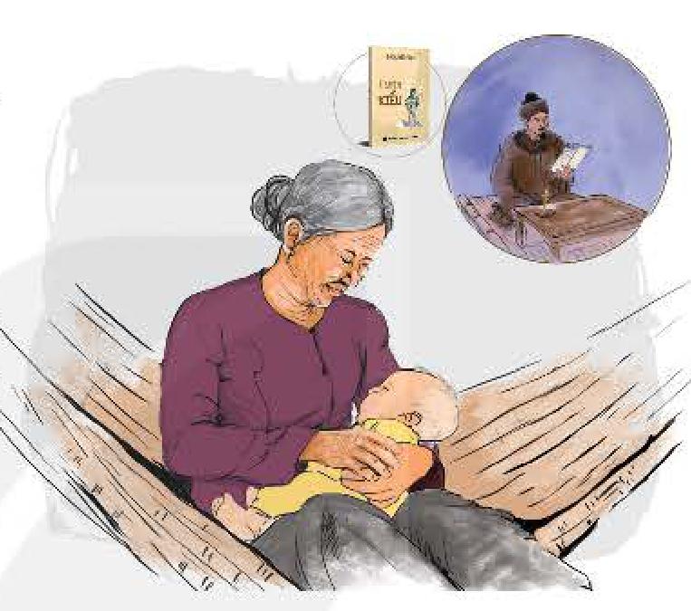

<!-- pdf:90 -->

# BÀI 4: KHÁM PHÁ VẺ ĐẸP VĂN CHƯƠNG

*Người đọc phải tự mình khám phá bộ mã nằm ngay trong văn bản*
*và hoạt động này tương đương với việc họ đem lại ý nghĩa cho văn bản.*
<!-- ocr-ok: câu đề từ chữ trắng trên nền hoa văn xanh bị OCR đọc nhầm nhiều từ, đã đối chiếu ảnh p090.png -->

Uốp-phờ-gang I-dơ (Wolfgang Iser)

## Giới thiệu bài học

- Tác phẩm văn học là thế giới của cái đẹp, vẫy gọi người đọc khám phá. Cái đẹp đó thường được thể hiện kín đáo trong ngôn từ, hình tượng, trong các thủ pháp nghệ thuật,... Để chạm tới được vẻ đẹp của văn chương, người đọc có thể tiếp cận bằng những con đường khác nhau, sử dụng những phương thức khác nhau.
- Trong bài học này, hai văn bản nghị luận văn học góp phần giúp em hiểu được con đường, cách thức khám phá vẻ đẹp văn chương của nhà nghiên cứu, phê bình văn học; văn bản thơ kết nối về chủ đề cho thấy một tác phẩm văn chương có thể được tiếp nhận khác nhau bởi những đối tượng có hiểu biết, vốn sống, trải nghiệm khác nhau.

## 🎯 Yêu cầu cần đạt

<!-- term: luận đề -->
<!-- term: luận điểm -->
<!-- term: lí lẽ -->
<!-- term: bằng chứng -->
<!-- term: người đọc -->
<!-- term: bối cảnh tiếp nhận -->
<!-- term: cách dẫn trực tiếp -->
<!-- term: cách dẫn gián tiếp -->
<!-- term: đạo văn -->
<!-- term: văn bản nghị luận phân tích một tác phẩm văn học -->
<!-- term: thảo luận về một vấn đề đáng quan tâm trong đời sống -->
- Nhận biết và phân tích được luận đề, luận điểm, lí lẽ và bằng chứng tiêu biểu trong văn bản.
- Nhận biết được vai trò của người đọc và bối cảnh tiếp nhận đối với việc đọc hiểu tác phẩm văn học; hiểu được cùng một vấn đề đặt ra trong văn bản, người đọc có thể tiếp nhận khác nhau.
- Nhận biết được sự khác nhau giữa cách dẫn trực tiếp và cách dẫn gián tiếp; biết cách dùng dấu câu khi dẫn trực tiếp và gián tiếp; biết cách tham khảo, trích dẫn tài liệu để tránh đạo văn.
- Viết được một văn bản nghị luận phân tích một tác phẩm văn học: phân tích nội dung chủ đề, những nét đặc sắc về hình thức nghệ thuật của tác phẩm và hiệu quả thẩm mĩ của nó; có hiểu biết và tôn trọng quyền sở hữu trí tuệ, biết cách trích dẫn văn bản của người khác.
- Biết thảo luận về một vấn đề đáng quan tâm trong đời sống phù hợp với lứa tuổi.
- Yêu thích việc khám phá vẻ đẹp văn chương, trân trọng lao động sáng tạo nghệ thuật của nhà văn.

<!-- pdf:91 -->

## Đọc

### TRI THỨC NGỮ VĂN

**Văn bản nghị luận viết về tác phẩm văn học**

<!-- term: văn bản nghị luận viết về tác phẩm văn học -->
<!-- term: luận điểm -->
<!-- term: lí lẽ -->
<!-- term: bằng chứng -->
Văn bản nghị luận văn học có thể bàn luận về nhiều đối tượng khác nhau, trong đó có tác phẩm văn học – trung tâm của hoạt động sáng tạo, kết nối tác giả với người đọc. **Văn bản nghị luận viết về tác phẩm văn học** là loại văn bản nhằm làm sáng tỏ các phương diện nội dung và hình thức của tác phẩm, thể hiện quan điểm, thái độ, cách đánh giá và kiến giải của người viết về tác phẩm. Vì vậy, nó cần được triển khai theo một hệ thống luận điểm rõ ràng, mạch lạc, dựa trên lí lẽ và bằng chứng thuyết phục. Những văn bản như thế không nhất thiết phải bàn luận một cách toàn diện về tác phẩm mà có thể đi sâu vào một hoặc một số khía cạnh nổi bật trong tác phẩm.

**Vai trò của người đọc và bối cảnh tiếp nhận đối với việc đọc hiểu văn bản**

<!-- term: người đọc -->
<!-- term: bối cảnh tiếp nhận -->
- Hoạt động đọc hiểu văn bản không thể thiếu nhân tố **người đọc**. Bằng sự tiếp nhận của mình, người đọc góp phần làm phong phú thêm ý nghĩa của tác phẩm văn học; tạo nên lịch sử tiếp nhận tác phẩm; tác động trở lại đối với hoạt động sáng tạo của nhà văn.
- **Bối cảnh tiếp nhận** tác phẩm bao gồm: bối cảnh thời đại, xã hội và hoàn cảnh riêng của mỗi cá nhân. Bối cảnh tiếp nhận có vai trò quan trọng, chi phối hoạt động tiếp nhận tác phẩm văn học, góp phần ảnh hưởng đến định hướng giá trị, trình độ tiếp nhận của người đọc. Mỗi thời đại hay mỗi xã hội đều có định hướng giá trị riêng, có mặt bằng trình độ tiếp nhận nhất định, những điều đó có ảnh hưởng đến từng cá nhân. Bối cảnh của cá nhân cũng chi phối sự tiếp nhận của người đọc, trong đó, hoàn cảnh sống, học tập của cá nhân và cả bối cảnh cụ thể tại thời điểm đọc đều ảnh hưởng đến tâm thế tiếp nhận.

**Cách dẫn trực tiếp và cách dẫn gián tiếp**

<!-- term: cách dẫn trực tiếp -->
<!-- term: cách dẫn gián tiếp -->
- **Cách dẫn trực tiếp** là sử dụng nguyên văn từ ngữ, câu, đoạn,... của một văn bản gốc vào bài viết, bài nói. Trong bài viết, phần dẫn trực tiếp cần được đặt trong dấu ngoặc kép.
- **Cách dẫn gián tiếp** là sử dụng ý tưởng của người khác và diễn đạt lại theo cách của mình. Tuy được diễn đạt lại nhưng ý tưởng trong văn bản gốc cần được thể hiện một cách trung thành. Trong bài viết, phần dẫn gián tiếp không đặt trong dấu ngoặc kép.

**Một số lưu ý về cách tham khảo, trích dẫn tài liệu**

<!-- term: đạo văn -->
<!-- term: nguồn của tài liệu tham khảo -->
Khi viết, chúng ta cần tìm kiếm ý tưởng, thông tin từ nhiều nguồn và đưa những ý tưởng, thông tin phù hợp vào bài viết theo cách dẫn trực tiếp hoặc gián tiếp. Ghi chú nguồn đúng quy cách là yêu cầu bắt buộc để tránh bị coi là **đạo văn**. **Nguồn của tài liệu tham khảo** thường bao gồm thông tin về tác giả và xuất xứ văn bản gốc. Mức độ cụ thể của thông tin về nguồn trích dẫn tuỳ thuộc vào tính chất của văn bản, chẳng hạn, bài nghiên cứu khoa học chuyên sâu thì thông tin về nguồn trích dẫn cần đầy đủ hơn bài viết của học sinh.

<!-- pdf:92 -->

### VĂN BẢN ĐỌC

- **VĂN BẢN 1.** *“Người con gái Nam Xương” – một bi kịch của con người*, Nguyễn Đăng Na
- **VĂN BẢN 2.** *Từ “Thằng quỷ nhỏ” của Nguyễn Nhật Ánh nghĩ về những phẩm chất của một tác phẩm viết cho thiếu nhi*, Trần Văn Toàn
- **VĂN BẢN 3.** *Ngày xưa*, Vũ Cao

### VĂN BẢN 1: “Người con gái Nam Xương” – một bi kịch của con người

**Trước khi đọc**

1. Kể tên một vài tác phẩm văn học Việt Nam viết về số phận bi kịch của con người.
2. Trong bài 1, em đã được học tác phẩm *Chuyện người con gái Nam Xương*. Hãy chia sẻ cảm nhận về một chi tiết mà em ấn tượng nhất trong tác phẩm.

**Đọc văn bản**

***Người con gái Nam Xương*(1) – một bi kịch của con người**

NGUYỄN ĐĂNG NA(2)

(1) *Người con gái Nam Xương* (*Nam Xương nữ tử truyện*) là một trong 11 truyện viết về đề tài phụ nữ của Nguyễn Dữ. Vũ Thị Thiết là nhân vật hoàn toàn có thật. Ngày nay tại Lý Nhân, Hà Nam còn đền thờ nàng. Kể từ khi nàng mất tới nay đã gần 5 thế kỉ, biết bao thế hệ, từ Lê Thánh Tông (1442 – 1497) – vị vua anh minh văn võ kiêm toàn đến các nhà khoa bảng “cưỡi đầu thiên hạ đã ba phen” như Nguyễn Khuyến (1835 – 1909)... đều đã phải rơi lệ xót thương cho thân phận nàng và gửi gắm niềm thương cảm của mình vào những bài thơ đề vịnh *Miếu vợ chàng Trương*.

> **Theo dõi:** Cách đặt vấn đề của tác giả.

(2) Cuộc đời Vũ Nương tuy ngắn ngủi, nhưng nàng đã kịp làm trọn nghĩa vụ của một kiếp đàn bà: làm con, làm dâu, làm vợ, làm mẹ. Mọi nỗi gian lao vất vả, nào khi sinh nở chẳng ai đỡ đần,

> **Theo dõi:** Nhận xét của tác giả về cuộc đời nhân vật Vũ Nương.

> (1) *Người con gái Nam Xương*: một cách dịch tên tác phẩm *Nam Xương nữ tử truyện* của Nguyễn Dữ (bản dùng ở bài 1 dịch là *Chuyện người con gái Nam Xương*).
> (2) Nguyễn Đăng Na (1942 – 2014) quê ở Đồng Tháp, là nhà nghiên cứu, phê bình văn học. Một số công trình tiêu biểu: *Văn xuôi tự sự Việt Nam thời trung đại* (tập I, 1997; tập II, 2001; tập III, 2000), *Con đường giải mã văn học trung đại Việt Nam* (2006),...

<!-- pdf:93 -->

nào một thân vừa nuôi con thơ, vừa chăm sóc thuốc thang cho mẹ chồng già yếu..., rồi khi mẹ chồng nằm xuống, lại một mình lo việc ma chay tế lễ, chôn cất... Tất cả những việc ấy, đối với nàng nào đáng kể chi, miễn sao có ngày hội ngộ, chồng sẽ trở về! Ngay như công danh, nàng cũng chẳng màng. Khi chồng ra đi, nàng giãi bày nỗi niềm của mình: “Chàng đi chuyến này, thiếp chẳng dám mong đeo được ấn phong hầu [...] chỉ xin ngày về mang theo được hai chữ bình yên, thế là đủ rồi”. Mong mỏi bao trùm cả cuộc đời nàng là “cái thú vui nghi gia nghi thất”, vợ chồng sum họp, con cái đề huề, được làm vợ, làm mẹ!

Sau ba năm đợi chờ, Trương Sinh trở về với hai chữ bình yên đúng như sở nguyện. Hạnh phúc đã mỉm cười, ước mơ đang đi vào hiện thực... Nhưng, oái oăm thay cho cuộc đời: Ngày sum họp cùng chồng, cũng là ngày nàng phải vĩnh viễn lìa xa tổ ấm. Và đau đớn hơn, kẻ đẩy nàng vào cái chết bi thảm không phải ai xa lạ, mà là chính người chồng nàng hằng “ba năm giữ gìn một tiết” đợi chờ và đứa con trai duy nhất mà nàng suốt ba năm nâng niu bú mớm. Hai người thân thương nhất, gần gũi nhất lại là kẻ gây ra oan trái cho đời nàng! Mà họ đâu phải là kẻ độc ác và nàng đâu có phải là kẻ phản bội chồng con! Đứa trẻ thì ngây thơ, chỉ kể lại những điều mà đêm đêm mẹ thường dạy khi cha vắng nhà; nó không thể phân biệt được giữa đùa với thật vì mới có ba tuổi đầu và tin lời mẹ. Còn người chồng thì cả ghen, hàm hồ và mù quáng.

(3) Là người cùng làng, chàng thừa biết đức hạnh của vợ. Chính vì “mến vì dung hạnh” của nàng, chàng mới “xin với mẹ đem trăm lạng vàng cưới về”. Nhưng, ghen tuông là ghen tuông! Cái tâm lí ghen tuông rất lạ. Dù mới cưới nhau mà Trương Sinh vẫn “phòng ngừa quá sức”. Song, khi đó hai người còn ở bên nhau và “nàng cũng giữ gìn khuôn phép” nên chưa xảy ra chuyện gì. Nay đã có khoảng trống về thời gian và không gian: ba năm xa cách. Chàng không thể kiểm soát được tất cả mọi hành vi của vợ. Ghen tuông thường đa nghi, mà đa nghi dễ dẫn đến định kiến. Do đó chỉ cần một cớ rất nhỏ, có khi hết sức mơ hồ, thậm chí chẳng cần một cớ gì cũng có thể tưởng tượng ra thành sự việc nghiêm trọng, một sự phản bội ô nhục làm bại hoại gia phong... Cái hàm hồ của tính ghen tuông thường dẫn đến tan cửa nát nhà và oan khiên giáng xuống.

> **Theo dõi:** Nét tính cách của nhân vật Trương Sinh được tác giả tập trung phân tích.
<!-- ocr-ok: thẻ Theo dõi cột phải bị OCR trộn vào văn bản chính và đọc lỗi nhiều chữ, đã đối chiếu ảnh p093.png -->

Ở đây ta cũng nên có một chút cảm thông với Trương Sinh. Ba năm đời lính làm chàng mệt mỏi chán chường. Về tới nhà, lại gặp cảnh đau lòng: “Cha về, bà đã mất, lòng cha buồn khổ lắm rồi”... Nỗi buồn tê tái đè nặng lên trái tim anh lính Trương Sinh. Nếu như đối với Vũ Nương, chỗ dựa để có thể tồn tại là con và chồng, thì đối với Trương Sinh, chỗ dựa để sống được là con và vợ. Thế mà, hình như có một người đàn ông thứ hai nào đó không rõ mặt mũi, họ tên đã len lỏi vào gia đình chàng, đã chiếm mất tình cha con của chàng: “Ô hay! Thế ra ông cũng là cha tôi ư? Ông lại biết nói, chứ không như cha tôi trước kia chỉ nín thin thít”. Đứa bé đã có hai người cha: một người xuất hiện khi chàng vắng nhà và một người là chàng. Chỗ dựa thứ nhất không còn.

> **Chú ý:** Lí lẽ và bằng chứng được tác giả sử dụng để bày tỏ suy nghĩ về nhân vật Trương Sinh.
<!-- ocr-ok: thẻ Chú ý cột phải bị OCR trộn vào văn bản chính và đọc lỗi nhiều chữ, đã đối chiếu ảnh p093.png -->

<!-- pdf:94 -->

Tuy nhiên, sự sụp đổ ấy chưa quan trọng đối với chàng. Chỉ đến lúc đứa bé kia khẳng định: “Trước đây, thường có một người đàn ông, đêm nào cũng đến” thì cơn ghen mới thực sự bùng lên. Chỗ dựa thứ hai hoàn toàn sụp đổ! Sự nghi ngờ vợ “không có gì gỡ ra được”. Đứa bé không biết nói dối. Chàng tin con. Mọi chi tiết đứa bé cung cấp đều chứng tỏ người đàn ông kia hành tung hết sức mờ ám, bí hiểm: đêm nào cũng đến, chỉ nín thin thít, chẳng bao giờ bế Đản... Đã thế, họ lại xoắn xuýt bên nhau: “mẹ Đản đi cũng đi, mẹ Đản ngồi cũng ngồi”. Sự bí ẩn về người đàn ông đó như những mũi dao xoáy vào tâm can và khơi vào đúng chỗ yếu nhất của chàng: tính đa nghi và cả ghen. Đã ghen, cần gì chứng cớ. Huống chi, nay chứng cứ đã rành rành ra đấy. Cái li kì trong “vụ án” đẩy mâu thuẫn gia đình Trương Sinh đến cực điểm và châm ngòi cho quả bom ghen tuông bùng nổ.

Tuy căng thẳng như vậy, song cái án “ngoại tình” sẽ được giải quyết ngay lập tức chỉ cần một điều kiện cực kì giản đơn: Trương Sinh cho biết ai đã cung cấp nguồn tin kia. Nhưng, điều kiện ấy như một thách thức trái tim ghen tuông của chàng. Chàng không nói! Cũng chẳng cần nói và không đủ can đảm nói. Cái định kiến về việc vợ hư đã đóng đinh vào đầu rồi. Chàng chẳng còn đủ tỉnh táo để suy xét lời đứa con nói. Ngay những lời van xin đến rớm máu của vợ, chàng cũng chẳng để lọt vào tai: “Nay đã bình rơi trâm gãy, mây tạnh mưa tan, sen rũ trong ao, liễu tàn trước gió; khóc tuyết bông hoa rụng cuống, kêu xuân cái én lìa đàn, nước thẳm buồm xa, đâu còn có thể lại lên núi Vọng Phu kia nữa”. Cơn ghen ở anh lính nông dân vốn không được học hành bùng ra thành những lời “la um lên cho hả giận”, rồi chuyển sang ngấm ngầm dấm dứt “lấy chuyện bóng gió này nọ mà mắng nhiếc nàng, và đánh đuổi đi”. Vũ Nương không thể chứng minh cho nỗi oan của mình. Họ hàng làng xóm “bênh vực và biện bạch cho nàng cũng chẳng ăn thua”. Cuối cùng, Vũ Nương chỉ còn biết bày tỏ tấm lòng trong trắng bằng cách “gieo mình xuống sông mà chết”.

Nỗi oan của Vũ Nương sẽ còn đeo đẳng mãi lấy nàng, nếu như không có một đêm tình cờ đứa bé nói: “Cha Đản lại đến kia kìa!”. Người cha thứ hai của bé Đản – nguyên nhân gây ra cái chết bi thảm cho Vũ Nương lại xuất hiện. “Chàng hỏi đâu. Nó chỉ bóng chàng ở trên vách:

– Đây này!

Thì ra, ngày thường, ở một mình, nàng hay đùa con, trỏ bóng mình mà bảo là cha Đản”.

> **Chú ý:** Cách tác giả phân tích chi tiết chiếc bóng trên vách – chi tiết mang tính thắt nút – mở nút.
<!-- ocr-ok: thẻ Chú ý cột phải bị OCR đọc lỗi nặng phần cuối, đã đối chiếu ảnh p094.png -->

Té ra chỉ là một trò đùa! Một trò đùa trong thương nhớ nhưng đem tới cái chết oan khiên vì lòng ghen mù quáng. Vợ chồng yêu nhau quyến luyến không rời như hình với bóng. Nàng là hình, chàng là bóng. Bóng với hình quấn quýt không rời: “mẹ Đản đi cũng đi, mẹ Đản ngồi cũng ngồi”. Nàng chết, hình đã mất, bóng đâu còn! Sự lẻ loi đơn chiếc và nỗi ân hận sẽ là một hình phạt giày vò Trương Sinh mãi mãi.

Lấy hình tượng cái bóng người và lời nói ngây thơ của đứa con để đẩy câu chuyện tới đỉnh điểm là nét độc đáo riêng của Nguyễn Dữ, không thể tìm thấy trong bất cứ truyện truyền kì nào của Việt Nam cũng như của các nước Trung Hoa, Nhật Bản, Hàn Quốc,...

<!-- pdf:95 -->

Tuy nhiên, công bằng mà xét, cái bi kịch của Vũ Thị Thiết một phần là do nàng. Từ trước, nàng đã biết chồng “có tính đa nghi, đối với vợ phòng ngừa quá sức”. Vậy mà, lúc chồng vắng nhà, đặc biệt vào ban đêm, nàng lại trỏ bóng mình mà bảo con rằng, đấy là cha nó. Bé Đản tin mẹ, nên tưởng cái bóng kia là cha mình thật. Nào ngờ, có một người khác – Trương Sinh, cũng xưng là cha. Nó ngạc nhiên là phải, vì điều người bố thật vừa xưng cha với nó, mẹ chưa từng bảo. Đầu óc ngây thơ của đứa bé vẫn đinh ninh rằng, mình có hai người cha: một người do mẹ trỏ cho và một người tự nhận. Nó cảm thấy hai người cha của mình rất khác nhau, nên đã đem ra so sánh. Giá như Vũ Nương biết tâm lí chồng, tránh đi những gì có thể khiến Trương Sinh ghen tuông ngờ vực thì đâu đến nỗi. Vợ chồng mà chẳng biết tính của nhau, dù có thương yêu nhau, chẳng trước thì sau, bi kịch ắt xảy đến. Đấy cũng là một khía cạnh Nguyễn Dữ muốn nói với người đời.

> **Chú ý:** Vì sao tác giả cho rằng “bi kịch của Vũ Thị Thiết một phần là do nàng”?

(4) Là nhà văn nhân đạo, Nguyễn Dữ không muốn những người đức hạnh, nết na như Vũ Nương bị chết. Song, hiện thực là hiện thực. Vũ Nương đã chết! Để minh oan và bù đắp cho lòng ngay thẳng, hiếu thảo, thuỷ chung của nàng, tác giả đã tưởng tượng ra [...] cảnh Vũ Nương hội ngộ với Trương Sinh. [...] Tái hợp là nguyện vọng của mọi người. Cái tài của Nguyễn Dữ là ông đã dung hoà được hiện thực với ước mơ, giữa cái tồn tại với cái ảo ảnh. Vũ Nương trở về dương thế, nhưng chỉ hiện ra “ở giữa dòng mà nói vọng vào: – [...] thiếp chẳng thể trở về nhân gian được nữa”. Ảo ảnh chập chờn và mau chóng tan biến. Chia li là vĩnh viễn. Người chết chẳng thể nào sống lại: “trong chốc lát, bóng nàng loang loáng mờ nhạt dần mà biến đi mất”. Hiện thực trở về. Đấy chính là nét đặc sắc trong truyện truyền kì của Nguyễn Dữ mà các tác giả sau chẳng thể vượt qua. Ảo ảnh đoàn tụ mau chóng tan biến để lại một hiện thực đắng cay chẳng ai muốn nhưng không thể đảo ngược lại được: Trương Sinh sống trong cảnh “phòng không vắng vẻ, chàng ngồi buồn dưới ngọn đèn khuya”. Đứa trẻ mồ côi, người chồng cô đơn, người vợ bị chết... Đấy là bi kịch gia đình.

> **Chú ý:** Nhận định của người viết về nét độc đáo ở truyện truyền kì Nguyễn Dữ.

(5) Có thể nói, với *Người con gái Nam Xương*, Nguyễn Dữ đã vượt khỏi những công thức thông lệ về hình tượng người phụ nữ trong thể truyền kì. Vũ Nương không phải là hình tượng một trang liệt nữ, nàng chỉ là một người đàn bà bình thường như bao người vợ, người mẹ trong đời thực. Phản ánh số phận Vũ Thị Thiết, Nguyễn Dữ đã đề cập tới cái bi kịch muôn thuở của con người. Có lẽ vì vậy mà *Người con gái Nam Xương* vẫn còn sức hấp dẫn đối với người đọc ngày nay.

> **Chú ý:** Cách tác giả kết thúc vấn đề.

(Nguyễn Đăng Na, *Con đường giải mã văn học trung đại Việt Nam*, NXB Giáo dục, 2007, tr. 217 – 221)

<!-- pdf:96 -->

**Sau khi đọc**

**Trả lời câu hỏi**

<!-- term: bố cục -->
<!-- term: luận đề -->
<!-- term: luận điểm -->
<!-- term: lí lẽ -->
<!-- term: bằng chứng -->
<!-- term: truyện truyền kì -->
<!-- term: văn bản nghị luận văn học -->
1. Xác định vấn đề được bàn luận và bố cục của bài nghị luận.
2. Từ luận đề, tác giả đã triển khai các luận điểm theo trình tự nào?
3. Đọc phần (2) và cho biết, theo tác giả, bi kịch của nhân vật Vũ Nương là gì. Tác giả đã làm sáng tỏ bi kịch ấy qua những lí lẽ và bằng chứng nào?
4. Đọc phần (3) và cho biết, theo tác giả, điều gì đã khiến Vũ Nương nhảy xuống sông tự tử. Em có suy nghĩ gì về cách lí giải của tác giả?
5. Những nét đặc sắc nào trong truyện truyền kì của Nguyễn Dữ được làm rõ ở phần (4)?
6. Đọc phần (3) và phần (5), cho biết tác giả đã làm nổi bật nét độc đáo trong truyện truyền kì của Nguyễn Dữ bằng cách nào. Những câu văn nào giúp em hiểu rõ về nét độc đáo của truyện truyền kì Nguyễn Dữ?
7. Phần (5) có vai trò gì trong bài nghị luận? Câu văn nào giúp em xác định được vai trò ấy?
8. Một số chi tiết và nhân vật trong tác phẩm *Người con gái Nam Xương* không được tác giả bài nghị luận phân tích, chẳng hạn như chi tiết người mẹ dặn dò trước khi Trương Sinh ra trận, các nhân vật Linh Phi, Phan Lang,... Từ đó, em có suy nghĩ gì về việc sử dụng lí lẽ và dẫn chứng trong văn bản nghị luận văn học?

#### Viết kết nối với đọc
<!-- ocr-ok: tiêu đề màu cam bị OCR đọc nhầm thành "VIẾT KẾT NốI VữI BE", đã đối chiếu ảnh p096.png -->

Em có đồng tình với những phân tích của tác giả bài viết *“Người con gái Nam Xương” – một bi kịch của con người* về chi tiết chiếc bóng trên vách không?

Viết đoạn văn (khoảng 7 – 9 câu) để trả lời câu hỏi trên.

### Thực hành tiếng Việt

*CÁCH DẪN TRỰC TIẾP VÀ CÁCH DẪN GIÁN TIẾP*

<!-- term: cách dẫn trực tiếp -->
<!-- term: cách dẫn gián tiếp -->
1. Xác định phần dẫn trong các câu sau, cho biết phần đó được dẫn theo cách trực tiếp hay gián tiếp. Những dấu hiệu nào giúp em nhận ra điều đó?

   a. *Khi chồng ra đi, nàng giãi bày nỗi niềm của mình: “Chàng đi chuyến này, thiếp chẳng dám mong đeo được ấn phong hầu [...], chỉ xin ngày về mang theo được hai chữ bình yên, thế là đủ rồi”.*

   (Nguyễn Đăng Na, *“Người con gái Nam Xương” – một bi kịch của con người*)

> **Nhận biết cách dẫn trực tiếp và cách dẫn gián tiếp**
>
> - Đọc ví dụ sau:
>   *Hoài Thanh nói rõ quan niệm của ông về phê bình: “Điều tôi ngại nhất là mang tên nhà phê bình. Hai chữ phê bình sao nghe nó khó chịu quá”.*
>   (Đỗ Đức Hiểu, *14 tháng Bảy 1789 và “Thi nhân Việt Nam”*)

<!-- pdf:97 -->

>   Trong ví dụ trên, người viết đã dùng **cách dẫn trực tiếp**, đánh dấu phần dẫn bằng dấu hai chấm và dấu ngoặc kép.
> - Đọc ví dụ sau:
>   *M. Go-rơ-ki đã kể chuyện* ***ông đọc nhiều như thế nào trước khi thành nhà văn lớn.*** *Muốn học giỏi văn phải bắt đầu bằng đọc văn.*
>   (Trần Đình Sử, *Đọc văn – cuộc chơi tìm ý nghĩa*)
>   Trong ví dụ trên, bộ phận in đậm là phần **dẫn gián tiếp** lời kể của nhà văn M. Go-rơ-ki, phần dẫn này không được đặt trong dấu ngoặc kép.
>
> **Chuyển đổi từ cách dẫn trực tiếp sang cách dẫn gián tiếp**
>
> - Phân tích ví dụ sau:
>   *Hoài Thanh nói rõ quan niệm của ông về phê bình: “Điều tôi ngại nhất là mang tên nhà phê bình. Hai chữ phê bình sao nghe nó khó chịu quá”.*
>   (Đỗ Đức Hiểu, *14 tháng Bảy 1789 và “Thi nhân Việt Nam”*)
>   Có thể chuyển từ cách dẫn trực tiếp trong ví dụ trên sang cách dẫn gián tiếp như sau:
>   *Trong “Thi nhân Việt Nam”, Hoài Thanh bày tỏ sự ngại ngùng, khó chịu khi được gọi là nhà phê bình.*
> - Từ việc phân tích ví dụ trên, có thể thấy, khi chuyển từ cách dẫn trực tiếp sang cách dẫn gián tiếp, cần:
>   – Lược bỏ dấu ngoặc kép, dấu hai chấm đánh dấu phần trích dẫn trực tiếp.
>   – Diễn đạt lại nội dung phần dẫn trực tiếp.

   b. *Theo như lời thầy giáo của tôi bảo, người La Mã xưa kia nuôi ong trong những cái tổ bằng đồng hình chiếc vại, có đục thủng nhiều hàng lỗ con vòng quanh miệng, quanh đáy.*

   (Đoàn Giỏi, *Đất rừng phương Nam*)

2. Hãy chuyển cách dẫn trực tiếp trong các câu dưới đây sang cách dẫn gián tiếp:

   a. *Thủ lĩnh da đỏ Xi-át-tơn đã khẳng định: “Đối với đồng bào tôi, mỗi tấc đất là thiêng liêng, mỗi lá thông óng ánh, mỗi bờ cát, mỗi hạt sương long lanh trong những cánh rừng rậm rạp, mỗi bãi đất hoang và tiếng thì thầm của côn trùng là những điều thiêng liêng trong kí ức và kinh nghiệm của đồng bào tôi.”.*

   (*Theo* Hoàng Vĩnh, tạp chí *Văn học và Tuổi trẻ*, tháng 4/2023)

   b. *Nỗi oan của Vũ Nương sẽ còn đeo đẳng mãi lấy nàng, nếu như không có một đêm tình cờ đứa bé nói: “Cha Đản lại đến kia kìa!”.*

   (Nguyễn Đăng Na, *“Người con gái Nam Xương” – một bi kịch của con người*)

   c. *Trong “Thi nhân Việt Nam”, Hoài Thanh đã bộc lộ thành thực một tâm trạng:*

   *“Dẫu có ưa thơ người này người khác, mỗi lúc buồn đến, tôi lại trở về với Lưu Trọng Lư. Có những bài thơ cứ vương vấn trong trí tôi hàng tháng, lúc nào cũng như văng vẳng bên tai. Bởi vì thơ Lư nhiều bài thực không phải là thơ, nghĩa là những công trình nghệ thuật, mà chính là tiếng lòng thổn thức cùng hoà theo tiếng thổn thức của lòng ta”.*

   (Lê Quang Hưng, *“Nắng mới” – sự thành thực của một tâm hồn giàu mơ mộng*)

3. Viết đoạn văn nghị luận (khoảng 5 – 7 câu) có nội dung liên quan đến ý kiến dưới đây, trích dẫn ý kiến đó theo cách trực tiếp hoặc gián tiếp:

   *Có thể nói, với “Người con gái Nam Xương”, Nguyễn Dữ đã vượt khỏi những công thức thông lệ về hình tượng người phụ nữ trong thể truyền kì.*

   (Nguyễn Đăng Na, *“Người con gái Nam Xương” – một bi kịch của con người*)

<!-- pdf:98 -->

### VĂN BẢN 2: Từ “Thằng quỷ nhỏ” của Nguyễn Nhật Ánh nghĩ về những phẩm chất của một tác phẩm viết cho thiếu nhi

**Trước khi đọc**

Em đã đọc tác phẩm văn học nào viết về những con người có ngoại hình khác lạ? Chia sẻ ngắn gọn cảm nhận của em về tác phẩm ấy.

**Đọc văn bản**

**Từ *Thằng quỷ nhỏ*(1) của Nguyễn Nhật Ánh nghĩ về những phẩm chất của một tác phẩm viết cho thiếu nhi**

TRẦN VĂN TOÀN(2)

(1) Theo tôi, *Thằng quỷ nhỏ* (xuất bản lần đầu năm 1990) của Nguyễn Nhật Ánh không chỉ hàm chứa những thông điệp sâu sắc mà còn gợi mở nhiều suy ngẫm về phẩm chất của một tác phẩm văn học viết cho thiếu nhi.

Trước tiên là nhan đề của tác phẩm: *Thằng quỷ nhỏ*. Chữ “quỷ” mà Nguyễn Nhật Ánh sử dụng ở đây để chỉ sự kì dị trong nhân dạng. Quỳnh – người mang biệt danh thằng quỷ nhỏ – được miêu tả với những đặc điểm: hai vành tai to, mỗi khi Quỳnh có tâm trạng nó lại ve vẩy như cánh bướm; thêm vào đó, là chiếc mũi to, đỏ ửng, lấm tấm mồ hôi. Những nét kì dị ấy vì gắn với gương mặt của nhân vật nên trở thành những khiếm khuyết không thể che giấu và nó trở thành dấu hiệu thường trực để nhận biết về nhân vật.

> **Theo dõi:** Cách giải thích của tác giả bài nghị luận về nhan đề của tác phẩm văn học được bàn luận.

> (1) *Thằng quỷ nhỏ* là truyện dài tiêu biểu của Nguyễn Nhật Ánh. Truyện gồm 21 chương, nhân vật chính là Quỳnh, cậu bé có biệt danh “thằng quỷ nhỏ” bởi ngoại hình khác thường. Câu chuyện xoay quanh các nhân vật trong lớp học của Quỳnh như Nga, Khải, Hạnh, Luận,... Nếu các bạn trong lớp chỉ lấy Quỳnh làm trò tiêu khiển thì Nga, học sinh mới của lớp, được xếp ngồi cạnh Quỳnh, lại coi cậu như một người bạn. Sự thân thiết của họ thường xuyên bị Luận, một học sinh nghịch ngợm trêu đùa ác ý. Về sau, Luận bớt trêu chọc khi vô tình biết được hoàn cảnh khó khăn của Quỳnh. Khải, lớp phó của lớp có tình cảm với Nga, nhưng Khải càng bộc lộ thì Nga càng giữ khoảng cách. Quỳnh cũng nảy sinh tình cảm với Nga, nhưng cậu giấu kín trong lòng, chỉ trong một lần Nga đến nhà Quỳnh khi cậu không ở nhà, vô tình phát hiện ra cuốn vở ghi chép những vần thơ của Quỳnh, cô mới biết Quỳnh có tình cảm với mình. Điều này khiến Nga tránh mặt và xa cách cậu, bởi cô chỉ coi Quỳnh là bạn. Biến cố xảy ra với gia đình Quỳnh khi mẹ cậu bị ngã, sau đó bị liệt, Quỳnh phải đưa mẹ về quê chăm sóc, không thể từ biệt Nga. Trong một lần tình cờ gặp Luận, Nga mới biết về hoàn cảnh tội nghiệp của Quỳnh. Quỳnh gửi lại cho Nga cuốn sách về nghệ thuật cắm hoa (với lời đề tặng: “Mến tặng Nga – Khải”) và chùm hoa thạch thảo – loài hoa tượng trưng cho sự lưu luyến lúc chia tay. Nga nhận quà và ngẩn ngơ nhìn ra sân nắng. Cô nghĩ mình sẽ trồng trước nhà một bụi thạch thảo.
> (2) Trần Văn Toàn sinh năm 1973, quê ở Nam Định, là giảng viên, nhà nghiên cứu, phê bình văn học. Một số công trình tiêu biểu: *Văn học Việt Nam từ đầu thế kỉ XX đến 1945* (viết chung, 2016), *Lược sử văn học Việt Nam* (viết chung, 2022),...

<!-- pdf:99 -->

Cái nhân dạng tưởng như hoàn toàn bề ngoài ấy, trên thực tế, đã quyết định toàn bộ nhân cách và vị thế tồn tại của Quỳnh. Nhân dạng lạ lẫm với chúng bạn đã khiến cậu bé ấy phải chịu thân phận một kẻ lạc loài. Trong mắt mọi người, Quỳnh chỉ là một thằng hề, để tiêu khiển, để mua vui cho đám đông hồn nhiên, vô tâm: “Họ lấy anh làm trò tiêu khiển. Anh giúp họ giải buồn hoặc thoả mãn tính hiếu kì hoặc lấp đầy những phút giây nhàn rỗi.”. Ngay cả với Hạnh, cô lớp trưởng luôn đúng mực, người luôn đứng ra trấn áp những kẻ bày trò tai quái với Quỳnh thì giữa họ vẫn có một khoảng cách mênh mông: “Bàn có hai người, nhưng mỗi người ngồi tít một đầu, chừa khoảng trống ở giữa”. Các lớp học của Nguyễn Nhật Ánh, được viết từ những kí ức xưa cũ, luôn chật chội. Anh có riêng một câu chuyện dài với nhan đề: *Bàn có năm chỗ ngồi*. Vậy nên, cái bàn học chỉ với hai chỗ ngồi và khoảng trống ở giữa là một ngoại lệ. Cái ngoại lệ ấy, hẳn có nguyên nhân từ sự dị thường trong ngoại hình của Quỳnh. Cái khoảng trống ấy là khoảng chân không ngăn cách Quỳnh với thế giới còn lại. Quỳnh như thuộc về một thế giới khác. Lạc lõng và lạc loài. Sự lạc loài ấy, cái khoảng cách ấy đã che khuất tất cả tồn tại đích thực của Quỳnh. Sự bất hạnh trong cuộc sống của Quỳnh là một bí mật với cả lớp. Và cả những phẩm chất đẹp đẽ của Quỳnh dù vẫn hiện diện nhưng chẳng ai nhận thấy giá trị đích thực của nó. Mấy chiếc chân bàn lung lay trong lớp đã được đóng lại nhưng không ai đánh giá đúng ý nghĩa đôi bàn tay khéo léo của Quỳnh. Trái tim nhân hậu của chú bé ấy mãi mãi chỉ là những bí mật của riêng Nga – người duy nhất, vì những ngẫu nhiên, đã nhận và chứng kiến những gì Quỳnh làm cho bạn bè, cho những đứa trẻ nghèo quanh nhà mình. Không ai muốn biết. Tất cả đều dừng lại trước một kẻ có ngoại hình lạ lẫm, kì dị.

> **Theo dõi:** Những lí lẽ và bằng chứng tác giả sử dụng để phân tích thái độ của các nhân vật trong truyện đối với Quỳnh.

Chẳng những thế, sự lạc loài khiến mọi tình cảm của một con người bình thường, nếu xuất hiện ở Quỳnh, thì trong mắt bạn bè đều là một cái gì khác thường, kệch cỡm. Tình cảm bạn bè của Quỳnh và Nga là đề tài cho mấy câu vè quái ác của Luận. Không ai tin được bên trong cái dung mạo dị thường của Quỳnh lại tồn tại những tình cảm của một con người bình thường. Ngay cả Nga, dù đã xem Quỳnh là bạn, nhưng khi thấy Quỳnh chép một số bài thơ tình trong sổ tay thì một phản xạ tự nhiên của cô là: “Nga mỉm cười nhủ bụng: hoá ra anh chàng này cũng mơ mộng gớm, thế mà mình cứ tưởng!”. Và khi, một cách tình cờ, biết được tình cảm đặc biệt mà Quỳnh dành cho mình thì Nga đã thật sự hoảng sợ: “Cứ hình dung đến cảnh phải đi chơi bên cạnh một con người có cái mũi to tướng và hai vành tai cũng to tướng không kém, lại không ngừng ve vẩy, Nga bất giác rùng mình.”.

Những cảm giác của Nga trước Quỳnh là rất chân thực. Đó là cảm giác khi tiếp xúc một cách quá gần gũi trước một tồn tại khác mình, lạc loài với mình. Để tô đậm cái thân phận lạc loài của Quỳnh trong mắt Nga, Nguyễn Nhật Ánh đưa ra chân dung của Khải: một cậu học sinh đẹp trai, chững chạc, là học sinh tiên tiến. Cũng như Quỳnh,

<!-- pdf:100 -->

Khải thích Nga. Nhưng Khải không mặc cảm như Quỳnh. Ngoại hình dễ ưa và những lợi thế khác khiến Khải tự tin để đến nhà Nga. Và đây là phản ứng của Nga trước hai cách thức bày tỏ tình cảm của hai người bạn trai: “Khi Khải lì lợm “tiến tới” thêm một bước, Nga càng ghét Khải. Với Quỳnh, mọi chuyện không giống như vậy. Tình yêu của Quỳnh là một tình yêu cháy bỏng nhưng lặng lẽ. Nga biết được hoàn toàn do tình cờ. Và Nga chẳng cảm thấy ghét Quỳnh. Nga chỉ sợ”. Rất rõ ràng: với Khải, Nga ghét. Với Quỳnh, Nga sợ. “Ghét” là sự xa cách với đồng loại. Nhưng “sợ” lại là sự xa cách với kẻ khác loại với mình. Nhưng đừng trách cô bé ấy. Sự sợ hãi trước một tồn tại khác loài với mình dường như là một đặc điểm phổ biến của nhân tính?

(2) Vậy là, mọi nông nỗi của Quỳnh đều bắt đầu từ ngoại hình dị thường, lạc loài của chú bé ấy. Chứng kiến câu chuyện của Quỳnh, người đọc nhận thấy một sự thật: nhân dạng hoá ra không phải là bề ngoài, một thứ “nước sơn” như lời khẳng định của một câu tục ngữ. Nhân dạng cũng được nhào nặn và xét đoán theo các chuẩn mực giá trị. Nhân dạng là của riêng một cá nhân nhưng nó lại được định giá bởi cộng đồng. Nó không phải chỉ là những cơ quan để thực hiện các chức năng sinh học mà còn được nhào trộn và định giá theo chuẩn mực, quy tắc thẩm mĩ của một cộng đồng. Một kẻ có nhân dạng dị thường, lạc loài khó có thể được chấp nhận có một tâm hồn bình thường trong mắt người khác.

> **Chú ý:** Quan điểm của tác giả về nhân dạng của con người.

Những nghiên cứu về nhân học cho thấy: trong bất kì một xã hội nào, luôn tồn tại các quy chuẩn. Các quy chuẩn này trong khi thiết lập những giới hạn được xem là hợp thức bao giờ cũng hàm ẩn trong nó sự bài trừ, gạt bỏ những gì đi chệch ra ngoài giới hạn đã được định ra. Từ đây mà hình thành cặp nhị phân: bình thường và bất bình thường. Bình thường và bất bình thường trong trí tuệ, trong giới tính, trong hành vi,... và cả trong nhân dạng nữa. Trong trường hợp của chú bé Quỳnh, thì sự bất bình thường trong nhân dạng đã mặc nhiên ấn định cho sinh thể bé nhỏ ấy vị thế của một kẻ lạc loài trong mắt đồng loại. Một mặt, bạn bè dành cho Quỳnh một ứng xử đầy khoảng cách và trịch thượng nhưng mặt khác, bản thân Quỳnh cũng thấy ứng xử ấy của cộng đồng là tự nhiên, chú chấp nhận nó, dù trong lặng lẽ, trong buồn tủi nhưng không hề có ý định bất bình và phản kháng. Chuẩn mực, như thế, mang trong nó quyền lực và sức mạnh áp đặt. Nó bắt những cá nhân phải tuân thủ mà không có quyền được phản biện.

Những tiêu chuẩn về nhân dạng tưởng như có tính thẩm mĩ, tưởng như khách quan và đầy nhân tính của chúng ta kì thực là một quyền lực mang trong nó hoạt động loại trừ với những gì còn lại, những gì thuộc về số ít, những gì lệch chuẩn,

> **Theo dõi:** Lí giải của tác giả về cách ứng xử và phản ứng của chúng ta trước một chân dung khác lạ.

<!-- pdf:101 -->

những gì dị thường. Điều này giải thích tại sao trong truyện cổ tích, sự kì dị trong nhân hình chỉ là vỏ bọc nhất thời của nhân vật chính diện. Sớm muộn gì thì nhân vật đó cũng trút bỏ lốt ngoài kì dị để tìm được sự hài hoà giữa nhân hình và nhân tính. Lí do: ở thể loại tuy huyễn tưởng trong thế giới hình tượng nhưng lại mang đậm những quy chuẩn của cộng đồng như truyện cổ tích thì một sự lệch pha giữa nhân hình và nhân tính là không được phép tồn tại. Có thể thấy: không chỉ nhân tính mà ngay cả nhân hình cũng đều được phân loại, điều chỉnh bởi những quy chuẩn, đều là những tạo tác mang tính văn hoá.

(3) Từ *Thằng quỷ nhỏ*, tôi muốn đi đến một vài thảo luận về những phẩm chất cần có ở một tác phẩm viết cho thiếu nhi.

Trước tiên, chúng ta vẫn thường nghĩ, một tác phẩm văn học thiếu nhi phải góp phần hình thành những chuẩn mực văn hoá của một cộng đồng trong tâm hồn của trẻ thơ. Điều này không sai, nhưng có lẽ là chưa đủ. Bởi lẽ, cũng cần nhận diện đầy đủ về những gì đã bị đặt ra ngoài chuẩn mực ấy. Không nên đối xử với những ngoại lệ, những bất thường như những gì sai lạc, như những tồn tại thứ cấp mà có lẽ cần hình dung về chúng như những tồn tại khác. Hiểu đó là một tồn tại khác sẽ giúp chúng ta biết tôn trọng những khác biệt chứ không miệt thị và xa lánh. Không hiểu điều đó, thì ngay một đứa trẻ hồn nhiên, ngây thơ nhất cũng có thể có những hành vi thật tàn nhẫn (hãy nhớ lại những chế nhạo tai quái mà Luận dành cho Quỳnh). Trong bối cảnh hiện nay, toàn cầu hoá là một tình thế tồn tại song song, thậm chí là đan xen của những nền văn hoá khác biệt một cách gay gắt. Sự tôn trọng những khác biệt vì thế đang là đạo lí sống của con người trong một thời đại mới. Học cách ứng xử trước những khác biệt ngay trong nội tại một nền văn hoá chính là những trải nghiệm khởi đầu để sống với những khác biệt giữa những nền văn hoá. Chính từ đây mà tác phẩm sẽ là nơi đánh thức và nuôi dưỡng tình yêu thương, sự trân trọng một tồn tại khác với những nỗ lực để thấu hiểu và tôn trọng.

> **Chú ý:** Quan điểm của tác giả về phẩm chất của một tác phẩm văn học thiếu nhi.

Thứ hai, không nên biến những nhân vật trong các tác phẩm văn học thiếu nhi trở thành những nhân vật hoàn hảo. Những nhân vật trong *Thằng quỷ nhỏ* (cũng như nhiều nhân vật khác trong sáng tác của Nguyễn Nhật Ánh) đều không phải là những nhân vật hoàn hảo. Khải đẹp trai, có tình cảm chân thành nhưng có phần lạm dụng những chiến thuật, tiểu xảo, có lúc nhỏ nhen. Nga nhân hậu nhưng không thật sâu sắc. Luận tinh nghịch, có khi vô tâm nhưng cũng biết chạnh lòng... Đọc *Thằng quỷ nhỏ*, tôi rất có ấn tượng khi Nguyễn Nhật Ánh

> **Chú ý:** Quan điểm của tác giả về nhân vật trong tác phẩm văn học thiếu nhi.

<!-- pdf:102 -->

miêu tả cảm giác sợ hãi của Nga trước những nét dị thường trong chân dung của Quỳnh, cái cách Nga chạy trốn khỏi tình cảm của Quỳnh... Một cây bút thiên về cảm hứng hoàn hảo sẽ miêu tả Nga với những cảm thông cao thượng hơn nhưng vì thế sẽ xa lạ hơn và vì thế ý đồ giáo dục của nó cũng lộ liễu hơn và khó được chấp nhận hơn với người đọc hiện nay. Nguyễn Nhật Ánh chọn một giải pháp khác: anh miêu tả một lòng tốt đầy giới hạn mà chúng ta vẫn thường gặp và vì thế đặt người đọc (những cô bé, những cậu bé) trước những giới hạn của chính bản thân mình. Điều này sẽ khơi gợi sự ngẫm ngợi trong lòng người đọc và từ đó hình thành một sự tự điều chỉnh, tự giáo dục trong mỗi đứa trẻ.

Cuối cùng, phải viết cho trẻ em từ cái nhìn của một người lớn sâu sắc và từng trải. Qua lăng kính của một người lớn đã đi qua bao bể dâu của cuộc đời, của tình người, tuổi thơ được phát hiện lại, được trục vớt từ trong những hoài niệm, được chiếu sáng từ những thao thức về giá trị. Một tác phẩm viết cho thiếu nhi sâu sắc, theo tôi, đều phải ít nhiều mang trong mình một tuổi thơ được nhìn từ một lăng kính như thế.

> **Suy luận:** Vì sao tác giả bài nghị luận cho rằng, cần phải viết cho trẻ em từ cái nhìn của một người lớn sâu sắc và từng trải?

(*Theo* Trần Văn Toàn, *Từ “Thằng quỷ nhỏ” của Nguyễn Nhật Ánh nghĩ về những phẩm chất của một tác phẩm viết cho thiếu nhi*, in trong *Nguyễn Nhật Ánh – Hiệp sĩ của tuổi thơ*, NXB Đại học Quốc gia Hà Nội, Hà Nội, 2015, tr. 146 – 159)

**Sau khi đọc**

**Trả lời câu hỏi**

<!-- term: luận điểm -->
<!-- term: lí lẽ -->
<!-- term: bằng chứng -->
<!-- term: truyện cổ tích -->
<!-- term: văn nghị luận -->
1. Văn bản bàn luận về vấn đề gì? Theo em, phạm vi của vấn đề bàn luận trong văn bản này có gì khác với văn bản *“Người con gái Nam Xương” – một bi kịch của con người*?
2. Xác định các luận điểm chính trong văn bản. Các luận điểm ấy có quan hệ với nhau như thế nào?
3. Đọc phần (1) và cho biết tác giả bài nghị luận đã dùng những lí lẽ, bằng chứng nào để phân tích nhân dạng của Quỳnh và thái độ của các nhân vật khác đối với nhân dạng ấy. Em có nhận xét gì về các lí lẽ và bằng chứng được tác giả sử dụng?
4. Đọc phần (2) và cho biết tác giả có quan điểm như thế nào về nhân dạng của con người. Em hãy dẫn ra một vài lí lẽ và bằng chứng tiêu biểu trong văn bản giúp làm sáng tỏ quan điểm của tác giả.

<!-- pdf:103 -->

5. Trong phần (2), tác giả đã lí giải như thế nào về cách ứng xử của chúng ta trước một nhân dạng đặc biệt? Việc liên tưởng đến truyện cổ tích trong đoạn cuối của phần này có tác dụng gì?
6. Trong phần (3), theo tác giả, một tác phẩm văn học viết cho thiếu nhi cần có những phẩm chất gì? Những câu văn nào giúp em nhận ra điều đó?
7. Trong đoạn cuối của bài nghị luận, tác giả cho rằng: “phải viết cho trẻ em từ cái nhìn của một người lớn sâu sắc và từng trải”. Em có suy nghĩ gì về quan điểm này?
8. Nhận xét về nghệ thuật viết văn nghị luận của tác giả thể hiện ở văn bản (cách đặt vấn đề, tổ chức luận điểm, cách sử dụng lí lẽ và bằng chứng, ngôn ngữ,...).

#### Viết kết nối với đọc
<!-- ocr-ok: tiêu đề màu cam bị OCR đọc nhầm thành "VIẾT KẾT NŨI VứI Đ0D", đã đối chiếu ảnh p103.png -->

*“Không nên biến những nhân vật trong các tác phẩm văn học thiếu nhi trở thành những nhân vật hoàn hảo”.*

Viết đoạn văn nghị luận (khoảng 7 – 9 câu) chia sẻ suy nghĩ của em về ý kiến trên.

### Thực hành tiếng Việt

*MỘT SỐ LƯU Ý VỀ CÁCH THAM KHẢO, TRÍCH DẪN TÀI LIỆU*

<!-- term: tài liệu tham khảo -->
<!-- term: trích dẫn tài liệu -->
<!-- term: cách dẫn trực tiếp -->
<!-- term: cách dẫn gián tiếp -->
<!-- term: đạo văn -->
1. So sánh hai cách trích dẫn tài liệu trong từng trường hợp dưới đây và cho biết cách nào đúng quy định. Dựa vào đâu em khẳng định như vậy?

   a. Cách 1: *Một nền giáo dục phiến diện, có thể sản sinh ra những người nông cạn về tinh thần, những con người một chiều kích.*

   Cách 2: *Một nền giáo dục phiến diện, có thể sản sinh ra những người nông cạn về tinh thần, “những con người một chiều kích” như Hơ-bớt Mác-kiu-dơ (Herbert Marcuse) đã nói.*

   (Huỳnh Như Phương, *Hãy cầm lấy và đọc*)

   b. Cách 1: *Nhưng có một điều chắc chắn, để đi đến đích, em sẽ phải trải qua không ít thử thách, gian nan. Những lúc như vậy, hãy luôn nhớ rằng, “Đường đi khó, không khó vì ngăn sông cách núi, mà khó vì lòng người ngại núi e sông.” (Nguyễn Bá Học).*

   (*Theo* Đoàn Công Lê Huy, *Câu chuyện về con đường*)

> **Cách sử dụng tài liệu tham khảo và trích dẫn tài liệu**
>
> - Khi viết, ta thường tham khảo tài liệu từ các nguồn khác nhau để có thể tiếp cận vấn đề một cách toàn diện, sâu sắc hơn.
> - **Tài liệu tham khảo** có thể được trích dẫn theo nhiều cách. Có thể chọn **cách dẫn trực tiếp** hoặc **cách dẫn gián tiếp** tuỳ vào mục đích của người viết. Tuy nhiên, dù chọn cách dẫn nào thì người viết cũng cần nêu rõ tác giả được trích dẫn và xuất xứ của tài liệu, đồng thời truyền tải trung thực nội dung ý tưởng, thông tin được trích dẫn để thể hiện sự tôn trọng đối với công sức lao động của người khác và tránh **đạo văn**. Ví dụ:

<!-- pdf:104 -->

>   (1) *Trong mắt mọi người, Quỳnh chỉ là một thằng hề, để tiêu khiển, để mua vui cho đám đông hồn nhiên, vô tâm: “Họ lấy anh làm trò tiêu khiển. Anh giúp họ giải buồn hoặc thoả mãn tính hiếu kì hoặc lấp đầy những phút giây nhàn rỗi.”.*
>   (Trần Văn Toàn, *Từ “Thằng quỷ nhỏ” của Nguyễn Nhật Ánh nghĩ về những phẩm chất của một tác phẩm viết cho thiếu nhi*)
>   Trong ví dụ trên, tác giả đã trích dẫn theo cách đặt những câu văn trong tác phẩm *Thằng quỷ nhỏ* của Nguyễn Nhật Ánh vào ngoặc kép. Đó là **dẫn trực tiếp**.
>   (2) *Trần Đình Sử quan niệm đọc văn chính là hành trình người đọc khám phá ý nghĩa thú vị bên trong tác phẩm văn chương, bởi theo ông, ý nghĩa của tác phẩm là điều có sức hấp dẫn lớn đối với độc giả (“Đọc văn – cuộc chơi tìm ý nghĩa”).*
>   Trong ví dụ trên, ý kiến của nhà nghiên cứu Trần Đình Sử được trích dẫn theo lối **gián tiếp**.

   Cách 2: *Nhưng có một điều chắc chắn, để đi đến đích, em sẽ phải trải qua không ít thử thách, gian nan. Những lúc như vậy, hãy luôn nhớ rằng, đường đi khó, không khó vì ngăn sông cách núi, mà khó vì lòng người ngại núi e sông.*

2. Dấu hiệu nào trong các đoạn trích sau cho thấy người viết tuân thủ quy định khi tham khảo tài liệu và trích dẫn? Từ đó, em rút ra bài học gì trong việc tham khảo và trích dẫn tài liệu?

   a. *Vũ Nương trở về dương thế, nhưng chỉ hiện ra “ở giữa dòng mà nói vọng vào: – [...] thiếp chẳng thể trở về nhân gian được nữa”. Ảo ảnh chập chờn và mau chóng tan biến. Chia li là vĩnh viễn. Người chết chẳng thể nào sống lại: “trong chốc lát, bóng nàng loang loáng mờ nhạt dần mà biến đi mất”.*

   (Nguyễn Đăng Na, *“Người con gái Nam Xương” – một bi kịch của con người*)

   b. *Sau này, tâm hồn thi sĩ, ngòi bút tài hoa của Hoàng Cầm cũng khiến ta chẳng thể nào quên nụ cười của những cô gái miền quê Kinh Bắc:*

   *Những cô hàng xén răng đen*
   *Cười như mùa thu toả nắng.*

   (*Bên kia sông Đuống*)

   (Lê Quang Hưng, *“Nắng mới” – sự thành thực của một tâm hồn giàu mơ mộng*)

   c. *Từ hơn nửa thế kỉ trước đây, Nguyễn Tuân đã sớm cảm thấy cái sức truyền cảm tuy kín đáo nhưng khó cưỡng lại ấy trong văn chương của Thạch Lam khi viết một câu văn đúng và đẹp lạ lùng: “Đọc “Hai đứa trẻ”, thấy bận bịu vô hạn về một tấm lòng quê hương êm mát và sâu kín.” (Nguyễn Tuân, “Thạch Lam”, trích lại trong “Thạch Lam, văn và đời”).*

   (Đỗ Kim Hồi, *Thạch Lam – Đôi điều cảm nhận*)

3. Trong tạo lập văn bản, việc không dẫn nguồn tài liệu khi dùng lời hoặc ý của người khác và việc trích dẫn theo cách gián tiếp khác nhau như thế nào?

<!-- pdf:105 -->

### VĂN BẢN 3: Ngày xưa
<!-- ocr-ok: nhãn hộp màu xanh "VĂN BẢN 3" bị OCR đọc nhầm thành "VĂN BÀN 3", đã đối chiếu ảnh p105.png -->

**Đọc văn bản**

**Ngày xưa**

VŨ CAO(1)

Mẹ tôi ru cháu chiều chiều
Thường là ru mấy câu Kiều cháu nghe:
“Mây Tần khoá kín song the
Bụi hồng lẽo đẽo đi về chiêm bao...”
Tôi rằng: cháu hiểu làm sao
Những câu thơ tự thuở nào, mẹ ơi!
Mẹ nhìn, chẳng trả lời tôi,
Hai tay ôm cháu, mẹ ngồi vẫn ru:
“Mai sau dù có bao giờ
Đốt lò hương ấy, so tơ phím này...”
Con tôi đôi má tròn đầy
Lại ngon giấc ngủ thơ ngây chiều chiều.

Bâng khuâng mẹ nói một điều:
– Nghĩ mà thương phận cô Kiều ngày xưa...

(Vũ Cao, *Thơ với tuổi thơ*, NXB Kim Đồng, Hà Nội, 2001)

**Sau khi đọc**

**Trả lời câu hỏi**

<!-- term: tiếp nhận -->
<!-- term: thể thơ -->
1. Bà ru cháu bằng những câu Kiều, mặc dù cháu còn rất nhỏ, chưa thể hiểu được, điều đó gợi cho em suy nghĩ gì?
2. Bài thơ cho thấy *Truyện Kiều* đã được tiếp nhận theo những cách nào?
3. Bài thơ gợi cho em suy nghĩ gì về sức sống của *Truyện Kiều* trong lòng người dân Việt Nam?
4. Em có nhận xét gì về hình thức nghệ thuật của bài thơ (thể thơ, ngôn từ, hình ảnh, cách tổ chức, sắp xếp ý thơ,...)?

> (1) Vũ Cao (1922 – 2007) quê ở Nam Định, từng tham gia kháng chiến chống thực dân Pháp và đế quốc Mỹ. Thơ ông thường viết về đề tài kháng chiến và những tình cảm cách mạng, ngôn ngữ và hình ảnh thơ trẻ trung, tươi mới và giàu cảm xúc. Tác phẩm tiêu biểu: *Núi đôi* (thơ, 1956), *Đèo trúc* (thơ, 1973), *Từ một trận địa* (truyện ngắn, 1973),...

<!-- pdf:106 -->

## Viết

<!-- term: bài văn nghị luận phân tích một tác phẩm văn học -->
<!-- term: chủ đề -->
<!-- term: cốt truyện -->
<!-- term: nhân vật -->
<!-- term: luận điểm -->
<!-- term: lí lẽ -->
<!-- term: bằng chứng -->
**Viết bài văn nghị luận phân tích một tác phẩm văn học (truyện)**

Trong bài 1 và bài 3, em đã được khám phá vẻ đẹp của truyện truyền kì và truyện thơ Nôm. Ở những lớp trước, em cũng đã được học nhiều tác phẩm truyện hiện đại. Phần Viết của bài học này sẽ hướng dẫn em cách viết bài văn nghị luận phân tích một tác phẩm truyện, trên cơ sở đó, em được củng cố tri thức về thể loại, đồng thời tiếp tục rèn luyện nhằm nâng cao kĩ năng phân tích tác phẩm văn học.

*Yêu cầu:*

<!-- term: bài văn nghị luận phân tích một tác phẩm văn học -->
- Giới thiệu khái quát tác phẩm truyện cần phân tích (nhan đề, tác giả, thể loại), nêu nhận xét chung của người viết về tác phẩm.
- Làm rõ được nội dung chủ đề của tác phẩm.
- Phân tích được những nét đặc sắc về hình thức nghệ thuật của tác phẩm truyện (cốt truyện, nghệ thuật xây dựng nhân vật, nghệ thuật kể chuyện, không gian và thời gian, ngôn ngữ người kể chuyện, ngôn ngữ đối thoại và độc thoại của nhân vật,...); tập trung vào một số yếu tố nghệ thuật nổi bật của tác phẩm.
- Triển khai hệ thống luận điểm chặt chẽ; sử dụng lí lẽ thuyết phục, bằng chứng xác đáng để làm sáng tỏ ý kiến nêu trong bài viết.
- Khẳng định được ý nghĩa, giá trị của tác phẩm.

### Phân tích bài viết tham khảo
<!-- ocr-ok: nhãn băng màu "Phân tích bài viết tham khảo" bị OCR bỏ sót, đã đối chiếu ảnh p106.png -->

**Nốt nhạc trầm trên đỉnh non cao**

Nguyễn Thành Long (1925 – 1991) là nhà văn có sở trường về truyện ngắn và bút kí. Sáng tác của ông ghi được dấu ấn trong lòng người đọc bởi sự nhẹ nhàng, trong trẻo mà sâu lắng, bởi tình yêu và sự gắn bó thiết tha với đất nước, con người. *Lặng lẽ Sa Pa* – một trong những truyện ngắn xuất sắc nhất của ông – được hoàn thành sau chuyến đi thực tế Lào Cai năm 1970, thuộc mảng đề tài cuộc sống và con người miền Bắc trong công cuộc lao động và dựng xây đất nước. Truyện có sức hấp dẫn bởi tình huống truyện độc đáo, nhân vật được xây dựng bằng bút pháp lí tưởng hoá, không khí truyện thấm đẫm chất thơ, ẩn chứa những thông điệp sâu xa.

> Giới thiệu và nêu nhận xét khái quát về tác phẩm.

<!-- pdf:107 -->

Sự cống hiến, hi sinh lặng thầm của những con người lao động nhỏ bé, bình dị là chủ đề nổi bật của *Lặng lẽ Sa Pa*. Chủ đề ấy được thể hiện qua một số nhân vật, trong đó rõ nét nhất là hình tượng anh thanh niên. Đó là một chàng trai 27 tuổi, sống và làm việc trong hoàn cảnh khắc nghiệt: một mình trên đỉnh Yên Sơn cao 2 600 mét, quanh năm chỉ có cây cỏ với mây mù. Không phải công việc, mà chính nỗi cô đơn mới là thử thách khó vượt qua nhất với anh. Chi tiết anh thanh niên lăn cây chặn đường để có thể gặp được bất cứ ai cho vơi bớt nỗi “thèm người” đã gây cho người đọc ấn tượng thật khó quên ngay khi nhân vật mới được giới thiệu.

> Phân tích nội dung chủ đề của tác phẩm.

Bằng việc chọn lựa các chi tiết đắt giá, nhà văn đã làm nổi bật những phẩm chất tốt đẹp nơi anh: tinh thần trách nhiệm, lí tưởng sống cao đẹp và thái độ sống tích cực trước gian khổ, khó khăn. Mưa tuyết dữ dội lúc 1 giờ sáng không làm anh bỏ cuộc. Sự yên lặng đáng sợ của non cao không khuất phục được anh. Đó là bởi anh ý thức sâu sắc ý nghĩa công việc mình làm. Nó giải toả nỗi cô đơn của anh. Nó giúp anh hiểu công việc chính là sợi dây vô hình kết nối giữa anh và đồng đội, khiến anh cảm thấy sống “thật hạnh phúc” bởi được góp sức vào sự nghiệp chung.

Dưới ngòi bút của Nguyễn Thành Long, anh thanh niên còn là người biết tổ chức cuộc sống. “Thế giới” sống của anh gắn với vườn hoa, với một khung cảnh sinh hoạt ngăn nắp, những trang sách như từng ô cửa kết nối anh với thế giới bên ngoài đỉnh Yên Sơn bốn mùa mây phủ. Trong cư xử với mọi người, anh cũng rất ấm áp, chân tình. Từ việc tặng củ tam thất cho vợ bác lái xe, cắt hoa tặng cô kĩ sư, đến việc từ chối khi người hoạ sĩ muốn kí hoạ chân dung của mình,... tất cả cho thấy sự ân cần, chu đáo và khiêm tốn của một chàng trai trẻ.

Có thể nói, những nhân vật như anh thanh niên, ông kĩ sư vườn rau, anh cán bộ nghiên cứu bản đồ sét đã giúp Nguyễn Thành Long làm sáng tỏ chủ đề của tác phẩm. Câu chuyện về họ khiến người ta hiểu hơn về cái “lặng lẽ” của Sa Pa. Sa Pa lặng lẽ đâu chỉ bởi “những dinh thự cũ kĩ” mà chỉ nghe tên người ta đã “nghĩ đến chuyện nghỉ ngơi”. Cái lặng lẽ của Sa Pa là giai âm của những nốt nhạc trầm trên đỉnh non cao, nó hoà vào bài ca lao động dựng xây đất nước trong một giai đoạn đầy khó khăn, thử thách.

Bên cạnh chủ đề về lẽ sống, truyện còn thể hiện những suy ngẫm của nhà văn về giới hạn của nghệ thuật trước cuộc đời. Đứng trước anh thanh niên, người hoạ sĩ cảm thấy rõ “sự bất lực của nghệ thuật”. Những suy tư của ông: Làm thế nào “cho người xem hiểu được anh ta, mà không phải hiểu như một ngôi sao xa? Và làm thế nào đặt được chính tấm lòng của nhà hoạ sĩ vào giữa bức tranh đó?”... chính là những trăn trở về việc làm sao để thể hiện được một cách chân thật nhất vẻ đẹp của những con người

<!-- pdf:108 -->

bình dị quanh mình, kéo nghệ thuật lại gần hơn với đời sống. Chất liệu của sáng tác đã có, nhưng để “hoàn thành được sáng tác”, người nghệ sĩ còn cần có tài năng và trái tim ấm nóng tình người.

Không chỉ mang thông điệp giàu ý nghĩa nhân văn, *Lặng lẽ Sa Pa* còn hấp dẫn người đọc bởi nghệ thuật kể chuyện độc đáo. Nhà văn đã sáng tạo được tình huống truyện bất ngờ, ấy là cuộc gặp gỡ ngắn ngủi mà thú vị giữa người hoạ sĩ già, cô kĩ sư trẻ và anh thanh niên trong một chuyến đi qua Sa Pa. Tình huống ấy giống như một lát cắt, một khoảnh khắc đắt giá của đời sống, qua đó chân dung nhân vật được hiện hình sắc nét, tư tưởng của tác phẩm thấm vào người đọc một cách tự nhiên. Nghệ thuật tạo dựng không khí truyện cũng rất đáng chú ý. Tác phẩm được bao bọc trong không gian ngập tràn ánh sáng, đầy chất thơ. Không gian Sa Pa “bắt đầu với những rặng đào”, các đồng cỏ, để rồi mở ra một vùng thiên nhiên “đẹp lạ kì” với những cây thông “rung tít trong nắng những ngón tay bằng bạc”, những ngọn đèo “mạ bạc”, những rừng cây “hừng hực như một bó đuốc lớn” dưới mặt trời, những bông hoa muôn hồng ngàn tía “rực rỡ”. Phải là không gian đầy màu sắc và ánh sáng, thanh khiết và trong trẻo ấy mới có thể tương ứng và làm nền cho những con người lặng lẽ toả sáng giữa non cao. Ngôn ngữ tác phẩm cũng nhẹ nhàng, tinh tế, đầy chất trữ tình. Những từ ngữ như “lặng lẽ”, “im lặng”, “lặng yên” được lặp lại nhiều lần là có dụng ý. Chúng vừa thể hiện được không khí lặng lẽ, mơ màng của cảnh vật, vừa diễn tả được những khoảng trầm tư của lòng người và khắc sâu hơn sự hi sinh âm thầm của những con người đang sống và làm việc nơi đây. Không đặt tên cho các nhân vật cũng là một dụng ý nghệ thuật của Nguyễn Thành Long. Dường như với ông, họ là những con người bình dị như bao người giữa cuộc đời này, “Không ai nhớ mặt đặt tên/ Nhưng họ đã làm ra Đất Nước” (Nguyễn Khoa Điềm). Nhìn sâu hơn, trong những nhân vật mang tính chất “vô danh” ấy, chỉ có anh thanh niên không được xưng hô bằng những từ ngữ gắn với nghề nghiệp đặc thù. Phải chăng, khi gọi nhân vật là “anh thanh niên”, nhà văn muốn nhấn mạnh hơn, tập trung hơn vào sự cống hiến của thế hệ trẻ, của tuổi trẻ trong sự nghiệp dựng xây đất nước? Điều này giúp tăng tính khái quát cho hình tượng nhân vật.

> Phân tích những nét đặc sắc về hình thức nghệ thuật của tác phẩm.

Có thể nói, *Lặng lẽ Sa Pa* là một truyện ngắn tiêu biểu, giàu sức gợi của Nguyễn Thành Long. Tuy đã ra đời cách đây hơn nửa thế kỉ, nhưng tác phẩm vẫn đem đến cho người đọc hôm nay nhiều rung cảm trước một lối văn nhẹ nhàng, trong sáng, thấm đượm chất trữ tình và những bài học, suy ngẫm về lí tưởng, lẽ sống.

> Khẳng định giá trị và ý nghĩa của tác phẩm.

(*Nhóm biên soạn*)

<!-- pdf:109 -->

**Thực hành viết theo các bước**
<!-- ocr-ok: nhãn băng màu "Thực hành viết theo các bước" bị OCR bỏ sót, đã đối chiếu ảnh p109.png -->

### 1. TRƯỚC KHI VIẾT

<!-- term: mục đích viết -->
<!-- term: người đọc -->
> **Mục đích viết**
> Phân tích để làm rõ chủ đề và những nét đặc sắc về nghệ thuật của tác phẩm truyện.
>
> **Người đọc**
> Những người quan tâm đến thể loại truyện và có nhu cầu tìm hiểu sâu hơn về tác phẩm được phân tích.

**a. Lựa chọn đề tài**

Trong chương trình Ngữ văn cấp Trung học cơ sở, em đã được học nhiều tác phẩm truyện, từ truyện truyền kì, truyện thơ Nôm đến truyện ngắn hiện đại. Hãy lựa chọn một tác phẩm mà mình yêu thích để phân tích. Em có thể phân tích toàn bộ tác phẩm, hoặc chỉ lựa chọn một đoạn trích, một khía cạnh tiêu biểu. Các tác phẩm truyện thơ Nôm thường có dung lượng tương đối dài, bởi vậy em nên lựa chọn trích đoạn biểu đạt một nội dung trọn vẹn, có độ dài vừa phải. Chẳng hạn, với *Truyện Kiều*, em có thể phân tích đoạn miêu tả vẻ đẹp của chị em Thuý Kiều, đoạn Kiều thề nguyền cùng Kim Trọng, đoạn Kiều ở lầu Ngưng Bích hay đoạn Thúc Sinh từ biệt Thuý Kiều,... Đối với những tác phẩm truyện truyền kì hay truyện ngắn hiện đại có dung lượng vừa phải, em có thể phân tích trọn vẹn tác phẩm hoặc lựa chọn một khía cạnh tiêu biểu để phân tích, chẳng hạn: bi kịch của người phụ nữ trong *Chuyện người con gái Nam Xương* hoặc hình tượng các cô gái thanh niên xung phong trong truyện ngắn *Những ngôi sao xa xôi*,...

**b. Tìm ý**

Để tìm ý cho bài văn phân tích một tác phẩm truyện, em cần đặt ra và trả lời các câu hỏi như:

– *Nội dung chủ đề của tác phẩm truyện (hoặc đoạn trích) là gì? Có thể phân tích chủ đề ấy như thế nào?*

Làm rõ chủ đề là một yêu cầu cơ bản của bài văn phân tích tác phẩm truyện. Theo bài viết tham khảo, chủ đề của truyện ngắn *Lặng lẽ Sa Pa* là sự cống hiến và hi sinh thầm lặng của những con người nhỏ bé, bình dị. Từ đó, bài viết phân tích chủ đề qua hình tượng anh thanh niên – nhân vật chính của tác phẩm. Bài viết tham khảo cũng phân tích một nội dung chủ đề khác của truyện là những trăn trở, suy ngẫm của nhà văn về mối quan hệ giữa nghệ thuật và cuộc đời.

– *Tác phẩm truyện (hoặc đoạn trích) có những nét đặc sắc gì về nghệ thuật? Những nét đặc sắc đó đem đến hiệu quả thẩm mĩ như thế nào?*

Bên cạnh đặc trưng chung của thể loại truyện, mỗi tác phẩm ra đời trong các thời kì khác nhau, thuộc các thể loại truyện khác nhau sẽ có những đặc điểm riêng. Với truyện truyền kì, khi phân tích đặc sắc về hình thức nghệ thuật, em cần chú ý các yếu tố cốt truyện, nghệ thuật xây dựng nhân vật, không gian, thời gian nghệ thuật, chi tiết,...

<!-- pdf:110 -->

đặc biệt là tác dụng của các yếu tố kì ảo. Với truyện thơ Nôm, em cần tập trung làm rõ sự kết hợp giữa yếu tố tự sự với yếu tố trữ tình. Đối với truyện ngắn hiện đại, em cần chú ý đến các vấn đề như ngôi kể, cốt truyện, ngôn ngữ, nghệ thuật kể chuyện mang đặc trưng của thời hiện đại,... Em không nhất thiết phải phân tích tất cả các nét đặc sắc nghệ thuật trong tác phẩm, mà nên đi sâu khai thác những yếu tố tiêu biểu, hơn nữa cần chú ý làm nổi bật những yếu tố thể hiện đặc trưng thể loại. Bài viết tham khảo đã lựa chọn phân tích hiệu quả thẩm mĩ của tình huống truyện, nghệ thuật tạo dựng không khí truyện, ngôn ngữ và nghệ thuật xây dựng nhân vật.

– *Tác phẩm truyện (hoặc đoạn trích) có giá trị, ý nghĩa gì?*

Sau khi phân tích, em cần nêu được thông điệp mà tác giả gửi gắm và giá trị nghệ thuật của tác phẩm. Bài viết tham khảo đã khái quát giá trị của tác phẩm, từ đó giúp người đọc hiểu hơn về sức hấp dẫn của *Lặng lẽ Sa Pa*.

**c. Lập dàn ý**

Em cần sắp xếp các ý đã tìm được thành một dàn ý chặt chẽ, hợp lí. Có thể tổ chức theo nhiều cách khác nhau (phân tách nội dung và nghệ thuật: phân tích nội dung trước, nghệ thuật sau hoặc ngược lại; phân tích theo các vấn đề chính trong tác phẩm truyện. Gợi ý:

> **Dàn ý**
>
> - *Mở bài:* Giới thiệu tác phẩm truyện và nêu ý kiến khái quát về tác phẩm.
> - *Thân bài:*
>   + Phân tích nội dung chủ đề của tác phẩm truyện (phân tích hiện thực đời sống; hình tượng con người; tư tưởng, tình cảm của nhà văn;...), có lí lẽ và bằng chứng.
>   + Phân tích những nét đặc sắc về hình thức nghệ thuật của tác phẩm (cốt truyện, ngôi kể, tình huống, nghệ thuật xây dựng nhân vật, ngôn ngữ, không gian, thời gian,...) và hiệu quả thẩm mĩ của nó, có lí lẽ và bằng chứng.
> - *Kết bài:* Khẳng định ý nghĩa, giá trị của tác phẩm truyện.

### 2. VIẾT BÀI

– Triển khai bài viết trên cơ sở dàn ý đã lập. Tuy vậy, nội dung bài viết có thể có thay đổi so với dàn ý nếu cần thiết.

– Chú ý đảm bảo yêu cầu của kiểu bài nghị luận phân tích tác phẩm văn học, bám sát đặc trưng thể loại truyện:

+ Tổ chức hệ thống luận điểm hợp lí, mỗi luận điểm cần được phân tích, chứng minh bằng các lí lẽ và bằng chứng thuyết phục, tránh kể lại văn bản.

+ Tập trung vào những nét nổi bật của tác phẩm, tạo điểm nhấn cho bài viết.

<!-- pdf:111 -->

### 3. CHỈNH SỬA BÀI VIẾT

Đọc lại bài viết, căn cứ vào yêu cầu của bài văn phân tích một tác phẩm truyện và dàn ý đã lập để chỉnh sửa các phần. Việc chỉnh sửa cần chú ý các vấn đề sau:

– Nếu thiếu các thông tin giới thiệu tác giả, tác phẩm (đoạn trích) thì cần bổ sung.

– Nếu việc phân tích nội dung chủ đề và các yếu tố nghệ thuật đặc sắc của tác phẩm chưa đủ rõ, chưa chính xác thì cần chỉnh sửa.

– Nếu các luận điểm chưa chặt chẽ, lí lẽ và bằng chứng chưa đạt yêu cầu, thiếu sức thuyết phục thì cần chỉnh sửa.

– Điều chỉnh dung lượng các ý để đảm bảo bài viết có bố cục hợp lí.

– Rà soát và chỉnh sửa lỗi chính tả, diễn đạt để đảm bảo chuẩn mực về ngôn ngữ.

## Nói và nghe

<!-- term: thảo luận về một vấn đề đáng quan tâm trong đời sống -->
**Thảo luận về một vấn đề đáng quan tâm trong đời sống phù hợp với lứa tuổi (Làm thế nào để học tốt môn Ngữ văn?)**

Trong Chương trình Trung học cơ sở, em đã được làm quen với nhiều môn học, trong đó có môn Ngữ văn. So với các môn học khác, môn Ngữ văn có đặc thù là môn học công cụ, lại là một môn học mang tính thẩm mĩ – nhân văn. Học tốt môn Ngữ văn vừa giúp em phát triển các năng lực chung, vừa phát triển năng lực đặc thù gắn với môn học (năng lực ngôn ngữ và năng lực văn học). Những năng lực ấy sẽ là hành trang quan trọng giúp em vững bước, trưởng thành. Chắc hẳn em đã từng trăn trở làm thế nào để học tốt môn Ngữ văn. Trong phần Nói và nghe của bài học này, em hãy tập trung thảo luận vấn đề làm thế nào để học tốt môn Ngữ văn, từ đó sẽ có được tâm thế chủ động, tích cực trong học tập.

### 1. TRƯỚC KHI THẢO LUẬN

<!-- term: mục đích thảo luận -->
<!-- term: người nghe -->
> **Mục đích thảo luận**
> Làm rõ cách tiếp cận hiệu quả đối với môn Ngữ văn, từ đó có tâm thế chủ động, tích cực và phương pháp học tập phù hợp để đạt được mục tiêu một cách thuận lợi.
>
> **Người nghe**
> Những người quan tâm đến vấn đề được thảo luận, muốn tham gia và đóng góp ý kiến trong buổi thảo luận.

– Để chuẩn bị cho hoạt động thảo luận, trước hết cần thực hiện các bước: thành lập nhóm, phân công người điều hành (chủ trì) và thư kí, thống nhất nguyên tắc thảo luận như đã thực hành ở bài 2.

– Do phạm vi đề tài thảo luận có thể mở rộng hoặc thu hẹp một cách linh hoạt nên cần xác định quy mô và thời gian thảo luận: Nếu quy mô lớn và thời gian dài, vấn đề thảo luận sẽ được bàn luận rộng và sâu hơn. Nếu quy mô nhỏ và thời gian ngắn, cần lựa chọn những khía cạnh tiêu biểu của vấn đề để thảo luận.

<!-- pdf:112 -->

– Mỗi thành viên tham gia thảo luận cần chuẩn bị ý tưởng và nội dung thảo luận. Bản chất của vấn đề thảo luận: *Làm thế nào để học tốt môn Ngữ văn?* là bàn luận về những cách thức, phương pháp học tập hiệu quả môn học này. Muốn vậy, em cần tìm hiểu những nội dung cụ thể sau:

+ Ngữ văn cũng là một môn học như tất cả các môn học khác, vì vậy, để học tốt môn này, em cần có những phương pháp học tập chung. Hãy suy nghĩ các phương pháp chung ấy là gì.

+ Ngữ văn còn là một môn học có những nét đặc thù, đặt ra yêu cầu về phát triển năng lực ngôn ngữ và năng lực văn học cho học sinh. Em cần có phương pháp học tập như thế nào để đáp ứng những đặc trưng của môn học? (Có thể tự đặt ra và trả lời các câu hỏi như: *Vì sao học môn Ngữ văn cần phải mở rộng tri thức đọc? Cần đọc những gì, đọc như thế nào? Vì sao học Ngữ văn cần phải chú ý thực hành kĩ năng viết? Để viết tốt các kiểu văn bản, ta cần phải làm gì? Học Ngữ văn có liên quan gì đến vốn sống, vốn trải nghiệm của mỗi người? Học Ngữ văn không chỉ là học đọc và viết, mà còn là học nói và nghe, vậy cần phải rèn luyện kĩ năng nói và nghe như thế nào?*,...)

### 2. THẢO LUẬN

<!-- term: thảo luận về một vấn đề đáng quan tâm trong đời sống -->
<!-- term: lí lẽ -->
<!-- term: bằng chứng -->
– Mở đầu: Người chủ trì nêu vấn đề thảo luận đã được thống nhất ở phần chuẩn bị.

– Triển khai:

+ Mỗi thành viên phát biểu ý kiến dưới sự điều hành, kết nối của người chủ trì.

+ Người chủ trì nhắc nhở nếu người tham gia thảo luận phát biểu quá thời gian quy định.

+ Những thành viên khác lắng nghe và trao đổi.

Khi thảo luận, người nói và người nghe cần chú ý:

| Người nói | Người nghe |
| --- | --- |
| • Đưa ra ý kiến thảo luận đúng chủ đề, bám sát mạch thảo luận, tránh nói lạc đề, xa đề, thiếu kết nối với các ý kiến thảo luận trước đó. • Các ý kiến được làm sáng tỏ bởi lí lẽ và bằng chứng xác đáng. • Trình bày rõ ràng, mạch lạc; kết hợp giữa lời nói, cử chỉ, điệu bộ và các phương tiện hỗ trợ (nếu có). • Đảm bảo thời gian theo quy định. | • Lắng nghe với tinh thần tôn trọng người nói; ghi chép các nội dung chính trong ý kiến phát biểu của mỗi thành viên tham gia thảo luận và những chỗ cần trao đổi với người nói. • Ý kiến trao đổi cần rõ ràng, ngắn gọn; có thể đặt ra các câu hỏi để người nói giải đáp. |

<!-- pdf:113 -->

– Kết thúc: Người chủ trì tổng kết những nội dung chính đã thảo luận, khẳng định ý nghĩa thiết thực của việc thảo luận về vấn đề: *Làm thế nào để học tốt môn Ngữ văn?*; cảm ơn sự đóng góp của các thành viên tham gia.

### 3. ĐÁNH GIÁ

– Đánh giá ý nghĩa của vấn đề thảo luận, chất lượng các ý kiến phát biểu. Việc đánh giá nội dung cuộc thảo luận cần tập trung vào các yêu cầu sau:

+ Thảo luận đúng chủ đề: *Làm thế nào để học tốt môn Ngữ văn?*

+ Các ý kiến thảo luận tập trung, không tản mạn.

+ Thông qua thảo luận, tìm được phương pháp, cách thức học tập môn Ngữ văn một cách hiệu quả.

– Trao đổi, rút kinh nghiệm về cách sử dụng ngôn ngữ nói, ngôn ngữ cơ thể và các phương tiện hỗ trợ; về cách tổ chức, điều hành cuộc thảo luận. Việc đánh giá cách tổ chức, điều hành cuộc thảo luận cần tập trung vào các yêu cầu sau:

+ Xây dựng được tinh thần dân chủ và tôn trọng những ý kiến khác biệt.

+ Những người tham gia thảo luận (chủ trì, thư kí, thành viên) thực hiện đúng vai trò của mình.

+ Thực hiện đúng tiến trình tổ chức một cuộc thảo luận.

## Củng cố, mở rộng

<!-- term: sơ đồ tư duy -->
<!-- term: luận đề -->
<!-- term: luận điểm -->
<!-- term: lí lẽ -->
<!-- term: bằng chứng -->
<!-- term: bài văn nghị luận văn học -->
<!-- term: truyện thơ Nôm -->
<!-- term: yếu tố kì ảo -->
<!-- term: truyện truyền kì -->
<!-- term: cách dẫn trực tiếp -->
<!-- term: cách dẫn gián tiếp -->
1. Vẽ sơ đồ tư duy thể hiện luận đề, hệ thống luận điểm và những lí lẽ, bằng chứng tiêu biểu của mỗi luận điểm trong hai văn bản: *“Người con gái Nam Xương” – một bi kịch của con người* và *Từ “Thằng quỷ nhỏ” của Nguyễn Nhật Ánh nghĩ về những phẩm chất của một tác phẩm viết cho thiếu nhi*.
2. Chỉ ra sự tương đồng và khác biệt trong cách đặt vấn đề và cách tổ chức luận điểm của hai văn bản *“Người con gái Nam Xương” – một bi kịch của con người* và *Từ “Thằng quỷ nhỏ” của Nguyễn Nhật Ánh nghĩ về những phẩm chất của một tác phẩm viết cho thiếu nhi*. Từ đó, em rút ra bài học gì khi thực hành viết bài văn nghị luận văn học?
3. Viết đoạn văn (khoảng 8 – 10 câu) phân tích vẻ đẹp ngôn từ của một đoạn trích truyện thơ Nôm hoặc tác dụng của yếu tố kì ảo trong một truyện truyền kì, trong đó có sử dụng cách dẫn trực tiếp hoặc cách dẫn gián tiếp.

<!-- pdf:114 -->

## Thực hành đọc

<!-- term: luận đề -->
<!-- term: luận điểm -->
<!-- term: lí lẽ -->
<!-- term: bằng chứng -->
<!-- term: ngôn ngữ nghị luận -->
*Khi đọc văn bản dưới đây, em cần chú ý những vấn đề sau:*

- Luận đề của văn bản.
- Hệ thống luận điểm và cách triển khai luận điểm.
- Cách sử dụng lí lẽ và bằng chứng để làm sáng tỏ luận điểm.
- Ngôn ngữ nghị luận.

***Hoàng Hạc lâu tống Mạnh Hạo Nhiên chi Quảng Lăng*, một bài thơ tiễn biệt tiêu biểu trong thơ Đường**

NGUYỄN KHẮC PHI(1)

**Hoàng Hạc lâu tống Mạnh Hạo Nhiên chi Quảng Lăng**

***(Tại lầu Hoàng Hạc tiễn Mạnh Hạo Nhiên đi Quảng Lăng)***

LÝ BẠCH

**Phiên âm:**

Cố nhân tây từ Hoàng Hạc lâu,
Yên hoa tam nguyệt há Dương Châu
Cô phàm viễn ảnh bích không tận,
Duy kiến Trường Giang thiên tế lưu.

**Dịch nghĩa:**

Bạn cũ rời khỏi lầu Hoàng Hạc, ở phía tây,
Xuôi xuống Dương Châu giữa tháng Ba mùa hoa khói
Bóng cánh buồm lẻ loi xa lẩn trong khoảng không xanh biếc,
Chỉ thấy Trường Giang chảy miệt bên trời.

> (1) Nguyễn Khắc Phi sinh năm 1934, quê ở Hà Tĩnh, là nhà nghiên cứu, phê bình văn học. Một số công trình tiêu biểu: *Thơ văn cổ Trung Hoa – Mảnh đất quen mà lạ* (1999), *Mối quan hệ giữa văn học Việt Nam và văn học Trung Quốc qua cái nhìn so sánh* (2001), *Nguyễn Khắc Phi tuyển tập* (2006), *Văn học Trung đại Việt Nam – Nghiên cứu và bình luận* (2018).

<!-- pdf:115 -->

**Dịch thơ:**

Bạn từ lầu Hạc lên đường,
Giữa mùa hoa khói, Châu Dương xuôi dòng.
Bóng buồm đã khuất bầu không,
Trông theo chỉ thấy dòng sông bên trời.

(Ngô Tất Tố *dịch*, in trong *Thơ Đường*, tập II, NXB Văn học, Hà Nội, 1987, tr. 74)
<!-- ocr-ok: dòng xuất xứ bản dịch bị OCR đọc nhầm ("Ngô Tắt Tố dặch", "7hơ Đường"), đã đối chiếu ảnh p115.png -->

Những cuộc đưa tiễn bao giờ cũng để lại trong lòng người đi, kẻ ở những ấn tượng và kỉ niệm khó quên. Trong xã hội xưa, khi điều kiện đi lại và trao đổi thư từ còn rất khó khăn, những cuộc chia tay càng dễ để lại cho đôi bên những nỗi nhớ nhung, lo âu thấp thỏm. Đó là những lí do giải thích vì sao “thơ tống biệt”, nói đầy đủ hơn là “thơ tống hành tặng biệt” (thơ tiễn chân và thơ từ biệt) chiếm một tỉ lệ khá cao trong văn học cổ điển. Lý Bạch là một người giao thiệp rất rộng, tính tình hồn nhiên cởi mở, suốt đời đi lại xê dịch nên tác phẩm viết về đề tài tiễn biệt chiếm tỉ lệ rất cao trong sự nghiệp thơ văn của ông.

[...] Lần tiễn Mạnh Hạo Nhiên đi Quảng Lăng, lòng nhà thơ cũng nao nức, xao động song rung động theo một kiểu khác và được biểu hiện hoàn toàn khác.

Hai câu thơ mở đầu thiên về nói tới người ra đi (Mạnh Hạo Nhiên) và tường thuật sự việc (nêu lên đầy đủ các yếu tố của một cuộc đưa tiễn) song trong đó vẫn chứa đựng bao niềm lưu luyến của người đưa tiễn.

Không bao lâu sau khi rời khỏi quê hương, Lý Bạch đã kết giao với Mạnh Hạo Nhiên, nhà thơ tiền bối, nhà thơ hơn mình đến hơn chục tuổi và bấy giờ danh tiếng đã lừng lẫy. Lý Bạch luôn nói về người bạn vong niên ấy với tất cả sự tôn kính và ngưỡng mộ:

*Ngô ái Mạnh phu tử,*
*Phong lưu thiên hạ văn...*

(*Ta yêu Mạnh phu tử đã nổi tiếng phong lưu khắp thiên hạ...*)
<!-- ocr-ok: câu dịch nghĩa in nghiêng bị OCR đọc nhầm ("7a yêu Alạnh phu từ đã nôi tiếng"), đã đối chiếu ảnh p115.png -->

Mối quan hệ đặc biệt thân tình ấy đã thể hiện đầy đủ, sinh động qua chỉ một từ “cố nhân”. Lý Bạch là “chủ” tiễn khách song không phải là tiễn khách tại nhà mình, quê mình, thậm chí cũng không phải là nơi nhiệm sở như trường hợp Bạch Cư Dị ở *Tỳ bà hành* mà là tiễn khách nơi đất khách, ở một điểm dừng chân trên bước đường ngao du, hơn nữa, lại là một thắng tích nổi tiếng gắn với những truyền thuyết từng làm xao động tâm hồn bao thế hệ. Cuộc tiễn chân diễn ra giữa thanh thiên bạch nhật, trong

<!-- pdf:116 -->

không khí cực kì phồn vinh của xã hội Thịnh Đường. Bạn ra đi giữa một ngày xuân đẹp (*tam nguyệt, yên hoa*), bạn đi về Dương Châu, thành phố phồn hoa nổi tiếng nhất của cả vùng Giang Nam đương thời mà Lý Bạch trước đó đã từng đặt chân tới. Cho nên, qua lời thơ bề ngoài có vẻ như trung tính, đạm bạc, ta không chỉ thấy phút giây bịn rịn của buổi tiễn đưa mà còn thấy sự nao nức của người đưa tiễn. Dường như do một lí do đặc biệt nào đó mà Lý Bạch không thể cùng đi với Mạnh Hạo Nhiên về Dương Châu đấy thôi. Đó chính là cái nền vững chắc tạo điều kiện cho việc xây dựng tứ thơ bay bỗng ở hai câu tiếp theo.

Nhận xét về hai câu thơ trên cũng như cách mở đầu thường thấy ở thơ tứ tuyệt Lý Bạch, có nhà nghiên cứu nhận định: “Nhiều bài trường thi, ca hành của Lý Bạch thường hạ bút vang dội, khí thế khác thường, đem đến sức truyền cảm nghệ thuật kinh hồn bạt vía cho người đọc song phần mở đầu thơ tuyệt cú của ông lại thường bình dị tự nhiên, chẳng có gì là đột ngột, gân guốc, tựa như nhìn không thấy sự suy nghĩ quá sâu xa, tinh tường. Ở hai câu đầu, nhà thơ thường chỉ tường thuật một cách giản đơn hoàn cảnh hoặc nguyên do sự việc mà thôi. Bài thơ này cũng không phải là ngoại lệ”(1). Ngôn từ không chỉ bình dị tự nhiên mà lại còn sát hợp. Các dòng sông lớn ở Trung Quốc thường chảy theo hướng tây – đông, Hoàng Hạc lâu lại ở phía trên dòng nên đặt trạng ngữ “tây” trước động từ “từ”, dùng động từ “há” trước Dương Châu là rất chuẩn xác. Động từ “từ” (từ giã, từ biệt) được sử dụng khá đắt, mang sắc thái biểu cảm và có tác dụng gợi cảm cao. Tác giả nói mình đưa tiễn “cố nhân” song không nói cố nhân từ giã mình mà lại nói “từ biệt lầu Hoàng Hạc”. Như vậy, vừa kết hợp xác định địa điểm đưa tiễn, vừa đem lại cho bản thân hình ảnh lầu Hoàng Hạc một ý nghĩa hoán dụ, lại vừa gợi cho độc giả liên tưởng tới động tác, tâm tư của cả người đi, kẻ ở: sau khi tiễn bạn ở bến sông, có lẽ Lý Bạch đã vội rời chân *lên tít lầu cao* để tiếp tục ngóng theo và Mạnh Hạo Nhiên, sau khi lên thuyền, có lẽ cũng đang ngước trông lên lầu cao tiếp tục vẫy tay từ biệt.

Hai câu đầu đã được người xưa gọi là “lệ cú” (câu đẹp), danh cú, song ai cũng thừa nhận hai câu sau mới là linh hồn của cả bài thơ. Hầu hết hai câu kết ở những bài thơ thuộc đề tài tống biệt của Lý Bạch đều dùng cảnh để biểu hiện tình (dụng cảnh kết tình) song thủ pháp rất đa dạng. *So sánh, nhân cách hoá, đồng nhất tình và cảnh* là những thủ pháp hay được sử dụng.

Nhân cách hoá như:

*Xuân phong tri biệt khổ*
*Bất khiển liễu điều thanh.*
<!-- ocr-ok: hai câu thơ phiên âm in nghiêng bị OCR đọc nhầm ("trí biệt khô", "Đất khiển"), đã đối chiếu ảnh p116.png -->

> (1) Chiêm Anh – Trương Thuỵ Quân, *Lý Bạch đại từ điển*, Quảng Tây giáo dục xuất bản xã, 1995, tr. 473 (chú thích của tác giả Nguyễn Khắc Phi).

<!-- pdf:117 -->

(*Gió xuân xót li biệt,*
*Chẳng khiến liễu xanh cành.*)

(*Lao Lao đình*, Tương Như *dịch*)
<!-- ocr-ok: dòng xuất xứ thơ in nghiêng bị OCR đọc nhầm ("Lao Tao đình", "cặch"), đã đối chiếu ảnh p117.png -->

Người xưa có tập tục bẻ cành liễu để tặng người đi xa. Đến vật vô tri như gió xuân cũng thấu hiểu nỗi đau xót của tình li biệt.

So sánh như:

*Thỉnh quân thí vấn đông lưu thuỷ,*
*Biệt ý dữ chi thuỳ đoản trường.*
<!-- ocr-ok: hai câu thơ phiên âm in nghiêng bị OCR đọc nhầm nhiều từ ("vốn", "dĩ chỉ", "đoán"), đã đối chiếu ảnh p117.png -->

(*Xin bạn thử hỏi dòng nước chảy về đông xem tình ý biệt li và dòng nước bên nào ngắn bên nào dài.*)

(*Từ biệt nơi quán rượu Kim Lăng làm thơ để lại*)
<!-- ocr-ok: dòng xuất xứ thơ in nghiêng bị OCR đọc nhầm ("Kim Lắng làm thơ đề kh"), đã đối chiếu ảnh p117.png -->

Không riêng gì Lý Bạch, các nhà thơ cổ điển lúc viết thơ tống biệt vẫn hay dùng những thủ pháp ấy, thậm chí đôi lúc còn viết những câu thơ hao hao câu thơ trong bài *Tại lầu Hoàng Hạc tiễn Mạnh Hạo Nhiên đi Quảng Lăng*.

Như Hứa Hồn ở đời Đường:

*Li tâm bất dị Tây Giang thuỷ,*
*Trực tống chinh phàm vạn lí hành.*
<!-- ocr-ok: hai câu thơ phiên âm in nghiêng bị OCR đọc nhầm dấu ("L¡ tâm bắt đị", "Trực tông"), đã đối chiếu ảnh p117.png -->

(*Tình biệt li chẳng khác gì dòng nước sông Tây Giang đưa mãi cánh buồm người ra đi tới nơi vạn dặm.*)

[...] Đọc lại tất cả những câu thơ trên kể cả những câu của Lý Bạch, rồi so sánh chúng với hai câu cuối của bài thơ đang phân tích, ta có thể lí giải vì sao xưa nay hai câu thơ đó đã được đánh giá cao đến nhường ấy.

Ở tất cả những câu thơ vừa dẫn, đâu ta cũng thấy dấu vết ít nhiều rõ rệt của nỗi lòng con người: “biệt khổ”, “biệt ý”, “li tâm”, còn ở *Tại lầu Hoàng Hạc tiễn Mạnh Hạo Nhiên đi Quảng Lăng*, tình đã hoà tan vào cảnh. Dù có cường điệu mối tình li biệt đến bao nhiêu chăng nữa, cho dù là dài hơn “nước sông Tây Giang”, dài hơn “dòng nước chảy về đông” thì vẫn là có giới hạn và có thể so sánh được. Mối tình của Lý Bạch ở lầu Hoàng Hạc lúc tiễn Mạnh Hạo Nhiên thì không gì có thể đưa ra so sánh, nó không thể so sánh với sông Trường Giang, không thể so sánh với bầu trời, hay nói chuẩn xác hơn, cả sông Trường Giang, cả bầu trời đều không thể so sánh với nó mà nó hoà tan man mác vào cả bầu trời mông mênh, vào cả dòng sông bất tận, vào cả vũ trụ bao la vì cuối cùng cả bầu trời và dòng sông cũng đã hoà nhập làm một! Đáng chú ý là

<!-- pdf:118 -->

hai câu thơ đã vẽ ra một cảnh tượng mênh mông song đồng thời cũng khắc hoạ được những đường nét tinh tế. Từ bản thân “chiếc buồm cô độc”, đến “bóng” của nó, đến bóng “xa”... xa dần của nó cho đến lúc nó mất hút vào bầu trời bát ngát là cả một quá trình, quá trình chuyển dịch ngày càng xa của con thuyền và quá trình ngóng trông theo vời vợi của cặp mắt người đưa tiễn. Thuyền đã mất hút song người tiễn đưa vẫn còn đứng đó, chơ vơ, đơn côi trên lầu Hoàng Hạc. Chiếc buồm hẳn là màu trắng; mảng trắng, vệt trắng rồi điểm trắng ấy, dưới bầu trời biếc, trên dòng nước mùa xuân trong xanh hẳn là “mục tiêu” dễ thấy, dễ tăng cường thị lực Lý Bạch, song quan trọng hơn là từ phía Lý Bạch, dù ở thời Thịnh Đường thuyền bè đi lại trên sông Trường Giang tấp nập như lá tre, tất cả thị lực của Lý Bạch chỉ đặt vào ở một điểm duy nhất đó mà thôi!

Hai câu cuối, bên ngoài như vẫn tiếp tục nói về người ra đi song thực chất đã chuyển sang nói tâm tình người ở lại. Bên ngoài như là thơ tả cảnh thuần tuý – mà xét về yêu cầu tả cảnh cũng đạt mức xuất sắc – song thực chất là tả tình.

Hàm súc, khêu gợi, ý tại ngôn ngoại, lời cạn ý sâu, lấy cảnh nói tình, từ nhỏ thấy lớn... tất cả những đặc trưng thi pháp ấy của thơ Đường nói chung, của thơ tuyệt cú nói riêng, chúng ta đều có thể tìm thấy trong sự thể hiện mẫu mực ở *Tại lầu Hoàng Hạc tiễn Mạnh Hạo Nhiên đi Quảng Lăng* của Lý Bạch.

(*Theo Nguyễn Khắc Phi tuyển tập*, NXB Giáo dục, 2006, tr. 908 – 914)

## 📷 Danh sách hình trong bài

| Mã hình | Trang PDF | Vị trí trong bài | Chú thích gốc |
| --- | --- | --- | --- |
| H9-ngu_van-b04-01 | 105 | Văn bản 3: *Ngày xưa* (trang 103) | Minh hoạ cảnh người bà ngồi võng ru cháu bằng những câu Kiều trong bài thơ *Ngày xưa* |
