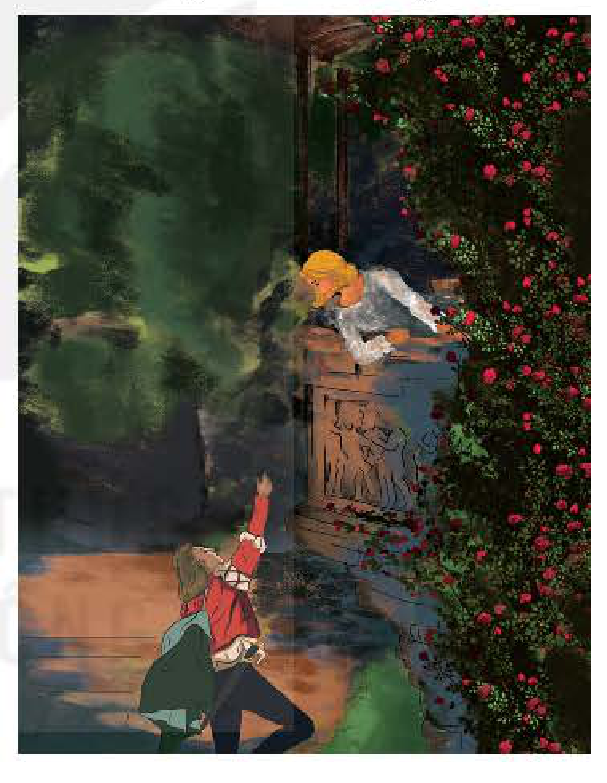
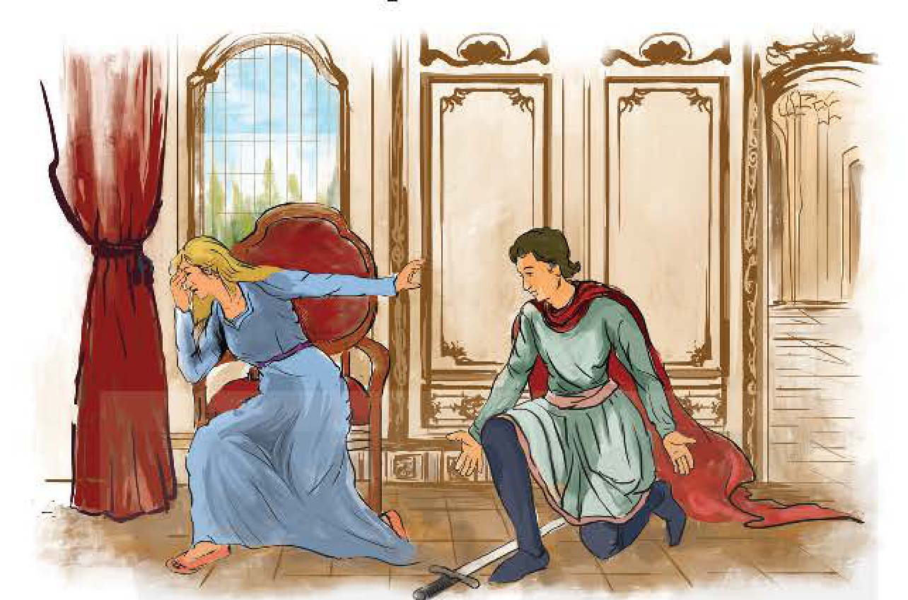

<!-- pdf:119 -->

# BÀI 5: ĐỐI DIỆN VỚI NỖI ĐAU

*Nỗi đau là một phần của cuộc sống, chúng ta có thể*
*học cách sống với nó và hướng tới hạnh phúc.*
<!-- ocr-ok: câu đề từ chữ trắng trên nền xanh trang PDF 119 bị OCR đọc lỗi ("vơ øÐÐÐe / học cách sống với xó"), đã đối chiếu ảnh p119.png -->

Ca-ren Xan-man-xon (Karen Salmansohn)

## Giới thiệu bài học

- Cuộc sống có niềm vui, nỗi buồn, nụ cười, nước mắt,... Có những lúc, con người phải đối mặt với thử thách, rơi vào mâu thuẫn khó giải quyết, chịu đựng đau đớn và mất mát. Văn học, bằng cách thể hiện những tình thế gay gắt, những sự việc bi thảm... đã khơi dậy nỗi xúc động thống thiết, đem đến những trải nghiệm căng thẳng và lo âu sâu sắc cho người đọc. Qua đó, văn học đồng thời hướng ta đến những tình cảm nhân văn cao cả, thôi thúc ta hành động tích cực, xứng đáng với hai chữ Con Người.
- Các kịch bản thuộc thể loại bi kịch và truyện ngắn kết nối về chủ đề trong bài học này thể hiện những tình huống đau đớn của con người, giúp em nhận diện sự phong phú, phức tạp của cuộc sống. Niềm thương cảm và nỗi khiếp sợ sẽ gợi ra cho em những suy tư về khả năng loại bỏ những điều tương tự trong các quan hệ đời sống.

## 🎯 Yêu cầu cần đạt

<!-- term: bi kịch -->
<!-- term: xung đột -->
<!-- term: hành động -->
<!-- term: cốt truyện -->
<!-- term: nhân vật -->
<!-- term: lời thoại -->
<!-- term: câu rút gọn -->
<!-- term: câu đặc biệt -->
<!-- term: bài văn nghị luận phân tích một tác phẩm văn học -->
<!-- term: chủ đề -->
<!-- term: thảo luận về một vấn đề đáng quan tâm trong đời sống -->
- Nhận biết và phân tích được một số yếu tố của bi kịch như: xung đột, hành động, cốt truyện, nhân vật, lời thoại.
- Nêu được những thay đổi trong suy nghĩ, tình cảm, lối sống và cách thưởng thức, đánh giá của cá nhân do văn bản đã học mang lại.
- Nhận biết được đặc điểm của câu rút gọn, câu đặc biệt và hiểu được chức năng của các loại câu này để sử dụng một cách hiệu quả.
- Viết được bài văn nghị luận phân tích một tác phẩm văn học: phân tích nội dung chủ đề, những nét đặc sắc về hình thức nghệ thuật của tác phẩm và hiệu quả thẩm mĩ của nó.
- Biết thảo luận về một vấn đề đáng quan tâm trong đời sống phù hợp với lứa tuổi.
- Coi trọng những giá trị nhân văn cao đẹp; lựa chọn hành động và cách ứng xử phù hợp để có được hạnh phúc chân chính.

<!-- pdf:120 -->

## Đọc

### TRI THỨC NGỮ VĂN

**Bi kịch**

<!-- term: bi kịch -->
<!-- term: xung đột -->
<!-- term: hành động -->
<!-- term: nhân vật -->
<!-- term: lời thoại -->
<!-- term: đề tài -->
<!-- term: cốt truyện -->
- **Bi kịch** là một thể loại của kịch, thể hiện xung đột không thể giải quyết giữa khát vọng cao đẹp của con người với khả năng, tình thế thực hiện. **Xung đột bi kịch** nảy sinh do mâu thuẫn giữa cái thiện với cái ác, cái cao cả với cái thấp hèn, cái mới với cái cũ, cái tiến bộ với cái phản tiến bộ, giữa các mặt khác nhau của tính cách, giữa mong muốn chủ quan và điều kiện khách quan, giữa các giá trị khác nhau của đời sống,... Các xung đột này tạo nên bởi **hành động** có ý thức của nhân vật trong việc thực hiện cái tất yếu mà nó tự thấy trước là không tránh khỏi bị tai hoạ. Qua hành động, nhân vật bộc lộ tính cách, phẩm chất của mình. **Nhân vật bi kịch** có sức mạnh lớn lao, phẩm chất cao cả, mang trong mình những lí tưởng, khát vọng đẹp đẽ,... nhưng phải đối mặt với số phận nghiệt ngã, những quyết định khó khăn, sự không thuận lợi của hoàn cảnh,... **Lời thoại** của nhân vật thường thể hiện sự căng thẳng, những giằng xé nội tâm, có tính hùng biện, triết lí, hoặc có tính chất mĩ lệ, trau chuốt,...
- **Đề tài** của bi kịch thường mượn từ lịch sử hay huyền thoại, đề cập những vấn đề lớn, có tính vĩnh cửu của cuộc sống con người. **Cốt truyện** của bi kịch biểu thị chuỗi hành động tuân theo quy tắc nhân quả, dẫn tới kết cục bi thảm của nhân vật chính. Kết thúc bi thảm của nhân vật có ý nghĩa thức tỉnh, dự báo về một cái gì tốt đẹp hơn sẽ nảy sinh trong cuộc sống và trong mỗi con người.

**Câu rút gọn và câu đặc biệt**

<!-- term: câu rút gọn -->
<!-- term: câu đặc biệt -->
- **Câu rút gọn** là câu có thành phần câu (thường là thành phần chính) bị tỉnh lược. Việc tỉnh lược chủ yếu do phương châm tiết kiệm trong việc sử dụng ngôn ngữ, nhất là khi nói (lược bỏ những thông tin đã biết hoặc bị coi là lặp, thừa), hoặc do dụng ý của người sử dụng (không muốn nêu rõ sự vật, sự việc nào đó trong câu).
- **Câu đặc biệt** là câu không được cấu tạo theo mô hình câu hai thành phần, thường dùng để gọi – đáp; nhấn mạnh cảm xúc; liệt kê, thông báo về sự tồn tại của sự vật, hiện tượng; xác định thời gian, nơi chốn diễn ra sự việc.

### VĂN BẢN ĐỌC

- **VĂN BẢN 1.** *Rô-mê-ô (Romeo)* và *Giu-li-ét (Juliet)* (trích), Uy-li-am Sếch-xpia (William Shakespeare)
- **VĂN BẢN 2.** *Lơ Xít (Le Cid)* (trích), Coóc-nây (Corneille)
- **VĂN BẢN 3.** *Bí ẩn của làn nước*, Bảo Ninh

<!-- pdf:121 -->

### VĂN BẢN 1: Rô-mê-ô và Giu-li-ét

**Trước khi đọc**

Tình yêu là đề tài phổ biến trong văn học, nghệ thuật. Hãy chia sẻ suy nghĩ của em về một tác phẩm viết về đề tài này.

**Đọc văn bản**

**Rô-mê-ô và Giu-li-ét**(1)

*Trích*, UY-LI-AM SẾCH-XPIA

**HỒI THỨ HAI**

**CẢNH II**

VƯỜN NHÀ CA-PIU-LÉT

*Rô-mê-ô ra*

**Rô-mê-ô:** – Kẻ chưa từng bị thương thì há sợ gì sẹo!

> **Chú ý:** Lời thoại của hai nhân vật có gì đặc biệt?
<!-- ocr-ok: thẻ chỉ dẫn đọc bên lề trang PDF 121 bị OCR đọc lỗi ("¡sử ... pho ng"), đã đối chiếu ảnh p121.png -->

*Giu-li-ét xuất hiện trên cửa sổ*

Ấy nhè nhẹ chứ nào! Ánh sáng nào vừa loé trên cửa sổ kia? Đó, phương đông đó, và nàng Giu-li-ét là mặt trời. Vừng đông đẹp tươi ơi, hãy hiện ra đi, hãy giết chết ả Hằng Nga đố kị, héo hon và nhợt nhạt vì đau buồn khi thấy kẻ hầu(2) của ả lại đẹp hơn ả. Ả ghen với em thế thì em theo ả làm gì? Bộ cánh đồng cốt của ả xanh xao nhợt nhạt, chỉ hợp với những đồ ngu xuẩn(3), em hãy vứt nó đi... Ôi người mà ta sùng kính, người mà ta yêu đương! Ôi, giá nàng biết nhỉ!... Nàng đang nói... Không, nàng im lặng... Gì kia? Đôi mắt nàng như lên tiếng, và ta nóng lòng muốn đáp lại ánh mắt nàng... Ta liều quá, nàng có nói với ta đâu. Nguyên là hai ngôi sao đẹp nhất bầu trời có việc phải đi vắng, đã tha thiết nhờ mắt nàng lấp lánh chờ đến lúc sao về. Ừ, nếu mắt nàng lên thay cho sao, và sao xuống nằm dưới đôi mày kia thì sao nhỉ? Vẻ rực rỡ của đôi gò má nàng sẽ làm cho các vì tinh tú nọ phải hổ ngươi(4), như vừng dương làm ánh đèn phải

> (1) Tóm tắt vở kịch: Dòng họ Ca-piu-lét (Capulet) và Môn-ta-ghiu (Montague) ở thành Vê-rô-na (Verona) nước Ý vốn có mối thâm thù. Gia đình Ca-piu-lét tổ chức đêm hội hoá trang nhân dịp con gái họ là Giu-li-ét tròn 14 tuổi. Rô-mê-ô, con trai nhà Môn-ta-ghiu cùng các bạn hoá trang đi vào nhà Ca-piu-lét. Chàng gặp Giu-li-ét xinh đẹp, say đắm nàng và cũng nhận được sự đồng cảm của nàng. Con trai Vương chủ thành Vê-rô-na là bá tước Pa-rít (Paris) đang muốn cầu hôn Giu-li-ét. Nửa đêm tiệc tan, Rô-mê-ô vượt tường nhảy vào vườn nhà Ca-piu-lét. Rô-mê-ô và Giu-li-ét cùng thổ lộ tình yêu say đắm (Hồi thứ Hai, Cảnh II). Họ nhờ tu sĩ Lâu-rân (Laurence) làm phép cưới bí mật. Mối hận thù giữa hai dòng họ lại bị khoét sâu do anh họ Giu-li-ét là Ti-bân (Tibalt) giết người của họ Môn-ta-ghiu là Mơ-kiu-xi-ô (Mercutio), Rô-mê-ô giết Ti-bân và bị đi đày biệt xứ. Gia đình Ca-piu-lét yêu cầu nàng nhận lời lấy Pa-rít. Giu-li-ét đến nhờ tu sĩ Lâu-rân giúp đỡ. Theo kế hoạch của tu sĩ Lâu-rân, Giu-li-ét giả vờ nhận lời lấy Pa-rít, trong hôn lễ, nàng uống thuốc ngủ (có hiệu lực trong 42 giờ), trong khi đó Lâu-rân cho người đi báo với Rô-mê-ô. Người của Lâu-rân không báo tin được cho Rô-mê-ô, trong khi đó, Rô-mê-ô nhận được hung tin do người nhà báo. Chàng bí mật trở về Vê-rô-na, mua sẵn một lọ thuốc độc. Gặp Pa-rít ở hầm mộ, chàng giết Pa-rít, tìm đến nơi Giu-li-ét nằm, uống thuốc độc chết. Giu-li-ét tỉnh dậy, thấy Rô-mê-ô đã chết liền lấy con dao mà Rô-mê-ô mang theo bên mình rồi tự sát. Tại hầm mộ, Lâu-rân kể lại mọi chuyện, Vương chủ thành Vê-rô-na lên án hai dòng họ. Hai bên tự nguyện xoá mối hận thù và dựng bức tượng vàng Rô-mê-ô và Giu-li-ét.
> (2) Ý nói những nàng trinh nữ được coi là thị nữ của thần Mặt Trăng.
> (3) Ý nói những cô gái không chịu đi lấy chồng.
> (4) *Hổ ngươi*: xấu hổ, tự lấy làm thẹn.

<!-- pdf:122 -->

thẹn thùng; còn cặp mắt kia trên bầu trời sẽ rọi khắp khoảng không một làn ánh sáng tưng bừng đến nỗi chim chóc sẽ lên tiếng hót vang vì tưởng là đêm đã tàn. Kìa nàng tì má lên tay! Ước gì ta là chiếc bao tay nhỉ, để được mơn trớn má đào!

**Giu-li-ét:** – Ôi chao!

**Rô-mê-ô:** – Kìa, nàng vừa lên tiếng! Hỡi nàng tiên lộng lẫy, hãy nói nữa đi! Đêm nay trên đầu ta, nàng toả ánh hào quang như một sứ giả nhà trời có đôi cánh, đang cưỡi những áng mây lười nhẹ lướt trên không trung, khiến kẻ trần tục phải cố ngước đôi mắt thịt mà chiêm ngưỡng.

**Giu-li-ét:** – Ôi Rô-mê-ô, hỡi Rô-mê-ô! Sao chàng lại mang tên đó nhỉ? Chàng hãy từ bỏ thân phụ đi, từ bỏ tên họ đi; hoặc không thì chàng hãy thề là chàng yêu em đi, em sẽ không còn là con cháu nhà Ca-piu-lét nữa.

> **Suy luận:** Tại sao Giu-li-ét mong Rô-mê-ô từ bỏ tên họ?

**Rô-mê-ô** *(nói một mình)*: – Ta cứ đứng nghe thêm nữa, hay nên lên tiếng nhỉ?

**Giu-li-ét:** – Chỉ có tên họ chàng là thù địch của em thôi. Nhưng nếu chẳng phải là người họ Môn-ta-ghiu thì chàng cũng vẫn là chàng. Chàng ơi! Hãy mang tên họ nào khác đi! Thế nào là họ Môn-ta-ghiu nhỉ? Cái tên đó đâu có phải là bàn tay, bàn chân, cánh tay, bộ mặt, một bộ phận nào đó của thân thể con người... Cái tên nào có nghĩa gì? Bông hồng kia, giá gọi bằng một tên khác, thì hương thơm cũng vẫn ngạt ngào. Vậy nếu chàng Rô-mê-ô chẳng mang tên Rô-mê-ô nữa, thì mười phân chàng cũng vẫn vẹn mười... Rô-mê-ô chàng ơi, chàng hãy từ bỏ tên họ đi. Cái tên kia đâu có phải xương thịt của chàng, chàng hãy đổi nó lấy cả tấm thân em.

**Rô-mê-ô:** – Đúng là từ miệng nàng nói ra nhé! Chỉ cần được nàng gọi là người yêu là tôi xin tức thì nhận tên thánh mới; từ nay trở đi, tôi không muốn bao giờ là Rô-mê-ô nữa.

**Giu-li-ét:** – Người là ai, mà nhờ đêm tối, chợt biết được điều tôi ấp ủ trong lòng vậy?

**Rô-mê-ô:** – Tôi không biết xưng danh cùng nàng thế nào. Nàng tiên yêu quý của tôi ơi, tôi thù ghét cái tên của tôi, vì nó là kẻ thù của nàng. Nếu chính tay tôi đã viết tên đó, thì tôi xin xé nát nó ra.

**Giu-li-ét:** – Tai nghe chưa trọn một trăm chữ từ miệng đó nói ra mà đã nhận ra tiếng ai rồi. Chẳng phải chàng Rô-mê-ô, họ nhà Môn-ta-ghiu đó ư?

**Rô-mê-ô:** – Hỡi nàng tiên kiều diễm, nếu nàng chẳng ưa tên họ đó, thì tôi chẳng phải Rô-mê-ô mà cũng chẳng thuộc họ Môn-ta-ghiu.

<!-- pdf:123 -->

**Giu-li-ét:** – Chàng làm thế nào mà tới được chốn này? Và chàng tới làm gì? Tường vườn này cao, vượt qua thật khó. Và chàng thử nghĩ lại xem mình là ai. Nếu bị họ hàng nhà em bắt gặp nơi đây thì chàng khó lòng thoát chết.

**Rô-mê-ô:** – Tôi vượt được tường này là nhờ đôi cánh của tình yêu; mấy bức tường đá ngăn sao được ái tình. Mà cái gì tình yêu dám làm là làm được. Người nhà nàng ngăn sao nổi tôi.

> **Chú ý:** Điều đã làm cho Rô-mê-ô có thể gặp gỡ Giu-li-ét.

**Giu-li-ét:** – Họ mà bắt gặp chàng thì họ giết chàng mất.

**Rô-mê-ô:** – Nàng ơi, ánh mắt kia còn nguy hiểm cho tôi hơn hai chục lưỡi kiếm của họ. Nàng hãy nhìn tôi với khoé mắt yêu thương là tôi chẳng ngại gì hằn thù của họ nữa.

**Giu-li-ét:** – Em cầu mong cho họ đừng bắt gặp chàng nơi đây.

**Rô-mê-ô:** – Đã có áo choàng của nàng Đêm che cho tôi khỏi bị họ nom thấy. Vả chăng, nếu chẳng được nàng đoái hoài thì thà cứ để họ bắt gặp. Thà để cho lòng căm thù của họ chấm dứt đời tôi còn hơn kéo dài kiếp sống mà thiếu tình nàng.

**Giu-li-ét:** – Ai đưa lối cho chàng tới đây?

**Rô-mê-ô:** – Ái tình, ái tình đã xui tôi tìm kiếm. Ái tình đã cho tôi lời khuyên, và tôi đã cho ái tình đôi mắt. Tôi chẳng phải là tay thuỷ thủ, nhưng giá nàng có ở nơi bờ biển xa xăm nhất, thì tôi cũng sẵn sàng liều mình vì báu vật.

(Uy-li-am Sếch-xpia, *Rô-mê-ô và Giu-li-ét*, in trong *William Shakespeare – Những vở kịch nổi tiếng*, Đặng Thế Bính *dịch*, NXB Kim Đồng, Hà Nội, 2017, tr. 58 – 61)

**Sau khi đọc**

> - **Uy-li-am Sếch-xpia** (1564 – 1616) là nhà viết kịch kiệt xuất ở Anh thời đại Phục hưng. Sáng tác của ông thấm đẫm tình yêu và lòng tin đối với con người. Đặc điểm nổi bật trong sáng tác của ông là nội dung đa dạng, tư tưởng lớn lao, hình tượng sắc nét, ngôn ngữ điêu luyện. Ông được coi là “nhà pháp sư” của ngôn ngữ Anh. Sếch-xpia đã sáng tác gần 40 vở kịch thuộc nhiều thể loại, nổi bật nhất là bi kịch. Các vở bi kịch nổi tiếng của ông được cả thế giới biết đến: *Rô-mê-ô và Giu-li-ét*, *Hăm-lét (Hamlet)*, *Mắc-bét (Macbeth)*, *Vua Lia (Lear)*, *Ô-ten-lô (Othello)*,...
> - *Rô-mê-ô và Giu-li-ét* được viết vào khoảng năm 1594 – 1595, là vở kịch năm hồi viết bằng thơ xen lẫn văn xuôi, dựa trên một câu chuyện có thật từng xảy ra ở I-ta-li-a thời trung cổ. Vở kịch được coi là bản tình ca say đắm nhất, ca ngợi tình yêu trong sáng, chân thành, thuỷ chung, dám vượt lên hận thù để giành lấy quyền tự do và hưởng hạnh phúc.

<!-- pdf:124 -->

**Trả lời câu hỏi**

<!-- term: lời thoại -->
<!-- term: nhân vật -->
<!-- term: xung đột -->
<!-- term: hành động -->
<!-- term: cốt truyện -->
1. Sự việc Rô-mê-ô gặp Giu-li-ét diễn ra trong tình thế như thế nào?
2. Hãy nhận xét cách bày tỏ tình yêu của Rô-mê-ô và Giu-li-ét.
3. Phân tích các hình thức thoại và chỉ ra vai trò của chúng trong việc thể hiện diễn biến tâm trạng của hai nhân vật Rô-mê-ô và Giu-li-ét.
4. Đoạn trích cho thấy những xung đột gì trong toàn bộ vở kịch?
5. Từ phần tóm tắt nội dung vở kịch, hãy cho biết hành động thổ lộ tình yêu trong đêm ở vườn nhà Ca-piu-lét có liên hệ như thế nào với chuỗi hành động tiếp theo của hai nhân vật Rô-mê-ô, Giu-li-ét và kết cục của vở kịch.
6. Về vở kịch *Rô-mê-ô và Giu-li-ét*, có ý kiến cho rằng: “Cái chết của đôi trai tài gái sắc đem lại niềm tin và hi vọng, đó là cái chết gieo mầm sự sống”(1). Em có đồng tình với ý kiến trên không? Vì sao?
7. Tìm một tác phẩm nghệ thuật hiện đại (văn học, hội hoạ, âm nhạc, điện ảnh,...) lấy đề tài từ câu chuyện tình yêu của Rô-mê-ô và Giu-li-ét. Nêu một điểm tương đồng giữa tác phẩm đó với vở kịch *Rô-mê-ô và Giu-li-ét* của Uy-li-am Sếch-xpia.

#### Viết kết nối với đọc
<!-- ocr-ok: tiêu đề màu cam trên trang PDF 124 bị OCR đọc nhầm thành "VIẾT KẾT NũI VứI ĐỤD", đã đối chiếu ảnh p124.png -->

<!-- term: xung đột -->
Dựa vào xung đột mà Sếch-xpia đề cập trong vở *Rô-mê-ô và Giu-li-ét* và thực tiễn cuộc sống, hãy viết đoạn văn (khoảng 7 – 9 câu) trình bày suy nghĩ của em về khát vọng tình yêu của con người.

### Thực hành tiếng Việt

*CÂU RÚT GỌN*

<!-- term: câu rút gọn -->
> **Nhận biết câu rút gọn**
>
> - **Câu rút gọn** có thể là câu có chủ ngữ hoặc vị ngữ bị tỉnh lược. Ví dụ:
>   (1) – *Anh đang làm gì?*
>   – *Đọc sách.* (rút gọn chủ ngữ)
>   (2) – *Ai đã trồng những cây hoa này?*
>   – *Mẹ tôi.* (rút gọn vị ngữ)
>   Ngoài ra, **câu rút gọn** cũng có thể là câu chỉ giữ lại thành phần cung cấp thông tin cần thiết, cốt lõi trong một ngữ cảnh giao tiếp cụ thể như trạng ngữ, bổ ngữ hoặc định ngữ, cả hai thành phần chủ ngữ và vị ngữ đều bị tỉnh lược. Ví dụ:
>   – *Ông ấy đi công tác ở đâu?*
>   – *Tây Nguyên.* (chỉ giữ lại bổ ngữ)
>   *Chú ý:* **Câu rút gọn** là câu có thể khôi phục thành phần bị tỉnh lược để thành câu đầy đủ.
> - Khi rút gọn câu, cần lưu ý: không làm cho câu trở nên cộc lốc, thiếu tính lịch sự; hạn chế dùng câu rút gọn khi nói với người trên hoặc những người mình kính trọng. Ví dụ:
>   – *Hôm nay con có đi học không?*
>   – *Không.* (câu nói không lễ phép)
>   Trong một số ngữ cảnh, câu rút gọn có thể gây hiểu lầm. Ví dụ: Truyện cười dân gian *Mất rồi* kể một người có việc đi xa, dặn con ở nhà có ai hỏi thì bảo bố đi vắng. Sợ con mải chơi quên mất, ông ta viết mấy câu vào giấy, đưa cho con, bảo có ai hỏi thì cứ đưa tờ giấy. Tối đến, sẵn có ngọn đèn, đứa con lấy giấy ra xem, chẳng may để giấy cháy mất. Hôm sau, có người khách lại chơi, hỏi:
>   – *Bố cháu có nhà không?*
>   *Nó ngẩn ra, rồi sực nhớ, sờ vào túi. Không thấy giấy, liền nói:*
>   – *Mất rồi!*
>   Câu “Mất rồi!” không trả lời trực tiếp câu hỏi của người hỏi mà hướng đến thông tin về tờ giấy. Câu đầy đủ phải là: “Tờ giấy bị mất rồi”. Dùng câu rút gọn chủ ngữ trong trường hợp này khiến người khách hiểu đối tượng mất là người bố.

<!-- term: câu rút gọn -->
1. Tìm câu rút gọn trong các lời thoại kịch sau và cho biết thành phần nào của câu bị tỉnh lược:

   ***Giu-li-ét:*** – *Chỉ có tên họ chàng là thù địch của em thôi. Nhưng nếu chẳng phải là người họ Môn-ta-ghiu thì chàng cũng vẫn là chàng. Chàng ơi! Hãy mang tên họ nào khác đi! Thế nào là họ Môn-ta-ghiu nhỉ?* [...] *Rô-mê-ô chàng ơi, chàng hãy từ bỏ tên họ đi. Cái tên kia đâu có phải xương thịt của chàng, chàng hãy đổi nó lấy cả tấm thân em.*

> (1) Nhiều tác giả, *Văn học phương Tây*, NXB Giáo dục Việt Nam, 2012, tr. 216.

<!-- pdf:125 -->

   ***Rô-mê-ô:*** – *Đúng là từ miệng nàng nói ra nhé! Chỉ cần được nàng gọi là người yêu là tôi xin tức thì nhận tên thánh mới; từ nay trở đi, tôi không muốn bao giờ là Rô-mê-ô nữa.*

   (Sếch-xpia, *Rô-mê-ô và Giu-li-ét*)
<!-- ocr-ok: dòng xuất xứ ngắn trang PDF 125 bị OCR đọc lỗi ("#ô-mê-ô và Giu-li-én"), đã đối chiếu ảnh p125.png -->

<!-- term: câu rút gọn -->
2. Dựa vào ngữ cảnh, hãy chuyển các câu rút gọn tìm được ở bài tập 1 thành câu đầy đủ. So sánh câu rút gọn và câu đầy đủ để làm rõ tác dụng của việc dùng câu rút gọn trong ngữ cảnh đó.

<!-- term: câu rút gọn -->
3. Những câu văn in đậm sau rút gọn thành phần nào? Nêu tác dụng của việc rút gọn câu trong các ngữ cảnh.

   a. – *Nhưng chiếc tàu chuyển động chứ?*
      – ***Thưa ngài, không!*** *Nó bập bênh trên sóng, chứ chẳng chuyển động chút nào.*

      (Giuyn Véc-nơ, *Hai vạn dặm dưới biển*)
<!-- ocr-ok: dòng xuất xứ ngắn trang PDF 125 bị OCR đọc lỗi ("Giuyn Véo-ng"), đã đối chiếu ảnh p125.png -->

   b. *Một ngày chúng tôi phá bom đến năm lần.* ***Ngày nào ít: ba lần.***

      (Lê Minh Khuê, *Những ngôi sao xa xôi*)

<!-- term: câu rút gọn -->
4. Đọc các đoạn văn sau và thực hiện yêu cầu bên dưới:

   a. – *Anh đã nhìn thấy chim chìa vôi nó bay từ bãi cát vào bờ bao giờ chưa?*
      – *Chưa.*
      – *Tổ chim sẽ bị chìm mất.*

      (Nguyễn Quang Thiều, *Bầy chim chìa vôi*)

   b. *Tôi đi đứng oai vệ. Mỗi bước đi, tôi làm điệu dún dẩy các khoeo chân, rung lên rung xuống hai chiếc râu. Cho ra kiểu cách con nhà võ.*

      (Tô Hoài, *Dế Mèn phiêu lưu kí*)

   c. – *Cậu làm trò gì thế? Sao lại ăn trộm hòn đá này?*
      – *Chúng ta không ăn trộm! – Hắn nhún vai. – Chúng ta chỉ mượn tạm thôi! Dùng xong sẽ mang trả lại! Tớ cũng tò mò muốn biết nơi nào được gọi là trung tâm của vũ trụ.*

      (Hà Thuỷ Nguyên, *Thiên Mã*)

<!-- pdf:126 -->

   d. *Mặt trời lại rọi lên ngày thứ sáu của tôi trên đảo Thanh Luân một cách thật quá là đầy đủ. Tôi dậy từ canh tư. Còn tối đất, cố đi mãi trên đá đầu sư, ra thấu đầu mũi đảo. Và ngồi đó rình mặt trời lên.*

      (Nguyễn Tuân, *Cô Tô*)

   Yêu cầu:

   (1) Chỉ ra các câu rút gọn.
   (2) Khôi phục các thành phần bị tỉnh lược để câu rút gọn thành câu đầy đủ.
   (3) Nêu tác dụng của câu rút gọn trong mỗi trường hợp.

### VĂN BẢN 2: Lơ Xít

**Trước khi đọc**

Trong mỗi con người đều có hai mặt cảm xúc và lí trí, đôi khi, hai mặt này có thể xung đột dữ dội. Hãy kể lại một trải nghiệm cá nhân khi em kiềm chế cảm xúc và dùng lí trí để quyết định hành động của mình.

**Đọc văn bản**

**Lơ Xít**(1)

*Trích*, COÓC-NÂY

**HỒI III**

**LỚP IV**

ĐÔNG RÔ-ĐRI-GƠ, SI-MEN, EN-VI-A

**Đông Rô-đri-gơ:** – Thôi! Kiện mà chi cho mất công nhiều,
Giành lấy vinh dự bắt ta đừng sống nữa!
<!-- ocr-ok: lời thoại mở đầu trang PDF 126 bị OCR trộn dòng và sai dấu ("Đông Rô-đri-øơ... mả chỉ... Giảnh lấy... bặt ta đừng sông"), đã đối chiếu ảnh p126.png -->

> **Theo dõi:** Việc Rô-đri-gơ muốn được chết.
<!-- ocr-ok: thẻ Theo dõi bên lề trang PDF 126 bị OCR bỏ sót tiêu đề và đọc sai tên riêng ("Fô-đri-gơ"), đã đối chiếu ảnh p126.png -->

**Si-men:** – En-vi-a! Ta ở đâu đây? Ta thấy gì? Thật, giả?
Rô-đri-gơ tại nhà này! Rô-đri-gơ trước mắt ta sao!

**Đông Rô-đri-gơ:** – Đừng tiếc máu ta! Cứ điềm nhiên nếm hạnh phúc ngọt ngào
Nhìn ta chết và mối thù em rửa sạch!
<!-- ocr-ok: lời thoại ngắn trang PDF 126 bị OCR đọc sai dấu ("máu tai Cứ điểm nhiên ném... môi thủ"), đã đối chiếu ảnh p126.png -->

> (1) Tóm tắt vở kịch: Đông Rô-đri-gơ (Don Rodrigue), con trai Đông Đi-e-gơ (Don Diègue), yêu Si-men (Chimène), con gái Đông Goóc-ma-xơ (Don Gormas). Một cuộc cãi cọ diễn ra giữa hai ông bố dẫn đến việc Đông Goóc-ma-xơ tát Đông Đi-e-gơ. Để rửa nhục, Đông Đi-e-gơ yêu cầu con trai trả thù Đông Goóc-ma-xơ. Rô-đri-gơ đấu tranh tư tưởng, cuối cùng, ý thức về bổn phận và danh dự dòng họ đã khiến chàng quyết đấu kiếm với Đông Goóc-ma-xơ. Đông Goóc-ma-xơ bị Rô-đri-gơ đâm chết. Sau đó Rô-đri-gơ đến yêu cầu Si-men hãy giết chàng để trả thù cho cha. Si-men thừa nhận lòng dũng cảm của Rô-đri-gơ và tuyên bố cũng sẽ làm bổn phận của mình là đòi nhà vua xử tội kẻ giết người. Lúc đó, giặc Mô sắp sửa tấn công, Rô-đri-gơ được cử đi đánh giặc. Chàng đã chiến thắng trở về. Si-men tiếp tục đòi lấy đầu Rô-đri-gơ. Hiệp sĩ Đông Xăng-sơ (Don Sanche), vốn yêu Si-men, tình nguyện đấu kiếm với Rô-đri-gơ để trả thù cho Si-men. Đông Xăng-sơ thua, nhưng Rô-đri-gơ đã tha chết cho chàng. Thấy Đông Xăng-sơ trở về, tưởng Rô-đri-gơ đã bị giết, Si-men đã không giấu được cảm xúc, bộc lộ rõ tình yêu với Rô-đri-gơ và sự đau đớn của mình. Nhà vua tuyên bố danh dự của Si-men được bảo toàn và có thể chắp duyên lành với Rô-đri-gơ.

<!-- pdf:127 -->

**Si-men:** – Ôi đau đớn!

**Đông Rô-đri-gơ:** – Hãy nghe ta!

**Si-men:** – Em chết mất!

**Đông Rô-đri-gơ:** – Một phút thôi!

> **Chú ý:** Nỗi đau của Si-men.
<!-- ocr-ok: thẻ Chú ý bên lề trang PDF 127 bị OCR bỏ sót tiêu đề và đọc lỗi ("Srmem"), đã đối chiếu ảnh p127.png -->

**Si-men:** – Chàng đi đi! Để em từ biệt cõi đời!
<!-- ocr-ok: câu thoại ngắn trang PDF 127 bị OCR đọc sai dấu ("Chẳng đi đi! Đề em từ biệt cối đời!"), đã đối chiếu ảnh p127.png -->

**Đông Rô-đri-gơ:** – Chỉ xin em cho nói một câu thôi!
Rồi sau đó trả lời bằng mũi kiếm!

**Si-men:** – Ôi! Mũi kiếm! Mà máu cha em còn đậm!

**Đông Rô-đri-gơ:** – Si-men em!

**Si-men:** – Cất khỏi mắt em cái vật đáng kinh kia!
Nó oán trách đời ai và tội ác nặng nề!

**Đông Rô-đri-gơ:** – Ngược lại, nên nhìn nó để khích lệ lòng căm ghét,
Nung nấu hận thù, cho ta được sớm về cõi chết.

**Si-men:** – Nó đẫm máu em!

**Đông Rô-đri-gơ:** – Hãy đâm ngập nó vào trong máu của ta,
Và như vậy, màu máu em sẽ bị xoá nhoà.

**Si-men:** – Ôi tàn nhẫn, chỉ một ngày thôi đã giết
Cha, bằng gươm, con gái, bằng cái nhìn oan nghiệt.
Cất gươm đi, em không chịu nổi nữa rồi!
Muốn em nghe, lại làm em chết mất thôi!

**Đông Rô-đri-gơ:** – Xin theo ý! Nhưng ta không bỏ điều mong muốn
Bằng tay em kết liễu cuộc đời sầu muộn.
Chớ mong chờ ở lòng âu yếm của ta
Sự hối hận đê hèn về hành động đúng vừa qua!
Cơn nóng nảy vội vàng khôn đường lấy lại
Nhục cha ta, phủ lên đời ta vết nhơ tai hại.
Biết không em? Với khách anh hào
Một cái tát xúc phạm người sâu nặng biết bao!
Nhục cả cho ta, ta đã tìm người gây nhục,
Tìm thấy: ta trả thù danh dự, thù cha cùng một lúc.
Và sẽ còn làm vậy nữa nếu như cần!
Nói thực thà, đâu phải trong thâm tâm
Ta chẳng có lúc vì em mà ngả nghiêng, rời rã,
Thầm oán trách cha ta, và oán trách cả bản thân ta nữa!

<!-- pdf:128 -->

Đấy, sức mạnh tình yêu: xúc phạm lớn dường này
Mà ta vẫn phân vân nên rửa hận hay thôi!
Trong cái thế: mất lòng em hoặc chịu điều sỉ nhục,
Ta suy nghĩ: hay chính tay ta đã quá vội vàng một lúc,
Tự kết tội mình đã hành động quá thô.
Nhan sắc em biết đâu đã thắng cả mối thù
Nếu để chống lại vẻ hương trời sắc nước
Ta quên rằng: mất danh dự thì yêu em không thể được!
Rằng: dẫu tình ta trong tim em dào dạt chan hoà,
Cao thượng, em yêu chiều, thì đê mạt, ghét sâu xa.
Nghe tiếng gọi con tim và làm theo lệnh nó
Là không xứng tình em và tiêu tan phẩm giá.
Ta nói mãi, em ơi! Dẫu lòng chua xót khóc than,
Đến nhắm mắt xuôi tay vẫn muốn nhắc em rằng:
Ta đã lỗi cùng em nhưng buộc lòng ta phải làm thế ấy
Để rửa vết nhơ và xứng tình em vậy.
Giờ đây, danh dự, thù cha, vẹn cả đôi đường,
Ta đến vì em đền đáp nỗi đau thương,
Ta đến đây, dâng em máu hồng đổ xuống,
Nghĩa trước trả đầy, tình nay giữ trọn.
Ta biết mất cha thù kia em phải báo đền,
Ta chẳng muốn cướp của em lễ vật hi sinh.
Hãy can đảm cắt ngang chớ ngại,
Trả lại cha, thay máu đào đã chảy,
Tính mạng của người đã tự hào làm đổ máu cha em!

> **Chú ý:** Sự “phân vân” của Rô-đri-gơ.
<!-- ocr-ok: thẻ Chú ý bên lề trang PDF 128 bị OCR đọc lỗi tiêu đề ("cu ì") và tên riêng ("Rô-dri-gơ"), đã đối chiếu ảnh p128.png -->

**Si-men:** – A, Rô-đri-gơ, tuy thù sâu nhưng nói thực nỗi niềm,
Em không thể trách chàng đã tránh điều đê tiện,
Dù cay đắng trăm ngàn, giày vò, đau đớn,
Chẳng buộc tội chàng, chỉ khóc điều bất hạnh xót xa.
Em biết: danh dự đòi hỏi gì sau điều sỉ nhục lớn kia.
Ở một tâm hồn thanh cao, dạt dào sức sống.

> **Theo dõi:** Si-men đánh giá hành động của Rô-đri-gơ.

<!-- pdf:129 -->

Hành động chàng, không ngoài nghĩa vụ con người cao thượng,
Đã đồng thời nhắc em, làm nghĩa vụ của em.
Tài oan nghiệt kia đã nhắc em bằng chiến thắng của mình
Nó đã trả vẹn thù cha và giữ tròn danh dự.

Em cũng thế: điều cân nhắc, băn khoăn, suy nghĩ
Là giữ gìn danh dự, trả thù cha.
Than ôi! Nghĩ tình chàng mà tuyệt vọng ngẩn ngơ:
Nếu phụ thân em chết vì điều bất hạnh khác.
Em đã thấy nơi chàng niềm an ủi lòng duy nhất,
Và giữa đau thương đôi cảm giác êm đềm
Được ngón tay chàng lau nước mắt cho em.
Chua xót bấy! Mất cha, lại phải mất chàng cùng một lúc!
Vì danh dự, lửa lòng đành dập tắt!
Nghĩa vụ khắt khe cay đắng trăm đường
Buộc lòng mình, giết kẻ mình thương!
Bởi rốt cuộc, dù âu yếm cũng chớ hòng mong ước
Tình cảm yếu hèn ngăn cánh tay trừng phạt.
Lòng thuỷ chung dẫu nồng thắm nâng niu,
Cao thượng này phải đáp lòng cao thượng người yêu:
Giết cha em, chàng chứng tỏ cùng em xứng đáng,
Để xứng chàng, em cũng phải đòi chàng thế mạng.

> **Theo dõi:** Si-men làm gì để xứng đáng với người mình yêu?
<!-- ocr-ok: thẻ Theo dõi bên lề trang PDF 129 bị OCR trộn dòng và đọc lỗi ("mon: là gÝ để... vêu?"), đã đối chiếu ảnh p129.png -->

(Coóc-nây, *Lơ Xít*, Hoàng Hữu Đản *dịch*, in trong *Bi kịch cổ điển Pháp*, NXB Văn hoá, Hà Nội, 1978, tr. 204 – 209)

<!-- pdf:130 -->

**Sau khi đọc**

> - **Coóc-nây** (1606 – 1684) là nhà viết kịch xuất sắc của nền bi kịch cổ điển Pháp. Kịch Coóc-nây có tính chất duy lí, thường thể hiện quan hệ cá nhân và xã hội thông qua sự đấu tranh giữa lí trí và dục vọng của con người. Một số vở kịch tiêu biểu: *Mê-đê (Médée)* (1635), *Lơ Xít* (1636), *Xin-na (Cinna)* (1640), *Ô-ra-xơ (Horace)* (1640)...
> - *Lơ Xít* được viết dựa trên một vở kịch về biến cố lịch sử có thật ở Tây Ban Nha thế kỉ XI: người anh hùng – hiệp sĩ Rô-đri-gơ Đi-a-dờ (Rodrigue Diaz) chiến thắng giặc Mô (chính giặc Mô gọi ông bằng danh hiệu “Xít”, nghĩa là “Ngài”, “Tôn ông” để thể hiện sự kính phục). Coóc-nây đã tập trung thể hiện cuộc đấu tranh nội tâm của nhân vật giữa một bên là danh dự, bổn phận với dòng họ và một bên là tình yêu nam nữ.

**Trả lời câu hỏi**

<!-- term: nhân vật -->
<!-- term: xung đột -->
<!-- term: lời thoại -->
<!-- term: hành động -->
1. Vì sao Rô-đri-gơ đến gặp Si-men sau khi đã giết cha của nàng?
2. Rô-đri-gơ đánh giá như thế nào về việc chàng giết cha của Si-men? Vì sao chàng không “Nghe tiếng gọi con tim và làm theo lệnh nó”?
3. Chỉ ra diễn biến tâm trạng của Si-men trong đoạn trích.
4. Phân tích sự giằng xé nội tâm của hai nhân vật Rô-đri-gơ và Si-men. Từ đó, hãy chỉ ra xung đột chính của vở kịch được thể hiện trong đoạn trích.
5. Nêu suy nghĩ của em về câu thoại của Si-men: “Giết cha em, chàng chứng tỏ cùng em xứng đáng/ Để xứng chàng, em cũng phải đòi chàng thế mạng”.
6. Hành động của các nhân vật trong vở kịch thể hiện quan niệm về danh dự, nghĩa vụ của con người ở thế kỉ XVII. Theo em, cách giải quyết xung đột trong vở kịch có còn phù hợp với thời đại ngày nay không? Vì sao?

#### Viết kết nối với đọc
<!-- ocr-ok: tiêu đề màu cam trên trang PDF 130 bị OCR đọc nhầm thành "VIẾT KẾT NỮI VŨI BE", đã đối chiếu ảnh p130.png -->

Viết đoạn văn (khoảng 7 – 9 câu) phân tích một chi tiết mà em thích trong đoạn trích vở kịch *Lơ Xít*.

<!-- pdf:131 -->

### VĂN BẢN 3: Bí ẩn của làn nước

**Đọc văn bản**

**Bí ẩn của làn nước**

BẢO NINH

Các dòng sông trôi đi như thời gian, và cũng như thời gian, trên mặt nước các triền sông biết bao nhiêu là chuyện đời đã diễn ra. Nhất là về đêm, trên làn nước của dòng sông quê hương tôi lấp lánh hằng hà những đốm sáng bí ẩn, có cả điều bí ẩn của đời tôi.

Năm ấy, nhằm trúng đỉnh lũ đêm Rằm tháng Bảy, một loạt bom Mỹ phá tan vệt đê canh giữ đằng trước làng tôi. Dứt dây nổ của bom và tiếng gầm ghê rợn của máy bay cường kích là chuỗi ầm ầm long lở của dòng sông phá bung đê tràn ngang vào đồng ruộng.

Từ trên điếm canh(1) tôi chạy lao về làng. Hồi chiều hay tin vợ ở nhà trở dạ nhưng tôi không thể rời vị trí hộ đê. Bây giờ giời đất sập rồi, trong tôi chỉ còn con tôi, vợ tôi. Tôi dốc toàn lực bình sinh vào đôi chân. Đằng sau, cơn đại hồng thuỷ đuổi bén gót.

Nước đã ngập làng. Tôi về, kịp dìu vợ leo lên mái. Mái nhà tranh của vợ chồng tôi bị lôi đi trong đêm đen. Đến khi mái rạ sắp rã tan ra thì ơn trời nó vướng vào thân đa trước đình làng. Đã cả một đám đông bám trên các cành. Nhiều bàn tay chìa xuống giúp tôi đỡ vợ con trèo lên. Vợ tôi ôm khư khư đứa con mới sinh, nhất định không để tôi bế đỡ.

– Con trai... con trai mà... con trai... Để yên em ẵm, anh vụng...
<!-- ocr-ok: câu thoại ngắn trang PDF 131 bị OCR đọc sai dấu ("mả... Đề yên em ấm"), đã đối chiếu ảnh p131.png -->

Nhiều giờ trôi qua. Mưa tuôn, gió thổi. Mực nước không dâng cao hơn, nhưng chảy xiết hơn. Cây đa đầy người hơn. Tôi mỏi nhừ. Tay ôm chặt vợ, tay níu mình vào chạc cây. Vợ tôi yếu lả, ướt lướt thướt, lạnh ngắt.

Khoảng gần sáng, bỗng có tiếng quẫy nước ngay dưới cành đa của vợ chồng tôi. Một giọng nghẹn sặc vói lên:

– Cứu mẹ con tôi mấy... cứu mấy, người ơi...
<!-- ocr-ok: câu thoại ngắn trang PDF 131 bị OCR đọc sai dấu ("cửu mây"), đã đối chiếu ảnh p131.png -->

Một bàn tay nhớt và lạnh như tay ma rờ vào chân tôi đang buông thõng. Tôi vội cúi xuống, đưa tay ra. Nhưng bàn tay của người đàn bà dưới nước truội đi, chìm nghỉm. Cành đa kêu rắc, chao mạnh. Vợ tôi ối kêu một tiếng thảng thốt, và “ùm”, con trai tôi, đứa con sơ sinh tôi chưa được nhìn thấy mặt, tuột khỏi bọc ni lông trên tay mẹ nó, sa xuống làn nước tối tăm.

– Con tôi...! – Vợ tôi hét rú lên và lao ngay lập tức xuống nước hòng chụp lấy con.

> (1) *Điếm canh*: nhà nhỏ dùng làm nơi canh giữ đê điều, hoa màu hoặc canh phòng trộm cướp.

<!-- pdf:132 -->

Tôi phóng mình theo. Nước lạnh, ngầu bùn, sâu hút và cuốn mạnh. Tôi vớ kịp thằng con, nhao vội lên, trao nó cho những bàn tay đang chìa xuống, rồi lại lặn tiếp ngay để cứu vợ. Nhiều người phi xuống theo để trợ sức tôi...
<!-- ocr-ok: đoạn đầu trang PDF 132 bị OCR đọc sai nhiều dấu thanh và sót chữ ("mỉnh... ngâu... cuồn... vớ kI[P thẳng... xuông, Tôi"), đã đối chiếu ảnh p132.png -->

Tôi tỉnh lại, thấy trời sáng rồi và đã tạnh mưa. Tôi nằm trong khoang một ca nô cứu nạn đầy ắp người. Hồi đêm, tôi đã vật lộn điên dại quyết sống mái một phen với làn nước giết người, nhưng tôi đã thua cuộc. Ứa ra cả máu tai máu mũi mà không những không cứu nổi vợ, đến thi thể cô ấy tôi cũng bất lực không tìm thấy. Khi ca nô quân đội tới, mọi người đã phải dùng sức để buộc tôi rời mặt nước. Kiệt sức, tôi ngất đi. Khổ đau, tôi tỉnh dậy, nước mắt nóng rực, tê nhói. Một chị phụ nữ chen tới bên tôi, lên lời an ủi:

– Phận chị ấy đã vậy, thôi thì anh phải nén lòng lại, giữ sức khoẻ mà nuôi con. Ơn trời, anh còn kịp cứu được cháu. Chao ôi, vừa kịp khóc chào đời đã trải một cơn kinh hoàng hú vía. Anh coi con anh này. Cứ như không. Đã bú, đã ngủ rồi đây này. Ngoan chưa này... Ôi chao, nó tè dầm rồi này.

Chị nựng nịu, và từ từ giở bọc chăn chiên đang ủ kín con tôi. Chị thay tã cho nó. Tôi nhìn, chết lặng.
<!-- ocr-ok: đoạn ngắn trang PDF 132 bị OCR đọc sai dấu và chữ ("nựng mu, vả từ tử... ú kín... nhỉn, chêt lặng"), đã đối chiếu ảnh p132.png -->

– Con tôi... – Tôi khóc, đỡ lấy bọc chăn. – Con tôi!

Từ bấy tới nay, thời gian trôi qua và triền nước trôi đi, tôi đã có tuổi và con gái tôi đã thành một thiếu nữ. Nó là đứa con của làn nước, mọi người đều nói thế bởi vì chuyện nó sa xuống dòng nước lụt rồi được cha nó cứu lên thì cả làng ai cũng biết. Nhưng điều bí mật kia thì không ai hay, kể cả con gái tôi cũng không thể biết. Chỉ có dòng sông biết.

Có ngày nào mà tôi không ra đê ngắm làn nước trôi. Vợ tôi, con tôi và người đàn bà vô danh nhìn tôi từ đáy nước. Thời gian, năm tháng cứ trôi, dòng sông và lịch sử, tất cả đều đổi thay nhưng mà niềm đau của đời tôi thì khôn nguôi bởi ấy là một niềm đau không thể nói nên lời.

(Bảo Ninh, *Những truyện ngắn*, NXB Trẻ, Thành phố Hồ Chí Minh, 2021, tr. 21 – 24)

**Sau khi đọc**

> **Bảo Ninh** sinh năm 1952, quê ở Quảng Bình. Ông vào bộ đội năm 1969 và bắt đầu viết văn sau khi giải ngũ vào năm 1975. Tên tuổi của ông gắn liền với *Nỗi buồn chiến tranh* (1991)(1) – một tiểu thuyết được dư luận bạn đọc trong và ngoài nước đánh giá rất cao. Ngoài tác phẩm này, ông còn viết nhiều truyện ngắn và tạp bút, được in trong các tập chính: *Trại bảy chú lùn* (truyện ngắn, 1987), *Truyện ngắn Bảo Ninh* (2002), *Lan man trong lúc kẹt xe* (truyện ngắn, 2005), *Chuyện xưa kết đi, được chưa?* (truyện ngắn, 2009), *Tạp bút Bảo Ninh* (2015).

> (1) Tác phẩm được xuất bản lần đầu với tên gọi *Thân phận của tình yêu* (1990).

<!-- pdf:133 -->

**Trả lời câu hỏi**

<!-- term: cốt truyện -->
<!-- term: người kể chuyện -->
<!-- term: nhân vật -->
<!-- term: chủ đề -->
1. Cốt truyện của tác phẩm xoay quanh sự kiện nào?
2. Câu chuyện được kể bằng lời của người kể chuyện ngôi thứ mấy? Với nội dung câu chuyện được kể, việc lựa chọn ngôi kể như vậy có tác dụng gì?
3. Điều gì đã khiến nhân vật “tôi” “chết lặng”? Phân tích vai trò của chi tiết này trong việc thể hiện chủ đề của tác phẩm.
4. Theo em, vì sao nhân vật “tôi” giữ điều bí mật cho riêng mình? Im lặng chịu đựng nỗi đau có phải là lựa chọn tốt nhất của nhân vật không? Vì sao?
5. Nêu suy nghĩ của em về ý nghĩa của nhan đề tác phẩm. Em có thể đề xuất một nhan đề khác cho truyện được không? Giải thích ý nghĩa của nhan đề do em đề xuất.

### Thực hành tiếng Việt

*CÂU ĐẶC BIỆT*

<!-- term: câu đặc biệt -->
> **Nhận biết câu đặc biệt**
>
> - **Câu đặc biệt** được cấu tạo bởi một từ hoặc một cụm từ. Trong những ngữ cảnh cụ thể, câu đặc biệt được sử dụng để nêu bật thông tin hoặc nhấn mạnh nội dung cần biểu đạt. Ví dụ:
>   (1) *Trước ga Hàng Cỏ. Chặp tối. Chuyến tàu Nam vừa lên, người chen lấn đông nghịt.*
>   (Tô Hoài, *Ghi lại*)
>   Các câu *“Trước ga Hàng Cỏ.”* và *“Chặp tối.”* đều được cấu tạo bằng một cụm danh từ; câu trước dùng để chỉ nơi chốn diễn ra sự việc, câu sau dùng để chỉ thời gian diễn ra sự việc. Việc tách hai thông tin thành hai câu đặc biệt nhằm hướng sự chú ý của độc giả vào nơi chốn và thời gian diễn ra sự việc trước khi sự việc được miêu tả.
>   (2) *Và tôi vừa trở dậy bỗng nghe thấy tiếng chó Ki rộn vang từ ngoài ngõ và cao bổng tận trời xanh. Chó Ki! Cứ nghĩ rằng đang trong chiêm bao! Mà rành rành đây chính là hình khối chó Ki lông vàng mượt, bụng thon, chân dài, tai vểnh đang lao tới. Không! Còn hơn thế nữa! Chó Ki đang dẫn bố tôi về!*
>   (Ma Văn Kháng, *Khu vườn tuổi thơ*)
>   Câu *“Chó Ki!”* cấu tạo bằng cụm danh từ, thông báo về sự xuất hiện của con vật. Câu *“Không!”* cấu tạo bằng từ chỉ sự phủ định. Câu *“Còn hơn thế nữa!”* cấu tạo bằng cụm từ, thể hiện thái độ ngạc nhiên.
>   (3) *Mùa mưa năm nay như về sớm hơn. Mấy ngày mưa liên miên và nước sông lên rất nhanh.*
>   – *Anh ơi! – Thằng Mon lại thì thào gọi.*
>   (Nguyễn Quang Thiều, *Bầy chim chìa vôi*)
>   Câu *“Anh ơi!”* cấu tạo bằng cụm từ, dùng để gọi – đáp.
> - *Lưu ý:* Cần phân biệt câu đặc biệt với câu sai ngữ pháp. Chỉ dùng câu đặc biệt trong những ngữ cảnh phù hợp.

<!-- term: câu đặc biệt -->
1. Trong các đoạn văn (a,b) và lời thoại kịch (c) dưới đây, những câu nào là câu đặc biệt? Phân tích tác dụng của câu đặc biệt trong từng trường hợp.

   a. *Những hạt mưa gõ vào mái tôn tạo ra một âm thanh khác hẳn khi chúng rơi trên mái ngói.*
      *Rầm rầm. Rầm rầm. Rầm rầm.*
      *Nghe như có hàng ngàn con ngựa phi ngay trên đầu.*

      (Nguyễn Nhật Ánh, *Tôi là Bê-tô*)

   b. *Bộp! Tôi bị giáng một cú vào đầu đau điếng trong khi đang cúi xem từng vết tích. Hắn! Và một cuốn sách!*

      (Hà Thuỷ Nguyên, *Thiên Mã*)

   c. ***Si-men:*** – *Ôi ! Mũi kiếm ! Mà máu cha em còn đậm!*
      ***Đông Rô-đri-gơ:*** – *Si-men em!*
      ***Si-men:*** – *Cất khỏi mắt em cái vật đáng kinh kia!*
      *Nó oán trách đời ai và tội ác nặng nề!*

      (Coóc-nây, *Lơ Xít*)

<!-- term: câu đặc biệt -->
2. Xác định câu đặc biệt trong các lời thoại kịch (a), đoạn văn (b, c) dưới đây và điền thông tin vào các ô trong bảng (kẻ bảng vào vở):

<!-- pdf:134 -->

| Câu đặc biệt \ Tác dụng | Bộc lộ cảm xúc | Liệt kê, thông báo về sự tồn tại của sự vật, hiện tượng | Xác định thời gian, nơi chốn | Gọi – đáp |
| --- | --- | --- | --- | --- |
| | | | | |
<!-- ocr-ok: bảng kẻ ô đầu trang PDF 134 bị OCR tách dòng lệch cột và sai dấu ("vôsự tôn tại", "oủa sựvật"), đã đối chiếu ảnh p134.png -->

   a. ***Giu-li-ét:*** – *Ôi chao!*

      ***Rô-mê-ô:*** – *Kìa, nàng vừa lên tiếng! Hỡi nàng tiên lộng lẫy, hãy nói nữa đi! Đêm nay trên đầu ta, nàng toả ánh hào quang như một sứ giả nhà trời có đôi cánh, đang cưỡi những áng mây lười nhẹ lướt trên không trung, khiến kẻ trần tục phải cố ngước đôi mắt thịt mà chiêm ngưỡng.*

      ***Giu-li-ét:*** – *Ôi Rô-mê-ô, hỡi Rô-mê-ô! Sao chàng lại mang tên đó nhỉ? Chàng hãy từ bỏ thân phụ đi, từ bỏ tên họ đi; hoặc không thì chàng hãy thề là chàng yêu em đi, em sẽ không còn là con cháu nhà Ca-piu-lét nữa.*

      (Sếch-xpia, *Rô-mê-ô và Giu-li-ét*)

   b. *Sói Lam chưa kịp mừng vì em chạy thoát. Bất ngờ một gã to như gấu đứng sựng trước mặt nó, hai tay vung một thân cây đang bốc cháy. Choáng váng. Đầu Sói Lam như nổ tung. Và màn đêm. Nó ngã xuống, ngã xuống, cứ xoay tròn và rơi mãi trong màn đêm đầy tia lửa.*

      (Đa-ni-en Pen-nắc, *Mắt sói*)

   c. *“Đêm!” – An-đéc-xen thầm nhủ.*
      *Lúc này, bóng đêm dễ chịu hơn ánh sáng ban ngày.*

      (Pau-xtốp-xki, *Xe đêm*)
<!-- ocr-ok: dòng xuất xứ ngắn trang PDF 134 bị OCR đọc lỗi ("Pau-xiốp-xki"), đã đối chiếu ảnh p134.png -->

<!-- term: câu đặc biệt -->
3. Tìm câu đặc biệt trong văn bản *Bí ẩn của làn nước* và chỉ ra tác dụng của chúng.

<!-- term: câu đặc biệt -->
<!-- term: câu rút gọn -->
4. Chỉ ra câu đặc biệt và câu rút gọn trong đoạn văn sau, từ đó nêu sự khác nhau giữa câu đặc biệt và câu rút gọn.

   – *Trời ơi, chỉ còn có năm phút!*

   *Chính là anh thanh niên giật mình nói to, giọng cười nhưng đầy tiếc rẻ. Anh chạy ra nhà sau, rồi trở vào liền, tay cầm một cái làn. Nhà hoạ sĩ tặc lưỡi đứng dậy. Cô gái cũng đứng lên, đặt lại chiếc ghế, thong thả đi đến chỗ bác già.*

   – *Ô! Cô còn quên chiếc mùi soa đây này!*

   (Nguyễn Thành Long, *Lặng lẽ Sa Pa*)

<!-- pdf:135 -->

## Viết

<!-- term: bài văn nghị luận phân tích một tác phẩm văn học -->
<!-- term: chủ đề -->
<!-- term: cốt truyện -->
<!-- term: nhân vật -->
<!-- term: hành động -->
<!-- term: xung đột -->
<!-- term: lời thoại -->
**Viết bài văn nghị luận phân tích một tác phẩm văn học (kịch)**

*Yêu cầu:*

- Giới thiệu khái quát về tác phẩm kịch (tên tác phẩm, tên tác giả, thể loại), nêu được nhận định chung của người viết về tác phẩm.
- Làm rõ được nội dung chủ đề của tác phẩm.
- Phân tích được những nét đặc sắc về hình thức nghệ thuật của tác phẩm kịch (cốt truyện, nhân vật, hành động, xung đột, lời thoại,...) và hiệu quả thẩm mĩ của chúng; tập trung vào một số yếu tố nghệ thuật nổi bật nhất của tác phẩm.
- Triển khai được hệ thống luận điểm chặt chẽ; sử dụng lí lẽ, bằng chứng xác đáng từ tác phẩm kịch để làm sáng tỏ ý kiến nêu trong bài viết.
- Khẳng định được ý nghĩa, giá trị của tác phẩm.

### Phân tích bài viết tham khảo
<!-- ocr-ok: nhãn hộp màu xanh trên trang PDF 135 bị OCR bỏ sót, đã đối chiếu ảnh p135.png -->

**Phân tích vở bi kịch *Yêu Ly* của Lưu Quang Thuận**

Trong số những vở kịch thơ ra đời ở thời kì trước năm 1945, *Yêu Ly* của tác giả Lưu Quang Thuận được coi là một tác phẩm tiêu biểu cho thể loại bi kịch. Vở kịch lấy đề tài từ lịch sử Trung Quốc nhưng đã nói được những vấn đề chung của con người ở mọi thời đại.

> Giới thiệu tác phẩm, tác giả; nêu nhận định chung về tác phẩm.

Nội dung vở kịch kể về nhân vật Yêu Ly, một hàn sĩ ở ẩn, sống trong thời đại loạn, ước mơ có cơ hội thi thố tài năng, làm nên sự nghiệp lớn. Ngũ Tử Tư – quân sư của nước Ngô, tìm gặp Yêu Ly, bày tỏ lòng ngưỡng mộ tài đức của y. Ngũ Tử Tư kể cho Yêu Ly về kế hoạch bình thiên hạ của mình. Kế hoạch muốn thành công cần loại trừ Khánh Kỵ, một đối thủ của Ngô vương. Cảm kích trước tấm lòng tri ngộ của Ngũ Tử Tư và bị thuyết phục bởi mưu đồ lớn của người này, Yêu Ly quyết góp công thực hiện việc hạ thủ Khánh Kỵ. Y dùng khổ nhục kế để lấy lòng tin của Khánh Kỵ, sai giết vợ con, tự chặt cánh tay trái của mình rồi chạy sang nước Vệ, bảo rằng vua Ngô hại gia đình mình và từ nay xin thờ Khánh Kỵ làm minh chủ. Y được Khánh Kỵ trọng dụng, cùng Khánh Kỵ bàn cách đánh quân Ngô. Thừa lúc cùng Khánh Kỵ huấn luyện thuỷ quân tập trận, Yêu Ly đâm chết Khánh Kỵ rồi tự kết án mình và tự sát.

> Tóm tắt cốt truyện kịch.
<!-- ocr-ok: hộp chỉ dẫn bên lề trang PDF 135 bị OCR đọc lỗi ("(u Rôm tốt oốt truyện kph."), đã đối chiếu ảnh p135.png -->

<!-- pdf:136 -->

Bi kịch *Yêu Ly* đặt ra nhiều vấn đề liên quan đến ý nghĩa sự tồn tại của con người trong các mối quan hệ và giá trị của những mối quan hệ ấy: gia đình, cá nhân, lí tưởng, sự nghiệp, nghĩa và tình, ơn và oán, đãi ngộ và phản trắc,... Con người bị đặt vào vòng xoáy của xung đột giữa các giá trị, theo đó, sự lựa chọn giá trị này cũng là sự phá vỡ giá trị khác. Không giống như hài kịch, xung đột trong bi kịch thường dẫn đến những tổn thất ghê gớm do không thể điều hoà giữa các mặt đối nghịch. Ở vở *Yêu Ly* có sự xung đột quyết liệt giữa những giá trị ngang bằng nhau: một bên là tình chồng vợ, cha con với một bên là khát vọng lập công của đấng nam nhi; một bên là thân thể cha sinh mẹ dưỡng, tình tri kỉ với một bên là ý chí phụng sự minh chủ:

> Chỉ ra chủ đề của vở bi kịch.

*Hồn thê tử dẫu lìa xa thế giới*
*Xin theo ta ngoài cõi rét phong sương*
*Hiền thê ơi hôm nay ta lên đường,*
*Đời lủi thủi một mình ta sống trọn*
*Nhưng trên khổ đau hãy còn nghĩa lớn...*

> Phân tích xung đột kịch và nêu bằng chứng.

Giá trị nào trong số này bị hi sinh cũng sẽ gây những thương tích không thể chữa lành. Không thể dung hoà được các giá trị, vẹn toàn được các mặt đời sống, nhân vật Yêu Ly tự nguyện hi sinh bản thân, vợ con, theo đuổi mục tiêu giết kẻ thù của Ngô vương, đền ơn tri ngộ của Ngũ Tử Tư. Việc nhân vật chủ động chọn lựa những giá trị mà mình coi trọng đã thúc đẩy hành động kịch phát triển. Yêu Ly vừa là người chiến thắng vừa là kẻ chiến bại, vừa là người có tội vừa không có tội. Yêu Ly thực hiện thành công mưu đồ hành thích Khánh Kỵ, song, chính lúc đó, nhân vật tự nhận ra sự thảm bại của con người mình: trở thành kẻ bất nhân, bất trí, bất tín:

*Ta vừa đâm Khánh Kỵ giữa phong ba,*
*Giữ vẹn lời cam kết lúc chia xa,*
*Nhưng khốn nỗi, lòng ta muôn cắn rứt!*
*Mơ bóng thê nhi nỗi niềm day dứt,*
*Bất tín trên đời, thêm bất trí, bất nhân.*
*Sống chi thêm cho sỉ nhục trăm phần?*
*Hỡi gươm báu giùm ta xong một kiếp!*
<!-- ocr-ok: đoạn thơ trích in nghiêng trang PDF 136 bị OCR đọc lỗi nhiều chữ ("1a vừa dâm Khánh ky giữa phong òa... NMhưng khôn nổi... HồI gươm báu"), đã đối chiếu ảnh p136.png -->

> Phân tích hành động kịch và nêu bằng chứng.

Có thể thấy nhân vật bi kịch sa vào tình trạng bất hạnh không phải vì sự xấu xa của nó. A-rít-xtốt cho rằng có ba loại người: thật tốt, thật xấu, và ở giữa tốt và xấu, nhân vật bi kịch là loại “ở giữa”, tốt nhưng có thể mắc sai lầm, mù quáng. Nhân vật Yêu Ly là người có ý chí, tài trí, kiên định theo đuổi sự nghiệp. Việc nhân vật lựa chọn hi sinh cá nhân, gia đình, tình nghĩa tri kỉ đồng nghĩa với việc ông ta chấp nhận sự trả giá đau đớn.

<!-- pdf:137 -->

Phần cuối vở kịch khắc hoạ sâu sắc bi kịch nội tâm của Yêu Ly. Có ý kiến cho rằng nhân vật đã nhận ra tính “khả nghi” của sự nghiệp mà ông ta theo đuổi:

*Điều bất tín sẽ truyền lưu miệng thế.*
*Trong kiếp sống thử còn chi đáng kể?*
<!-- ocr-ok: hai dòng thơ in nghiêng trang PDF 137 bị OCR đọc lỗi ("Điều bắt tín số truyền lưu nưệng thế. / Trong kiếp sống thứ còn chỉ đóng kê?"), đã đối chiếu ảnh p137.png -->

Khánh Kỵ hay Ngô vương, ai là người xứng đáng để Yêu Ly dốc lòng phò tá? Theo các tài liệu lịch sử Trung Quốc, Khánh Kỵ là người tài trí trong thiên hạ, vua cha bị giết, phải rời cố quốc mưu tính việc khôi phục vương quyền. Ngô vương lên ngôi được là do triệt hạ cha Khánh Kỵ. Phải chăng, Yêu Ly đã vỡ lẽ tính vô luân, bất nghĩa của việc hành thích Khánh Kỵ? Vì giúp Ngô vương, ông ta đã giết một người hết mực trọng tài và biệt đãi mình. Từ sự nhận thức về tình thế của mình, nhân vật ngộ ra sự vô nghĩa của hành động giết vợ con và tự huỷ bản thân. Ở Yêu Ly, không có sự hân hoan của người toại chí. Người chiến thắng cũng là kẻ thất bại. Sự tự trừng phạt của Yêu Ly vì thế là kết quả tất yếu của toàn bộ hành động kịch. Sự giằng xé tinh thần ở nhân vật Yêu Ly tạo cho mạch truyện một khúc ngoặt bất ngờ, khép lại việc thanh trừng đối thủ của Ngô vương trong cuộc tranh giành ngôi vị, mở ra xung đột nội tâm dữ dội, dẫn đến kết cục đặc trưng của bi kịch – sân khấu “trắng”, các nhân vật chính tiêu vong.

> Phân tích nội tâm nhân vật và nêu bằng chứng.

Trong *Yêu Ly*, thông qua sự bại vong của những con người xuất chúng, Lưu Quang Thuận gợi ra ở người đọc những cảm nhận sâu sắc về số phận con người nói chung trong hành trình sống khi phải đối mặt với những biến động ghê gớm của lịch sử, những thử thách khốc liệt hay những lựa chọn khó khăn. Đôi khi, trong một số thời điểm và hoàn cảnh, việc phân định các giá trị đời sống không hề dễ dàng. Cái chết của Khánh Kỵ và Yêu Ly, hai “người hùng” theo cách đánh giá của chính các nhân vật, đã tạo nên hiệu ứng kinh sợ, đau xót, đồng thời cũng mang đến sự thức tỉnh về những giá trị nhân văn của con người như tình chồng vợ, cha con, lòng cao thượng, tình tri kỉ,... Ở đây, khả năng lớn của thể thơ tám chữ trong việc diễn tả những tâm trạng căng thẳng dồn nén đã được tác giả khai thác hết sức thành công. Ưu thế của lớp từ Hán Việt trong việc khơi gợi không khí cổ kính của bối cảnh hay khí chất trượng phu của nhân vật chính cũng đã được nhà viết kịch tô đậm. Tất cả hoà hợp với nhau, tạo nên hiệu quả tác động mạnh mẽ mang tính đặc thù của một vở bi kịch đích thực.

Vở bi kịch *Yêu Ly* gợi ra nhiều lớp nghĩa phong phú. Người tiếp nhận tác phẩm sẽ không tìm thấy ở đó lời xác quyết về cái đúng cái sai. Qua sự xung đột giữa lí tưởng và đạo đức cùng nỗi đau đớn của con người, chúng ta cảm nhận sâu sắc hơn về các mối quan hệ đời sống, tự nhận ra đâu là điều chúng ta cần coi trọng và lựa chọn. Vở kịch không chỉ là câu chuyện của những cá nhân ở một thời xa xôi của lịch sử. Nó còn hiển hiện một tình thế mà nhân loại phải đối mặt trong suốt hành trình tồn tại của mình.

> Khẳng định ý nghĩa, giá trị của vở kịch.

(*Nhóm biên soạn*)

<!-- pdf:138 -->

**Thực hành viết theo các bước**
<!-- ocr-ok: nhãn hộp màu xanh trên trang PDF 138 bị OCR đọc lỗi ("Thực hành lếttheo các bước"), đã đối chiếu ảnh p138.png -->

### 1. TRƯỚC KHI VIẾT

<!-- term: mục đích viết -->
<!-- term: người đọc -->
> **Mục đích viết**
> Phân tích để làm rõ một số nét đặc sắc về nội dung và nghệ thuật của một kịch bản văn học.
>
> **Người đọc**
> Những người quan tâm tới thể loại văn học kịch và có nhu cầu tìm hiểu sâu về tác phẩm được phân tích.

**a. Lựa chọn đề tài**
<!-- ocr-ok: đề mục nhỏ in màu xanh trên trang PDF 138 bị OCR đọc sai dấu ("a. Lưa chọn đê tải"), đã đối chiếu ảnh p138.png -->

– Liệt kê một số kịch bản văn học em đã học hoặc đã đọc.

– Bài viết tham khảo phân tích một vở bi kịch. Tuy nhiên, em có thể chọn một vở kịch hay trích đoạn kịch thuộc bất kì thể loại nào.

**b. Tìm ý**

<!-- term: chủ đề -->
<!-- term: xung đột -->
<!-- term: bi kịch -->
<!-- term: nhân vật -->
<!-- term: hành động -->
<!-- term: lời thoại -->
Dựa vào những đặc trưng thể loại của vở kịch, hãy xác định những phương diện cần phân tích.

– *Xác định nội dung chủ đề qua xung đột kịch:* Hãy đọc tóm tắt nội dung vở kịch (nếu có); tìm kịch bản trọn vẹn để đọc kĩ các chi tiết; theo dõi nội dung các hồi, diễn tiến các sự kiện; xác định nội dung xuyên suốt tác phẩm và vấn đề mà tác phẩm đặt ra. Chủ đề vở kịch toát ra từ xung đột kịch được thể hiện trong kịch bản. Ví dụ, bài viết tham khảo đã chỉ ra ở vở *Yêu Ly* sự xung đột quyết liệt giữa những giá trị ngang bằng nhau: một bên là tình chồng vợ, cha con với một bên là khát vọng lập công của đấng nam nhi; một bên là thân thể cha sinh mẹ dưỡng, tình tri kỉ với một bên là ý chí phụng sự minh chủ.

– *Xác định các phương diện đặc trưng của thể loại kịch:* Xem lại tri thức ngữ văn trong các bài học về kịch ở lớp 8 và lớp 9 để nắm vững đặc trưng các thể loại kịch. Từ đó, phát hiện một số đặc điểm nổi bật của thể loại thể hiện qua kịch bản mà em chọn. Ví dụ, phân tích một vở bi kịch, bài viết tham khảo đã khai thác đặc trưng nhân vật bi kịch: “Nhân vật bi kịch sa vào tình trạng bất hạnh không phải vì sự xấu xa của nó. A-rít-xtốt cho rằng có ba loại người: thật tốt, thật xấu, và ở giữa tốt và xấu, nhân vật bi kịch là loại “ở giữa”, tốt nhưng có thể mắc sai lầm, mù quáng. Nhân vật Yêu Ly là người có ý chí, tài trí, kiên định theo đuổi sự nghiệp. Việc nhân vật lựa chọn hi sinh cá nhân, gia đình, tình nghĩa tri kỉ đồng nghĩa với việc ông ta chấp nhận sự trả giá đau đớn.”.

– *Chọn một số phương diện nổi bật của văn bản kịch để đi sâu phân tích:* Căn cứ vào kịch bản em chọn, xác định một hoặc một số phương diện nổi bật ở vở kịch (hành động, lời thoại, nhân vật,...). Tiến hành khai thác các chi tiết quan trọng, xâu chuỗi các chi tiết để có những đánh giá khái quát về tác phẩm. Bài viết tham khảo nhấn mạnh động cơ hành động, mâu thuẫn nội tâm, tính lô-gíc của hành động kịch – những yếu tố làm nổi rõ xung đột bi kịch trong vở *Yêu Ly*.

<!-- pdf:139 -->

<!-- term: hài kịch -->
<!-- term: bi kịch -->
– *Xác định hiệu quả thẩm mĩ của văn bản kịch:* Nếu là một vở hài kịch, hiệu quả thẩm mĩ của nó là tạo tiếng cười công phá những cái xấu để khẳng định cái đẹp, cái tốt, cái tiến bộ. Nếu là một vở bi kịch, hiệu quả thẩm mĩ của nó là sự thanh lọc tâm hồn, khiến con người qua nỗi khiếp sợ, xót thương mà tự nâng mình lên, hướng đến những giá trị nhân văn như tình yêu lứa đôi, tình cảm gia đình, tình yêu nước, yêu lí tưởng, đạo nghĩa,...

**c. Lập dàn ý**

Em hãy sắp xếp các ý tìm được thành một dàn ý.

> **Dàn ý**
>
> - *Mở bài:* Giới thiệu tác phẩm, tác giả; nêu nhận định chung về tác phẩm kịch.
> - *Thân bài:*
>   + Phân tích nội dung chủ đề của tác phẩm.
>   + Phân tích những nét đặc sắc về hình thức nghệ thuật của tác phẩm (xung đột, hành động, cốt truyện, nhân vật, lời thoại,...).
> - *Kết bài:* Khẳng định hiệu quả thẩm mĩ và ý nghĩa của tác phẩm.

### 2. VIẾT BÀI

Khi viết bài, em cần chú ý:

– Dựa vào dàn ý để triển khai bài viết. Trong khi viết cần kết hợp các thao tác trình bày khác nhau: nêu nhận định, đánh giá, trích dẫn, so sánh, giải thích, biểu cảm,...

– Phân tích chi tiết cụ thể hoặc nêu một số chi tiết rồi đưa nhận định khái quát. Cần tránh kể lại nội dung tác phẩm kịch.

– Có thể bố trí các luận điểm chính của bài lần lượt theo các đặc điểm của thể loại kịch hoặc đi sâu vào đặc điểm nổi bật nhất, từ đó liên hệ với các đặc điểm còn lại.

### 3. CHỈNH SỬA BÀI VIẾT

Đối chiếu bài viết của em với yêu cầu của kiểu bài nghị luận phân tích một tác phẩm kịch và dàn ý đã lập để chỉnh sửa. Nên lưu ý một số điểm như sau:

– Nêu đầy đủ thông tin về tác phẩm, tác giả.

– Nếu bài viết chưa làm rõ được những phương diện chính của kịch bản thì cần làm rõ.

– Những ý kiến đánh giá, nhận xét về ý nghĩa và giá trị thẩm mĩ của tác phẩm cần phù hợp với vở kịch được phân tích.

<!-- pdf:140 -->

## Nói và nghe

<!-- term: thảo luận về một vấn đề đáng quan tâm trong đời sống -->
**Thảo luận về một vấn đề đáng quan tâm trong đời sống phù hợp với lứa tuổi (được gợi ra từ tác phẩm văn học)**

Trong các tác phẩm văn học, đời sống hiện lên một cách phong phú, nhiều chiều, nhiều khía cạnh. Những vấn đề mà người cầm bút đặt ra trong tác phẩm có thể cũng là những điều được công chúng quan tâm. Do vậy, khi tiếp nhận tác phẩm văn học cũng là lúc người đọc tiếp cận quan điểm của nhà văn, đối thoại với nhà văn về các vấn đề đời sống được đề cập. Trong phần *Nói và nghe* của bài học này, em sẽ thực hành thảo luận về những vấn đề đời sống mà tác phẩm gợi ra với những độc giả khác có cùng mối quan tâm.

### 1. TRƯỚC KHI THẢO LUẬN

<!-- term: mục đích thảo luận -->
<!-- term: người nghe -->
> **Mục đích thảo luận**
> Thông qua thảo luận, hiểu được suy nghĩ về một vấn đề đời sống của những người tham gia, từ đó có sự hiểu biết sâu sắc hơn về vấn đề, có nhận thức và hành động đúng đắn.
>
> **Người nghe**
> Những người tham gia và quan tâm đến vấn đề thảo luận.

– Ở bài này, có thể tổ chức thảo luận theo 2 vòng.

+ Vòng 1: Thảo luận vấn đề trong nhóm.

+ Vòng 2: Thảo luận vấn đề trong phạm vi lớp.

– Để chuẩn bị cho thảo luận ở vòng 1, cần chia lớp thành các nhóm và phân công người chủ trì, thư kí cho mỗi nhóm; đồng thời phân công người chủ trì và thư kí cho thảo luận trong phạm vi lớp ở vòng 2.

– Các nhóm cần thống nhất lựa chọn vấn đề thảo luận dựa trên nội dung những tác phẩm văn học đã học hoặc đã đọc; trước hết là những tác phẩm vừa được học trong bài 5, sau đó có thể mở rộng tìm thêm đề tài từ các tác phẩm ngoài phạm vi bài 5, lựa chọn một vấn đề đời sống được gợi ra từ tác phẩm mà nhiều người quan tâm. Một số đề tài gợi ý:

+ Vẻ đẹp của tình yêu (*Rô-mê-ô và Giu-li-ét*).

+ Danh dự và bổn phận của mỗi người (*Lơ Xít*).

+ Cách ứng xử của con người trước những tai hoạ, mất mát, nghịch cảnh (*Bí ẩn của làn nước*).

+ Mỗi người cần nắm nội dung khái quát và các chi tiết trong tác phẩm có liên quan đến vấn đề được lựa chọn, suy nghĩ về vấn đề và ghi lại ý kiến của mình để chuẩn bị tham gia thảo luận.

### 2. THẢO LUẬN

– Vòng 1: Thảo luận vấn đề trong nhóm. Mỗi thành viên phát biểu ý kiến theo chỉ định của người chủ trì. Thư kí ghi chép nội dung các ý kiến thảo luận. Sau khi kết thúc thảo luận trong nhóm, mỗi nhóm cử đại diện tham gia thảo luận ở vòng 2.

<!-- pdf:141 -->

– Vòng 2: Thảo luận vấn đề trong phạm vi lớp.

+ Người chủ trì nêu vấn đề thảo luận đã được thống nhất và giới thiệu trước lớp, đại diện các nhóm tham gia thảo luận.

+ Đại diện mỗi nhóm trình bày ý kiến dựa trên kết quả thảo luận nhóm đã thực hiện ở vòng 1. Khi đại diện của mỗi nhóm phát biểu, các thành viên trong lớp lắng nghe, ghi chép nội dung ý kiến; dự kiến các ý kiến hoặc câu hỏi để tham gia thảo luận.

+ Sau khi đại diện các nhóm phát biểu hết một lượt, dưới sự điều hành của người chủ trì, các thành viên trong lớp nêu ý kiến góp ý hoặc đặt câu hỏi cho bất kì đại diện của nhóm nào; đại diện các nhóm trao đổi, trả lời.

+ Thư kí ghi chép nội dung các ý kiến thảo luận thành biên bản.

+ Kết thúc cuộc thảo luận, người chủ trì tổng kết các nội dung chính đã thảo luận; khẳng định ý nghĩa của việc thảo luận về vấn đề đáng quan tâm trong đời sống được gợi ra từ tác phẩm văn học; cảm ơn sự đóng góp của các thành viên tham gia.

### 3. ĐÁNH GIÁ

– Đánh giá ý nghĩa của việc thảo luận về vấn đề; chất lượng các ý kiến phát biểu.

– Trao đổi, rút kinh nghiệm về cách sử dụng kết hợp ngôn ngữ nói, ngôn ngữ cơ thể và các phương tiện hỗ trợ; cách tổ chức, điều hành buổi thảo luận.

## Củng cố, mở rộng

<!-- term: đề tài -->
<!-- term: xung đột -->
<!-- term: nhân vật -->
<!-- term: hành động -->
<!-- term: lời thoại -->
<!-- term: bi kịch -->
1. Kẻ bảng vào vở theo mẫu sau và điền thông tin phù hợp:

| Văn bản | Nguồn gốc đề tài | Xung đột | Phẩm chất của nhân vật chính | Hành động chính trong đoạn trích | Tính chất lời thoại |
| --- | --- | --- | --- | --- | --- |
| *Rô-mê-ô và Giu-li-ét* | | | | | |
| *Lơ Xít* | | | | | |
<!-- ocr-ok: bảng tổng hợp trang PDF 141 bị OCR tách dòng lệch cột và đọc lỗi chữ ("Nguồn góc đề tải", "Xung đội", "Hô-mê-ô và Giu-li-ái", "Lơ X#"), đã đối chiếu ảnh p141.png -->

2. Tìm đọc một số vở bi kịch của Việt Nam và thế giới. Chọn trong số đó một tác phẩm em yêu thích và trả lời các câu hỏi sau:

   a. Nhân vật chính trong vở kịch có phẩm chất gì?
   b. Xung đột chính trong vở kịch là gì?
   c. Chi tiết nào em thấy thú vị nhất?

3. *Nhân vật bi kịch vừa có tội lại vừa không có tội.*

   Lấy câu văn trên làm câu chủ đề, hãy viết một đoạn văn (khoảng 10 – 12 câu).

<!-- pdf:142 -->

## Thực hành đọc

*Khi đọc văn bản dưới đây, em cần chú ý những vấn đề sau:*

<!-- term: bi kịch -->
<!-- term: xung đột -->
<!-- term: hành động -->
<!-- term: nhân vật -->
- Những dấu hiệu cho thấy văn bản thuộc thể loại bi kịch.
- Xung đột chính được biểu hiện trong văn bản.
- Diễn biến hành động của nhân vật Phéc-đi-năng (Ferdinand).

**Âm mưu và tình yêu**(1)

*Trích*, GIÔ-HAN CƠ-RÍT-XTỐP-PHƠ PHRI-ĐƠ-RÍCH SI-LƠ(2)
(JOHANN CHRISTOPH FRIEDRICH SCHILLER)

**HỒI II**

**CẢNH 1**

(Lược dẫn: *Âm mưu của Tể tướng được thực thi. Việc này đã đẩy Phéc-đi-năng và Min-phơ vào một tình huống không có đường lui. Chàng đến lâu đài của Min-phơ xin bà đồng ý huỷ bỏ hôn lễ nhưng bất thành.*)
<!-- ocr-ok: đoạn lược dẫn in nghiêng Cảnh 1 trang PDF 142 bị OCR đọc lỗi nhiều chữ ("z; nu của Tế tướng... 1Min-pho... Ađin-pho... bốt thành"), đã đối chiếu ảnh p142.png -->

**CẢNH 2**

(Lược dẫn: *Phéc-đi-năng đến nhà nhạc công Mi-lơ gặp Luy-dơ, nói cho nàng biết âm mưu của cha mình và trấn an nàng. Biết chuyện, ông bà Mi-lơ hết sức hoang mang, Luy-dơ rất sợ hãi và tuyệt vọng. Giữa lúc đó, Tể tướng Phôn Van-te cùng đám nhân viên pháp đình kéo đến nhà Mi-lơ. Ông ta hăm doạ, bắt bớ, mắng nhiếc ông bà Mi-lơ và Phéc-đi-năng, sỉ nhục Luy-dơ hết sức tàn độc, nặng nề khiến nàng ngã ngất.*)

TẠI NHÀ MI-LƠ *(sau khi Tể tướng sỉ nhục Luy-dơ)*

**Phéc-đi-năng** *(chạy lại đỡ Luy-dơ ngã ngất trong tay anh)*: – Luy-dơ! Luy-dơ! Trời ơi, nàng sợ hãi ngất đi rồi!

> (1) *Âm mưu và tình yêu* là vở kịch năm hồi được sáng tác năm 1784. Tóm tắt nội dung vở kịch: Thiếu tá Phéc-đi-năng, con trai Tể tướng Phôn Van-te (Von Walter) yêu Luy-dơ (Luise), con gái nhạc công Mi-lơ (Miller). Không phân biệt sự khác nhau về địa vị xã hội, Phéc-đi-năng quyết tâm lấy nàng Luy-dơ làm vợ. Cha của Phéc-đi-năng là một kẻ gian ác, bất chấp các thủ đoạn để ngoi lên chức Tể tướng. Y đã ám sát viên Tể tướng trước đó để chiếm ngôi vị. Phôn Van-te cấm Phéc-đi-năng yêu Luy-dơ. Nhằm củng cố địa vị của mình, y bắt con trai phải lấy Min-phơ (Milford). Phéc-đi-năng kiên quyết bảo vệ tình yêu, doạ tố giác cha đã giết người. Một viên thư kí của Tể tướng là Vuôm (Wurm) (cũng đang yêu Luy-dơ) đã bày kế bắt giam vợ chồng nhạc công Mi-lơ. Để cứu cha mẹ, Luy-dơ bị buộc phải viết một bức thư tỏ tình với Phôn Ca-bơ (Von Calb), một người nàng không quen biết và thề trước tượng Chúa sẽ không tiết lộ việc này. Bức thư được Vuôm bố trí để rơi vào tay Phéc-đi-năng. Tưởng mình bị lừa dối, Phéc-đi-năng đến gặp Luy-dơ, bí mật bỏ thuốc độc vào li nước cho nàng uống và mình cùng uống. Biết mình sắp chết, Luy-dơ nói ra sự thật về bức thư nhưng tất cả đã muộn. Hai nhân vật cùng chết vì thuốc độc và vì những âm mưu của những kẻ độc ác.
> (2) Giô-han Cơ-rít-xtốp-phơ Phri-đơ-rích Si-lơ (1759 – 1805) là nhà viết kịch nổi tiếng người Đức.

<!-- pdf:143 -->

*(Mi-lơ nắm lấy gậy, che đầu, thủ thế chống cự. Bà Mi-lơ quỳ xuống chân Tể tướng.)*
<!-- ocr-ok: chỉ dẫn sân khấu in nghiêng đầu trang PDF 143 bị OCR đọc lỗi ("A4i-lơ năm lấy gậy... chồng cụ. Đà Àđi-lơ... Tế tướng"), đã đối chiếu ảnh p143.png -->

**Tể tướng** *(giơ huân chương, với nhân viên pháp đình)*: – Nhân danh Hoàng thân, hãy bắt chúng nó đi! [...] Bắt lấy nó, dù nó ngất hay nó tỉnh... Khi nào vòng sắt đeo vào cổ nó rồi, thì người ta sẽ có cách dùng đá ném cho nó tỉnh lại.

**Bà Mi-lơ:** – Trăm lạy Đức ông, xin ngài thương chúng tôi!
<!-- ocr-ok: câu thoại ngắn trang PDF 143 bị OCR đọc lỗi ("Bà Mi-lợ: — Trăm lạyv Đức ông, xim ngài"), đã đối chiếu ảnh p143.png -->

**Mi-lơ** *(dữ dội, kéo vợ đứng lên)*: – Có quỳ gối thì hãy quỳ gối trước mặt Chúa, đừng quỳ gối trước mặt... lũ hung đồ. Đằng nào thì ta cũng xuống ngục tối rồi.

**Tể tướng** *(cắn môi)*: – Mày tính lầm rồi, thằng khốn kiếp! Giá treo cổ vẫn còn chỗ dành cho mày! *(với nhân viên pháp đình)* – Ta phải nhắc lại lệnh của ta hay sao? *(bọn họ xô đến)*

**Phéc-đi-năng** *(bật dậy, ngăn giữa Luy-dơ và bọn họ, dữ dội)*: – Đứa nào dám tới đây? *(cầm gươm cả vỏ, chống lại)* – Đứa nào đã bán đứt cái sọ của nó khi vào làm thuê cho pháp đình thì hãy thử động vào nàng xem! *(với Tể tướng)* – Xin ông hãy nghĩ đến chính thân ông một chút. Đừng dồn ép tôi thêm nữa.

**Tể tướng** *(giọng doạ nạt, với nhân viên pháp đình)*: – Các người có còn muốn giữ bát cơm nữa không, đồ hèn nhát! *(bọn họ lại xông tới)*

**Phéc-đi-năng:** – Thề độc có tử thần cùng các loài ma quỷ, lùi lại! Tao bảo: Lùi lại! Tôi nhắc lại một lần nữa: Hãy thương tiếc lấy thân ông một chút, đừng dồn tôi đến chỗ cùng đường!

**Tể tướng** *(sôi sục giận dữ)*: – Các ngươi tỏ lòng trung thành như thế đó sao? *(bọn tuỳ tùng lại xông tới, dữ dội hơn trước)*

**Phéc-đi-năng:** – Đã vậy thì... *(tuốt gươm đâm trúng mấy đứa)* – Hỡi Chúa công bằng, xin tha tội cho ta!
<!-- ocr-ok: lời thoại kèm chỉ dẫn in nghiêng trang PDF 143 bị OCR đọc lỗi ("uổt gươm đâm trúng máy đứa — Hỡối... tha tôi"), đã đối chiếu ảnh p143.png -->

**Tể tướng:** – Ta muốn xem thử lưỡi gươm kia có nhọn chăng? *(nắm lấy Luy-dơ, tàn nhẫn kéo nàng dậy, giao cho một tên)*

**Phéc-đi-năng** *(cười cay đắng)*: – Cha ơi cha! Hành vi của cha thật là một lời cay độc chửi vào mặt Chúa, vì Chúa đã lẫn, đã mù chọn tên đao phủ lỗi lạc đặt lên làm tên Tể tướng mạt hạng.

**Tể tướng:** – Lôi nó đi!

**Phéc-đi-năng:** – Cha nghe đây! Nếu nàng bị đem bêu trên giá nhục hình, thì thiếu tá con trai của Tể tướng sẽ cùng đứng chịu bêu với nàng. Cha vẫn cương quyết không chuyển chăng?

**Tể tướng:** – Thế thì cuộc trưng bày sẽ càng thú vị chứ sao? Nhanh lên, lôi nó đi!

<!-- pdf:144 -->

**Phéc-đi-năng:** – Tôi sẽ dùng thanh gươm sĩ quan của tôi mà che chở cho người thiếu nữ này. Cha vẫn cương quyết không chuyển chăng?

**Tể tướng:** – Thanh gươm của mày đã học được thói quen chịu nhơ nhuốc rồi đấy... Nhanh lên, đưa nó đi.

**Phéc-đi-năng** *(dữ dội gạt tên quân ra, một tay ôm Luy-dơ, một tay chĩa mũi gươm vào nàng)*: – Thà tôi đâm lưỡi gươm này qua xác vợ tôi, còn hơn nhìn nàng bị sỉ nhục! Cha vẫn còn cương quyết không chuyển chăng?

**Tể tướng:** – Đâm đi, nếu mũi gươm của mày đủ nhọn!
<!-- ocr-ok: câu thoại ngắn trang PDF 144 bị OCR đọc sai dấu ("Tê tướng: — Dâm đi, nêu... máy"), đã đối chiếu ảnh p144.png -->

**Phéc-đi-năng** *(buông Luy-dơ, ngước mắt nhìn trời, ghê gớm)*: – Xin Chúa cao cả làm chứng cho tôi. Tôi đã dùng hết mọi thủ đoạn của con người, bây giờ tôi chỉ còn cách dùng đến những thủ đoạn của loài ma quỷ. Được rồi, chúng mày cứ đem nàng đi! Còn ta *(thét vào tai Tể tướng)* – Ta sẽ đi kể cho tất cả xứ này nghe một câu chuyện nhan đề là: Người ta đã leo lên ghế Tể tướng bằng cách nào.

**Tể tướng** *(như bị sét đánh)*: – Thế là thế nào, Phéc-đi-năng! Buông nó ra! *(chạy theo Thiếu tá)*

(Giô-han Cơ-rít-xtốp-phơ Phri-đơ-rích Si-lơ, *Âm mưu và tình yêu*, Nguyễn Đình Nghi – Tất Thắng *dịch*, NXB Sân khấu, Hà Nội, 2006, tr. 137 – 141)
<!-- ocr-ok: dòng xuất xứ cuối văn bản trang PDF 144 bị OCR đọc lỗi ("Ẩm muu về Hình yêu, Nguyên Đình Nghi — Tắt Thắng dïch, NXB Sân khẩu"), đã đối chiếu ảnh p144.png -->

## Đọc mở rộng

<!-- term: bi kịch -->
<!-- term: luận đề -->
<!-- term: luận điểm -->
<!-- term: lí lẽ -->
<!-- term: bằng chứng -->
<!-- term: chủ đề -->
<!-- term: xung đột -->
<!-- term: hành động -->
<!-- term: cốt truyện -->
<!-- term: nhân vật -->
<!-- term: lời thoại -->
1. Tìm đọc một số văn bản nghị luận văn học và văn bản bi kịch. Ghi vào nhật kí đọc sách những thông tin đáng chú ý về các văn bản mà em đã đọc.
2. Trao đổi với các bạn về:
   - Luận đề, luận điểm, lí lẽ và bằng chứng tiêu biểu trong văn bản nghị luận văn học; những cách hiểu khác của em so với cách hiểu của tác giả văn bản nghị luận đối với vấn đề đặt ra trong tác phẩm văn học.
   - Chủ đề và các yếu tố của bi kịch: xung đột, hành động, cốt truyện, nhân vật, lời thoại; những thay đổi trong suy nghĩ, tình cảm, lối sống và cách thưởng thức, đánh giá của em sau khi đọc văn bản bi kịch.

## 📷 Danh sách hình trong bài

| Mã hình | Trang PDF | Vị trí trong bài | Chú thích gốc |
| --- | --- | --- | --- |
| H9-ngu_van-b05-01 | 122 | Văn bản 1: *Rô-mê-ô và Giu-li-ét* (trang 120) | Minh hoạ cảnh Rô-mê-ô và Giu-li-ét thổ lộ tình yêu bên ban công trong đêm |
| H9-ngu_van-b05-02 | 129 | Văn bản 2: *Lơ Xít* (trang 127) | Minh hoạ cảnh Đông Rô-đri-gơ quỳ trước Si-men |
