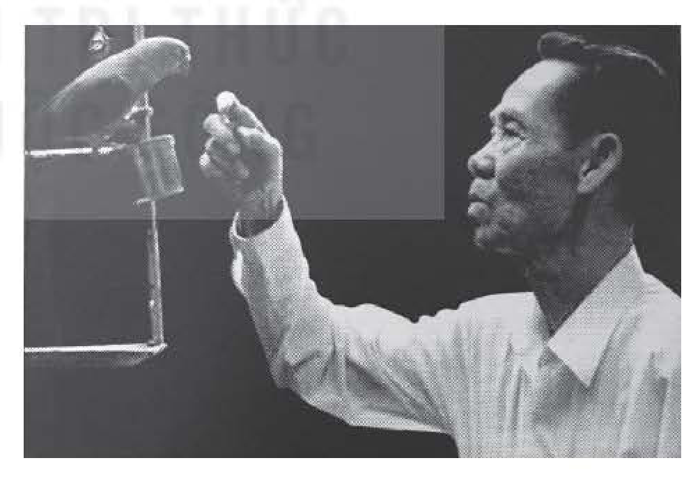

<!-- pdf:6 -->

# BÀI 6: GIẢI MÃ NHỮNG BÍ MẬT

*Cuộc sống là một câu đố và giải mã*
*những bí mật của nó là cuộc phiêu lưu đầy thú vị.*
<!-- ocr-ok: câu đề từ chữ viết tay trắng trên nền xanh bị OCR đọc lỗi nặng, đã đối chiếu ảnh trang PDF 6 -->

Đan Bờ-rao (Dan Brown)
<!-- ocr-ok: tên tác giả chữ trắng trên nền xanh bị OCR đọc nhầm "Bờ-rao" thành "Bỡ-rao", đã đối chiếu ảnh trang PDF 6 -->

## Giới thiệu bài học

- Thế giới tự nhiên và đời sống xã hội luôn ẩn chứa bao điều bí mật, thách thức sự khám phá của con người. Việc khám phá, giải mã những bí ẩn không chỉ để thoả mãn trí tò mò, khả năng phán đoán, mà còn góp phần giúp chúng ta giải quyết nhiều vấn đề hệ trọng của cuộc sống.
- Với các truyện trinh thám trong bài học này, em sẽ được dẫn vào thế giới đầy những điều li kì, bất ngờ; được trải nghiệm nhiều cung bậc cảm xúc. Các nhân vật người điều tra trong truyện thể hiện khả năng suy luận tuyệt vời, giải mã được những điều bí ẩn khiến ta phải kinh ngạc. Kết nối về chủ đề là văn bản khắc hoạ chân dung một nhà tình báo lỗi lạc mà cuộc đời và sự nghiệp của ông được ví như một “huyền thoại”. Tất cả sẽ giúp em hiểu hơn bức tranh đa diện, phức tạp của cuộc sống, tầm quan trọng của kĩ năng quan sát, sức mạnh của suy luận lô-gíc và niềm tin vào sự chiến thắng của công lí.

## 🎯 Yêu cầu cần đạt

- Nhận biết và phân tích được một số yếu tố trong truyện trinh thám như: không gian, thời gian, chi tiết, cốt truyện, nhân vật chính, lời người kể chuyện.
- Nêu được những thay đổi trong suy nghĩ, tình cảm, lối sống và cách thưởng thức, đánh giá của cá nhân do văn bản đã học mang lại.
- Nhận biết được các kiểu câu ghép, kết từ để nối các vế câu ghép; biết lựa chọn câu đơn – câu ghép trong hoạt động giao tiếp.
- Viết được một truyện kể sáng tạo, có thể mô phỏng một truyện đã đọc; sử dụng các yếu tố miêu tả và biểu cảm trong truyện.
- Biết kể một câu chuyện tưởng tượng (có bối cảnh, nhân vật, cốt truyện,...).
- Sống trung thực, trách nhiệm; tôn trọng pháp luật.

<!-- pdf:7 -->

## Đọc

### TRI THỨC NGỮ VĂN

**Truyện trinh thám**

Truyện trinh thám là loại tác phẩm truyện viết về quá trình điều tra vụ án, thường có những sự việc bí ẩn, bất ngờ. Quá trình phá án của người điều tra dựa trên yếu tố quan trọng là sự suy luận lô-gíc. Vụ án thường được làm sáng tỏ ở phần kết thúc truyện. Nhà văn người Mỹ Ét-ga A-len Pâu (Edgar Allan Poe, 1804 – 1842) được đánh giá là “cha đẻ” của thể loại truyện trinh thám với các tác phẩm nổi tiếng như: *Vụ án đường Mo-gi (Morgue)*, *Con cánh cam vàng*, *Lá thư bị mất*,... Hiện nay, thể loại truyện trinh thám có vị trí quan trọng trong đời sống văn học, nhiều tác phẩm trinh thám đã gây được sức hấp dẫn lớn với bạn đọc.

**Một số yếu tố của truyện trinh thám**

<!-- term: hệ thống nhân vật trong truyện trinh thám -->
- Không gian của truyện trinh thám là không gian hiện trường – nơi xảy ra vụ án, cũng là nơi người điều tra nghiên cứu để tìm thủ phạm. Các vụ án có thể diễn ra ở những không gian rộng (khu rừng, hang động, góc phố,...) hoặc không gian nhỏ hẹp (căn phòng, bàn ăn,...). Trong truyện trinh thám, không gian hiện trường được khắc hoạ chi tiết, cụ thể và gắn liền với dấu hiệu bằng chứng phạm tội.
- Thời gian trong truyện trinh thám thường được giới thiệu ở phần đầu tác phẩm với thông tin cụ thể về tháng, năm hay tình huống mà người điều tra tiếp nhận vụ án. Cách giới thiệu thời gian như vậy có tác dụng tạo nên tính chân thực cho câu chuyện. Truyện trinh thám thường xây dựng tình huống người điều tra chịu áp lực chạy đua với thời gian để tìm ra kẻ phạm tội. Điều này tạo ra sự căng thẳng, hấp dẫn cho người đọc đồng thời cho thấy tài năng của người điều tra.
- Cốt truyện trong truyện trinh thám gồm một chuỗi sự kiện mà sự kiện trung tâm là vụ án và hành trình phá án của người điều tra. Tác phẩm thường bắt đầu bằng một bí ẩn được đặt ra – thực chất là một vụ án phức tạp, có nhiều tình tiết dường như không thể giải thích được; sau đó là hành trình giải mã của người điều tra và cuối cùng bí ẩn được làm sáng tỏ.
- Hệ thống nhân vật trong truyện trinh thám thường gồm người điều tra, nạn nhân, nghi phạm, thủ phạm. Người điều tra là nhân vật chính trong tác phẩm, có thể là nhà điều tra chuyên nghiệp như thám tử, cảnh sát, thanh tra,... hoặc nhà điều tra nghiệp dư. Người điều tra trong truyện trinh thám có tố chất đặc biệt. Đó là sự dũng cảm, ưa mạo hiểm, vốn kiến thức phong phú, trí thông minh vượt trội, tài quan sát và suy luận,... đặc biệt là trung thực, luôn đặt sự thật lên trên hết nhằm bảo vệ lẽ phải và công lí.
- Truyện trinh thám có những chi tiết thể hiện sự bí ẩn, li kì của vụ án và những bất ngờ của cuộc điều tra. Những chi tiết về khung cảnh, không gian, thời gian xảy ra sự việc; chân dung, cử chỉ, hành động, lời nói,... của nhân vật thường có dấu hiệu của bằng chứng hoặc manh mối quan trọng trong quá trình điều tra.

<!-- pdf:8 -->

- Câu chuyện trong truyện trinh thám được kể theo ngôi thứ nhất hoặc ngôi thứ ba. Ở ngôi thứ nhất, câu chuyện thường được kể lại qua lời của người điều tra hoặc lời một người bạn của người điều tra – nhân vật chứng kiến toàn bộ quá trình giải mã vụ án. Điều này giúp câu chuyện trở nên chân thực, đáng tin, bất ngờ và kịch tính hơn.

**Câu đơn và câu ghép, các kiểu câu ghép và phương tiện nối các vế câu ghép**

<!-- term: câu đơn -->
<!-- term: vế câu -->
- Câu đơn là câu được cấu tạo bằng một cụm chủ ngữ – vị ngữ nòng cốt (cụm chủ ngữ – vị ngữ không bị bao chứa trong một cụm từ khác). Câu ghép là câu do hai hoặc nhiều cụm chủ ngữ – vị ngữ nòng cốt tạo thành, mỗi cụm chủ ngữ – vị ngữ này được gọi là một vế câu.
- Căn cứ vào sự có mặt hay vắng mặt của từ ngữ làm phương tiện nối các vế câu, có thể chia câu ghép thành hai loại: câu ghép có từ ngữ nối các vế câu và câu ghép không có từ ngữ nối các vế câu.

  Căn cứ vào quan hệ giữa các vế câu, có thể chia câu ghép thành hai loại: câu ghép đẳng lập và câu ghép chính phụ. Câu ghép đẳng lập là câu ghép mà các vế có quan hệ bình đẳng, ngang hàng với nhau. Câu ghép chính phụ là câu ghép mà các vế có quan hệ phụ thuộc, nghĩa là có vế chính và vế phụ.
<!-- term: cặp từ hô ứng -->
- Từ ngữ nối các vế của câu ghép có thể là kết từ (*và, nhưng, hay*,...) hoặc các cặp từ hô ứng (*vừa... vừa, bao nhiêu... bấy nhiêu*,...). Mỗi từ ngữ nối đều thể hiện tường minh một quan hệ nghĩa nhất định giữa các vế câu.

**Lựa chọn câu đơn – câu ghép**

<!-- term: việc lựa chọn câu đơn và câu ghép -->
Trong hoạt động giao tiếp, tuỳ thuộc vào mục đích, kiểu loại văn bản, ngữ cảnh và nội dung cần biểu đạt mà người nói (người viết) lựa chọn câu đơn hay câu ghép cho phù hợp.

### VĂN BẢN ĐỌC

- VĂN BẢN 1. *Ba chàng sinh viên*, A-thơ Cô-nan Đoi-lơ (Athur Conan Doyle)
- VĂN BẢN 2. *Bài hát đồng sáu xu*, A-ga-thơ Crít-xti (Agatha Christie)
- VĂN BẢN 3. *Phạm Xuân Ẩn – tên người như cuộc đời* (trích), Nguyễn Thị Ngọc Hải

### VĂN BẢN 1: Ba chàng sinh viên

**Trước khi đọc**

1. Em hiểu gì về công việc của một thám tử?
2. Nêu tên một nhân vật thám tử trong tác phẩm văn học hoặc bộ phim mà em biết. Chia sẻ ngắn gọn cảm nhận của em về nhân vật đó.

<!-- pdf:9 -->

**Đọc văn bản**

**Ba chàng sinh viên**

A-THƠ CÔ-NAN ĐOI-LƠ
<!-- ocr-ok: tên tác giả bị OCR đọc nhầm thành "A-THƠ GÔ-NAN ĐỌI-LƠ", đã đối chiếu ảnh trang PDF 9 -->

(Lược một đoạn: Vào năm 1895, tại căn nhà trọ ở một thành phố của Anh, Sơ-lốc Hôm (Sherlock Holmes) và người bạn Oát-xơn (Watson) đã nghe ông Hin-tơn Xôm (Hilton Soames) – giảng viên của trường Đại học Xanh Lúc (St. Luke) – kể lại câu chuyện xảy ra ở trường mình. Theo lời ông, ngày mai, cuộc thi để lấy học bổng sẽ được tổ chức. Đề thi môn tiếng Hy Lạp yêu cầu dịch một bài khá dài, hoàn toàn mới đối với thí sinh. Vì học bổng có giá trị cao nên nếu thí sinh nào biết trước đề sẽ có lợi thế lớn. Do đó, thầy Xôm và các đồng nghiệp đã giữ đề thi cẩn thận. Khoảng 3 giờ chiều nay, bản in thử được gửi đến. Thầy Xôm phải soát lại để đảm bảo đề bài tuyệt đối chính xác. Tới 4 giờ 30 phút, thầy vẫn chưa đọc xong. Vì phải đi dùng trà cùng một người bạn như đã hứa, thầy để bản in thử trên bàn và vắng mặt khoảng một tiếng đồng hồ. Khi trở về, thầy kinh ngạc vì thấy chìa khoá đang cắm vào ổ khoá cửa phòng do người hầu Be-ni-xtơ (Bannister) quên rút. Trước khi đi, thầy để ba trang đề thi ở cùng một chỗ, nhưng lúc này, thầy thấy một trang nằm trên sàn, một trang trên cái bàn kê sát cửa sổ, còn một trang vẫn ở vị trí cũ. Trên mặt bàn có vài mảnh vỏ bút chì, một đầu chì gãy, vết rách dài độ 3 inch(1) và một mẩu bột đen nhỏ, lấm tấm như mùn cưa. Thầy Xôm cho biết thêm, có một sinh viên tên là Đao-lát Rát (Daulat Ras) đã vào phòng hỏi về cuộc thi, lúc ấy bản in thử đã được mang đến nhưng vẫn còn cuộn lại. Sơ-lốc Hôm được mời tới phòng thầy Xôm để xem xét. Phòng làm việc của thầy có một cửa sổ gắn lưới sắt nhìn ra khoảng sân rêu phong của ngôi trường cổ kính. Sơ-lốc Hôm cho rằng có người đã chép được nửa tờ thứ hai thì thấy thầy Xôm về nên vội rút lui, không kịp để đề thi về chỗ cũ. Hắn đã viết mạnh đến mức làm gãy ngòi chì, phải vót lại. Vị thám tử cũng phát hiện trong phòng ngủ của thầy Xôm có mẩu nhỏ màu đen dạng hình chóp, giống hệt mẩu trên bàn ngoài phòng làm việc. Sơ-lốc Hôm phỏng đoán kẻ chép trộm đề thi đã trốn vào phòng ngủ trong suốt thời gian thầy Xôm nói chuyện với Be-ni-xtơ ở phòng làm việc. Theo lời thầy Xôm, có ba sinh viên ở trong nhà này và thường đi qua cửa phòng làm việc của thầy. Phòng của thầy Xôm ở tầng một. Ghi-crít (Gilchrist) – một sinh viên chăm chỉ và là vận động viên giỏi – sống ở tầng hai. Cậu ta tử tế. Cha cậu là một quý tộc nhưng bị phá sản và đã qua đời. Đao-lát Rát sống ở tầng ba. Cậu học tốt, nhưng môn tiếng Hy Lạp yếu. Sống ở tầng trên cùng là Mai Mắc Le-rờn (Miles Mc Laren). Cậu ta được xem là sáng dạ nhất trường, nhưng lại lười học, ương ngạnh, ăn chơi và vô kỉ luật. Cậu ta suýt bị đuổi học ngay trong năm thứ nhất vì dính vào một vụ bài bạc. Cả học kì này, cậu ta toàn rong chơi. Thầy Xôm cho rằng trong ba sinh viên, Mắc Le-rờn là người đáng nghi ngờ nhất. Hôm đã hỏi ông Be-ni-xtơ việc ông quên rút chìa khoá vào đúng ngày có đề thi trong phòng, lí do ông ngồi lên cái ghế gần cửa phòng khi thấy choáng váng mà không phải cái ghế khác. Sau đó Sơ-lốc Hôm muốn xem qua phòng của ba sinh viên.)

> **THEO DÕI:** Vụ việc mà thầy Xôm muốn Sơ-lốc Hôm giúp đỡ.

> (1) *Inch*: đơn vị đo chiều dài, được sử dụng phổ biến ở một số nước nói tiếng Anh như: Anh, Mỹ, Ca-na-đa (Canada),...; 1 inch tương đương 2,54 cm.

<!-- pdf:10 -->

– Tôi muốn ngó qua từng người một – Hôm nói. – Vậy có được không nhỉ?

– Dễ thôi – Xôm trả lời. – Dãy phòng này thuộc loại cổ nhất trong trường, vì vậy chuyện có khách tới tham quan cũng không hề lạ. Mời các ông đi theo tôi, tôi sẽ dẫn đường.

– Ông nhớ đừng gọi tên chúng tôi đấy nhé! – Hôm nói khi chúng tôi gõ cửa phòng Ghi-crít.

Một thanh niên cao gầy, tóc hoe vàng ra mở cửa rồi niềm nở mời chúng tôi vào khi biết mục đích chuyến viếng thăm. Phòng vẫn còn lại vài bức phù điêu đẹp đẽ thời Trung cổ. Hôm mê mẩn một bức đến độ đòi vẽ nó vào cuốn sổ tay cho kì được. Anh làm gãy bút chì nên đành hỏi mượn một cái của chủ nhân căn phòng, rồi sau đó mượn thêm dao để chuốt. Vận xui kì lạ đó tiếp tục bám theo anh tại phòng cậu người Ấn. Đó là một gã trầm lặng, nhỏ thó, mũi khoằm, cứ gườm gườm nhìn chúng tôi suốt và mừng ra mặt khi Hôm nghiên cứu xong mấy bức phù điêu. Tuy nhiên tại cả hai phòng, tôi đều không thấy Hôm bắt được manh mối cần tìm. Đến phòng thứ ba, mánh của Hôm thất bại từ trong trứng nước. Chúng tôi gõ cửa nhưng chủ nhân căn phòng không chịu mở, đã thế còn tặng chúng tôi một tràng chửi rủa.

– Tôi cóc cần biết mấy người là ai. Mấy người đi phứt cho nhờ! – Giọng giận dữ gầm lên. – Tôi bận ôn thi, các người nghe rõ chưa?

– Một gã thô lỗ. – Người dẫn đường của chúng tôi nói, đỏ mặt giận dữ khi chúng tôi xuống nhà. – Tất nhiên cậu ta không biết tôi là người gõ cửa. Nhưng kể cả vậy thì cậu ta cũng quả là bất lịch sự và lối cư xử đó thật đáng ngờ trong hoàn cảnh này.

> **THEO DÕI:** Thầy Xôm nghi ngờ sinh viên nào đã chép trộm đề thi?
<!-- ocr-ok: thẻ Theo dõi ở lề phải bị OCR bỏ sót nhãn và đọc nhầm dấu thanh, đã đối chiếu ảnh trang PDF 10 -->

Phản ứng của Hôm khá kì lạ.

– Ông có thể cho tôi biết chiều cao chính xác của cậu này không? – Anh hỏi.

– Ông Hôm, tôi quả thật không biết chắc. Cậu ta cao hơn cậu người Ấn nhưng thấp hơn Ghi-crít. Chắc tầm năm foot(1) sáu.

– Chuyện đó rất quan trọng – Hôm nói. – Còn giờ xin chúc thầy Xôm ngủ ngon.

Người dẫn đường của chúng tôi kêu lên tỏ ý kinh ngạc và thất vọng.

– Ôi, ông Hôm, ông không định bỏ tôi đường đột thế này chứ? Hình như ông chưa nhận ra tình thế. Mai là thi rồi. Tối nay tôi buộc phải đưa ra quyết định dứt khoát. Tôi không thể để kì thi diễn ra khi đề thi bị lộ. Tôi phải làm gì đó.

– Ông cứ để nguyên vậy đi. Sớm mai tôi sẽ ghé rồi bàn về việc này, có thể lúc đó tôi đã nắm được những tình tiết mới giúp ông thoát khỏi tình cảnh này. Còn từ giờ tới đó, ông đừng thay đổi gì cả.

– Đành vậy.

> (1) *Foot*: đơn vị đo chiều dài, được sử dụng phổ biến ở một số nước nói tiếng Anh như: Anh, Mỹ, Ca-na-đa,... 1 foot tương đương 30,48 cm.

<!-- pdf:11 -->

– Ông yên tâm. Nhất định chúng tôi sẽ tìm được cách giúp ông thoát khỏi rắc rối. Tôi sẽ đem hai mẩu đất đen và mảnh vỏ bút chì về. Xin chào ông!

Bước ra khoảng sân tối om, chúng tôi ngước nhìn ngôi nhà một lần nữa. Cậu người Ấn vẫn đi tới đi lui trong phòng, nhưng chúng tôi không thấy bóng dáng hai người kia đâu.

– Oát-xơn này, anh nghĩ sao? – Hôm hỏi khi chúng tôi tiến ra đường lớn. – Tôi thấy chúng ta như đang chơi trò loại trừ vậy. Anh có ba người. Thủ phạm phải là một trong số họ. Anh chọn đi. Anh chọn ai nào?

– Gã ăn nói lỗ mãng ở tầng trên cùng. Hắn là kẻ “có tiếng” nhất. Nhưng gã người Ấn có vẻ ranh ma. Và sao cậu ta cứ đi lại trong phòng suốt vậy?

> **THEO DÕI:** Oát-xơn nghi ngờ ai là thủ phạm chép trộm đề thi?

– Cũng không có gì đâu. Nhiều người thường làm vậy khi học thuộc lòng.

– Cách cậu ta nhìn chúng ta rất đáng ngờ.

– Anh cũng sẽ như vậy nếu bị một toán người lạ làm phiền trong khi ngày mai anh có một kì thi quan trọng và mọi phút chuẩn bị đều đáng quý. Không, những chi tiết đó cùng với bút chì và dao, tất thảy đều thoả đáng. Nhưng gã đó lại khiến tôi rối trí.

– Ai?

– Gã người hầu Be-ni-xtơ chứ ai! Ông ta đang toan tính gì đây?

– Tôi thấy ông ta là người trung hậu.

– Tôi cũng thấy vậy. Đó chính là chỗ khó hiểu. Sao một con người trung hậu như vậy lại... A, có một tiệm văn phòng phẩm lớn này. Ta sẽ bắt đầu tìm hiểu từ đây.

(Lược một đoạn: Sơ-lốc Hôm vào các tiệm bán văn phòng phẩm trong thành phố để tìm cái bút có vỏ giống mảnh vỏ bút chì ở hiện trường nhưng không tìm được. 8 giờ sáng hôm sau, Sơ-lốc Hôm giục Oát-xơn đi Xanh Lúc vì thám tử đã giải được bí mật vụ án. Hôm nói rằng mình đã dậy từ 6 giờ sáng, đi bộ suốt hai giờ và mang về một mẩu đất sét hình chóp màu đen. Mẩu đất thứ ba được lấy chính từ nơi có hai mẩu đầu tiên.)

Khi chúng tôi tới nơi, ông thầy khốn khổ đang đứng ngồi không yên. Chỉ vài giờ nữa là kì thi bắt đầu, ấy vậy mà ông ta chưa biết nên công bố sự việc hay mặc thây cho kẻ gian trá tranh học bổng đáng giá. Đầu óc căng như dây đàn khiến ông ta không ngồi yên nổi, vậy nên vừa thấy Hôm, ông ta đã chạy ào ra và dang tay đón mừng.

> **DỰ ĐOÁN:** Những ai liên quan đến vụ việc chép trộm đề thi?

– Ơn trời ông đến rồi! Tôi chỉ sợ ông cũng bó tay. Tôi phải làm gì đây? Kì thi có tiếp tục không?

<!-- pdf:12 -->

– Có. Bất luận thế nào cũng phải để nó diễn ra.

– Nhưng còn tên vô lại kia?

– Hắn sẽ không thi.

– Ông biết hắn là ai rồi sao?
<!-- ocr-ok: câu thoại ngắn bị OCR đọc lỗi dấu ("Ong biệt hãn"), đã đối chiếu ảnh trang PDF 12 -->

> **SUY LUẬN:** Lúc này, Sơ-lốc Hôm đã biết thủ phạm chép trộm đề thi chưa?

– Tôi nghĩ vậy. Vì chuyện này phải được giữ kín nên chúng ta sẽ tự lập ra một toà án nho nhỏ vậy. Thầy Xôm, mời thầy ngồi đằng kia! Oát-xơn, anh ngồi đây! Tôi sẽ ngồi ở ghế bành chính giữa. Chúng ta đã đủ oai nghiêm để làm thủ phạm phải hoảng hốt rồi đấy. Xin thầy vui lòng rung chuông!

Be-ni-xtơ vào, ông ta suýt té ngửa vì ngạc nhiên và hốt hoảng trước phong thái pháp đình của chúng tôi. [...]

– Giờ thì Be-ni-xtơ, ông vui lòng khai thật cho chúng tôi biết sự việc hôm qua chứ?

Ông này tái mét tới tận chân tóc.

– Thưa ông, tôi đã thưa cả rồi.

– Không còn gì để kể thêm sao?
<!-- ocr-ok: câu thoại ngắn bị OCR đọc nhầm dấu hỏi ("đề kế"), đã đối chiếu ảnh trang PDF 12 -->

– Không, thưa ông.

– Nếu vậy, tôi đành gợi ý cho ông vài điều. Hôm qua khi ngồi xuống chiếc ghế đó, phải chăng ông có chủ đích che giấu một vật có thể tiết lộ danh tính kẻ đột nhập?

Be-ni-xtơ tái mặt.

– Không, thưa ông. Không hề.

– Chỉ là gợi ý thôi mà – Hôm khéo léo nói. – Thú thật là tôi không thể chứng minh điều đó. Nhưng chuyện đó xem ra rất có thể, vì thầy Xôm vừa rời nhà là ông liền thả kẻ nấp trong phòng ngủ đi mất.

Be-ni-xtơ liếm đôi môi khô nẻ.

– Tôi không thả ai, thưa ông. [...]

– Vậy là ông không thể cho chúng tôi thêm thông tin rồi. Ông vui lòng ở lại trong phòng nhé! Mời ông đứng gần cửa phòng ngủ. Thầy Xôm, thầy vui lòng lên phòng cậu Ghi-crít và bảo cậu ta xuống đây.

Một loáng sau, ông thầy đã trở lại và dẫn theo chàng sinh viên nọ. Cậu ta có dáng dấp đẹp đẽ, cao ráo, uyển chuyển và nhanh nhẹn, bước đi thoăn thoắt và gương mặt cởi mở, dễ gần. Đôi mắt xanh tràn ngập lo âu nhìn từng người trong chúng tôi, rồi cuối cùng bàng hoàng dừng lại ở Be-ni-xtơ đang đứng trong góc đằng xa.

<!-- pdf:13 -->

– Đóng cửa lại đã – Hôm nói. – Này cậu Ghi-crít, ở đây chỉ có chúng ta và không ai ngoài kia biết gì về chuyện này. Chúng ta hoàn toàn có thể thẳng thắn nói chuyện với nhau. Cậu Ghi-crít, chúng tôi muốn biết làm sao mà một con người trọng danh dự như cậu lại làm cái chuyện như hôm qua chứ?

Chàng trai khốn khổ loạng choạng bước lui và ném về Be-ni-xtơ một cái nhìn hoảng sợ pha lẫn trách móc.

– Không, không phải tôi đâu, thưa cậu Ghi-crít. Tôi không hề nói một lời nào – không hé răng một lời nào hết! – Ông người hầu kêu lên.

– Phải, nhưng ông vừa nói đấy thôi – Hôm cất tiếng. – Còn cậu, hẳn cậu thấy rằng sau lời nói vừa rồi của Be-ni-xtơ, cậu đã rơi vào tình thế vô vọng và cậu chỉ còn một cơ may duy nhất nếu thành khẩn khai thật.

Ghi-crít giơ một bàn tay lên và cố kìm nén vẻ uất ức hiện lên gương mặt trong chốc lát. Sau đó, cậu ta quỳ thụp xuống cạnh bàn, hai tay ôm mặt và bật khóc.

– Nào, nào – Hôm nhẹ nhàng nói. – Đời chẳng có ai là không phạm sai lầm và ít ra không ai có thể quy kết rằng cậu đã phạm tội ác tày trời. Có lẽ sẽ dễ hơn cho cậu nếu tôi kể lại sự vụ và nếu tôi sai ở chỗ nào thì cậu cứ đính chính. Vậy được chứ? Thôi, cậu không cần trả lời đâu. Hãy nghe và cậu sẽ thấy tôi không hề nói oan cho cậu.

Thầy Xôm, từ lúc thầy nói rằng không có ai, kể cả Be-ni-xtơ, biết đề thi ở trong phòng thầy, vụ này đã bắt đầu tựu hình rõ rệt trong đầu tôi. Chúng ta có thể gạt thợ in ra khỏi diện nghi vấn. Nếu muốn, anh ta có thể chép lại đề thi ngay trong nhà mình. Tôi cũng không nghi ngờ cậu người Ấn, vì bản in thử được cuộn lại nên cậu ta không thể biết đó là gì. Mặt khác, tôi không tin có người tình cờ bước vào và vô tình thấy đề thi. Người vào phải biết đề thi có ở đó. Nhưng làm sao hắn ta biết?

> **THEO DÕI:** Suy luận của Sơ-lốc Hôm về thủ phạm chép trộm đề thi.
<!-- ocr-ok: thẻ Theo dõi ở lề phải bị OCR bỏ sót nhãn và đọc lỗi nặng, đã đối chiếu ảnh trang PDF 13 -->

Trước khi vào nhà, tôi có kiểm tra cửa sổ phòng làm việc của thầy. [...] Lúc ấy, tôi đang ước lượng xem người này phải cao chừng nào mới có thể thấy giấy tờ để trên bàn giữa phòng là gì khi đi ngang qua. Tôi cao sáu foot, ấy vậy mà cũng phải cố lắm tôi mới nhìn ra được.

<!-- pdf:14 -->

Vậy nên kẻ kia phải cao tầm tôi hoặc hơn. Giờ hẳn thầy đã rõ vì sao trong ba cậu sinh viên, tôi lại nghi ngờ cậu Ghi-crít nhất. Tôi vào nhà và nói cho thầy nghe các suy đoán của tôi về cái bàn kê gần cửa sổ. Tôi không rút ra kết luận gì về cái bàn giữa phòng cho đến khi thầy nói Ghi-crít là vận động viên nhảy xa. Bấy giờ, toàn bộ sự việc ngay tức khắc hiện lên trong đầu tôi và việc tôi cần làm chỉ còn là tìm ra vài bằng chứng chứng thực. Chẳng mấy chốc tôi đã có được chúng.

Chuyện xảy ra như thế này: Cả buổi chiều chàng trai kia ở ngoài sân vận động để luyện nhảy xa. Cậu ta đi đôi giày nhảy về, mà như thầy biết đấy, đây là loại giày đinh. Lúc đi ngang cửa sổ phòng thầy, nhờ lợi thế chiều cao nên cậu ta thấy mấy bản in thử trên bàn và đoán ra chúng là gì. Chuyện xấu đã chẳng xảy ra nếu khi đi qua cửa phòng thầy, cậu ta không thấy cái chìa khoá người hầu sơ suất để quên. Cậu ta bị thôi thúc phải vào xem cái cậu ta thấy có phải đề thi ngày mai không. Hành động đó không hề mạo hiểm vì nếu bị bắt gặp, cậu ta có thể nói mình có chuyện cần hỏi thầy.

Khi thấy đó đúng là đề thi, cậu ta đã đầu hàng sự cám dỗ. Cậu ta đặt giày lên bàn. Cậu để gì bên ghế gần cửa sổ vậy?

– Đôi găng tay – chàng trai nói.

Hôm đắc thắng nhìn Be-ni-xtơ.

– Cậu ta để găng tay trên ghế rồi lấy từng tờ đề thi để chép lại. Cậu ta tưởng thầy sẽ về qua cửa chính nên ngồi bên bàn cạnh cửa sổ để trông chừng. Như chúng ta đã biết, thầy vào bằng cửa hông. Cậu ta rất bất ngờ khi nghe tiếng thầy mở cửa ngoài. Cậu ta không còn đường thoát. Cậu ta chộp lấy đôi giày và chạy ào vào phòng ngủ nhưng để quên đôi găng tay. Thầy quan sát thấy rằng vết rách khá nông ở một bên, nhưng lại hằn rõ theo hướng của phòng ngủ. Chỉ riêng điều ấy cũng đủ cho ta thấy chiếc giày bị kéo về hướng đó và thủ phạm trốn trong phòng ngủ. Đất bám quanh một đinh giày vương lên bàn và mẩu đất thứ hai rã ra, rơi xuống sàn phòng ngủ. Xin được nói thêm, sáng nay tôi đã ra sân vận động, thấy rằng loại đất sét đen cứng này được đổ trong hố nhảy cùng một ít vỏ cây mịn hay mùn cưa rải lên trên để vận động viên không bị trượt ngã. Tôi nói đúng chứ, cậu Ghi-crít?

Anh sinh viên đứng thẳng dậy.
<!-- ocr-ok: câu ngắn bị OCR đọc nhầm "thẳng" thành "thắng", đã đối chiếu ảnh trang PDF 14 -->

– Vâng, ông nói đúng – cậu ta nói.

– Chao ôi, cậu không còn gì để nói nữa ư? – Thầy Xôm kêu lên.

– Có, thưa thầy, tôi còn có điều muốn nói, nhưng nỗi kinh hoàng bị vạch trần nhục nhã này làm tôi rối trí. Thầy Xôm, hồi sớm nay sau một đêm thao thức, tôi đã viết một lá thư gửi thầy. Tôi viết trước khi biết tội lỗi của mình bị vạch trần. Nó đây ạ. Trong thư

<!-- pdf:15 -->

tôi có viết: Tôi quyết định không dự thi. Tôi được nhận vào làm ở Sở Cảnh sát Rốt-đơ (Rhodes) nên sẽ đi Nam Phi ngay.

– Tôi thật lòng rất vui khi biết cậu không định lợi dụng sơ sót của tôi. – Thầy Xôm nói. – Nhưng sao cậu lại đổi ý?

Ghi-crít chỉ Be-ni-xtơ.

– Chính người này đã đưa tôi vào đường ngay. – Cậu ta nói.

– Giờ nói đi, Be-ni-xtơ. – Hôm nói. – Sau điều tôi vừa giải thích, hẳn ông đã thấy rõ chỉ có ông mới có thể cho chàng trai này ra khỏi phòng, vì sau lúc thầy Xôm đi, chỉ còn lại mình ông trong phòng và ông hẳn đã khoá cửa khi ra. Tôi không tin cậu ta thoát ra ngoài qua đường cửa sổ phòng ngủ. Ông có thể làm sáng tỏ điểm cuối cùng trong bí ẩn này và cho chúng tôi biết lí do ông hành động như vậy chứ?

– Nếu ông biết về tôi, ông sẽ thấy lí do rất đơn giản, nhưng tuy thông minh là thế ông không thể biết chuyện. Thưa ông, khi xưa tôi làm quản gia cho ông Gia-bớt Ghi-crít (Jabez Gilchrist), cha của cậu đây. Khi ông ấy khánh kiệt(1) thì tôi đến trường làm, nhưng tôi không bao giờ quên ông chủ quá cố. Tôi chăm lo cho con trai ông ấy để trả ơn. Vâng thưa ông, hôm qua khi thầy Xôm gọi tôi vào phòng, cái tôi thấy trước tiên là đôi găng tay màu nâu của cậu Ghi-crít trên cái ghế đó. Tôi biết rõ đôi găng nên hiểu ra ngay. Nếu thầy Xôm thấy chúng, tất cả sẽ hỏng bét. Tôi vội ngồi xuống ghế đó và không nhúc nhích cho đến khi thầy Xôm chạy đi tìm ông. Sau đó cậu chủ tội nghiệp, người từng ngồi trong lòng tôi, bước ra và thú nhận tất cả. Thưa ông, lẽ tự nhiên tôi phải cứu cậu ấy chứ? Và cũng là lẽ tự nhiên tôi phải nói phải trái với cậu Ghi-crít như người cha quá cố của cậu ấy, để cậu ấy hiểu mình không thể trục lợi bằng cách đó, đúng không? Ông có chê trách tôi không, thưa ông Hôm?

> **ĐỐI CHIẾU:** Những người có liên quan đến vụ việc chép trộm đề thi có đúng như dự đoán của em không?
<!-- ocr-ok: thẻ Đối chiếu ở lề phải bị OCR bỏ sót nhãn và mất chữ cuối hộp, đã đối chiếu ảnh trang PDF 15 -->

– Đúng, tôi không thể chê trách ông. – Hôm nói rất thành thực và đứng dậy. – Thầy Xôm, tôi nghĩ chúng tôi đã làm sáng tỏ vấn đề nho nhỏ của ông và bữa điểm tâm đang chờ chúng tôi ở nhà. Đi nào, Oát-xơn! Còn về phần cậu, tôi mong một tiền đồ xán lạn đang chờ cậu ở Rốt-đơ. Cậu đã vấp ngã một lần và tôi mong cậu có thể vươn cao trong tương lai.

(A-thơ Cô-nan Đoi-lơ, *Sơ-lốc Hôm toàn tập*, tập 2, *theo* Lê Quang Toản *dịch*, NXB Văn học, Hà Nội, 2022, tr. 572 – 588)

> (1) *Khánh kiệt*: bị mất hết tài sản.

<!-- pdf:16 -->

**Sau khi đọc**

> - **A-thơ Cô-nan Đoi-lơ** (1859 – 1930) là nhà văn người Xcốt-len (Scotland). Ông sáng tác ở nhiều thể loại như: tiểu thuyết lịch sử, truyện khoa học viễn tưởng, truyện ngắn, kịch,... Ông nổi tiếng trên toàn thế giới với truyện trinh thám, trong đó nhân vật chính là Sơ-lốc Hôm. Sơ-lốc Hôm đã xuất hiện trong 4 tiểu thuyết và 56 truyện ngắn của Cô-nan Đoi-lơ. Một số truyện trinh thám nổi bật của ông: *Cuộc điều tra màu đỏ* (1887), *Dấu bộ tứ* (1890), *Những cuộc phiêu lưu của Sơ-lốc Hôm* (1892), *Những hồi ức về Sơ-lốc Hôm* (1894),...
> - Truyện ngắn *Ba chàng sinh viên* được in trong tập truyện *Sự trở về của Sơ-lốc Hôm* (1905).

**Trả lời câu hỏi**

1. Tóm tắt chuỗi sự kiện của tác phẩm theo trật tự: vụ việc gây lo lắng, hoảng hốt – hành trình phá án của người điều tra – công bố sự thật.
2. Vụ án xảy ra ở đâu? Những dấu vết quan trọng nào đã được Sơ-lốc Hôm phát hiện trong không gian đó?
3. Chỉ ra các chi tiết cho thấy áp lực về thời gian của cuộc điều tra. Việc tạo ra áp lực về thời gian điều tra như vậy có tác dụng gì?
4. Để tạo nên sự hấp dẫn của truyện trinh thám, nhà văn thường đánh lạc hướng suy luận của người đọc để cuối cùng, chân tướng sự việc lộ diện bất ngờ. Đặc điểm này được thể hiện như thế nào trong truyện *Ba chàng sinh viên*?
5. Phân tích cách thức giúp Sơ-lốc Hôm đi đến kết luận về người có hành động gian dối trước khi kì thi diễn ra (loại trừ giả thiết, xem xét hiện trường, tìm kiếm bằng chứng). Qua đó, nhận xét về tài năng phá án của vị thám tử.
6. Việc nhà văn để cho Oát-xơn – bạn thân của Sơ-lốc Hôm – vào vai người kể chuyện ngôi thứ nhất có tác dụng gì?
7. Em rút ra bài học gì từ câu chuyện được kể trong tác phẩm?

#### Viết kết nối với đọc
<!-- ocr-ok: tiêu đề màu cam phông chữ hẹp bị OCR đọc lỗi thành "VIẾT KẾT NỮI VŨI ĐỤD", đã đối chiếu ảnh trang PDF 16 -->

Viết đoạn văn (khoảng 7 – 9 câu) trình bày suy nghĩ của em về nhân vật Be-ni-xtơ hoặc Ghi-crít trong truyện *Ba chàng sinh viên*.

<!-- pdf:17 -->

### Thực hành tiếng Việt

*CÁC KIỂU CÂU GHÉP VÀ PHƯƠNG TIỆN NỐI CÁC VẾ CÂU GHÉP*

1. Trong các câu trích từ văn bản *Ba chàng sinh viên* dưới đây, câu nào là câu ghép đẳng lập, câu nào là câu ghép chính phụ?
   a. *Cậu người Ấn vẫn đi tới đi lui trong phòng, nhưng chúng tôi không thấy bóng dáng hai người kia đâu.*
   b. *Chuyện xấu đã chẳng xảy ra nếu khi đi qua cửa phòng thầy, cậu ta không thấy cái chìa khoá người hầu sơ suất để quên.*
   c. *Nếu thầy Xôm thấy chúng, tất cả sẽ hỏng bét.*
   d. *Cậu đã vấp ngã một lần và tôi mong cậu có thể vươn cao trong tương lai.*

> **Nhận biết câu ghép đẳng lập**
>
> - Những quan hệ ý nghĩa thường gặp giữa các vế của câu ghép đẳng lập là: quan hệ thời gian, quan hệ tương phản, quan hệ lựa chọn, quan hệ tăng cấp, quan hệ bổ sung,...
> - Phương tiện ngôn ngữ chủ yếu được dùng để nối các vế của câu ghép đẳng lập là kết từ (*và, nhưng, hoặc*,...) hoặc cặp từ hô ứng (*càng... càng..., vừa... vừa..., bao nhiêu... bấy nhiêu*,...).
>   Ví dụ:
>   (1) *Trời không gió, nhưng không khí vẫn mát lạnh.*
>   (Đoàn Giỏi, *Đất rừng phương Nam*)
>   Giữa hai vế của câu (1) có mối quan hệ tương phản. Hai vế của câu ghép được nối với nhau bằng kết từ *nhưng*.
>   (2) *Ông ấy càng nói, chúng tôi càng thấy có nhiều vấn đề thực sự mới mẻ.*
>   Giữa hai vế của câu (2) có mối quan hệ tăng cấp. Hai vế của câu ghép được nối với nhau bằng cặp từ hô ứng *càng... càng...*
>
> **Nhận biết câu ghép chính phụ**
>
> - Những quan hệ ý nghĩa thường gặp giữa các vế của câu ghép chính phụ là: quan hệ nguyên nhân – kết quả; quan hệ điều kiện, giả thiết – hệ quả; quan hệ nhượng bộ – tăng tiến; quan hệ sự kiện – mục đích;...
> - Phương tiện ngôn ngữ chủ yếu được dùng để nối các vế của câu ghép chính phụ là cặp kết từ (*tuy... nhưng, vì... nên, nếu... thì*,...) hoặc một kết từ ở vế phụ hay vế chính (*tuy, nên*,...).
>   Ví dụ:
>   (1) *Bởi tôi ăn uống điều độ và làm việc có chừng mực nên tôi chóng lớn lắm.*
>   (Tô Hoài, *Dế Mèn phiêu lưu kí*)
>   Giữa hai vế của câu (1) có mối quan hệ nguyên nhân – kết quả. Hai vế của câu ghép được nối với nhau bằng cặp kết từ *bởi... nên*.
>   (2) *Nếu bầy chim con cất cánh sớm hơn, chúng sẽ bị rơi xuống dòng nước trên đường từ bãi cát vào bờ.*
>   (Nguyễn Quang Thiều, *Bầy chim chìa vôi*)
>   Giữa hai vế của câu (2) có mối quan hệ giả thiết – hệ quả. Hai vế của câu ghép được nối với nhau bằng kết từ *nếu*.

2. Xác định quan hệ ý nghĩa giữa các vế ở những câu ghép dưới đây và cho biết trong mỗi câu ghép, các vế câu được nối với nhau bằng cách nào.
   a. *Vì chuyện này phải được giữ kín nên chúng ta sẽ tự lập ra một toà án nho nhỏ vậy.*
   (Cô-nan Đoi-lơ, *Ba chàng sinh viên*)
   b. *Đất bám quanh một đinh giày vương lên bàn và mẩu đất thứ hai rã ra, rơi xuống sàn phòng ngủ.*
   (Cô-nan Đoi-lơ, *Ba chàng sinh viên*)
   c. *Để người con gái khỏi trở lại bàn, anh lấy chiếc khăn tay còn vo tròn cặp giữa cuốn sách tới trả cho cô gái.*
   (Nguyễn Thành Long, *Lặng lẽ Sa Pa*)
   d. *Khó khăn càng lớn, quyết tâm càng cao.*

3. Ở từng câu ghép có hai vế dưới đây, trọng tâm của thông báo nằm ở vế nào? Dựa vào đâu mà em xác định như vậy?
   a. – *Thu nhập tốt nhưng chỗ làm hơi xa.*
      – *Chỗ làm hơi xa nhưng thu nhập tốt.*

<!-- pdf:18 -->

   b. – *Vì Hà chăm chỉ và luôn cố gắng trong học tập nên bạn ấy đạt điểm rất cao trong kì thi vừa qua.*
      – *Hà đạt điểm rất cao trong kì thi vừa qua vì bạn ấy chăm chỉ và luôn cố gắng trong học tập.*

4. Trong các câu ghép sau, câu nào dùng sai phương tiện nối giữa các vế câu? Hãy sửa lại cho đúng.
   a. *Hà không những học tốt, Hà lại hát hay và có khả năng biểu diễn xuất sắc trên sân khấu.*
   b. *Tôi chưa nói câu nào mà nó đã khóc nức nở.*
   c. *Chúng ta càng đọc sách nhiều, kiến thức sẽ được mở rộng.*
   d. *Mặc dù trời mưa rất to còn chị ấy vẫn đến đúng giờ.*

### VĂN BẢN 2: Bài hát đồng sáu xu

**Trước khi đọc**

Theo em, điều gì làm nên sức hấp dẫn của một truyện trinh thám?

**Đọc văn bản**

**Bài hát đồng sáu xu**

A-GA-THƠ CRÍT-XTI
<!-- ocr-ok: tên tác giả bị OCR đọc dính chữ thành "A-GA-THOGRÍT-XTI", đã đối chiếu ảnh trang PDF 18 -->

(Lược một đoạn: Vào một buổi tối, Méc-đơ-lân Va-an (Magdelen Vaughan) đến gặp luật sư Ét-uốt (Edward) nhờ ông giúp gia đình cô điều tra một vụ việc. Ba tuần trước, bà Li-ly Cráp-tri (Lily Crabtree) của cô đã bị giết ngay trong nhà. Bà Li-ly là em gái bà nội Méc-đơ-lân. Méc-đơ-lân và em trai sinh đôi Mét-thiu (Matthew) sống với bà từ khi 14 tuổi. Trong nhà còn có chú họ Uy-li-am Cráp-tri (William Crabtree) – cháu trai bà Li-ly (con của em trai bà) và vợ chú là thím Ê-mi-ly (Emily). Bà Li-ly để lại số tiền thừa kế lớn chia đều cho bốn người cháu. Méc-đơ-lân kể rằng sau buổi uống trà, các thành viên trong gia đình đi làm việc riêng của mình. Khi bà giúp việc Ma-thơ (Martha) chuẩn bị dọn bữa tối vào lúc 7 giờ 30 phút thì bà Li-ly đã chết rồi. Bà bị đánh bằng cái chặn giấy rất nặng trên bàn cạnh cửa ra vào. Cảnh sát kiểm tra dấu vân tay trên đó nhưng không thấy gì, vì nó đã được lau sạch. Các thành viên trong nhà nghĩ rằng thủ phạm là một tên trộm nào đó, nhưng bà Ma-thơ nói không có ai đến nhà. Tất cả các cửa sổ đều được cài then bên trong và dường như không có dấu hiệu nào của việc đột nhập. Vì thế, nghi ngờ dồn vào bốn thành viên của gia đình. Buổi sáng hôm đó, ngài Ét-uốt đã nói chuyện với luật sư của bà Li-ly. Cách bà Li-ly quản lí tiền bạc hơi kì lạ. Bà không bao giờ sử dụng séc. Bà có thói quen viết thư cho luật sư và yêu cầu ông để sẵn cho bà một số tiền toàn những

> **THEO DÕI:** Vụ việc mà luật sư Ét-uốt cần xử lí.

<!-- pdf:19 -->

đồng 5 bảng Anh. 3 giờ chiều, vị luật sư đến nhà Méc-đơ-lân. Méc-đơ-lân kể rằng bà giúp việc Ma-thơ là người cuối cùng nhìn thấy bà Li-ly. Chiều hôm đó, bà Ma-thơ làm sổ sách và mang đến cho bà Li-ly tiền thừa cùng bản báo cáo. Méc-đơ-lân giải thích việc thím Ê-mi-ly hôm đó đau đầu, phải nằm nghỉ do thím và bà Li-ly cãi nhau rất căng thẳng. Bà Li-ly bảo vợ chồng thím hãy cuốn gói ra khỏi nhà. Còn Méc-đơ-lân không muốn sống ở nhà bà nữa, do bà Li-ly không đồng ý cho cô trở thành người mẫu. Mét-thiu đang nợ rất nhiều tiền, nhưng giờ đã ổn do có số tiền thừa kế từ bà Li-ly. Ngài Ét-uốt đã gặp gỡ các thành viên trong nhà Cráp-tri. Ông Cráp-tri nói rằng khi bi kịch xảy ra, ông đang mải chơi tem nên không nghe thấy gì. Thím Ê-mi-ly trả lời luật sư với vẻ ngoan cố và sợ hãi rằng bà chẳng biết gì vì bà đang ngủ.)

> **THEO DÕI:** Những thông tin nào cho thấy Méc-đơ-lân, Mét-thiu, thím Ê-mi-ly, chú Uy-li-am đều có thể là nghi phạm?

Ở hành lang, ngài Ét-uốt suýt đâm vào một chàng trai cao ráo da ngăm đen đang sải bước về phía cửa chính.

– Cậu Mét-thiu đấy à?
<!-- ocr-ok: câu thoại ngắn bị OCR đọc lỗi thành "Cậu Méớt-thiu đây à?", đã đối chiếu ảnh trang PDF 19 -->

– Vâng... nhưng mà, tôi không chờ được. Tôi có một cuộc hẹn.

– Mét-thiu! – Đó là tiếng chị cậu ta gọi vọng xuống từ cầu thang. – Ôi! Mét-thiu, em đã hứa...

– Em biết, chị à. Nhưng em không thể. Em phải đi gặp một người. Và, dù sao, cứ nói đi nói lại cái chuyện khốn nạn đó liệu có ích gì. Chúng ta đã làm đủ thứ với cảnh sát rồi. Em chán lắm.

Cửa chính đánh rầm. Anh Mét-thiu đã bỏ đi.

Ngài Ét-uốt được dẫn vào bếp. Bà Ma-thơ đang ủi đồ. Bà dừng lại, tay vẫn cầm bàn ủi. Ngài Ét-uốt đóng cửa lại.

– Cô Va-an nhờ tôi giúp cô ấy, – ông bảo. – Tôi hi vọng bà sẽ không phản đối chuyện tôi hỏi bà vài câu.

Bà nhìn ông, rồi lắc đầu.
<!-- ocr-ok: câu ngắn bị OCR đọc sai dấu thanh toàn câu ("nhin", "rối", "đâu"), đã đối chiếu ảnh trang PDF 19 -->

– Không ai trong số họ làm đâu, thưa ngài. Tôi biết ngài đang nghĩ gì, nhưng chuyện không phải thế. Một nhóm phụ nữ và quý ông tử tế mà người ta ao ước được gặp đấy ạ.

– Tôi cũng nghĩ thế. Nhưng sự tử tế của họ không phải là cái mà chúng ta gọi là bằng chứng, bà ạ.

– Có lẽ là không, thưa ngài. Luật pháp buồn cười thật. Nhưng có chứng cứ – theo như cách ngài gọi đấy, thưa ngài. Không ai trong số họ có thể làm gì mà tôi không biết.

– Nhưng chắc là...

– Tôi biết mình đang nói gì thưa ngài. Đấy, ngài nghe nhé...

<!-- pdf:20 -->

“Đấy” là tiếng kêu cót két trên đầu họ.
<!-- ocr-ok: câu văn bị OCR đọc lỗi thành "Đây” là hềng kêu cót két trên đâu họ.", đã đối chiếu ảnh trang PDF 20 -->

– Cái cầu thang đấy, thưa ngài. Mỗi khi có người lên xuống cầu thang, nó kêu cót két ghê lắm. Dù cho người ta đi nhẹ nhàng cỡ nào đi nữa. Bà Cráp-tri, bà ấy ngủ trên giường, còn ông Cráp-tri thì đang nghịch mấy con tem chết tiệt của ông ấy, cô Méc-đơ-lân ở trên lầu đang may váy, và nếu có ai trong số ba người họ xuống cầu thang thì tôi đã biết rồi. Nhưng họ đâu có đi xuống!

> **THEO DÕI:** Tại sao bà Ma-thơ khẳng định không ai trong gia đình liên quan đến vụ việc?

Bà nói vẻ chắc nịch khiến vị luật sư rất ấn tượng. Ông nghĩ: “Một nhân chứng tốt. Bà ấy quan trọng lắm đây.”.

– Nhỡ bà không để ý thì sao.

– Có chứ ạ. Tôi để ý mà chẳng cần chú ý, có thể nói vậy. [...]
<!-- ocr-ok: câu thoại bị OCR đọc nhầm dấu thanh ("đề", "chủ", "thê"), đã đối chiếu ảnh trang PDF 20 -->

– Ba người thì giải thích được rồi, nhưng còn người thứ tư nữa. Anh Mét-thiu Va-an cũng ở trên lầu sao?

– Không, cậu ấy ở trong một căn phòng nhỏ tầng dưới. Cạnh bên. Và cậu đang đánh máy chữ. Ngài có thể nghe rõ mồn một từ trong này. Tiếng đánh máy của cậu ấy không hề dừng một giây. Không một giây, thưa ngài, tôi có thể thề. Một thứ tiếng gõ gây bực mình khó chịu mà ồn ào nữa chứ.

Ngài Ét-uốt ngừng một lát.

– Bà chính là người phát hiện ra bà ấy, đúng không?

– Vâng, thưa ngài, đúng thế. [...] Và chẳng ai nghe tiếng động gì chỉ tại tiếng gõ lách cách từ cái máy đánh chữ của cậu Mét-thiu.

– Theo tôi hiểu thì bà khẳng định rằng không ai vào nhà cả đúng không?

– Làm sao họ vào được mà tôi lại không biết chứ, thưa ngài? Chuông reo trong đây mà. Và kia là cửa chính duy nhất.

Ông nhìn thẳng bà.

– Bà rất gắn bó với bà Cráp-tri đúng không?

Một vẻ bừng sáng ấm áp... chân thành... không lẫn vào đâu được... hiện lên trên gương mặt bà.

– Vâng, thật thế, đúng thế, thưa ngài. Nhưng về bà Cráp-tri... Ờ, tôi sống hoà hợp và bây giờ tôi không ngại phải kể ra. Hồi con gái tôi lỡ chửa hoang, thưa ngài, và bà Cráp-tri đã bênh vực tôi... đưa tôi về làm việc cho bà, bà đã làm thế, khi mọi chuyện đã xong xuôi. Ví thử chết thay bà... nói thật là tôi cũng sẽ làm.

Ngài Ét-uốt nghe là biết bà nói chân thành. Ma-thơ là người ngay thật.

<!-- pdf:21 -->

– Theo bà biết thì không ai đến cửa chính cả...?

– Không có ai cả ạ.

– Tôi nói theo bà biết. Nhưng nếu bà Cráp-tri đang đợi ai đó... nếu tự bà ấy mở cửa chính cho người đó...

> **SUY LUẬN:** Luật sư Ét-uốt phỏng đoán như thế nào về vụ án?

– Ồ! – Ma-thơ có vẻ bất ngờ.

– Tôi nghĩ có thể thế lắm chứ? – Ngài Ét-uốt gặng.

– Có thể lắm... vâng... nhưng không chắc lắm. Ý tôi là...

Rõ ràng là bà rất bất ngờ. Bà không thể chối bỏ dù rất muốn. Tại sao thế? Bởi vì bà biết sự thật nằm ở chỗ khác. Phải thế không nhỉ? Bốn người trong một nhà... một trong số họ là kẻ có tội? Có phải Ma-thơ muốn che giấu kẻ có tội đó không? Cầu thang đã kêu cót két ư? Có ai đó đã lén lút đi xuống và bà Ma-thơ có biết người đó là ai không?

Bà ấy là người chân thật... Ngài Ét-uốt tin như thế. [...]

– Tôi đoán không chừng là bà Cráp-tri đã làm vậy, nhỉ? Cửa của căn phòng đó hướng ra đường. Từ cửa sổ bà ấy hẳn đã nhìn thấy người mà bà đang đợi nên bước ra hành lang và mở cửa cho anh ta... hay cô ta... vào nhà. Thậm chí có thể bà ấy còn mong không có ai trông thấy người đó.

Bà Ma-thơ có vẻ lo âu. Cuối cùng bà miễn cưỡng đáp:

– Vâng, có thể ngài nói đúng, thưa ngài. Tôi không hề nghĩ đến chuyện đó. Rằng bà ấy đang đợi một quý ông nào đấy... vâng, có thể thế lắm chứ. [...]

– Bà là người cuối cùng thấy bà ấy, đúng không?

– Vâng, thưa ngài. Sau khi tôi dọn dẹp bữa trà. Tôi mang sổ sách biên nhận đến cho bà và cả tiền lẻ từ số tiền mà bà đưa cho tôi. [...]

– Bà ấy cất tiền ở đâu?
<!-- ocr-ok: câu thoại ngắn bị OCR đọc nhầm dấu thanh ("Bả", "tiên"), đã đối chiếu ảnh trang PDF 21 -->

– Tôi không biết chính xác lắm, thưa ngài. Tôi đoán bà mang nó theo mình... trong một chiếc túi nhung màu đen. [...]

– Và bà ấy không có nói gì khiến bà nghĩ rằng bà ấy đang đợi ai à?

– Không, thưa ngài.

– Bà chắc chứ? Thế chính xác bà ấy đã nói những gì?

– Ờ, – Ma-thơ đắn đo. – Bà ấy bảo người bán thịt không khác gì một thằng xỏ lá và lừa đảo, và bảo tôi mua thêm một phần tư số trà mà tôi phải mua, rồi bà chê bà Cráp-tri là đồ vớ vẩn khi không thích ăn bơ thực vật, và bảo trong mấy đồng 6 xu mà tôi mang về cho bà thì có một đồng bà không thích – một đồng mới

> **THEO DÕI:** Các chi tiết trong lời nói của bà Li-ly.
<!-- ocr-ok: thẻ Theo dõi ở lề phải bị OCR bỏ sót nhãn và đọc nhầm "chi" thành "chỉ", đã đối chiếu ảnh trang PDF 21 -->

<!-- pdf:22 -->

có hình lá sồi – bà bảo nó xấu quá, và tôi phải nhọc công lắm mới thuyết phục được bà. Rồi bà bảo... ôi, rằng người bán cá gửi đến cá tuyết chấm đen chứ không phải cá whiting(1), và rằng tôi đã báo lại với ông ta chuyện đó chưa, và tôi đáp tôi đã báo rồi... và, thật ra, tôi nghĩ chỉ có chừng ấy thôi, thưa ngài.

Đối với ngài Ét-uốt, mấy lời của bà Ma-thơ đã khiến người phụ nữ quá cố hiện ra còn rõ hơn một bảng miêu tả chi tiết. Ông nói vẻ tình cờ:

– Một bà chủ hơi khó chiều, nhỉ?

– Hơi cầu kì, nhưng đấy, bà cụ đáng thương, hiếm khi đi chơi mà chỉ ru rú trong nhà nên phải kiếm cái gì đấy đại loại là để tự tiêu khiển. Bà khó tính nhưng nhân từ – không bao giờ để một người ăn mày đến rồi về tay không. Cầu kì nhưng là một người phụ nữ rất độ lượng. [...]

Méc-đơ-lân vừa bước xuống tới cuối cầu thang. Cô nhìn ông Ét-uốt đầy hi vọng.

– Chưa đi đến đâu cả. – Ngài Ét-uốt bảo, đáp lại cái nhìn của cô, rồi nói thêm:

– Cô có biết những thư từ nào bà cô đã nhận vào ngày bà qua đời không?

– Chúng vẫn còn cả đấy. Đương nhiên, cảnh sát đã xem qua.

Cô đưa ông sang phòng khách đôi lớn, mở khoá một ngăn kéo và lấy ra cái túi nhung to màu đen có móc khoá bằng bạc cũ kĩ.

– Đây là túi của bà cô. Mọi thứ đều ở trong đó như ngày bà mất. Tôi vẫn giữ nguyên thế.

Ngài Ét-uốt cảm ơn cô rồi bắt đầu xổ những thứ trong túi xách ra bàn. Ông nghĩ đó là một loại túi xách dành cho một cụ bà lập dị.

Có vài đồng xu bạc lẻ, hai cái bánh quy gừng, ba mẩu báo về chiếc rương của Giôn-nơ Xao-cót(2) (Joanna Southcott), một bài thơ in vớ vẩn về những người thất nghiệp, một quyển *Old Moore’s Almanack*(3), một miếng long não(4) to, vài cặp kính đeo mắt, và ba phong thư. Một lá thư chữ viết nghều ngoào gửi từ người có tên là “Em họ Lắc-xi (Lucy)”, một hoá đơn sửa đồng hồ, và giấy kêu gọi giúp đỡ của một hội từ thiện.

> (1) *Whiting*: một loại cá biển nhỏ màu xám bạc, thuộc họ cá tuyết.
> (2) Giôn-nơ Xao-cót (1750 – 1814) là một nữ tiên tri người Anh.
> (3) *Old Moore’s Almanack*: sách niên giám thuật chiêm tinh được xuất bản ở Anh vào năm 1697.
> (4) *Long não*: chất rắn được chưng cất từ cây long não, mùi hăng, có tác dụng khử mùi và xua đuổi côn trùng.

<!-- pdf:23 -->

Ngài Ét-uốt kiểm tra mọi thứ rất cẩn thận, rồi bỏ đồ trở vào túi và đưa lại cho Méc-đơ-lân kèm một tiếng thở dài.

– Cảm ơn, cô Méc-đơ-lân. Tôi e là trong đó chẳng có gì nhiều. [...]

Ngài Ét-uốt ra về. Ông đi bộ trên con đường và trầm tư suy nghĩ. Câu đố đã nằm trong tay... vậy mà ông vẫn chưa giải được. Cần thêm cái gì đấy... cái gì đấy nhỏ thôi. Vừa đủ để chỉ cho ông đi đúng hướng.

> **DỰ ĐOÁN:** Ai liên quan đến vụ án mạng?

Một bàn tay đặt lên vai khiến ông giật mình. Đó là Mét-thiu, có vẻ đang thở dốc.

– Tôi vừa mới chạy đuổi theo ngài, thưa ngài Ét-uốt. Tôi muốn xin lỗi. Về thái độ rất tệ của tôi nửa giờ trước. Nhưng tôi e là tâm trạng mình không được tốt. Ngài thật quá tốt bụng khi phải bận tâm chuyện này. Xin cứ hỏi tôi bất kì điều gì ngài muốn. Nếu có điều gì tôi có thể làm để giúp đỡ...

Đột nhiên ngài Ét-uốt đơ ra. Cái liếc mắt của ông dán chặt – không phải vào Mét-thiu – mà vào phía bên kia đường. Có vẻ hơi hoang mang, Mét-thiu lặp lại:

– Nếu có điều gì tôi có thể làm để giúp...

– Cậu mới giúp rồi đấy, chàng trai yêu quý ạ – ngài Ét-uốt đáp. – Vì đã dừng tôi lại đúng vị trí này và kéo sự quan tâm của tôi vào một thứ, mà nếu không thì tôi đã bỏ sót.

Ông chỉ vào một nhà hàng nhỏ bên kia đường.

– Hai Tư Chú Sáo Đen? – Mét-thiu hỏi, giọng hoang mang.

– Chính xác.

– Cái tên kì cục thật... nhưng thức ăn ở đó ngon lắm, tôi nghĩ thế.

– Tôi sẽ không dám đánh liều ăn thử đâu. – Ngài Ét-uốt bảo. – Tôi đã qua cái thời đi mẫu giáo trước cậu lâu lắm rồi, anh bạn ạ, có lẽ tôi lại nhớ những giai điệu mẫu giáo tốt hơn. Nếu tôi nhớ đúng thì có một bài đồng dao cổ hát thế này:

*Hát bài đồng sáu xu*
*Lúa mạch đen đầy lu*
*Sáo đen hai tư chú*
*Nướng trong bánh ú nù...*

Phần còn lại không liên quan đến chúng ta.

Ông quay ngoắt người.

– Ngài đi đâu thế ạ? – Mét-thiu hỏi.

– Quay lại nhà cậu, anh bạn ạ.

<!-- pdf:24 -->

Họ lặng lẽ đi bộ đến đó, Mét-thiu bối rối liếc nhìn người đi cùng. Ngài Ét-uốt vào nhà, sải bước tới ngăn kéo, lấy cái túi nhung đen và mở nó ra. [...]

Ngài Ét-uốt trút mấy đồng xu bạc lẻ lên bàn. Rồi ông gật đầu. Trí nhớ của ông đã không hề sai.

Ông đứng lên và nhấn chuông. Ma-thơ xuất hiện.

– Ma-thơ, nếu tôi nhớ không nhầm thì bà nói với tôi bà có cãi cọ đôi chút với bà chủ quá cố về một trong những đồng 6 xu mới.

> **THEO DÕI:** Bài đồng dao giúp luật sư Ét-uốt nhớ lại chứng cứ nào mà ông đã bỏ sót?

– Vâng, thưa ngài.

– À! Nhưng Ma-thơ này, điều lạ lùng là trong số tiền lẻ này, không có đồng 6 xu mới nào cả. Có hai đồng 6 xu nhưng cả hai đều cũ rồi.

Bà trố mắt nhìn ông vẻ bối rối.

– Bà biết điều đó nghĩa là gì không? Ai đấy đã đến nhà tối đó... ai đấy đã được bà chủ của bà cho đồng 6 xu... Tôi nghĩ bà cho anh ta để lấy cái này...

Bằng một động tác nhanh nhẹn, ông vung tay đưa ra mấy vần thơ vụng về viết về chuyện thất nghiệp.

Chỉ thoáng nhìn qua khuôn mặt bà là đã đủ.

– Kết thúc trò chơi rồi, Ma-thơ... bà thấy đấy, tôi biết hết. Có lẽ bà nên nói cho tôi biết mọi chuyện.

Bà ngồi thụp xuống ghế... nước mắt thi nhau chảy giàn giụa.
<!-- ocr-ok: câu văn bị OCR đọc nhầm dấu thanh ("ghê", "giản"), đã đối chiếu ảnh trang PDF 24 -->

– Đúng thế... Đúng thế... cái chuông không hoạt động bình thường. Tôi cũng không chắc, và rồi tôi nghĩ tốt nhất nên đi xem xét. Tôi đến cửa thì hắn ta vừa đánh gục bà ấy. Cuộn tiền tờ 5 đồng nằm trên bàn trước mặt bà... Chính cái cảnh tiền bạc đó đã khiến hắn làm thế... cái đó và suy nghĩ rằng bà chỉ có một mình ở nhà khi bà cho hắn vào. Tôi không la lên được. Tôi quá tê liệt và rồi hắn quay lại... và tôi thấy đó là thằng con trai tôi...

> **ĐỐI CHIẾU:** Người liên quan đến vụ án mạng có đúng như dự đoán của em không?
<!-- ocr-ok: thẻ Đối chiếu ở lề phải bị OCR bỏ sót nhãn và đọc lỗi vỡ dòng, đã đối chiếu ảnh trang PDF 24 -->

Ôi, nó luôn là thằng con hư đốn. Có bao nhiêu tiền tôi cho nó hết. Nó ở tù hai lần rồi. Hẳn là nó đến tìm tôi, và rồi bà Cráp-tri thấy có vẻ như tôi không ra mở cửa thì tự mình đi mở, và nó ngạc nhiên nên lôi ra một trong mấy cái tờ rơi về thất nghiệp, và vì là người rộng lượng, bà chủ bảo hắn vào nhà và lấy ra một đồng 6 xu. Và suốt thời gian đó cọc tiền nằm trên bàn như nó vẫn nằm khi tôi đưa tiền thối lại cho bà. Và rồi ma quỷ nhập vào thằng Ben (Ben) của tôi và nó đi tới đằng sau bà và đánh gục bà.

– Rồi sao nữa? – Ngài Ét-uốt hỏi.

<!-- pdf:25 -->

– Ôi, ngài ơi, tôi có thể làm gì được chứ? Máu mủ ruột rà của tôi mà. Cha nó là thằng tồi và Ben học đòi theo... nhưng nó là con trai tôi. Tôi xua nó đi và rồi tôi quay vào bếp và đi dọn bữa ăn tối vào thời gian như thường lệ. Ngài nghĩ rằng tôi rất ranh mãnh phải không, thưa ngài? Tôi cố gắng không nói dối ngài khi ngài chất vấn tôi.

Ngài Ét-uốt đứng dậy.

Người đàn bà tội nghiệp ơi! – Ông nói giọng xúc động. – Tôi thấy rất tiếc cho bà. Dù vậy, luật pháp sẽ phải thực thi thôi, bà biết đấy.

(A-ga-thơ Crít-xti, *Bài hát đồng sáu xu*, in trong *Nhân chứng buộc tội*, *theo* Lan Huế *dịch*, NXB Trẻ, Thành phố Hồ Chí Minh, 2022, tr. 194 – 222)

**Sau khi đọc**

> - **A-ga-thơ Crít-xti** (1890 – 1976) là nhà văn lớn người Anh, được mệnh danh là “nữ hoàng truyện trinh thám”. Sự nghiệp văn học của bà khá đồ sộ với nhiều thể loại: tiểu thuyết, truyện ngắn, kịch,... Một số tiểu thuyết trinh thám nổi tiếng của bà đã được dịch sang tiếng Việt: *Án mạng trên chuyến tàu tốc hành Phương Đông* (1934), *Án mạng trên sông Nin (Nile)* (1937), *Mười người da đen nhỏ* (1939), *Ngôi nhà quái dị* (1949),...
> - Truyện ngắn *Bài hát đồng sáu xu* được đăng lần đầu trên hoạ báo *Tin tức sân khấu và thể thao* vào tháng 12 năm 1929 ở Anh. Sau đó tác phẩm được in trong tập truyện *Bí mật của Lít-tơ-đeo (Listerdale)* (1934) và *Nhân chứng buộc tội* (1948).

**Trả lời câu hỏi**

1. Xác định vụ án được kể lại trong tác phẩm và cho biết không gian, thời gian xảy ra vụ án.
2. Đặc điểm hệ thống nhân vật của thể loại truyện trinh thám được thể hiện như thế nào trong tác phẩm *Bài hát đồng sáu xu*?
3. Khi việc điều tra của luật sư Ét-uốt rơi vào bế tắc, yếu tố ngẫu nhiên nào đã xuất hiện? Yếu tố đó giúp ích gì cho việc suy luận của vị luật sư?
4. Bằng cách nào luật sư Ét-uốt đã phá án thành công? Qua đó, ông đã bộc lộ những khả năng gì?
5. Tác phẩm chủ yếu là lời thoại của các nhân vật. Theo em, vì sao nhà văn không miêu tả kĩ quá trình cân nhắc, suy luận của người điều tra?
6. Chỉ ra sự bất ngờ trong kết quả điều tra vụ án. Từ đó, em rút ra được bài học gì về cách nhìn nhận, đánh giá sự việc, con người trong cuộc sống?

<!-- pdf:26 -->

#### Viết kết nối với đọc
<!-- ocr-ok: tiêu đề màu cam phông chữ hẹp bị OCR đọc lỗi thành "VIẾT KẾT NũI VứI B00", đã đối chiếu ảnh trang PDF 26 -->

Vào vai nhân vật Méc-đơ-lân, viết đoạn văn (khoảng 7 – 9 câu) ghi lại cảm nghĩ về luật sư Ét-uốt sau khi ông phá án thành công.

### VĂN BẢN 3: Phạm Xuân Ẩn – tên người như cuộc đời

**Đọc văn bản**

**Phạm Xuân Ẩn – tên người như cuộc đời**(1)

*Trích*, NGUYỄN THỊ NGỌC HẢI(2)

(1)

Pi-tơ Rót-xơ Rên-giơ (Peter Ross Range) – “burô”(3), sếp của ông thời kì ở Việt Nam khi ông làm cho tờ *Time*(4) đã nghĩ ra hẳn tên một cuốn sách để khuyến khích ông viết lại cuộc đời mình. “Nếu không có câu chuyện của anh, một mảng quan trọng của lịch sử sẽ bị thiếu”. – Pi-tơ viết. – “Không ai có một câu chuyện như anh để kể lại: làm việc trong một cơ quan báo chí Mỹ trong khi cung cấp tin tức cho miền Bắc. Không ai có một cuộc đời như đời anh, tham gia Việt Minh ở một lứa tuổi rất trẻ. Một câu chuyện lí thú biết bao!”.

Pi-tơ thuyết phục một cách đầy hứng khởi. Ông ta còn đề nghị cái tựa cho quyển sách ấy: *A man of honor: The life of Pham Xuan An*(5). [...]

Ông đã trải đời mình cùng với lịch sử kháng chiến của Việt Nam, là quân nhân trong ba quân đội khác nhau. Tham gia Vệ quốc đoàn(6) khi 18 tuổi, bị trả về vì thiếu súng đạn, vũ khí lúc đó dành cho thành phần cơ bản. Ông hoà vào phong trào học sinh sinh viên Trần Văn Ơn tại Sài Gòn năm 1950. Trở thành lính trong quân đội Pháp, không phải lính bộ binh, mà là bí thư cho trưởng phòng lo về chính trị trong

> (1) *Phạm Xuân Ẩn – tên người như cuộc đời* là cuốn sách đầu tiên viết về Thiếu tướng tình báo, Anh hùng Lực lượng vũ trang nhân dân Phạm Xuân Ẩn (1927 – 2006).
> (2) Nguyễn Thị Ngọc Hải sinh năm 1944, quê ở Hà Nội, là nhà báo, nhà văn có nhiều kí sự viết về những nhân vật đặc biệt. Một số tác phẩm tiêu biểu của bà: *Tôi chết bắt đầu một thế giới sống* (1997), *Phạm Xuân Ẩn – tên người như cuộc đời* (2002), *Trần Quốc Hương – người chỉ huy tình báo* (2003), *Đại tướng Mai Chí Thọ* (2005),...
> (3) *Burô* (tiếng lóng): sếp (nghĩa trong văn bản).
> (4) *Time*: tạp chí nổi tiếng phát hành hằng tuần tại Mỹ.
> (5) *A man of honor: The life of Pham Xuan An*: Một người đáng trân trọng: Cuộc đời của Phạm Xuân Ẩn.
> (6) *Vệ quốc đoàn*: tên gọi của Quân đội Nhân dân Việt Nam trong giai đoạn từ tháng 9 năm 1945 đến tháng 5 năm 1946.

<!-- pdf:27 -->

quân đội. Khi hoà bình lập lại ở Đông Dương sau Hội nghị Giơ-ne-vơ (Genève), Mỹ can thiệp dựng Ngô Đình Diệm với chủ trương phá hoại Hiệp định, không chịu tổng tuyển cử thống nhất Việt Nam sau hai năm như đã kí kết. Mỹ đổ tiền của vào Việt Nam để giúp họ Ngô đứng vững. [...] Ông Ẩn do có tiếng Anh và thạo nghề, nên lại trở thành nhân viên dịch thuật tại Bộ Tổng tham mưu, tham dự vào việc thành lập những sư đoàn đầu tiên do Mỹ tuyển chọn và đào tạo. Năm 1957 ông là sinh viên Việt Nam đầu tiên đến học về báo chí ở quận Cam và sống ở Ca-li-phoóc-ni-a (California) trong hai năm. [...] Nhưng không ai biết được ngoài việc học thực sự kiến thức, chàng sinh viên ấy đã trở thành Đảng viên Cộng sản từ năm 1953, được chính bác sĩ Phạm Ngọc Thạch tuyển vào Chiến khu D(1) từ 1952. Sang Mỹ học, ông Ẩn còn có nhiệm vụ tìm hiểu về văn hoá Mỹ vì Đảng đã nhìn thấy sự dính líu sâu sắc của Mỹ đối với Việt Nam. Muốn chiến thắng kẻ thù này, phải đào tạo những người có điều kiện như ông, “chuyển qua làm với Mỹ, phải được đào tạo trình độ phù hợp với yêu cầu của Mỹ”. Sau khi học ở Mỹ về, Phạm Xuân Ẩn hành nghề báo chí, từ Việt Tấn xã dưới thời Ngô Đình Diệm, cho tới làm phóng viên cho các hãng nước ngoài tại Việt Nam như Roi-tơ(2) (Reuters), Time,... Ông là người Việt Nam duy nhất vào biên chế của hãng nước ngoài với lương rất cao thời đó, 750 đô la một tháng. Phạm Xuân Ẩn hành nghề báo chí và trở thành kí giả thực sự có tên tuổi. Chỉ có điều khác lạ là ông còn trở thành một vị Thiếu tướng, Anh hùng Lực lượng vũ trang của Quân đội Nhân dân Việt Nam.

Vì sao sau khi đất nước giải phóng, cả nước và thế giới biết rõ ông là tình báo, vậy mà người Mỹ trong giới báo chí hoạt động cùng thời với ông nay trở lại Việt Nam vẫn đem lòng tin tưởng và kính trọng ông? Đó là một nhân cách, một tài năng. Đời ông là một câu trả lời lớn cho nhiều câu hỏi vẫn làm đau đầu nhiều người bạn Mỹ của ông. Đến hôm nay họ quay lại đất nước này vẫn tìm ông để mong có câu giải đáp vì sao Mỹ thất bại ở Việt Nam. Vì sao một trí thức giỏi và sống có nhân cách theo “kiểu Mỹ” như ông Ẩn lại có thể là người đứng trong tổ chức chặt chẽ của Quân đội Nhân dân Việt Nam, của ngành tình báo vốn đầy hiểm nguy? Có những người Mỹ là bạn cũ trong giới báo chí của ông, nay đã mất nhưng dặn lại con cái họ sang Việt Nam hãy tìm đến ông Ẩn. Họ nói sẽ học được nhiều ở con người đó. Quả thật, cuốn sách viết về ông nên có tên là *Người có cuộc đời bí ẩn như cái tên* – chứ không cần đến cái tựa đề mà Pi-tơ Rót-xơ Rên-giơ đề nghị.

Bởi vì, cuộc đời ông không được ông viết ra bao giờ. Năm 1989, 14 năm sau ngày miền Nam giải phóng, Mo-li Xây-phơ (Morley Safer) chủ biên *Chương trình 60 phút*(3)

> (1) *Chiến khu D*: căn cứ cách mạng quan trọng của miền Đông Nam Bộ trong kháng chiến chống thực dân Pháp và đế quốc Mỹ, nằm ở phía bắc sông Đồng Nai, trải rộng từ biên giới Cam-pu-chia (Cambodia) xuống giáp các tỉnh Bình Dương, Bình Phước, Đắk Lắk hiện nay.
> (2) *Roi-tơ*: hãng thông tấn quốc tế lớn, có trụ sở chính tại Luân Đôn (Anh).
> (3) *Chương trình 60 phút (60 Minutes)*: chương trình tin tức nổi tiếng có thời lượng 60 phút, được phát sóng trên kênh CBS.

<!-- pdf:28 -->

nổi tiếng của đài truyền hình CBS(1) đã trở lại Sài Gòn, gặp ông Phạm Xuân Ẩn như người bạn làm báo cũ trong thời kì chiến tranh. Cuộc gặp gỡ này đã được viết thành hẳn một chương trong cuốn sách *Hồi tưởng: Khi trở lại thăm Việt Nam* của Mo-li Xây-phơ do Nhà xuất bản Ren-đầm Hao-xơ (Random House) xuất bản năm 1989.

Hãy xem dưới mắt nhà báo phương Tây, ông Ẩn đã hiện ra như thế nào:

“Phạm Xuân Ẩn đang đứng nơi cổng sắt đã mở sẵn với một cặp chó Đức kèm sát bên. Ẩn và những con chó thân yêu của anh ta. Anh ta thường dắt chó đi khắp nơi, hay uống cà phê buổi sáng ở khách sạn Continental với con chó Đức thò cái mõm đen ra khỏi gầm bàn. Anh ta tiến về phía tôi, mở rộng vòng tay choàng ôm hôn, một cung cách ít thấy ở người Việt”.

Có lẽ Mo-li Xây-phơ đang sống lại những cảm xúc của một thời đã xa, khi họ còn làm báo ở Sài Gòn và Continental là nơi họ tụ họp mỗi buổi sáng vừa điểm tâm vừa trao đổi tin tức. Với Mo-li, lúc đó ông Ẩn là nhà báo thực thụ của tuần báo *Time*, người rất nhạy bén về các vấn đề thời cuộc, cả chính trị lẫn quân sự. Ông có nhiều mối quen biết quan trọng.

Lại lời Mo-li Xây-phơ: “Ở toà báo *Time* anh được coi là người khôn khéo. Ẩn luôn luôn được giao nhiệm vụ thuyết trình cho nhóm phóng viên mới tới. Và cũng chính anh ta là người gỡ mối cho những vấn đề chính trị rối mù của chính giới Việt Nam lúc đó. Anh là người cởi mở, dấn thân và có óc hài hước, luôn được niềm nở tiếp đón trong các giới quân sự và ngoại giao Việt – Mỹ và cũng là một trong số rất ít kí giả Việt được cho phép tham dự các buổi thuyết trình hạn chế của phái bộ Mỹ”. [...]

Mo-li nói ông Ẩn còn là một bí mật. Thật ra điều đó chỉ đúng với cảm giác của Mo-li, còn với người Việt Nam thì ông nếu có là một bí mật thì chỉ là vì ông ít bộc bạch cuộc đời mình. Người Việt Nam đều biết ông là anh hùng tình báo, một thiếu tướng được kính trọng. Không ai còn hỏi như Mo-li hỏi hôm đó: “Anh đang còn là một bí mật. Dân chúng vẫn chưa biết chắc là anh hoạt động cho phe nào. Vậy sự thật ra sao?”.

“Ẩn cười lớn: Sự thật? Sự thật nào mới được chứ? Có một sự thật là trong 10 năm tôi là phóng viên cho toà soạn tuần báo *Time* và trước đó làm cho hãng Roi-tơ. Một sự thật khác nữa là tôi gia nhập phong trào cách mạng từ năm 1945 và là thành viên của họ từ đó với các chức vụ khác nhau. Hai sự thật, hai sự thật... đều thật”. [...]

(2)

[...] Trong cuộc nói chuyện với các đồng nghiệp cũ khi họ trở lại Việt Nam sau này, ông Ẩn quan tâm thăm hỏi tin tức của các đồng nghiệp cũ như Phranh Mắc Cơ-lóc (Frank McCulloch), giám đốc văn phòng tuần báo *Time* tại Sài Gòn, Ri-chát Clơ-men

> (1) *CBS*: viết tắt của Colombia Broadcasting System – hệ thống phát thanh Cô-lôm-bi-a, một công ti truyền thông lớn tại Mỹ.

<!-- pdf:29 -->

(Richard Clurman), trưởng ban phóng viên cho *Time – Life* có văn phòng tại Niu Oóc (New York). Những người Mỹ đã biết ông Ẩn tới một phần tư thế kỉ mà vẫn còn nhiều bất ngờ về ông. Sau nữa, chắc gì họ đã hiểu ông Ẩn như họ thường cho là họ hiểu. Như Mo-li Xây-phơ chẳng hạn. Xây-phơ viết: “Tội nghiệp cho Ẩn. Anh đã chọn chỗ đứng giữa vùng đất không người, tuỳ thuộc vào sự hình thành của lực lượng thứ ba. Chẳng có chỗ đứng nào cho một tâm hồn nhạy cảm như anh...”. Mặc dù Xây-phơ cũng nhận ra rằng do ý nghĩa lịch sử, chỉ có một chỗ đứng như ông Ẩn đã đứng, dành cho những tâm hồn nhạy cảm. Nếu hiểu theo cách người Việt nghĩ thì do đất nước gặp ngoại xâm, tất cả những tâm hồn yêu nước, nhạy cảm, chỉ có một chỗ đứng giống nhau như vậy thôi, chỗ đứng trong đội quân những người cứu nước. Xây-phơ còn cho rằng nếu Gra-ham Grin (Graham Greene) nhìn Việt Nam theo một cách nào đó, ông có thể viết cuốn tiểu thuyết *Người Việt Nam trầm lặng* với Phạm Xuân Ẩn là nhân vật mẫu.

Rõ ràng Phạm Xuân Ẩn có cuộc đời của nhân vật tiểu thuyết. Nhưng các nhà báo Việt Nam cũng như nhà báo nước ngoài mới chỉ có được “vài chớp đèn flash(1)” nắm bắt những nét thoáng qua nào đó của cuộc đời ông theo một số sự kiện lịch sử lớn lao. Chưa ai có được tấm chân dung hay “bản hồ sơ về tâm hồn” với tính cách điển hình Việt Nam. Các thành tích của ông đã khắc ghi bằng danh hiệu Anh hùng cao quý do nhà nước tặng. Nhưng điều gì, hoàn cảnh nào đã tạo nên một người Việt đặc sắc như thế?

Đó là nỗi niềm mong ước của tôi, khi lưỡng lự bấm chuông một ngôi biệt thự ở vào vị trí rất đẹp nhưng chỉ vào hạng xoàng trên đường Lý Chính Thắng, Sài Gòn. Tôi không thể đủ điều kiện viết về ông theo cách chuẩn xác của những điệp vụ. Càng không muốn liệt kê theo các bản khai lí lịch đơn thuần. Tôi muốn tìm ra cái chất “Người Việt trầm lặng” mà Xây-phơ hình dung, hoặc là chất honor(2) trong cuộc đời ông mà Pi-tơ Rót-xơ Rên-giơ đề nghị. Nhưng sau hết, tôi muốn mọi người Việt Nam được đón lấy những gì dịu dàng nhất, can đảm nhất, yêu thương tươi cười nhất, từ cuộc đời của một con người cao gầy, mỏng manh như cây sậy. Sức mạnh của con người ấy được lấy từ mỏ năng lượng quý báu và thần diệu nào đã ban cho? Nếu như bạn đọc nào ao ước cùng tôi điều đó thì hãy đọc cuốn sách này. Nó là một phần chân dung để chúng ta tự hiểu, hình ảnh người Việt cao quý giống như chúng ta đang vẽ ra bản đồ của một tâm hồn. Một việc thật khó làm!

(Nguyễn Thị Ngọc Hải, *Phạm Xuân Ẩn – tên người như cuộc đời*, NXB Tổng hợp Thành phố Hồ Chí Minh, 2015, tr. 9 – 22)

> (1) *Đèn flash*: còn gọi là đèn chớp, một loại đèn chuyên dụng trong nhiếp ảnh và quay phim, có khả năng phát ra ánh sáng mạnh để hỗ trợ cho việc ghi hình.
> (2) *Honor*: tự trọng, tôn kính, danh dự.

<!-- pdf:30 -->

**Sau khi đọc**

**Trả lời câu hỏi**

1. Văn bản cung cấp những thông tin cơ bản nào về cuộc đời hoạt động cách mạng của nhà tình báo Phạm Xuân Ẩn?
2. Tìm những chi tiết cho thấy các nhà báo nước ngoài đã đánh giá rất cao cuộc đời, con người Phạm Xuân Ẩn.
3. Tác giả đã đánh giá như thế nào về Phạm Xuân Ẩn và thể hiện mong ước gì khi khắc hoạ chân dung ông?
4. Nghệ thuật xây dựng chân dung nhân vật trong văn bản có gì đặc sắc?
5. Theo em, việc giải mã bí mật về những con người đặc biệt như Phạm Xuân Ẩn có ý nghĩa như thế nào?

### Thực hành tiếng Việt

*LỰA CHỌN CÂU ĐƠN – CÂU GHÉP*

1. Xác định quan hệ ý nghĩa giữa các vế trong những câu ghép dưới đây. Có thể tách mỗi vế của câu ghép thành một câu đơn được không? Vì sao?
   a. *Chẳng những thái ấp của ta không còn, mà bổng lộc các ngươi cũng mất; chẳng những gia quyến của ta bị tan, mà vợ con các ngươi cũng khốn; chẳng những xã tắc tổ tông ta bị giày xéo, mà phần mộ cha mẹ các ngươi cũng bị quật lên; chẳng những thân ta kiếp này chịu nhục, rồi đến trăm năm sau, tiếng dơ khôn rửa, tên xấu còn lưu, mà đến gia thanh các ngươi cũng không khỏi mang tiếng là tướng bại trận.*
   (Trần Quốc Tuấn, *Hịch tướng sĩ*)
   b. *Nếu con chưa đi, cụ Nghị chưa giao tiền cho, u chưa có tiền nộp sưu thì không khéo thầy con sẽ chết ở đình, chứ không sống được.*
   (Ngô Tất Tố, *Tắt đèn*)

> **Mục đích của việc lựa chọn câu đơn và câu ghép**
>
> Do cấu trúc khác nhau nên câu đơn và câu ghép có sự khác biệt trong việc biểu đạt nghĩa, nhằm đến những mục đích giao tiếp khác nhau. Ví dụ:
>
> *Pháp chạy, Nhật hàng, vua Bảo Đại thoái vị.*
> (Hồ Chí Minh, *Tuyên ngôn Độc lập*)
>
> Câu văn trên là một câu ghép đẳng lập có ba vế, liệt kê ba sự kiện. Để biểu đạt ý liệt kê này, chúng ta có thể dùng ba câu đơn: *Pháp chạy. Nhật hàng. Vua Bảo Đại thoái vị.* Tuy nhiên, việc thể hiện ba sự kiện bằng ba câu đơn riêng biệt như vậy sẽ không biểu đạt được hiệu quả ý nhấn mạnh sự nối tiếp và mối quan hệ chặt chẽ giữa ba sự kiện.

<!-- pdf:31 -->

2. Hãy chuyển đổi các câu đơn trong mỗi trường hợp sau thành câu ghép và nhận xét sự khác biệt về ý nghĩa giữa các câu đơn ban đầu và câu ghép có được sau khi chuyển đổi.
   a. *Có một sự thật là trong 10 năm tôi là phóng viên cho toà soạn tuần báo “Time” và trước đó làm cho hãng Roi-tơ. Một sự thật khác nữa là tôi gia nhập phong trào cách mạng từ năm 1944 và là thành viên của họ từ đó với các chức vụ khác nhau.*
   (Nguyễn Thị Ngọc Hải, *Phạm Xuân Ẩn – tên người như cuộc đời*)
   b. *Rõ ràng Phạm Xuân Ẩn có cuộc đời của nhân vật tiểu thuyết. Nhưng các nhà báo Việt Nam cũng như nhà báo nước ngoài mới chỉ có được “vài chớp đèn flash” nắm bắt những nét thoáng qua nào đó của cuộc đời ông theo một số sự kiện lịch sử lớn lao.*
   (Nguyễn Thị Ngọc Hải, *Phạm Xuân Ẩn – tên người như cuộc đời*)
   c. *Tôi không thể đủ điều kiện viết về ông theo cách chuẩn xác của những điệp vụ. Càng không muốn liệt kê theo các bản khai lí lịch đơn thuần.*
   (Nguyễn Thị Ngọc Hải, *Phạm Xuân Ẩn – tên người như cuộc đời*)

3. Các đoạn trích sau vừa có câu đơn vừa có câu ghép. Hãy chỉ ra sự phù hợp giữa kiểu cấu trúc câu và ý nghĩa cần biểu đạt của mỗi câu.
   a. *Chúng ta muốn hoà bình, chúng ta phải nhân nhượng. Nhưng chúng ta càng nhân nhượng, thực dân Pháp càng lấn tới, vì chúng quyết tâm cướp nước ta lần nữa!*
   *Không! Chúng ta thà hi sinh tất cả, chứ nhất định không chịu mất nước, nhất định không chịu làm nô lệ.*
   (Hồ Chí Minh, *Lời kêu gọi toàn quốc kháng chiến*)
   b. *Vì sao sau khi đất nước giải phóng, cả nước và thế giới biết rõ ông là tình báo, vậy mà người Mỹ trong giới báo chí hoạt động cùng thời với ông nay trở lại Việt Nam vẫn đem lòng tin tưởng và kính trọng ông? Đó là một nhân cách, một tài năng. Đời ông là một câu trả lời lớn cho nhiều câu hỏi vẫn làm đau đầu nhiều người bạn Mỹ của ông.*
   (Nguyễn Thị Ngọc Hải, *Phạm Xuân Ẩn – tên người như cuộc đời*)

4. Viết đoạn văn (khoảng 5 – 7 câu) trình bày cảm nghĩ của em về nhà tình báo Phạm Xuân Ẩn sau khi đọc văn bản *Phạm Xuân Ẩn – tên người như cuộc đời*, trong đoạn văn có ít nhất một câu ghép.

<!-- pdf:32 -->

## Viết

**Viết truyện ngắn sáng tạo (truyện có yếu tố trinh thám)**

Một cốt truyện trinh thám hay bao giờ cũng khiến người đọc tò mò, hồi hộp. Và mặc dù câu chuyện có nhiều chi tiết phức tạp, bí ẩn, li kì nhưng cũng cần để lộ manh mối của những việc sắp xảy ra. Ở phần Viết của bài học này, em sẽ được thử sức viết một truyện ngắn có yếu tố trinh thám với cốt truyện hoàn toàn do em sáng tạo hoặc chuyển thể từ một truyện tranh trinh thám mà em đã đọc. Em hãy mở rộng trí tưởng tượng của mình, vận dụng những hiểu biết về đặc điểm của truyện trinh thám để trải nghiệm sáng tác một truyện ngắn và... biết đâu em có thể trở thành một nhà văn viết truyện trinh thám trong tương lai.

*Yêu cầu:*

<!-- term: truyện ngắn sáng tạo -->
- Giới thiệu được bối cảnh (thời gian, không gian), nhân vật và câu chuyện.
- Sắp xếp chuỗi sự kiện theo trật tự lô-gíc.
- Xây dựng nhân vật với một số yếu tố như lai lịch, ngoại hình, hành động, lời nói, suy nghĩ.
- Trình bày được cách thức để đi đến kết luận của nhà điều tra.
- Sử dụng ngôi kể phù hợp (ngôi thứ nhất hoặc thứ ba).
- Sử dụng các yếu tố miêu tả và biểu cảm ở những chỗ cần thiết.

### Phân tích bài viết tham khảo
<!-- ocr-ok: nhãn hộp màu trắng trên nền xanh bị OCR bỏ sót, đã đối chiếu ảnh trang PDF 32 -->

**Con mèo Đại Uý**

(Dựa theo chương 865 – 866, tập 82, truyện tranh *Thám tử lừng danh Cô-nan*(1) của Gô-sô Ao-da-ma (Gosho Aoyama).)

Buổi sáng cuối tuần, tiệm cà phê Poa-rô (Poirot) bỗng xuất hiện những vị khách kì lạ khiến cô chủ A-du-xa (Azusa) vô cùng bối rối.

> Giới thiệu bối cảnh (thời gian, không gian), nhân vật và câu chuyện.

Cách đây hai tuần, có một chú mèo đi lạc tới tiệm cà phê của chị A-du-xa. Chú mèo thông minh này đã giúp chị tìm được chiếc ví của một vị khách nên chị đặt tên nó là Đại Uý. Vì trên con mèo có vết mổ triệt sản nên chị đoán

> Giới thiệu sự kiện mở đầu câu chuyện.

> (1) Ku-đô Si-ni-chi (Kudo Shinichi) là một thám tử học sinh trung học tài ba, nổi tiếng vì phá được những vụ án hóc búa. Một lần, vì tình cờ phát hiện hoạt động của một tổ chức tội phạm mà cậu bị bọn chúng cho uống thuốc teo nhỏ. Từ đó, cậu trở thành Ê-đô-ga-oa Cô-nan (Edogawa Conan) – một học sinh lớp 1, sống nhờ ở nhà thám tử “gà mờ” Mô-ri (Mori). Kể từ đó, “thám tử nhí” Cô-nan nhiều lần phá án dưới danh nghĩa của ông Mô-ri (nhờ dùng máy giả giọng) hoặc trực tiếp phá án cùng những người bạn của mình.

<!-- pdf:33 -->

chắc rằng nó từng có chủ. Mãi không thấy ai tới nhận, chị A-du-xa đăng bức ảnh chú mèo lên mạng để tìm chủ của nó. Nhưng không ngờ sự việc lại rắc rối như vậy: có tới ba người đến nhận là chủ của con mèo.

Người đầu tiên là bà Xi-na-ga-oa (Shinagawa). Bà trông nom con mèo Mu-xi (Mushi) hộ cháu gái nhưng vô tình để con mèo sổng mất. Bà mang theo bằng chứng là bức ảnh cháu gái bà chụp cùng con mèo trông giống hệt Đại Uý. Khi bà Xi-na-ga-oa đang nói chuyện thì một cậu thanh niên bước vào, lớn tiếng phủ nhận lời bà. Cậu ta tên là Ô-xa-oa (Osawa). Ngày hôm qua, khi thấy bức ảnh chị A-du-xa đăng lên, cậu ta đã nhận ra con mèo, lập tức để lại bình luận: “Đại Uý là một con mèo đực, đúng không? Của tôi đó!”. Và hôm nay, cậu ta đến để đón con mèo đã thất lạc nửa năm về. Người cuối cùng tìm đến để xin nhận thú cưng là ông Ma-xu-cô (Masuko), người vừa mới mất vợ tháng trước và mất luôn con mèo của vợ trong lúc ông chuyển nhà. Ông ta vẫn giữ bức ảnh vợ mình chụp cùng chú mèo cưng Xô-xê-ki (Soseki) – và đó lại là một con mèo giống hệt Đại Uý. Vậy là, ai cũng có thể là chủ nhân của con mèo!

Chợt nhớ ra vết mổ của con mèo, A-du-xa liền hỏi ba vị khách rằng mèo của họ đã triệt sản chưa. Bà Xi-na-ga-oa kể lại cháu bà từng nói nó đã đưa mèo đi triệt sản và sau đó con mèo phải đeo dải băng y tế trên bụng suốt một tuần liền. Ông Ma-xu-cô cũng nhớ rõ Xô-xê-ki từng phải đeo một cái đai trên đầu trông như cái loa sau khi đi triệt sản về. Còn Ô-xa-oa thì không quan tâm nó triệt sản hay chưa, anh chỉ nuôi kiểu thả rông.

– Tốt nhất là cô hãy nhanh nhanh mang con mèo ra đây – Ô-xa-oa lớn tiếng – nếu con mèo chạy đến với ai thì hẳn là mèo của người đó!

> Xây dựng nhân vật qua hành động, lời nói.

Không có cách nào khác, chị A-du-xa liền bế Đại Uý ra chỗ ba người đến nhận mèo. Bất ngờ, Đại Uý nhảy ngay vào lòng Ô-xa-oa rồi kêu “Meo! Meo!” âu yếm khiến anh ta vô cùng đắc chí, toan bế luôn con mèo về.

– Khoan đã! – Chị A-du-xa lúng túng. Phía sau, ông Ma-xu-cô và bà Xi-na-ga-oa đều bất giác kêu lên:

– Không thể nào! Cậu ta không có bằng chứng gì cả!

Chợt ngoài cửa có một giọng nói trẻ con lanh lảnh cất lên:

– Chào chị A-du-xa! Hôm nay chị đông khách quá nhỉ?
<!-- ocr-ok: câu thoại bị OCR đọc lỗi nhiều từ ("Chảo", "A-du-xal", "đồng", "nhi"), đã đối chiếu ảnh trang PDF 33 -->

Chị A-du-xa mừng như vớ được vàng:

– Ồ, ra là Cô-nan! Thật may quá, vừa lúc chị đang cần sự giúp đỡ từ một bộ óc thiên tài đây!

Rồi A-du-xa thuật lại cho Cô-nan toàn bộ sự việc. Cô-nan vừa nghe vừa đăm chiêu suy nghĩ. Trong hình hài của một học sinh lớp 1, Cô-nan là một thám tử tài ba với sự quan sát tinh nhạy, vốn kiến thức phong phú và khả năng giải đoán những mê cung suy luận. Đoạn, cậu mỉm cười – nụ cười quen thuộc khi cậu nắm được thế thắng trong cuộc chơi lô-gíc. Cậu bình thản:

<!-- pdf:34 -->

– Muốn biết ai là chủ của Đại Uý thì chị hãy cứ hỏi nó, nó sẽ cho chị câu trả lời. Đại Uý! – Cô-nan huýt sáo. – Ra đây với ta nào!

Rồi cậu quay sang nói với ba vị khách:

– Tôi có một cách để kiểm tra xem Đại Uý thực sự là mèo của ai. Các vị hãy đứng đợi sau cánh cửa, còn tôi sẽ mang Đại Uý ra ngoài. Khi tôi gọi đến vị nào, người đó hãy đi ra cửa để nhận mèo nhé!

> Trình bày cách thức để đi đến kết luận của nhà điều tra.

– Được thôi, làm gì thì làm nhanh lên nhóc. Nó lại chọn ta thôi! – Ô-xa-oa nói rồi cười thầm.

Bà Xi-na-ga-oa bước đến đầu tiên, nhưng con mèo quay lưng lại phía bà và chỉ hứng thú với đĩa hạt. Bà thở dài: “Nó không phải là Mu-xi ư?”.

– Đại Uý là mèo đực, còn Mu-xi của bà là mèo cái. Chỉ có mèo cái sau khi triệt sản mới phải quấn băng dưới bụng, còn mèo đực sẽ đeo đai bảo vệ quanh cổ để tránh liếm vết mổ. Cháu đoán là Mu-xi ít gặp bà nên bà còn không biết nó là đực hay cái. Cháu rất tiếc! – Cô-nan nói.

Người tiếp theo là Ô-xa-oa. Anh ta tưng tửng huýt sáo, tiến lại chỗ con mèo. Sau cái liếc mắt, Đại Uý... quay lại với đĩa hạt của nó, không thèm đếm xỉa anh chàng.

– Này, này! Lại đây với ta! Meo, meo... Ta bảo lại đây mà, con mèo kia! – Ô-xa-oa gào lên. – Sao lại thế?

Nghe anh ta hét lớn, Đại Uý sợ co rúm lại, lông dựng lên. Cô-nan bật cười:

– Anh đã dùng bột nho bạc để thu hút mèo đúng không? Rất tiếc, thứ đó chỉ có tác dụng trong năm tới mười phút thôi! Thế nên anh cứ liên tục giục chị A-du-xa và tôi phải nhanh chóng đưa con mèo đến chỗ anh. Khi bột nho hết tác dụng thì anh chỉ là một kẻ đáng sợ với nó thôi!

– Ra là thế! – Chị A-du-xa thốt lên. – Nhưng, tại sao hắn phải lừa dối chị để có được Đại Uý? Chỉ vì thích con mèo thôi sao?

– Ồ không. Nếu Đại Uý là mèo cái, nó sẽ chỉ là con mèo bình thường. Nhưng nó lại là mèo tam thể đực quý hiếm, thường được bán với giá hàng trăm triệu. Một con mèo quý như thế mà lại nuôi thả rông ư? Nói dối! Khi thấy ảnh Đại Uý trên mạng, anh ta đã thăm dò chị xem nó là đực hay cái nhưng không được trả lời, vì thế anh ta tới tận đây để tìm hiểu và định mang nó đi. Nhưng, những gì không thuộc về anh, dù anh có cố gắng nguỵ tạo tinh vi tới mấy, thì cũng vô ích mà thôi!

Ô-xa-oa sững sờ khi bị Cô-nan vạch mặt. Hắn liền bỏ chạy.

Lúc này chỉ còn ông Ma-xu-cô. Kì lạ thay, ông Ma-xu-cô chưa bước tới cửa thì Đại Uý đã ngồi khoanh chân, vẫy đuôi mừng. Cánh cửa mở ra, ông quỳ xuống: “Xô-xê-ki! Mi vẫn nhớ ta phải không?”.

> Sử dụng các yếu tố miêu tả và biểu cảm.

<!-- pdf:35 -->

Chị A-du-xa kinh ngạc không hiểu nổi tại sao con mèo lại biết trước rằng chủ của mình đang tới để chờ sẵn. Cô-nan nhẹ nhàng giải thích:

– Là âm thanh. Tai mèo rất thính, nó có thể nghe và ghi nhớ tiếng bước chân của chủ.

– Ra là thế. – Chị A-du-xa gật gù. – Tôi vừa nhớ ra một chuyện. Ông Ma-xu-cô, ông đã mất con mèo khi chuyển nhà nhỉ? Hôm trước, Đại Uý đã chạy theo một chiếc xe tải chuyển nhà. Có lẽ nó nghĩ rằng nếu đi theo chiếc xe thì sẽ tìm được đường về với chủ nhân chăng?

Ông Ma-xu-cô xúc động:

– Cảm ơn cô, cảm ơn cậu bé đã giúp tôi tìm lại được Xô-xê-ki. Vợ tôi luôn mong Xô-xê-ki sẽ bầu bạn với tôi sau này. Loài vật thực sự là những người bạn rất thông minh và tình cảm. Lúc nào rảnh, hai người hãy qua thăm Xô-xê-ki nhé!

Bóng ông Ma-xu-cô và con Đại Uý khuất dần sau dòng người giữa con phố. Chị A-du-xa mỉm cười. Chẳng mấy khi được chứng kiến những chuyện thú vị như thế này. Chị cúi xuống, xoa đầu Cô-nan:

> Chọn sự kiện kết thúc câu chuyện.

– Chà! Cậu bé, em làm chị ngạc nhiên đấy.

Cô-nan nháy mắt:

– Vì em là thám tử nhí lừng danh Cô-nan mà!

(*Bài làm của học sinh, có chỉnh sửa*)

**Thực hành viết theo các bước**
<!-- ocr-ok: nhãn hộp màu trắng trên nền xanh bị OCR bỏ sót, đã đối chiếu ảnh trang PDF 35 -->

### 1. TRƯỚC KHI VIẾT

> *Mục đích viết*
> Sáng tác một truyện ngắn có yếu tố trinh thám để giải trí và mang đến cho người đọc một thông điệp nào đó.
>
> *Người đọc*
> Những người yêu thích truyện trinh thám.

**a. Tìm ý tưởng cho truyện kể**

- Em có thể tự sáng tác một truyện ngắn có yếu tố trinh thám theo gợi ý sau:
  + Dựa vào hiểu biết của em về những câu chuyện có yếu tố trinh thám để sáng tác (như một chuyện mất cắp ở siêu thị, một vụ án trong rừng hay góc phố,...).
  + Ý tưởng có thể gắn với những địa điểm quen thuộc với em và có thể là không gian hiện trường thú vị như lớp học, sân vận động, rạp chiếu phim, một ngôi nhà bỏ hoang,... Tưởng tượng câu chuyện có thể diễn ra ở mỗi nơi.

<!-- pdf:36 -->

  + Đọc thông tin trên báo về những vụ án mà em nghĩ rằng mình có thể dựa vào đó một phần để phát triển thành câu chuyện hấp dẫn.
- Em cũng có thể dựa vào toàn bộ hay một phần của truyện tranh trinh thám đã đọc để chuyển thể (mô phỏng) thành một truyện ngắn. Ví dụ, trong bài viết tham khảo, người viết đã dựa vào hai chương của truyện tranh *Thám tử lừng danh Cô-nan* để chuyển thể thành một truyện ngắn.

**b. Xây dựng khung truyện**

Để xây dựng nội dung cho truyện ngắn, em cần xem xét các yếu tố của truyện trinh thám như nhân vật, bối cảnh, cốt truyện, người kể chuyện bằng cách tự đặt ra và trả lời các câu hỏi sau:

- *Hệ thống nhân vật (nhà điều tra, nghi phạm, thủ phạm,...) gồm những ai?*

Em hãy ghi lại vai trò của các nhân vật trong tác phẩm, đặc điểm về ngoại hình, tính cách, lời nói, hành động,... Có thể sử dụng bảng sau để phác thảo chân dung của mỗi nhân vật dự kiến xuất hiện trong truyện:

| Nhân vật | Vai trò | Ngoại hình | Tính cách | Lời nói | Hành động |
| --- | --- | --- | --- | --- | --- |
| | | | | | |

Ví dụ, hệ thống nhân vật trong truyện *Con mèo Đại Uý* là thám tử Cô-nan, chị A-du-xa – chủ quán cà phê và ba người đến nhận mèo: bà Xi-na-ga-oa, cậu thanh niên Ô-xa-oa và người đàn ông trung niên Ma-xu-cô.

- *Câu chuyện diễn ra ở đâu? Vào lúc nào?*

Không gian và thời gian diễn ra câu chuyện trong truyện trinh thám thường đem đến cho người đọc nhiều thông tin. Đó cũng là nơi để lộ các manh mối của vụ việc.

- *Diễn biến cốt truyện như thế nào?*

Mọi cốt truyện đều trải qua tiến trình vận động, có trình bày phát triển và kết thúc. Cốt truyện của truyện ngắn có yếu tố trinh thám không thể thiếu sự kiện công bố sự thật của người điều tra. Em nên chia sẻ ý tưởng xây dựng cốt truyện với các bạn trong nhóm và ghi lại những đề xuất hoặc phản hồi của các bạn để điều chỉnh, bổ sung.

- *Ai sẽ kể lại câu chuyện?*

Câu chuyện có thể được kể từ ngôi thứ nhất (theo lời một nhân vật) hoặc được kể từ ngôi thứ ba.

**c. Lập dàn ý**

Sắp xếp các ý tưởng ở trên thành một dàn ý. Dàn ý có thể được xây dựng theo diễn biến cốt truyện gồm phần mở đầu, phần phát triển, phần kết thúc.

<!-- pdf:37 -->

### 2. VIẾT

Khi viết một truyện kể sáng tạo có yếu tố trinh thám, em cần lưu ý:

- Truyện cần có những chi tiết là dấu hiệu báo trước hoặc gợi ý cho điều sẽ xảy ra để tạo nên tính lô-gíc của cốt truyện và sự tò mò, hồi hộp cho người đọc.
- Sử dụng các chi tiết miêu tả thời gian, không gian, nhân vật để câu chuyện sinh động.
- Xây dựng hội thoại để khắc hoạ nhân vật và phát triển mạch sự kiện.
- Xây dựng lập luận của nhà điều tra sao cho lô-gíc, thuyết phục.
- Nếu chuyển thể từ một truyện tranh trinh thám đã đọc, em cần sáng tạo dựa trên cốt truyện hoặc một phần cốt truyện đã có; tránh việc chỉ tóm tắt lại truyện một cách đơn giản. Chú ý ghi rõ truyện được chuyển thể từ truyện tranh nào để đảm bảo vấn đề sở hữu trí tuệ.

### 3. CHỈNH SỬA

Đọc lại truyện đã viết, đối chiếu với yêu cầu để thực hiện việc chỉnh sửa, hoàn thiện. Lưu ý:

- Kiểm tra bối cảnh của câu chuyện; bổ sung chi tiết miêu tả thời gian, không gian trong câu chuyện (nếu cần).
- Đánh số vào các sự kiện. Nếu trình tự các sự kiện chưa hợp lí, hãy sắp xếp lại. Có thể bổ sung từ ngữ để liên kết các sự kiện.
- Bổ sung các chi tiết về ngoại hình, hành động, cảm xúc, suy nghĩ, lời thoại của nhân vật nếu nhân vật được khắc hoạ còn mờ nhạt.
- Kiểm tra lại cách thức đi đến kết luận của nhà điều tra; chỉnh sửa, bổ sung nếu chưa hợp lí hoặc chưa thuyết phục.

## Nói và nghe

**Kể một câu chuyện tưởng tượng**

<!-- term: câu chuyện tưởng tượng -->
Câu chuyện tưởng tượng là câu chuyện do người kể hư cấu (có thể dựa vào những điều có thật rồi tưởng tượng thêm cho thú vị). Phần Nói và nghe của bài học này sẽ hướng dẫn em cách kể một câu chuyện như vậy.

<!-- pdf:38 -->

### 1. TRƯỚC KHI NÓI

> *Mục đích nói*
> Kể một câu chuyện tưởng tượng để giải trí và mang đến cho người nghe một thông điệp nào đó.
>
> *Người nghe*
> Những người thích các câu chuyện tưởng tượng.

- Lựa chọn một câu chuyện tưởng tượng mà em muốn kể. Chuyện tưởng tượng không có sẵn trong sách vở hay trong thực tế mà do em nghĩ ra bằng trí tưởng tượng của mình.
- Em có thể tham khảo một số đề tài gợi ý sau:
  + Việc em sống ở thế giới tương lai trong thế kỉ tiếp theo.
  + Em gặp gỡ một nhân vật văn học.
  + Cuộc trò chuyện của em với một sự vật (bàn ghế ở lớp học, chiếc máy tính, chiếc đồng hồ, cái cây trong sân trường,...).
  + Sáng tạo kết thúc khác cho truyện ngắn đã đọc theo cách của em.
- Ghi chú ngắn gọn một số ý quan trọng không thể bỏ qua khi kể như: nhan đề của câu chuyện tưởng tượng em muốn kể, bối cảnh diễn ra câu chuyện, nhân vật trong truyện (trang phục, ngoại hình, lời nói, hành động,...), hệ thống sự kiện,...

### 2. TRÌNH BÀY BÀI NÓI

<!-- term: câu chuyện tưởng tượng -->
- Kể lại câu chuyện tưởng tượng một cách diễn cảm.
- Nhấn mạnh những chi tiết tưởng tượng về thời gian, không gian, nhân vật và sự kiện.
- Điều chỉnh giọng nói, sử dụng cử chỉ, điệu bộ và các phương tiện hỗ trợ một cách phù hợp để tạo nên sức hấp dẫn, thuyết phục cho câu chuyện được kể; lưu ý phân biệt rõ ngữ điệu của lời người kể chuyện và lời nhân vật.

### 3. SAU KHI NÓI

| Người nghe | Người nói |
| --- | --- |
| Trao đổi về bài kể chuyện với tinh thần xây dựng và thái độ tôn trọng. Có thể tập trung vào một số nội dung sau: - Diễn biến của câu chuyện. - Những chi tiết tưởng tượng trong câu chuyện. - Ý nghĩa của câu chuyện. - Sự phù hợp của các yếu tố phi ngôn ngữ (điệu bộ, cử chỉ, nét mặt,...) với nội dung câu chuyện. | Lắng nghe, phản hồi những ý kiến của người nghe với thái độ tôn trọng và tinh thần cầu thị: - Tiếp thu những ý kiến góp ý mà em cho là xác đáng. - Trả lời các câu hỏi, giải thích thêm về những sự kiện, chi tiết mà người nghe chưa rõ. - Tự rút kinh nghiệm để hoàn thiện nội dung câu chuyện và nâng cao kĩ năng kể chuyện. |

<!-- pdf:39 -->

## Củng cố, mở rộng

1. Kẻ bảng theo mẫu sau (làm vào vở) và điền thông tin về hai văn bản *Ba chàng sinh viên* và *Bài hát đồng sáu xu* vào ô phù hợp:

   | Nội dung \ Văn bản | *Ba chàng sinh viên* | *Bài hát đồng sáu xu* |
   | --- | --- | --- |
   | Vụ án | | |
   | Không gian hiện trường | | |
   | Hệ thống nhân vật: – Người điều tra – Nạn nhân – Nghi phạm – Thủ phạm | | |
   | Ngôi kể | | |
   | Chủ đề | | |

2. Hãy diễn tả một sự việc hay chi tiết tiêu biểu trong văn bản *Ba chàng sinh viên* hoặc *Bài hát đồng sáu xu* bằng một hình thức nghệ thuật mà em thích (tranh, truyện tranh, hoạt cảnh,...).
3. Các văn bản trong bài học này đã giải mã những bí mật gì? Theo em, việc giải mã những bí mật trong thế giới tự nhiên và đời sống xã hội có ý nghĩa như thế nào?

## Thực hành đọc

*Khi đọc văn bản dưới đây, em cần chú ý những vấn đề sau:*

- Cốt truyện của tác phẩm.
- Thời điểm thám tử Kỳ Phát xác định được người lấy trộm chuỗi hột vàng có ba viên ngọc bích.
- Cách thức tìm bằng chứng để giải mã vụ án của thám tử.
- Một số chi tiết có vai trò là manh mối của vụ án.

<!-- pdf:40 -->

**Ba viên ngọc bích**

*Trích*, PHẠM CAO CỦNG(1)
<!-- ocr-ok: tên tác giả bị OCR đọc nhầm thành "PHAM CAO GỦNG(?)", đã đối chiếu ảnh trang PDF 40 -->

(Lược một đoạn: Thám tử Kỳ Phát và người bạn (nhân vật “tôi”) đang chơi cờ ở nhà thì nhận được một cái phong bì do thằng xe(2) của nhà anh Tham Lượng mang đến. Đó là thư của anh Tham Lượng nhờ Kỳ Phát điều tra giúp một vụ trộm. Kỳ Phát nói với nhân vật “tôi” rằng xem bức thư thì nhận thấy trong lúc anh Tham Lượng ngồi viết, chắc hẳn chị vợ đứng bên cạnh. Kỳ Phát và “tôi” đã đến nhà anh Tham Lượng ngay. Theo lời chị Tham Lượng, chị vừa bị mất chuỗi hột vàng có ba viên ngọc bích rất quý. Ba viên ngọc ấy do nhà vua ban cho ông cụ tổ nhà chị bởi khi làm quan ngự y, cụ có công chữa khỏi bệnh cho vua. Kỳ Phát đề nghị chị Tham Lượng kể lại thật tường tận câu chuyện mất trộm.)

Chị Tham Lượng nói:

– Anh để tôi nói rõ ràng anh nghe. Nguyên hôm kia, nghĩa là hôm thứ Bảy, tôi và nhà tôi đi xem hát tại Nhà hát Lớn. Tôi định đeo chuỗi hột đi thì nhà tôi bảo nên để ở nhà, vì ở đấy đông nhỡ ra chen nhau, đứt mất thì sao. Thực là tại nhà tôi, chứ nếu đeo đi thì có lẽ lại không bị mất!

Tham Lượng cãi:

– Phải, bây giờ nói thế nào chẳng được, nghĩa là số đã mất của thì trăm đường tránh cũng không thoát được. [...]

Kỳ Phát ngắt lời hỏi:

– Chị không đeo chuỗi hột đi đêm hôm ấy, vậy để ở nhà thì cất vào đâu?

– Tính tôi vốn cẩn thận nên bỏ chuỗi hột vào chiếc két kia.

Phát nhìn theo tay chỉ, thấy chiếc két sắt kiểu lớn, ba ổ khoá.

Phát gật đầu lẩm bẩm điều gì không rõ, giây lát mới hỏi tiếp:

– Chị có khoá két lại chứ?

– Vâng, chính tay tôi khoá lại cẩn thận.

– Mấy giờ chị đi xem?

– Lúc ấy vào quãng 8 giờ rưỡi.

Phát cười mà hỏi rằng:

– Chắc chị không quên mang chìa khoá đi.

Chị Tham Lượng cũng cười:

> (1) Phạm Cao Củng (1913 – 2012) là một trong những nhà văn viết truyện trinh thám đầu tiên và nổi tiếng nhất của văn học Việt Nam giai đoạn 1930 – 1945. Ông được đánh giá là “vua truyện trinh thám Việt Nam” với khoảng 30 cuốn truyện trinh thám gồm cả tiểu thuyết và truyện ngắn. Một số tác phẩm tiêu biểu của ông: *Vết tay trên trần* (1936), *Chiếc tất nhuộm bùn* (1938), *Kỳ Phát giết người* (1941), *Nhà sư thọt* (1941), *Đám cưới Kỳ Phát* (1942),...
> (2) *Thằng xe*: người làm công việc kéo xe tay (xe hai bánh, có càng dài, thường để chở người) ở thành thị thời trước.

<!-- pdf:41 -->

– Anh nói mới lẩn thẩn, có mỗi cái két mà lại quên không mang chìa khoá đi thì lạ thực, bao giờ chìa tôi cũng giữ, nhưng vì hôm ấy mặc bộ áo vải “phin” mỏng quá, nên sợ rách túi tôi giao cho nhà tôi giữ.

Phát vẫn cười quay hỏi Tham Lượng:

– Còn anh, hẳn anh cũng nhớ mang theo, tôi chỉ lo anh đãng trí lại để quên ở nhà thôi!

Tham Lượng lắc đầu:

– Không, lúc ra khỏi nhà, nhà tôi mới đưa chìa khoá cho tôi, mà lúc về thì tôi lại trao trả nhà tôi ngay.

Phát có vẻ nghĩ ngợi, sau bỗng nói lẩm bẩm:
<!-- ocr-ok: câu văn bị OCR đọc nhầm "vẻ" thành "về", "lẩm" thành "lâm", đã đối chiếu ảnh trang PDF 41 -->

– Quái lạ, hôm ấy, tôi cũng có đi xem sao lúc tôi nhìn thấy chị thì lại không thấy anh đâu: tôi lại cứ yên trí rằng chỉ có một mình chị đi xem thôi, còn anh ấy không đi vì bận việc!

Chị Tham Lượng hỏi:

– Có phải anh nhìn thấy tôi lúc “giờ tạm nghỉ” không?

Kỳ Phát gật đầu:

– Vâng, đúng đó, chắc lúc ấy anh Tham Lượng ra ngoài hàng hiên hút thuốc.

Tham Lượng lắc đầu:

– Không, lúc đó tôi có tí việc phải về nhà... Tôi quên chưa lấy cái thư bỏ vào thùng, cái thư cần gửi để nhà dây thép(1) cho đi chuyến sáng sớm mai!

Phát nhìn thẳng vào mặt Tham Lượng rồi đột ngột hỏi:

– Anh về tận nhà bưu điện bỏ thư thì kịp về xem lúc mở màn sao được?

Tham Lượng lắc đầu:

– Không, tôi bỏ ngay chỗ hòm thư đầu phố!

Chị Tham Lượng nói:

– Ấy bỏ ngay đầu phố, thế mà cũng mất xem một đoạn vì quá được chốc lát thì nhà tôi mới về kịp.

Rồi chị Tham Lượng lại cười:

– Ấy vì vội vàng vậy, vội đến nỗi trượt chân ngã lấm cả quần, đây này anh xem.
<!-- ocr-ok: câu thoại bị OCR đọc nhầm dấu thanh ("vôi", "lắm cả quân"), đã đối chiếu ảnh trang PDF 41 -->

Phát nhìn theo tay chỉ, rồi chàng đứng dậy hỏi:

– Bộ quần áo này như mới may đấy chứ, sao mới mà anh mặc không giữ gìn nên chóng hại quá.

Phát lại về chỗ ngồi, rồi hỏi tiếp:
<!-- ocr-ok: câu ngắn bị OCR đọc thiếu dấu thanh ("chô ngôi", "rôi"), đã đối chiếu ảnh trang PDF 41 -->

> (1) *Nhà dây thép*: bưu điện.

<!-- pdf:42 -->

– Anh đi bộ hay sao mà đến nỗi ngã?

Tham Lượng lắc đầu:

– Không, tôi đi xe nhưng vì lúc vội bước xuống, vướng quần phải bánh xe.

Phát gật đầu:

– Phải, chẳng thế người ta lại chẳng có câu ví: “Đi đâu mà vội mà vàng, mà vấp phải đá mà quàng phải gai”.
<!-- ocr-ok: câu thoại bị OCR đọc lỗi nhiều dấu thanh ("chăng thê", "Di đầu", "mã vấp phải đả mả quảng"), đã đối chiếu ảnh trang PDF 42 -->

Tôi thấy Phát cứ đùa hoài khó chịu quá, bảo:

– Gớm, anh cứ bông đùa thế thì tra xét thế nào được.

Kỳ Phát nhìn tôi rồi cười mà rằng:

– Nào tới tra xét, vậy chị biết mất chuỗi hột hồi lúc nào?

Chị Tham Lượng nói:

– Tôi biết mất ngay từ sáng sớm hôm sau. Lúc mở két ra thì chuỗi hột đã không cánh mà bay.

Kỳ Phát lại hỏi:

– Ngoài chuỗi hột ra chị có mất gì nữa không?

– Không, vả lại tiền thì tôi để trong ngăn kéo ở trong tủ, muốn mở lại phải dùng chìa khoá nữa.

Kỳ Phát hỏi:

– Vậy chị có nghi ngờ cho ai trong nhà này không?

– Không, vả lại trong nhà hôm ấy thì chỉ có thằng xe ở nhà mà thôi. Con sen(1) mới xin về hôm trước.

Kỳ Phát hỏi:

– Có lẽ là thằng xe lấy?

Tham Lượng lắc đầu:

– Không, thằng xe này ở đã lâu, vả lại tôi biết nó là người thực thà cẩn thận.

Tôi nói một câu hoài nghi:
<!-- ocr-ok: câu ngắn bị OCR đọc nhầm thành "Tôi nói một cầu hoải nghị:", đã đối chiếu ảnh trang PDF 42 -->

– Ở đời không biết đâu mà lường được. Nhiều khi mình tin cậy hết sức mà lại gian giảo không chừng!

(Lược một đoạn: Kỳ Phát hỏi chuyện thằng xe. Theo lời nó, khi ông bà chủ đi xem hát thì nó ở nhà và không có ai vào nhà. Trên đường về nhà, nhân vật “tôi” cho rằng thằng xe là người lấy cắp chuỗi hột với lí lẽ “Trong nhà chỉ có ba người: anh Tham Lượng, chị Tham Lượng và thằng xe. Lẽ tất nhiên chị Tham Lượng không ăn cắp của chị ấy, anh Tham Lượng cũng không ăn cắp nốt, chỉ còn có thằng xe.”. Kỳ Phát cho rằng kết luận với lí lẽ giản đơn, mơ hồ như thế

> (1) *Con sen*: đầy tớ gái trong các gia đình giàu có ở thành thị thời trước.

<!-- pdf:43 -->

thì thực là ngốc. Theo anh, thằng xe là một người mà hai vợ chồng anh Tham Lượng cùng tin cẩn và nó không có chìa khoá giả mà mở két nên nó không thể là thủ phạm. Rồi anh lại khẳng định chính thằng xe lấy chuỗi ngọc lúc Tham Lượng về nhà lấy thư. Điều này khiến nhân vật “tôi” cảm thấy rất khó hiểu. Kỳ Phát mượn đồng hồ của “tôi” và đi đến Nhà hát Lớn. Anh bảo “tôi” đi về nhà anh Tham Lượng bằng xe tay còn mình thuê xe đạp. Kỳ Phát cắm đầu đạp xe. Khi xe của “tôi” vừa đến nhà anh Tham Lượng thì Kỳ Phát đã đứng đón ở nhà bên cạnh. Sau đó, Kỳ Phát xem đồng hồ rồi lập tức nhảy lên xe đạp đi vụt mất. Kỳ Phát trở lại nhà chị Tham Lượng và nói rằng đã tìm ra thủ phạm lấy cắp chuỗi hột rồi. Anh muốn chị trả công bằng một đêm đi hát với anh Tham Lượng. Kỳ Phát hẹn chị Tham Lượng sáng hôm sau sẽ quay lại nhà chị trả chuỗi ngọc. Kỳ Phát mượn mấy đĩa hát anh Tham Lượng mới mua và bảo chị cho thằng xe đưa đến nhà mình. Nhân vật “tôi” rất nghĩ ngợi vì thường ngày Kỳ Phát rất ghét đi hát ả đào nhưng hôm nay lại thích như vậy. Kỳ Phát vừa về đến nhà thì thằng xe mang mấy đĩa hát đến.)

Cửa mở, thằng xe nhà anh Tham Lượng mang mấy chiếc đĩa hát vào, nó để lên bàn rồi toan đi ra, nhưng Phát gọi giật lại:

– Xe, anh hãy vào đây tôi bảo đã.

Thằng xe đã luống cuống, nhưng Phát bảo:

– Anh không có việc gì mà sợ, nhưng tại sao anh lại dám lấy chuỗi hột như vậy?

Thằng xe vẫn chối:

– Thưa ông, con có lấy đâu, lấy thế nào được, vì két khoá.

Phát quắc mắt, nhảy xổ ra, nắm lấy hai vai nó, nhìn vào tận mặt, rồi cười gằn nói dằn từng tiếng:
<!-- ocr-ok: câu văn bị OCR đọc nhầm nhiều từ ("nhảây", "lầy", "cười gắn nói dẫn"), đã đối chiếu ảnh trang PDF 43 -->

– Con dại lắm, con ạ, bây giờ không phải là lúc nói dối quanh nữa.

Thằng xe vẫn chối:

– Thưa ông oan con, tủ két khoá, con lấy thế nào được.

Phát lắc đầu:

– Bất tất anh phải dối tôi, tủ két mở nên anh mới lấy được!

Rồi Phát vẫn nhìn chằm chằm vào mặt thằng xe, nói nhanh:

– Ta biết hết cả rồi, anh giấu nữa cũng vô ích; sau khi ông Tham về, anh tình cờ thấy tủ két mở, anh lấy chuỗi hột ngọc vì anh không thấy có tiền nong nào để ngoài nữa. Anh lấy xong rồi, anh mang giấu vào trong bếp chỗ chiếc chạn bát, góc bên trái. Tôi biết hết cả rồi. Anh giấu nữa cũng vô ích, vậy anh muốn ngồi tù hay được tôi tha cho?

Thằng xe luống cuống, sau đành van lạy:
<!-- ocr-ok: câu ngắn bị OCR đọc nhầm dấu thanh ("luồng", "đảnh"), đã đối chiếu ảnh trang PDF 43 -->

– Thưa ông xin ông thương cho con được nhờ, quả thật con không có ý lấy trộm chuỗi hột ngọc nhưng vì lúc ấy tủ két mở...

(Lược một đoạn: Kỳ Phát yêu cầu thằng xe mang chuỗi ngọc đến cho anh. Hôm đó anh và “tôi” đi hát cùng anh Tham Lượng cả đêm. Khi anh Tham Lượng về rồi, Kỳ Phát chủ yếu nói chuyện với cô đào Phụng – người yêu của anh Tham Lượng. Sáng hôm sau, Kỳ Phát và “tôi” về

<!-- pdf:44 -->

nhà chị Tham Lượng. Kỳ Phát đã trả lại chuỗi ngọc quý cho chị Tham Lượng. Sau đó, Kỳ Phát và người bạn về nhà.)

Lúc về đến nhà Phát nhìn tôi cười:

– Phải, tôi đã tìm thấy chuỗi hột thực, anh đã hiểu chưa?

Tôi thì chưa hiểu được chút nào cả.

Phát đánh diêm châm thuốc lá hút rồi gật đầu:

– Anh không thể hiểu được thực, vì anh không chịu nghĩ như tôi. Tôi nhận thấy thế ngay khi có chiếc danh thiếp của anh Lượng.

Tôi chợt nhớ ra, hỏi:

– Nào, bây giờ thì anh hãy nói cho tôi biết anh nhận thấy ở cái danh thiếp ấy những gì.

Phát móc trong túi ra chiếc danh thiếp đưa cho tôi xem lại, rồi cắt nghĩa:

– Trước hết, anh hãy nhắc lại cho tôi biết, anh đã nhận thấy gì lạ.

– Tôi chỉ nhận thấy có một chỗ chữa, chữa thêm vào chữ “ngay”.

Phát gật đầu:

– Phải, đó là chỗ chữa, như thế không phải là tại sao anh Tham Lượng không cẩn thận. Đây anh thử đọc lại tấm thiếp:

*“Anh Kỳ Phát,*

*Nếu anh rỗi rãi, thì lại chơi tôi ngay. Tôi có một việc trộm thường, nhưng rất bí mật, nếu được anh tra xét giúp cho thì hay lắm.*

*Thế nào anh cũng lại, và trời mưa thì anh xơi cơm luôn thể ở đằng tôi cho vui.*

*Anh lại ngay.*

*Tham Lượng”*

Kỳ Phát lại nói tiếp:

– Anh là một nhà văn, sao lại không thấy lời trong thiếp phản trái nhau ư? Này nhé: “nếu anh rỗi rãi” sao lại “thì lại chơi tôi ngay”. Tôi đoán thấy lúc anh Tham Lượng viết thiếp mời thì chị ấy đứng ngay ở bên cạnh. Chính chị ấy bảo chồng viết thêm chữ “ngay” vào. Rồi lại: “việc trộm thường, rất bí mật” đã “thường” lại còn “rất bí mật” đủ hiểu khi viết thiếp, chị ấy muốn mời tôi lại lắm, còn anh ấy thì... không muốn! Hai câu sau là lời chị ấy đọc, nên mới có ý khẩn khoản như vậy.

Tôi ngẩn người, nghĩ ngợi.
<!-- ocr-ok: câu ngắn bị OCR đọc thiếu dấu hỏi "ngẩn" thành "ngân", đã đối chiếu ảnh trang PDF 44 -->

– Ừ nhỉ, tại sao anh Tham Lượng lại không muốn anh đến tra xét?

Kỳ Phát nhìn thẳng vào tôi rồi cả cười:

– Có gì là khó hiểu: Vì anh ấy chính là thủ phạm! Anh để nguyên tôi kể lại “vụ trộm thường mà rất bí mật” ấy có đầu đuôi để anh nghe:

<!-- pdf:45 -->

Anh Tham Lượng vốn là một người sợ vợ, nhưng anh ấy lại si tình. Anh ấy đi hát, mê đào Phụng quá thể, mà đào Phụng cũng ác, lại cứ một mực đòi anh ấy chuỗi hột, chuỗi hột có ba viên ngọc bích. Lượng khó nghĩ quá, vì những hột vàng có thể mua đánh cho Phụng được, nhưng ba viên ngọc quý thì lấy đâu ra. Bởi vậy cho nên muốn được lòng người yêu, lại không rắc rối với vợ, Lượng nghĩ cách thuê thợ kim hoàn làm một chuỗi hột giả, giống như in chuỗi thực, nghĩa là chỉ có ba viên ngọc bích là giả mà thôi. Rồi Lượng đợi cơ hội để đánh tráo lấy chuỗi hột của vợ. Thì cơ hội ấy đã đến. Hôm đi xem hát Lượng khuyên vợ để chuỗi hột ấy ở nhà rồi trong giờ nghỉ, về mở két, đổi lấy chuỗi thực.

Tôi ngắt lời Kỳ Phát:

– Nhưng tại sao anh biết thế?

Kỳ Phát mỉm cười:

– Tôi biết là vì tôi thấy trong vụ trộm này có nhiều điều trái ngược nhau lắm. Ví dụ như việc về nhà bỏ thư. Tôi ngờ vực nên thử lại thì hôm qua tôi đã nhận thấy rõ ràng rằng: Nếu người ta đi xe mà về nhà, như anh đi hôm qua thì một lượt xe mất những 9 phút, hai lần đi về mất 18 phút, không kể còn rẽ vào bỏ thư, còn thuê xe, còn gọi cửa ở nhà. Nghĩa là ít nhất cũng phải mất 25 phút, hay hơn thế nữa. Vậy mà Lượng về nhà chỉ mất có 15, 16 phút thôi. Chẳng lẽ chạy, mà chạy cũng chẳng nhanh hơn xe kéo là mấy, do đó, tôi biết Lượng chỉ có một cách là thuê xe đạp, tôi sực nhớ ngay đến hiệu xe đạp ở cạnh nhà hát. Cũng như anh đã biết tôi thuê xe, lại giở sổ tìm ngày hôm thứ Bảy, quả nhiên có chữ anh Lượng viết thuê xe lúc 10 giờ rưỡi.

Nhưng anh ấy đi đâu? Đó là một điều cần phải biết. Tôi để ý thấy quần anh ấy có lấm đất sét, tôi biết ngay là anh ấy đi xuống xóm chị em lầy lội.

Tôi gật đầu.

– Thôi, bây giờ thì tôi hiểu lắm rồi. Anh Tham Lượng đạp vội xe về nhà, rồi mở két thay chuỗi hột giả vào đấy, rồi vội đi nên không kịp khoá két lại nữa. Xong đâu đấy, anh xuống luôn xóm dưới, trao chuỗi hột thực cho Phụng rồi về Nhà hát Lớn. Thằng xe tình cờ thấy két mở, lấy luôn chuỗi hột giả kia.

Kỳ Phát gật đầu:

– Đã đoán ra được nên tôi chỉ còn có việc thử lại xem có đúng không thì quả nhiên đi bằng xe đạp, tôi cũng mất vừa đúng hết 17 phút, cái thời gian mà Lượng đã vắng mặt tại Nhà hát Lớn rồi trở lại sau khi mở màn diễn tiếp hồi sau. Vậy tôi chỉ còn có một việc rất dễ dàng là trả lại cho chị Tham Lượng chuỗi hột thực, chuỗi hột mà đêm qua tôi đã tráo lại của đào Phụng! [...]

(Phạm Cao Củng, *Ba viên ngọc bích*, in trong *Vết tay trên trần*, NXB Công an nhân dân, 2018, tr. 60 – 105)

## 📷 Danh sách hình trong bài

| Mã hình | Trang PDF | Vị trí trong bài | Chú thích gốc |
| --- | --- | --- | --- |
| H9-ngu_van-b06-01 | 26 | Đọc – Văn bản 3: *Phạm Xuân Ẩn – tên người như cuộc đời* (trang 24) | Ảnh tư liệu Thiếu tướng tình báo Phạm Xuân Ẩn (không có lời chú thích dưới ảnh) |

